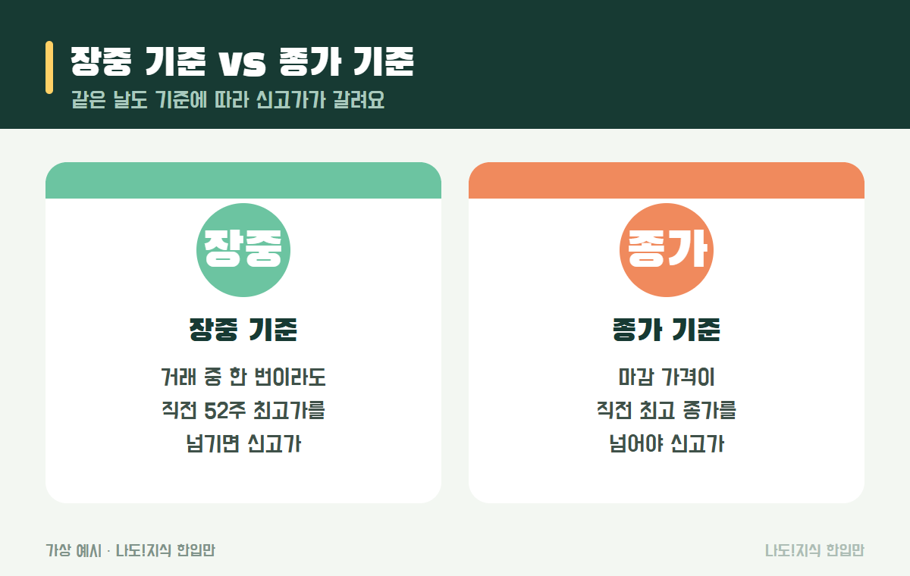
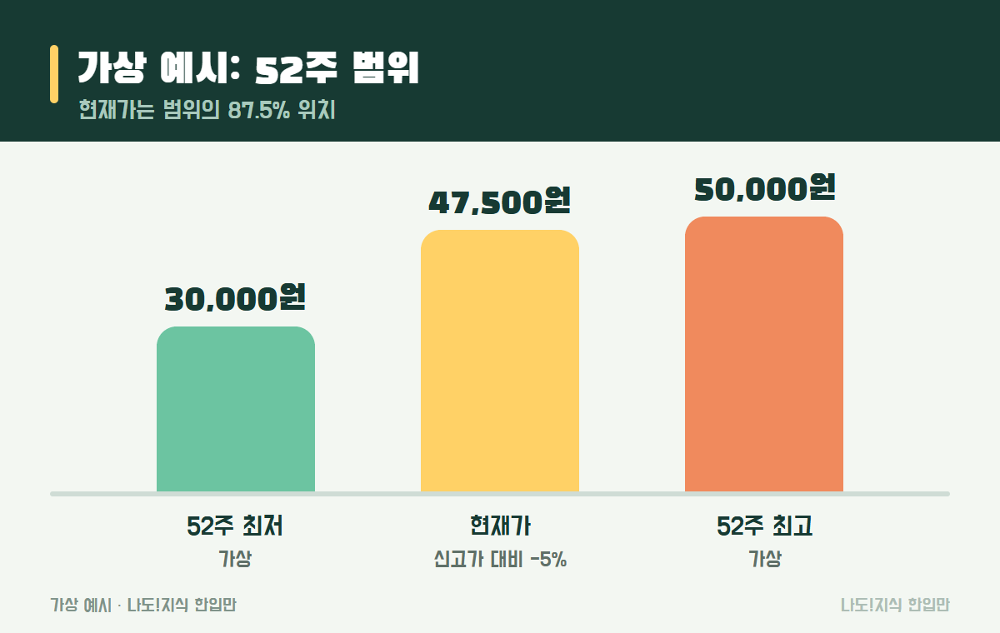
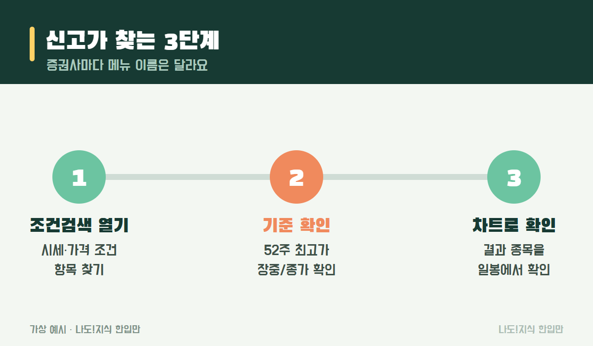

최종 검토일: 2026-11-25

"오늘 신고가 갱신!"이라는 뉴스를 보고 내 종목도 신고가인 줄 알았는데, 화면에는 아니라고 나오는 경우가 많아요. 52주 신고가는 최근 52주, 즉 약 1년 동안의 최고가를 넘어선 것인데, 어떤 가격을 기준으로 하느냐에 따라 결과가 달라지거든요.

이 글에서는 장중 기준과 종가 기준의 차이를 가상 가격으로 비교하고, 신고가 대비 거리를 직접 계산해 보고, 증권사 화면에서 찾는 순서까지 따라가 볼게요.

📌 핵심만 먼저 보기

<ul style="margin:0;padding-left:20px;line-height:1.9;">
<li>52주 신고가는 최근 52주(약 1년) 중 가장 높았던 가격을 새로 넘긴 상태예요.</li>
<li>장중 기준은 거래 중 한 번이라도 넘기면, 종가 기준은 마감 가격이 넘어야 해요.</li>
<li>현재가가 신고가에서 얼마나 떨어졌는지는 (신고가 − 현재가) ÷ 신고가로 계산해요.</li>
</ul>

목차: 준비물 · 1. 52주 신고가란 · 2. 장중과 종가 기준 · 3. 거리 계산 · 4. 화면에서 찾기 · 5. 실수 · Q&amp;A

<h2 style="color:#4b2a80;font-family:'Noto Serif KR', serif;">준비물: 무엇만 있으면 되나요?</h2>

증권사 앱이나 HTS의 차트 화면, 그리고 확인하고 싶은 종목 하나면 충분해요. 계산은 사칙연산이라 계산기가 있으면 편해요.

<ul>
  <li>일봉 차트: 최근 1년 흐름이 보이도록 기간을 넓혀 두세요.</li>
  <li>상세 시세 화면: 52주 최고가·최저가 칸이 있는 증권사가 많아요.</li>
  <li>메모할 곳: 장중 고가와 종가를 따로 적어 두면 헷갈리지 않아요.</li>
</ul>

<h2 style="color:#4b2a80;font-family:'Noto Serif KR', serif;">1. 52주 신고가가 정확히 뭔가요?</h2>

52주 신고가는 최근 52주 동안 기록한 가격 중 가장 높은 값을 새로 넘어선 상태를 말해요. 1년은 52개의 주로 나뉘기 때문에 "52주"라고 부르고, 인베스팅닷컴 같은 자료도 최근 1년 중 최고치라고 설명해요.

반대로 최근 52주 중 가장 낮은 가격을 새로 내려가면 52주 신저가라고 해요. 둘 다 차트에서 "지금 가격이 1년 중 어디쯤인가"를 알려 주는 위치 정보예요.

52주를 거래일로 바꾸면 휴장일을 뺀 약 240~250일 정도로 보는 경우가 많아요. 인베스팅닷컴 칼럼은 HTS에서 240봉 고가의 최고값으로 직접 지표를 만드는 방법도 소개해요. 정확한 일수는 증권사 화면마다 조금 다를 수 있어요.

<h2 style="color:#4b2a80;font-family:'Noto Serif KR', serif;">2. 장중 기준과 종가 기준은 뭐가 다른가요?</h2>

장중 기준은 거래되는 도중 한 번이라도 직전 52주 최고가를 넘으면 신고가로 보고, 종가 기준은 마감 가격이 넘어야 신고가로 봐요. 같은 날이라도 기준에 따라 신고가일 수도, 아닐 수도 있어요.

언론 보도에서도 두 용례가 모두 보여요. 어떤 기사는 한국거래소 자료를 인용해 장중 신고가를 경신한 종목을 따로 세고, 어떤 기사는 종가 기준으로 52주 신고가나 신저가를 기록한 종목을 집계해요.

<figure style="margin:24px 0;"><figcaption style="font-size:13px;color:#888;">가상의 가격으로 두 기준을 나란히 놓은 그림이에요.</figcaption></figure>

가상 예시로 확인해 볼게요. 직전 52주 장중 최고가가 50,000원, 그 기간 가장 높았던 종가가 49,000원이라고 가정해요.

<table style="width:100%;border-collapse:collapse;margin:16px 0;">
  <thead>
    <tr style="background:#7b4bc4;color:#fff;"><th style="border:1px solid #ddd;padding:8px;">경우</th><th style="border:1px solid #ddd;padding:8px;">오늘 장중 고가</th><th style="border:1px solid #ddd;padding:8px;">오늘 종가</th><th style="border:1px solid #ddd;padding:8px;">장중 기준</th><th style="border:1px solid #ddd;padding:8px;">종가 기준</th></tr>
  </thead>
  <tbody>
    <tr><td style="border:1px solid #ddd;padding:8px;">A</td><td style="border:1px solid #ddd;padding:8px;">50,300</td><td style="border:1px solid #ddd;padding:8px;">49,500</td><td style="border:1px solid #ddd;padding:8px;">신고가</td><td style="border:1px solid #ddd;padding:8px;">신고가</td></tr>
    <tr><td style="border:1px solid #ddd;padding:8px;">B</td><td style="border:1px solid #ddd;padding:8px;">50,300</td><td style="border:1px solid #ddd;padding:8px;">48,700</td><td style="border:1px solid #ddd;padding:8px;">신고가</td><td style="border:1px solid #ddd;padding:8px;">아님</td></tr>
    <tr><td style="border:1px solid #ddd;padding:8px;">C</td><td style="border:1px solid #ddd;padding:8px;">49,800</td><td style="border:1px solid #ddd;padding:8px;">49,500</td><td style="border:1px solid #ddd;padding:8px;">아님</td><td style="border:1px solid #ddd;padding:8px;">신고가</td></tr>
  </tbody>
</table>

B가 가장 헷갈리는 경우예요. 장중에는 50,000원을 넘겼지만 마감은 48,700원이라 종가 기준으로는 신고가가 아니에요.

C는 장중 고가가 50,000원에 못 미쳤지만 종가가 직전 최고 종가 49,000원을 넘은 경우예요. 종가끼리만 비교하면 신고가가 돼요. 이 표는 설명용 가상값이고, 실제 산정 방식은 증권사·집계 기관마다 다를 수 있어요.

💡 기사 읽을 때 한 가지

신고가 기사를 볼 때는 "장중"이라는 말이 붙었는지 먼저 살펴보는 습관이 좋아요. 같은 날 같은 종목도 기준이 다르면 다르게 집계돼요.

<h2 style="color:#4b2a80;font-family:'Noto Serif KR', serif;">3. 신고가에서 얼마나 떨어졌는지 어떻게 계산하나요?</h2>

신고가 대비 거리는 (52주 최고가 − 현재가) ÷ 52주 최고가로 계산해요. 비율로 바꾸면 종목끼리 비교하기 쉬워져요.

가상 예시로 52주 최고가가 50,000원, 52주 최저가가 30,000원, 현재가가 47,500원이라고 해 볼게요.

<ol>
  <li>신고가와 차이: 50,000 − 47,500 = 2,500원</li>
  <li>신고가 대비 거리: 2,500 ÷ 50,000 = 0.05, 즉 5%</li>
  <li>52주 범위: 50,000 − 30,000 = 20,000원</li>
  <li>범위 안 위치: (47,500 − 30,000) ÷ 20,000 = 17,500 ÷ 20,000 = 87.5%</li>
</ol>

<figure style="margin:24px 0;"><figcaption style="font-size:13px;color:#888;">가상 가격으로 52주 범위와 현재 위치를 보여 주는 막대예요.</figcaption></figure>

87.5%는 "1년 가격 범위 중 위쪽 끝에 가깝다"는 뜻이지, 더 오른다는 뜻이 아니에요. 같은 값이어도 이후 흐름은 종목과 시장 상황에 따라 달라요.

이 위치를 이동평균선과 함께 보면 흐름을 더 입체적으로 볼 수 있어요. 계산법은 <a href="https://sensitiveboss3.tistory.com/entry/moving-average-5-20-day-cross" target="_blank" rel="noopener">이동평균선 5일 20일 계산과 크로스 보는 법</a>에 정리해 두었어요.

<h2 style="color:#4b2a80;font-family:'Noto Serif KR', serif;">4. 증권사 화면에서는 어디서 찾나요?</h2>

대부분의 증권사는 종목 상세 화면에 52주 최고·최저가를 보여 주고, 조건검색으로 신고가 종목을 모아 볼 수도 있어요. 메뉴 이름은 증권사마다 다르니 "조건검색"이나 "종목검색"에서 52주 항목을 찾으면 돼요.

<figure style="margin:24px 0;"><figcaption style="font-size:13px;color:#888;">조건검색으로 찾는 흐름을 3단계로 줄인 그림이에요.</figcaption></figure>

키움증권 영웅문 도움말은 조건검색에서 시세분석, 가격조건 항목으로 들어가 52주 최고가 대비 변동률을 고르고, 변동률을 0% 이상으로 설정하는 방법을 안내해요. 신고가 조건을 따로 고르는 방법도 함께 안내하고 있어요.

<ol>
  <li>조건검색 메뉴를 열고 시세·가격 조건 항목을 찾아요.</li>
  <li>52주 최고가 관련 조건과 기준(장중 또는 종가)을 확인해요.</li>
  <li>검색 결과 종목은 차트를 열어 일봉으로 직접 확인해요.</li>
</ol>

2026년 11월 기준 도움말이므로 앱 업데이트로 화면이 바뀌었을 수 있어요. 한국거래소 정보데이터시스템(data.krx.co.kr)에서도 종목별 시세를 조회할 수 있으니, 숫자가 다르면 원자료를 한 번 더 열어 대조하는 편이 안전해요. 대조한 날짜와 기준도 함께 적어 두면 나중에 같은 질문이 생겼을 때 바로 답을 찾을 수 있어요.

⚠️ 결과 확인 습관

검색 결과에 나온 종목은 "조건에 맞는 목록"일 뿐이에요. 이 글은 어떤 종목을 사라고 권하는 글이 아니에요.

<h2 style="color:#4b2a80;font-family:'Noto Serif KR', serif;">5. 자주 하는 실수는 뭔가요?</h2>

신고가에서 생기는 실수는 대부분 기준을 확인하지 않고 숫자만 비교하는 데서 나와요.

<ol>
  <li>장중 기준 기사와 종가 기준 화면을 그대로 비교해요.</li>
  <li>신고가를 "곧 더 오른다"는 신호로 받아들여요.</li>
  <li>배당·분할 같은 사유로 가격이 조정된 종목의 과거 가격을 그대로 비교해요.</li>
  <li>거래량 없이 가격만 봐요. 신고가를 넘긴 날 거래가 평소보다 많았는지, 적었는지 함께 적어 두면 판단 재료가 하나 늘어요.</li>
  <li>신고가 하나만 보고 과열 여부는 보지 않아요. 과열 정도는 <a href="https://sensitiveboss3.tistory.com/entry/rsi-meaning-14day-calculation" target="_blank" rel="noopener">RSI 뜻과 14일 계산법</a>을 함께 봐요.</li>
</ol>

세 번째 실수는 조금 더 설명이 필요해요. 주식분할이나 배당락처럼 가격이 조정되는 일이 있으면 증권사가 과거 가격을 고쳐서 보여 주기도 하고, 그대로 두기도 해요. 그래서 같은 종목의 52주 최고가가 두 앱에서 다르게 보일 수 있어요.

두 앱의 숫자가 다르면 어느 쪽이 틀렸다고 단정하지 말고, 각각 조정 가격 기준인지 실제 거래 가격 기준인지 도움말에서 확인해 보세요. 확인한 기준을 메모해 두면 다음에 같은 종목을 볼 때 시간이 줄어요.

신고가 이후 해석은 갈려요. 상승 흐름이 이어지는 모습으로 보는 시각도 있고, 이미 많이 올라 부담이라고 보는 시각도 있어요. 어느 쪽이 맞는지는 이 글로 정할 수 없어요.

<h2 style="color:#4b2a80;font-family:'Noto Serif KR', serif;">52주 신고가 Q&amp;A 5개</h2>

  
52주 신고가는 몇 일치인가요

  
최근 52주, 즉 약 1년이에요. 거래일로는 휴장일을 뺀 약 240~250일 정도로 보는 자료가 있고, 증권사 화면마다 조금 달라요.

  
장중 신고가와 종가 신고가 중 무엇이 맞나요

  
둘 다 쓰이는 용어라 어느 쪽이 틀린 것은 아니에요. 기사나 화면에서 어떤 기준인지 확인하는 것이 중요해요.

  
52주 신고가면 역대 최고가인가요

  
아니에요. 52주 신고가는 최근 1년 기준이고, 1년 전에 더 높았다면 역대 최고가는 아닐 수 있어요. 뉴스에서 둘을 함께 쓰는 경우는 두 조건이 같이 맞았다는 뜻이에요.

  
52주 신저가는 어떻게 보나요

  
같은 방식으로 최근 52주 중 가장 낮았던 가격을 새로 내려간 상태예요. 계산은 신고가의 반대로 (현재가 − 52주 최저가) ÷ 52주 최저가로 하면 돼요.

  
신고가 종목을 사면 되나요

  
이 글은 매수·매도를 권하지 않아요. 신고가는 과거 가격 대비 현재 위치를 알려 줄 뿐 앞으로의 가격을 정하지 않아요.

✅ 한 줄 정리

<ul style="margin:0;padding-left:20px;line-height:1.9;">
<li>뜻: 최근 52주 최고가를 새로 넘은 상태예요.</li>
<li>기준: 장중은 한 번이라도, 종가는 마감 가격으로 판단해요.</li>
<li>계산: (신고가 − 현재가) ÷ 신고가로 거리를 비율로 봐요.</li>
<li>찾기: 상세 시세와 조건검색에서 52주 항목을 확인해요.</li>
<li>주의: 위치 정보일 뿐 방향을 알려 주지 않아요.</li>
</ul>

  <strong style="font-size:16px;">📚 함께 보면 좋은 글</strong>
  <ul style="margin:8px 0 0 0;padding-left:20px;line-height:1.9;"><li><a href="https://sensitiveboss3.tistory.com/entry/moving-average-5-20-day-cross" target="_blank" rel="noopener">이동평균선 5일 20일 계산과 크로스 보는 법</a></li><li><a href="https://sensitiveboss3.tistory.com/entry/bollinger-bands-calculation" target="_blank" rel="noopener">볼린저밴드 뜻과 계산법</a></li><li><a href="https://sensitiveboss3.tistory.com/entry/rsi-meaning-14day-calculation" target="_blank" rel="noopener">RSI 뜻과 14일 계산법</a></li></ul>

  참고 출처 (52주 신고가의 산정 규칙을 정한 공식 문서는 확인하지 못해 증권사 도움말과 자료를 기준으로 했어요):
  <ul style="margin:6px 0 0 0;padding-left:20px;">
    <li><a href="https://download.kiwoom.com/hero4_help_new/qa11.htm" target="_blank" rel="noopener">키움증권 영웅문 도움말: 52주 신고가 종목 검색</a></li>
    <li><a href="https://kr.investing.com/analysis/article-200443808" target="_blank" rel="noopener">인베스팅닷컴: 52주 신고점 설명</a></li>
    <li><a href="https://data.krx.co.kr" target="_blank" rel="noopener">한국거래소 정보데이터시스템</a></li>
  </ul>
  기준일: 2026년 11월 25일. 예시 가격은 계산을 보여 주기 위한 가상 예시예요.

이 글은 정보 제공을 목적으로 하며 특정 종목이나 상품의 매수·매도를 권유하지 않습니다. 투자 판단과 그 결과에 대한 책임은 투자자 본인에게 있습니다.
예시는 계산을 보여 주기 위한 가상값이며, 산정 기준은 증권사와 집계 기관마다 다를 수 있으므로 반드시 원출처에서 확인하시기 바랍니다.

