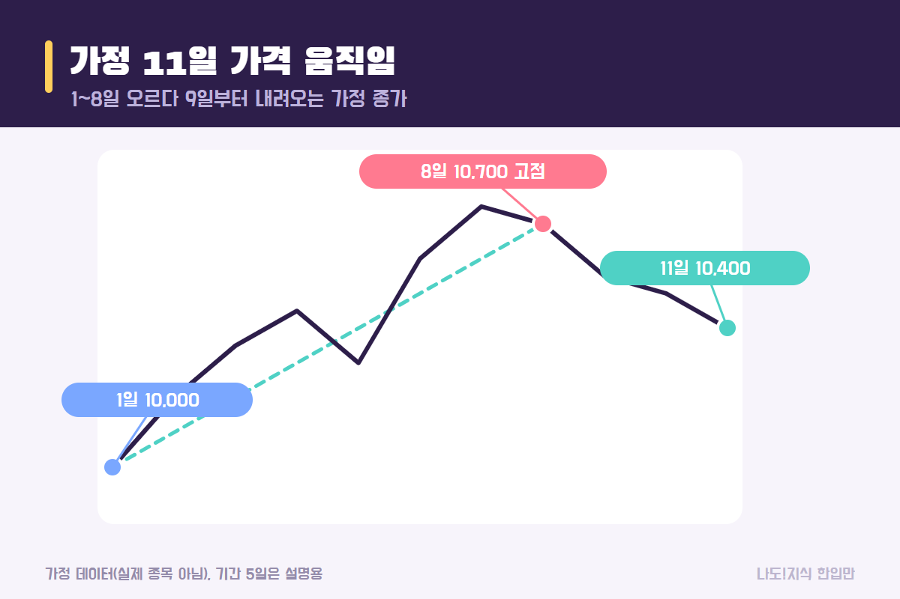
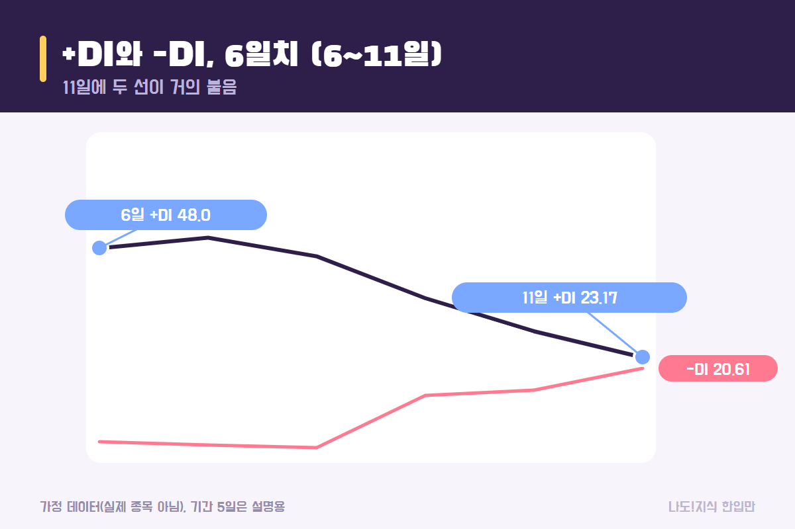
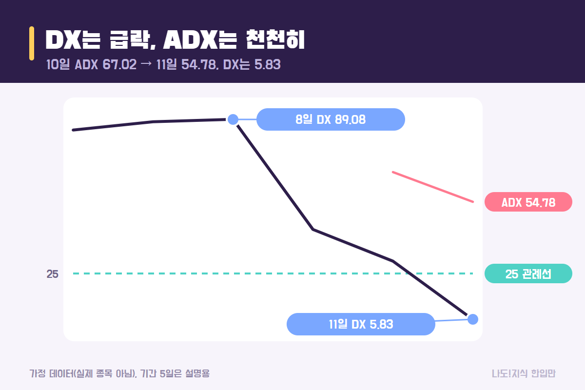

최종 검토일: 2026-11-23

ADX 지표는 추세가 어느 방향인지가 아니라 얼마나 강한지를 0에서 100 사이 숫자로 보여 주는 지표예요. Average Directional Index의 줄임말이고, 1978년 J. Welles Wilder가 만들었어요.

계산이 길어 보여서 막히는 분이 많아요. 가정 데이터 11일로 +DM·-DM에서 DX, ADX까지 한 줄씩 따라가 보면 구조가 단순하다는 걸 알 수 있어요. 가격이 꺾인 뒤에도 ADX가 높게 남는 이유와 25 기준을 읽는 법도 함께 볼게요.

  <strong style="color:#2d1e4a;font-size:18px;">📊 한눈에 보기</strong>
  <ul style="margin:10px 0 0 0;padding-left:20px;line-height:1.9;">
    <li><b>뜻:</b> 추세의 방향이 아니라 강도를 0~100으로 나타낸 값</li>
    <li><b>순서:</b> TR·+DM·-DM → 평활 → +DI·-DI → DX → ADX</li>
    <li><b>예시:</b> 11일 계산 결과 ADX 54.78 (5일 기준으로 설명)</li>
    <li><b>25 기준:</b> 20 아래는 약한 추세, 25 위는 강한 추세로 보는 관례일 뿐이에요</li>
    <li><b>한계:</b> 한 번 평균을 낸 값이라 늦게 움직여요. 방향 예측 도구가 아니에요</li>
  </ul>

  <strong style="font-size:16px;">📖 처음이라면 이것만 — 낱말 풀이</strong>
  <ul style="margin:8px 0 0 0;padding-left:20px;line-height:1.9;">
    <li><b>고가·저가·종가:</b> 하루 중 가장 높았던 가격, 가장 낮았던 가격, 장 마감 때의 마지막 가격.</li>
    <li><b>TR(True Range):</b> 하루 가격이 실제로 움직인 폭. 전날 종가와의 간격까지 포함해요.</li>
    <li><b>DM(Directional Movement):</b> 어제보다 고가가 오른 폭(+DM)과 저가가 내린 폭(-DM).</li>
    <li><b>DI(Directional Indicator):</b> DM을 TR로 나눠 퍼센트로 만든 값. +DI는 위쪽, -DI는 아래쪽 힘이에요.</li>
    <li><b>DX:</b> +DI와 -DI의 차이가 합계에서 차지하는 비율. 하루치 방향 강도예요.</li>
    <li><b>평활:</b> 들쭉날쭉한 값을 직전 값과 섞어 부드럽게 만드는 평균 방식.</li>
  </ul>

<h2 style="border-left:6px solid #2d1e4a;padding-left:12px;margin-top:36px;">목차</h2>
<ol style="line-height:1.9;">
  <li><a href="#sec-1" style="color:inherit;text-decoration:underline;text-underline-offset:3px;">ADX는 무엇인가요?</a></li>
  <li><a href="#sec-2" style="color:inherit;text-decoration:underline;text-underline-offset:3px;">ADX는 어떻게 계산하나요?</a></li>
  <li><a href="#sec-3" style="color:inherit;text-decoration:underline;text-underline-offset:3px;">가격이 꺾였는데 ADX가 높은 이유는?</a></li>
  <li><a href="#sec-4" style="color:inherit;text-decoration:underline;text-underline-offset:3px;">25 기준은 어떻게 보나요?</a></li>
  <li><a href="#sec-5" style="color:inherit;text-decoration:underline;text-underline-offset:3px;">차트에서 ADX 켜는 법 따라 하기</a></li>
  <li><a href="#sec-6" style="color:inherit;text-decoration:underline;text-underline-offset:3px;">자주 하는 실수 5가지</a></li>
  <li><a href="#sec-7" style="color:inherit;text-decoration:underline;text-underline-offset:3px;">ADX Q&amp;A 5개</a></li>
</ol>

<h2 id="sec-1" style="scroll-margin-top:72px;border-left:6px solid #2d1e4a;padding-left:12px;margin-top:36px;">ADX는 무엇인가요?</h2>

ADX는 +DI와 -DI의 간격을 바탕으로 추세의 세기를 한 줄로 만든 지표예요. 윌더가 1978년 책 <i>New Concepts in Technical Trading Systems</i>에서 소개했어요.

이 지표는 세 개의 선으로 이루어져 있어요. +DI는 위로 가려는 힘, -DI는 아래로 가려는 힘, ADX는 그 둘의 차이로 만든 강도예요.

<ul style="line-height:1.9;">
  <li>방향은 +DI와 -DI 중 어느 쪽이 위에 있는지로 봐요.</li>
  <li>강도는 ADX 한 줄로 봐요.</li>
  <li>ADX가 높다는 말은 오르든 내리든 한쪽으로 힘이 실렸다는 뜻이지, 오른다는 뜻이 아니에요.</li>
</ul>

이름에 평균(Average)이 들어간 이유는 DX를 한 번 더 평균 냈기 때문이에요. 이 평균 덕분에 선이 부드러워지지만 반응은 느려져요.

<h2 id="sec-2" style="scroll-margin-top:72px;border-left:6px solid #2d1e4a;padding-left:12px;margin-top:36px;">ADX는 어떻게 계산하나요?</h2>

ADX는 TR·+DM·-DM을 구해 평활하고, +DI·-DI와 DX를 거쳐 한 번 더 평균 내면 나와요. 단계는 다섯 개예요.

<ol style="line-height:2;">
  <li>매일 TR, +DM, -DM을 구해요.</li>
  <li>일정 기간 동안 세 값을 윌더 방식으로 평활해요.</li>
  <li>평활한 DM을 평활한 TR로 나눠 +DI와 -DI를 만들어요.</li>
  <li>DX = 100 × |+DI − -DI| ÷ (+DI + -DI)로 계산해요.</li>
  <li>DX를 평균 내어 ADX를 만들어요.</li>
</ol>

실제 기본 기간은 14일이에요. 여기서는 손으로 따라 할 수 있게 <b>설명용으로 5일</b>을 써요. 기간이 바뀌어도 순서는 똑같아요.

<figure style="margin:24px 0;"><figcaption style="font-size:13px;color:#888;">계산을 보여 주기 위한 가정 데이터예요. 실제 종목이 아니에요. 1~8일은 오르고 9일부터 꺾여요.</figcaption></figure>

먼저 TR, +DM, -DM이에요. TR은 고가−저가, |고가−전일 종가|, |저가−전일 종가| 중 가장 큰 값이에요. +DM은 오늘 고가−어제 고가, -DM은 어제 저가−오늘 저가이고, 둘 중 큰 쪽만 남기고 작은 쪽은 0으로 해요. 둘 다 음수이면 둘 다 0이에요.

<table style="width:100%;border-collapse:collapse;margin:16px 0;">
  <thead>
    <tr style="background:#2d1e4a;color:#fff;"><th style="border:1px solid #ddd;padding:8px;">날</th><th style="border:1px solid #ddd;padding:8px;">고가</th><th style="border:1px solid #ddd;padding:8px;">저가</th><th style="border:1px solid #ddd;padding:8px;">종가</th><th style="border:1px solid #ddd;padding:8px;">TR</th><th style="border:1px solid #ddd;padding:8px;">+DM</th><th style="border:1px solid #ddd;padding:8px;">-DM</th></tr>
  </thead>
  <tbody>
    <tr><td style="border:1px solid #ddd;padding:8px;">1일</td><td style="border:1px solid #ddd;padding:8px;">10,100</td><td style="border:1px solid #ddd;padding:8px;">9,900</td><td style="border:1px solid #ddd;padding:8px;">10,000</td><td style="border:1px solid #ddd;padding:8px;">기준</td><td style="border:1px solid #ddd;padding:8px;">-</td><td style="border:1px solid #ddd;padding:8px;">-</td></tr>
    <tr><td style="border:1px solid #ddd;padding:8px;">2일</td><td style="border:1px solid #ddd;padding:8px;">10,250</td><td style="border:1px solid #ddd;padding:8px;">10,000</td><td style="border:1px solid #ddd;padding:8px;">10,200</td><td style="border:1px solid #ddd;padding:8px;">250</td><td style="border:1px solid #ddd;padding:8px;">150</td><td style="border:1px solid #ddd;padding:8px;">0</td></tr>
    <tr><td style="border:1px solid #ddd;padding:8px;">3일</td><td style="border:1px solid #ddd;padding:8px;">10,400</td><td style="border:1px solid #ddd;padding:8px;">10,150</td><td style="border:1px solid #ddd;padding:8px;">10,350</td><td style="border:1px solid #ddd;padding:8px;">250</td><td style="border:1px solid #ddd;padding:8px;">150</td><td style="border:1px solid #ddd;padding:8px;">0</td></tr>
    <tr><td style="border:1px solid #ddd;padding:8px;">4일</td><td style="border:1px solid #ddd;padding:8px;">10,500</td><td style="border:1px solid #ddd;padding:8px;">10,300</td><td style="border:1px solid #ddd;padding:8px;">10,450</td><td style="border:1px solid #ddd;padding:8px;">200</td><td style="border:1px solid #ddd;padding:8px;">100</td><td style="border:1px solid #ddd;padding:8px;">0</td></tr>
    <tr><td style="border:1px solid #ddd;padding:8px;">5일</td><td style="border:1px solid #ddd;padding:8px;">10,450</td><td style="border:1px solid #ddd;padding:8px;">10,250</td><td style="border:1px solid #ddd;padding:8px;">10,300</td><td style="border:1px solid #ddd;padding:8px;">200</td><td style="border:1px solid #ddd;padding:8px;">0</td><td style="border:1px solid #ddd;padding:8px;">50</td></tr>
    <tr><td style="border:1px solid #ddd;padding:8px;">6일</td><td style="border:1px solid #ddd;padding:8px;">10,650</td><td style="border:1px solid #ddd;padding:8px;">10,350</td><td style="border:1px solid #ddd;padding:8px;">10,600</td><td style="border:1px solid #ddd;padding:8px;">350</td><td style="border:1px solid #ddd;padding:8px;">200</td><td style="border:1px solid #ddd;padding:8px;">0</td></tr>
    <tr><td style="border:1px solid #ddd;padding:8px;">7일</td><td style="border:1px solid #ddd;padding:8px;">10,800</td><td style="border:1px solid #ddd;padding:8px;">10,550</td><td style="border:1px solid #ddd;padding:8px;">10,750</td><td style="border:1px solid #ddd;padding:8px;">250</td><td style="border:1px solid #ddd;padding:8px;">150</td><td style="border:1px solid #ddd;padding:8px;">0</td></tr>
    <tr><td style="border:1px solid #ddd;padding:8px;">8일</td><td style="border:1px solid #ddd;padding:8px;">10,850</td><td style="border:1px solid #ddd;padding:8px;">10,650</td><td style="border:1px solid #ddd;padding:8px;">10,700</td><td style="border:1px solid #ddd;padding:8px;">200</td><td style="border:1px solid #ddd;padding:8px;">50</td><td style="border:1px solid #ddd;padding:8px;">0</td></tr>
    <tr><td style="border:1px solid #ddd;padding:8px;">9일</td><td style="border:1px solid #ddd;padding:8px;">10,750</td><td style="border:1px solid #ddd;padding:8px;">10,500</td><td style="border:1px solid #ddd;padding:8px;">10,550</td><td style="border:1px solid #ddd;padding:8px;">250</td><td style="border:1px solid #ddd;padding:8px;">0</td><td style="border:1px solid #ddd;padding:8px;">150</td></tr>
    <tr><td style="border:1px solid #ddd;padding:8px;">10일</td><td style="border:1px solid #ddd;padding:8px;">10,700</td><td style="border:1px solid #ddd;padding:8px;">10,450</td><td style="border:1px solid #ddd;padding:8px;">10,500</td><td style="border:1px solid #ddd;padding:8px;">250</td><td style="border:1px solid #ddd;padding:8px;">0</td><td style="border:1px solid #ddd;padding:8px;">50</td></tr>
    <tr><td style="border:1px solid #ddd;padding:8px;">11일</td><td style="border:1px solid #ddd;padding:8px;">10,600</td><td style="border:1px solid #ddd;padding:8px;">10,350</td><td style="border:1px solid #ddd;padding:8px;">10,400</td><td style="border:1px solid #ddd;padding:8px;">250</td><td style="border:1px solid #ddd;padding:8px;">0</td><td style="border:1px solid #ddd;padding:8px;">100</td></tr>
  </tbody>
</table>

  <strong>✍️ 따라 해 보기 (2일, 5일)</strong> 
  ① 1일은 비교할 어제가 없어서 계산을 2일부터 시작해요. 
  ② 2일 TR: 고−저 250, |10,250−10,000| 250, |10,000−10,000| 0 중 가장 큰 <b>250</b> 
  ③ 2일 DM: 고가 +150(10,100→10,250), 저가는 올랐으니 내린 폭 0이라 +DM <b>150</b>, -DM <b>0</b> 
  ④ 5일 DM: 고가는 10,500→10,450으로 내려 +DM 0, 저가는 10,300→10,250으로 50 내려 -DM <b>50</b>

다음은 평활이에요. 첫 값은 처음 5일치(2~6일)의 합이고, 그다음부터는 <b>직전 값 − 직전 값÷5 + 오늘 값</b>으로 이어 가요. 6일의 TR은 250+250+200+200+350 = 1,250, +DM은 150+150+100+0+200 = 600, -DM은 50이에요.

7일 TR은 1,250 − 1,250÷5 + 250 = 1,250이에요. 같은 식으로 계속 이어 가고, +DI·-DI와 DX는 이렇게 나와요.

<table style="width:100%;border-collapse:collapse;margin:16px 0;">
  <thead>
    <tr style="background:#2d1e4a;color:#fff;"><th style="border:1px solid #ddd;padding:8px;">날</th><th style="border:1px solid #ddd;padding:8px;">평활 TR</th><th style="border:1px solid #ddd;padding:8px;">평활 +DM</th><th style="border:1px solid #ddd;padding:8px;">평활 -DM</th><th style="border:1px solid #ddd;padding:8px;">+DI</th><th style="border:1px solid #ddd;padding:8px;">-DI</th><th style="border:1px solid #ddd;padding:8px;">DX</th></tr>
  </thead>
  <tbody>
    <tr><td style="border:1px solid #ddd;padding:8px;">6일</td><td style="border:1px solid #ddd;padding:8px;">1,250</td><td style="border:1px solid #ddd;padding:8px;">600</td><td style="border:1px solid #ddd;padding:8px;">50</td><td style="border:1px solid #ddd;padding:8px;">48.00</td><td style="border:1px solid #ddd;padding:8px;">4.00</td><td style="border:1px solid #ddd;padding:8px;">84.62</td></tr>
    <tr><td style="border:1px solid #ddd;padding:8px;">7일</td><td style="border:1px solid #ddd;padding:8px;">1,250</td><td style="border:1px solid #ddd;padding:8px;">630</td><td style="border:1px solid #ddd;padding:8px;">40</td><td style="border:1px solid #ddd;padding:8px;">50.40</td><td style="border:1px solid #ddd;padding:8px;">3.20</td><td style="border:1px solid #ddd;padding:8px;">88.06</td></tr>
    <tr><td style="border:1px solid #ddd;padding:8px;">8일</td><td style="border:1px solid #ddd;padding:8px;">1,200</td><td style="border:1px solid #ddd;padding:8px;">554</td><td style="border:1px solid #ddd;padding:8px;">32</td><td style="border:1px solid #ddd;padding:8px;">46.17</td><td style="border:1px solid #ddd;padding:8px;">2.67</td><td style="border:1px solid #ddd;padding:8px;">89.08</td></tr>
    <tr><td style="border:1px solid #ddd;padding:8px;">9일</td><td style="border:1px solid #ddd;padding:8px;">1,210</td><td style="border:1px solid #ddd;padding:8px;">443.2</td><td style="border:1px solid #ddd;padding:8px;">175.6</td><td style="border:1px solid #ddd;padding:8px;">36.63</td><td style="border:1px solid #ddd;padding:8px;">14.51</td><td style="border:1px solid #ddd;padding:8px;">43.24</td></tr>
    <tr><td style="border:1px solid #ddd;padding:8px;">10일</td><td style="border:1px solid #ddd;padding:8px;">1,218</td><td style="border:1px solid #ddd;padding:8px;">354.56</td><td style="border:1px solid #ddd;padding:8px;">190.48</td><td style="border:1px solid #ddd;padding:8px;">29.11</td><td style="border:1px solid #ddd;padding:8px;">15.64</td><td style="border:1px solid #ddd;padding:8px;">30.10</td></tr>
    <tr><td style="border:1px solid #ddd;padding:8px;">11일</td><td style="border:1px solid #ddd;padding:8px;">1,224.4</td><td style="border:1px solid #ddd;padding:8px;">283.65</td><td style="border:1px solid #ddd;padding:8px;">252.38</td><td style="border:1px solid #ddd;padding:8px;">23.17</td><td style="border:1px solid #ddd;padding:8px;">20.61</td><td style="border:1px solid #ddd;padding:8px;">5.83</td></tr>
  </tbody>
</table>

  <strong>✍️ 따라 해 보기 (6일 DI와 DX)</strong> 
  ① +DI = 100 × 600 ÷ 1,250 = <b>48.00</b> 
  ② -DI = 100 × 50 ÷ 1,250 = <b>4.00</b> 
  ③ DX = 100 × |48 − 4| ÷ (48 + 4) = 100 × 44 ÷ 52 = <b>84.62</b>

마지막은 ADX예요. 첫 ADX는 DX 5개(6~10일)의 평균이라서 (84.62 + 88.06 + 89.08 + 43.24 + 30.10) ÷ 5 = <b>67.02</b>이고, 10일에 나와요.

그다음부터는 <b>(직전 ADX × 4 + 오늘 DX) ÷ 5</b>예요. 11일 ADX는 (67.02 × 4 + 5.83) ÷ 5 = 54.78이에요. 14일 기준이라면 DX 14개 평균으로 시작하고, 이후 (직전 ADX × 13 + 오늘 DX) ÷ 14로 이어져요.

플랫폼마다 평활 방식의 세부가 조금씩 달라서, 같은 종목도 값이 몇 포인트 다를 수 있어요. 이 글은 윌더 방식 그대로 계산한 거예요.

<h2 id="sec-3" style="scroll-margin-top:72px;border-left:6px solid #2d1e4a;padding-left:12px;margin-top:36px;">가격이 꺾였는데 ADX가 높은 이유는?</h2>

ADX는 DX를 평균 낸 값이라 방향이 바뀐 뒤에도 한동안 높게 남아요. 이것이 후행성이에요.

앞의 11일 표를 다시 봐요. 가격은 8일 고가 10,850을 찍고 9일부터 내려갔어요.

<figure style="margin:24px 0;"><figcaption style="font-size:13px;color:#888;">+DI는 내려오고 -DI는 올라와서 간격이 좁아져요(가정).</figcaption></figure>

+DI와 -DI의 간격은 6일에 44.00이었는데 11일에는 2.56까지 좁아졌어요. 힘의 차이가 거의 없어졌다는 뜻이에요. DX도 88.06에서 5.83으로 뚝 떨어졌어요.

<figure style="margin:24px 0;"><figcaption style="font-size:13px;color:#888;">DX는 11일에 5.83까지 내려왔지만 ADX는 54.78이에요(가정). 평균 낸 값이 뒤따라와요.</figcaption></figure>

그런데 11일 ADX는 54.78이에요. 앞의 높은 DX 값들이 평균에 아직 남아 있기 때문이에요.

<ul style="line-height:1.9;">
  <li>ADX가 높아도 지금 힘이 센 상태라는 보장은 없어요.</li>
  <li>ADX가 내려가기 시작해야 추세가 약해졌다고 읽어요.</li>
  <li>그래서 ADX만으로 시점을 잡는 도구로는 약하다고 해요.</li>
</ul>

  <strong style="font-size:16px;">💡 읽는 요령</strong>
  <ul style="margin:8px 0 0 0;padding-left:20px;line-height:1.9;">
    <li>ADX 수치와 함께 +DI와 -DI의 간격도 확인해요.</li>
    <li>간격이 좁아지는데 ADX가 높다면, 평균이 뒤따라오는 중일 수 있어요.</li>
    <li>가격 평균선의 움직임도 같은 후행성이 있어요. 계산은 <a href="https://sensitiveboss3.tistory.com/entry/moving-average-5-20-day-cross" target="_blank" rel="noopener">이동평균선 5일 20일 계산과 크로스 보는 법</a>에서 볼 수 있어요.</li>
  </ul>

<h2 id="sec-4" style="scroll-margin-top:72px;border-left:6px solid #2d1e4a;padding-left:12px;margin-top:36px;">25 기준은 어떻게 보나요?</h2>

25는 많이 쓰는 관례일 뿐 고정된 법칙이 아니에요. 보통 20 아래는 약한 추세, 25 위는 강한 추세로 읽어요.

<table style="width:100%;border-collapse:collapse;margin:16px 0;">
  <thead>
    <tr style="background:#2d1e4a;color:#fff;"><th style="border:1px solid #ddd;padding:8px;">ADX 값</th><th style="border:1px solid #ddd;padding:8px;">흔한 해석</th><th style="border:1px solid #ddd;padding:8px;">주의할 점</th></tr>
  </thead>
  <tbody>
    <tr><td style="border:1px solid #ddd;padding:8px;">20 아래</td><td style="border:1px solid #ddd;padding:8px;">추세가 약하거나 횡보</td><td style="border:1px solid #ddd;padding:8px;">추세가 막 시작되는 구간일 수도 있어요</td></tr>
    <tr><td style="border:1px solid #ddd;padding:8px;">20~25</td><td style="border:1px solid #ddd;padding:8px;">애매한 구간</td><td style="border:1px solid #ddd;padding:8px;">기준선을 넘나들며 흔들려요</td></tr>
    <tr><td style="border:1px solid #ddd;padding:8px;">25 위</td><td style="border:1px solid #ddd;padding:8px;">추세가 강한 편</td><td style="border:1px solid #ddd;padding:8px;">오르는 추세인지 내리는 추세인지는 따로 봐야 해요</td></tr>
  </tbody>
</table>

종목과 기간에 따라 평소 ADX 수준이 달라서 20이나 25를 그대로 쓰면 맞지 않을 때가 있어요. 해당 종목의 과거 차트에서 ADX가 어느 구간을 오갔는지 살펴보는 게 도움이 돼요.

방향은 +DI와 -DI의 위치로 봐요. +DI가 위에 있으면 위쪽 힘이, -DI가 위에 있으면 아래쪽 힘이 상대적으로 크다는 뜻이에요. 이것도 현재 상태의 설명이지 앞으로의 예측이 아니에요.

<h2 id="sec-5" style="scroll-margin-top:72px;border-left:6px solid #2d1e4a;padding-left:12px;margin-top:36px;">차트에서 ADX 켜는 법 따라 하기</h2>

ADX는 보조지표 목록에서 ADX 또는 DMI를 검색해 추가하면 끝이에요. 대부분의 증권사 HTS·MTS와 차트 서비스에 들어 있어요.

<ol style="line-height:2;">
  <li>차트를 <b>일봉</b>으로 놓아요.</li>
  <li><b>[지표 추가]</b>에서 <b>ADX</b>, <b>DMI</b>, <b>ADX&amp;DI</b> 같은 이름을 검색해요.</li>
  <li>기간은 기본값 <b>14</b>를 그대로 써요.</li>
  <li>가격 차트 아래 칸에 ADX 선과 +DI, -DI 선이 그려져요.</li>
  <li>ADX가 오르는 중인지 내리는 중인지, +DI와 -DI 간격이 벌어지는지 좁아지는지 모양을 살펴요.</li>
</ol>

도구에 따라 ADX만 나오는 것과 세 선이 함께 나오는 것이 있어요. 세 선이 나오는 쪽이 방향까지 함께 볼 수 있어요. 가격이 평균선에서 얼마나 떨어져 있는지를 보여 주는 <a href="https://sensitiveboss3.tistory.com/entry/disparity-index-calculation" target="_blank" rel="noopener">이격도 계산</a>처럼 다른 각도의 지표를 곁들여 보는 방법도 있어요.

<h2 id="sec-6" style="scroll-margin-top:72px;border-left:6px solid #2d1e4a;padding-left:12px;margin-top:36px;">자주 하는 실수 5가지</h2>

ADX에서 생기는 실수는 대부분 강도 지표를 방향 지표로 착각해서 생겨요.

  <strong style="font-size:16px;">⚠️ 이것만 피하세요</strong>
  <ol style="margin:8px 0 0 0;padding-left:20px;line-height:1.9;">
    <li><b>ADX가 높으면 오른다고 생각하기</b> → ADX는 강도예요. 내리는 추세도 높게 나와요.</li>
    <li><b>25를 넘으면 곧바로 신호로 받아들이기</b> → 25는 관례일 뿐이고, 값이 25 근처에서 자주 오르내려요.</li>
    <li><b>ADX가 높다고 지금도 강하다고 믿기</b> → 평균이라 뒤따라와요. 11일 예시처럼 DX가 5.83인데 ADX가 54.78일 수 있어요.</li>
    <li><b>+DI와 -DI를 확인하지 않기</b> → 방향 정보는 두 선에 있어요.</li>
    <li><b>기간 14와 설명용 5일을 섞기</b> → 5일은 손으로 따라 하려고 줄인 값이에요. 차트 값과 직접 맞춰 보려면 같은 기간으로 계산해야 해요.</li>
  </ol>

<h2 id="sec-7" style="scroll-margin-top:72px;border-left:6px solid #2d1e4a;padding-left:12px;margin-top:36px;">ADX Q&amp;A 5개</h2>

  
ADX 지표 뜻이 뭔가요

  
ADX는 Average Directional Index(평균방향지수)의 줄임말이에요. 추세의 방향이 아니라 추세가 얼마나 강한지를 0~100 사이 숫자로 나타내는 지표이고, 1978년 J. Welles Wilder가 소개했어요.

  
ADX 계산 방법은요

  
TR, +DM, -DM을 구해 평활한 뒤 +DI와 -DI를 만들고, DX = 100 × |+DI − -DI| ÷ (+DI + -DI)로 계산해요. 이 DX를 기간만큼 평균 내면 첫 ADX가 되고, 이후에는 윌더 방식으로 이어져요. 가정 데이터 11일(설명용 5일)에서는 첫 ADX 67.02, 11일 ADX 54.78이 나왔어요.

  
ADX 25는 무슨 기준인가요

  
보통 20 아래는 약한 추세, 25 위는 강한 추세로 보는 관례예요. 고정된 법칙은 아니어서 종목과 기간에 따라 달리 볼 수 있고, 방향은 알려 주지 않아요.

  
ADX는 왜 가격보다 늦게 움직이나요

  
DX를 평균 낸 값이라서 방향이 바뀐 뒤에도 앞의 높은 값이 남아요. 가정 예시에서 11일 DX는 5.83까지 내려갔지만 ADX는 54.78로 높게 남았어요.

  
ADX만 보고 사고팔면 되나요

  
ADX 하나로 판단하는 방식은 권하지 않아요. 강도만 알려 주고 후행성이 있어서 시점을 잡는 도구로는 약해요. 이동평균선 같은 다른 지표와 함께 참고용으로 보는 정도가 알맞아요.

  <strong style="font-size:16px;">📚 함께 보면 좋은 글</strong>
  <ul style="margin:8px 0 0 0;padding-left:20px;line-height:1.9;"><li><a href="https://sensitiveboss3.tistory.com/entry/moving-average-5-20-day-cross" target="_blank" rel="noopener">이동평균선 5일 20일 계산과 크로스 보는 법</a></li><li><a href="https://sensitiveboss3.tistory.com/entry/rsi-meaning-14day-calculation" target="_blank" rel="noopener">RSI 뜻과 14일 값 직접 구하기</a></li><li><a href="https://sensitiveboss3.tistory.com/entry/disparity-index-calculation" target="_blank" rel="noopener">이격도 뜻과 계산법, 20일 이격도 105·95 의미와 5·20·60일 값이 다른 이유</a></li></ul>

  참고 출처 (ADX는 공시 기관이 정의한 지표가 아니라서 1차 출처가 없고, 아래는 교육·도움말 자료예요):
  <ul style="margin:6px 0 0 0;padding-left:20px;">
    <li><a href="https://chartschool.stockcharts.com/table-of-contents/technical-indicators-and-overlays/technical-indicators/average-directional-index-adx" target="_blank" rel="noopener">StockCharts ChartSchool: Average Directional Index (ADX)</a></li>
    <li><a href="https://www.fidelity.com/learning-center/trading-investing/technical-analysis/technical-indicator-guide/dmi" target="_blank" rel="noopener">Fidelity: Directional Movement Index (DMI)</a></li>
    <li><a href="https://en.wikipedia.org/wiki/Average_directional_movement_index" target="_blank" rel="noopener">Wikipedia: Average directional movement index</a></li>
    <li><a href="https://kr.tradingview.com/support/solutions/43000589099/" target="_blank" rel="noopener">TradingView 도움말: 평균방향지수(ADX)</a></li>
    <li><a href="https://ta-lib.org/functions/adx/" target="_blank" rel="noopener">TA-Lib: ADX</a></li>
  </ul>
  기준일: 2026년 11월 23일. 예시는 계산을 보여 주기 위한 가정 데이터이고, 기간은 설명용 5일이에요(실제 기본은 14일).

이 글은 정보 제공을 목적으로 하며 특정 종목이나 상품의 매수·매도를 권유하지 않습니다. 투자 판단과 그 결과에 대한 책임은 투자자 본인에게 있습니다.
예시는 계산을 보여 주기 위한 가정값이며, 지표 정의와 계산 방식은 차트 도구마다 다를 수 있으므로 반드시 이용하는 서비스의 도움말에서 확인하시기 바랍니다.

