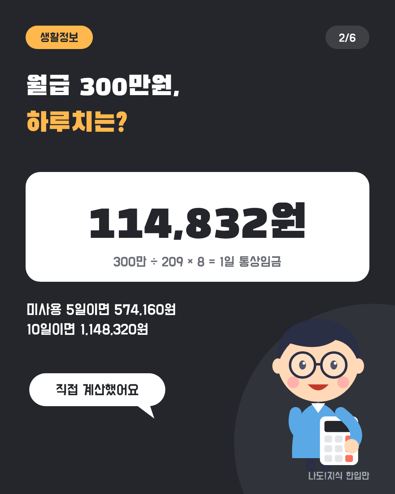
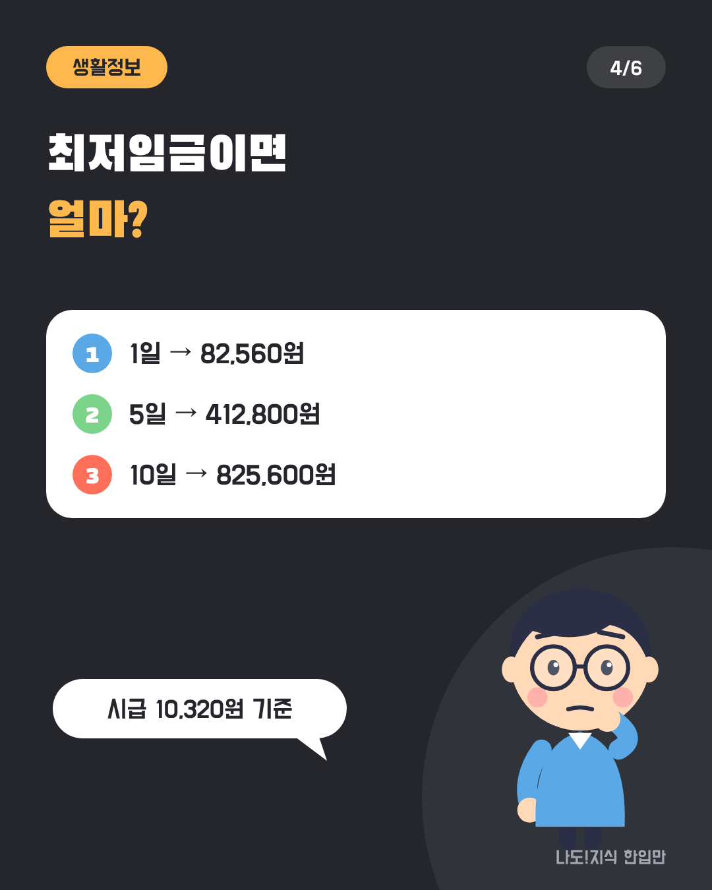
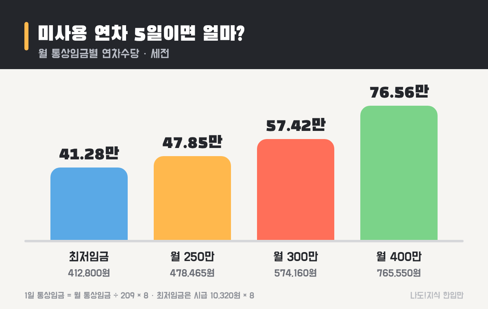
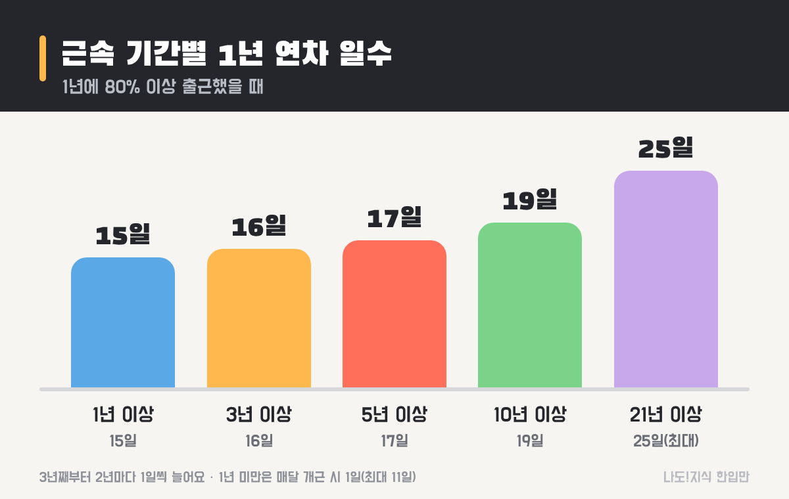
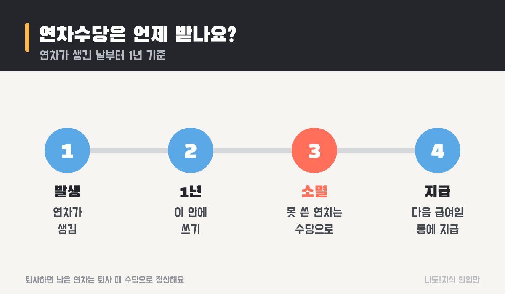

최종 검토일: 2026-11-17

연차수당은 쓰지 못한 연차휴가를 돈으로 바꿔 받는 것이에요. 계산은 1일 통상임금 × 남은 연차 일수이고, 월 통상임금이 300만원이면 하루치가 114,832원이라 5일 남았다면 574,160원이에요.

연말이 다가오면 "남은 연차를 쓸까, 수당으로 받을까"가 고민되죠. 월급별로 하루치가 얼마인지, 연차는 몇 년 일하면 며칠 생기는지, 수당을 못 받는 경우는 언제인지 숫자로 정리할게요.

  <strong style="color:#24262b;font-size:18px;">🗓 한눈에 보기</strong>
  <ul style="margin:10px 0 0 0;padding-left:20px;line-height:1.9;">
    <li><b>계산:</b> 1일 통상임금(월 통상임금 ÷ 209 × 8) × 미사용 일수</li>
    <li><b>월 300만원:</b> 하루 114,832원 · 5일 574,160원</li>
    <li><b>최저임금:</b> 하루 82,560원 · 5일 412,800원</li>
    <li><b>연차 일수:</b> 1년 미만 최대 11일, 1년 이상 15일, 최대 25일</li>
    <li><b>못 받는 경우:</b> 5인 미만, 주 15시간 미만, 회사의 사용 촉진</li>
  </ul>

옆으로 넘겨 보세요 → (카드 6장 요약)

  <strong style="font-size:16px;">📖 처음이라면 이것만 — 낱말 풀이</strong>
  <ul style="margin:8px 0 0 0;padding-left:20px;line-height:1.9;">
    <li><b>연차휴가:</b> 일한 기간에 따라 생기는, 쉬어도 월급이 나오는 휴가.</li>
    <li><b>통상임금:</b> 매달 고정으로 받는 임금(기본급과 고정 수당). 성과급·실비는 보통 빠져요.</li>
    <li><b>1일 통상임금:</b> 하루 8시간 일한 몫. 월급제는 월 통상임금 ÷ 209 × 8로 구해요.</li>
    <li><b>209시간:</b> 주 40시간에 주휴 8시간을 더해 한 달로 바꾼 시간.</li>
    <li><b>사용 촉진:</b> 회사가 법에 정한 절차로 "연차를 쓰라"고 서면으로 알리는 제도.</li>
  </ul>

<h2 style="border-left:6px solid #24262b;padding-left:12px;margin-top:36px;">목차</h2>
<ol style="line-height:1.9;">
  <li><a href="#sec-1" style="color:inherit;text-decoration:underline;text-underline-offset:3px;">연차수당은 얼마인가요?</a></li>
  <li><a href="#sec-2" style="color:inherit;text-decoration:underline;text-underline-offset:3px;">연차수당은 어떻게 계산하나요?</a></li>
  <li><a href="#sec-3" style="color:inherit;text-decoration:underline;text-underline-offset:3px;">월급별로 연차수당은 얼마인가요?</a></li>
  <li><a href="#sec-4" style="color:inherit;text-decoration:underline;text-underline-offset:3px;">연차는 1년에 며칠 생기나요?</a></li>
  <li><a href="#sec-5" style="color:inherit;text-decoration:underline;text-underline-offset:3px;">연차수당은 언제 받나요?</a></li>
  <li><a href="#sec-6" style="color:inherit;text-decoration:underline;text-underline-offset:3px;">연차수당을 못 받는 경우는?</a></li>
  <li><a href="#sec-7" style="color:inherit;text-decoration:underline;text-underline-offset:3px;">자주 하는 실수 5가지</a></li>
  <li><a href="#sec-8" style="color:inherit;text-decoration:underline;text-underline-offset:3px;">연차수당 Q&amp;A 5개</a></li>
</ol>

<h2 id="sec-1" style="scroll-margin-top:72px;border-left:6px solid #24262b;padding-left:12px;margin-top:36px;">연차수당은 얼마인가요?</h2>

연차수당은 남은 연차 하루마다 1일 통상임금만큼 받아요. 그래서 월급이 높을수록, 남은 연차가 많을수록 커져요.

<table style="width:100%;border-collapse:collapse;margin:16px 0;">
  <thead>
    <tr style="background:#24262b;color:#fff;"><th style="border:1px solid #ddd;padding:8px;">월 통상임금</th><th style="border:1px solid #ddd;padding:8px;">1일 통상임금</th><th style="border:1px solid #ddd;padding:8px;">5일 남았을 때</th><th style="border:1px solid #ddd;padding:8px;">10일 남았을 때</th></tr>
  </thead>
  <tbody>
    <tr><td style="border:1px solid #ddd;padding:8px;">최저임금(시급 10,320원)</td><td style="border:1px solid #ddd;padding:8px;">82,560원</td><td style="border:1px solid #ddd;padding:8px;">412,800원</td><td style="border:1px solid #ddd;padding:8px;">825,600원</td></tr>
    <tr><td style="border:1px solid #ddd;padding:8px;">250만원</td><td style="border:1px solid #ddd;padding:8px;">95,693원</td><td style="border:1px solid #ddd;padding:8px;">478,465원</td><td style="border:1px solid #ddd;padding:8px;">956,930원</td></tr>
    <tr><td style="border:1px solid #ddd;padding:8px;">300만원</td><td style="border:1px solid #ddd;padding:8px;">114,832원</td><td style="border:1px solid #ddd;padding:8px;"><b>574,160원</b></td><td style="border:1px solid #ddd;padding:8px;">1,148,320원</td></tr>
    <tr><td style="border:1px solid #ddd;padding:8px;">400만원</td><td style="border:1px solid #ddd;padding:8px;">153,110원</td><td style="border:1px solid #ddd;padding:8px;">765,550원</td><td style="border:1px solid #ddd;padding:8px;">1,531,100원</td></tr>
  </tbody>
</table>

연차를 쓰면 쉬는 날에도 같은 하루치를 받고, 쓰지 않으면 일한 하루치에 더해 수당으로 하루치를 더 받는 구조예요. 그래서 돈만 보면 수당이 커 보이지만, 쉬지 못한 만큼의 대가라는 점도 같이 생각해야 해요.

<h2 id="sec-2" style="scroll-margin-top:72px;border-left:6px solid #24262b;padding-left:12px;margin-top:36px;">연차수당은 어떻게 계산하나요?</h2>

연차수당은 1일 통상임금을 먼저 구하고, 남은 연차 일수를 곱하면 돼요. 시급제라면 시급 × 8이 1일 통상임금이고, 월급제라면 월 통상임금을 209시간으로 나눠 시급으로 바꾼 뒤 8을 곱해요.

  <strong>✍️ 내 경우로 따라 해 보기 (월 통상임금 300만원, 남은 연차 5일)</strong> 
  ① 시급으로 바꾸기: 3,000,000 ÷ 209 = <b>약 14,354원</b> 
  ② 1일 통상임금: 14,354원 × 8시간 = <b>114,832원</b> 
  ③ 연차수당: 114,832원 × 5일 = <b>574,160원</b> (세전) 
  ④ 10일이었다면: 114,832원 × 10일 = <b>1,148,320원</b>

여기서 '월 통상임금'은 통장에 들어오는 돈이 아니라 세금 떼기 전 고정 임금이에요. 식대·교통비 같은 실비나 성과급은 보통 빠지고, 매달 정해진 금액으로 주는 고정 수당은 들어가요. 정확한 범위는 근로계약서와 취업규칙을 기준으로 해요. 연차수당도 근로소득이라 세금과 4대보험을 뗀 금액이 들어와요.

<h2 id="sec-3" style="scroll-margin-top:72px;border-left:6px solid #24262b;padding-left:12px;margin-top:36px;">월급별로 연차수당은 얼마인가요?</h2>

미사용 연차 5일 기준으로 최저임금은 412,800원, 월 300만원은 574,160원, 400만원은 765,550원이에요.

<figure style="margin:24px 0;"><figcaption style="font-size:13px;color:#888;">1일 통상임금 = 월 통상임금 ÷ 209 × 8, 세전 금액이에요.</figcaption></figure>

월 통상임금이 100만원 많으면 하루치가 약 38,000원 커져요. 남은 연차가 많은 사람일수록 차이가 벌어지니, 연말에 남은 일수부터 확인해 보세요. 회사 그룹웨어나 급여명세서에 '잔여 연차'가 나오는 경우가 많아요.

<h2 id="sec-4" style="scroll-margin-top:72px;border-left:6px solid #24262b;padding-left:12px;margin-top:36px;">연차는 1년에 며칠 생기나요?</h2>

연차는 1년에 80% 이상 출근하면 15일이 생기고, 3년째부터 2년마다 1일씩 늘어 최대 25일까지 생겨요. 입사 1년이 안 됐을 때는 한 달을 개근할 때마다 1일씩, 최대 11일이 생겨요.

<figure style="margin:24px 0;"><figcaption style="font-size:13px;color:#888;">1년 미만은 매달 개근 시 1일(최대 11일)이에요.</figcaption></figure>

<table style="width:100%;border-collapse:collapse;margin:16px 0;">
  <thead>
    <tr style="background:#24262b;color:#fff;"><th style="border:1px solid #ddd;padding:8px;">근속 기간</th><th style="border:1px solid #ddd;padding:8px;">1년에 생기는 연차</th></tr>
  </thead>
  <tbody>
    <tr><td style="border:1px solid #ddd;padding:8px;">1년 미만</td><td style="border:1px solid #ddd;padding:8px;">1개월 개근마다 1일 (최대 11일)</td></tr>
    <tr><td style="border:1px solid #ddd;padding:8px;">1년 이상</td><td style="border:1px solid #ddd;padding:8px;">15일</td></tr>
    <tr><td style="border:1px solid #ddd;padding:8px;">3년 이상</td><td style="border:1px solid #ddd;padding:8px;">16일</td></tr>
    <tr><td style="border:1px solid #ddd;padding:8px;">5년 이상</td><td style="border:1px solid #ddd;padding:8px;">17일</td></tr>
    <tr><td style="border:1px solid #ddd;padding:8px;">10년 이상</td><td style="border:1px solid #ddd;padding:8px;">19일</td></tr>
    <tr><td style="border:1px solid #ddd;padding:8px;">21년 이상</td><td style="border:1px solid #ddd;padding:8px;"><b>25일 (최대)</b></td></tr>
  </tbody>
</table>

그래서 입사 첫해에 최대 11일, 1년을 채우면 15일이 따로 생겨요. 이 연차들은 각각 생긴 날부터 1년 안에 써야 하고, 못 쓰면 수당으로 바뀌어요.

예를 들어 2026년 3월 1일에 입사했다면 2027년 1월 말까지 매달 개근할 때마다 1일씩 최대 11일이 생기고, 2027년 3월 1일에 1년을 채우면 15일이 새로 생겨요. 같은 회사에 10년을 다녔다면 1년에 19일, 21년을 넘기면 법에서 정한 최대치인 25일이 생겨요. 회사 규정이 법보다 많이 주는 건 괜찮지만, 적게 주는 건 효력이 없어요.

<h2 id="sec-5" style="scroll-margin-top:72px;border-left:6px solid #24262b;padding-left:12px;margin-top:36px;">연차수당은 언제 받나요?</h2>

연차수당은 연차가 생긴 날부터 1년 동안 쓰지 못하고 그 연차가 없어질 때 받을 권리가 생겨요. 지급 시기는 회사마다 다르지만, 보통 연차가 소멸된 다음 급여일에 함께 줘요.

<figure style="margin:24px 0;"><figcaption style="font-size:13px;color:#888;">퇴사하면 남은 연차는 퇴사 때 수당으로 정산해요.</figcaption></figure>

<ol style="line-height:2;">
  <li><b>남은 일수 확인:</b> 그룹웨어·급여명세서·인사 담당자에게 잔여 연차를 확인해요.</li>
  <li><b>사용 계획 정하기:</b> 회사에서 사용 촉진 안내가 왔다면 기한 안에 쓸 날짜를 정해 알려요.</li>
  <li><b>소멸 뒤 급여 확인:</b> 연차가 없어진 뒤 급여명세서에 연차수당이 들어왔는지 봐요.</li>
  <li><b>퇴사 시 정산:</b> 퇴사하면 남은 연차를 1일 통상임금으로 계산해 함께 받아요.</li>
  <li><b>청구 기한:</b> 못 받은 연차수당은 3년이 지나면 청구할 수 없어요.</li>
</ol>

퇴사할 때 받는 미사용 연차수당은 퇴직금 계산의 평균임금에는 들어가지 않아요. 퇴직 전에 이미 확정된 연차수당만 3/12만큼 들어가요. 퇴사 뒤 생활비가 걱정이라면 <a href="https://sensitiveboss3.tistory.com/entry/unemployment-benefit-2026-daily-amount" target="_blank" rel="noopener">실업급여 하루 얼마</a> 글도 함께 확인해 보세요.

<h2 id="sec-6" style="scroll-margin-top:72px;border-left:6px solid #24262b;padding-left:12px;margin-top:36px;">연차수당을 못 받는 경우는?</h2>

5인 미만 사업장, 주 15시간 미만 근로자, 회사가 사용 촉진을 한 경우에는 연차수당을 받지 못할 수 있어요.

<table style="width:100%;border-collapse:collapse;margin:16px 0;">
  <thead>
    <tr style="background:#24262b;color:#fff;"><th style="border:1px solid #ddd;padding:8px;">상황</th><th style="border:1px solid #ddd;padding:8px;">연차수당</th></tr>
  </thead>
  <tbody>
    <tr><td style="border:1px solid #ddd;padding:8px;">상시 5인 이상 사업장, 주 40시간</td><td style="border:1px solid #ddd;padding:8px;">받음</td></tr>
    <tr><td style="border:1px solid #ddd;padding:8px;">상시 5인 미만 사업장</td><td style="border:1px solid #ddd;padding:8px;">연차휴가 적용 안 됨</td></tr>
    <tr><td style="border:1px solid #ddd;padding:8px;">주 15시간 미만 근로자</td><td style="border:1px solid #ddd;padding:8px;">연차휴가 적용 안 됨</td></tr>
    <tr><td style="border:1px solid #ddd;padding:8px;">회사가 법정 절차로 사용 촉진했는데 안 씀</td><td style="border:1px solid #ddd;padding:8px;">못 받을 수 있음</td></tr>
    <tr><td style="border:1px solid #ddd;padding:8px;">퇴사하면서 남은 연차</td><td style="border:1px solid #ddd;padding:8px;">받음 (퇴사 때 정산)</td></tr>
  </tbody>
</table>

사용 촉진은 회사가 연차 만료 전에 남은 일수를 알리고 사용 시기를 정하라고 서면으로 요구하는 등 법에 정한 절차를 밟아야 인정돼요. 말로만 "연차 쓰세요"라고 한 정도라면 해당하지 않을 수 있어요. 애매하면 고용노동부 고객상담센터 <b>1350</b>에 물어보면 돼요.

<h2 id="sec-7" style="scroll-margin-top:72px;border-left:6px solid #24262b;padding-left:12px;margin-top:36px;">자주 하는 실수 5가지</h2>

연차수당을 놓치는 경우는 대부분 계산 기준을 잘못 잡거나 기한을 넘겨서 생겨요.

  <strong style="font-size:16px;">⚠️ 이것만 피하세요</strong>
  <ol style="margin:8px 0 0 0;padding-left:20px;line-height:1.9;">
    <li><b>세후 월급으로 계산하기</b> → 기준은 세금 떼기 전 통상임금이에요.</li>
    <li><b>월급 ÷ 30일로 하루치 구하기</b> → 월급제는 ÷ 209 × 8이에요. 300만원이면 10만원이 아니라 114,832원이에요.</li>
    <li><b>입사 첫해 연차를 잊기</b> → 1년 미만에도 매달 개근하면 1일씩, 최대 11일이 생겨요.</li>
    <li><b>사용 촉진 안내를 무시하기</b> → 법정 절차를 거친 촉진이면 수당을 못 받을 수 있어요.</li>
    <li><b>퇴사하고 잊어버리기</b> → 남은 연차는 퇴사 때 정산 대상이에요. 3년 안에 청구하세요.</li>
  </ol>

연말에는 연차 정리와 함께 연말정산도 챙길 때예요. 남은 기간 카드 사용을 어떻게 나누면 좋은지는 <a href="https://sensitiveboss3.tistory.com/entry/year-end-tax-preview-card-deduction-2026" target="_blank" rel="noopener">연말정산 미리보기</a> 글에서 볼 수 있어요.

<h2 id="sec-8" style="scroll-margin-top:72px;border-left:6px solid #24262b;padding-left:12px;margin-top:36px;">연차수당 Q&amp;A 5개</h2>

  
연차수당 계산 방법은요

  
연차수당 = 1일 통상임금 × 미사용 연차 일수예요. 월급제라면 1일 통상임금은 월 통상임금 ÷ 209 × 8로 구해요. 월 300만원이면 114,832원이고, 5일 남았다면 574,160원이에요.

  
최저임금이면 연차수당은 하루 얼마인가요

  
2026년 최저시급 10,320원 × 8시간 = 82,560원이에요. 미사용 연차가 5일이면 412,800원, 10일이면 825,600원이에요.

  
연차는 1년에 며칠 생기나요

  
1년 동안 80% 이상 출근하면 15일이 생겨요. 입사 1년 미만은 한 달 개근할 때마다 1일씩 최대 11일이고, 3년째부터 2년마다 1일씩 늘어 최대 25일까지 생겨요.

  
연차수당은 언제 받나요

  
연차가 생긴 날부터 1년 안에 쓰지 못하면 그 연차는 없어지고 수당을 받을 권리가 생겨요. 퇴사하면 남은 연차를 퇴사 때 수당으로 정산해요. 청구할 수 있는 기간은 3년이에요.

  
연차수당을 못 받는 경우도 있나요

  
5인 미만 사업장과 주 15시간 미만 근로자는 연차휴가 자체가 적용되지 않아요. 또 회사가 법에 정한 절차로 연차 사용을 촉진했는데도 쓰지 않았다면 수당을 받지 못할 수 있어요.

  <strong style="font-size:16px;">📚 함께 보면 좋은 글</strong>
  <ul style="margin:8px 0 0 0;padding-left:20px;line-height:1.9;"><li><a href="https://sensitiveboss3.tistory.com/entry/unemployment-benefit-2026-daily-amount" target="_blank" rel="noopener">실업급여 하루 얼마? 2026 계산법</a></li><li><a href="https://sensitiveboss3.tistory.com/entry/year-end-tax-preview-card-deduction-2026" target="_blank" rel="noopener">연말정산 미리보기 12월 18일까지</a></li><li><a href="https://sensitiveboss3.tistory.com/entry/eitc-late-application-2026" target="_blank" rel="noopener">근로장려금 기한 후 신청 12월 1일까지</a></li></ul>

  참고 출처:
  <ul style="margin:6px 0 0 0;padding-left:20px;">
    <li><a href="https://shiftee.io/ko/blog/article/how-to-calculate-unused-leaves" target="_blank" rel="noopener">시프티: 미사용 연차수당 계산 방법</a></li>
    <li><a href="https://www.bizforms.co.kr/guide365/176" target="_blank" rel="noopener">비즈폼: 연차수당 계산법, 퇴사 전 미사용 연차</a></li>
    <li><a href="https://wikidocs.net/blog/@mythos/21223/" target="_blank" rel="noopener">연차수당 계산 방법과 연차휴가 발생 기준(2026)</a></li>
    <li><a href="https://www.law.go.kr/법령/근로기준법" target="_blank" rel="noopener">국가법령정보센터: 근로기준법(연차 유급휴가·사용 촉진)</a></li>
  </ul>
  기준일: 2026년 11월 17일. 금액은 세전 단순 계산이에요.

정보 제공을 목적으로 쓴 글이에요. 통상임금의 범위와 연차 발생은 근로계약·취업규칙·근무 실태에 따라 달라질 수 있고, 고용노동부(1350) 상담 결과가 기준이에요.

