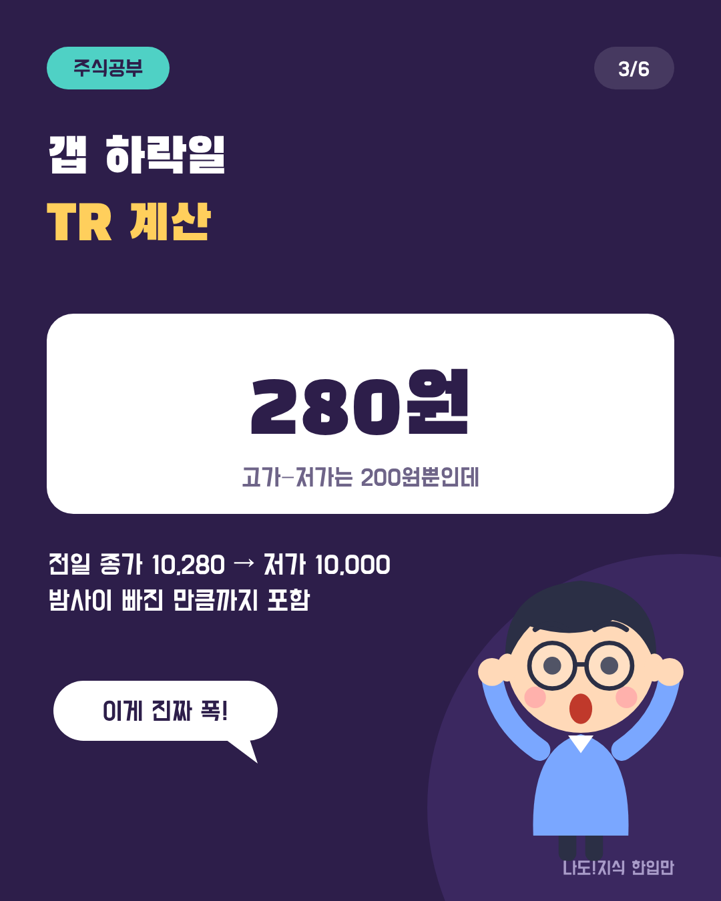
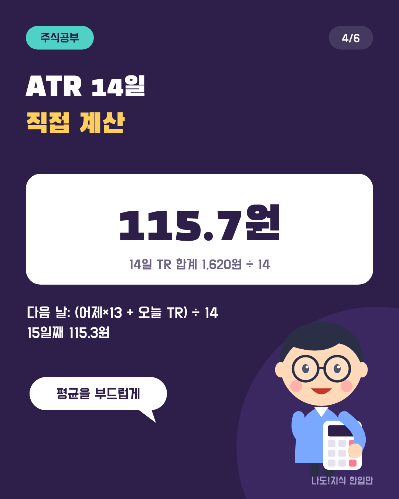
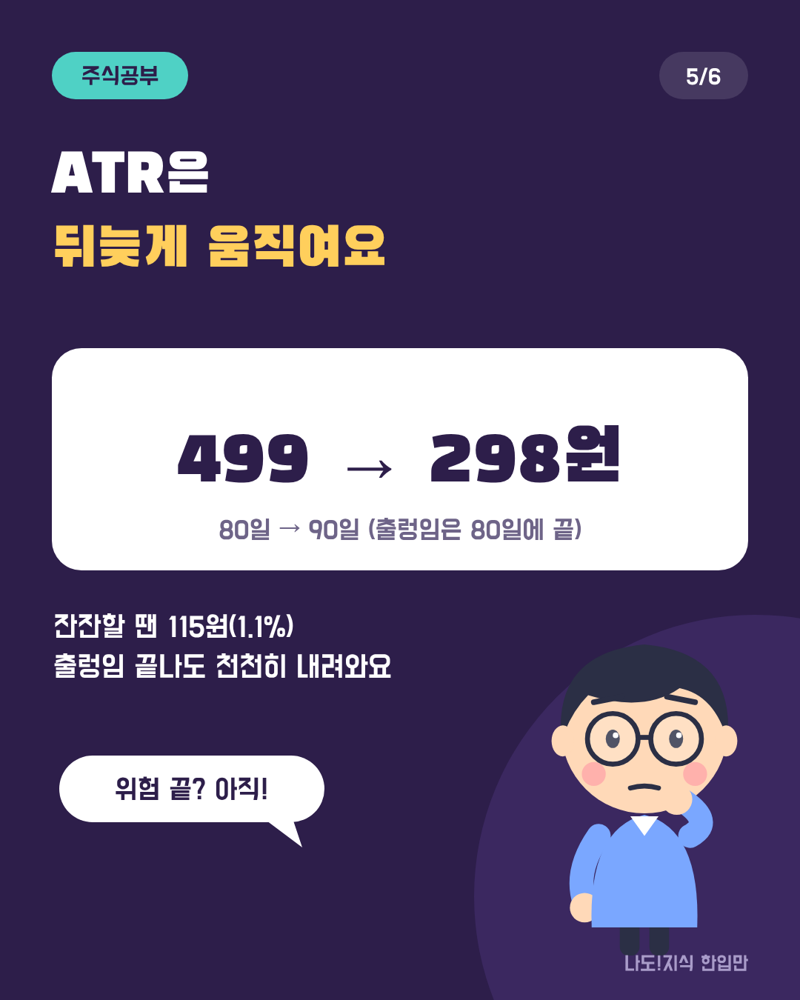
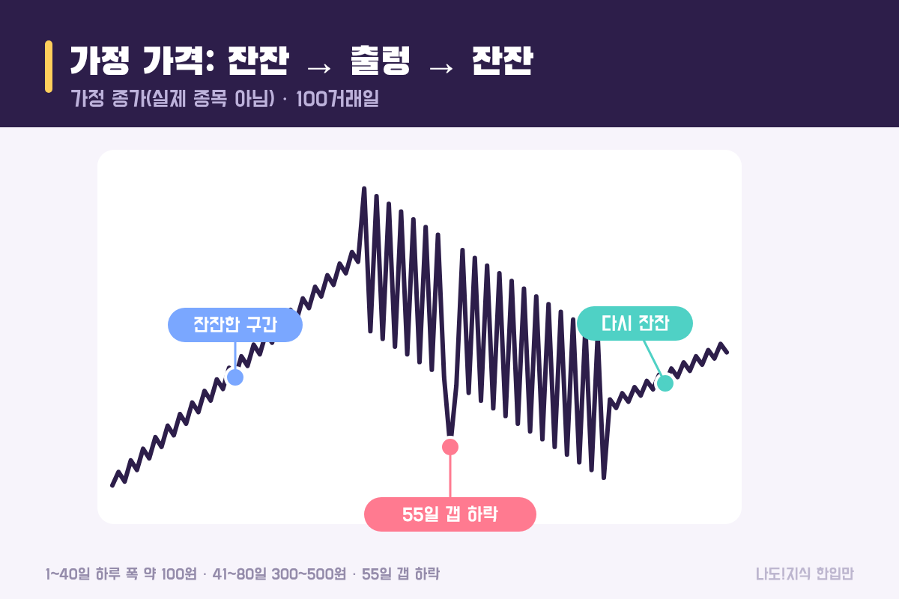
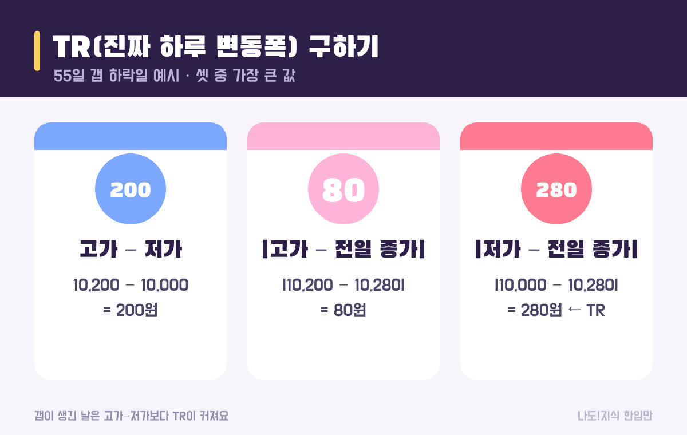
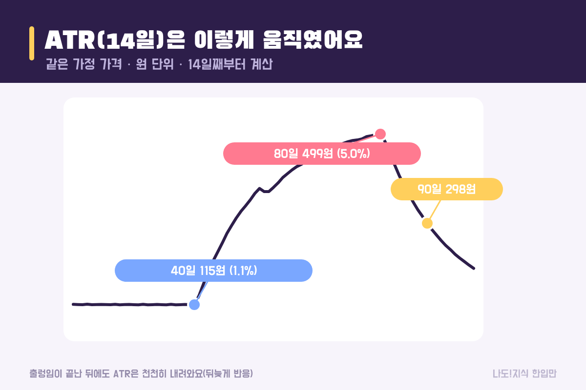

최종 검토일: 2026-11-11

ATR(Average True Range, 평균 진폭)은 <mark>주가가 하루에 평균 얼마나 크게 움직이는지를 원 단위로 보여 주는 지표</mark>예요. 하루의 진짜 변동폭(TR)을 구한 뒤 보통 <mark>14일 동안 평균</mark>을 내서 계산해요.

이름은 어려워 보이지만 생각은 단순해요. "이 종목은 하루에 보통 이 정도는 오르내린다"를 숫자 하나로 알려 주는 거예요. 방향(오를지 내릴지)은 알려 주지 않고, <b>얼마나 출렁이는지</b>만 알려 줘요. 가정 가격으로 TR부터 ATR까지 직접 계산해 볼게요.

  <strong style="color:#2d1e4a;font-size:18px;">📏 한 줄 정리</strong>
  <ul style="margin:10px 0 0 0;padding-left:20px;line-height:1.9;">
    <li><b>TR:</b> ① 고가 − 저가 ② |고가 − 전일 종가| ③ |저가 − 전일 종가| 중 <b>가장 큰 값</b></li>
    <li><b>ATR(14):</b> TR의 14일 평균. 다음 날부터는 (어제 ATR × 13 + 오늘 TR) ÷ 14</li>
    <li><b>ATR%:</b> ATR ÷ 주가 × 100. 가격이 다른 종목끼리 비교할 때 써요.</li>
  </ul>

옆으로 넘겨 보세요 → (카드 6장 요약)

  <strong style="font-size:16px;">📖 처음이라면 이것만 — 낱말 풀이</strong>
  <ul style="margin:8px 0 0 0;padding-left:20px;line-height:1.9;">
    <li><b>변동성:</b> 가격이 얼마나 크게 오르내리는지. 클수록 하루에 많이 움직여요.</li>
    <li><b>고가·저가·종가:</b> 그날 가장 높았던 값, 가장 낮았던 값, 장이 끝날 때의 값</li>
    <li><b>갭(gap):</b> 오늘 가격이 어제 종가와 겹치지 않고 위나 아래로 건너뛴 것</li>
    <li><b>TR(True Range):</b> 갭까지 포함한 '진짜' 하루 변동폭</li>
    <li><b>평활(스무딩):</b> 하루하루 튀는 값을 평균으로 부드럽게 만드는 것. ATR은 와일더 방식으로 평활해요.</li>
  </ul>

<h2 style="border-left:6px solid #2d1e4a;padding-left:12px;margin-top:36px;">목차</h2>
<ol style="line-height:1.9;">
  <li><a href="#sec-1" style="color:inherit;text-decoration:underline;text-underline-offset:3px;">ATR이란 무엇인가요?</a></li>
  <li><a href="#sec-2" style="color:inherit;text-decoration:underline;text-underline-offset:3px;">TR은 어떻게 구하나요? 갭 하락일로 계산</a></li>
  <li><a href="#sec-3" style="color:inherit;text-decoration:underline;text-underline-offset:3px;">ATR 14일은 어떻게 계산하나요?</a></li>
  <li><a href="#sec-4" style="color:inherit;text-decoration:underline;text-underline-offset:3px;">가정 차트로 본 ATR의 변화</a></li>
  <li><a href="#sec-5" style="color:inherit;text-decoration:underline;text-underline-offset:3px;">내 종목에 쓰면? ATR%로 비교하기</a></li>
  <li><a href="#sec-6" style="color:inherit;text-decoration:underline;text-underline-offset:3px;">HTS에서 ATR 켜는 법 따라 하기</a></li>
  <li><a href="#sec-7" style="color:inherit;text-decoration:underline;text-underline-offset:3px;">자주 하는 오해 5가지와 한계</a></li>
  <li><a href="#sec-8" style="color:inherit;text-decoration:underline;text-underline-offset:3px;">ATR Q&amp;A 5개</a></li>
</ol>

<h2 id="sec-1" style="scroll-margin-top:72px;border-left:6px solid #2d1e4a;padding-left:12px;margin-top:36px;">ATR이란 무엇인가요?</h2>

ATR은 <mark>최근 일정 기간(보통 14일) 동안 하루 변동폭의 평균</mark>이에요. 1970년대 웰스 와일더가 만든 지표로, RSI를 만든 사람과 같은 사람이에요.

<figure style="margin:24px 0;"><figcaption style="font-size:13px;color:#888;">실제 종목이 아닌 가정 가격이에요. 가운데 구간에서 하루 폭이 서너 배로 커져요.</figcaption></figure>

예를 들어 ATR이 300원이면 "요즘 이 종목은 하루에 보통 300원쯤 오르내린다"는 뜻이에요. 위로 300원인지 아래로 300원인지는 알려 주지 않아요. 그래서 ATR은 <b>매수·매도 신호가 아니라 '출렁임의 크기'를 재는 자</b>예요.

같은 '변동성' 지표인 <a href="https://sensitiveboss3.tistory.com/entry/bollinger-bands-calculation" target="_blank" rel="noopener">볼린저밴드</a>는 종가의 흩어짐(표준편차)을 쓰고, ATR은 고가·저가·전일 종가까지 쓴다는 점이 달라요.

<h2 id="sec-2" style="scroll-margin-top:72px;border-left:6px solid #2d1e4a;padding-left:12px;margin-top:36px;">TR은 어떻게 구하나요? 갭 하락일로 계산</h2>

TR은 <mark>세 가지 값 중 가장 큰 값</mark>이에요. 보통은 '고가 − 저가'가 가장 크지만, 갭이 생긴 날은 전일 종가와의 차이가 더 커질 수 있어요.

<figure style="margin:24px 0;"><figcaption style="font-size:13px;color:#888;">전날 종가 10,280원, 오늘 고가 10,200원·저가 10,000원.</figcaption></figure>

<table style="width:100%;border-collapse:collapse;margin:16px 0;">
  <thead>
    <tr style="background:#2d1e4a;color:#fff;"><th style="border:1px solid #ddd;padding:8px;">계산</th><th style="border:1px solid #ddd;padding:8px;">55일(갭 하락일)</th><th style="border:1px solid #ddd;padding:8px;">값</th></tr>
  </thead>
  <tbody>
    <tr><td style="border:1px solid #ddd;padding:8px;">① 고가 − 저가</td><td style="border:1px solid #ddd;padding:8px;">10,200 − 10,000</td><td style="border:1px solid #ddd;padding:8px;">200원</td></tr>
    <tr><td style="border:1px solid #ddd;padding:8px;">② |고가 − 전일 종가|</td><td style="border:1px solid #ddd;padding:8px;">|10,200 − 10,280|</td><td style="border:1px solid #ddd;padding:8px;">80원</td></tr>
    <tr><td style="border:1px solid #ddd;padding:8px;">③ |저가 − 전일 종가|</td><td style="border:1px solid #ddd;padding:8px;">|10,000 − 10,280|</td><td style="border:1px solid #ddd;padding:8px;"><mark>280원 ← TR</mark></td></tr>
  </tbody>
</table>

왜 이렇게 할까요? 이날 하루만 보면 10,200원~10,000원으로 200원만 움직인 것 같지만, 어제 10,280원에 끝난 걸 생각하면 실제로는 280원이 빠진 셈이에요. TR은 이렇게 <b>밤사이 건너뛴 만큼까지 포함</b>해서 진짜 변동폭을 재요.

<h2 id="sec-3" style="scroll-margin-top:72px;border-left:6px solid #2d1e4a;padding-left:12px;margin-top:36px;">ATR 14일은 어떻게 계산하나요?</h2>

첫 ATR은 <mark>처음 14일 TR의 단순 평균</mark>이고, 그다음 날부터는 <mark>(어제 ATR × 13 + 오늘 TR) ÷ 14</mark>로 조금씩 갱신해요.

<ol style="line-height:2;">
  <li><b>매일 TR 구하기:</b> 가정 차트 1~14일의 TR은 100~130원 사이였어요.</li>
  <li><b>첫 ATR(14일째):</b> 1~14일 TR 합계 1,620원 ÷ 14 = <b>약 115.7원</b></li>
  <li><b>15일째 갱신:</b> 15일 TR이 110원이면 (115.7 × 13 + 110) ÷ 14 = <b>약 115.3원</b></li>
  <li>이후 매일 같은 식으로 갱신해요.</li>
</ol>

갱신식에서 오늘 TR은 1/14만큼만 반영돼요. 그래서 하루 크게 출렁여도 ATR이 갑자기 뛰지 않고, 반대로 출렁임이 끝나도 천천히 내려와요. RSI의 평균 상승·하락폭을 구할 때도 같은 와일더 방식을 써요(<a href="https://sensitiveboss3.tistory.com/entry/rsi-meaning-14day-calculation" target="_blank" rel="noopener">RSI 14일 값 직접 구하기</a> 참고).

<h2 id="sec-4" style="scroll-margin-top:72px;border-left:6px solid #2d1e4a;padding-left:12px;margin-top:36px;">가정 차트로 본 ATR의 변화</h2>

가정 차트에서 ATR은 <mark>잔잔할 때 약 115원, 크게 출렁일 때 최고 499원</mark>까지 올라갔다가, 출렁임이 끝난 뒤 천천히 내려왔어요.

<figure style="margin:24px 0;"><figcaption style="font-size:13px;color:#888;">81일부터 하루 폭은 다시 100원 안팎인데, ATR은 90일에도 298원이에요.</figcaption></figure>

<table style="width:100%;border-collapse:collapse;margin:16px 0;">
  <thead>
    <tr style="background:#2d1e4a;color:#fff;"><th style="border:1px solid #ddd;padding:8px;">날짜</th><th style="border:1px solid #ddd;padding:8px;">종가</th><th style="border:1px solid #ddd;padding:8px;">ATR(14)</th><th style="border:1px solid #ddd;padding:8px;">ATR%</th></tr>
  </thead>
  <tbody>
    <tr><td style="border:1px solid #ddd;padding:8px;">40일(잔잔)</td><td style="border:1px solid #ddd;padding:8px;">10,580원</td><td style="border:1px solid #ddd;padding:8px;">115원</td><td style="border:1px solid #ddd;padding:8px;"><mark>1.1%</mark></td></tr>
    <tr><td style="border:1px solid #ddd;padding:8px;">60일(출렁)</td><td style="border:1px solid #ddd;padding:8px;">10,220원</td><td style="border:1px solid #ddd;padding:8px;">410원</td><td style="border:1px solid #ddd;padding:8px;">4.0%</td></tr>
    <tr><td style="border:1px solid #ddd;padding:8px;">80일(출렁 끝)</td><td style="border:1px solid #ddd;padding:8px;">10,020원</td><td style="border:1px solid #ddd;padding:8px;">499원</td><td style="border:1px solid #ddd;padding:8px;"><mark>5.0%</mark></td></tr>
    <tr><td style="border:1px solid #ddd;padding:8px;">90일(다시 잔잔)</td><td style="border:1px solid #ddd;padding:8px;">10,265원</td><td style="border:1px solid #ddd;padding:8px;">298원</td><td style="border:1px solid #ddd;padding:8px;">2.9%</td></tr>
    <tr><td style="border:1px solid #ddd;padding:8px;">100일</td><td style="border:1px solid #ddd;padding:8px;">10,345원</td><td style="border:1px solid #ddd;padding:8px;">197원</td><td style="border:1px solid #ddd;padding:8px;">1.9%</td></tr>
  </tbody>
</table>

두 가지가 보여요. 첫째, 가격이 크게 오르든 내리든 출렁이면 ATR은 올라가요(가운데 구간은 전체적으로 내리는 중이었어요). 둘째, ATR은 <b>뒤늦게 반응</b>해요. 출렁임은 80일에 끝났지만 ATR이 원래 수준으로 돌아오는 데는 몇 주가 걸려요.

<h2 id="sec-5" style="scroll-margin-top:72px;border-left:6px solid #2d1e4a;padding-left:12px;margin-top:36px;">내 종목에 쓰면? ATR%로 비교하기</h2>

ATR은 원 단위라서 <mark>주가가 다른 종목끼리는 ATR%(ATR ÷ 주가)로 바꿔서 비교</mark>해야 해요. 상황별로 계산해 볼게요.

<table style="width:100%;border-collapse:collapse;margin:16px 0;">
  <thead>
    <tr style="background:#2d1e4a;color:#fff;"><th style="border:1px solid #ddd;padding:8px;">이런 경우</th><th style="border:1px solid #ddd;padding:8px;">계산</th><th style="border:1px solid #ddd;padding:8px;">읽는 법</th></tr>
  </thead>
  <tbody>
    <tr><td style="border:1px solid #ddd;padding:8px;">주가 1만원, ATR 300원 vs 주가 10만원, ATR 2,000원</td><td style="border:1px solid #ddd;padding:8px;">3.0% vs 2.0%</td><td style="border:1px solid #ddd;padding:8px;">원 단위로는 두 번째가 크지만, 비율로는 <b>첫 번째가 더 출렁여요</b></td></tr>
    <tr><td style="border:1px solid #ddd;padding:8px;">각각 100만원어치 들고 있다면</td><td style="border:1px solid #ddd;padding:8px;">100만 × 3% vs 100만 × 2%</td><td style="border:1px solid #ddd;padding:8px;">하루 평균 <b>약 3만원 vs 2만원</b>씩 오르내리는 셈</td></tr>
    <tr><td style="border:1px solid #ddd;padding:8px;">같은 종목, 지난달 ATR 1.1% → 이번 달 5.0%</td><td style="border:1px solid #ddd;padding:8px;">약 4.5배</td><td style="border:1px solid #ddd;padding:8px;">요즘 평소보다 훨씬 크게 출렁이는 중</td></tr>
  </tbody>
</table>

이렇게 보면 "이 정도 오르내림을 내가 견딜 수 있나?"를 미리 가늠하는 데 도움이 돼요. 다만 ATR은 과거 평균일 뿐이라, 내일도 그만큼 움직인다는 보장은 없어요.

<h2 id="sec-6" style="scroll-margin-top:72px;border-left:6px solid #2d1e4a;padding-left:12px;margin-top:36px;">HTS에서 ATR 켜는 법 따라 하기</h2>

대부분의 HTS·MTS(증권사 앱)에서 ATR은 기본 보조지표로 들어 있어요. 증권사마다 메뉴 이름이 조금 다르니 비슷한 이름을 찾으면 돼요.

<ol style="line-height:2;">
  <li>종목 차트 화면을 열어요(일봉 기준).</li>
  <li><b>[지표]</b> 또는 <b>[보조지표 추가]</b> 버튼을 눌러요.</li>
  <li>검색창에 <b>ATR</b>을 입력해요(이름이 'Average True Range'나 '평균진폭'으로 나오기도 해요).</li>
  <li>기간(주기)을 <b>14</b>로 두고 확인을 눌러요. 다른 기간과 비교하고 싶으면 숫자만 바꾸면 돼요.</li>
  <li>차트 아래에 선이 하나 생기면 끝이에요. 값에 주가를 나눠 ATR%로 바꿔 보는 습관을 들이면 좋아요.</li>
</ol>

<b>기간은 몇 일로 할까요?</b> 기본값 14일이 가장 많이 쓰여요. 기간을 짧게(예: 7일) 하면 오늘 TR이 1/7씩 반영돼서 빨리 반응하지만 선이 들쭉날쭉해지고, 길게(예: 20일) 하면 1/20씩만 반영돼서 부드럽지만 더 늦게 움직여요. 처음에는 14일로 두고, 같은 종목의 지난 몇 달 값과 비교하는 데부터 써 보는 걸 추천해요.

<h2 id="sec-7" style="scroll-margin-top:72px;border-left:6px solid #2d1e4a;padding-left:12px;margin-top:36px;">자주 하는 오해 5가지와 한계</h2>

ATR은 계산이 단순한 만큼 <mark>"방향을 알려 준다"는 오해</mark>가 가장 흔해요. 아래 다섯 가지만 기억하면 잘못 읽을 일이 줄어요.

  <strong style="font-size:16px;">⚠️ 이렇게 읽으면 안 돼요</strong>
  <ol style="margin:8px 0 0 0;padding-left:20px;line-height:1.9;">
    <li><b>"ATR이 오르면 주가가 오른다"</b> → 아니에요. 크게 내려도 ATR은 올라요. 방향과 무관해요.</li>
    <li><b>"ATR 300원이면 내일 300원 움직인다"</b> → 과거 14일 평균일 뿐, 내일 값은 아무도 몰라요.</li>
    <li><b>원 단위 ATR로 종목 비교하기</b> → 주가가 다르면 % 로 바꿔야 공평해요.</li>
    <li><b>ATR이 내려왔으니 위험이 끝났다고 보기</b> → ATR은 뒤늦게 움직여요. 가정 차트도 출렁임이 끝난 뒤 한참 높았어요.</li>
    <li><b>갭을 빼고 고가−저가로만 계산하기</b> → 갭이 잦은 종목은 변동성이 작게 나와요. TR 세 가지를 꼭 비교하세요.</li>
  </ol>

정리하면 ATR은 신호가 아니라 <b>'요즘 얼마나 출렁이는지'를 재는 자</b>예요. 추세나 방향은 다른 도구로 봐야 해요. 방향을 숫자로 보는 방법은 <a href="https://sensitiveboss3.tistory.com/entry/trendline-slope-calculation" target="_blank" rel="noopener">추세선 기울기 계산법</a>에 정리했어요.

<h2 id="sec-8" style="scroll-margin-top:72px;border-left:6px solid #2d1e4a;padding-left:12px;margin-top:36px;">ATR Q&amp;A 5개</h2>

  
ATR은 무엇인가요

  
주가가 하루에 평균 얼마나 크게 움직이는지를 원 단위로 보여 주는 지표예요. 하루의 진짜 변동폭(TR)을 보통 14일 동안 평균 내서 구해요. 방향은 알려 주지 않아요.

  
TR은 어떻게 계산하나요

  
고가−저가, |고가−전일 종가|, |저가−전일 종가| 셋 중 가장 큰 값이에요. 전일 종가 10,280원, 고가 10,200원, 저가 10,000원이면 200·80·280원 중 TR은 280원이에요.

  
ATR 14일은 어떻게 계산하나요

  
첫 값은 14일 TR의 단순 평균이고, 다음 날부터는 (어제 ATR × 13 + 오늘 TR) ÷ 14로 갱신해요. 14일 TR 합계가 1,620원이면 첫 ATR은 약 115.7원이에요.

  
ATR이 높으면 좋은 건가요

  
좋고 나쁨이 아니라 요즘 크게 출렁인다는 뜻이에요. 오를 때도 내릴 때도 ATR은 올라가요. 변동폭이 클수록 하루 손익이 크게 바뀐다는 점만 알려 줘요.

  
가격이 다른 종목은 ATR을 어떻게 비교하나요

  
ATR을 주가로 나눈 ATR%로 비교해요. 주가 1만원·ATR 300원은 3%, 주가 10만원·ATR 2,000원은 2%라서 비율로는 첫 번째가 더 출렁여요.

  <strong style="font-size:16px;">📚 함께 보면 좋은 글</strong>
  <ul style="margin:8px 0 0 0;padding-left:20px;line-height:1.9;"><li><a href="https://sensitiveboss3.tistory.com/entry/bollinger-bands-calculation" target="_blank" rel="noopener">볼린저밴드 뜻과 계산법</a></li><li><a href="https://sensitiveboss3.tistory.com/entry/rsi-meaning-14day-calculation" target="_blank" rel="noopener">RSI 14일 값 직접 구하기</a></li><li><a href="https://sensitiveboss3.tistory.com/entry/moving-average-5-20-day-cross" target="_blank" rel="noopener">이동평균선 5일 20일 계산과 크로스 보는 법</a></li></ul>

  참고:
  <ul style="margin:6px 0 0 0;padding-left:20px;">
    <li>ATR은 J. 웰스 와일더가 1978년 저서에서 소개한 지표이고, TR·14일 평균·평활식은 그 정의를 그대로 따랐어요.</li>
    <li>예시 가격과 차트는 계산을 보여 주기 위한 가정값이에요(실제 종목 아님).</li>
  </ul>
  기준일: 2026년 11월 11일.

정보 제공을 목적으로 쓴 글이며 특정 종목의 매수·매도나 손절 기준을 권유하지 않아요. 예시는 계산을 보여 주기 위한 가정값이고, 투자 판단과 그 결과에 대한 책임은 투자자 본인에게 있어요.

