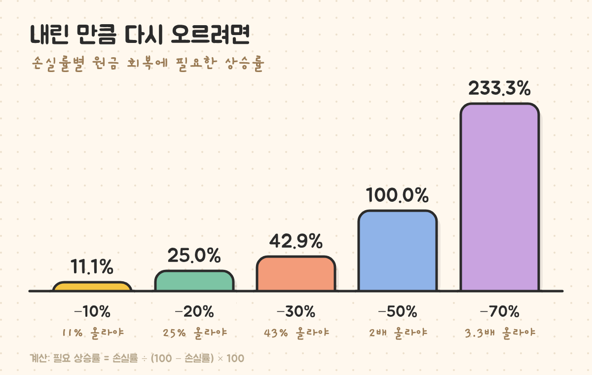
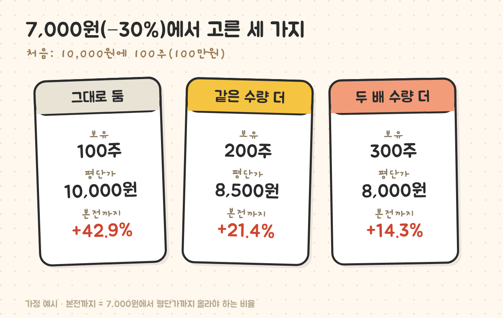
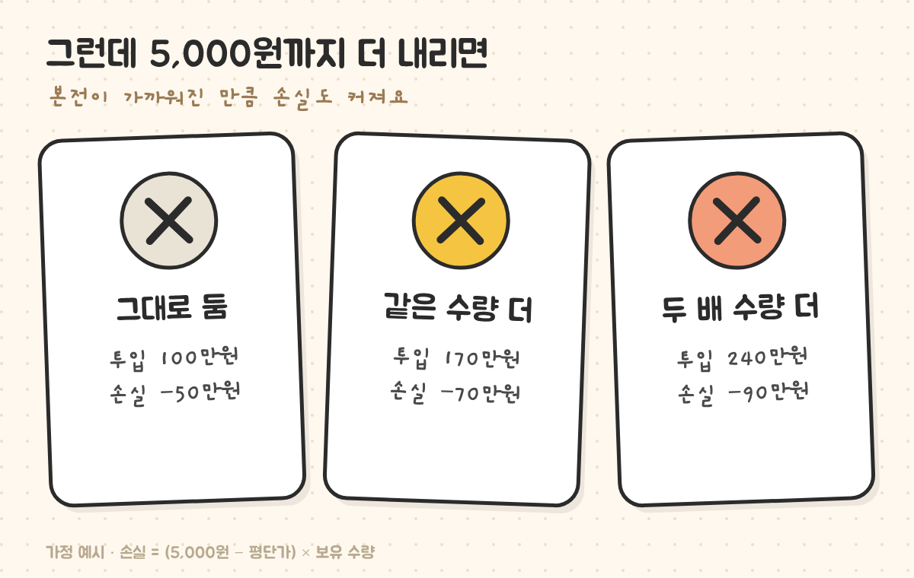

최종 검토일: 2026-11-04

물타기는 <mark>가지고 있는 주식이 산 가격보다 내렸을 때 더 사서 평균 매입단가(평단가)를 낮추는 것</mark>이에요. 평단가는 <mark>(먼저 산 금액 + 추가로 산 금액) ÷ 전체 수량</mark>으로 계산하고, 평단이 낮아지는 만큼 본전까지 올라야 하는 폭이 줄어요.

대신 같은 종목에 들어간 돈이 커지기 때문에, 더 내리면 손실도 같이 커져요. 평단가 계산법, 원하는 평단을 만들려면 몇 주를 사야 하는지 거꾸로 구하는 식, 그리고 물타기 전후로 무엇이 바뀌고 무엇이 그대로인지 숫자로 볼게요.

  <strong style="color:#1e4e36;font-size:18px;">🧮 계산식 두 줄</strong>
  <ul style="margin:10px 0 0 0;padding-left:20px;line-height:1.9;">
    <li><b>새 평단가</b> = (지금 평단 × 지금 수량 + 추가 매수가 × 추가 수량) ÷ (지금 수량 + 추가 수량)</li>
    <li><b>목표 평단에 필요한 추가 수량</b> = 지금 수량 × (지금 평단 − 목표 평단) ÷ (목표 평단 − 지금 가격)</li>
  </ul>

<h2 style="border-left:6px solid #2f6f4f;padding-left:12px;margin-top:36px;">목차</h2>
<ol style="line-height:1.9;">
  <li><a href="#sec-1" style="color:inherit;text-decoration:underline;text-underline-offset:3px;">물타기 뜻과 평단가 계산</a></li>
  <li><a href="#sec-2" style="color:inherit;text-decoration:underline;text-underline-offset:3px;">목표 평단을 만들려면 몇 주 사야 하나</a></li>
  <li><a href="#sec-3" style="color:inherit;text-decoration:underline;text-underline-offset:3px;">내린 만큼 다시 오르려면 얼마나 올라야 하나</a></li>
  <li><a href="#sec-4" style="color:inherit;text-decoration:underline;text-underline-offset:3px;">물타기로 바뀌는 것과 그대로인 것</a></li>
  <li><a href="#sec-5" style="color:inherit;text-decoration:underline;text-underline-offset:3px;">더 내리면 어떻게 되나</a></li>
  <li><a href="#sec-6" style="color:inherit;text-decoration:underline;text-underline-offset:3px;">물타기 Q&amp;A 5개</a></li>
</ol>

<h2 id="sec-1" style="scroll-margin-top:72px;border-left:6px solid #2f6f4f;padding-left:12px;margin-top:36px;">물타기 뜻과 평단가 계산</h2>

10,000원에 100주(100만원)를 샀는데 7,000원으로 30% 내렸다고 해 볼게요. 여기서 7,000원에 100주를 더 사면 평단가는 이렇게 바뀌어요.

<table style="width:100%;border-collapse:collapse;margin:16px 0;">
  <thead>
    <tr style="background:#f0f0f0;">
      <th style="border:1px solid #ddd;padding:8px;text-align:left;">항목</th>
      <th style="border:1px solid #ddd;padding:8px;text-align:left;">계산</th>
      <th style="border:1px solid #ddd;padding:8px;text-align:left;">값</th>
    </tr>
  </thead>
  <tbody>
    <tr><td style="border:1px solid #ddd;padding:8px;">전체 매입금액</td><td style="border:1px solid #ddd;padding:8px;">10,000원 × 100주 + 7,000원 × 100주</td><td style="border:1px solid #ddd;padding:8px;">170만원</td></tr>
    <tr><td style="border:1px solid #ddd;padding:8px;">전체 수량</td><td style="border:1px solid #ddd;padding:8px;">100주 + 100주</td><td style="border:1px solid #ddd;padding:8px;">200주</td></tr>
    <tr><td style="border:1px solid #ddd;padding:8px;"><mark>새 평단가</mark></td><td style="border:1px solid #ddd;padding:8px;">170만원 ÷ 200주</td><td style="border:1px solid #ddd;padding:8px;"><b>8,500원</b></td></tr>
  </tbody>
</table>

증권사 앱의 평단가는 매수 수수료를 넣어서 보여 주는 곳도 있어서, 위 계산과 몇 원 차이가 날 수 있어요. 증권사별 수수료는 <a href="https://sensitiveboss3.tistory.com/entry/broker-fee-comparison-2026" target="_blank" rel="noopener">증권사 수수료 비교 2026</a>에 정리해 뒀어요.

<h2 id="sec-2" style="scroll-margin-top:72px;border-left:6px solid #2f6f4f;padding-left:12px;margin-top:36px;">목표 평단을 만들려면 몇 주 사야 하나</h2>

"평단을 8,000원으로 만들려면 몇 주 사야 하지?"는 위 식을 거꾸로 풀면 돼요.

<table style="width:100%;border-collapse:collapse;margin:16px 0;">
  <thead>
    <tr style="background:#f0f0f0;">
      <th style="border:1px solid #ddd;padding:8px;text-align:left;">목표 평단</th>
      <th style="border:1px solid #ddd;padding:8px;text-align:left;">계산(지금 100주·평단 10,000원·가격 7,000원)</th>
      <th style="border:1px solid #ddd;padding:8px;text-align:left;">추가 수량</th>
      <th style="border:1px solid #ddd;padding:8px;text-align:left;">추가 금액</th>
    </tr>
  </thead>
  <tbody>
    <tr><td style="border:1px solid #ddd;padding:8px;">9,000원</td><td style="border:1px solid #ddd;padding:8px;">100 × 1,000 ÷ 2,000</td><td style="border:1px solid #ddd;padding:8px;">50주</td><td style="border:1px solid #ddd;padding:8px;">35만원</td></tr>
    <tr><td style="border:1px solid #ddd;padding:8px;">8,500원</td><td style="border:1px solid #ddd;padding:8px;">100 × 1,500 ÷ 1,500</td><td style="border:1px solid #ddd;padding:8px;">100주</td><td style="border:1px solid #ddd;padding:8px;">70만원</td></tr>
    <tr><td style="border:1px solid #ddd;padding:8px;">8,000원</td><td style="border:1px solid #ddd;padding:8px;">100 × 2,000 ÷ 1,000</td><td style="border:1px solid #ddd;padding:8px;">200주</td><td style="border:1px solid #ddd;padding:8px;">140만원</td></tr>
    <tr><td style="border:1px solid #ddd;padding:8px;">7,500원</td><td style="border:1px solid #ddd;padding:8px;">100 × 2,500 ÷ 500</td><td style="border:1px solid #ddd;padding:8px;"><mark>500주</mark></td><td style="border:1px solid #ddd;padding:8px;"><mark>350만원</mark></td></tr>
  </tbody>
</table>

목표 평단이 지금 가격에 가까워질수록 필요한 수량이 급격히 늘어요. 평단을 500원 더 내리는 데(8,000원 → 7,500원) 추가로 210만원이 더 들어가요. 평단은 지금 가격보다 낮아질 수 없어서, 7,000원 근처까지 내리려면 사실상 끝없이 사야 해요.

<h2 id="sec-3" style="scroll-margin-top:72px;border-left:6px solid #2f6f4f;padding-left:12px;margin-top:36px;">내린 만큼 다시 오르려면 얼마나 올라야 하나</h2>

물타기를 생각하게 되는 이유가 이 표에 있어요. 손실률과 회복에 필요한 상승률은 같지 않아요.

<figure style="margin:24px 0;"><figcaption style="font-size:13px;color:#888;">50% 내리면 두 배가 올라야 본전이에요.</figcaption></figure>

계산은 <mark>필요 상승률 = 손실률 ÷ (100 − 손실률) × 100</mark>이에요. 30% 내린 7,000원에서 10,000원으로 돌아가려면 3,000원 ÷ 7,000원 = 42.9%가 올라야 해요.

<figure style="margin:24px 0;"><figcaption style="font-size:13px;color:#888;">평단이 내려간 만큼 본전까지 필요한 상승률이 줄어요.</figcaption></figure>

<h2 id="sec-4" style="scroll-margin-top:72px;border-left:6px solid #2f6f4f;padding-left:12px;margin-top:36px;">물타기로 바뀌는 것과 그대로인 것</h2>

물타기 직후 7,000원 기준으로 보면, 평단은 내려가지만 <b>지금 잃고 있는 돈의 크기는 그대로</b>예요.

<table style="width:100%;border-collapse:collapse;margin:16px 0;">
  <thead>
    <tr style="background:#f0f0f0;">
      <th style="border:1px solid #ddd;padding:8px;text-align:left;">7,000원 기준</th>
      <th style="border:1px solid #ddd;padding:8px;text-align:left;">그대로 둠</th>
      <th style="border:1px solid #ddd;padding:8px;text-align:left;">100주 더</th>
      <th style="border:1px solid #ddd;padding:8px;text-align:left;">200주 더</th>
    </tr>
  </thead>
  <tbody>
    <tr><td style="border:1px solid #ddd;padding:8px;">들어간 돈</td><td style="border:1px solid #ddd;padding:8px;">100만원</td><td style="border:1px solid #ddd;padding:8px;">170만원</td><td style="border:1px solid #ddd;padding:8px;">240만원</td></tr>
    <tr><td style="border:1px solid #ddd;padding:8px;">평가금액</td><td style="border:1px solid #ddd;padding:8px;">70만원</td><td style="border:1px solid #ddd;padding:8px;">140만원</td><td style="border:1px solid #ddd;padding:8px;">210만원</td></tr>
    <tr><td style="border:1px solid #ddd;padding:8px;"><mark>평가손실</mark></td><td style="border:1px solid #ddd;padding:8px;">−30만원</td><td style="border:1px solid #ddd;padding:8px;">−30만원</td><td style="border:1px solid #ddd;padding:8px;">−30만원</td></tr>
    <tr><td style="border:1px solid #ddd;padding:8px;">수익률 표시</td><td style="border:1px solid #ddd;padding:8px;">−30.0%</td><td style="border:1px solid #ddd;padding:8px;">−17.6%</td><td style="border:1px solid #ddd;padding:8px;">−12.5%</td></tr>
  </tbody>
</table>

앱의 수익률 숫자는 −30%에서 −12.5%로 좋아 보이지만, 손실 금액 30만원은 하나도 줄지 않았어요. 바뀐 건 <b>분모(들어간 돈)가 커진 것</b>뿐이에요. 본전이 가까워진 대신, 이 종목 하나에 걸린 돈이 2.4배가 됐어요.

<h2 id="sec-5" style="scroll-margin-top:72px;border-left:6px solid #2f6f4f;padding-left:12px;margin-top:36px;">더 내리면 어떻게 되나</h2>

<figure style="margin:24px 0;"><figcaption style="font-size:13px;color:#888;">손실 = (5,000원 − 평단가) × 보유 수량이에요.</figcaption></figure>

7,000원에서 5,000원까지 더 내리면 손실은 그대로 둔 경우 50만원, 100주 더 산 경우 70만원, 200주 더 산 경우 90만원이에요. 물타기는 <b>"반등한다"에 돈을 더 거는 선택</b>이라, 반등이 오면 빨리 본전에 닿고, 안 오면 손실이 더 커져요. 기업에 무슨 일이 있어서 내린 건지(실적 악화, 유상증자 같은 공시 등)부터 확인하지 않고 평단만 보고 사면, 이 오른쪽 결과를 맞을 수 있어요.

반대로 오를 때 더 사는 것은 "불타기"라고 불러요. 이때는 평단이 올라가고, 같은 계산식을 그대로 쓰면 돼요. 팔 때 붙는 세금은 <a href="https://sensitiveboss3.tistory.com/entry/securities-transaction-tax-rate" target="_blank" rel="noopener">증권거래세 세율 2026</a>에서 볼 수 있어요.

<h2 id="sec-6" style="scroll-margin-top:72px;border-left:6px solid #2f6f4f;padding-left:12px;margin-top:36px;">물타기 Q&amp;A 5개</h2>

  
물타기 뜻이 뭔가요

  
가지고 있는 주식이 산 가격보다 내렸을 때 더 사서 평균 매입단가(평단가)를 낮추는 것이에요. 평단이 낮아지면 본전까지 올라야 하는 폭이 줄지만, 그 종목에 들어간 돈은 커져요.

  
평단가는 어떻게 계산하나요

  
(지금 평단 × 지금 수량 + 추가 매수가 × 추가 수량) ÷ 전체 수량이에요. 10,000원에 100주, 7,000원에 100주를 샀다면 170만원 ÷ 200주 = 8,500원이에요.

  
원하는 평단을 만들려면 몇 주 사야 하나요

  
지금 수량 × (지금 평단 − 목표 평단) ÷ (목표 평단 − 지금 가격)이에요. 평단 10,000원 100주를 7,000원에서 평단 8,000원으로 만들려면 200주가 필요해요. 목표가 지금 가격에 가까울수록 필요한 수량이 급격히 늘어요.

  
물타기하면 손실이 줄어드나요

  
물타기한 순간의 손실 금액은 그대로예요. 앱의 수익률 숫자만 작아 보이는데, 들어간 돈이 커져서 그래요. 반등하면 본전에 빨리 닿지만, 더 내리면 손실이 더 커져요.

  
50% 손실이면 몇 % 올라야 본전인가요

  
100% 올라야 해요. 필요 상승률은 손실률 ÷ (100 − 손실률) × 100이라, 10% 손실은 11.1%, 30% 손실은 42.9%, 70% 손실은 233.3%가 올라야 본전이에요.

  참고 출처:
  <ul style="margin:6px 0 0 0;padding-left:20px;">
    <li>평단가·필요 수량·회복 상승률은 산수 공식으로, 본문 숫자는 가정 예시로 직접 계산했어요(실제 종목 아님).</li>
  </ul>
  기준일: 2026년 11월 4일.

정보 제공을 목적으로 쓴 글이며 물타기나 특정 종목의 매수·매도를 권유하지 않아요. 예시는 계산을 보여 주기 위한 가정값이고, 투자 판단과 그 결과에 대한 책임은 투자자 본인에게 있어요.

