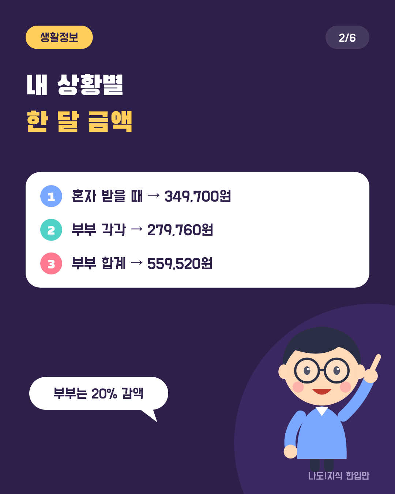
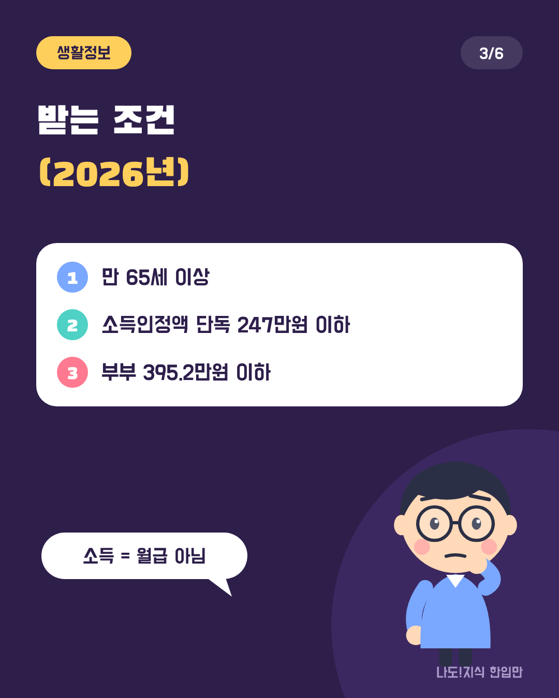
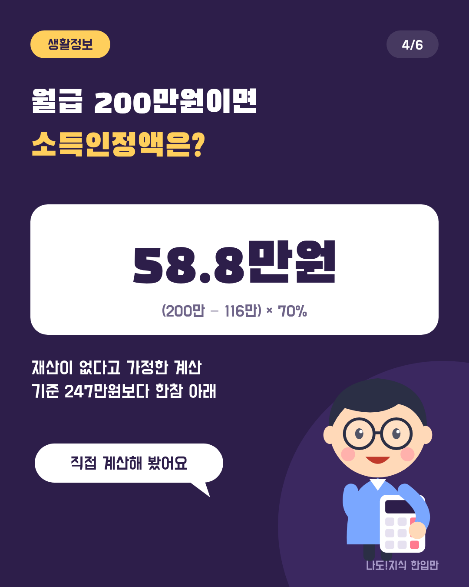
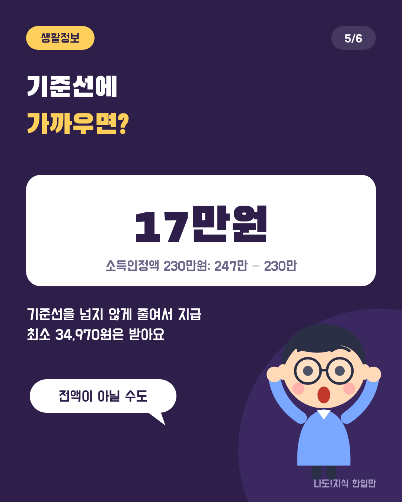
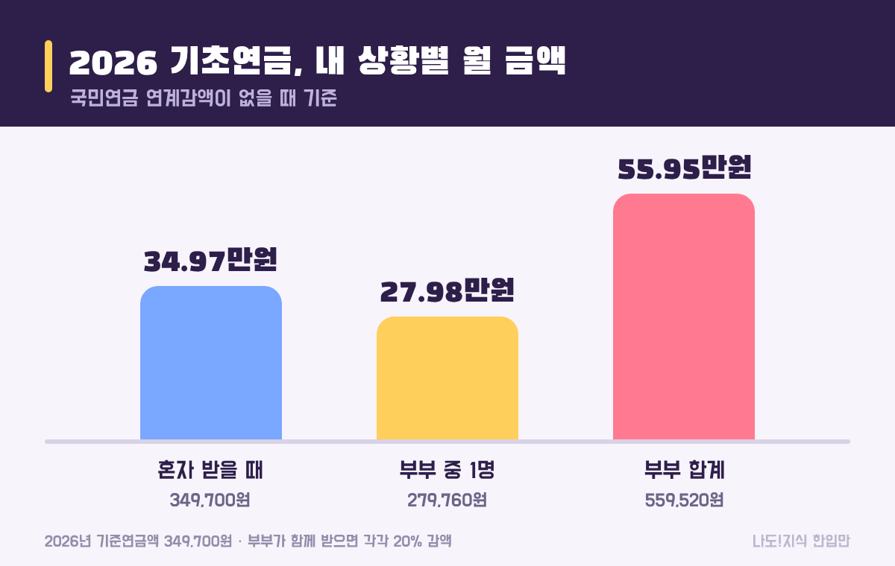
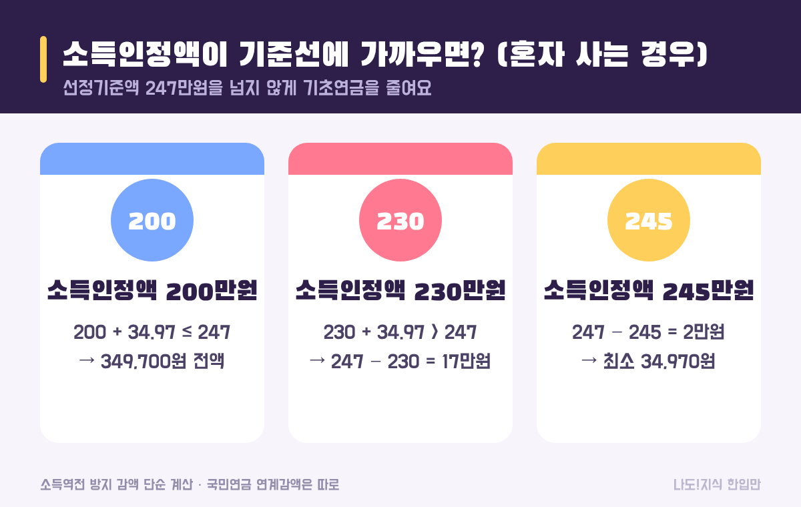
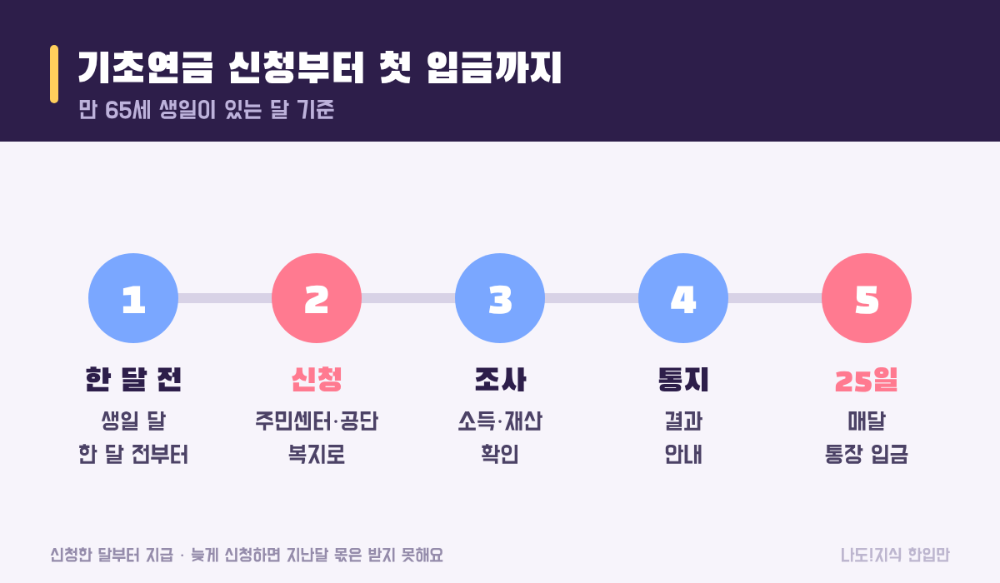

최종 검토일: 2026-11-12

기초연금은 만 65세 이상 중 소득과 재산이 적은 분께 나라가 매달 주는 연금이에요. 기초연금 금액은 2026년 기준 <mark>혼자 받으면 월 최대 349,700원</mark>, <mark>부부가 함께 받으면 둘이 합쳐 559,520원</mark>이에요.

다만 누구나 이 금액을 다 받는 건 아니에요. 소득인정액이 기준선에 가까우면 줄여서 주고, 부부는 20%씩 깎여요. 우리 부모님이나 내가 받을 수 있는지, 받으면 얼마인지 실제 숫자로 계산해 볼게요.

  <strong style="color:#2d1e4a;font-size:18px;">👵 한눈에 보기</strong>
  <ul style="margin:10px 0 0 0;padding-left:20px;line-height:1.9;">
    <li><b>금액:</b> 혼자 월 최대 349,700원 · 부부 합계 559,520원</li>
    <li><b>누가:</b> 만 65세 이상 + 소득인정액 단독 247만원·부부 395.2만원 이하</li>
    <li><b>일해도:</b> 근로소득은 116만원 빼고 70%만 반영</li>
    <li><b>줄어드는 경우:</b> 부부 동시 수급(−20%), 기준선 근처, 국민연금을 많이 받을 때</li>
    <li><b>신청:</b> 생일 달 한 달 전부터 · 신청한 달부터 지급</li>
  </ul>

옆으로 넘겨 보세요 → (카드 6장 요약)

  <strong style="font-size:16px;">📖 처음이라면 이것만 — 낱말 풀이</strong>
  <ul style="margin:8px 0 0 0;padding-left:20px;line-height:1.9;">
    <li><b>기준연금액:</b> 한 사람이 받을 수 있는 최대 금액. 2026년 349,700원이에요.</li>
    <li><b>선정기준액:</b> 받을 수 있는 소득인정액의 한도. 이 금액 이하여야 받아요.</li>
    <li><b>소득인정액:</b> 소득에서 공제를 뺀 금액 + 재산을 소득으로 바꾼 금액. 월급과 다른 숫자예요.</li>
    <li><b>부부 감액:</b> 부부가 둘 다 받을 때 각각 20%를 줄이는 것.</li>
    <li><b>소득역전 방지 감액:</b> 기초연금을 받아서 오히려 기준선을 넘는 사람보다 형편이 나아지지 않도록 줄이는 것.</li>
  </ul>

<h2 style="border-left:6px solid #2d1e4a;padding-left:12px;margin-top:36px;">목차</h2>
<ol style="line-height:1.9;">
  <li><a href="#sec-1" style="color:inherit;text-decoration:underline;text-underline-offset:3px;">2026년 기초연금은 얼마인가요?</a></li>
  <li><a href="#sec-2" style="color:inherit;text-decoration:underline;text-underline-offset:3px;">기초연금은 누가 받을 수 있나요?</a></li>
  <li><a href="#sec-3" style="color:inherit;text-decoration:underline;text-underline-offset:3px;">소득인정액은 어떻게 계산하나요?</a></li>
  <li><a href="#sec-4" style="color:inherit;text-decoration:underline;text-underline-offset:3px;">부부가 함께 받으면 얼마인가요?</a></li>
  <li><a href="#sec-5" style="color:inherit;text-decoration:underline;text-underline-offset:3px;">전액을 못 받는 경우는 언제인가요?</a></li>
  <li><a href="#sec-6" style="color:inherit;text-decoration:underline;text-underline-offset:3px;">기초연금은 어떻게 신청하나요?</a></li>
  <li><a href="#sec-7" style="color:inherit;text-decoration:underline;text-underline-offset:3px;">자주 하는 실수 5가지</a></li>
  <li><a href="#sec-8" style="color:inherit;text-decoration:underline;text-underline-offset:3px;">기초연금 Q&amp;A 5개</a></li>
</ol>

<h2 id="sec-1" style="scroll-margin-top:72px;border-left:6px solid #2d1e4a;padding-left:12px;margin-top:36px;">2026년 기초연금은 얼마인가요?</h2>

2026년 기초연금은 <mark>혼자 받으면 월 최대 349,700원</mark>이에요. 해마다 전년도 물가상승률만큼 올리는데, 2025년 물가상승률 2.1%가 반영돼 2025년 342,510원에서 <b>월 7,190원(1년 86,280원)</b> 올랐어요.

<figure style="margin:24px 0;"><figcaption style="font-size:13px;color:#888;">국민연금 연계감액이나 소득역전 감액이 없을 때의 최대 금액이에요.</figcaption></figure>

<table style="width:100%;border-collapse:collapse;margin:16px 0;">
  <thead>
    <tr style="background:#2d1e4a;color:#fff;"><th style="border:1px solid #ddd;padding:8px;">구분</th><th style="border:1px solid #ddd;padding:8px;">2025년</th><th style="border:1px solid #ddd;padding:8px;">2026년</th><th style="border:1px solid #ddd;padding:8px;">차이</th></tr>
  </thead>
  <tbody>
    <tr><td style="border:1px solid #ddd;padding:8px;">혼자 받을 때</td><td style="border:1px solid #ddd;padding:8px;">342,510원</td><td style="border:1px solid #ddd;padding:8px;"><mark>349,700원</mark></td><td style="border:1px solid #ddd;padding:8px;">+7,190원</td></tr>
    <tr><td style="border:1px solid #ddd;padding:8px;">부부 중 1명</td><td style="border:1px solid #ddd;padding:8px;">274,008원</td><td style="border:1px solid #ddd;padding:8px;">279,760원</td><td style="border:1px solid #ddd;padding:8px;">+5,752원</td></tr>
    <tr><td style="border:1px solid #ddd;padding:8px;">부부 합계</td><td style="border:1px solid #ddd;padding:8px;">548,016원</td><td style="border:1px solid #ddd;padding:8px;"><mark>559,520원</mark></td><td style="border:1px solid #ddd;padding:8px;">+11,504원</td></tr>
  </tbody>
</table>

지급일은 매달 <b>25일</b>이에요. 25일이 주말이나 공휴일이면 그 전 평일에 들어와요. 금액은 위 최대치에서 상황에 따라 줄어들 수 있어서, 실제로 받을 금액은 아래 계산을 차례로 따라가 보면 돼요.

<h2 id="sec-2" style="scroll-margin-top:72px;border-left:6px solid #2d1e4a;padding-left:12px;margin-top:36px;">기초연금은 누가 받을 수 있나요?</h2>

기초연금은 <mark>만 65세 이상이고 소득인정액이 선정기준액 이하인 분</mark>이 받아요. 2026년 선정기준액은 혼자 사는 경우 월 247만원, 부부는 월 395만2천원이에요. 65세 이상 어르신 중 약 70%가 받도록 매년 정해요.

<table style="width:100%;border-collapse:collapse;margin:16px 0;">
  <thead>
    <tr style="background:#2d1e4a;color:#fff;"><th style="border:1px solid #ddd;padding:8px;">가구</th><th style="border:1px solid #ddd;padding:8px;">2026년 선정기준액</th><th style="border:1px solid #ddd;padding:8px;">이 금액 이하면</th></tr>
  </thead>
  <tbody>
    <tr><td style="border:1px solid #ddd;padding:8px;">혼자 사는 경우(단독)</td><td style="border:1px solid #ddd;padding:8px;"><mark>월 247만원</mark></td><td style="border:1px solid #ddd;padding:8px;">받을 수 있음</td></tr>
    <tr><td style="border:1px solid #ddd;padding:8px;">부부</td><td style="border:1px solid #ddd;padding:8px;"><mark>월 395만2천원</mark></td><td style="border:1px solid #ddd;padding:8px;">받을 수 있음 (한 명만 65세여도 부부 기준)</td></tr>
  </tbody>
</table>

여기서 많이 헷갈리는 게 <b>소득인정액은 월급이 아니라는 것</b>이에요. 월 300만원을 벌어도 공제를 하고 나면 소득인정액이 247만원 아래로 내려가 받는 분도 있고, 소득이 없어도 집이나 예금이 많으면 못 받을 수 있어요. 그리고 공무원·군인·사학연금 등을 받는 분과 그 배우자는 원칙적으로 대상에서 빠져요.

<h2 id="sec-3" style="scroll-margin-top:72px;border-left:6px solid #2d1e4a;padding-left:12px;margin-top:36px;">소득인정액은 어떻게 계산하나요?</h2>

소득인정액은 <mark>소득평가액 + 재산의 소득환산액</mark>이에요. 소득은 공제를 빼고, 재산은 기본으로 빼 주는 금액을 뺀 뒤 일정 비율로 '월 소득'처럼 바꿔서 더해요.

<ol style="line-height:2;">
  <li><b>근로소득:</b> 월급에서 <b>116만원</b>(2026년)을 빼고, 남은 금액의 <b>70%</b>만 소득으로 봐요.</li>
  <li><b>연금소득:</b> 국민연금 같은 공적연금은 받는 금액 그대로 소득에 넣어요.</li>
  <li><b>일반재산(집 등):</b> 사는 지역에 따라 기본재산액을 빼요. 대도시는 <b>1억3,500만원</b>이에요.</li>
  <li><b>금융재산(예금 등):</b> <b>2,000만원</b>을 빼요.</li>
  <li>남은 재산을 정해진 비율로 월 소득으로 바꿔 1·2번과 더하면 소득인정액이에요.</li>
</ol>

  <strong>✍️ 내 경우로 따라 해 보기 (혼자 사는 66세, 월급 200만원, 공제 뒤 남는 재산 없음)</strong> 
  ① 근로소득 공제: 200만 − 116만 = <b>84만원</b> 
  ② 70%만 반영: 84만 × 0.7 = <b>58.8만원</b> 
  ③ 재산: 집이 대도시 1억3,500만원 이하, 예금 2,000만원 이하라면 <b>0원</b> 
  ④ 소득인정액 58.8만원 ≤ 247만원 → <mark><b>기초연금 349,700원 전액</b></mark>

재산을 소득으로 바꾸는 비율과 자동차 같은 예외 규칙은 꽤 복잡해요. 집·예금이 많은 경우에는 <a href="https://basicpension.mohw.go.kr" target="_blank" rel="noopener">기초연금 누리집(basicpension.mohw.go.kr)</a>의 모의계산에 넣어 보는 게 가장 정확해요.

<h2 id="sec-4" style="scroll-margin-top:72px;border-left:6px solid #2d1e4a;padding-left:12px;margin-top:36px;">부부가 함께 받으면 얼마인가요?</h2>

부부가 둘 다 받으면 <mark>각각 20%씩 줄어 한 사람당 279,760원, 둘이 합쳐 559,520원</mark>이에요. 함께 살면 생활비를 나눠 쓰는 효과가 있다고 보고 줄이는 거예요.

<table style="width:100%;border-collapse:collapse;margin:16px 0;">
  <thead>
    <tr style="background:#2d1e4a;color:#fff;"><th style="border:1px solid #ddd;padding:8px;">부부 상황</th><th style="border:1px solid #ddd;padding:8px;">한 사람</th><th style="border:1px solid #ddd;padding:8px;">합계</th></tr>
  </thead>
  <tbody>
    <tr><td style="border:1px solid #ddd;padding:8px;">둘 다 받을 때</td><td style="border:1px solid #ddd;padding:8px;">279,760원</td><td style="border:1px solid #ddd;padding:8px;"><mark>559,520원</mark></td></tr>
    <tr><td style="border:1px solid #ddd;padding:8px;">한 명만 받을 때</td><td style="border:1px solid #ddd;padding:8px;">349,700원 (감액 없음)</td><td style="border:1px solid #ddd;padding:8px;">349,700원</td></tr>
    <tr><td style="border:1px solid #ddd;padding:8px;">혼자 사는 경우(비교)</td><td style="border:1px solid #ddd;padding:8px;">349,700원</td><td style="border:1px solid #ddd;padding:8px;">349,700원</td></tr>
  </tbody>
</table>

부부 감액률을 낮추자는 논의가 나오고 있지만, 법이 바뀌기 전까지는 20% 감액이 그대로 적용돼요. 한 명만 받는 경우에는 깎이지 않아요.

<h2 id="sec-5" style="scroll-margin-top:72px;border-left:6px solid #2d1e4a;padding-left:12px;margin-top:36px;">전액을 못 받는 경우는 언제인가요?</h2>

전액을 못 받는 대표적인 경우는 <mark>소득인정액이 기준선에 가깝거나, 국민연금을 많이 받는 경우</mark>예요.

<b>① 기준선 근처(소득역전 방지 감액):</b> 소득인정액에 기초연금을 더한 금액이 선정기준액을 넘으면, 넘는 만큼 기초연금을 줄여요. 기준선 바로 아래 사람이 기준선 바로 위 사람보다 형편이 크게 나아지지 않게 하려는 장치예요.

<figure style="margin:24px 0;"><figcaption style="font-size:13px;color:#888;">247만원 기준선을 넘지 않도록 줄여서 줘요. 다만 최소 기준연금액의 10%는 받아요.</figcaption></figure>

<table style="width:100%;border-collapse:collapse;margin:16px 0;">
  <thead>
    <tr style="background:#2d1e4a;color:#fff;"><th style="border:1px solid #ddd;padding:8px;">소득인정액(혼자)</th><th style="border:1px solid #ddd;padding:8px;">계산</th><th style="border:1px solid #ddd;padding:8px;">기초연금</th></tr>
  </thead>
  <tbody>
    <tr><td style="border:1px solid #ddd;padding:8px;">200만원</td><td style="border:1px solid #ddd;padding:8px;">200 + 34.97 = 234.97 ≤ 247</td><td style="border:1px solid #ddd;padding:8px;">349,700원 (전액)</td></tr>
    <tr><td style="border:1px solid #ddd;padding:8px;">230만원</td><td style="border:1px solid #ddd;padding:8px;">247 − 230</td><td style="border:1px solid #ddd;padding:8px;"><mark>17만원</mark></td></tr>
    <tr><td style="border:1px solid #ddd;padding:8px;">240만원</td><td style="border:1px solid #ddd;padding:8px;">247 − 240</td><td style="border:1px solid #ddd;padding:8px;">7만원</td></tr>
    <tr><td style="border:1px solid #ddd;padding:8px;">245만원</td><td style="border:1px solid #ddd;padding:8px;">247 − 245 = 2만원 → 최소액</td><td style="border:1px solid #ddd;padding:8px;">34,970원</td></tr>
  </tbody>
</table>

<b>② 국민연금을 많이 받을 때(연계감액):</b> 국민연금 월 수령액이 일정 수준을 넘으면 기초연금이 최대 절반까지 줄어들 수 있어요. 계산식이 가입기간과 수령액에 따라 복잡해서, 국민연금공단 1355에 물어보면 내 금액을 바로 알려 줘요.

<h2 id="sec-6" style="scroll-margin-top:72px;border-left:6px solid #2d1e4a;padding-left:12px;margin-top:36px;">기초연금은 어떻게 신청하나요?</h2>

기초연금은 <mark>만 65세 생일이 있는 달의 한 달 전부터</mark> 신청할 수 있어요. 자동으로 들어오지 않고, <b>신청한 달부터</b> 지급돼요.

<figure style="margin:24px 0;"><figcaption style="font-size:13px;color:#888;">늦게 신청하면 그 전 달 몫은 소급해 주지 않아요.</figcaption></figure>

<ol style="line-height:2;">
  <li><b>어디서:</b> 가까운 주민센터(행정복지센터), 국민연금공단 지사, 또는 <a href="https://www.bokjiro.go.kr" target="_blank" rel="noopener">복지로(bokjiro.go.kr)</a> 온라인.</li>
  <li><b>무엇을:</b> 신분증, 통장 사본. 필요하면 임대차계약서나 금융정보 제공 동의서를 써요.</li>
  <li><b>조사:</b> 소득·재산 조사를 거쳐 결과를 알려 줘요. 보통 한 달 안팎이 걸려요.</li>
  <li><b>떨어졌다면:</b> 소득이나 재산이 줄었을 때 다시 신청할 수 있어요. 한 번 탈락했다고 끝이 아니에요.</li>
  <li><b>도움:</b> 기초연금 콜센터는 보건복지상담센터 129, 국민연금공단 1355예요.</li>
</ol>

65세 이상이면 이자에 세금이 붙지 않는 저축도 함께 챙길 수 있어요. 한도와 조건은 <a href="https://sensitiveboss3.tistory.com/entry/tax-exempt-savings-limit-2026" target="_blank" rel="noopener">비과세종합저축 조건과 한도 2026</a> 글에 정리했어요.

<h2 id="sec-7" style="scroll-margin-top:72px;border-left:6px solid #2d1e4a;padding-left:12px;margin-top:36px;">자주 하는 실수 5가지</h2>

기초연금을 놓치는 경우는 대부분 <mark>월급만 보고 스스로 안 된다고 판단하거나, 신청을 늦게 해서</mark> 생겨요.

  <strong style="font-size:16px;">⚠️ 이것만 피하세요</strong>
  <ol style="margin:8px 0 0 0;padding-left:20px;line-height:1.9;">
    <li><b>월급이 247만원 넘으니 안 된다고 생각하기</b> → 근로소득은 116만원을 빼고 70%만 봐요. 월 300만원도 재산이 없으면 소득인정액은 128.8만원이에요.</li>
    <li><b>생일 지나고 천천히 신청하기</b> → 신청한 달부터 줘요. 늦은 달만큼 그냥 사라져요.</li>
    <li><b>부부 중 한 명만 신청하기</b> → 둘 다 대상이면 둘 다 신청해야 각각 받아요.</li>
    <li><b>한 번 떨어지면 끝이라고 생각하기</b> → 소득·재산이 바뀌면 다시 신청할 수 있어요.</li>
    <li><b>국민연금 때문에 못 받는다고 생각하기</b> → 국민연금을 받아도 기초연금은 받을 수 있어요. 많이 받는 경우에만 일부 줄어요.</li>
  </ol>

<h2 id="sec-8" style="scroll-margin-top:72px;border-left:6px solid #2d1e4a;padding-left:12px;margin-top:36px;">기초연금 Q&amp;A 5개</h2>

  
2026년 기초연금은 얼마인가요

  
혼자 받으면 월 최대 349,700원이에요. 2025년(342,510원)보다 월 7,190원 올랐어요. 부부가 함께 받으면 각각 20%씩 줄어 둘이 합쳐 월 559,520원이에요.

  
기초연금 받는 소득 기준이 얼마인가요

  
2026년 선정기준액은 혼자 사는 경우 소득인정액 월 247만원, 부부는 월 395만2천원 이하예요. 소득인정액은 실제 소득에서 공제를 하고 재산을 소득으로 바꿔 더한 금액이라 월급과 달라요.

  
일하면서 기초연금 받을 수 있나요

  
받을 수 있어요. 근로소득은 2026년 기준 116만원을 빼고 나머지의 70%만 소득으로 봐요. 재산이 없다면 월급 200만원의 소득인정액은 58.8만원이에요.

  
부부가 같이 받으면 왜 깎이나요

  
부부가 함께 살면 생활비를 나눠 쓰는 효과가 있다고 보고 두 사람 모두 받을 때 각각 20%를 줄여요. 2026년에는 한 사람당 279,760원이에요.

  
기초연금은 언제부터 신청하나요

  
만 65세 생일이 있는 달의 한 달 전부터 신청할 수 있어요. 신청한 달부터 지급되고 지난달 몫을 소급해 주지 않으니 미리 신청하는 게 좋아요.

  <strong style="font-size:16px;">📚 함께 보면 좋은 글</strong>
  <ul style="margin:8px 0 0 0;padding-left:20px;line-height:1.9;"><li><a href="https://sensitiveboss3.tistory.com/entry/tax-exempt-savings-limit-2026" target="_blank" rel="noopener">비과세종합저축 조건과 한도 2026</a></li><li><a href="https://sensitiveboss3.tistory.com/entry/pension-savings-tax-credit" target="_blank" rel="noopener">연금저축 세액공제 얼마 돌려받나</a></li><li><a href="https://sensitiveboss3.tistory.com/entry/unemployment-benefit-2026-daily-amount" target="_blank" rel="noopener">실업급여 하루 얼마? 2026 계산법</a></li></ul>

  참고 출처:
  <ul style="margin:6px 0 0 0;padding-left:20px;">
    <li><a href="https://www.yeonsu.go.kr/welfare/life/senior/policy/basic.asp" target="_blank" rel="noopener">인천 연수구청: 기초연금 안내(2026년 선정기준액)</a></li>
    <li><a href="https://www.mt.co.kr/policy/2026/01/02/2026010118311774918" target="_blank" rel="noopener">머니투데이: 부부 월 395만원 못 벌면 받는다(2026년 기준)</a></li>
    <li><a href="https://glasswallet.com/calculate/basic-pension/income-calculation" target="_blank" rel="noopener">글래스월렛: 기초연금 소득인정액 계산법(근로소득 공제)</a></li>
    <li><a href="https://www.law.go.kr/법령/기초연금법" target="_blank" rel="noopener">국가법령정보센터: 기초연금법(부부 감액·소득역전 방지)</a></li>
  </ul>
  기준일: 2026년 11월 12일. 금액 계산은 국민연금 연계감액이 없다고 가정한 단순 계산이에요.

정보 제공을 목적으로 쓴 글이에요. 실제 수급 여부와 금액은 소득·재산 조사 결과에 따라 달라지고, 주민센터·국민연금공단의 결정이 기준이에요.

