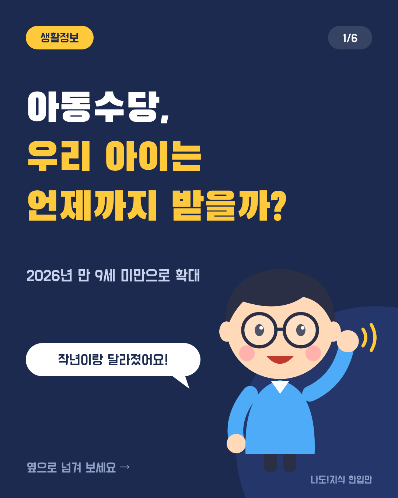
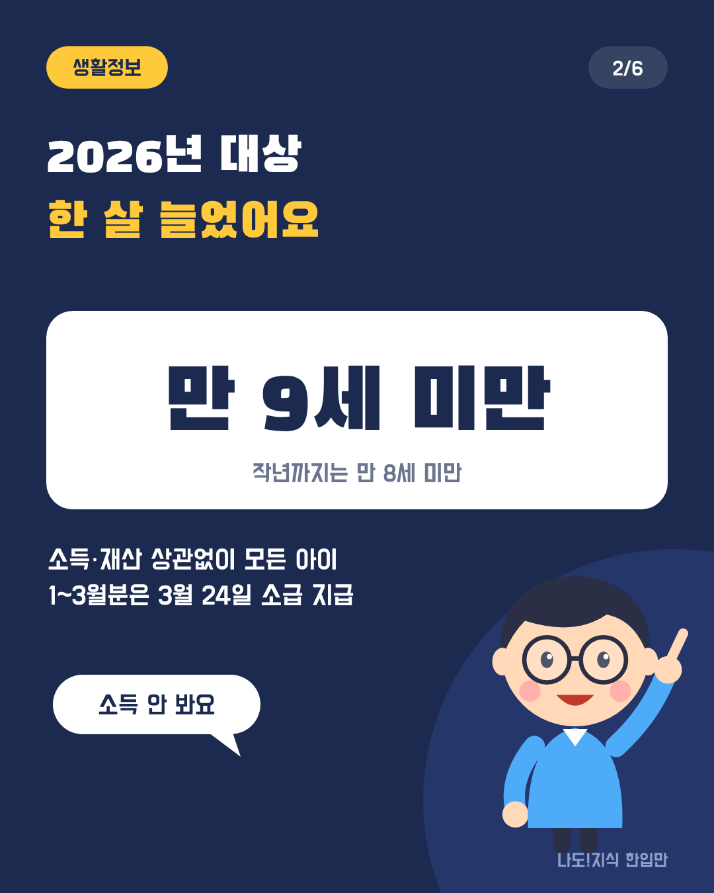
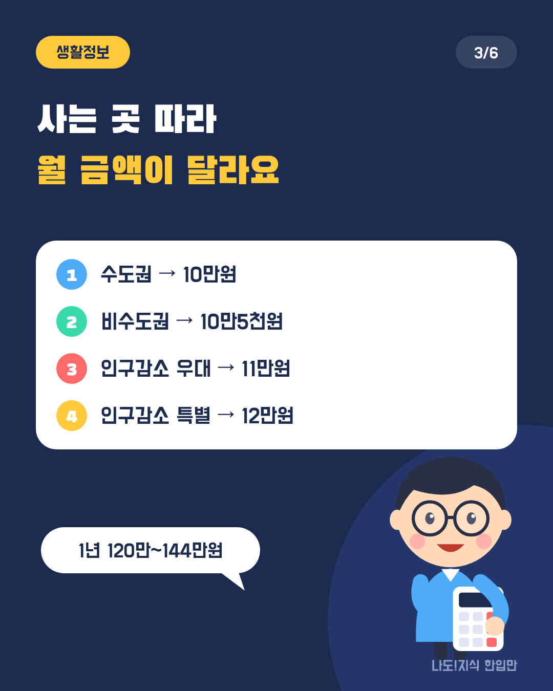
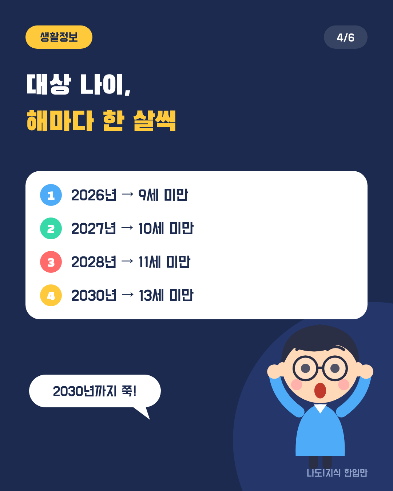
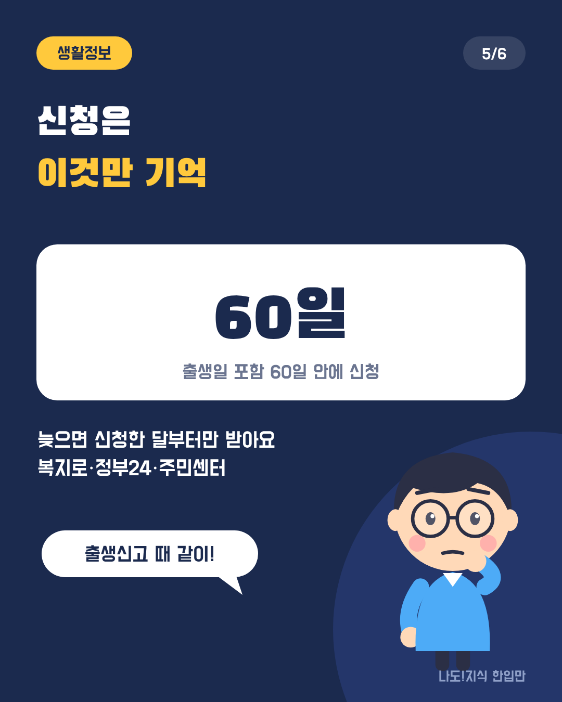
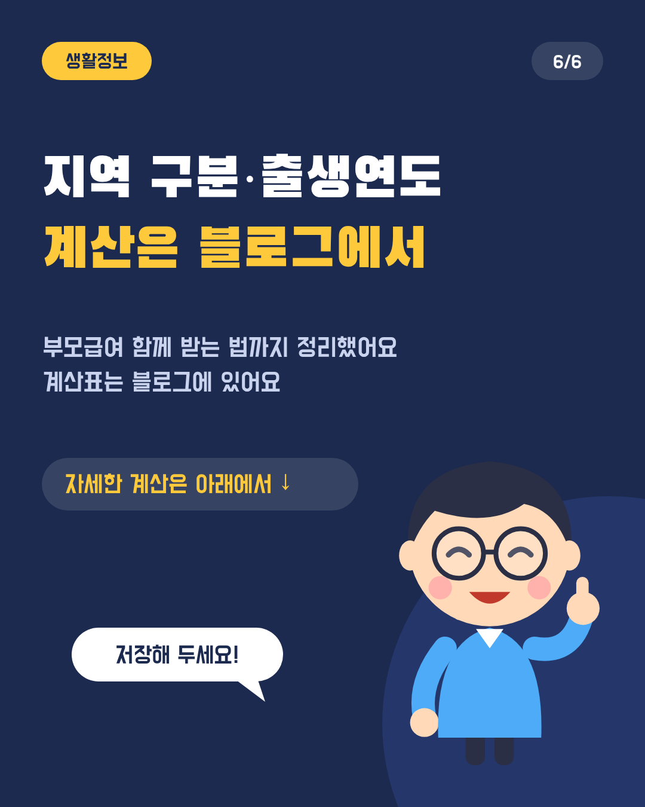
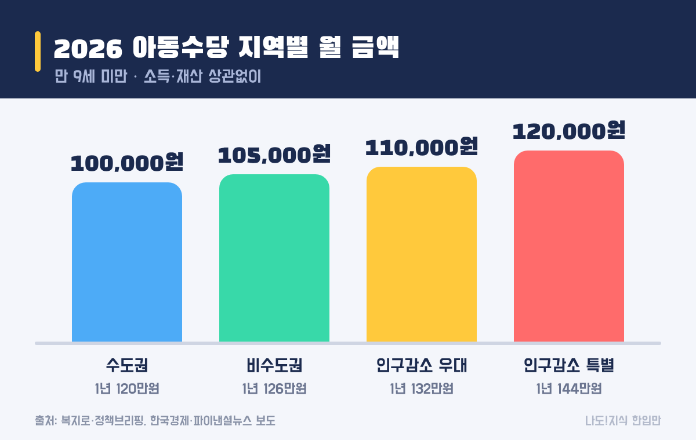
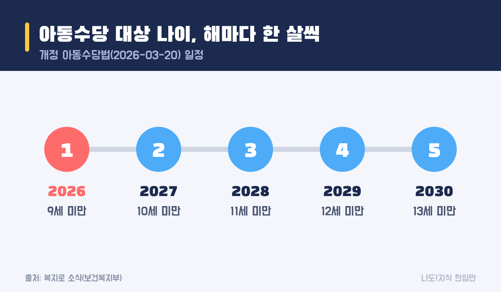
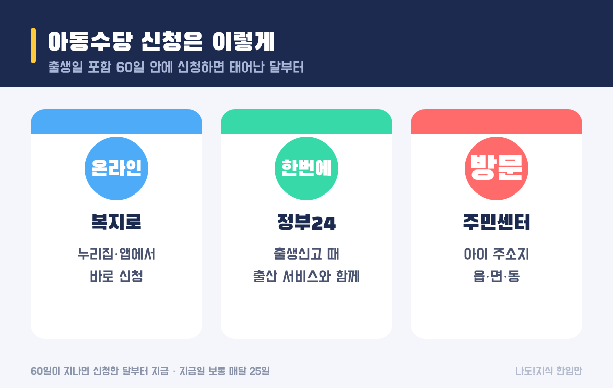

최종 검토일: 2026-11-05

2026년 아동수당은 <mark>만 9세 미만</mark> 아이에게 매달 지급되고, 사는 지역에 따라 <mark>월 10만~12만원</mark>이에요. 작년까지는 만 8세 미만이었는데 한 살 늘었고, 법에 따라 2030년까지 해마다 한 살씩 더 늘어나요.

그래서 "우리 아이는 언제까지 받나"의 답이 작년과 달라졌어요. 지역별 금액, 연도별 대상 나이, 1년에 받는 총액, 신청할 때 놓치기 쉬운 기한까지 정리할게요.

  <strong style="color:#1b2a4e;font-size:18px;">👶 먼저 볼 세 가지</strong>
  <ul style="margin:10px 0 0 0;padding-left:20px;line-height:1.9;">
    <li><b>대상:</b> 2026년은 <b>만 9세 미만</b> 모든 아이(소득·재산 상관없음)</li>
    <li><b>금액:</b> 수도권 10만원, 비수도권 10만5천원, 인구감소지역 11만원·12만원</li>
    <li><b>신청:</b> 출생일 포함 <b>60일 안에</b> 신청하면 태어난 달부터 받아요</li>
  </ul>

옆으로 넘겨 보세요 → (카드 6장 요약)

<h2 style="border-left:6px solid #1b2a4e;padding-left:12px;margin-top:36px;">목차</h2>
<ol style="line-height:1.9;">
  <li><a href="#sec-1" style="color:inherit;text-decoration:underline;text-underline-offset:3px;">2026년 아동수당 대상: 만 9세 미만</a></li>
  <li><a href="#sec-2" style="color:inherit;text-decoration:underline;text-underline-offset:3px;">아동수당 지역별로 얼마 받나요?</a></li>
  <li><a href="#sec-3" style="color:inherit;text-decoration:underline;text-underline-offset:3px;">아동수당 몇 살까지 받나요?</a></li>
  <li><a href="#sec-4" style="color:inherit;text-decoration:underline;text-underline-offset:3px;">신청 방법과 60일 규칙</a></li>
  <li><a href="#sec-5" style="color:inherit;text-decoration:underline;text-underline-offset:3px;">부모급여와 함께 받을 수 있나</a></li>
  <li><a href="#sec-6" style="color:inherit;text-decoration:underline;text-underline-offset:3px;">아동수당 Q&amp;A 5개</a></li>
</ol>

<h2 id="sec-1" style="scroll-margin-top:72px;border-left:6px solid #1b2a4e;padding-left:12px;margin-top:36px;">2026년 아동수당 대상: 만 9세 미만</h2>

2026년 3월 20일 개정된 아동수당법에 따라 지급 대상이 <mark>만 8세 미만에서 만 9세 미만</mark>으로 넓어졌어요. 개정이 3월에 이뤄져서, 그사이 만 8세가 되어 수당이 끊겼던 아이에게는 <b>1~3월분을 소급해 3월 24일에</b> 한꺼번에 지급했어요.

부모의 소득이나 재산은 따지지 않아요. 대한민국 국적에 주민등록번호가 있는 만 9세 미만 아이라면 대상이에요.

<h2 id="sec-2" style="scroll-margin-top:72px;border-left:6px solid #1b2a4e;padding-left:12px;margin-top:36px;">아동수당 지역별로 얼마 받나요?</h2>

2026년부터는 사는 곳에 따라 금액이 달라졌어요. 수도권은 그대로 10만원이고, 비수도권과 인구감소지역 아이에게 매달 5천~2만원을 더 줘요.

<figure style="margin:24px 0;"><figcaption style="font-size:13px;color:#888;">인구감소지역에서 지역사랑상품권으로 받으면 월 1만원이 더 붙는다고 보도됐어요.</figcaption></figure>

<table style="width:100%;border-collapse:collapse;margin:16px 0;">
  <thead>
    <tr style="background:#1b2a4e;color:#fff;"><th style="border:1px solid #ddd;padding:8px;">지역 구분</th><th style="border:1px solid #ddd;padding:8px;">월 금액</th><th style="border:1px solid #ddd;padding:8px;">1년(12개월) 총액</th></tr>
  </thead>
  <tbody>
    <tr><td style="border:1px solid #ddd;padding:8px;">수도권(서울·경기·인천)</td><td style="border:1px solid #ddd;padding:8px;"><mark>10만원</mark></td><td style="border:1px solid #ddd;padding:8px;">120만원</td></tr>
    <tr><td style="border:1px solid #ddd;padding:8px;">비수도권</td><td style="border:1px solid #ddd;padding:8px;"><mark>10만5천원</mark></td><td style="border:1px solid #ddd;padding:8px;">126만원</td></tr>
    <tr><td style="border:1px solid #ddd;padding:8px;">인구감소지역(우대)</td><td style="border:1px solid #ddd;padding:8px;"><mark>11만원</mark></td><td style="border:1px solid #ddd;padding:8px;">132만원</td></tr>
    <tr><td style="border:1px solid #ddd;padding:8px;">인구감소지역(특별)</td><td style="border:1px solid #ddd;padding:8px;"><mark>12만원</mark></td><td style="border:1px solid #ddd;padding:8px;">144만원</td></tr>
  </tbody>
</table>

내가 사는 시·군이 어느 구분인지는 복지로나 주민센터에서 확인할 수 있어요. 지역 추가 지급은 <b>올해 한시로 시행한다는 보도</b>가 있어서, 2027년에도 같은 금액일지는 아직 정해지지 않았어요. 정해지면 이 글을 고칠게요.

<h2 id="sec-3" style="scroll-margin-top:72px;border-left:6px solid #1b2a4e;padding-left:12px;margin-top:36px;">아동수당 몇 살까지 받나요?</h2>

개정법은 대상 나이를 <mark>2030년까지 해마다 한 살씩</mark> 올리도록 정했어요.

<figure style="margin:24px 0;"><figcaption style="font-size:13px;color:#888;">아이가 한 살 먹을 때 기준도 한 살 올라가요.</figcaption></figure>

<table style="width:100%;border-collapse:collapse;margin:16px 0;">
  <thead>
    <tr style="background:#1b2a4e;color:#fff;"><th style="border:1px solid #ddd;padding:8px;">연도</th><th style="border:1px solid #ddd;padding:8px;">2026</th><th style="border:1px solid #ddd;padding:8px;">2027</th><th style="border:1px solid #ddd;padding:8px;">2028</th><th style="border:1px solid #ddd;padding:8px;">2029</th><th style="border:1px solid #ddd;padding:8px;">2030</th></tr>
  </thead>
  <tbody>
    <tr><td style="border:1px solid #ddd;padding:8px;">대상 나이</td><td style="border:1px solid #ddd;padding:8px;"><mark>9세 미만</mark></td><td style="border:1px solid #ddd;padding:8px;">10세 미만</td><td style="border:1px solid #ddd;padding:8px;">11세 미만</td><td style="border:1px solid #ddd;padding:8px;">12세 미만</td><td style="border:1px solid #ddd;padding:8px;">13세 미만</td></tr>
  </tbody>
</table>

여기서 계산해 보면 재미있는 결과가 나와요. 아이도 1년에 한 살, 기준도 1년에 한 살 올라가니까 <b>2018년 이후에 태어난 아이는 2030년까지 나이 때문에 끊기는 일이 없어요.</b> 예를 들어 2018년생은 2026년에 8세, 2027년에 9세, 2030년에 12세가 되는데, 매년 그해 기준(9·10·…·13세 미만)보다 한 살 어려요.

<ul style="line-height:1.9;">
  <li><b>2018년 이후 출생:</b> 2030년까지 계속 대상. 2030년 이후 기준이 13세 미만에 머물면 만 13세가 될 때 끝나요.</li>
  <li><b>2017년생:</b> 해마다 기준 나이와 같은 나이가 되는 해라 경계에 걸려 있어요. 몇 월분까지 받는지는 복지로나 주민센터에서 꼭 확인해 보세요.</li>
</ul>

<h2 id="sec-4" style="scroll-margin-top:72px;border-left:6px solid #1b2a4e;padding-left:12px;margin-top:36px;">신청 방법과 60일 규칙</h2>

아동수당은 복지로·정부24·주민센터 중 한 곳에서 출생일 포함 60일 안에 신청하면 태어난 달부터 받아요.

<figure style="margin:24px 0;"><figcaption style="font-size:13px;color:#888;">어디서 신청해도 결과는 같아요. 60일만 지키면 돼요.</figcaption></figure>

<ul style="line-height:1.9;">
  <li><b>온라인:</b> 복지로 누리집·앱에서 신청해요.</li>
  <li><b>출생신고와 함께:</b> 정부24의 출산 관련 서비스를 한 번에 신청하는 메뉴로 같이 낼 수 있어요.</li>
  <li><b>방문:</b> 아이 주소지 읍·면·동 주민센터에서 신청해요.</li>
</ul>

가장 중요한 건 기한이에요. <mark>출생일을 포함해 60일 안에</mark> 신청하면 태어난 달부터 소급해서 받지만, 그보다 늦으면 <b>신청한 달부터</b> 받아요. 늦은 만큼 그대로 못 받는 거라 출생신고 때 같이 하는 게 가장 안전해요.

지급일은 보통 <b>매달 25일</b>이고, 신청할 때 정한 보호자 계좌로 들어와요.

<h2 id="sec-5" style="scroll-margin-top:72px;border-left:6px solid #1b2a4e;padding-left:12px;margin-top:36px;">부모급여와 함께 받을 수 있나</h2>

네. 아동수당과 부모급여는 별개 제도라 <b>같이 받을 수 있어요.</b> 부모급여는 0~1세 아이를 대상으로 따로 지급되고, 아동수당은 그와 상관없이 만 9세 미만이면 나와요. 그래서 0~1세 동안은 두 가지가 한꺼번에 들어오고, 부모급여가 끝난 뒤에도 아동수당은 계속 이어져요.

부모급여는 어린이집을 이용하면 보육료로 바뀌어 지급되는 등 따질 게 따로 있어서, 정확한 금액은 복지로에서 확인하는 게 좋아요.

<h2 id="sec-6" style="scroll-margin-top:72px;border-left:6px solid #1b2a4e;padding-left:12px;margin-top:36px;">아동수당 Q&amp;A 5개</h2>

  
2026년 아동수당은 몇 살까지 받나요

  
2026년은 만 9세 미만까지예요. 개정 아동수당법에 따라 2027년 10세 미만, 2028년 11세 미만처럼 2030년까지 해마다 한 살씩 올라가 2030년에는 13세 미만이 돼요.

  
아동수당 금액은 얼마인가요

  
수도권은 월 10만원, 비수도권은 10만5천원, 인구감소지역은 우대 11만원·특별 12만원이에요. 1년으로 치면 120만~144만원이에요.

  
작년에 만 8세가 돼서 끊겼는데 다시 받을 수 있나요

  
2026년에 만 9세 미만이면 다시 대상이에요. 개정법 시행 전에 끊긴 1~3월분은 3월 24일에 소급 지급됐어요. 받지 못했다면 복지로나 주민센터에 확인해 보세요.

  
아동수당은 언제 신청해야 하나요

  
출생일을 포함해 60일 안에 신청하면 태어난 달부터 받아요. 그보다 늦으면 신청한 달부터 받기 때문에 출생신고 때 함께 신청하는 게 좋아요.

  
부모급여와 아동수당을 같이 받을 수 있나요

  
네. 두 제도는 별개라 0~1세 동안은 함께 받고, 부모급여가 끝난 뒤에도 아동수당은 만 9세 미만(2026년 기준)까지 계속 받아요.

  참고 출처:
  <ul style="margin:6px 0 0 0;padding-left:20px;">
    <li><a href="https://www.bokjiro.go.kr/ssis-tbu/cms/pc/news/news/1309692_1114.html" target="_blank" rel="noopener">복지로: 아동수당 9세 미만으로 확대…1~3월분 소급해 24일 지급</a></li>
    <li><a href="https://www.korea.kr/news/policyNewsView.do?newsId=148961693" target="_blank" rel="noopener">정책브리핑: 2026년 달라지는 임신·출산·육아 지원</a></li>
    <li><a href="https://www.hankyung.com/article/2025082910431" target="_blank" rel="noopener">한국경제: 강원 양구, 아동수당 12만원 받는다(2025-08-29)</a></li>
    <li><a href="https://www.fnnews.com/news/202602041428260070" target="_blank" rel="noopener">파이낸셜뉴스: 아동수당 지역별 추가 지급(2026-02-04)</a></li>
    <li><a href="https://www.khan.co.kr/article/202601072049015/" target="_blank" rel="noopener">경향신문: 아동수당 지역 추가 지급 보도(2026-01-07)</a></li>
  </ul>
  기준일: 2026년 11월 5일. 지역 구분과 개별 지급 여부는 복지로·주민센터에서 확인해 주세요.

정보 제공을 목적으로 쓴 글이에요. 실제 지급 대상과 금액은 주소지 지자체의 확인을 거쳐 정해져요.

