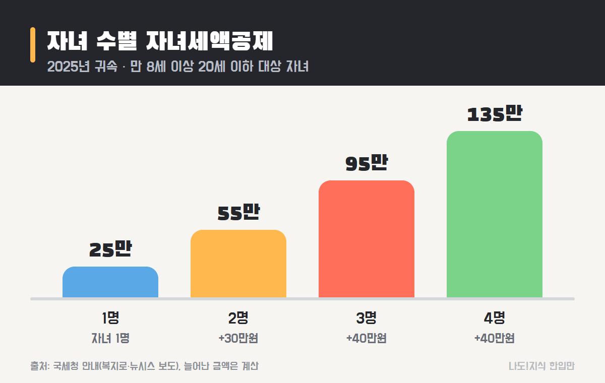
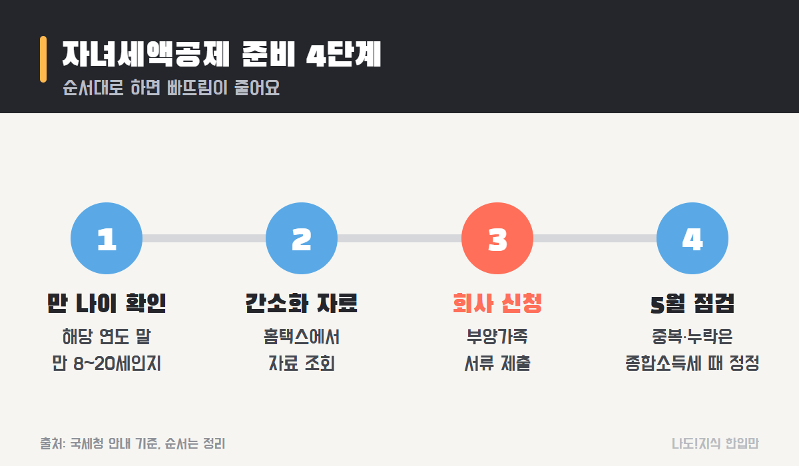

최종 검토일: 2026-11-26

25만원은 2025년 귀속 연말정산에서 자녀 1명을 둔 가정이 받는 자녀세액공제 금액이에요. 자녀가 2명이면 55만원, 3명이면 95만원으로 늘어요.

그런데 아이가 있다고 해서 모두 세어지지는 않아요. 만 8세 이상 20세 이하 자녀만 수에 들어가서, 같은 자녀 둘이어도 집마다 결과가 달라져요.

  <strong style="font-family:'Noto Sans KR', sans-serif;color:#163d7a;font-size:18px;">핵심만 먼저 보기</strong>
  <ul style="margin:10px 0 0 0;padding-left:20px;line-height:1.9;">
    <li>자녀세액공제는 기본공제 대상 자녀 중 만 8세 이상 20세 이하만 해당해요.</li>
    <li>자녀 1명 25만원, 2명 55만원, 3명 95만원, 4명 135만원이에요(2025년 귀속).</li>
    <li>2025년 귀속에서는 2005~2017년생이 대상이에요(연도로 계산한 값이에요).</li>
    <li>소득금액 100만원(근로소득만 총급여 500만원)을 넘는 자녀는 대상에서 빠져요.</li>
  </ul>

기준일: 2025년 12월 국세청 안내(2025년 귀속 연말정산, 2026년 1~2월 정산) 기준이에요. 지금 진행하는 2026년 귀속 정산은 국세청 안내에서 한 번 더 비교해 주세요.

<h2 style="color:#163d7a;font-family:'Noto Sans KR', sans-serif;">1. 자녀가 몇 명이면 얼마를 돌려받나요?</h2>

자녀 수에 따라 1명 25만원, 2명 55만원, 3명 95만원, 4명 135만원이에요. 국세청은 2025년 귀속 연말정산부터 이 금액이 지난해보다 10만원 올랐다고 안내했어요.

연말정산 자녀 세액공제는 기본공제 대상인 만 8세 이상 20세 이하 자녀 수에 따라, 내야 할 세금에서 정해진 금액을 직접 빼 주는 제도예요. 소득공제와 달리 세율과 상관없이 금액이 같아요.

용어가 헷갈리면 이렇게 나눠 보면 쉬워요.

<ul style="line-height:1.9;">
  <li><b>기본공제:</b> 부양가족 1명당 소득에서 150만원을 빼 주는 소득공제예요(소득세법 제50조). 세율이 높을수록 절세액이 커져요.</li>
  <li><b>자녀세액공제:</b> 기본공제 대상 자녀 중 만 8세 이상 20세 이하에게 붙는 세액공제예요. 계산된 세금에서 곧바로 빼기 때문에 세율과 상관없이 같아요.</li>
  <li><b>결정세액:</b> 모든 공제를 반영한 뒤 최종으로 내야 하는 세금이에요. 세액공제는 이 금액을 넘겨서 돌려받지는 못해요.</li>
</ul>

<table style="width:100%;border-collapse:collapse;margin:16px 0;">
  <thead>
    <tr style="background:#1f6feb;color:#fff;"><th style="border:1px solid #ddd;padding:8px;">대상 자녀 수</th><th style="border:1px solid #ddd;padding:8px;">공제 금액(총액)</th><th style="border:1px solid #ddd;padding:8px;">직전 단계보다 늘어난 금액</th></tr>
  </thead>
  <tbody>
    <tr><td style="border:1px solid #ddd;padding:8px;">1명</td><td style="border:1px solid #ddd;padding:8px;">25만원</td><td style="border:1px solid #ddd;padding:8px;">-</td></tr>
    <tr><td style="border:1px solid #ddd;padding:8px;">2명</td><td style="border:1px solid #ddd;padding:8px;">55만원</td><td style="border:1px solid #ddd;padding:8px;">+30만원</td></tr>
    <tr><td style="border:1px solid #ddd;padding:8px;">3명</td><td style="border:1px solid #ddd;padding:8px;">95만원</td><td style="border:1px solid #ddd;padding:8px;">+40만원</td></tr>
    <tr><td style="border:1px solid #ddd;padding:8px;">4명</td><td style="border:1px solid #ddd;padding:8px;">135만원</td><td style="border:1px solid #ddd;padding:8px;">+40만원</td></tr>
  </tbody>
</table>

늘어난 금액은 제가 총액끼리 뺀 계산이에요. 3명째부터는 1명이 늘 때마다 40만원씩 늘어나요.

<figure style="margin:24px 0;"><figcaption style="font-size:13px;color:#888;">2025년 귀속 국세청 안내(복지로·뉴시스 보도) 기준</figcaption></figure>

<h2 style="color:#163d7a;font-family:'Noto Sans KR', sans-serif;">2. 우리 아이는 대상인가요?</h2>

2025년 귀속에서는 연말 기준 만 8세 이상 20세 이하인 자녀가 대상이고, 출생연도로는 2005년생부터 2017년생까지예요.

저도 처음엔 "초등학교 들어갔으면 되는 건가?" 하고 헷갈렸어요. 그래서 출생연도마다 2025년 12월 31일 기준 만 나이를 직접 계산해서 표로 만들어 봤어요.

<table style="width:100%;border-collapse:collapse;margin:16px 0;">
  <thead>
    <tr style="background:#1f6feb;color:#fff;"><th style="border:1px solid #ddd;padding:8px;">출생연도</th><th style="border:1px solid #ddd;padding:8px;">2025년 말 만 나이</th><th style="border:1px solid #ddd;padding:8px;">자녀세액공제</th></tr>
  </thead>
  <tbody>
    <tr><td style="border:1px solid #ddd;padding:8px;">2018년생</td><td style="border:1px solid #ddd;padding:8px;">7세</td><td style="border:1px solid #ddd;padding:8px;">대상 아님(8세 미만)</td></tr>
    <tr><td style="border:1px solid #ddd;padding:8px;">2017년생</td><td style="border:1px solid #ddd;padding:8px;">8세</td><td style="border:1px solid #ddd;padding:8px;">대상</td></tr>
    <tr><td style="border:1px solid #ddd;padding:8px;">2005년생</td><td style="border:1px solid #ddd;padding:8px;">20세</td><td style="border:1px solid #ddd;padding:8px;">대상</td></tr>
    <tr><td style="border:1px solid #ddd;padding:8px;">2004년생</td><td style="border:1px solid #ddd;padding:8px;">21세</td><td style="border:1px solid #ddd;padding:8px;">대상 아님(20세 초과)</td></tr>
  </tbody>
</table>

이 표는 연도로만 계산한 값이에요. 생일이 지났는지에 따른 경계는 회사 안내와 홈택스 자료에서 한 번 더 살펴봐 주세요. 2026년 귀속이라면 같은 계산으로 한 해씩 뒤로 가서 2006~2018년생이 돼요.

나이만 맞다고 끝나지 않아요. 국세청 안내에 따르면 소득금액이 100만원(근로소득만 있으면 총급여 500만원)을 넘는 자녀는 기본공제 대상에서 빠지고, 자녀세액공제 대상에서도 제외돼요.

<ul style="line-height:1.9;">
  <li>아르바이트 소득이 있는 대학생 자녀는 연간 총급여를 따로 계산해 보세요.</li>
  <li>아이 이름의 예금 이자·배당이 있다면 그것도 소득이에요.</li>
  <li>8세 미만 자녀는 자녀세액공제는 아니지만 기본공제 대상일 수 있어요.</li>
</ul>

<h2 style="color:#163d7a;font-family:'Noto Sans KR', sans-serif;">3. 세 가정을 비교하면 어떻게 달라지나요?</h2>

같은 "자녀 2~3명"이어도 8세 미만 아이가 끼면 공제 금액이 달라져요. 아래는 제가 가상으로 만든 세 가정이에요.

<table style="width:100%;border-collapse:collapse;margin:16px 0;">
  <thead>
    <tr style="background:#1f6feb;color:#fff;"><th style="border:1px solid #ddd;padding:8px;">가정</th><th style="border:1px solid #ddd;padding:8px;">자녀 출생연도</th><th style="border:1px solid #ddd;padding:8px;">대상 자녀 수</th><th style="border:1px solid #ddd;padding:8px;">자녀세액공제</th></tr>
  </thead>
  <tbody>
    <tr><td style="border:1px solid #ddd;padding:8px;">A</td><td style="border:1px solid #ddd;padding:8px;">2012년, 2015년</td><td style="border:1px solid #ddd;padding:8px;">2명</td><td style="border:1px solid #ddd;padding:8px;">55만원</td></tr>
    <tr><td style="border:1px solid #ddd;padding:8px;">B</td><td style="border:1px solid #ddd;padding:8px;">2007년, 2011년, 2016년</td><td style="border:1px solid #ddd;padding:8px;">3명</td><td style="border:1px solid #ddd;padding:8px;">95만원</td></tr>
    <tr><td style="border:1px solid #ddd;padding:8px;">C</td><td style="border:1px solid #ddd;padding:8px;">2009년, 2019년</td><td style="border:1px solid #ddd;padding:8px;">1명(2019년생 제외)</td><td style="border:1px solid #ddd;padding:8px;">25만원</td></tr>
  </tbody>
</table>

A 가정은 두 아이가 모두 2025년 말 만 10세·13세라서 2명 기준 55만원이에요. B 가정은 만 18세·14세·9세 세 명이 모두 해당해서 95만원이에요.

C 가정이 가장 헷갈리는 경우예요. 둘째가 2019년생(만 6세)이라 자녀세액공제의 수에서 빠져서, 아이가 둘이어도 1명 기준 25만원으로 계산해요.

  <strong style="font-family:'Noto Sans KR', sans-serif;color:#163d7a;font-size:18px;">기본공제까지 합치면 얼마?</strong>
  <ul style="margin:10px 0 0 0;padding-left:20px;line-height:1.9;">
    <li>A 가정이 세율 15% 구간이라면, 자녀 2명 기본공제 300만원(1인 150만원, 소득세법 제50조) × 15% = 45만원이에요.</li>
    <li>여기에 자녀세액공제 55만원을 더하면 단순 계산으로 약 100만원이에요.</li>
    <li>실제 환급은 다른 공제와 합쳐서 정해지고, 낸 세금보다 많이 돌려받을 수는 없어요.</li>
  </ul>

내 경우를 고를 때는 아래 순서로 따져 보면 돼요.

<ol style="line-height:1.9;">
  <li>자녀마다 출생연도를 적고 앞의 나이 표로 8~20세인지 표시해요.</li>
  <li>표시된 자녀 수를 세요. 이 숫자가 공제 금액을 정하는 기준이에요.</li>
  <li>그 수에 맞는 금액(25·55·95·135만원)을 찾아요.</li>
</ol>

  <strong style="font-family:'Noto Sans KR', sans-serif;color:#163d7a;font-size:18px;">여기서 자주 걸려요</strong>
  <ul style="margin:10px 0 0 0;padding-left:20px;line-height:1.9;">
    <li>"둘째가 아직 어린데 수에 넣었다" → 만 8세 미만 자녀는 자녀세액공제의 수에서 빠져요.</li>
    <li>"올해 스무 살이 된 대학생은 이제 안 되겠지" → 연말 기준 만 20세 이하라면 대상일 수 있어요.</li>
    <li>"아이가 알바를 조금 했는데 괜찮겠지" → 소득이 기준을 넘으면 기본공제와 자녀세액공제가 함께 빠져요.</li>
    <li>"부부가 둘 다 올리면 더 받겠지" → 같은 자녀는 한 사람만 공제받아요.</li>
  </ul>

<h2 style="color:#163d7a;font-family:'Noto Sans KR', sans-serif;">4. 부부 중 누가 신청해야 하나요?</h2>

맞벌이라면 자녀 한 명을 부부 중 한 사람만 공제받을 수 있어요. 둘 다 올렸다면 중복이라 나중에 바로잡아야 해요.

자녀세액공제는 기본공제를 받는 사람에게 붙는 공제라서, 누구 몫으로 올렸는지가 먼저 정해져야 해요. 중복으로 올렸을 때는 국세청 안내에 따라 5월 종합소득세 신고에서 바로잡는 방법이 있어요.

<ul style="line-height:1.9;">
  <li>배우자와 올리는 사람을 말로 먼저 정해요.</li>
  <li>작년에 누가 올렸는지가 올해 순서의 기준이 될 수 있어요.</li>
  <li>중복으로 올렸다면 5월 종합소득세 신고 때 정정하는 편이 부담이 적어요.</li>
</ul>

<h2 style="color:#163d7a;font-family:'Noto Sans KR', sans-serif;">5. 올해 새로 챙길 것이 있나요?</h2>

발달재활서비스를 받는 9세 미만 아동은 이용증명서만으로 장애인 추가공제 200만원을 받을 수 있게 됐어요.

국세청 안내에 따르면 이 이용증명서는 간소화 서비스에서 처음으로 제공돼요. 병원에서 장애인증명서를 따로 받는 부담이 줄어드는 셈이에요.

같은 해에 아이를 낳았거나 입양했다면 출생·입양 세액공제도 있다고 알려져 있어요. 다만 금액은 이번에 두 곳 이상에서 일치하는 값을 확인하지 못해서 이 글에는 적지 않았어요. 국세청 홈택스 안내에서 직접 보셔야 해요.

그래서 올해 아이가 태어났다면 이 글의 금액표만 보지 말고, 출생·입양 공제 항목이 따로 있는지 간소화 서비스와 회사 안내문에서 한 번 더 찾아봐 주세요. 대상 자녀 수가 달라지는 경우에도 같은 방식으로 이중으로 확인하면 놓치는 일이 줄어요.

<h2 style="color:#163d7a;font-family:'Noto Sans KR', sans-serif;">자주 묻는 질문 3가지</h2>

<h3>Q. 올해 만 7세인 아이는 아예 공제가 없나요?</h3>

A. 자녀세액공제 대상은 만 8세 이상이라 해당하지 않아요. 다만 기본공제 대상 자녀일 수는 있어요. 아동수당 같은 다른 지원은 따로 신청 대상인지 살펴봐 주세요.

<h3>Q. 대학생 자녀가 용돈 벌이를 했는데 공제가 되나요?</h3>

A. 소득금액이 100만원(근로소득만 총급여 500만원)을 넘으면 기본공제가 안 되고 자녀세액공제도 같이 빠져요. 아르바이트 소득을 합쳐서 계산해 보세요.

<h3>Q. 이 금액이 2026년 귀속에도 그대로인가요?</h3>

A. 이 글은 2025년 귀속 국세청 안내 기준이에요. 2026년 귀속 금액은 국세청 안내가 나오는 대로 바뀐 점이 있는지 비교해서 갱신할 예정이에요.

<h2 style="color:#163d7a;font-family:'Noto Sans KR', sans-serif;">6. 이 글 다음에 무엇을 하면 되나요?</h2>

올해 연말정산에서 할 일은 크게 네 단계예요. 순서대로 하면 빠뜨리는 일이 줄어요.

<figure style="margin:24px 0;"><figcaption style="font-size:13px;color:#888;">자녀세액공제 준비 순서</figcaption></figure>

<ol style="line-height:1.9;">
  <li><b>만 나이 확인:</b> 자녀마다 해당 연도 말 만 나이가 8~20세인지 표로 확인해요.</li>
  <li><b>간소화 자료 조회:</b> 홈택스에서 자료를 보고, 소득금액 100만원(총급여 500만원)을 넘는 자녀가 없는지도 같이 봐요.</li>
  <li><b>회사 신청:</b> 부부 중 누가 부양가족으로 올릴지 정하고 회사에 서류를 내요.</li>
  <li><b>5월 점검:</b> 중복이나 빠진 자녀가 있으면 종합소득세 신고 때 바로잡아요.</li>
</ol>

저는 이 글을 쓰면서 자녀 출생연도 몇 개를 넣고 표를 만들어 봤어요. 표를 한 번 만들어 두니 "작년엔 대상이 아니었는데 올해는 되나?" 같은 고민이 금방 풀렸어요.

해가 바뀌면 같은 아이도 나이가 한 살씩 올라가요. 그래서 작년에 빠졌던 아이가 올해 들어오거나, 반대로 올해부터 20세를 넘어 빠지는 경우가 생겨요. 이 변화를 해마다 확인하는 습관을 들이면 놓치는 금액이 줄어요.

  <strong style="font-family:'Noto Sans KR', sans-serif;color:#163d7a;font-size:16px;">함께 보면 좋은 글</strong>
  <ul style="margin:8px 0 0 0;padding-left:20px;line-height:1.9;"><li><a href="https://sensitiveboss3.tistory.com/entry/year-end-tax-preview-card-deduction-2026" target="_blank" rel="noopener">연말정산 미리보기 12월 18일까지</a></li><li><a href="https://sensitiveboss3.tistory.com/entry/hometown-donation-tax-credit-2026" target="_blank" rel="noopener">고향사랑기부 세액공제</a></li><li><a href="https://sensitiveboss3.tistory.com/entry/pension-savings-tax-credit" target="_blank" rel="noopener">연금저축 세액공제</a></li></ul>

  참고 출처:
  <ul style="margin:6px 0 0 0;padding-left:20px;">
    <li><a href="https://www.bokjiro.go.kr/ssis-tbu/cms/pc/news/promotion/1309120_1118.html" target="_blank" rel="noopener">복지로(국세청 카드뉴스 소개): 2025년 귀속 연말정산, 무엇이 달라졌을까?</a></li>
    <li><a href="https://www.newsis.com/view/NISX20251217_0003444516" target="_blank" rel="noopener">뉴시스(2025-12-17): 자녀세액공제·고향사랑기부금 상향, 국세청 안내</a></li>
    <li><a href="https://www.law.go.kr/법령/소득세법" target="_blank" rel="noopener">국가법령정보센터: 소득세법 제50조(기본공제)</a></li>
  </ul>
  기준일: 2026년 11월 26일. 출생연도별 나이와 절세 예시는 직접 계산한 값이며 지방소득세는 별도예요.

이 글은 정보 제공을 목적으로 하며 특정 종목이나 상품의 매수·매도를 권유하지 않습니다. 세율·한도는 변경될 수 있으므로 반드시 국세청 등 원출처에서 최신 내용을 확인하시기 바랍니다. 개인별 세액은 소득과 공제 항목에 따라 달라져요.

