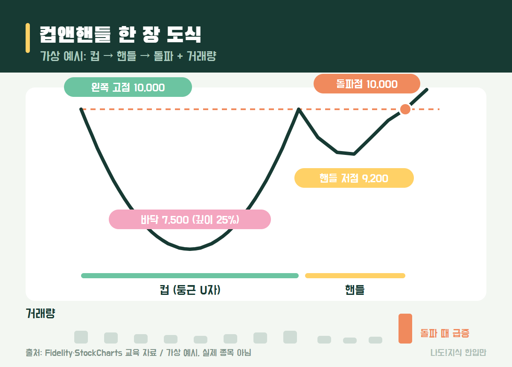
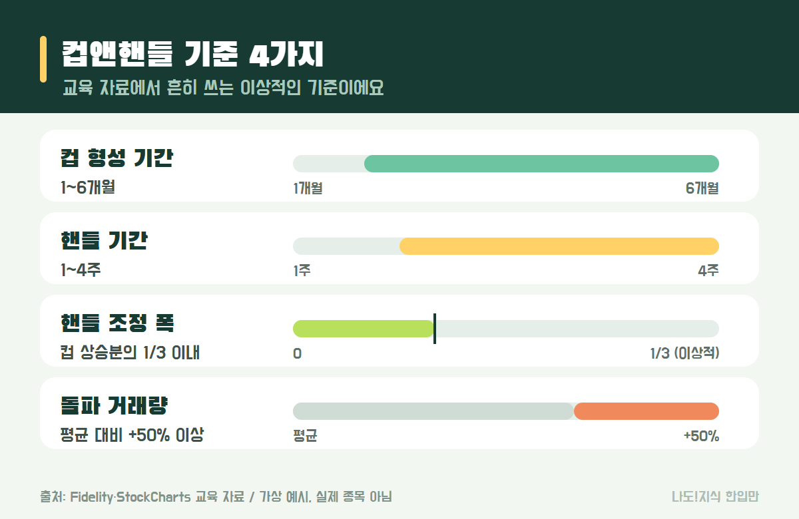
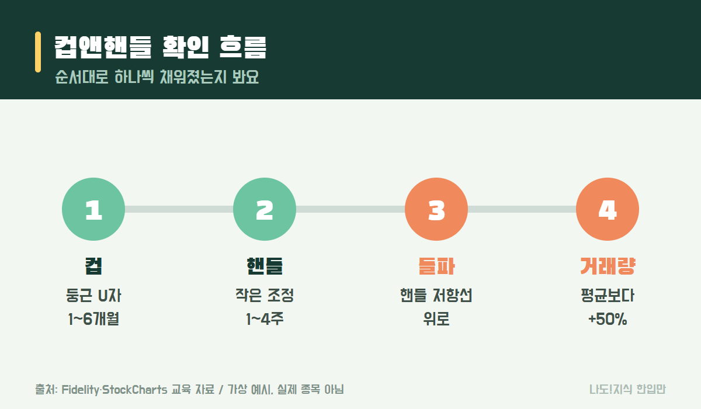

최종 검토일: 2026-11-24

컵앤핸들은 차트에서 가격이 컵 모양으로 둥글게 내려갔다 올라온 뒤, 작은 핸들 조정을 거쳐 이전 고점 부근을 넘어서는 모양을 부르는 말이에요. 상승 추세가 이어지는 중에 나오는 지속형 패턴으로 분류돼요.

이름은 알아도 어디까지가 컵이고 핸들이 얼마나 내려와야 하는지는 헷갈리기 쉬워요. 기간, 조정폭, 돌파 거래량 기준을 숫자로 정리하고, 가상 예시 계산까지 따라 해 볼 수 있어요.

  <strong style="color:#2f5d3a;font-size:18px;">📊 한눈에 보기</strong>
  <ul style="margin:10px 0 0 0;padding-left:20px;line-height:1.9;">
    <li><b>모양:</b> 둥근 U자 컵, 그 뒤 짧고 얕은 핸들</li>
    <li><b>기간:</b> 컵 보통 1~6개월, 핸들 1~4주</li>
    <li><b>핸들 조정폭:</b> 컵 상승분의 최대 3분의 1이 이상적(출처마다 다름)</li>
    <li><b>돌파 거래량:</b> 평균보다 최소 50% 늘어나는 것이 이상적</li>
    <li><b>한계:</b> 과거에 자주 보이는 모양일 뿐 앞날을 알려 주지 않아요</li>
  </ul>

  <strong style="font-size:16px;">📖 처음이라면 이것만 — 낱말 풀이</strong>
  <ul style="margin:8px 0 0 0;padding-left:20px;line-height:1.9;">
    <li><b>컵:</b> 고점에서 내려갔다가 다시 비슷한 높이로 올라오는 둥근 구간.</li>
    <li><b>핸들:</b> 컵 오른쪽 끝에서 잠깐 살짝 내려오는 짧은 조정 구간.</li>
    <li><b>저항선:</b> 가격이 자꾸 부딪혀 넘기 어려워하는 가격대.</li>
    <li><b>돌파:</b> 가격이 저항선 위로 올라서는 것.</li>
    <li><b>지속형 패턴:</b> 원래 흐름(상승)이 이어지는 중에 나오는 모양.</li>
  </ul>

<h2 style="border-left:6px solid #2f5d3a;padding-left:12px;margin-top:36px;">목차</h2>
<ol style="line-height:1.9;">
  <li><a href="#sec-1" style="color:inherit;text-decoration:underline;text-underline-offset:3px;">컵앤핸들은 어떤 모양인가요?</a></li>
  <li><a href="#sec-2" style="color:inherit;text-decoration:underline;text-underline-offset:3px;">컵과 핸들은 기간과 조정폭을 어떻게 보나요?</a></li>
  <li><a href="#sec-3" style="color:inherit;text-decoration:underline;text-underline-offset:3px;">돌파는 거래량으로 어떻게 확인하나요?</a></li>
  <li><a href="#sec-4" style="color:inherit;text-decoration:underline;text-underline-offset:3px;">가상 예시로 숫자 따라 하기</a></li>
  <li><a href="#sec-5" style="color:inherit;text-decoration:underline;text-underline-offset:3px;">자주 하는 실수 5가지</a></li>
  <li><a href="#sec-6" style="color:inherit;text-decoration:underline;text-underline-offset:3px;">컵앤핸들 Q&amp;A 5개</a></li>
</ol>

<h2 id="sec-1" style="scroll-margin-top:72px;border-left:6px solid #2f5d3a;padding-left:12px;margin-top:36px;">컵앤핸들은 어떤 모양인가요?</h2>

컵앤핸들은 둥근 컵 모양의 조정 뒤에 짧은 핸들이 붙어 손잡이 달린 찻잔처럼 보이는 차트 모양이에요. 윌리엄 오닐(William O'Neil)이 1988년 책 How to Make Money in Stocks에서 정의했어요.

전체 흐름은 네 단계로 나눠 볼 수 있어요.

<ol style="line-height:2;">
  <li><b>컵 왼쪽:</b> 오르던 가격이 고점을 찍고 서서히 내려가요.</li>
  <li><b>컵 바닥:</b> 둥글게 바닥을 만든 뒤 다시 올라오기 시작해요.</li>
  <li><b>컵 오른쪽:</b> 왼쪽 고점 부근까지 회복해요.</li>
  <li><b>핸들:</b> 그 자리에서 잠시 작게 내려왔다가 저항선을 향해 다시 올라가요.</li>
</ol>

<figure style="margin:24px 0;"><figcaption style="font-size:13px;color:#888;">가상의 모양을 설명하기 위한 도식이에요. 실제 종목이 아니에요.</figcaption></figure>

컵은 V자보다 둥근 U자 모양이 이상적이라고 설명해요. 급하게 내려갔다 급하게 올라온 V자는 중간에 매물이 정리될 시간이 적었다고 보기 때문이에요.

이 글은 모양을 읽는 법을 정리한 것이고, 모양이 나왔을 때 사야 한다는 뜻이 아니에요. 이동평균선 같은 다른 도구와 함께 보면 흐름을 확인하기가 쉬워요. 평균선 계산은 <a href="https://sensitiveboss3.tistory.com/entry/moving-average-5-20-day-cross" target="_blank" rel="noopener">이동평균선 5일 20일 계산과 크로스 보는 법</a>에서 볼 수 있어요.

<h2 id="sec-2" style="scroll-margin-top:72px;border-left:6px solid #2f5d3a;padding-left:12px;margin-top:36px;">컵과 핸들은 기간과 조정폭을 어떻게 보나요?</h2>

기간과 조정폭은 컵 1~6개월, 핸들 1~4주, 핸들 되돌림은 컵 상승분의 최대 3분의 1이라는 설명이 가장 흔해요. 다만 자료마다 숫자가 조금씩 달라요.

<table style="width:100%;border-collapse:collapse;margin:16px 0;">
  <thead>
    <tr style="background:#2f5d3a;color:#fff;"><th style="border:1px solid #ddd;padding:8px;">구분</th><th style="border:1px solid #ddd;padding:8px;">자료에서 흔히 보이는 기준</th><th style="border:1px solid #ddd;padding:8px;">참고</th></tr>
  </thead>
  <tbody>
    <tr><td style="border:1px solid #ddd;padding:8px;">컵 형성 기간</td><td style="border:1px solid #ddd;padding:8px;">보통 1~6개월</td><td style="border:1px solid #ddd;padding:8px;">Fidelity, Wikipedia</td></tr>
    <tr><td style="border:1px solid #ddd;padding:8px;">핸들 기간</td><td style="border:1px solid #ddd;padding:8px;">1~4주</td><td style="border:1px solid #ddd;padding:8px;">Fidelity, StockCharts, TrendSpider</td></tr>
    <tr><td style="border:1px solid #ddd;padding:8px;">핸들 되돌림</td><td style="border:1px solid #ddd;padding:8px;">컵 상승분의 최대 1/3(이상적)</td><td style="border:1px solid #ddd;padding:8px;">Fidelity. 10~33%로 보는 자료도 있고 위키는 30~50%로 달라 출처마다 다름</td></tr>
    <tr><td style="border:1px solid #ddd;padding:8px;">컵 깊이</td><td style="border:1px solid #ddd;padding:8px;">12~33%</td><td style="border:1px solid #ddd;padding:8px;">한 연구의 기준이라 합의된 값은 아님</td></tr>
    <tr><td style="border:1px solid #ddd;padding:8px;">컵 모양</td><td style="border:1px solid #ddd;padding:8px;">V자보다 둥근 U자</td><td style="border:1px solid #ddd;padding:8px;">Fidelity, Wikipedia</td></tr>
  </tbody>
</table>

<figure style="margin:24px 0;"><figcaption style="font-size:13px;color:#888;">자료에서 흔히 보이는 기준을 막대로 모았어요. 출처마다 다를 수 있어요.</figcaption></figure>

  <strong style="font-size:16px;">💡 읽는 요령</strong>
  <ul style="margin:8px 0 0 0;padding-left:20px;line-height:1.9;">
    <li>기준 숫자는 법칙이 아니라 교육 자료의 설명이에요.</li>
    <li>핸들이 컵보다 깊으면 컵앤핸들이라고 보기 어렵다는 쪽이 많아요.</li>
    <li>핸들은 컵 윗부분에서 만들어져야 모양이 자연스러워요.</li>
  </ul>

컵 깊이 12~33%는 한 연구가 제시한 범위예요. 어느 정도까지 깊은 컵을 인정할지는 자료마다 달라서, 하나의 숫자로 외우기보다 범위로 받아들이는 게 좋아요.

<h2 id="sec-3" style="scroll-margin-top:72px;border-left:6px solid #2f5d3a;padding-left:12px;margin-top:36px;">돌파는 거래량으로 어떻게 확인하나요?</h2>

돌파를 볼 때는 핸들 저항선이나 컵 오른쪽 고점을 넘어서는 날의 거래량을 같이 확인해요. 가격만 넘어서고 거래량이 따라오지 않으면 확인이 약하다고 보는 거예요.

<ul style="line-height:1.9;">
  <li><b>가격:</b> 핸들 저항선(컵 오른쪽 고점 부근)을 넘어섰는지.</li>
  <li><b>거래량:</b> 평소 평균보다 늘었는지. Tastytrade는 최소 50% 증가가 이상적이라고 설명해요.</li>
  <li><b>핸들 구간:</b> 거래량이 점점 줄었는지(조정이 조용했는지).</li>
</ul>

<figure style="margin:24px 0;"><figcaption style="font-size:13px;color:#888;">차례대로 확인하는 흐름을 정리한 그림이에요. 단계를 모두 채워도 결과는 정해져 있지 않아요.</figcaption></figure>

거래량 기준도 한 자료의 설명이지 모두가 합의한 규칙은 아니에요. PDF 연구에서도 비슷한 방향이 보이지만, 연구마다 표본과 기간이 달라서 수치는 참고만 해요.

돌파 직후 가격이 다시 저항선 아래로 내려오는 모습도 차트에서는 자주 볼 수 있어요. 그래서 모양을 읽는 것과 결과를 아는 것은 다른 일이에요. 변동 폭을 함께 보고 싶다면 <a href="https://sensitiveboss3.tistory.com/entry/bollinger-bands-calculation" target="_blank" rel="noopener">볼린저밴드 뜻과 계산법</a>도 참고가 돼요.

<h2 id="sec-4" style="scroll-margin-top:72px;border-left:6px solid #2f5d3a;padding-left:12px;margin-top:36px;">가상 예시로 숫자 따라 하기</h2>

가상 예시로 숫자를 따라 하면 컵 깊이 25%, 핸들 조정 32%가 어떻게 나오는지 한눈에 보여요. 실제 종목이 아닌 가정 가격이고, 계산 연습용이에요.

<table style="width:100%;border-collapse:collapse;margin:16px 0;">
  <thead>
    <tr style="background:#2f5d3a;color:#fff;"><th style="border:1px solid #ddd;padding:8px;">위치</th><th style="border:1px solid #ddd;padding:8px;">가상 가격</th><th style="border:1px solid #ddd;padding:8px;">설명</th></tr>
  </thead>
  <tbody>
    <tr><td style="border:1px solid #ddd;padding:8px;">컵 왼쪽 고점</td><td style="border:1px solid #ddd;padding:8px;">10,000</td><td style="border:1px solid #ddd;padding:8px;">컵이 시작되는 고점</td></tr>
    <tr><td style="border:1px solid #ddd;padding:8px;">컵 바닥</td><td style="border:1px solid #ddd;padding:8px;">7,500</td><td style="border:1px solid #ddd;padding:8px;">고점에서 2,500 하락</td></tr>
    <tr><td style="border:1px solid #ddd;padding:8px;">컵 오른쪽 고점</td><td style="border:1px solid #ddd;padding:8px;">10,000</td><td style="border:1px solid #ddd;padding:8px;">왼쪽 고점 부근까지 회복</td></tr>
    <tr><td style="border:1px solid #ddd;padding:8px;">핸들 저점</td><td style="border:1px solid #ddd;padding:8px;">9,200</td><td style="border:1px solid #ddd;padding:8px;">오른쪽 고점에서 800 하락</td></tr>
    <tr><td style="border:1px solid #ddd;padding:8px;">돌파점(저항선)</td><td style="border:1px solid #ddd;padding:8px;">10,000</td><td style="border:1px solid #ddd;padding:8px;">핸들 뒤 올라서야 하는 가격대</td></tr>
  </tbody>
</table>

  <strong>✍️ 따라 해 보기</strong> 
  ① 컵 깊이: (10,000 − 7,500) ÷ 10,000 = 2,500 ÷ 10,000 = <b>25%</b> 
  ② 컵 상승분: 바닥 7,500에서 10,000까지 오른 2,500 
  ③ 핸들 되돌림: 800 ÷ 2,500 = 0.32, 즉 <b>32%</b> 
  ④ 기준 비교: 3분의 1은 약 33.3%이므로 32%는 그 안쪽 
  ⑤ 어림 값: 돌파점 10,000 + 컵 깊이 2,500 = <b>12,500</b>

⑤의 12,500은 컵 깊이를 돌파점에 더하는 교육용 어림 산수예요. Fidelity와 StockCharts가 이 방식으로 설명하지만, 도달을 예측하거나 목표 가격을 제시하는 것이 아니에요.

거래량도 가상으로 계산해 볼게요. 평균 거래량이 100,000주라면 최소 50% 증가는 100,000 × 1.5 = 150,000주예요. 돌파한 날이 120,000주였다면 이 기준에는 못 미친 셈이에요.

<h2 id="sec-5" style="scroll-margin-top:72px;border-left:6px solid #2f5d3a;padding-left:12px;margin-top:36px;">자주 하는 실수 5가지</h2>

컵앤핸들에서 생기는 실수는 대부분 모양이 닮았다는 이유로 기준을 건너뛰는 데서 나와요.

  <strong style="font-size:16px;">⚠️ 이것만 피하세요</strong>
  <ol style="margin:8px 0 0 0;padding-left:20px;line-height:1.9;">
    <li><b>V자 급등락도 컵이라고 보기</b> → 둥근 U자 모양과 충분한 기간이 있어야 해요.</li>
    <li><b>핸들이 너무 깊은데 그냥 넘어가기</b> → 컵 상승분의 3분의 1을 넘으면 기준에서 멀어져요.</li>
    <li><b>거래량 확인 없이 가격만 보기</b> → 돌파일 거래량이 평균 대비 늘었는지 함께 봐요.</li>
    <li><b>어림 목표 12,500을 예측으로 받아들이기</b> → 교육용 산수일 뿐 도달을 알려 주지 않아요.</li>
    <li><b>패턴 하나만 보기</b> → 상승 추세인지, 과열은 아닌지 다른 지표로 함께 점검해요. 과열 정도는 <a href="https://sensitiveboss3.tistory.com/entry/rsi-meaning-14day-calculation" target="_blank" rel="noopener">RSI 뜻과 14일 값 직접 구하기</a>에서 계산법을 볼 수 있어요.</li>
  </ol>

이 실수들은 차트를 한참 본 뒤에야 알아채는 경우가 많아요. 그래서 패턴을 발견했을 때 곧바로 "맞다"고 결론 내리기보다, 위 기준을 하나씩 체크하는 순서를 정해 두는 편이 좋아요.

<ul>
  <li>컵의 기간이 1~6개월 안에 들어오는지 달력으로 세어 봐요.</li>
  <li>핸들 저점이 컵 상승분의 3분의 1 안에 있는지 직접 계산해 봐요.</li>
  <li>돌파한 날의 거래량을 평소 평균과 숫자로 비교해 봐요.</li>
</ul>

이 체크는 패턴이 기준에 맞는지 보는 확인 절차일 뿐, 이후 가격 방향을 알려 주지는 않아요. 같은 모양이어도 시장 상황에 따라 결과는 얼마든지 달라질 수 있어요.

<h2 id="sec-6" style="scroll-margin-top:72px;border-left:6px solid #2f5d3a;padding-left:12px;margin-top:36px;">컵앤핸들 Q&amp;A 5개</h2>

  
컵앤핸들 패턴이 뭔가요

  
윌리엄 오닐이 1988년 책 How to Make Money in Stocks에서 정의한 패턴으로, 상승 추세 중에 컵 모양으로 둥글게 조정받은 뒤 작은 핸들을 만들고 저항선을 넘어서는 모양을 말해요. 상승 흐름이 이어질 때 나오는 지속형 패턴으로 분류돼요.

  
핸들은 얼마나 내려와야 하나요

  
핸들 되돌림은 컵 상승분의 최대 3분의 1 정도가 이상적이라는 자료가 있어요. 다만 10~33%로 보는 자료도 있고 30~50%까지 허용하는 자료도 있어서 출처마다 달라요.

  
컵 기간은 얼마나 걸리나요

  
컵은 보통 1~6개월, 핸들은 1~4주로 설명하는 자료가 많아요. 한 연구가 제시한 컵 깊이 12~33%는 그 연구의 기준일 뿐 모두가 합의한 값은 아니에요.

  
돌파 때 거래량은 얼마나 늘어야 하나요

  
평균 거래량보다 최소 50% 늘어나는 것이 이상적이라는 설명이 있어요. 가상 예시로 평균이 100,000주라면 150,000주 이상인 셈이에요. 이 기준도 자료 하나의 설명이라 절대 규칙은 아니에요.

  
컵앤핸들이 나오면 오르나요

  
그렇지 않아요. 패턴은 과거 차트에서 반복적으로 관찰된 모양일 뿐 앞으로의 가격을 정해 주지 않아요. 어림 목표값도 교육용 산수이고 예측이 아니에요.

  <strong style="font-size:16px;">📚 함께 보면 좋은 글</strong>
  <ul style="margin:8px 0 0 0;padding-left:20px;line-height:1.9;"><li><a href="https://sensitiveboss3.tistory.com/entry/moving-average-5-20-day-cross" target="_blank" rel="noopener">이동평균선 5일 20일 계산과 크로스 보는 법</a></li><li><a href="https://sensitiveboss3.tistory.com/entry/bollinger-bands-calculation" target="_blank" rel="noopener">볼린저밴드 뜻과 계산법</a></li><li><a href="https://sensitiveboss3.tistory.com/entry/rsi-meaning-14day-calculation" target="_blank" rel="noopener">RSI 뜻과 14일 값 직접 구하기</a></li></ul>

  참고 출처 (컵앤핸들은 공시 기관이 정의한 지표가 아니라서 1차 출처가 없고, 아래는 교육 자료예요):
  <ul style="margin:6px 0 0 0;padding-left:20px;">
    <li><a href="https://www.fidelity.com/learning-center/trading-investing/technical-analysis/technical-indicator-guide/cup-with-handle" target="_blank" rel="noopener">Fidelity: Cup with handle</a></li>
    <li><a href="https://chartschool.stockcharts.com/table-of-contents/chart-analysis/chart-patterns/cup-with-handle" target="_blank" rel="noopener">StockCharts ChartSchool: Cup with Handle</a></li>
    <li><a href="https://tastytrade.com/learn/platforms-and-tools/charts/cup-and-handle/" target="_blank" rel="noopener">Tastytrade: Cup and Handle</a></li>
    <li><a href="https://en.wikipedia.org/wiki/Cup_and_handle" target="_blank" rel="noopener">Wikipedia: Cup and handle</a></li>
    <li><a href="https://alphasquare.co.kr/home/insight/posts/7614e10c-c46c-4518-a3d0-de215d2c1828" target="_blank" rel="noopener">알파스퀘어: 컵앤핸들</a></li>
  </ul>
  기준일: 2026년 11월 24일. 예시 가격은 계산을 보여 주기 위한 가상 예시예요.

이 글은 정보 제공을 목적으로 하며 특정 종목이나 상품의 매수·매도를 권유하지 않습니다. 투자 판단과 그 결과에 대한 책임은 투자자 본인에게 있습니다.
예시는 계산을 보여 주기 위한 가상값이며, 패턴의 기준은 자료마다 다를 수 있으므로 반드시 원출처에서 확인하시기 바랍니다.

