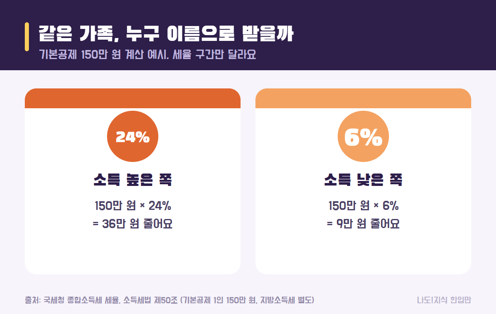
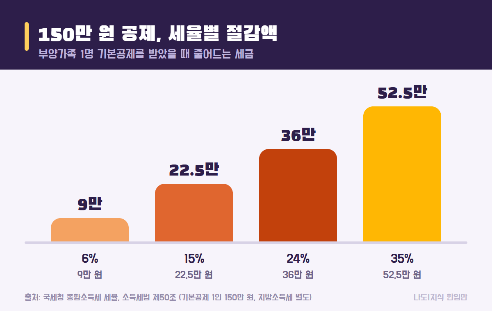

최종 검토일: 2026-11-26

같은 가족을 두 사람이 부양가족으로 올리면 한 사람만 150만원 기본공제를 받을 수 있어요. 둘이 신청했다면 국세청 안내 순서에 따라 직전 연도에 공제받은 사람이, 그런 사람이 없으면 소득이 많은 사람이 받는 쪽으로 가려져요.

직장인 A씨(가상의 인물이에요)는 맞벌이예요. 아내와 둘 다 "우리 아이는 내가 올릴게"라고 생각하고 회사에 서류를 냈다면 어떻게 될까요? 이 글에서는 맞벌이·형제 사례를 계산해 보고, 잘못 받았을 때 고치는 방법까지 정리했어요.

  <strong style="font-family:'Nanum Myeongjo', serif;color:#8a3412;font-size:18px;">핵심만 먼저 보기</strong>
  <ul style="margin:10px 0 0 0;padding-left:20px;line-height:1.9;">
    <li>부양가족 1명은 한 사람만 기본공제(1인 150만원)를 받아요.</li>
    <li>맞벌이 자녀 중복 공제는 5월 종합소득세 신고 때 정정하고, 그 뒤에 고치면 가산세가 붙어요.</li>
    <li>소득금액 100만원(근로소득만이면 총급여 500만원)을 넘는 가족은 기본공제가 안 돼요.</li>
    <li>150만원이 세금으로 얼마나 줄어드는지는 세율에 따라 9만원부터 52.5만원까지 달라져요.</li>
  </ul>

기준일: 2026년 1월 국세청 연말정산 안내(2025년 귀속) 기준이에요. 2026년 귀속은 현행 규정을 같은 안내와 홈택스에서 다시 살펴봐 주세요.

<h2 style="color:#8a3412;font-family:'Nanum Myeongjo', serif;">부양가족 한 명을 두 사람이 신청하면 누가 받나요?</h2>

한 명은 한 사람만 공제받을 수 있고, 둘 이상이 신청하면 직전 과세기간에 공제받은 사람이 먼저, 없으면 종합소득금액이 많은 사람이 받아요.

연말정산 부양가족 공제는 소득이 적은 가족을 부양하는 사람의 세금 부담을 덜어 주는 기본공제(소득공제)예요. 소득세법 제50조에 따라 한 사람당 150만원을 소득에서 빼 줘요.

공제받을 사람을 가리는 순서는 국세청 Q&amp;A에 이렇게 나와 있어요.

<ol style="line-height:1.9;">
  <li><b>1순위:</b> 직전 과세기간(작년)에 그 가족을 공제받은 사람</li>
  <li><b>2순위:</b> 작년에 공제받은 사람이 없다면 종합소득금액이 많은 사람</li>
</ol>

이 순서는 "누가 더 유리한가"를 따지는 게 아니라 "누구 몫으로 볼 것인가"를 가르는 기준이에요. 그래서 올해 갑자기 세율이 높은 쪽으로 옮기고 싶어도 마음대로 되지 않을 수 있어요.

<h2 style="color:#8a3412;font-family:'Nanum Myeongjo', serif;">맞벌이 부부는 자녀 공제를 누가 받나요?</h2>

맞벌이 부부는 자녀 한 명을 부부 중 한 사람만 공제받을 수 있어요. 둘 다 올리면 중복이고, 정정 대상이에요.

사례 1을 볼게요. 가상의 부부 A씨와 B씨는 맞벌이이고 자녀가 한 명이에요. A씨는 과세표준이 5,000만원 초과 8,800만원 이하(세율 24%) 구간이고, B씨는 1,400만원 이하(세율 6%) 구간이라고 가정했어요.

<ul style="line-height:1.9;">
  <li><b>A씨가 받으면:</b> 150만원 × 24% = 36만원 (소득세 줄어드는 금액)</li>
  <li><b>B씨가 받으면:</b> 150만원 × 6% = 9만원</li>
  <li><b>차이:</b> 27만원</li>
</ul>

<figure style="margin:24px 0;"><figcaption style="font-size:13px;color:#888;">세율 24%와 6%로 비교한 계산 예시예요. 지방소득세는 별도라 포함하지 않았어요.</figcaption></figure>

이 계산은 공제액 150만원이 한 세율 구간 안에서 모두 줄어든다고 보고 단순하게 한 거예요. 구간 경계에 걸치면 실제 절세액은 달라질 수 있어요. 신용카드 공제처럼 소득 크기에 따라 문턱이 달라지는 항목도 있어서, 최종 판단은 연말정산 미리보기(홈택스)로 두 경우를 모두 확인하는 게 안전해요.

중복으로 올렸다면 고치는 시점이 중요해요. 국세청 안내에 따르면 맞벌이 부부가 자녀를 중복 공제받은 경우 5월 종합소득세 신고 때 제외하고 추가 납부해야 해요. 그 이후에 수정신고하면 과소납부세액의 10%와 납부지연 가산세(1일 0.022%)가 붙어요.

<h2 style="color:#8a3412;font-family:'Nanum Myeongjo', serif;">형제가 같은 부모님을 신청하면 어떻게 되나요?</h2>

형과 동생이 같은 아버지나 어머니를 신청하면 1명만 공제가 돼요. 앞에서 본 순서(직전 과세기간 공제자, 없으면 종합소득금액이 많은 사람)가 그대로 쓰여요.

사례 2예요. 가상의 형제 C씨와 D씨가 어머니를 부양해요. C씨는 세율 15% 구간(과세표준 1,400만원 초과 5,000만원 이하), D씨는 35% 구간이에요.

<ul style="line-height:1.9;">
  <li><b>C씨가 받으면:</b> 150만원 × 15% = 22.5만원</li>
  <li><b>D씨가 받으면:</b> 150만원 × 35% = 52.5만원</li>
  <li><b>작년에 C씨가 받았다면:</b> 올해는 C씨가 먼저예요. D씨가 신청해도 순서가 바뀌지 않아요.</li>
</ul>

형제가 가장 많이 놓치는 건 의료비예요. 국세청 안내에 따르면 형이 어머니를 기본공제 대상으로 올렸다면 동생이 어머니를 위해 낸 의료비는 공제받을 수 없어요. 병원비를 낸 사람과 가족을 올린 사람이 다르면 공제가 비어 버려요.

  <strong style="font-family:'Nanum Myeongjo', serif;color:#8a3412;font-size:18px;">형제끼리 미리 정할 것</strong>
  <ul style="margin:10px 0 0 0;padding-left:20px;line-height:1.9;">
    <li>부모님 각각을 누가 부양가족으로 올릴지</li>
    <li>병원비·보험료를 누가 낼지 (올린 사람과 같아야 공제가 이어져요)</li>
    <li>작년에 누가 받았는지 (올해 순서의 기준이 돼요)</li>
  </ul>

<h2 style="color:#8a3412;font-family:'Nanum Myeongjo', serif;">소득이 있는 가족을 올리면 무엇이 안 되나요?</h2>

소득금액이 100만원(근로소득만 있다면 총급여 500만원)을 넘는 가족은 기본공제를 받을 수 없고, 그 가족 몫의 신용카드·보험료·교육비·기부금·추가공제도 함께 안 돼요.

사례 3이에요. 가상의 직장인 E씨는 배우자의 양도소득금액이 200만원인데 부양가족으로 올렸어요. 국세청 보도자료의 예시처럼 양도소득금액이 200만원이면 소득금액 100만원을 넘으니 배우자 기본공제는 불가해요.

<ul style="line-height:1.9;">
  <li><b>E씨의 세율이 15%라면:</b> 150만원 × 15% = 22.5만원의 절세가 취소돼요.</li>
  <li><b>되돌릴 때 가산세:</b> 22.5만원의 10%인 22,500원이 단순 계산으로 붙을 수 있고, 납부지연 가산세는 별도예요.</li>
  <li><b>예외:</b> 의료비는 소득 초과 가족이어도 공제가 가능해요.</li>
</ul>

근로소득만 있는 가족은 총급여 500만원 이하, 다른 소득이 있다면 소득금액 100만원 이하가 기준이에요. 어느 쪽인지 헷갈리면 가족의 소득을 모두 합쳐 보세요. 소득 요건 자체와 추가공제 금액은 연말정산 인적공제 조건 글에 따로 정리해 두었어요.

<h2 style="color:#8a3412;font-family:'Nanum Myeongjo', serif;">세율에 따라 150만원 공제는 얼마가 되나요?</h2>

150만원 공제의 절세액은 세율 6%면 9만원, 15%면 22.5만원, 24%면 36만원, 35%면 52.5만원이에요.

<figure style="margin:24px 0;"><figcaption style="font-size:13px;color:#888;">2023~2025 귀속 국세청 세율표 구간 기준 계산이에요. 지방소득세는 별도예요.</figcaption></figure>

<table style="width:100%;border-collapse:collapse;margin:16px 0;">
  <thead>
    <tr style="background:#e0662f;color:#fff;"><th style="border:1px solid #ddd;padding:8px;">세율</th><th style="border:1px solid #ddd;padding:8px;">과세표준 구간</th><th style="border:1px solid #ddd;padding:8px;">150만원 공제 시 절세액</th></tr>
  </thead>
  <tbody>
    <tr><td style="border:1px solid #ddd;padding:8px;">6%</td><td style="border:1px solid #ddd;padding:8px;">1,400만원 이하</td><td style="border:1px solid #ddd;padding:8px;">9만원</td></tr>
    <tr><td style="border:1px solid #ddd;padding:8px;">15%</td><td style="border:1px solid #ddd;padding:8px;">1,400만원 초과 5,000만원 이하</td><td style="border:1px solid #ddd;padding:8px;">22.5만원</td></tr>
    <tr><td style="border:1px solid #ddd;padding:8px;">24%</td><td style="border:1px solid #ddd;padding:8px;">5,000만원 초과 8,800만원 이하</td><td style="border:1px solid #ddd;padding:8px;">36만원</td></tr>
    <tr><td style="border:1px solid #ddd;padding:8px;">35%</td><td style="border:1px solid #ddd;padding:8px;">8,800만원 초과 구간</td><td style="border:1px solid #ddd;padding:8px;">52.5만원</td></tr>
  </tbody>
</table>

과세표준은 총급여에서 각종 공제를 뺀 뒤의 금액이라 월급만 보고 구간을 짐작하기 어려워요. 내 구간은 작년 결정세액 자료나 홈택스 미리보기에서 확인할 수 있어요. 이 표는 세율 구간의 단순 계산이고, 실제 환급·추가납부는 다른 공제와 합쳐서 정해져요.

<h2 style="color:#8a3412;font-family:'Nanum Myeongjo', serif;">잘못 받았다면 언제까지 어떻게 고치나요?</h2>

중복 공제는 5월 종합소득세 신고 때 바로잡는 것이 가장 부담이 적어요. 그 뒤에 수정신고하면 가산세가 붙어요.

<ol style="line-height:1.9;">
  <li><b>중복 여부 확인:</b> 홈택스 연말정산 간소화 서비스와 회사 제출 서류에서 같은 가족이 두 사람에게 올라갔는지 봐요.</li>
  <li><b>한쪽을 정하기:</b> 앞에서 본 순서(직전 과세기간 공제자, 없으면 소득이 많은 사람)에 맞춰 누가 받을지 정해요.</li>
  <li><b>5월에 정정:</b> 공제를 뺀 쪽은 종합소득세 신고에서 제외하고 추가 세금을 내요.</li>
  <li><b>기한이 지났다면:</b> 수정신고를 하고, 과소납부세액 10%와 납부지연 1일 0.022% 가산세를 감안해요.</li>
</ol>

사례 1의 부부가 둘 다 150만원을 공제받았고 A씨 쪽을 정정해야 한다면 36만원을 추가로 내요. 이 시점이 수정신고라면 36만원의 10%인 3.6만원이 단순 계산으로 가산세에 해당하고, 납부지연 가산세가 날짜만큼 더 붙어요. 가산세는 정정이 늦을수록 커지니 먼저 알아챌수록 유리해요.

<h2 style="color:#8a3412;font-family:'Nanum Myeongjo', serif;">이런 실수가 가장 많아요</h2>

  <strong style="font-family:'Nanum Myeongjo', serif;color:#8a3412;font-size:18px;">이 네 가지부터 점검</strong>
  <ol style="margin:10px 0 0 0;padding-left:20px;line-height:1.9;">
    <li><b>부부가 서로 모르고 같은 자녀를 올리기</b> → 서류를 내기 전에 서로 확인해요.</li>
    <li><b>형제가 각자 부모님을 올리기</b> → 부모님 한 분당 한 사람만 올릴 수 있어요.</li>
    <li><b>소득 초과 가족의 카드·보험료까지 공제받기</b> → 기본공제가 안 되면 함께 빠져요.</li>
    <li><b>의료비를 낸 사람과 올린 사람이 다름</b> → 형이 올린 어머니의 의료비는 동생이 공제받을 수 없어요.</li>
  </ol>

<h2 style="color:#8a3412;font-family:'Nanum Myeongjo', serif;">자주 묻는 질문 4가지</h2>

<h3>Q. 부부가 둘 다 같은 자녀를 올렸는데 회사에서 아무 말이 없었어요.</h3>

A. 회사가 모든 중복을 걸러 주는 건 아니에요. 중복이라면 5월 종합소득세 신고 때 한쪽을 제외하고 추가 납부해야 하고, 그 뒤에 고치면 가산세가 붙어요.

<h3>Q. 올해만 소득이 높은 쪽으로 부모님을 옮겨도 되나요?</h3>

A. 순서는 작년에 공제받은 사람이 먼저예요. 작년에 공제받은 사람이 있다면 그 사람 몫으로 보는 게 우선이라, 임의로 옮기기는 어려울 수 있어요. 구체적인 사정은 국세청 상담센터(126)에 물어보세요.

<h3>Q. 소득이 넘는 부모님은 병원비도 공제가 안 되나요?</h3>

A. 의료비는 예외예요. 국세청 안내에 따르면 소득 초과 가족이어도 의료비는 공제받을 수 있어요. 다만 다른 가족이 이미 기본공제로 올렸다면 형제가 낸 의료비는 공제가 안 돼요.

<h3>Q. 올해 규정도 이 글과 같은가요?</h3>

A. 이 글은 2026년 1월 국세청 안내(2025년 귀속) 기준이에요. 2026년 귀속 연말정산은 현행 규정을 다시 확인해야 해요. 연말정산 안내가 나오는 대로 이 글을 갱신할 예정이에요.

  <strong style="font-family:'Nanum Myeongjo', serif;color:#8a3412;font-size:18px;">오늘 할 일 체크리스트</strong>
  <ul style="margin:10px 0 0 0;padding-left:20px;line-height:1.9;list-style:none;">
    <li>[ ] 배우자와 자녀를 누가 올릴지 말로 정한다</li>
    <li>[ ] 형제나 가족과 부모님 부양가족 신청자를 맞춰 본다</li>
    <li>[ ] 가족 중 소득금액 100만원(총급여 500만원)을 넘는 사람이 있는지 본다</li>
    <li>[ ] 내 세율 구간을 확인해 150만원이 얼마로 줄어드는지 계산한다</li>
    <li>[ ] 이미 중복했다면 5월 종합소득세 신고 때 바로잡을 일정을 적어 둔다</li>
  </ul>

  <strong style="font-family:'Nanum Myeongjo', serif;color:#8a3412;font-size:16px;">함께 보면 좋은 글</strong>
  <ul style="margin:8px 0 0 0;padding-left:20px;line-height:1.9;"><li><a href="https://sensitiveboss3.tistory.com/entry/year-end-tax-preview-card-deduction-2026" target="_blank" rel="noopener">연말정산 미리보기 12월 18일까지</a></li><li><a href="https://sensitiveboss3.tistory.com/entry/income-tax-interim-prepayment-2026" target="_blank" rel="noopener">종합소득세 중간예납 2026, 11월 30일 마감·50만원 미만 면제</a></li></ul>

  참고 출처:
  <ul style="margin:6px 0 0 0;padding-left:20px;">
    <li><a href="https://www.korea.kr/news/policyNewsView.do?newsId=148958494" target="_blank" rel="noopener">국세청 보도(2026-01-23): 연말정산 안내(정책브리핑)</a></li>
    <li><a href="https://www.korea.kr/news/policyNewsView.do?newsId=148937040" target="_blank" rel="noopener">국세청 연말정산 Q&amp;A(정책브리핑)</a></li>
    <li><a href="https://www.law.go.kr/법령/소득세법" target="_blank" rel="noopener">국가법령정보센터: 소득세법 제50조(기본공제)</a></li>
  </ul>
  기준일: 2026년 11월 26일. 금액은 세율을 곱한 단순 계산이며 지방소득세는 별도예요.

이 글은 정보 제공을 목적으로 하며 특정 종목이나 상품의 매수·매도를 권유하지 않습니다. 세율·한도는 변경될 수 있으므로 반드시 국세청 등 원출처에서 최신 내용을 확인하시기 바랍니다. 개인별 세액은 소득과 공제 항목에 따라 달라져요.

