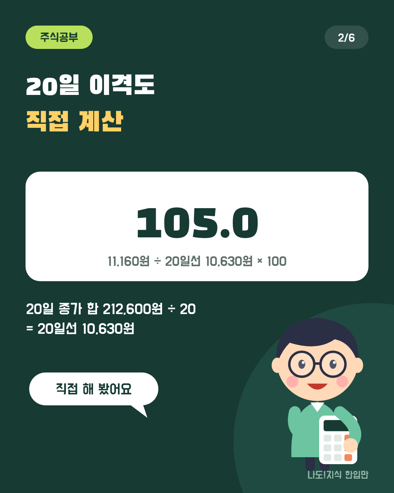
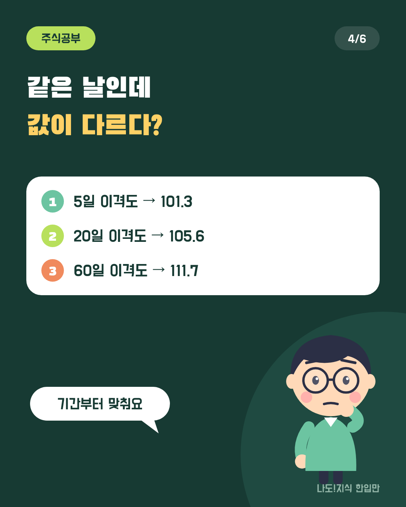
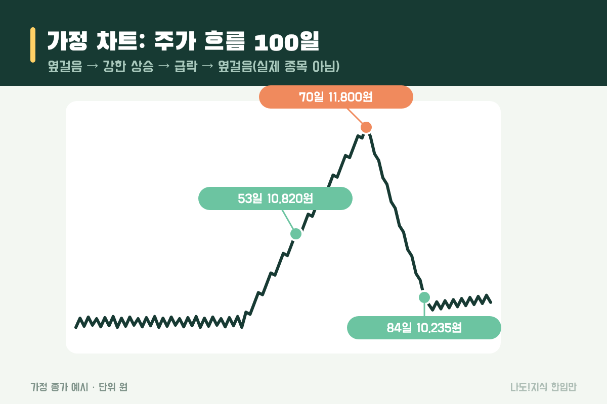
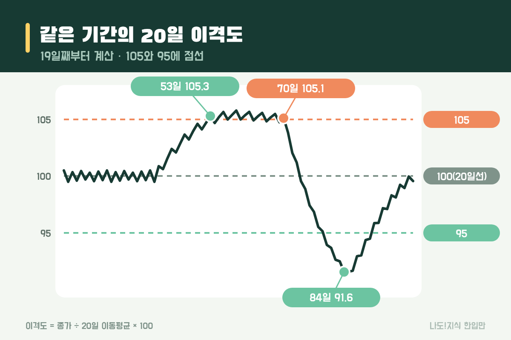
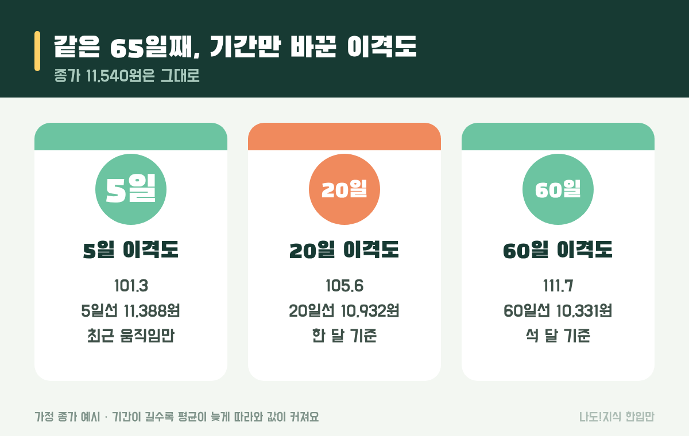

최종 검토일: 2026-11-12

이격도는 주가가 이동평균선에서 얼마나 떨어져 있는지를 %로 나타낸 지표예요. 공식은 주가 ÷ 이동평균 × 100 한 줄이고, 100이면 주가가 이동평균선과 같은 자리, 105면 5% 위, 95면 5% 아래예요.

숫자는 간단하지만 "105면 많이 오른 거니까 곧 내려간다"처럼 오해하기 쉬운 지표이기도 해요. 가정 차트로 20일 이격도를 직접 계산하고, 같은 날인데 기간마다 값이 왜 다른지, 어디서 틀리는지까지 볼게요.

  <strong style="color:#173a33;font-size:18px;">📏 한눈에 보기</strong>
  <ul style="margin:10px 0 0 0;padding-left:20px;line-height:1.9;">
    <li><b>뜻:</b> 주가와 이동평균선 사이의 거리(%)</li>
    <li><b>공식:</b> 오늘 종가 ÷ N일 이동평균 × 100 (보통 N = 20)</li>
    <li><b>읽는 법:</b> 100 = 같은 자리 · 105 = 5% 위 · 95 = 5% 아래</li>
    <li><b>기준 숫자:</b> 105·95, 106·98 등 자료마다 달라요</li>
    <li><b>한계:</b> 강한 추세에서는 105 근처에 오래 머물 수 있어요</li>
  </ul>

옆으로 넘겨 보세요 → (카드 6장 요약)

  <strong style="font-size:16px;">📖 처음이라면 이것만 — 낱말 풀이</strong>
  <ul style="margin:8px 0 0 0;padding-left:20px;line-height:1.9;">
    <li><b>이동평균(이동평균선):</b> 최근 N일 종가의 평균. 매일 하루씩 밀려가며 다시 계산해서 '이동'평균이에요.</li>
    <li><b>20일선:</b> 최근 20거래일 종가 평균을 이은 선. 주식시장이 한 달에 약 20일 열려서 '한 달 평균'처럼 써요.</li>
    <li><b>종가:</b> 그날 장이 끝날 때의 마지막 가격.</li>
    <li><b>괴리:</b> 두 값이 벌어진 정도. 이격도는 주가와 평균의 괴리를 %로 바꾼 거예요.</li>
    <li><b>보조지표:</b> 가격·거래량으로 계산해 차트 아래나 위에 덧그리는 숫자. 이격도도 그중 하나예요.</li>
  </ul>

<h2 style="border-left:6px solid #173a33;padding-left:12px;margin-top:36px;">목차</h2>
<ol style="line-height:1.9;">
  <li><a href="#sec-1" style="color:inherit;text-decoration:underline;text-underline-offset:3px;">이격도는 무엇인가요?</a></li>
  <li><a href="#sec-2" style="color:inherit;text-decoration:underline;text-underline-offset:3px;">20일 이격도는 어떻게 계산하나요?</a></li>
  <li><a href="#sec-3" style="color:inherit;text-decoration:underline;text-underline-offset:3px;">이격도 105와 95는 무슨 뜻인가요?</a></li>
  <li><a href="#sec-4" style="color:inherit;text-decoration:underline;text-underline-offset:3px;">5일·20일·60일 이격도는 왜 다르게 나오나요?</a></li>
  <li><a href="#sec-5" style="color:inherit;text-decoration:underline;text-underline-offset:3px;">이격도가 105를 넘으면 바로 내려가나요?</a></li>
  <li><a href="#sec-6" style="color:inherit;text-decoration:underline;text-underline-offset:3px;">HTS에서 이격도 켜는 법 따라 하기</a></li>
  <li><a href="#sec-7" style="color:inherit;text-decoration:underline;text-underline-offset:3px;">자주 하는 오해 5가지</a></li>
  <li><a href="#sec-8" style="color:inherit;text-decoration:underline;text-underline-offset:3px;">이격도 Q&amp;A 5개</a></li>
</ol>

<h2 id="sec-1" style="scroll-margin-top:72px;border-left:6px solid #173a33;padding-left:12px;margin-top:36px;">이격도는 무엇인가요?</h2>

이격도는 오늘 주가를 이동평균으로 나눠 100을 곱한 값이에요. 이동평균이 '최근 평균 가격'이니, 이격도는 지금 가격이 평균에서 몇 % 벌어져 있는지를 알려 줘요.

이동평균선을 차트에 그려 놓으면 주가가 선 위에 있는지 아래에 있는지는 눈으로 보이지만, <b>얼마나</b> 떨어졌는지는 종목마다 가격이 달라 비교가 어려워요. 1만원짜리 주식이 500원 위에 있는 것과 10만원짜리 주식이 500원 위에 있는 건 전혀 다르죠. 이격도는 이걸 %로 바꿔서 같은 눈금으로 보게 해 줘요.

<table style="width:100%;border-collapse:collapse;margin:16px 0;">
  <thead>
    <tr style="background:#173a33;color:#fff;"><th style="border:1px solid #ddd;padding:8px;">이격도</th><th style="border:1px solid #ddd;padding:8px;">뜻</th><th style="border:1px solid #ddd;padding:8px;">예: 20일선이 10,000원일 때</th></tr>
  </thead>
  <tbody>
    <tr><td style="border:1px solid #ddd;padding:8px;">110</td><td style="border:1px solid #ddd;padding:8px;">20일선보다 10% 위</td><td style="border:1px solid #ddd;padding:8px;">주가 11,000원</td></tr>
    <tr><td style="border:1px solid #ddd;padding:8px;">105</td><td style="border:1px solid #ddd;padding:8px;">20일선보다 5% 위</td><td style="border:1px solid #ddd;padding:8px;">주가 10,500원</td></tr>
    <tr><td style="border:1px solid #ddd;padding:8px;">100</td><td style="border:1px solid #ddd;padding:8px;">20일선과 같은 자리</td><td style="border:1px solid #ddd;padding:8px;">주가 10,000원</td></tr>
    <tr><td style="border:1px solid #ddd;padding:8px;">95</td><td style="border:1px solid #ddd;padding:8px;">20일선보다 5% 아래</td><td style="border:1px solid #ddd;padding:8px;">주가 9,500원</td></tr>
    <tr><td style="border:1px solid #ddd;padding:8px;">90</td><td style="border:1px solid #ddd;padding:8px;">20일선보다 10% 아래</td><td style="border:1px solid #ddd;padding:8px;">주가 9,000원</td></tr>
  </tbody>
</table>

이동평균 계산과 5일·20일선이 겹치는 크로스는 <a href="https://sensitiveboss3.tistory.com/entry/moving-average-5-20-day-cross" target="_blank" rel="noopener">이동평균선 5일 20일 계산과 크로스 보는 법</a> 글에서 따로 다뤘어요.

<h2 id="sec-2" style="scroll-margin-top:72px;border-left:6px solid #173a33;padding-left:12px;margin-top:36px;">20일 이격도는 어떻게 계산하나요?</h2>

20일 이격도는 최근 20일 종가 평균을 구한 뒤, 오늘 종가를 그 평균으로 나누고 100을 곱하면 돼요. 아래 가정 차트(실제 종목 아님)의 60일째로 직접 해 볼게요.

<figure style="margin:24px 0;"><figcaption style="font-size:13px;color:#888;">계산을 보여 주기 위한 가정 종가예요. 실제 종목이 아니에요.</figcaption></figure>

  <strong>✍️ 따라 해 보기 (60일째, 종가 11,160원)</strong> 
  ① 41~60일 종가 20개 더하기: <b>212,600원</b> 
  ② 20으로 나누기: 212,600 ÷ 20 = <b>20일선 10,630원</b> 
  ③ 오늘 종가 ÷ 20일선: 11,160 ÷ 10,630 = <b>1.0499</b> 
  ④ × 100 = <b>이격도 105.0</b> → 20일선보다 약 5% 위

다음 날에는 41일 종가를 빼고 61일 종가를 넣어 20일선을 새로 구한 뒤 같은 계산을 해요. 그래서 이격도는 주가가 그대로여도 20일선이 움직이면 바뀌어요. 주가가 같은 자리에 멈춰 있어도 평균이 따라 올라오면 이격도는 100 쪽으로 내려와요.

HTS에서 보이는 값과 소수점이 조금 다를 수 있어요. 증권사에 따라 종가 대신 다른 가격을 쓰거나, 이동평균을 지수 방식으로 구하기도 해서예요.

<h2 id="sec-3" style="scroll-margin-top:72px;border-left:6px solid #173a33;padding-left:12px;margin-top:36px;">이격도 105와 95는 무슨 뜻인가요?</h2>

이격도 105는 주가가 이동평균보다 5% 위, 95는 5% 아래라는 '거리'예요. 많은 자료에서 20일 이격도 105 이상을 평균보다 많이 올라온 상태, 95 이하를 많이 내려간 상태로 소개하지만, 기준 숫자는 자료마다 달라요.

<table style="width:100%;border-collapse:collapse;margin:16px 0;">
  <thead>
    <tr style="background:#173a33;color:#fff;"><th style="border:1px solid #ddd;padding:8px;">자료</th><th style="border:1px solid #ddd;padding:8px;">위쪽 기준</th><th style="border:1px solid #ddd;padding:8px;">아래쪽 기준</th><th style="border:1px solid #ddd;padding:8px;">비고</th></tr>
  </thead>
  <tbody>
    <tr><td style="border:1px solid #ddd;padding:8px;">키움증권 지표 설명 등</td><td style="border:1px solid #ddd;padding:8px;">105</td><td style="border:1px solid #ddd;padding:8px;">95</td><td style="border:1px solid #ddd;padding:8px;">20일 이격도 기준</td></tr>
    <tr><td style="border:1px solid #ddd;padding:8px;">한국경제 경제교육 기사(상승장)</td><td style="border:1px solid #ddd;padding:8px;">106</td><td style="border:1px solid #ddd;padding:8px;">98</td><td style="border:1px solid #ddd;padding:8px;">시장 흐름에 따라 다르게 봄</td></tr>
    <tr><td style="border:1px solid #ddd;padding:8px;">한국경제 경제교육 기사(하락장)</td><td style="border:1px solid #ddd;padding:8px;">102</td><td style="border:1px solid #ddd;padding:8px;">92</td><td style="border:1px solid #ddd;padding:8px;">같은 기사, 하락 국면 기준</td></tr>
  </tbody>
</table>

같은 '5% 위'라도 하루에 1%씩 움직이는 잔잔한 종목과 하루에 5%씩 출렁이는 종목에서는 의미가 전혀 달라요. 잔잔한 종목에게 105는 드문 자리지만, 출렁이는 종목에게는 흔한 자리일 수 있어요. 그래서 다른 사람이 쓰는 숫자를 그대로 가져오기보다, 그 종목의 이격도가 평소 어디까지 움직였는지 차트에서 먼저 보는 게 좋아요.

<figure style="margin:24px 0;"><figcaption style="font-size:13px;color:#888;">점선 105·100·95와 이격도 선. 강한 상승 구간에서 이격도가 105 근처에 머물러요.</figcaption></figure>

<h2 id="sec-4" style="scroll-margin-top:72px;border-left:6px solid #173a33;padding-left:12px;margin-top:36px;">5일·20일·60일 이격도는 왜 다르게 나오나요?</h2>

이격도는 나누는 이동평균의 기간이 다르면 같은 날에도 값이 달라져요. 기간이 길수록 평균이 주가를 늦게 따라와서, 오르는 중에는 이격도가 더 크게 나와요.

<figure style="margin:24px 0;"><figcaption style="font-size:13px;color:#888;">같은 날, 같은 종가인데 기간만 바꿨어요.</figcaption></figure>

<table style="width:100%;border-collapse:collapse;margin:16px 0;">
  <thead>
    <tr style="background:#173a33;color:#fff;"><th style="border:1px solid #ddd;padding:8px;">기간</th><th style="border:1px solid #ddd;padding:8px;">이동평균(65일째)</th><th style="border:1px solid #ddd;padding:8px;">이격도</th><th style="border:1px solid #ddd;padding:8px;">주로 보는 것</th></tr>
  </thead>
  <tbody>
    <tr><td style="border:1px solid #ddd;padding:8px;">5일</td><td style="border:1px solid #ddd;padding:8px;">11,388원</td><td style="border:1px solid #ddd;padding:8px;">101.3</td><td style="border:1px solid #ddd;padding:8px;">며칠 사이 움직임</td></tr>
    <tr><td style="border:1px solid #ddd;padding:8px;">20일</td><td style="border:1px solid #ddd;padding:8px;">10,932원</td><td style="border:1px solid #ddd;padding:8px;">105.6</td><td style="border:1px solid #ddd;padding:8px;">한 달 흐름</td></tr>
    <tr><td style="border:1px solid #ddd;padding:8px;">60일</td><td style="border:1px solid #ddd;padding:8px;">10,331원</td><td style="border:1px solid #ddd;padding:8px;">111.7</td><td style="border:1px solid #ddd;padding:8px;">석 달 흐름</td></tr>
  </tbody>
</table>

그래서 "이격도 105"라는 말을 들으면 <b>몇 일 이격도인지</b>부터 맞춰야 해요. 5일 이격도 105와 60일 이격도 105는 전혀 다른 상황이에요. 이 글의 기준 숫자(105·95)는 모두 20일 이격도 기준이에요.

<h2 id="sec-5" style="scroll-margin-top:72px;border-left:6px solid #173a33;padding-left:12px;margin-top:36px;">이격도가 105를 넘으면 바로 내려가나요?</h2>

아니에요. 강하게 오르는 동안에는 이격도가 105 근처에 오래 머물 수 있어요. 가정 차트에서 이격도는 53일째(종가 10,820원)에 처음 105를 넘었는데, 주가는 70일째 11,800원까지 <b>980원(약 9%) 더 올랐어요.</b>

이유는 계산식에 있어요. 주가가 매일 비슷한 속도로 오르면 20일선도 같은 속도로 따라오기 때문에, 둘 사이 거리가 거의 일정해져요. 그래서 이격도는 계속 105 언저리에 있고, 언제 꺾일지는 알려 주지 않아요.

<table style="width:100%;border-collapse:collapse;margin:16px 0;">
  <thead>
    <tr style="background:#173a33;color:#fff;"><th style="border:1px solid #ddd;padding:8px;">구간</th><th style="border:1px solid #ddd;padding:8px;">주가</th><th style="border:1px solid #ddd;padding:8px;">20일 이격도</th></tr>
  </thead>
  <tbody>
    <tr><td style="border:1px solid #ddd;padding:8px;">53일째</td><td style="border:1px solid #ddd;padding:8px;">10,820원</td><td style="border:1px solid #ddd;padding:8px;">105.3 (처음 105 이상)</td></tr>
    <tr><td style="border:1px solid #ddd;padding:8px;">53~70일</td><td style="border:1px solid #ddd;padding:8px;">10,820 → 11,800원</td><td style="border:1px solid #ddd;padding:8px;">104.7~105.8 사이를 오르내림</td></tr>
    <tr><td style="border:1px solid #ddd;padding:8px;">70일째(최고)</td><td style="border:1px solid #ddd;padding:8px;">11,800원</td><td style="border:1px solid #ddd;padding:8px;">105.1</td></tr>
    <tr><td style="border:1px solid #ddd;padding:8px;">84일째</td><td style="border:1px solid #ddd;padding:8px;">10,235원</td><td style="border:1px solid #ddd;padding:8px;">91.6 (가장 낮음)</td></tr>
  </tbody>
</table>

반대로 급락 구간에서도 이격도가 95 아래로 내려간 뒤 주가가 더 빠지는 일이 흔해요. 이격도는 '지금 평균에서 얼마나 떨어져 있나'를 재는 자일 뿐, 방향을 알려 주는 지표가 아니에요. 변동성까지 반영해 폭을 정하는 방식은 <a href="https://sensitiveboss3.tistory.com/entry/bollinger-bands-calculation" target="_blank" rel="noopener">볼린저밴드 뜻과 계산법</a>에서, 오른 날과 내린 날의 힘을 비교하는 방식은 <a href="https://sensitiveboss3.tistory.com/entry/rsi-meaning-14day-calculation" target="_blank" rel="noopener">RSI 뜻과 14일 값 직접 구하기</a>에서 볼 수 있어요.

<h2 id="sec-6" style="scroll-margin-top:72px;border-left:6px solid #173a33;padding-left:12px;margin-top:36px;">HTS에서 이격도 켜는 법 따라 하기</h2>

이격도는 대부분의 HTS·MTS에 기본 보조지표로 들어 있어요. 증권사마다 메뉴 이름이 조금 다르니 비슷한 이름을 찾으면 돼요.

<ol style="line-height:2;">
  <li>차트 화면을 열고 <b>[보조지표]</b> 또는 <b>[지표 추가]</b>를 눌러요.</li>
  <li>검색창에 <b>이격도</b>(영문 Disparity)를 입력해 추가해요.</li>
  <li>설정에서 기간을 <b>20</b>으로 맞춰요. 기본값이 다른 증권사도 있어요.</li>
  <li>기준선을 넣을 수 있으면 <b>100·105·95</b>에 선을 그어 두면 거리 읽기가 쉬워요.</li>
  <li>여러 기간을 함께 보고 싶으면 5·20·60을 따로 추가해요. 이때 어느 선이 몇 일인지 색으로 구분해 두세요.</li>
</ol>

<h2 id="sec-7" style="scroll-margin-top:72px;border-left:6px solid #173a33;padding-left:12px;margin-top:36px;">자주 하는 오해 5가지</h2>

이격도에서 생기는 오해는 대부분 거리를 신호로 착각해서 생겨요.

  <strong style="font-size:16px;">⚠️ 이것만 피하세요</strong>
  <ol style="margin:8px 0 0 0;padding-left:20px;line-height:1.9;">
    <li><b>105면 곧 내려간다고 생각하기</b> → 가정 차트에서 105를 넘은 뒤에도 9% 더 올랐어요.</li>
    <li><b>기간을 안 보고 숫자만 비교하기</b> → 같은 날 5일 101.3, 60일 111.7이었어요.</li>
    <li><b>남이 쓰는 기준 숫자를 그대로 쓰기</b> → 105·95, 106·98, 102·92 등 자료마다 달라요.</li>
    <li><b>종목 성격을 무시하기</b> → 잘 출렁이는 종목은 105가 흔하고, 잔잔한 종목은 드물어요.</li>
    <li><b>이격도 하나만 보기</b> → 거리만 알려 줘요. 거래량, 추세, 기업 소식은 따로 봐야 해요.</li>
  </ol>

<h2 id="sec-8" style="scroll-margin-top:72px;border-left:6px solid #173a33;padding-left:12px;margin-top:36px;">이격도 Q&amp;A 5개</h2>

  
이격도 뜻이 뭔가요

  
이격도는 주가가 이동평균선에서 얼마나 떨어져 있는지를 백분율로 나타낸 값이에요. 주가 ÷ 이동평균 × 100으로 구하고, 100이면 주가와 이동평균이 같은 자리예요.

  
이격도 계산 방법은요

  
먼저 정한 기간(보통 20일)의 종가를 모두 더해 기간으로 나눠 이동평균을 구해요. 그다음 오늘 종가를 그 이동평균으로 나누고 100을 곱해요. 예를 들어 11,160원 ÷ 10,630원 × 100 = 105.0이에요.

  
이격도 105는 무슨 뜻인가요

  
주가가 이동평균보다 5% 위에 있다는 뜻이에요. 20일 이격도라면 최근 20일 평균 가격보다 5% 높은 자리예요. 많이 올라온 상태로 보는 자료가 많지만, 그것만으로 방향을 알 수는 없어요.

  
이격도 기준은 105·95가 정답인가요

  
정답은 없어요. 105·95를 소개하는 자료도 있고, 106·98이나 하락장에서는 102·92를 쓰는 자료도 있어요. 종목의 평소 움직임 크기에 따라 같은 105도 의미가 달라져요.

  
이격도와 볼린저밴드는 뭐가 다른가요

  
둘 다 이동평균에서 떨어진 거리를 보지만, 이격도는 고정된 %로 재고 볼린저밴드는 최근 변동성(표준편차)에 맞춰 폭이 넓어지거나 좁아져요.

  <strong style="font-size:16px;">📚 함께 보면 좋은 글</strong>
  <ul style="margin:8px 0 0 0;padding-left:20px;line-height:1.9;"><li><a href="https://sensitiveboss3.tistory.com/entry/moving-average-5-20-day-cross" target="_blank" rel="noopener">이동평균선 5일 20일 계산과 크로스 보는 법</a></li><li><a href="https://sensitiveboss3.tistory.com/entry/bollinger-bands-calculation" target="_blank" rel="noopener">볼린저밴드 뜻과 계산법</a></li><li><a href="https://sensitiveboss3.tistory.com/entry/rsi-meaning-14day-calculation" target="_blank" rel="noopener">RSI 뜻과 14일 값 직접 구하기</a></li></ul>

  참고 출처:
  <ul style="margin:6px 0 0 0;padding-left:20px;">
    <li><a href="https://www.kiwoom.com/wm/fnd/fs010/fndTechIndiGuidePop" target="_blank" rel="noopener">키움증권: 기술적 지표 가이드(이격도)</a></li>
    <li><a href="https://sgsg.hankyung.com/article/2005102520411" target="_blank" rel="noopener">한국경제 생글생글: 이격도와 시장 국면별 기준</a></li>
    <li><a href="https://kbthink.com/investment/101/moving-average.html" target="_blank" rel="noopener">KB 씽크: 이동평균선 보는 법</a></li>
  </ul>
  기준일: 2026년 11월 12일. 예시 수치는 계산을 보여 주기 위한 가정 종가로 구했어요.

정보 제공을 목적으로 쓴 글이며 특정 종목의 매수·매도를 권유하지 않아요. 예시는 계산을 보여 주기 위한 가정값이고, 투자 판단과 그 결과에 대한 책임은 투자자 본인에게 있어요.

