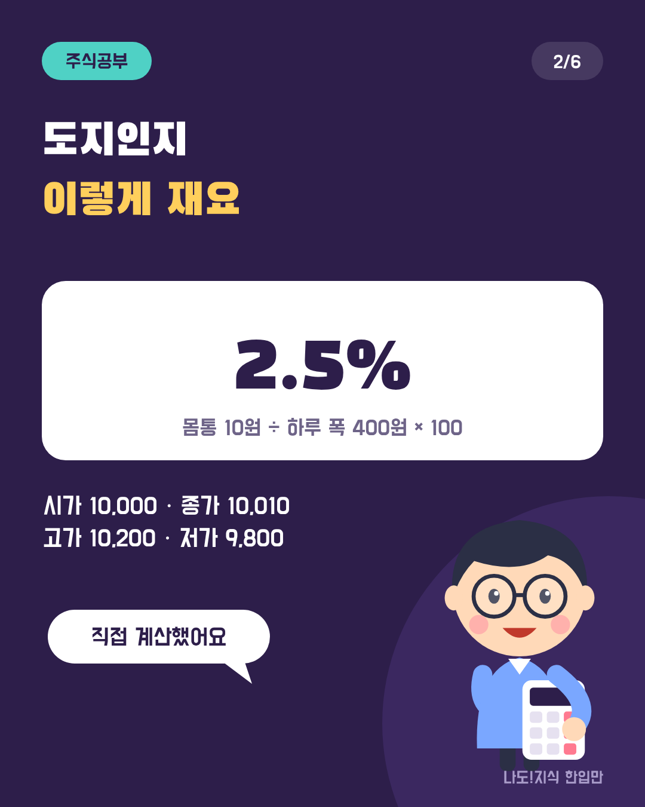
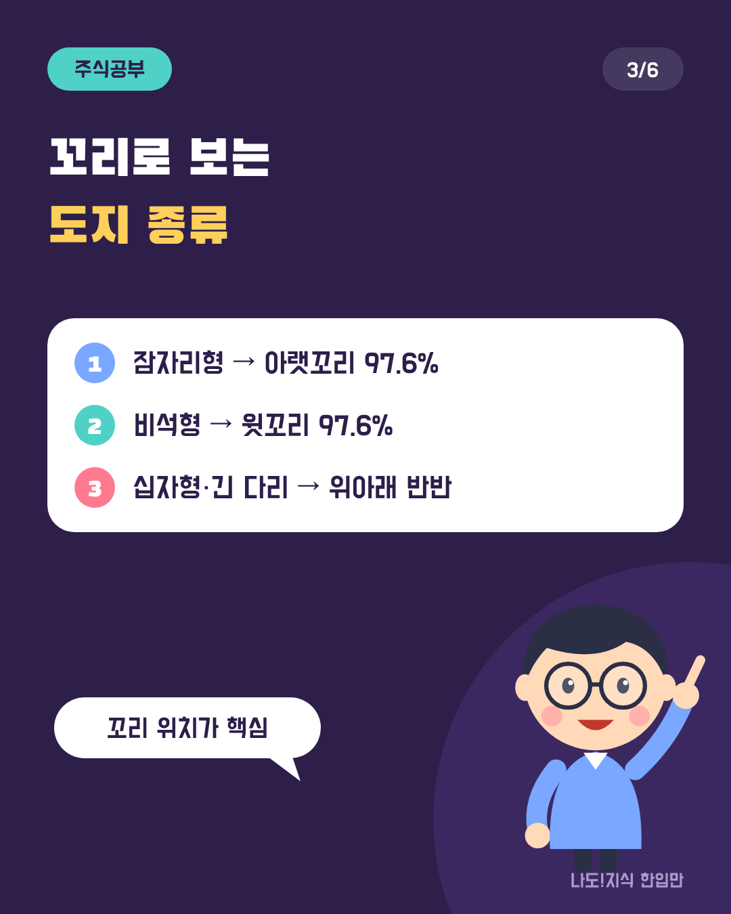
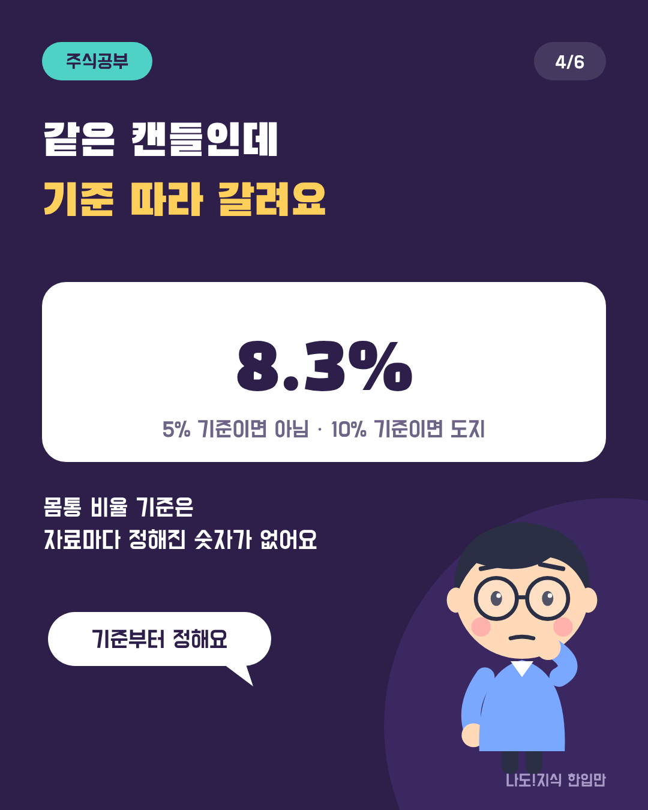
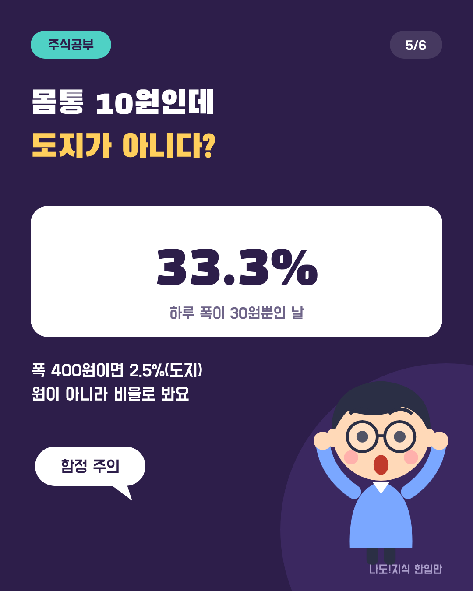
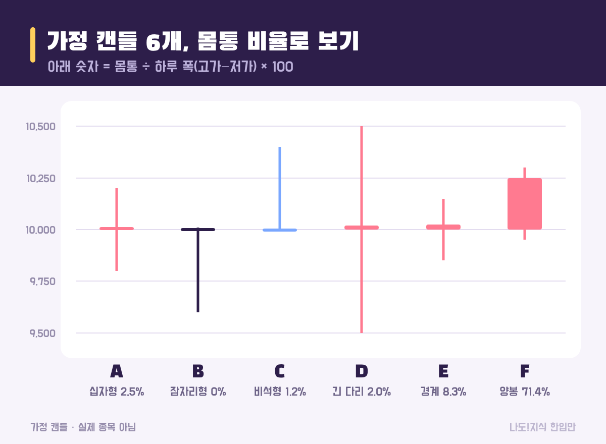
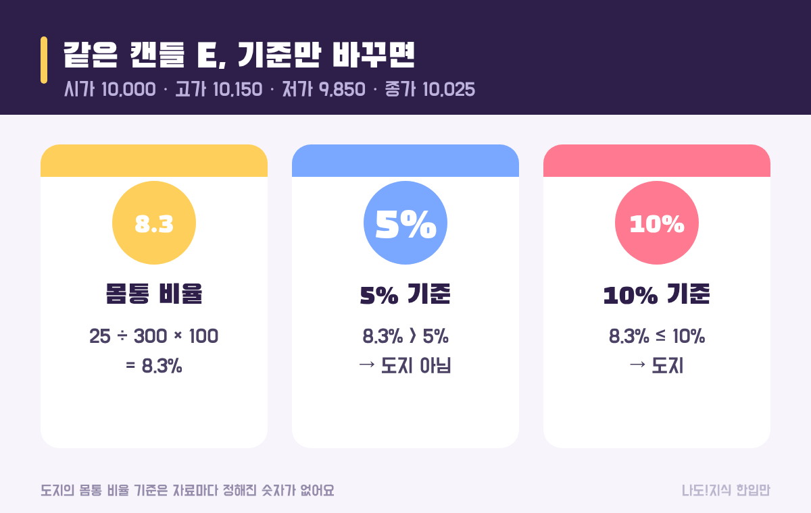
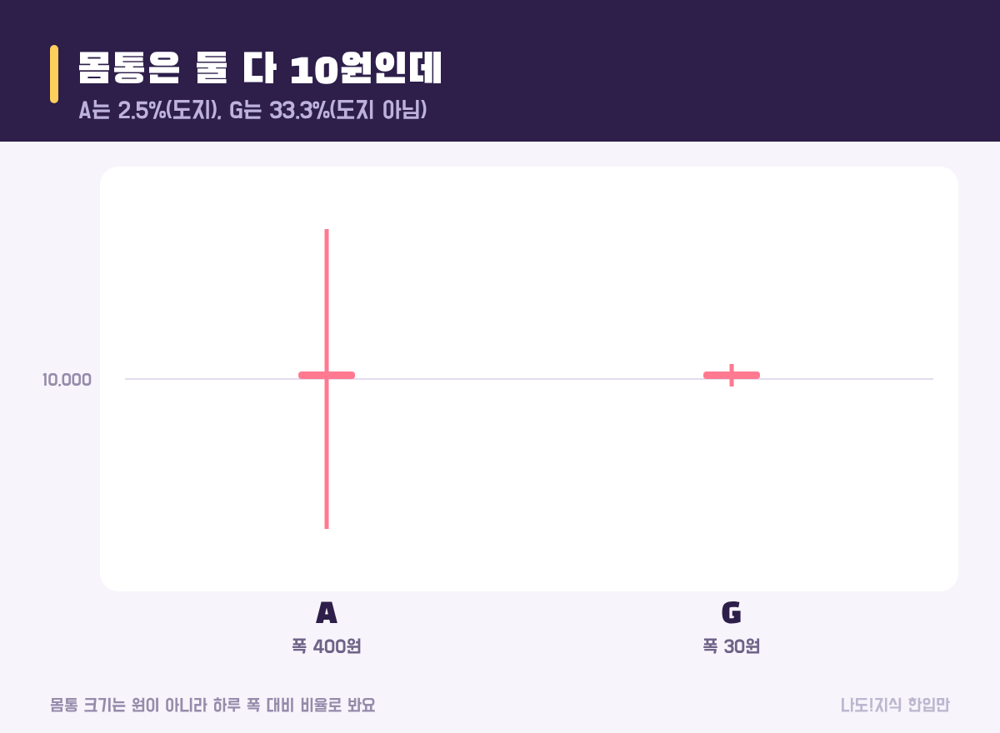

최종 검토일: 2026-11-16

도지캔들은 시가와 종가가 거의 같아서 몸통이 선처럼 얇은 캔들이에요. 하루 동안 오르내렸지만 결국 시작한 가격 근처에서 끝난 날이라, 사려는 힘과 팔려는 힘이 비슷했던 날로 읽어요.

그런데 "거의 같다"는 게 몇 원 차이까지인지는 정해져 있지 않아요. 몸통 비율을 직접 계산해 도지 종류를 구분하고, 같은 캔들이 기준에 따라 도지가 되기도 하고 안 되기도 하는 경우까지 가정 캔들로 볼게요.

  <strong style="color:#2d1e4a;font-size:18px;">🕯 한눈에 보기</strong>
  <ul style="margin:10px 0 0 0;padding-left:20px;line-height:1.9;">
    <li><b>뜻:</b> 시가 ≈ 종가, 몸통이 아주 얇은 캔들</li>
    <li><b>계산:</b> 몸통 비율 = |종가 − 시가| ÷ (고가 − 저가) × 100</li>
    <li><b>종류:</b> 꼬리 위치로 십자형·긴 다리·잠자리형·비석형</li>
    <li><b>기준:</b> 몇 % 이하가 도지인지 정해진 숫자는 없어요</li>
    <li><b>해석:</b> 혼자서는 방향을 알려 주지 않는 약한 신호</li>
  </ul>

옆으로 넘겨 보세요 → (카드 6장 요약)

  <strong style="font-size:16px;">📖 처음이라면 이것만 — 낱말 풀이</strong>
  <ul style="margin:8px 0 0 0;padding-left:20px;line-height:1.9;">
    <li><b>시가·종가:</b> 그날 처음 거래된 가격과 마지막 가격.</li>
    <li><b>고가·저가:</b> 그날 가장 높았던 가격과 가장 낮았던 가격.</li>
    <li><b>몸통(실체):</b> 시가와 종가 사이의 굵은 막대. 양봉(빨강)은 종가가 높고, 음봉(파랑)은 시가가 높아요.</li>
    <li><b>꼬리(그림자):</b> 몸통 위아래로 튀어나온 가는 선. 고가·저가까지 갔다가 돌아온 흔적이에요.</li>
    <li><b>하루 폭:</b> 고가 − 저가. 이 글에서 비율을 계산할 때 기준으로 써요.</li>
  </ul>

<h2 style="border-left:6px solid #2d1e4a;padding-left:12px;margin-top:36px;">목차</h2>
<ol style="line-height:1.9;">
  <li><a href="#sec-1" style="color:inherit;text-decoration:underline;text-underline-offset:3px;">도지캔들은 무엇인가요?</a></li>
  <li><a href="#sec-2" style="color:inherit;text-decoration:underline;text-underline-offset:3px;">도지인지 어떻게 계산하나요?</a></li>
  <li><a href="#sec-3" style="color:inherit;text-decoration:underline;text-underline-offset:3px;">도지캔들 종류는 어떻게 구분하나요?</a></li>
  <li><a href="#sec-4" style="color:inherit;text-decoration:underline;text-underline-offset:3px;">몇 % 이하면 도지인가요?</a></li>
  <li><a href="#sec-5" style="color:inherit;text-decoration:underline;text-underline-offset:3px;">몸통이 작으면 무조건 도지인가요?</a></li>
  <li><a href="#sec-6" style="color:inherit;text-decoration:underline;text-underline-offset:3px;">도지캔들이 나오면 어떻게 읽어야 하나요?</a></li>
  <li><a href="#sec-7" style="color:inherit;text-decoration:underline;text-underline-offset:3px;">자주 하는 오해 5가지</a></li>
  <li><a href="#sec-8" style="color:inherit;text-decoration:underline;text-underline-offset:3px;">도지캔들 Q&amp;A 5개</a></li>
</ol>

<h2 id="sec-1" style="scroll-margin-top:72px;border-left:6px solid #2d1e4a;padding-left:12px;margin-top:36px;">도지캔들은 무엇인가요?</h2>

도지캔들은 시가와 종가가 거의 같아 몸통이 거의 없는 캔들이에요. 하루 동안 가격이 위아래로 움직였더라도 마지막에 시작 가격 근처로 돌아왔다는 뜻이에요.

보통 캔들은 몸통 길이로 그날 누가 이겼는지를 보여 줘요. 종가가 시가보다 많이 높으면 긴 양봉, 많이 낮으면 긴 음봉이죠. 도지는 몸통이 거의 없으니 "이긴 쪽이 없는 날"이에요. 그래서 여러 자료가 도지를 사려는 힘과 팔려는 힘이 팽팽한 상태, 또는 방향이 정해지지 않은 상태로 설명해요.

<table style="width:100%;border-collapse:collapse;margin:16px 0;">
  <thead>
    <tr style="background:#2d1e4a;color:#fff;"><th style="border:1px solid #ddd;padding:8px;">구분</th><th style="border:1px solid #ddd;padding:8px;">몸통</th><th style="border:1px solid #ddd;padding:8px;">읽는 법</th></tr>
  </thead>
  <tbody>
    <tr><td style="border:1px solid #ddd;padding:8px;">긴 양봉</td><td style="border:1px solid #ddd;padding:8px;">길고 빨강</td><td style="border:1px solid #ddd;padding:8px;">종가가 시가보다 크게 높음</td></tr>
    <tr><td style="border:1px solid #ddd;padding:8px;">긴 음봉</td><td style="border:1px solid #ddd;padding:8px;">길고 파랑</td><td style="border:1px solid #ddd;padding:8px;">종가가 시가보다 크게 낮음</td></tr>
    <tr><td style="border:1px solid #ddd;padding:8px;">도지</td><td style="border:1px solid #ddd;padding:8px;">거의 없음</td><td style="border:1px solid #ddd;padding:8px;">시가와 종가가 거의 같음</td></tr>
  </tbody>
</table>

<h2 id="sec-2" style="scroll-margin-top:72px;border-left:6px solid #2d1e4a;padding-left:12px;margin-top:36px;">도지인지 어떻게 계산하나요?</h2>

도지인지는 몸통 길이를 하루 폭(고가 − 저가)으로 나눈 비율로 재요. 몸통이 몇 원인지보다, 그날 움직인 폭에서 몸통이 얼마나 차지하는지가 중요해요.

<figure style="margin:24px 0;"><figcaption style="font-size:13px;color:#888;">계산을 보여 주기 위한 가정 캔들이에요. 실제 종목이 아니에요.</figcaption></figure>

  <strong>✍️ 따라 해 보기 (캔들 A: 시가 10,000 · 고가 10,200 · 저가 9,800 · 종가 10,010)</strong> 
  ① 몸통: |10,010 − 10,000| = <b>10원</b> 
  ② 하루 폭: 10,200 − 9,800 = <b>400원</b> 
  ③ 몸통 비율: 10 ÷ 400 × 100 = <b>2.5%</b> 
  ④ 꼬리: 윗꼬리 10,200 − 10,010 = 190원 · 아랫꼬리 10,000 − 9,800 = 200원 → 위아래가 비슷

④의 꼬리 계산이 다음 장에서 종류를 나누는 기준이 돼요. 윗꼬리는 고가에서 몸통 위쪽까지, 아랫꼬리는 몸통 아래쪽에서 저가까지의 길이예요.

음봉도 계산은 똑같아요. 캔들 C는 시가 10,000원, 종가 9,995원으로 5원 내린 음봉이에요. 몸통은 |9,995 − 10,000| = 5원이고, 하루 폭은 10,400 − 9,990 = 410원이라 몸통 비율은 약 1.2%예요. 절댓값을 쓰기 때문에 오른 날이든 내린 날이든 몸통 길이만 보고 비교할 수 있어요. 시가와 종가가 완전히 같은 캔들 B는 몸통이 0원이라 비율도 0%이고, 차트에서는 가로줄 하나로 보여요.

<h2 id="sec-3" style="scroll-margin-top:72px;border-left:6px solid #2d1e4a;padding-left:12px;margin-top:36px;">도지캔들 종류는 어떻게 구분하나요?</h2>

도지 종류는 꼬리가 어느 쪽으로 길게 뻗었는지로 나눠요. 꼬리 길이도 하루 폭에 대한 비율로 보면 헷갈리지 않아요.

<table style="width:100%;border-collapse:collapse;margin:16px 0;">
  <thead>
    <tr style="background:#2d1e4a;color:#fff;"><th style="border:1px solid #ddd;padding:8px;">캔들</th><th style="border:1px solid #ddd;padding:8px;">이름</th><th style="border:1px solid #ddd;padding:8px;">몸통 비율</th><th style="border:1px solid #ddd;padding:8px;">윗꼬리</th><th style="border:1px solid #ddd;padding:8px;">아랫꼬리</th><th style="border:1px solid #ddd;padding:8px;">모양</th></tr>
  </thead>
  <tbody>
    <tr><td style="border:1px solid #ddd;padding:8px;">A</td><td style="border:1px solid #ddd;padding:8px;">십자형</td><td style="border:1px solid #ddd;padding:8px;">2.5%</td><td style="border:1px solid #ddd;padding:8px;">47.5%</td><td style="border:1px solid #ddd;padding:8px;">50.0%</td><td style="border:1px solid #ddd;padding:8px;">+ 모양, 위아래 비슷</td></tr>
    <tr><td style="border:1px solid #ddd;padding:8px;">D</td><td style="border:1px solid #ddd;padding:8px;">긴 다리 도지</td><td style="border:1px solid #ddd;padding:8px;">2.0%</td><td style="border:1px solid #ddd;padding:8px;">48.0%</td><td style="border:1px solid #ddd;padding:8px;">50.0%</td><td style="border:1px solid #ddd;padding:8px;">폭 1,000원, 위아래 모두 김</td></tr>
    <tr><td style="border:1px solid #ddd;padding:8px;">B</td><td style="border:1px solid #ddd;padding:8px;">잠자리형</td><td style="border:1px solid #ddd;padding:8px;">0%</td><td style="border:1px solid #ddd;padding:8px;">2.4%</td><td style="border:1px solid #ddd;padding:8px;"><b>97.6%</b></td><td style="border:1px solid #ddd;padding:8px;">T자, 아랫꼬리만 김</td></tr>
    <tr><td style="border:1px solid #ddd;padding:8px;">C</td><td style="border:1px solid #ddd;padding:8px;">비석형</td><td style="border:1px solid #ddd;padding:8px;">1.2%</td><td style="border:1px solid #ddd;padding:8px;"><b>97.6%</b></td><td style="border:1px solid #ddd;padding:8px;">1.2%</td><td style="border:1px solid #ddd;padding:8px;">뒤집힌 T자, 윗꼬리만 김</td></tr>
  </tbody>
</table>

잠자리형(B)은 장중에 크게 내려갔다가 시가 근처까지 다시 올라온 날이고, 비석형(C)은 반대로 크게 올라갔다가 시가 근처로 밀려 내려온 날이에요. 자료들은 잠자리형을 하락 뒤에 나오면 반등 가능성, 비석형을 상승 뒤에 나오면 하락 가능성으로 해석하는 경우가 많지만, 어디까지나 '가능성'이에요.

긴 다리 도지(D)는 십자형과 모양은 같은데 하루 폭이 훨씬 커요. 그날 위아래로 크게 흔들렸다는 점이 다르죠.

<h2 id="sec-4" style="scroll-margin-top:72px;border-left:6px solid #2d1e4a;padding-left:12px;margin-top:36px;">몇 % 이하면 도지인가요?</h2>

정해진 숫자가 없어요. 몸통 비율이 몇 % 이하여야 도지라는 공통 기준은 찾을 수 없었고, 자료마다 "아주 작은 몸통" 정도로만 설명해요. 그래서 기준을 어디에 두느냐에 따라 같은 캔들이 도지가 되기도 하고 안 되기도 해요.

<figure style="margin:24px 0;"><figcaption style="font-size:13px;color:#888;">이 글에서는 비교를 위해 5%와 10% 두 기준을 가정했어요.</figcaption></figure>

<table style="width:100%;border-collapse:collapse;margin:16px 0;">
  <thead>
    <tr style="background:#2d1e4a;color:#fff;"><th style="border:1px solid #ddd;padding:8px;">캔들</th><th style="border:1px solid #ddd;padding:8px;">몸통 비율</th><th style="border:1px solid #ddd;padding:8px;">5% 기준</th><th style="border:1px solid #ddd;padding:8px;">10% 기준</th></tr>
  </thead>
  <tbody>
    <tr><td style="border:1px solid #ddd;padding:8px;">A 십자형</td><td style="border:1px solid #ddd;padding:8px;">2.5%</td><td style="border:1px solid #ddd;padding:8px;">도지</td><td style="border:1px solid #ddd;padding:8px;">도지</td></tr>
    <tr><td style="border:1px solid #ddd;padding:8px;">C 비석형</td><td style="border:1px solid #ddd;padding:8px;">1.2%</td><td style="border:1px solid #ddd;padding:8px;">도지</td><td style="border:1px solid #ddd;padding:8px;">도지</td></tr>
    <tr><td style="border:1px solid #ddd;padding:8px;">E 경계</td><td style="border:1px solid #ddd;padding:8px;">8.3%</td><td style="border:1px solid #ddd;padding:8px;"><b>도지 아님</b></td><td style="border:1px solid #ddd;padding:8px;"><b>도지</b></td></tr>
    <tr><td style="border:1px solid #ddd;padding:8px;">F 양봉</td><td style="border:1px solid #ddd;padding:8px;">71.4%</td><td style="border:1px solid #ddd;padding:8px;">아님</td><td style="border:1px solid #ddd;padding:8px;">아님</td></tr>
  </tbody>
</table>

HTS의 캔들 패턴 자동 찾기 기능도 증권사마다 기준이 다를 수 있어요. 그래서 "도지가 떴다"는 말을 들으면 어떤 기준으로 찾은 건지부터 보는 게 좋아요. 직접 볼 때는 내 기준(예: 5% 이하)을 하나 정해 두고 같은 기준으로만 비교하면 헷갈리지 않아요. 기준을 바꿀 때는 지난 몇 달 차트에서 그 기준으로 도지가 몇 번 나왔는지 세어 보면, 너무 자주 잡히는지 너무 드문지 감을 잡을 수 있어요.

<h2 id="sec-5" style="scroll-margin-top:72px;border-left:6px solid #2d1e4a;padding-left:12px;margin-top:36px;">몸통이 작으면 무조건 도지인가요?</h2>

아니에요. 몸통이 10원이어도 하루 폭이 작으면 도지가 아니에요. 비율로 보면 전혀 다른 캔들이거든요.

<figure style="margin:24px 0;"><figcaption style="font-size:13px;color:#888;">몸통 크기는 원이 아니라 하루 폭 대비 비율로 봐요.</figcaption></figure>

<table style="width:100%;border-collapse:collapse;margin:16px 0;">
  <thead>
    <tr style="background:#2d1e4a;color:#fff;"><th style="border:1px solid #ddd;padding:8px;">캔들</th><th style="border:1px solid #ddd;padding:8px;">몸통</th><th style="border:1px solid #ddd;padding:8px;">하루 폭</th><th style="border:1px solid #ddd;padding:8px;">몸통 비율</th><th style="border:1px solid #ddd;padding:8px;">판정</th></tr>
  </thead>
  <tbody>
    <tr><td style="border:1px solid #ddd;padding:8px;">A</td><td style="border:1px solid #ddd;padding:8px;">10원</td><td style="border:1px solid #ddd;padding:8px;">400원</td><td style="border:1px solid #ddd;padding:8px;">2.5%</td><td style="border:1px solid #ddd;padding:8px;">도지</td></tr>
    <tr><td style="border:1px solid #ddd;padding:8px;">G</td><td style="border:1px solid #ddd;padding:8px;">10원</td><td style="border:1px solid #ddd;padding:8px;">30원</td><td style="border:1px solid #ddd;padding:8px;"><b>33.3%</b></td><td style="border:1px solid #ddd;padding:8px;">도지 아님</td></tr>
  </tbody>
</table>

G는 하루 종일 거의 움직이지 않은 날이에요. 몸통이 작아 보여도 그날 움직인 폭의 3분의 1이 몸통이라, 시가와 종가가 "거의 같다"고 보기 어려워요. 거래가 적은 종목이나 장이 조용한 날에 이런 캔들이 자주 나와요.

<h2 id="sec-6" style="scroll-margin-top:72px;border-left:6px solid #2d1e4a;padding-left:12px;margin-top:36px;">도지캔들이 나오면 어떻게 읽어야 하나요?</h2>

도지캔들은 혼자서는 방향을 알려 주지 않는 약한 신호로 보는 게 안전해요. 여러 자료가 도지를 확인이 필요한 신호로 설명하고, 다음 날 캔들과 그전까지의 추세를 함께 보라고 해요.

<ol style="line-height:2;">
  <li><b>앞의 흐름 보기:</b> 계속 오르던 중인지, 내리던 중인지, 옆으로 가던 중인지 확인해요.</li>
  <li><b>위치 보기:</b> 이동평균선이나 볼린저밴드 같은 기준선 근처인지 봐요.</li>
  <li><b>다음 캔들 보기:</b> 다음 날 어느 쪽으로 몸통이 생기는지 확인해요.</li>
  <li><b>거래량 보기:</b> 평소보다 거래가 많았는지 적었는지 봐요.</li>
</ol>

추세를 보는 기준선은 <a href="https://sensitiveboss3.tistory.com/entry/moving-average-5-20-day-cross" target="_blank" rel="noopener">이동평균선 5일 20일 계산과 크로스 보는 법</a>, 변동 폭을 보는 방법은 <a href="https://sensitiveboss3.tistory.com/entry/bollinger-bands-calculation" target="_blank" rel="noopener">볼린저밴드 뜻과 계산법</a>, 오른 힘과 내린 힘을 비교하는 방법은 <a href="https://sensitiveboss3.tistory.com/entry/rsi-meaning-14day-calculation" target="_blank" rel="noopener">RSI 뜻과 14일 값 직접 구하기</a>에서 볼 수 있어요.

<h2 id="sec-7" style="scroll-margin-top:72px;border-left:6px solid #2d1e4a;padding-left:12px;margin-top:36px;">자주 하는 오해 5가지</h2>

도지캔들에서 생기는 오해는 대부분 모양 하나로 결론을 내리는 데서 생겨요.

  <strong style="font-size:16px;">⚠️ 이것만 피하세요</strong>
  <ol style="margin:8px 0 0 0;padding-left:20px;line-height:1.9;">
    <li><b>도지가 나오면 반드시 방향이 바뀐다고 생각하기</b> → 혼자서는 약한 신호예요. 다음 캔들을 봐야 해요.</li>
    <li><b>몸통 원 단위로만 보기</b> → 몸통 10원도 하루 폭이 30원이면 33.3%예요.</li>
    <li><b>기준 없이 눈대중으로 판단하기</b> → 같은 8.3% 캔들도 기준에 따라 갈려요.</li>
    <li><b>잠자리형·비석형을 꼬리 길이 확인 없이 부르기</b> → 꼬리가 하루 폭의 대부분인지 계산해 보세요.</li>
    <li><b>거래가 적은 날 캔들도 같은 무게로 보기</b> → 조용한 날의 작은 캔들은 의미가 약해요.</li>
  </ol>

<h2 id="sec-8" style="scroll-margin-top:72px;border-left:6px solid #2d1e4a;padding-left:12px;margin-top:36px;">도지캔들 Q&amp;A 5개</h2>

  
도지캔들 뜻이 뭔가요

  
도지캔들은 시가와 종가가 거의 같아서 몸통이 선처럼 얇은 캔들이에요. 하루 동안 오르내렸지만 시작한 가격 근처에서 끝났다는 뜻이라, 사려는 힘과 팔려는 힘이 비슷했던 날로 읽어요.

  
도지캔들인지 어떻게 계산하나요

  
몸통 비율 = |종가 − 시가| ÷ (고가 − 저가) × 100으로 구해요. 시가 10,000원, 종가 10,010원, 고가 10,200원, 저가 9,800원이면 10 ÷ 400 × 100 = 2.5%예요.

  
몸통 비율이 몇 % 이하면 도지인가요

  
정해진 숫자는 없어요. 자료마다 기준이 달라서, 같은 8.3% 캔들도 5% 기준이면 도지가 아니고 10% 기준이면 도지예요. 내가 쓸 기준을 먼저 정해 두는 게 좋아요.

  
잠자리형과 비석형은 어떻게 다른가요

  
잠자리형은 아랫꼬리가 길고 윗꼬리가 거의 없는 T자 모양이고, 비석형은 반대로 윗꼬리가 길고 아랫꼬리가 거의 없는 뒤집힌 T자 모양이에요.

  
도지캔들이 나오면 추세가 바뀌나요

  
도지만으로는 방향을 알 수 없어요. 여러 자료가 도지를 약한 신호로 보고, 다음 캔들과 추세를 함께 봐야 한다고 설명해요.

  <strong style="font-size:16px;">📚 함께 보면 좋은 글</strong>
  <ul style="margin:8px 0 0 0;padding-left:20px;line-height:1.9;"><li><a href="https://sensitiveboss3.tistory.com/entry/moving-average-5-20-day-cross" target="_blank" rel="noopener">이동평균선 5일 20일 계산과 크로스 보는 법</a></li><li><a href="https://sensitiveboss3.tistory.com/entry/bollinger-bands-calculation" target="_blank" rel="noopener">볼린저밴드 뜻과 계산법</a></li><li><a href="https://sensitiveboss3.tistory.com/entry/rsi-meaning-14day-calculation" target="_blank" rel="noopener">RSI 뜻과 14일 값 직접 구하기</a></li></ul>

  참고 출처:
  <ul style="margin:6px 0 0 0;padding-left:20px;">
    <li><a href="https://therighttrader.com/ko/learn/candlestick-patterns/doji" target="_blank" rel="noopener">The Right Trader: 도지 캔들 패턴</a></li>
    <li><a href="https://corporatefinanceinstitute.com/resources/capital-markets/doji" target="_blank" rel="noopener">Corporate Finance Institute: Doji</a></li>
    <li><a href="https://capital.com/doji-definition" target="_blank" rel="noopener">Capital.com: What does Doji mean?</a></li>
    <li><a href="https://www.ebc.com/kr/forex/270318.html" target="_blank" rel="noopener">EBC: 도지 캔들이란?</a></li>
  </ul>
  기준일: 2026년 11월 16일. 예시 캔들은 계산을 보여 주기 위한 가정값이에요.

정보 제공을 목적으로 쓴 글이며 특정 종목의 매수·매도를 권유하지 않아요. 예시는 계산을 보여 주기 위한 가정값이고, 투자 판단과 그 결과에 대한 책임은 투자자 본인에게 있어요.

