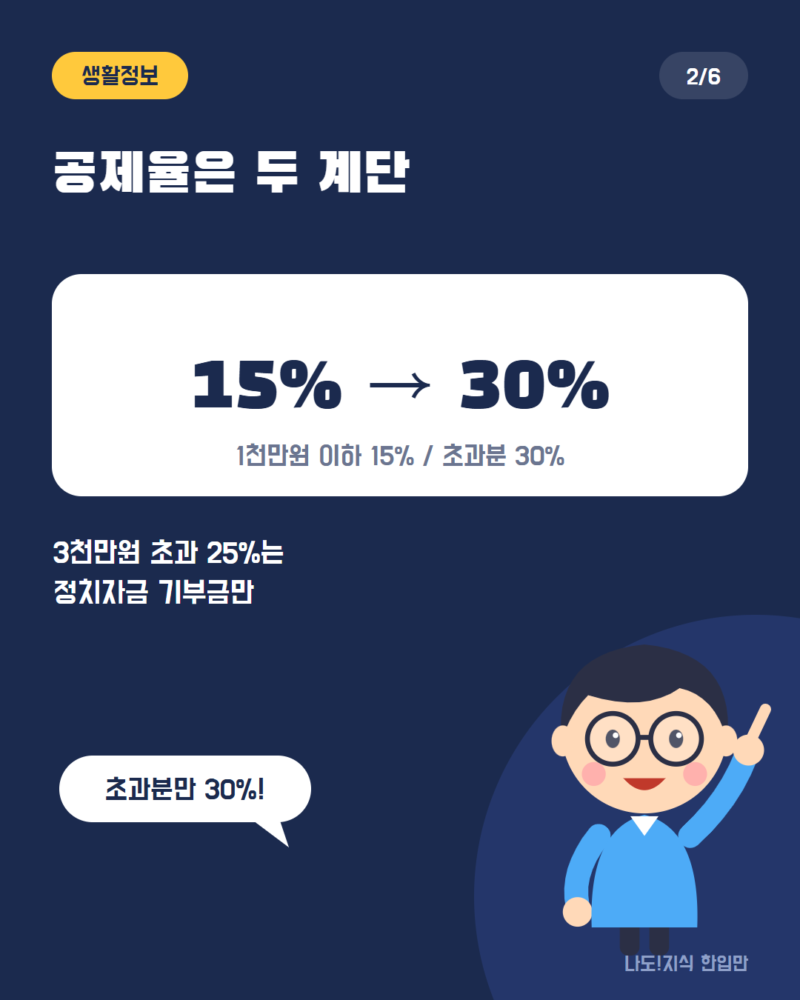
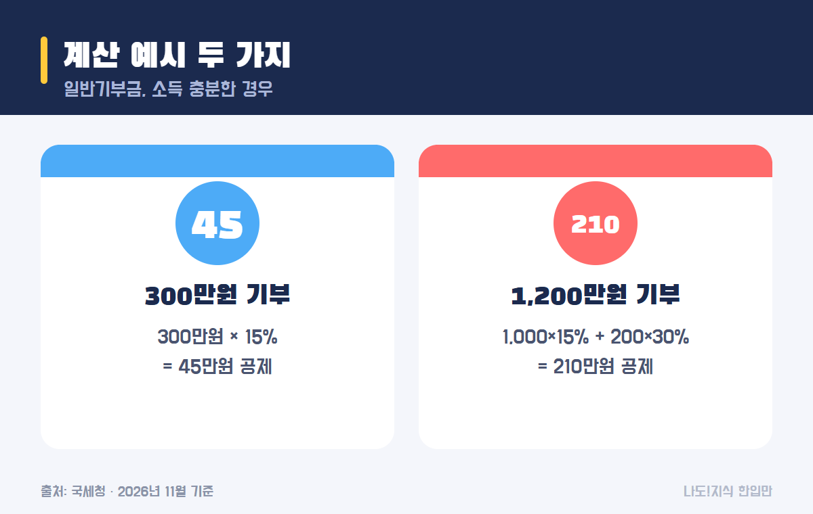
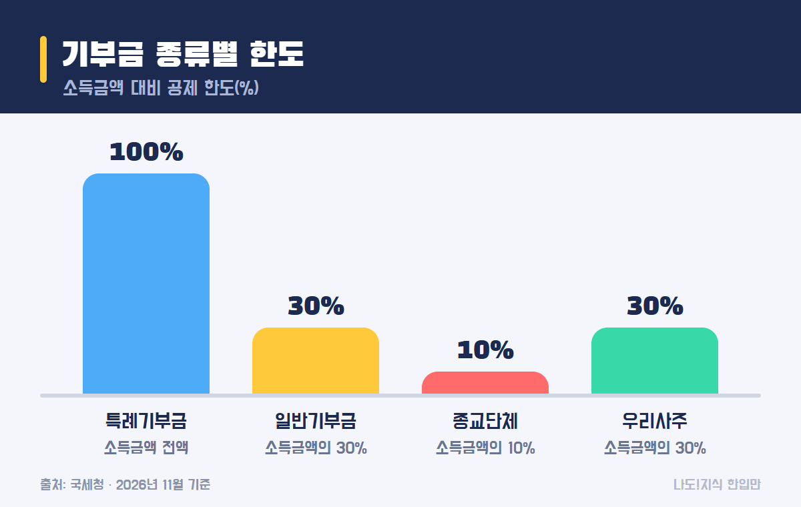

최종 검토일: 2026-11-23

기부금 세액공제는 낸 기부금의 일부를 내가 낼 세금에서 직접 빼 주는 제도예요. 특례·일반·우리사주 기부금은 1천만원 이하분은 15%, 1천만원을 넘는 분은 30%를 공제받아요.

연말이 가까워지면 "기부했는데 얼마나 돌려받지?"가 궁금하죠. 종류마다 한도가 다르고 이월되는 것과 안 되는 것도 갈리니, 계산 예시와 함께 차근차근 정리할게요.

  <strong style="color:#1f3a5f;font-size:18px;">💙 한눈에 보기</strong>
  <ul style="margin:10px 0 0 0;padding-left:20px;line-height:1.9;">
    <li><b>공제율:</b> 1천만원 이하 15%, 초과분 30%</li>
    <li><b>300만원 기부:</b> 세액공제 45만원</li>
    <li><b>1,200만원 기부:</b> 세액공제 210만원 (소득이 충분할 때)</li>
    <li><b>한도:</b> 특례 전액, 일반 30%, 종교단체 10%, 우리사주 30%</li>
    <li><b>이월 불가:</b> 정치자금·고향사랑·우리사주</li>
  </ul>

옆으로 넘겨 보세요 → (카드 6장 요약)

  <strong style="font-size:16px;">📖 처음이라면 이것만 — 낱말 풀이</strong>
  <ul style="margin:8px 0 0 0;padding-left:20px;line-height:1.9;">
    <li><b>세액공제:</b> 계산된 세금에서 일정 금액을 바로 빼 주는 것. 소득에서 빼는 소득공제와 달라요.</li>
    <li><b>특례기부금:</b> 국가나 지방자치단체에 내는 것처럼 공제 혜택이 가장 큰 기부금.</li>
    <li><b>일반기부금:</b> 공익 목적의 법인·단체에 내는 기부금. 종교단체 기부는 따로 한도를 둬요.</li>
    <li><b>이월공제:</b> 한도를 넘어 못 받은 공제를 다음 해로 넘겨 받는 것.</li>
    <li><b>기부금 영수증:</b> 기부했다는 증빙. 연말정산 간소화 서비스에서 조회돼요.</li>
  </ul>

<h2 style="border-left:6px solid #1f3a5f;padding-left:12px;margin-top:36px;">목차</h2>
<ol style="line-height:1.9;">
  <li><a href="#sec-1" style="color:inherit;text-decoration:underline;text-underline-offset:3px;">기부금 세액공제는 얼마나 되나요?</a></li>
  <li><a href="#sec-2" style="color:inherit;text-decoration:underline;text-underline-offset:3px;">기부금 세액공제는 어떻게 계산하나요?</a></li>
  <li><a href="#sec-3" style="color:inherit;text-decoration:underline;text-underline-offset:3px;">기부금 종류별 한도는 얼마인가요?</a></li>
  <li><a href="#sec-4" style="color:inherit;text-decoration:underline;text-underline-offset:3px;">한도를 넘으면 이월할 수 있나요?</a></li>
  <li><a href="#sec-5" style="color:inherit;text-decoration:underline;text-underline-offset:3px;">기부금 세액공제는 어떻게 받나요?</a></li>
  <li><a href="#sec-6" style="color:inherit;text-decoration:underline;text-underline-offset:3px;">자주 하는 실수 5가지</a></li>
  <li><a href="#sec-7" style="color:inherit;text-decoration:underline;text-underline-offset:3px;">기부금 세액공제 Q&amp;A 5개</a></li>
</ol>

<h2 id="sec-1" style="scroll-margin-top:72px;border-left:6px solid #1f3a5f;padding-left:12px;margin-top:36px;">기부금 세액공제는 얼마나 되나요?</h2>

기부금 세액공제는 기부금 중 1천만원 이하는 15%, 1천만원을 넘는 부분은 30%를 세금에서 빼 주는 제도예요. 2026년 11월 국세청 기준이에요.

<figure style="margin:24px 0;"><figcaption style="font-size:13px;color:#888;">공제율은 금액 전체가 아니라 구간별로 나눠 적용해요.</figcaption></figure>

<table style="width:100%;border-collapse:collapse;margin:16px 0;">
  <thead>
    <tr style="background:#1f3a5f;color:#fff;"><th style="border:1px solid #ddd;padding:8px;">기부금 종류</th><th style="border:1px solid #ddd;padding:8px;">1천만원 이하</th><th style="border:1px solid #ddd;padding:8px;">1천만원 초과</th></tr>
  </thead>
  <tbody>
    <tr><td style="border:1px solid #ddd;padding:8px;">특례기부금</td><td style="border:1px solid #ddd;padding:8px;">15%</td><td style="border:1px solid #ddd;padding:8px;">30%</td></tr>
    <tr><td style="border:1px solid #ddd;padding:8px;">일반기부금</td><td style="border:1px solid #ddd;padding:8px;">15%</td><td style="border:1px solid #ddd;padding:8px;">30%</td></tr>
    <tr><td style="border:1px solid #ddd;padding:8px;">우리사주조합 기부금</td><td style="border:1px solid #ddd;padding:8px;">15%</td><td style="border:1px solid #ddd;padding:8px;">30%</td></tr>
  </tbody>
</table>

3천만원을 넘는 25% 공제율은 정치자금 기부금에만 있어요. 일반 기부금에서 "초과하면 무조건 30%"로 알고 계셨다면 구간을 다시 짚어 보세요. 공제율은 금액 전체가 아니라 1천만원을 넘는 부분에만 30%가 붙어요.

<h2 id="sec-2" style="scroll-margin-top:72px;border-left:6px solid #1f3a5f;padding-left:12px;margin-top:36px;">기부금 세액공제는 어떻게 계산하나요?</h2>

계산은 1천만원 이하 금액 × 15% + 1천만원 초과 금액 × 30%예요. 먼저 한도 안에서 공제 대상 금액을 정하고, 그 금액을 구간으로 나눠 곱해요.

  <strong>✍️ 내 경우로 따라 해 보기 (일반기부금, 소득은 한도에 걸리지 않는다고 가정)</strong> 
  <b>[예시 1] 300만원 기부</b> 
  ① 1천만원 이하이므로 전액 15%: 300만원 × 15% = <b>45만원</b> 
  <b>[예시 2] 1,200만원 기부</b> 
  ① 1천만원까지: 1,000만원 × 15% = 150만원 
  ② 초과분: 200만원 × 30% = 60만원 
  ③ 합계: 150만원 + 60만원 = <b>210만원</b>

<figure style="margin:24px 0;"><figcaption style="font-size:13px;color:#888;">기부금이 늘수록 1천만원 위쪽 구간부터 공제율이 올라가요.</figcaption></figure>

예를 들어 올해 일반기부금으로 400만원을 냈는데 한도 안이라면, 400만원 × 15% = 60만원이 세액공제돼요. 같은 400만원을 정치자금으로 냈다면 공제 구간이 따로 있어 계산이 달라지니, 기부 종류부터 먼저 구분하는 게 순서예요.

<ul style="line-height:1.9;">
  <li><b>1천만원 이하 구간:</b> 모든 기부금이 15%로 같아요.</li>
  <li><b>1천만원 초과 구간:</b> 특례·일반·우리사주는 초과분만 30%로 올라가요.</li>
  <li><b>정치자금:</b> 3천만원 초과분에 25%가 따로 있어요.</li>
</ul>

세액공제는 낸 세금보다 많이 돌려받을 수 없어요. 회사에서 이미 낸 세금(결정세액)이 공제액보다 적다면 그만큼만 환급돼요. 그래서 기부 계획은 올해 낼 세금 규모와 함께 보는 게 좋아요.

<h2 id="sec-3" style="scroll-margin-top:72px;border-left:6px solid #1f3a5f;padding-left:12px;margin-top:36px;">기부금 종류별 한도는 얼마인가요?</h2>

한도는 특례기부금 근로소득금액 전액, 일반기부금 30%, 종교단체 10%, 우리사주 30%예요. 한도를 넘는 금액은 그해 공제 대상이 아니에요.

<figure style="margin:24px 0;"><figcaption style="font-size:13px;color:#888;">한도는 근로소득금액을 기준으로 정해져요.</figcaption></figure>

<table style="width:100%;border-collapse:collapse;margin:16px 0;">
  <thead>
    <tr style="background:#1f3a5f;color:#fff;"><th style="border:1px solid #ddd;padding:8px;">기부금 종류</th><th style="border:1px solid #ddd;padding:8px;">공제 한도(기준: 근로소득금액)</th><th style="border:1px solid #ddd;padding:8px;">비고</th></tr>
  </thead>
  <tbody>
    <tr><td style="border:1px solid #ddd;padding:8px;">특례기부금</td><td style="border:1px solid #ddd;padding:8px;">전액</td><td style="border:1px solid #ddd;padding:8px;">국가·지자체 등</td></tr>
    <tr><td style="border:1px solid #ddd;padding:8px;">정치자금 기부금</td><td style="border:1px solid #ddd;padding:8px;">전액</td><td style="border:1px solid #ddd;padding:8px;">25% 구간은 이 기부금에만</td></tr>
    <tr><td style="border:1px solid #ddd;padding:8px;">일반기부금</td><td style="border:1px solid #ddd;padding:8px;">30%</td><td style="border:1px solid #ddd;padding:8px;">공익 법인·단체</td></tr>
    <tr><td style="border:1px solid #ddd;padding:8px;">종교단체 기부금</td><td style="border:1px solid #ddd;padding:8px;">10%</td><td style="border:1px solid #ddd;padding:8px;">일반기부금 안의 종교 몫</td></tr>
    <tr><td style="border:1px solid #ddd;padding:8px;">우리사주조합 기부금</td><td style="border:1px solid #ddd;padding:8px;">30%</td><td style="border:1px solid #ddd;padding:8px;">이월 불가</td></tr>
    <tr><td style="border:1px solid #ddd;padding:8px;">고향사랑 기부금</td><td style="border:1px solid #ddd;padding:8px;">연 2,000만원</td><td style="border:1px solid #ddd;padding:8px;">이월 불가</td></tr>
  </tbody>
</table>

  <strong style="font-size:16px;">💡 한도를 가늠하는 순서</strong>
  <ol style="margin:8px 0 0 0;padding-left:20px;line-height:1.9;">
    <li>내 근로소득금액을 급여명세서나 지난해 원천징수영수증에서 찾아요.</li>
    <li>기부 종류별 한도 비율(전액·30%·10%)을 곱해 한도 금액을 구해요.</li>
    <li>실제 기부액이 한도보다 작으면 기부액 전체가, 크면 한도까지만 공제 대상이에요.</li>
  </ol>

기부금은 먼저 내 소득에서 한도를 계산하고, 한도 안의 금액에만 공제율을 곱해요. 종교단체에 기부하는 경우는 일반 한도 안에서도 따로 10% 선이 있다는 점을 기억해 두세요.

<h2 id="sec-4" style="scroll-margin-top:72px;border-left:6px solid #1f3a5f;padding-left:12px;margin-top:36px;">한도를 넘으면 이월할 수 있나요?</h2>

한도를 넘은 일반 기부금은 이월할 수 있지만, 정치자금·고향사랑·우리사주 기부금은 이월공제가 안 돼요. 이월 기간은 국세청 안내에서 확인해 주세요.

<table style="width:100%;border-collapse:collapse;margin:16px 0;">
  <thead>
    <tr style="background:#1f3a5f;color:#fff;"><th style="border:1px solid #ddd;padding:8px;">기부금 종류</th><th style="border:1px solid #ddd;padding:8px;">한도 초과분 이월</th></tr>
  </thead>
  <tbody>
    <tr><td style="border:1px solid #ddd;padding:8px;">특례기부금</td><td style="border:1px solid #ddd;padding:8px;">가능</td></tr>
    <tr><td style="border:1px solid #ddd;padding:8px;">일반기부금</td><td style="border:1px solid #ddd;padding:8px;">가능</td></tr>
    <tr><td style="border:1px solid #ddd;padding:8px;">정치자금 기부금</td><td style="border:1px solid #ddd;padding:8px;">불가</td></tr>
    <tr><td style="border:1px solid #ddd;padding:8px;">고향사랑 기부금</td><td style="border:1px solid #ddd;padding:8px;">불가</td></tr>
    <tr><td style="border:1px solid #ddd;padding:8px;">우리사주조합 기부금</td><td style="border:1px solid #ddd;padding:8px;">불가</td></tr>
  </tbody>
</table>

이월 기간 같은 세부 요건은 해마다 바뀔 수 있어요. 큰 금액을 기부하기 전에는 국세청 안내를 한 번 더 읽어 보시는 게 안전해요.

일반 기부금을 한도보다 많이 냈다면 넘친 금액은 버려지지 않고 이월돼요. 그래서 올해 소득이 적어 한도가 낮았던 사람은 이월이 허용되는 기간 안에 소득이 오른 해에 이어서 공제받을 수 있어요. 반대로 정치자금·고향사랑·우리사주는 그해 한도 안에서만 공제되니, 이쪽은 한도에 맞춰 기부액을 잡는 편이 좋아요.

<h2 id="sec-5" style="scroll-margin-top:72px;border-left:6px solid #1f3a5f;padding-left:12px;margin-top:36px;">기부금 세액공제는 어떻게 받나요?</h2>

기부금은 연말정산 간소화 서비스에서 영수증을 확인하고 회사에 제출하면 돼요. 간소화 서비스는 2026년 1월 15일에 열렸고, 전자기부금영수증을 발행한 기부가 조회돼요.

<ol style="line-height:2;">
  <li><b>기부처 확인:</b> 공제 대상 법인·단체인지 기부 전에 확인해요.</li>
  <li><b>영수증 받기:</b> 기부금 영수증을 받아 두거나 전자영수증이 발행되는지 확인해요.</li>
  <li><b>간소화 서비스 조회:</b> 연말정산 시기에 홈택스에서 기부금 항목을 열어 봐요.</li>
  <li><b>빠진 기부 보충:</b> 조회되지 않는 기부는 영수증을 직접 모아 회사에 내요.</li>
  <li><b>공제 신청:</b> 회사의 연말정산 서식에 기부금 내역을 넣어 공제받아요.</li>
</ol>

고향사랑 기부는 10만원 이하 100/110, 10만원 초과 20만원 이하 40%, 20만원 초과 15%로 일반 기부금과 계산이 달라요. 자세한 내용은 <a href="https://sensitiveboss3.tistory.com/entry/hometown-donation-tax-credit-2026" target="_blank" rel="noopener">고향사랑기부제 세액공제</a> 글에 따로 정리해 두었어요.

<h2 id="sec-6" style="scroll-margin-top:72px;border-left:6px solid #1f3a5f;padding-left:12px;margin-top:36px;">자주 하는 실수 5가지</h2>

기부금 공제를 놓치는 실수는 대부분 한도와 이월 규칙을 잘못 알고 있어서 생겨요.

  <strong style="font-size:16px;">⚠️ 이것만 피하세요</strong>
  <ol style="margin:8px 0 0 0;padding-left:20px;line-height:1.9;">
    <li><b>금액 전체에 30% 곱하기</b> → 30%는 1천만원을 넘는 부분에만 붙어요.</li>
    <li><b>종교단체 한도를 무시하기</b> → 종교단체 기부금은 10% 선이 따로 있어요.</li>
    <li><b>이월되는 줄 알고 몰아 내기</b> → 정치자금·고향사랑·우리사주는 이월이 안 돼요.</li>
    <li><b>영수증 확인을 건너뛰기</b> → 간소화 서비스에 안 나오는 기부는 직접 증빙해야 해요.</li>
    <li><b>낸 세금보다 많이 돌려받는다고 생각하기</b> → 세액공제는 낸 세금 한도 안에서만 환급돼요.</li>
  </ol>

영수증을 빠뜨렸다면 기부 내역을 미리 모아 두세요. 간소화 자료에 없는 기부금은 직접 기부 단체에 영수증을 요청해 두면 연말정산 때 당황하지 않아요. 가족이 대신 낸 기부금은 공제 대상이 아닐 수 있으니 영수증 이름도 살펴보세요.

기부금 공제와 같이 챙기면 좋은 노후 대비 공제는 <a href="https://sensitiveboss3.tistory.com/entry/pension-savings-tax-credit" target="_blank" rel="noopener">연금저축 세액공제</a> 글에서 볼 수 있어요.

<h2 id="sec-7" style="scroll-margin-top:72px;border-left:6px solid #1f3a5f;padding-left:12px;margin-top:36px;">기부금 세액공제 Q&amp;A 5개</h2>

  
기부금 세액공제율은 얼마인가요

  
특례·일반·우리사주 기부금은 1천만원 이하분에 15%, 1천만원을 넘는 분에 30%를 세액에서 빼 줘요. 정치자금 기부금은 3천만원 초과분에 25%가 따로 있어요. 2026년 11월 국세청 기준이에요.

  
기부금 한도는 종류마다 다른가요

  
네, 달라요. 특례기부금과 정치자금은 근로소득금액 전액, 일반기부금은 30%, 종교단체 기부금은 10%, 우리사주 기부금은 30%까지예요. 고향사랑 기부금은 연 2,000만원까지예요.

  
한도를 넘은 기부금은 이월되나요

  
일반 기부금은 한도를 넘은 금액을 이월해 이어서 공제받을 수 있어요. 하지만 정치자금·고향사랑·우리사주 기부금은 이월공제가 안 돼요.

  
기부금 영수증은 직접 내야 하나요

  
대부분 연말정산 간소화 서비스에서 조회돼요. 전자기부금영수증을 발행한 기부는 자동으로 나오고, 간소화 서비스는 2026년 1월 15일에 열렸어요. 조회되지 않는 기부는 기부처에서 영수증을 받아 회사에 내야 해요.

  
고향사랑 기부금은 어떻게 공제되나요

  
10만원 이하는 100/110, 10만원 초과 20만원 이하는 40%, 20만원 초과는 15%를 세액공제해요. 특별재난지역에 기부하면 30%예요. 자세한 계산은 고향사랑기부제 글에서 따로 다뤘어요.

  <strong style="font-size:16px;">📚 함께 보면 좋은 글</strong>
  <ul style="margin:8px 0 0 0;padding-left:20px;line-height:1.9;"><li><a href="https://sensitiveboss3.tistory.com/entry/hometown-donation-tax-credit-2026" target="_blank" rel="noopener">고향사랑기부제 2026 세액공제, 20만원 기부하면 얼마 돌려받나</a></li><li><a href="https://sensitiveboss3.tistory.com/entry/year-end-tax-preview-card-deduction-2026" target="_blank" rel="noopener">연말정산 미리보기 12월 18일까지</a></li><li><a href="https://sensitiveboss3.tistory.com/entry/pension-savings-tax-credit" target="_blank" rel="noopener">연금저축 세액공제 얼마 돌려받나</a></li></ul>

  참고 출처:
  <ul style="margin:6px 0 0 0;padding-left:20px;">
    <li><a href="https://www.nts.go.kr" target="_blank" rel="noopener">국세청: 종합소득세 세율·연말정산 안내(기부금 세액공제)</a></li>
    <li><a href="https://www.korea.kr/briefing/policyBriefingView.do?newsId=148974171" target="_blank" rel="noopener">정책브리핑: 2026 연말정산 미리보기(2026.10.23)</a></li>
  </ul>
  기준일: 2026년 11월 23일. 금액은 세전 단순 계산이에요.

이 글은 정보 제공을 목적으로 하며 특정 종목이나 상품의 매수·매도를 권유하지 않습니다. 투자 판단과 그 결과에 대한 책임은 투자자 본인에게 있습니다. 세율·수수료·한도는 변경될 수 있으므로 반드시 원출처에서 최신 내용을 확인하시기 바랍니다.

