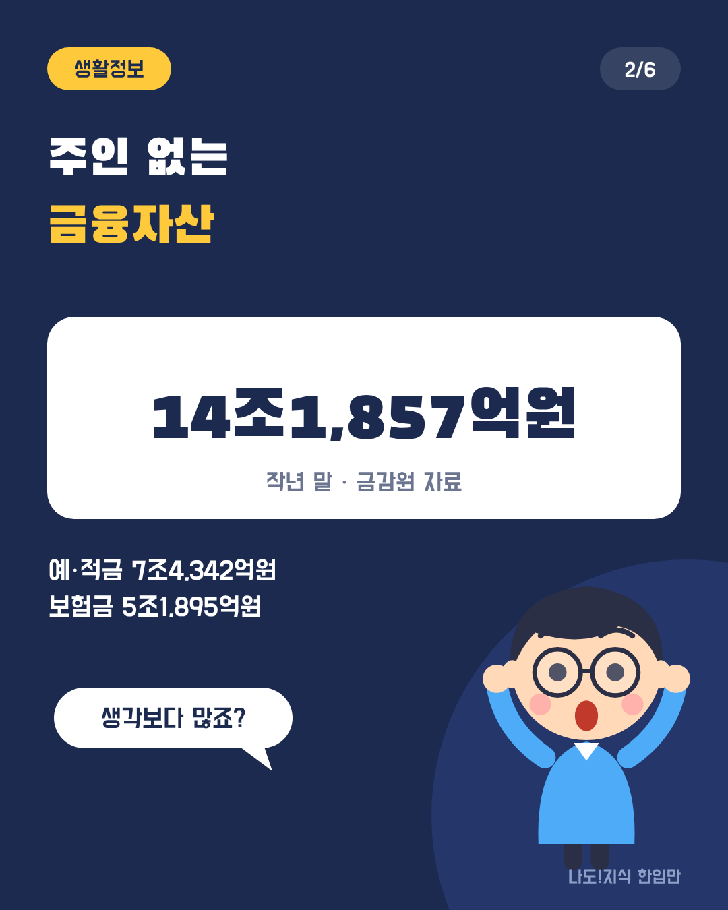
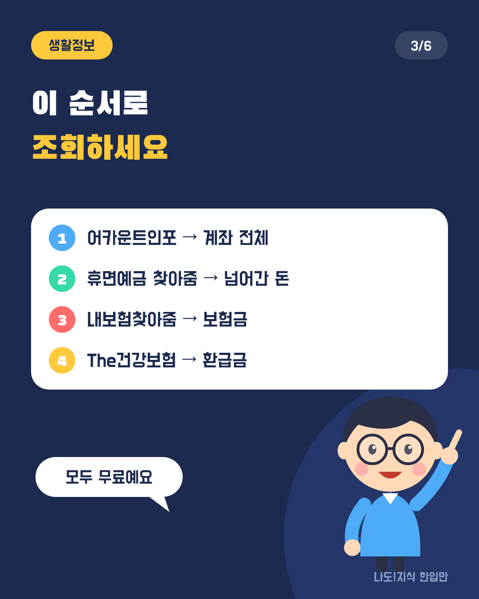
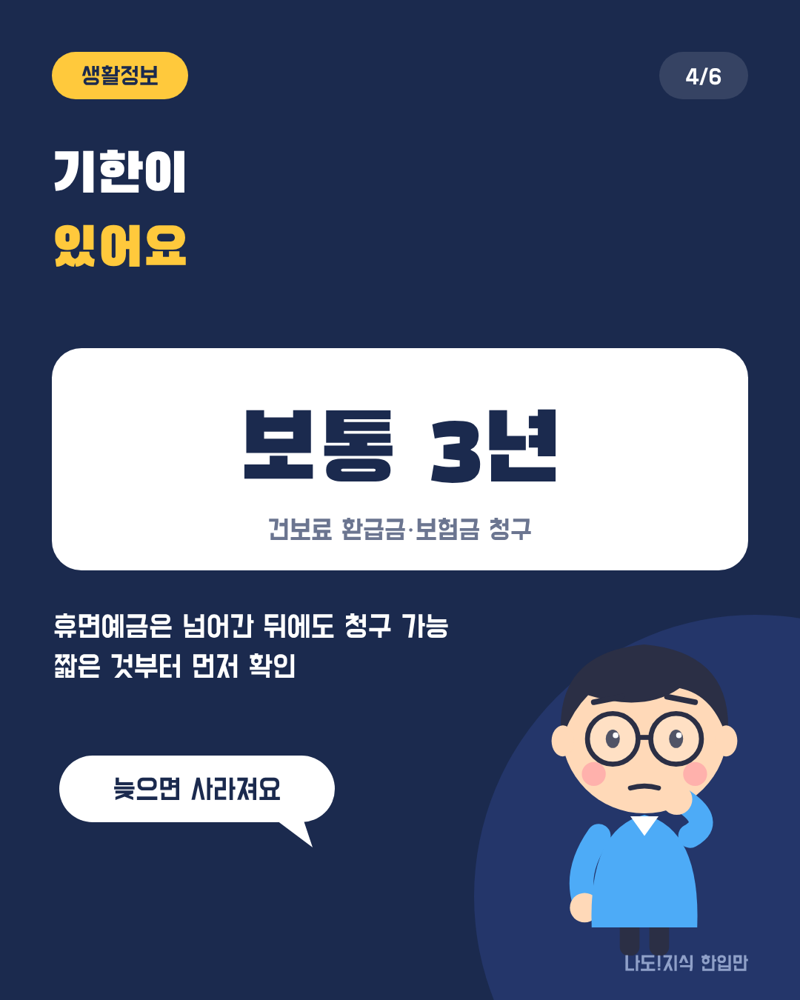
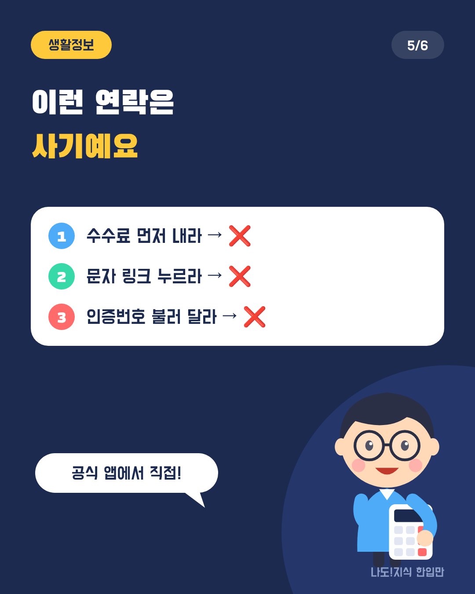
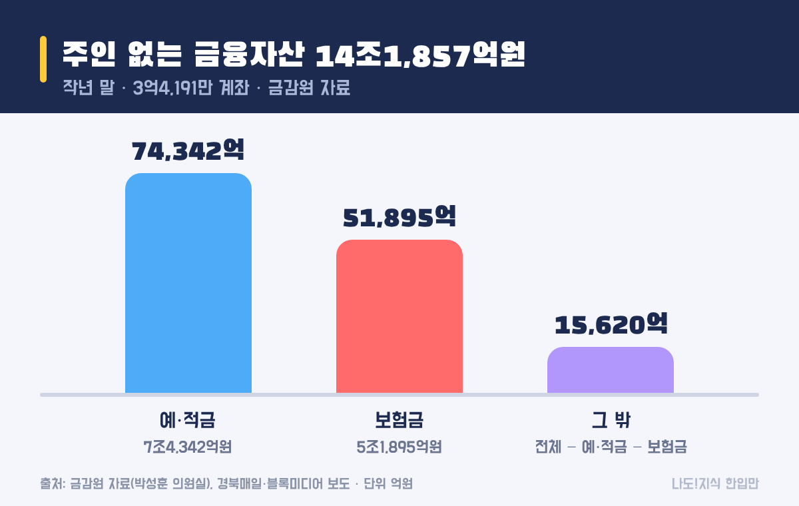
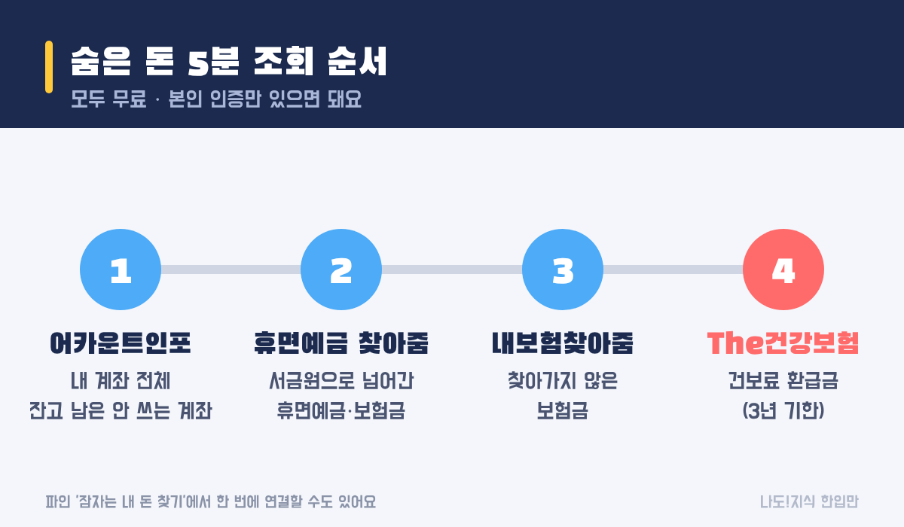
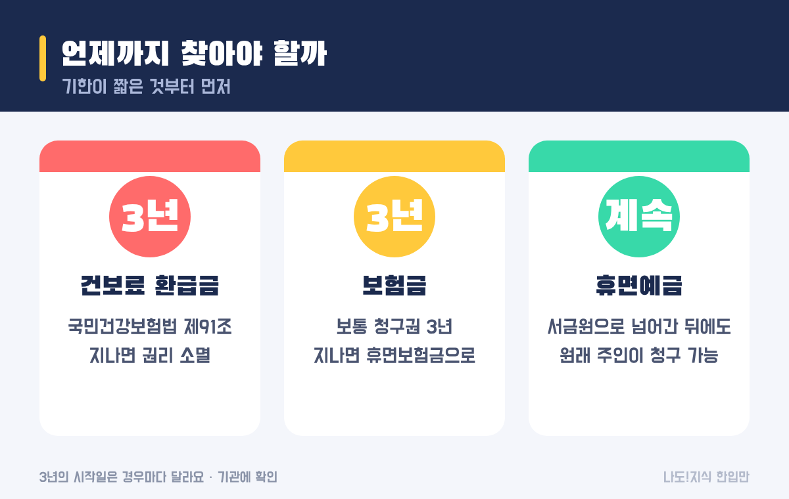

최종 검토일: 2026-11-09

휴면예금과 숨은 보험금은 어카운트인포, 휴면예금 찾아줌, 내보험찾아줌 세 곳에서 조회하고, 건강보험료 환급금은 The건강보험 앱에서 따로 봐야 해요. 네 곳을 차례로 돌면 5분 안팎이면 끝나요.

이렇게 주인이 찾아가지 않은 금융자산이 작년 말 기준 14조원이 넘어요. 그중 보험금과 건보 환급금은 3년이 지나면 권리가 사라질 수 있어서, 기한부터 알고 찾는 게 좋아요. 순서대로 정리할게요.

  <strong style="color:#1b2a4e;font-size:18px;">💸 한눈에 보기</strong>
  <ul style="margin:10px 0 0 0;padding-left:20px;line-height:1.9;">
    <li><b>누가:</b> 예전 통장·보험·건강보험료 기록이 있는 누구나(본인 명의)</li>
    <li><b>얼마:</b> 전체 숨은 금융자산 14조1,857억원(작년 말, 금감원 자료)</li>
    <li><b>언제까지:</b> 건보 환급금·보험금은 보통 3년, 휴면예금은 서민금융진흥원으로 넘어간 뒤에도 청구 가능</li>
    <li><b>어디서:</b> 어카운트인포 → 휴면예금 찾아줌 → 내보험찾아줌 → The건강보험(모두 무료)</li>
  </ul>

옆으로 넘겨 보세요 → (카드 6장 요약)

<h2 style="border-left:6px solid #1b2a4e;padding-left:12px;margin-top:36px;">목차</h2>
<ol style="line-height:1.9;">
  <li><a href="#sec-1" style="color:inherit;text-decoration:underline;text-underline-offset:3px;">휴면예금이란 무엇이고, 얼마나 쌓여 있나요?</a></li>
  <li><a href="#sec-2" style="color:inherit;text-decoration:underline;text-underline-offset:3px;">휴면예금은 어디서 어떤 순서로 찾나요?</a></li>
  <li><a href="#sec-3" style="color:inherit;text-decoration:underline;text-underline-offset:3px;">건강보험료 환급금은 어떻게 조회하나요?</a></li>
  <li><a href="#sec-4" style="color:inherit;text-decoration:underline;text-underline-offset:3px;">언제까지 찾아야 하나요: 돈 종류별 기한</a></li>
  <li><a href="#sec-5" style="color:inherit;text-decoration:underline;text-underline-offset:3px;">휴면예금 찾기 사기 문자 구별법</a></li>
  <li><a href="#sec-6" style="color:inherit;text-decoration:underline;text-underline-offset:3px;">숨은 돈 찾기 Q&amp;A 5개</a></li>
</ol>

<h2 id="sec-1" style="scroll-margin-top:72px;border-left:6px solid #1b2a4e;padding-left:12px;margin-top:36px;">휴면예금이란 무엇이고, 얼마나 쌓여 있나요?</h2>

휴면예금은 오랫동안 거래가 없어 주인이 찾아가지 않은 예금·보험금을 말해요. 일정 기간이 지나면 서민금융진흥원으로 넘어가는데, 넘어간 뒤에도 원래 주인은 찾아갈 수 있어요.

<figure style="margin:24px 0;"><figcaption style="font-size:13px;color:#888;">'그 밖'은 전체에서 예·적금과 보험금을 뺀 계산값이에요.</figcaption></figure>

<table style="width:100%;border-collapse:collapse;margin:16px 0;">
  <thead>
    <tr style="background:#1b2a4e;color:#fff;"><th style="border:1px solid #ddd;padding:8px;">구분</th><th style="border:1px solid #ddd;padding:8px;">금액</th><th style="border:1px solid #ddd;padding:8px;">출처</th></tr>
  </thead>
  <tbody>
    <tr><td style="border:1px solid #ddd;padding:8px;">숨은 금융자산 전체(작년 말)</td><td style="border:1px solid #ddd;padding:8px;">14조1,857억원 (3억4,191만 계좌)</td><td style="border:1px solid #ddd;padding:8px;">금감원 자료</td></tr>
    <tr><td style="border:1px solid #ddd;padding:8px;">그중 예·적금</td><td style="border:1px solid #ddd;padding:8px;">7조4,342억원</td><td style="border:1px solid #ddd;padding:8px;">금감원 자료</td></tr>
    <tr><td style="border:1px solid #ddd;padding:8px;">그중 보험금</td><td style="border:1px solid #ddd;padding:8px;">5조1,895억원</td><td style="border:1px solid #ddd;padding:8px;">금감원 자료</td></tr>
    <tr><td style="border:1px solid #ddd;padding:8px;">서금원이 올해 상반기 돌려준 돈</td><td style="border:1px solid #ddd;padding:8px;">2,058억원 (41만4천 건, 상반기 역대 최대)</td><td style="border:1px solid #ddd;padding:8px;">서민금융진흥원 발표</td></tr>
  </tbody>
</table>

상반기에 돌려준 돈의 63.9%는 정부24, 어카운트인포, 내보험찾아줌, 금융회사 앱 같은 비대면 경로로 나갔어요. 은행에 가지 않고 휴대폰으로 대부분 찾을 수 있다는 뜻이에요.

<h2 id="sec-2" style="scroll-margin-top:72px;border-left:6px solid #1b2a4e;padding-left:12px;margin-top:36px;">휴면예금은 어디서 어떤 순서로 찾나요?</h2>

휴면예금과 숨은 보험금은 아래 세 곳을 차례로 보면 대부분 확인돼요. 모두 무료이고, 본인 인증(공동·간편인증)만 있으면 돼요.

<figure style="margin:24px 0;"><figcaption style="font-size:13px;color:#888;">1~3번은 금융자산, 4번은 건강보험료 환급금이에요.</figcaption></figure>

<table style="width:100%;border-collapse:collapse;margin:16px 0;">
  <thead>
    <tr style="background:#1b2a4e;color:#fff;"><th style="border:1px solid #ddd;padding:8px;">순서</th><th style="border:1px solid #ddd;padding:8px;">어디서</th><th style="border:1px solid #ddd;padding:8px;">찾는 돈</th><th style="border:1px solid #ddd;padding:8px;">운영</th></tr>
  </thead>
  <tbody>
    <tr><td style="border:1px solid #ddd;padding:8px;">1</td><td style="border:1px solid #ddd;padding:8px;"><b>어카운트인포</b>(앱·누리집)</td><td style="border:1px solid #ddd;padding:8px;">내 명의 은행·저축은행·증권 계좌 전체, 잔고가 남은 안 쓰는 계좌</td><td style="border:1px solid #ddd;padding:8px;">금융결제원</td></tr>
    <tr><td style="border:1px solid #ddd;padding:8px;">2</td><td style="border:1px solid #ddd;padding:8px;"><b>휴면예금 찾아줌</b></td><td style="border:1px solid #ddd;padding:8px;">서민금융진흥원으로 이미 넘어간 휴면예금·보험금</td><td style="border:1px solid #ddd;padding:8px;">서민금융진흥원</td></tr>
    <tr><td style="border:1px solid #ddd;padding:8px;">3</td><td style="border:1px solid #ddd;padding:8px;"><b>내보험찾아줌</b></td><td style="border:1px solid #ddd;padding:8px;">가입한 보험 목록, 찾아가지 않은 보험금(만기·중도·휴면)</td><td style="border:1px solid #ddd;padding:8px;">생명·손해보험협회</td></tr>
    <tr><td style="border:1px solid #ddd;padding:8px;">+</td><td style="border:1px solid #ddd;padding:8px;">파인 '잠자는 내 돈 찾기'</td><td style="border:1px solid #ddd;padding:8px;">위 서비스들을 한곳에 모아 연결</td><td style="border:1px solid #ddd;padding:8px;">금융감독원</td></tr>
  </tbody>
</table>

어카운트인포에서는 잔고가 적게 남은 안 쓰는 계좌를 해지하면서 남은 돈을 쓰는 계좌로 옮기는 것까지 할 수 있어요. 찾은 돈이 있으면 각 화면에서 바로 지급 신청을 하면 돼요.

<h2 id="sec-3" style="scroll-margin-top:72px;border-left:6px solid #1b2a4e;padding-left:12px;margin-top:36px;">건강보험료 환급금은 어떻게 조회하나요?</h2>

건강보험료 환급금은 금융 서비스에서 안 나와요. The건강보험 앱이나 국민건강보험공단 누리집의 환급금 조회 메뉴에서 따로 확인해야 해요.

<ul style="line-height:1.9;">
  <li><b>자주 생기는 경우:</b> 보험료를 두 번 낸 경우(퇴직·이직 무렵), 피부양자로 바뀐 뒤에도 지역보험료가 나간 경우, 1년 병원비 본인부담금이 상한액을 넘은 경우(본인부담상한제 초과금)</li>
  <li><b>조회:</b> 앱에서 간편인증 로그인 → 환급금 조회/신청</li>
  <li><b>자동 입금:</b> 환급금 받을 계좌를 미리 등록해 두면 다음부터는 신청 없이 들어와요.</li>
  <li><b>문의:</b> 국민건강보험공단 고객센터 1577-1000</li>
</ul>

<h2 id="sec-4" style="scroll-margin-top:72px;border-left:6px solid #1b2a4e;padding-left:12px;margin-top:36px;">언제까지 찾아야 하나요: 돈 종류별 기한</h2>

건강보험료 환급금과 보험금은 보통 3년이 지나면 권리가 사라질 수 있어요. 반면 서민금융진흥원으로 넘어간 휴면예금은 넘어간 뒤에도 원래 주인이 청구할 수 있다고 안내돼요.

<figure style="margin:24px 0;"><figcaption style="font-size:13px;color:#888;">기한이 짧은 것부터 먼저 확인하세요.</figcaption></figure>

<table style="width:100%;border-collapse:collapse;margin:16px 0;">
  <thead>
    <tr style="background:#1b2a4e;color:#fff;"><th style="border:1px solid #ddd;padding:8px;">돈 종류</th><th style="border:1px solid #ddd;padding:8px;">기한</th><th style="border:1px solid #ddd;padding:8px;">근거·설명</th></tr>
  </thead>
  <tbody>
    <tr><td style="border:1px solid #ddd;padding:8px;">건강보험료 환급금</td><td style="border:1px solid #ddd;padding:8px;">3년</td><td style="border:1px solid #ddd;padding:8px;">국민건강보험법 제91조. 권리를 행사할 수 있는 때부터 3년</td></tr>
    <tr><td style="border:1px solid #ddd;padding:8px;">보험금</td><td style="border:1px solid #ddd;padding:8px;">보통 3년</td><td style="border:1px solid #ddd;padding:8px;">보험금 청구권 소멸시효. 지나면 휴면보험금으로 넘어가요</td></tr>
    <tr><td style="border:1px solid #ddd;padding:8px;">휴면예금·휴면보험금</td><td style="border:1px solid #ddd;padding:8px;">이관 뒤에도 청구 가능</td><td style="border:1px solid #ddd;padding:8px;">서민금융진흥원 '휴면예금 찾아줌'에서 원래 주인이 지급 신청</td></tr>
  </tbody>
</table>

3년의 시작일은 경우마다 달라서, 기한이 얼마 안 남았다고 생각되면 해당 기관에 바로 문의하는 게 안전해요.

<h2 id="sec-5" style="scroll-margin-top:72px;border-left:6px solid #1b2a4e;padding-left:12px;margin-top:36px;">휴면예금 찾기 사기 문자 구별법</h2>

공식 기관은 수수료를 요구하거나, 문자 링크로 계좌 비밀번호·인증번호를 묻지 않아요. 이런 연락은 사기로 보면 돼요.

<ul style="line-height:1.9;">
  <li>"숨은 돈을 찾아 드릴 테니 수수료를 먼저 내라" → 사기. 위 서비스는 모두 무료예요.</li>
  <li>"환급금이 있으니 링크를 눌러라" → 누르지 말고, 앱이나 누리집에 직접 들어가서 조회하세요.</li>
  <li>전화로 인증번호를 불러 달라는 요청 → 절대 알려 주지 마세요.</li>
</ul>

<h2 id="sec-6" style="scroll-margin-top:72px;border-left:6px solid #1b2a4e;padding-left:12px;margin-top:36px;">숨은 돈 찾기 Q&amp;A 5개</h2>

  
휴면예금은 어디서 조회하나요

  
어카운트인포에서 내 명의 계좌 전체를, 서민금융진흥원 '휴면예금 찾아줌'에서 이미 넘어간 휴면예금을, 내보험찾아줌에서 숨은 보험금을 조회해요. 금감원 파인의 '잠자는 내 돈 찾기'에서 한 번에 연결할 수도 있어요.

  
숨은 금융자산은 얼마나 되나요

  
금감원 자료 기준 작년 말 14조1,857억원이에요. 그중 예·적금이 7조4,342억원, 보험금이 5조1,895억원이에요. 서민금융진흥원은 올해 상반기에만 2,058억원을 주인에게 돌려줬어요.

  
건강보험료 환급금은 언제까지 찾아야 하나요

  
국민건강보험법에 따라 권리를 행사할 수 있는 때부터 3년이 지나면 사라져요. The건강보험 앱이나 공단 누리집의 환급금 조회 메뉴에서 바로 확인할 수 있어요.

  
휴면예금이 서민금융진흥원으로 넘어가면 못 찾나요

  
아니에요. 넘어간 뒤에도 원래 주인은 '휴면예금 찾아줌'이나 금융회사 창구에서 지급을 신청할 수 있어요.

  
숨은 돈 찾기에 수수료가 드나요

  
아니요, 어카운트인포·휴면예금 찾아줌·내보험찾아줌·The건강보험 모두 무료예요. 수수료를 요구하거나 링크로 인증번호를 묻는 연락은 사기예요.

  참고 출처:
  <ul style="margin:6px 0 0 0;padding-left:20px;">
    <li><a href="https://biz.sbs.co.kr/amp/article/20000322935" target="_blank" rel="noopener">SBS Biz: 서금원, 상반기 휴면예금 등 2천58억원 찾아줘…역대 최대</a></li>
    <li><a href="https://www.fnnews.com/news/202607160950512973" target="_blank" rel="noopener">파이낸셜뉴스: 서민금융진흥원 상반기 휴면예금 지급 보도(2026-07-16)</a></li>
    <li><a href="https://kbmaeil.com/article/20261020500099" target="_blank" rel="noopener">경북매일: 숨은 금융자산 14조1,857억원(2026-10-20)</a></li>
    <li><a href="https://www.blockmedia.co.kr/archives/406193" target="_blank" rel="noopener">블록미디어: 장기 미거래·휴면 금융자산 보도</a></li>
    <li><a href="https://biz.sbs.co.kr/amp/article/20000264469" target="_blank" rel="noopener">SBS Biz: 3년 지나면 사라지는 건보료 환급금</a></li>
  </ul>
  기준일: 2026년 11월 9일. 기한의 시작일은 경우마다 달라 각 기관에 확인해 주세요.

정보 제공을 목적으로 쓴 글이에요. 실제 지급 여부와 금액은 각 기관의 확인을 거쳐 정해져요.

