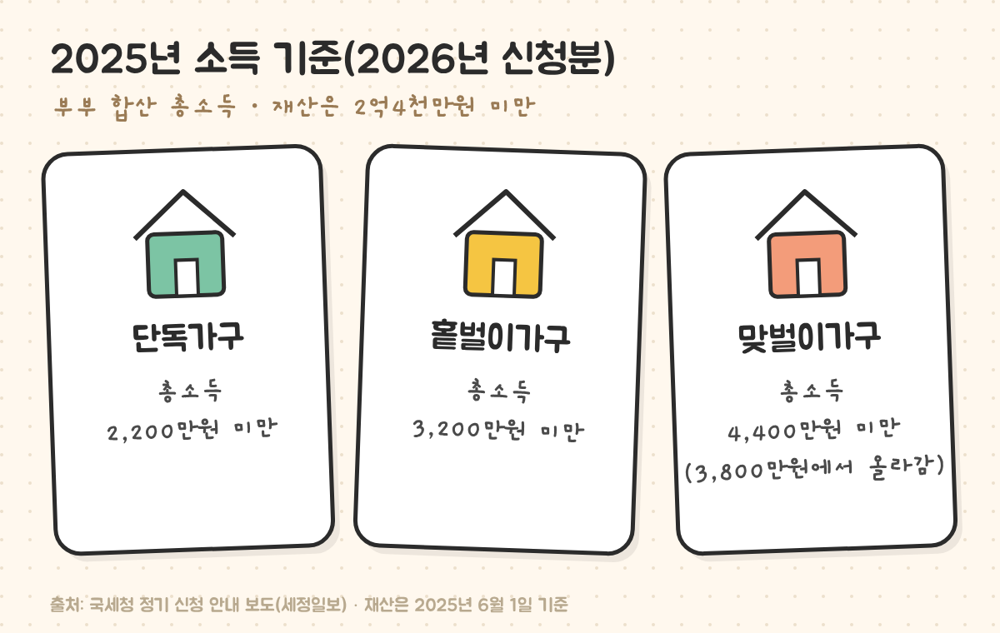
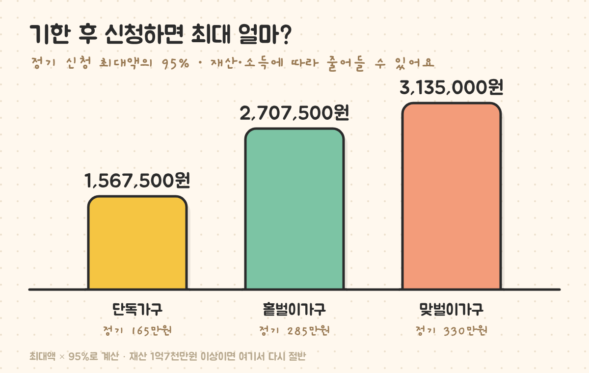
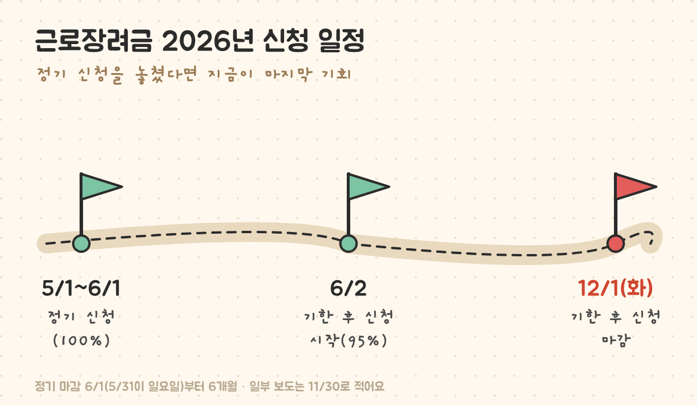

최종 검토일: 2026-11-02

5월 정기 신청 때 근로장려금을 신청하지 못했다면, <mark>12월 1일(화)까지 기한 후 신청</mark>으로 받을 수 있어요. 대신 금액은 원래 받을 돈의 <mark>95%</mark>로 5% 줄어들고, 소득·재산 기준은 정기 신청과 같아요.

2026년 신청분은 2025년 소득을 기준으로 보는데, 맞벌이 가구 소득 기준이 4,400만원 미만으로 올라 작년에 안 됐던 집도 대상일 수 있어요. 대상인지, 얼마를 받는지, 어디서 신청하는지 순서대로 볼게요.

  <strong style="color:#a04e0e;font-size:18px;">⏰ 마감일은 이렇게 잡으세요</strong>
  <ul style="margin:10px 0 0 0;padding-left:20px;line-height:1.9;">
    <li>올해 정기 신청은 5월 31일이 일요일이라 <b>6월 1일</b>까지였고, 기한 후 신청은 그 뒤 6개월 동안이라 <b>12월 1일</b>까지예요.</li>
    <li>일부 보도는 11월 30일로 적고 있어요. <b>11월 30일(월)까지 끝내 두면</b> 어느 쪽이든 안전해요.</li>
    <li>이 기간이 지나면 2025년 소득분 근로장려금은 받을 수 없어요.</li>
  </ul>

<h2 style="border-left:6px solid #e0703a;padding-left:12px;margin-top:36px;">목차</h2>
<ol style="line-height:1.9;">
  <li><a href="#sec-1" style="color:inherit;text-decoration:underline;text-underline-offset:3px;">나는 근로장려금 대상일까</a></li>
  <li><a href="#sec-2" style="color:inherit;text-decoration:underline;text-underline-offset:3px;">기한 후 신청하면 최대 얼마 받나</a></li>
  <li><a href="#sec-3" style="color:inherit;text-decoration:underline;text-underline-offset:3px;">재산 때문에 반으로 줄어드는 경우</a></li>
  <li><a href="#sec-4" style="color:inherit;text-decoration:underline;text-underline-offset:3px;">기한 후 신청 방법과 일정</a></li>
  <li><a href="#sec-5" style="color:inherit;text-decoration:underline;text-underline-offset:3px;">기한 후 신청 전에 놓치기 쉬운 것</a></li>
  <li><a href="#sec-6" style="color:inherit;text-decoration:underline;text-underline-offset:3px;">근로장려금 기한 후 신청 Q&amp;A 5개</a></li>
</ol>

<h2 id="sec-1" style="scroll-margin-top:72px;border-left:6px solid #e0703a;padding-left:12px;margin-top:36px;">나는 근로장려금 대상일까</h2>

기준은 <b>가구 유형별 총소득</b>과 <b>재산</b> 두 가지예요. 총소득은 근로·사업소득 등을 부부 합산한 금액이고, 재산은 가구원 전체 재산을 2025년 6월 1일 기준으로 더한 금액이에요. 빚은 빼지 않아요.

<figure style="margin:24px 0;"><figcaption style="font-size:13px;color:#888;">맞벌이 기준이 3,800만원에서 4,400만원으로 올라, 작년에 안 됐던 맞벌이 가구도 다시 볼 만해요.</figcaption></figure>

<table style="width:100%;border-collapse:collapse;margin:16px 0;">
  <thead>
    <tr style="background:#f0f0f0;">
      <th style="border:1px solid #ddd;padding:8px;text-align:left;">가구 유형</th>
      <th style="border:1px solid #ddd;padding:8px;text-align:left;">어떤 집</th>
      <th style="border:1px solid #ddd;padding:8px;text-align:left;">2025년 총소득</th>
      <th style="border:1px solid #ddd;padding:8px;text-align:left;">정기 신청 최대액</th>
    </tr>
  </thead>
  <tbody>
    <tr><td style="border:1px solid #ddd;padding:8px;">단독가구</td><td style="border:1px solid #ddd;padding:8px;">배우자·부양자녀·70세 이상 부양 부모가 없는 가구</td><td style="border:1px solid #ddd;padding:8px;">2,200만원 미만</td><td style="border:1px solid #ddd;padding:8px;">165만원</td></tr>
    <tr><td style="border:1px solid #ddd;padding:8px;">홑벌이가구</td><td style="border:1px solid #ddd;padding:8px;">배우자 소득이 적거나 부양가족이 있는 가구</td><td style="border:1px solid #ddd;padding:8px;">3,200만원 미만</td><td style="border:1px solid #ddd;padding:8px;">285만원</td></tr>
    <tr><td style="border:1px solid #ddd;padding:8px;"><mark>맞벌이가구</mark></td><td style="border:1px solid #ddd;padding:8px;">부부가 둘 다 일정 소득 이상 버는 가구</td><td style="border:1px solid #ddd;padding:8px;"><b>4,400만원 미만</b></td><td style="border:1px solid #ddd;padding:8px;">330만원</td></tr>
  </tbody>
</table>

재산 합계는 <b>2억4천만원 미만</b>이어야 해요. 가구 유형을 정하는 세부 기준(배우자 소득이 얼마부터 맞벌이인지 등)은 홈택스 신청 화면에서 자동으로 판정되니, 위 표로 대략 대상인지만 먼저 보면 돼요.

<h2 id="sec-2" style="scroll-margin-top:72px;border-left:6px solid #e0703a;padding-left:12px;margin-top:36px;">기한 후 신청하면 최대 얼마 받나</h2>

받는 금액은 소득 구간에 따라 계산되는데, 최대액은 가구 유형별로 정해져 있어요. 기한 후 신청은 여기에 <mark>95%</mark>를 곱해요.

<figure style="margin:24px 0;"><figcaption style="font-size:13px;color:#888;">최대액 기준이고, 실제 금액은 소득이 어느 구간인지에 따라 이보다 적을 수 있어요.</figcaption></figure>

<table style="width:100%;border-collapse:collapse;margin:16px 0;">
  <thead>
    <tr style="background:#f0f0f0;">
      <th style="border:1px solid #ddd;padding:8px;text-align:left;">가구 유형</th>
      <th style="border:1px solid #ddd;padding:8px;text-align:left;">정기 신청 최대</th>
      <th style="border:1px solid #ddd;padding:8px;text-align:left;">기한 후(95%) 최대</th>
      <th style="border:1px solid #ddd;padding:8px;text-align:left;">줄어드는 돈</th>
    </tr>
  </thead>
  <tbody>
    <tr><td style="border:1px solid #ddd;padding:8px;">단독가구</td><td style="border:1px solid #ddd;padding:8px;">165만원</td><td style="border:1px solid #ddd;padding:8px;">156만7,500원</td><td style="border:1px solid #ddd;padding:8px;">8만2,500원</td></tr>
    <tr><td style="border:1px solid #ddd;padding:8px;">홑벌이가구</td><td style="border:1px solid #ddd;padding:8px;">285만원</td><td style="border:1px solid #ddd;padding:8px;">270만7,500원</td><td style="border:1px solid #ddd;padding:8px;">14만2,500원</td></tr>
    <tr><td style="border:1px solid #ddd;padding:8px;">맞벌이가구</td><td style="border:1px solid #ddd;padding:8px;">330만원</td><td style="border:1px solid #ddd;padding:8px;"><b>313만5,000원</b></td><td style="border:1px solid #ddd;padding:8px;">16만5,000원</td></tr>
  </tbody>
</table>

5%가 줄어도 신청하지 않으면 0원이라, 대상이라면 지금 신청하는 쪽이 무조건 남아요.

<h2 id="sec-3" style="scroll-margin-top:72px;border-left:6px solid #e0703a;padding-left:12px;margin-top:36px;">재산 때문에 반으로 줄어드는 경우</h2>

재산 합계가 <mark>1억7천만원 이상 2억4천만원 미만</mark>이면 계산된 금액의 50%만 받아요. 기한 후 신청이면 여기에 다시 95%가 곱해져요.

<table style="width:100%;border-collapse:collapse;margin:16px 0;">
  <thead>
    <tr style="background:#f0f0f0;">
      <th style="border:1px solid #ddd;padding:8px;text-align:left;">맞벌이가구 최대액 예시</th>
      <th style="border:1px solid #ddd;padding:8px;text-align:left;">계산</th>
      <th style="border:1px solid #ddd;padding:8px;text-align:left;">받는 돈</th>
    </tr>
  </thead>
  <tbody>
    <tr><td style="border:1px solid #ddd;padding:8px;">재산 1억7천만원 미만, 기한 후</td><td style="border:1px solid #ddd;padding:8px;">330만원 × 95%</td><td style="border:1px solid #ddd;padding:8px;">313만5,000원</td></tr>
    <tr><td style="border:1px solid #ddd;padding:8px;">재산 1억7천만~2억4천만원, 기한 후</td><td style="border:1px solid #ddd;padding:8px;">330만원 × 50% × 95%</td><td style="border:1px solid #ddd;padding:8px;">156만7,500원</td></tr>
    <tr><td style="border:1px solid #ddd;padding:8px;">재산 2억4천만원 이상</td><td style="border:1px solid #ddd;padding:8px;">대상 아님</td><td style="border:1px solid #ddd;padding:8px;">0원</td></tr>
  </tbody>
</table>

재산에는 집(전세보증금 포함), 토지, 자동차, 예금 등이 들어가고 빚은 빼지 않아요. 전세 보증금이 큰 집은 재산 구간부터 먼저 보는 게 좋아요.

<h2 id="sec-4" style="scroll-margin-top:72px;border-left:6px solid #e0703a;padding-left:12px;margin-top:36px;">기한 후 신청 방법과 일정</h2>

<figure style="margin:24px 0;"><figcaption style="font-size:13px;color:#888;">정기 신청이 끝난 다음 날부터 6개월이 기한 후 신청 기간이에요.</figcaption></figure>

<ul style="line-height:1.9;">
  <li><b>홈택스·손택스:</b> <a href="https://www.hometax.go.kr" target="_blank" rel="noopener">홈택스</a> 또는 손택스 앱에서 "장려금" 메뉴로 들어가 신청해요. 소득 자료가 대부분 미리 채워져 있어요.</li>
  <li><b>세무서 방문:</b> 앱이 어렵다면 가까운 세무서에서 신청할 수 있어요.</li>
  <li><b>지급:</b> 기한 후 신청분은 심사를 거쳐 지급돼서 정기 신청보다 늦게 들어와요. 진행 상황은 홈택스 장려금 메뉴에서 볼 수 있어요.</li>
</ul>

<h2 id="sec-5" style="scroll-margin-top:72px;border-left:6px solid #e0703a;padding-left:12px;margin-top:36px;">기한 후 신청 전에 놓치기 쉬운 것</h2>

<ol style="line-height:1.9;">
  <li><b>"안내문을 못 받았으니 대상이 아니다"는 아니에요.</b> 안내문은 국세청이 대상일 가능성이 큰 가구에 보내는 것이고, 못 받았어도 기준에 맞으면 신청할 수 있어요.</li>
  <li><b>2025년에 이직·퇴사가 있었다면 소득을 다시 봐요.</b> 일한 기간이 짧아 1년 총소득이 기준 아래로 내려간 경우가 많아요.</li>
  <li><b>맞벌이 기준이 바뀌었어요.</b> 작년(2024년 소득) 기준 3,800만원 때문에 안 됐던 집이라도 올해는 4,400만원 미만이면 대상이에요.</li>
</ol>

<h2 id="sec-6" style="scroll-margin-top:72px;border-left:6px solid #e0703a;padding-left:12px;margin-top:36px;">근로장려금 기한 후 신청 Q&amp;A 5개</h2>

  
근로장려금 기한 후 신청은 언제까지인가요

  
2026년은 정기 신청이 6월 1일에 끝나 기한 후 신청은 6월 2일부터 12월 1일까지예요. 일부 보도는 11월 30일로 적고 있어, 11월 30일까지 끝내 두면 안전해요.

  
기한 후 신청하면 얼마나 줄어드나요

  
계산된 금액의 95%를 받아 5%가 줄어요. 맞벌이가구 최대액 330만원이면 313만5,000원, 홑벌이 285만원이면 270만7,500원, 단독 165만원이면 156만7,500원이에요.

  
2026년 근로장려금 소득 기준은 얼마인가요

  
2025년 부부 합산 총소득이 단독가구 2,200만원 미만, 홑벌이가구 3,200만원 미만, 맞벌이가구 4,400만원 미만이어야 해요. 재산은 2025년 6월 1일 기준 2억4천만원 미만이어야 해요.

  
재산이 1억7천만원을 넘으면 못 받나요

  
2억4천만원 미만이면 받을 수 있지만, 1억7천만원 이상이면 계산된 금액의 50%만 받아요. 기한 후 신청이면 여기에 95%가 다시 곱해져요.

  
안내문을 못 받았는데 신청해도 되나요

  
네. 안내문은 대상 가능성이 큰 가구에 보내는 것이고, 받지 못했어도 소득·재산 기준에 맞으면 홈택스·손택스나 세무서에서 신청할 수 있어요.

  참고 출처:
  <ul style="margin:6px 0 0 0;padding-left:20px;">
    <li><a href="https://www.taxtimes.co.kr/news/article.html?no=274947" target="_blank" rel="noopener">세정일보: 근로·자녀장려금 6월 1일까지 신청, 국세청 324만 가구 안내(소득·재산 기준)</a></li>
    <li><a href="https://www.imaeil.com/page/view/2026101309584007035" target="_blank" rel="noopener">매일신문: 근로장려금 기한 후 신청, 95%라도 받는다(2026-10-13)</a></li>
    <li><a href="http://refundnote.com/blog/eitc-late-application-2026/" target="_blank" rel="noopener">환급노트: 12월 1일까지 기한 후 신청, 95% 지급</a></li>
    <li><a href="https://www.hometax.go.kr" target="_blank" rel="noopener">국세청 홈택스(장려금 신청·심사 진행 조회)</a></li>
  </ul>
  기준일: 2026년 11월 2일. 개별 가구의 대상 여부와 금액은 홈택스 심사 결과가 최종 기준이에요.

정보 제공을 목적으로 쓴 글이에요. 장려금 기준과 금액은 세법 개정에 따라 바뀔 수 있어요.

