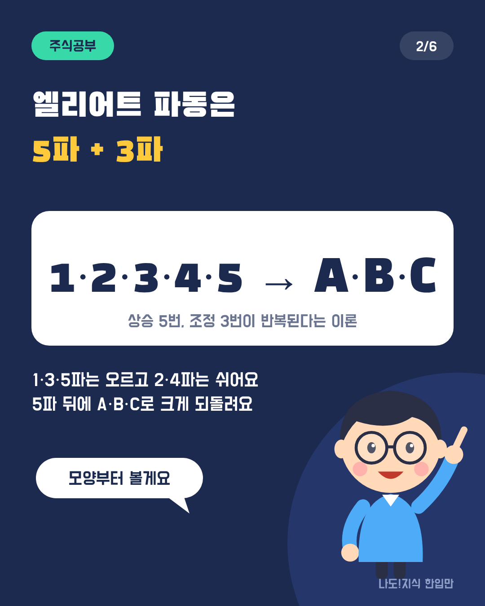
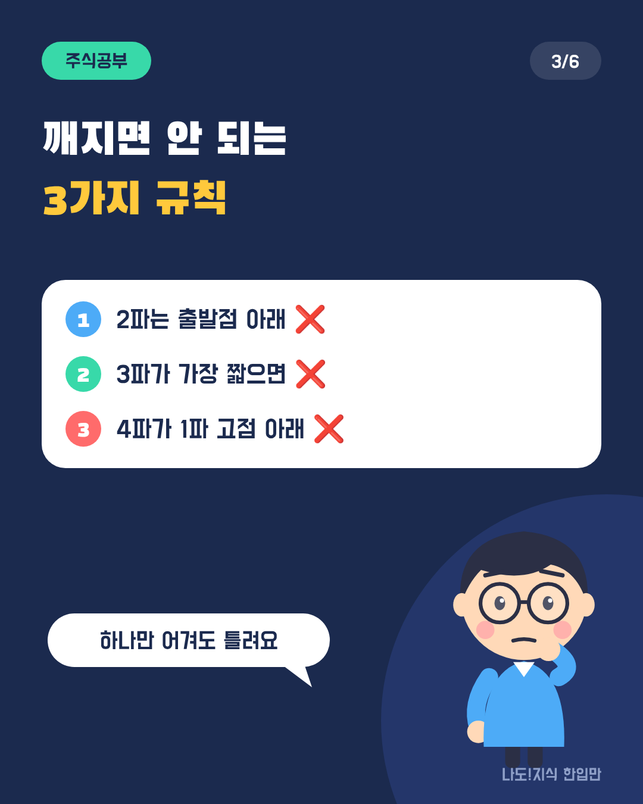
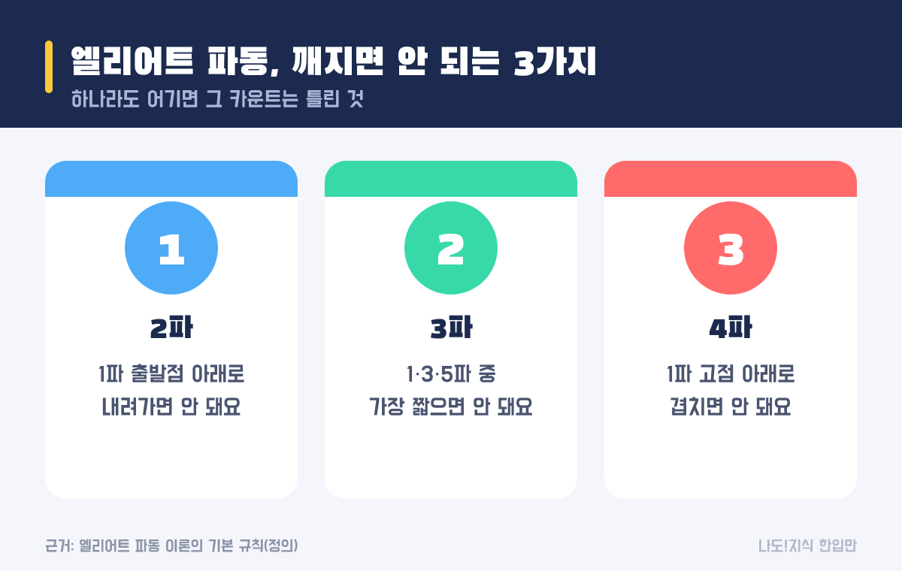
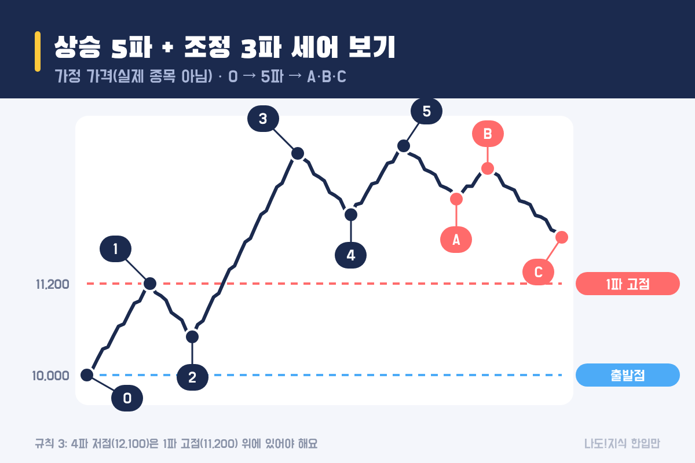
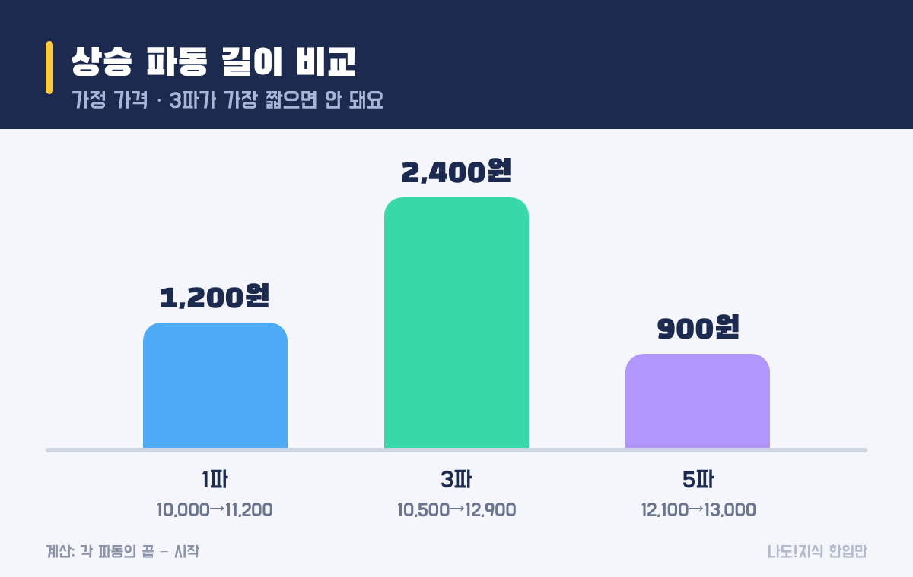

최종 검토일: 2026-11-09

엘리어트 파동은 <mark>주가가 오르는 다섯 번의 움직임(1~5파)과 되돌리는 세 번의 움직임(A·B·C)이 반복된다</mark>고 보는 이론이에요. 어떻게 셀지는 사람마다 달라도, <mark>절대 깨지면 안 되는 규칙 3가지</mark>가 있어서 그걸로 틀린 카운트를 걸러낼 수 있어요.

이론 소개보다 실제로 쓸 수 있는 부분에 집중할게요. 가정 차트로 1~5파를 직접 세 보고, 규칙 3가지로 그 카운트가 맞는지 숫자로 검사하는 방법을 볼게요.

  <strong style="color:#1b2a4e;font-size:18px;">📏 깨지면 안 되는 3가지</strong>
  <ul style="margin:10px 0 0 0;padding-left:20px;line-height:1.9;">
    <li><b>규칙 1:</b> 2파는 1파의 출발점 아래로 내려가지 않는다.</li>
    <li><b>규칙 2:</b> 3파는 1·3·5파 중 가장 짧을 수 없다.</li>
    <li><b>규칙 3:</b> 4파는 1파의 고점 아래로 내려가 겹치지 않는다.</li>
  </ul>

옆으로 넘겨 보세요 → (카드 6장 요약)

<h2 style="border-left:6px solid #1b2a4e;padding-left:12px;margin-top:36px;">목차</h2>
<ol style="line-height:1.9;">
  <li><a href="#sec-1" style="color:inherit;text-decoration:underline;text-underline-offset:3px;">엘리어트 파동이란 무엇인가요?</a></li>
  <li><a href="#sec-2" style="color:inherit;text-decoration:underline;text-underline-offset:3px;">엘리어트 파동, 깨지면 안 되는 규칙은 뭔가요?</a></li>
  <li><a href="#sec-3" style="color:inherit;text-decoration:underline;text-underline-offset:3px;">가정 차트로 1~5파를 직접 세어 보면</a></li>
  <li><a href="#sec-4" style="color:inherit;text-decoration:underline;text-underline-offset:3px;">틀린 카운트는 어떻게 구별하나요?</a></li>
  <li><a href="#sec-5" style="color:inherit;text-decoration:underline;text-underline-offset:3px;">규칙과 관행(피보나치 비율)의 차이</a></li>
  <li><a href="#sec-6" style="color:inherit;text-decoration:underline;text-underline-offset:3px;">한계: 같은 차트, 다른 카운트</a></li>
  <li><a href="#sec-7" style="color:inherit;text-decoration:underline;text-underline-offset:3px;">엘리어트 파동 Q&amp;A 5개</a></li>
</ol>

<h2 id="sec-1" style="scroll-margin-top:72px;border-left:6px solid #1b2a4e;padding-left:12px;margin-top:36px;">엘리어트 파동이란 무엇인가요?</h2>

엘리어트 파동은 주가의 큰 흐름이 <b>추세 방향으로 5번(1·2·3·4·5파), 반대 방향으로 3번(A·B·C파)</b> 움직이며 반복된다고 보는 이론이에요. 1930년대 랠프 넬슨 엘리어트가 정리했고, 지금도 차트 분석에서 자주 쓰여요.

<table style="width:100%;border-collapse:collapse;margin:16px 0;">
  <thead>
    <tr style="background:#1b2a4e;color:#fff;"><th style="border:1px solid #ddd;padding:8px;">구간</th><th style="border:1px solid #ddd;padding:8px;">방향</th><th style="border:1px solid #ddd;padding:8px;">흔히 하는 설명</th></tr>
  </thead>
  <tbody>
    <tr><td style="border:1px solid #ddd;padding:8px;">1·3·5파</td><td style="border:1px solid #ddd;padding:8px;">추세 방향(상승)</td><td style="border:1px solid #ddd;padding:8px;">오르는 구간. 3파가 가장 강한 경우가 많다고 해요</td></tr>
    <tr><td style="border:1px solid #ddd;padding:8px;">2·4파</td><td style="border:1px solid #ddd;padding:8px;">반대 방향(조정)</td><td style="border:1px solid #ddd;padding:8px;">오른 만큼 일부를 되돌리는 구간</td></tr>
    <tr><td style="border:1px solid #ddd;padding:8px;">A·B·C파</td><td style="border:1px solid #ddd;padding:8px;">5파 뒤 큰 조정</td><td style="border:1px solid #ddd;padding:8px;">내리고(A) 반등하고(B) 다시 내리는(C) 구간</td></tr>
  </tbody>
</table>

하락장에서는 방향만 뒤집혀서, 하락 5파와 반등 3파로 셀 수 있어요.

<h2 id="sec-2" style="scroll-margin-top:72px;border-left:6px solid #1b2a4e;padding-left:12px;margin-top:36px;">엘리어트 파동, 깨지면 안 되는 규칙은 뭔가요?</h2>

상승 5파를 셀 때 아래 세 가지 중 하나라도 어기면, 그 카운트는 틀린 거예요. 다시 세야 해요.

<figure style="margin:24px 0;"><figcaption style="font-size:13px;color:#888;">이 세 가지는 '대체로'가 아니라 '반드시'예요.</figcaption></figure>

<table style="width:100%;border-collapse:collapse;margin:16px 0;">
  <thead>
    <tr style="background:#1b2a4e;color:#fff;"><th style="border:1px solid #ddd;padding:8px;">규칙</th><th style="border:1px solid #ddd;padding:8px;">검사하는 식(상승 기준)</th></tr>
  </thead>
  <tbody>
    <tr><td style="border:1px solid #ddd;padding:8px;">1. 2파 바닥</td><td style="border:1px solid #ddd;padding:8px;"><mark>2파 저점 &gt; 1파 출발점</mark></td></tr>
    <tr><td style="border:1px solid #ddd;padding:8px;">2. 3파 길이</td><td style="border:1px solid #ddd;padding:8px;"><mark>3파 길이 ≠ 1·3·5파 중 최솟값</mark></td></tr>
    <tr><td style="border:1px solid #ddd;padding:8px;">3. 4파 바닥</td><td style="border:1px solid #ddd;padding:8px;"><mark>4파 저점 &gt; 1파 고점</mark></td></tr>
  </tbody>
</table>

파동 길이는 '끝 가격 − 시작 가격'으로 재요. 규칙 3에는 예외로 보는 특수한 모양(쐐기형 등)이 있다는 설명도 있지만, 처음 셀 때는 세 규칙을 그대로 적용하는 게 안전해요.

<h2 id="sec-3" style="scroll-margin-top:72px;border-left:6px solid #1b2a4e;padding-left:12px;margin-top:36px;">가정 차트로 1~5파를 직접 세어 보면</h2>

가정 가격으로 10,000원에서 13,000원까지 다섯 번에 걸쳐 오른 뒤, 세 번에 걸쳐 11,800원까지 되돌린 차트를 세어 봤어요. 세 규칙 모두 통과해요.

<figure style="margin:24px 0;"><figcaption style="font-size:13px;color:#888;">실제 종목이 아닌 가정 가격이에요. 빨간 점선이 1파 고점(규칙 3의 기준선)이에요.</figcaption></figure>

<table style="width:100%;border-collapse:collapse;margin:16px 0;">
  <thead>
    <tr style="background:#1b2a4e;color:#fff;"><th style="border:1px solid #ddd;padding:8px;">검사</th><th style="border:1px solid #ddd;padding:8px;">숫자</th><th style="border:1px solid #ddd;padding:8px;">결과</th></tr>
  </thead>
  <tbody>
    <tr><td style="border:1px solid #ddd;padding:8px;">규칙 1</td><td style="border:1px solid #ddd;padding:8px;">2파 저점 10,500 &gt; 출발점 10,000</td><td style="border:1px solid #ddd;padding:8px;"><mark>통과</mark></td></tr>
    <tr><td style="border:1px solid #ddd;padding:8px;">규칙 2</td><td style="border:1px solid #ddd;padding:8px;">1파 1,200 · 3파 2,400 · 5파 900 → 3파가 가장 김</td><td style="border:1px solid #ddd;padding:8px;"><mark>통과</mark></td></tr>
    <tr><td style="border:1px solid #ddd;padding:8px;">규칙 3</td><td style="border:1px solid #ddd;padding:8px;">4파 저점 12,100 &gt; 1파 고점 11,200</td><td style="border:1px solid #ddd;padding:8px;"><mark>통과</mark></td></tr>
  </tbody>
</table>

<figure style="margin:24px 0;"><figcaption style="font-size:13px;color:#888;">규칙 2는 '3파가 가장 길어야 한다'가 아니라 '가장 짧으면 안 된다'예요.</figcaption></figure>

규칙 2를 자주 헷갈려요. 3파가 꼭 가장 길 필요는 없어요. 예를 들어 1파 1,200원, 3파 1,000원, 5파 900원이라면 3파가 가장 길지는 않지만 가장 짧지도 않아서 규칙은 통과해요.

<h2 id="sec-4" style="scroll-margin-top:72px;border-left:6px solid #1b2a4e;padding-left:12px;margin-top:36px;">틀린 카운트는 어떻게 구별하나요?</h2>

내가 붙인 번호를 세 규칙에 하나씩 넣어 보면 돼요. 하나라도 걸리면 그 번호 매기기는 버리고 다른 방식으로 다시 세요.

<table style="width:100%;border-collapse:collapse;margin:16px 0;">
  <thead>
    <tr style="background:#1b2a4e;color:#fff;"><th style="border:1px solid #ddd;padding:8px;">만약 이랬다면</th><th style="border:1px solid #ddd;padding:8px;">어긴 규칙</th><th style="border:1px solid #ddd;padding:8px;">판정</th></tr>
  </thead>
  <tbody>
    <tr><td style="border:1px solid #ddd;padding:8px;">4파가 <b>11,100원</b>까지 내려옴</td><td style="border:1px solid #ddd;padding:8px;">규칙 3 (1파 고점 11,200원 아래로 겹침)</td><td style="border:1px solid #ddd;padding:8px;"><mark>틀린 카운트</mark></td></tr>
    <tr><td style="border:1px solid #ddd;padding:8px;">2파가 <b>9,900원</b>까지 내려옴</td><td style="border:1px solid #ddd;padding:8px;">규칙 1 (출발점 10,000원 아래)</td><td style="border:1px solid #ddd;padding:8px;"><mark>틀린 카운트</mark></td></tr>
    <tr><td style="border:1px solid #ddd;padding:8px;">3파가 <b>800원</b>만 오름(1파 1,200·5파 900)</td><td style="border:1px solid #ddd;padding:8px;">규칙 2 (3파가 가장 짧음)</td><td style="border:1px solid #ddd;padding:8px;"><mark>틀린 카운트</mark></td></tr>
  </tbody>
</table>

틀린 카운트라는 건 "주가가 틀렸다"가 아니라 <b>내가 번호를 잘못 붙였다</b>는 뜻이에요. 보통은 더 작은 파동을 큰 파동으로 잘못 봤거나, 상승 5파가 아니라 조정 구간일 가능성이 있어요.

<h2 id="sec-5" style="scroll-margin-top:72px;border-left:6px solid #1b2a4e;padding-left:12px;margin-top:36px;">규칙과 관행(피보나치 비율)의 차이</h2>

엘리어트 파동 설명에는 피보나치 비율이 자주 같이 나오지만, 이건 <b>규칙이 아니라 '흔히 그렇다'는 관행</b>이에요. 어겨도 카운트가 틀린 건 아니에요.

<table style="width:100%;border-collapse:collapse;margin:16px 0;">
  <thead>
    <tr style="background:#1b2a4e;color:#fff;"><th style="border:1px solid #ddd;padding:8px;">흔히 쓰는 관행</th><th style="border:1px solid #ddd;padding:8px;">가정 차트 값</th></tr>
  </thead>
  <tbody>
    <tr><td style="border:1px solid #ddd;padding:8px;">2파는 1파의 50~61.8%쯤 되돌린다</td><td style="border:1px solid #ddd;padding:8px;">58.3% (1,200 중 700 되돌림)</td></tr>
    <tr><td style="border:1px solid #ddd;padding:8px;">3파는 1파의 1.618배 이상인 경우가 많다</td><td style="border:1px solid #ddd;padding:8px;">2.0배 (2,400 ÷ 1,200)</td></tr>
    <tr><td style="border:1px solid #ddd;padding:8px;">4파는 3파의 38.2% 안팎을 되돌린다</td><td style="border:1px solid #ddd;padding:8px;">33.3% (2,400 중 800 되돌림)</td></tr>
  </tbody>
</table>

가정 차트는 설명하려고 관행에 맞춰 만든 거라 잘 들어맞지만, 실제 차트는 자주 어긋나요. 되돌림 비율 계산은 <a href="https://sensitiveboss3.tistory.com/entry/fibonacci-retracement-calculation" target="_blank" rel="noopener">피보나치 되돌림 계산법</a> 글에 정리했어요.

<h2 id="sec-6" style="scroll-margin-top:72px;border-left:6px solid #1b2a4e;padding-left:12px;margin-top:36px;">한계: 같은 차트, 다른 카운트</h2>

엘리어트 파동의 가장 큰 약점은 <mark>같은 차트를 두고도 사람마다 다르게 셀 수 있다</mark>는 점이에요. 세 규칙은 틀린 카운트를 걸러 줄 뿐, 맞는 카운트를 하나로 정해 주지는 않아요.

<ul style="line-height:1.9;">
  <li><b>지금 몇 파인지는 나중에야 확실해져요.</b> 3파라고 생각했는데 더 큰 그림에서는 1파의 일부였던 경우가 흔해요.</li>
  <li><b>파동 안에 더 작은 파동이 있어요.</b> 어떤 크기로 셀지에 따라 번호가 완전히 달라져요.</li>
  <li><b>방향을 보장하지 않아요.</b> "지금 4파니까 5파가 남았다"는 해석일 뿐, 실제로 오른다는 보장은 없어요.</li>
</ul>

그래서 엘리어트 파동은 단독 신호보다 <b>내 해석이 말이 되는지 점검하는 틀</b>로 쓰는 편이 무난해요. 이동평균선 같은 다른 지표와 함께 보는 순서는 <a href="https://sensitiveboss3.tistory.com/entry/moving-average-5-20-day-cross" target="_blank" rel="noopener">이동평균선 계산과 크로스 보는 법</a>, <a href="https://sensitiveboss3.tistory.com/entry/stock-chart-reading-guide" target="_blank" rel="noopener">주식 차트 보는법</a>에 정리했어요.

<h2 id="sec-7" style="scroll-margin-top:72px;border-left:6px solid #1b2a4e;padding-left:12px;margin-top:36px;">엘리어트 파동 Q&amp;A 5개</h2>

  
엘리어트 파동 3가지 규칙은 무엇인가요

  
2파는 1파 출발점 아래로 내려가지 않고, 3파는 1·3·5파 중 가장 짧을 수 없고, 4파는 1파 고점 아래로 겹치지 않는다는 세 가지예요. 하나라도 어기면 그 카운트는 틀린 거예요.

  
3파가 꼭 가장 길어야 하나요

  
아니에요. 규칙은 '3파가 가장 짧으면 안 된다'예요. 1파 1,200원, 3파 1,000원, 5파 900원처럼 3파가 가장 길지 않아도 가장 짧지만 않으면 규칙은 통과해요.

  
4파가 1파 고점 아래로 내려가면 어떻게 되나요

  
그 카운트는 틀린 거예요. 예를 들어 1파 고점이 11,200원인데 4파가 11,100원까지 내려왔다면 규칙 3 위반이라, 번호를 다시 붙여야 해요.

  
엘리어트 파동과 피보나치는 무슨 관계인가요

  
파동이 얼마나 되돌리거나 뻗는지 가늠할 때 피보나치 비율을 흔히 써요. 2파 50~61.8% 되돌림, 3파가 1파의 1.618배 이상 같은 기준인데, 규칙이 아니라 관행이라 실제로는 자주 어긋나요.

  
엘리어트 파동으로 매매 시점을 알 수 있나요

  
어렵다고 보는 게 맞아요. 같은 차트도 사람마다 다르게 세고, 지금 몇 파인지는 나중에야 확실해져요. 규칙으로 틀린 해석을 걸러 내는 점검 도구로 쓰는 편이 무난하고, 매수·매도 판단은 본인 몫이에요.

  참고:
  <ul style="margin:6px 0 0 0;padding-left:20px;">
    <li>세 가지 규칙은 엘리어트 파동 이론의 기본 정의(R. N. 엘리어트가 정리하고 프로스트·프렉터가 체계화)를 따랐어요.</li>
    <li>예시 가격과 차트는 계산을 보여 주기 위한 가정값이에요(실제 종목 아님).</li>
  </ul>
  기준일: 2026년 11월 9일.

정보 제공을 목적으로 쓴 글이며 특정 종목의 매수·매도를 권유하지 않아요. 예시는 계산을 보여 주기 위한 가정값이고, 투자 판단과 그 결과에 대한 책임은 투자자 본인에게 있어요.

