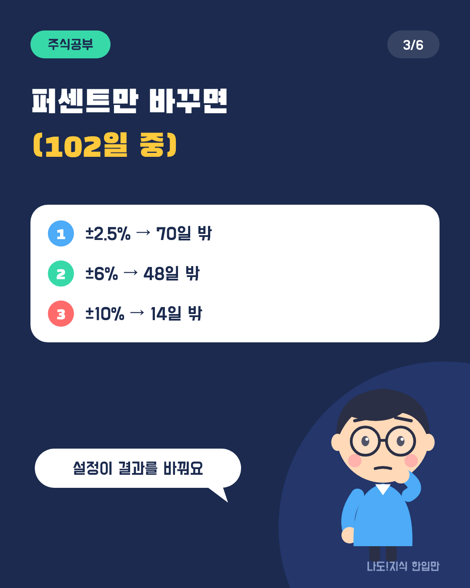
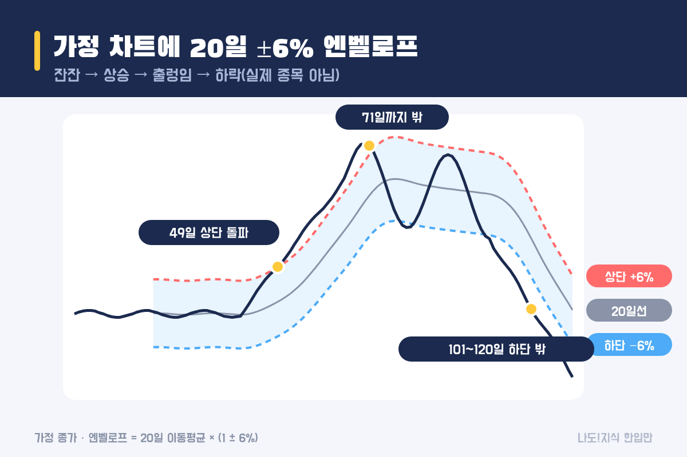
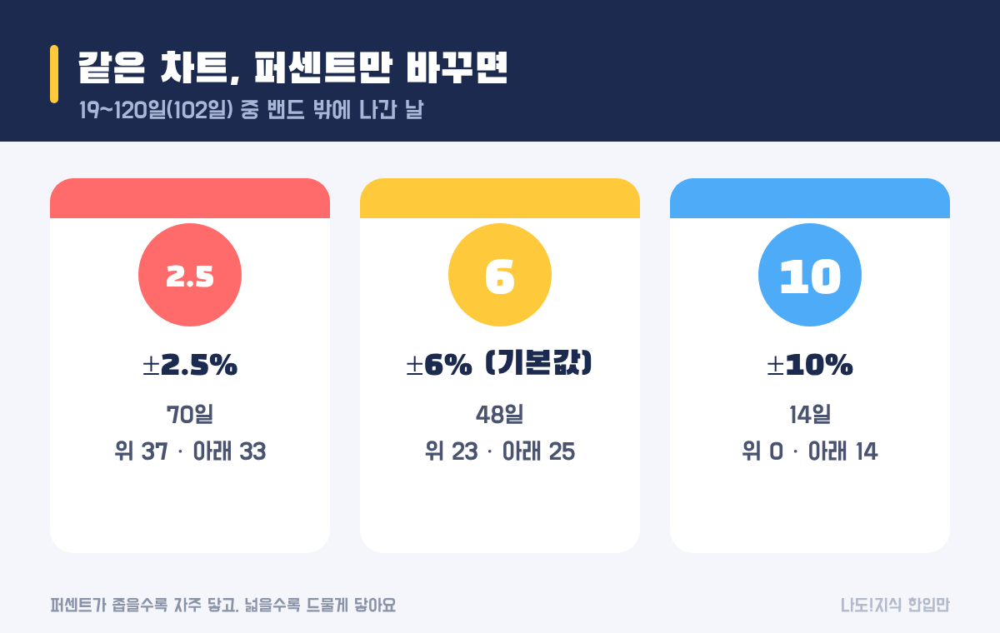
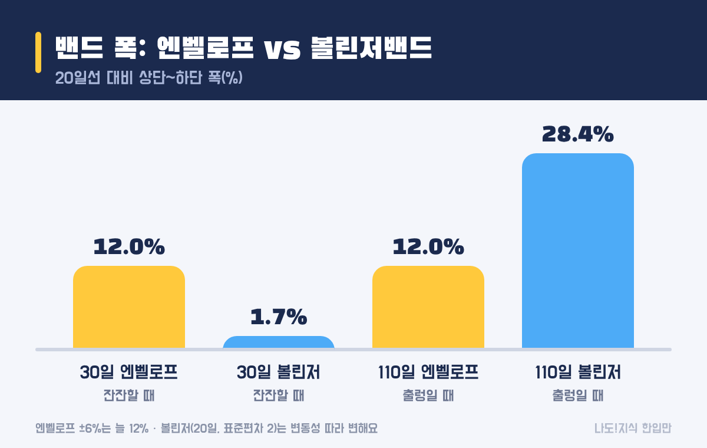

최종 검토일: 2026-11-13

엔벨로프는 이동평균선 위아래로 같은 퍼센트만큼 떨어진 선 두 개를 그린 지표예요. 봉투(envelope)처럼 주가를 감싼다고 해서 붙은 이름이고, 20일 이동평균에 ±6%를 쓰는 설정이 국내 증권사 기본값으로 흔해요.

계산은 곱하기 한 번이면 끝나지만, 퍼센트를 얼마로 잡느냐에 따라 같은 차트에서도 결과가 크게 달라져요. 가정 차트로 상단·하단을 직접 구하고, 2.5·6·10%를 나란히 비교한 뒤, 볼린저밴드와 무엇이 다른지까지 볼게요.

  <strong style="color:#1b2a4e;font-size:18px;">✉️ 한눈에 보기</strong>
  <ul style="margin:10px 0 0 0;padding-left:20px;line-height:1.9;">
    <li><b>뜻:</b> 이동평균 위아래에 고정 퍼센트로 친 울타리</li>
    <li><b>공식:</b> 상단 = 이동평균 × (1 + k%), 하단 = 이동평균 × (1 − k%)</li>
    <li><b>흔한 설정:</b> 20일 · ±6% (증권사 기본값), 해외 자료는 2.5%·5%도</li>
    <li><b>볼린저와 차이:</b> 엔벨로프는 폭 고정, 볼린저는 변동성 따라 변함</li>
    <li><b>한계:</b> 강한 추세에서는 밴드 밖에 오래 머물러요</li>
  </ul>

옆으로 넘겨 보세요 → (카드 6장 요약)

  <strong style="font-size:16px;">📖 처음이라면 이것만 — 낱말 풀이</strong>
  <ul style="margin:8px 0 0 0;padding-left:20px;line-height:1.9;">
    <li><b>이동평균:</b> 최근 N일 종가의 평균. 매일 하루씩 밀려가며 다시 계산해요.</li>
    <li><b>상단·하단(밴드):</b> 이동평균 위아래에 그린 두 선. 그 사이 구간을 밴드라고 불러요.</li>
    <li><b>k%(퍼센트 값):</b> 이동평균에서 얼마나 떨어진 곳에 선을 그을지 정하는 값. 6이면 ±6%예요.</li>
    <li><b>표준편차:</b> 값들이 평균에서 얼마나 흩어져 있는지 나타내는 숫자. 볼린저밴드가 폭을 정할 때 써요.</li>
    <li><b>이격도:</b> 주가 ÷ 이동평균 × 100. 엔벨로프와 같은 거리를 숫자 하나로 보여 줘요.</li>
  </ul>

<h2 style="border-left:6px solid #1b2a4e;padding-left:12px;margin-top:36px;">목차</h2>
<ol style="line-height:1.9;">
  <li><a href="#sec-1" style="color:inherit;text-decoration:underline;text-underline-offset:3px;">엔벨로프는 무엇인가요?</a></li>
  <li><a href="#sec-2" style="color:inherit;text-decoration:underline;text-underline-offset:3px;">20일 ±6% 엔벨로프는 어떻게 계산하나요?</a></li>
  <li><a href="#sec-3" style="color:inherit;text-decoration:underline;text-underline-offset:3px;">퍼센트를 바꾸면 무엇이 달라지나요?</a></li>
  <li><a href="#sec-4" style="color:inherit;text-decoration:underline;text-underline-offset:3px;">볼린저밴드와는 무엇이 다른가요?</a></li>
  <li><a href="#sec-5" style="color:inherit;text-decoration:underline;text-underline-offset:3px;">상단을 뚫으면 곧 내려오나요?</a></li>
  <li><a href="#sec-6" style="color:inherit;text-decoration:underline;text-underline-offset:3px;">HTS에서 엔벨로프 켜는 법 따라 하기</a></li>
  <li><a href="#sec-7" style="color:inherit;text-decoration:underline;text-underline-offset:3px;">자주 하는 오해 5가지</a></li>
  <li><a href="#sec-8" style="color:inherit;text-decoration:underline;text-underline-offset:3px;">엔벨로프 Q&amp;A 5개</a></li>
</ol>

<h2 id="sec-1" style="scroll-margin-top:72px;border-left:6px solid #1b2a4e;padding-left:12px;margin-top:36px;">엔벨로프는 무엇인가요?</h2>

엔벨로프는 이동평균을 가운데 두고, 위아래로 같은 비율만큼 떨어진 곳에 선을 그은 것이에요. 주가가 평균에서 얼마나 벌어졌는지를 차트 위에 울타리처럼 보여 줘요.

이동평균선만 있으면 주가가 선 위에 있는지 아래에 있는지만 보여요. 엔벨로프는 여기에 "평균에서 6%쯤 벌어진 자리"를 선으로 그려 둬서, 지금 주가가 평균에서 꽤 멀리 나갔는지 한눈에 보게 해 줘요. 숫자로 바꾸면 20일 이격도와 같은 이야기예요. ±6% 상단은 이격도 106, 하단은 이격도 94인 자리예요.

<table style="width:100%;border-collapse:collapse;margin:16px 0;">
  <thead>
    <tr style="background:#1b2a4e;color:#fff;"><th style="border:1px solid #ddd;padding:8px;">구분</th><th style="border:1px solid #ddd;padding:8px;">계산</th><th style="border:1px solid #ddd;padding:8px;">20일선이 10,000원일 때</th></tr>
  </thead>
  <tbody>
    <tr><td style="border:1px solid #ddd;padding:8px;">상단</td><td style="border:1px solid #ddd;padding:8px;">20일선 × 1.06</td><td style="border:1px solid #ddd;padding:8px;">10,600원</td></tr>
    <tr><td style="border:1px solid #ddd;padding:8px;">가운데</td><td style="border:1px solid #ddd;padding:8px;">20일 이동평균</td><td style="border:1px solid #ddd;padding:8px;">10,000원</td></tr>
    <tr><td style="border:1px solid #ddd;padding:8px;">하단</td><td style="border:1px solid #ddd;padding:8px;">20일선 × 0.94</td><td style="border:1px solid #ddd;padding:8px;">9,400원</td></tr>
  </tbody>
</table>

이동평균 자체를 구하는 법과 5일·20일선 크로스는 <a href="https://sensitiveboss3.tistory.com/entry/moving-average-5-20-day-cross" target="_blank" rel="noopener">이동평균선 5일 20일 계산과 크로스 보는 법</a> 글에 정리해 뒀어요.

<h2 id="sec-2" style="scroll-margin-top:72px;border-left:6px solid #1b2a4e;padding-left:12px;margin-top:36px;">20일 ±6% 엔벨로프는 어떻게 계산하나요?</h2>

20일 ±6% 엔벨로프는 20일 종가 평균을 구하고, 1.06을 곱하면 상단, 0.94를 곱하면 하단이에요. 아래 가정 차트(실제 종목 아님)의 60일째로 계산해 볼게요.

<figure style="margin:24px 0;"><figcaption style="font-size:13px;color:#888;">계산을 보여 주기 위한 가정 종가예요. 실제 종목이 아니에요.</figcaption></figure>

  <strong>✍️ 따라 해 보기 (60일째, 종가 11,870원)</strong> 
  ① 41~60일 종가 20개 더하기: <b>220,000원</b> 
  ② 20으로 나누기: <b>20일선 11,000원</b> 
  ③ 상단: 11,000 × 1.06 = <b>11,660원</b> · 하단: 11,000 × 0.94 = <b>10,340원</b> 
  ④ 종가 11,870원 > 상단 11,660원 → <b>상단 밖(위)</b> (이격도로는 107.9)

다음 날에는 41일 종가를 빼고 61일 종가를 넣어 20일선을 다시 구하고, 같은 비율을 곱해요. 그래서 엔벨로프는 이동평균을 그대로 따라 움직이고, 두 선 사이 간격은 늘 이동평균의 12%(위 6% + 아래 6%)예요.

<h2 id="sec-3" style="scroll-margin-top:72px;border-left:6px solid #1b2a4e;padding-left:12px;margin-top:36px;">퍼센트를 바꾸면 무엇이 달라지나요?</h2>

퍼센트를 바꾸면 같은 차트에서도 밴드 밖에 나가는 날 수가 크게 달라져요. 가정 차트의 19~120일(102일)로 세어 봤어요.

<figure style="margin:24px 0;"><figcaption style="font-size:13px;color:#888;">퍼센트가 좁을수록 자주 닿고, 넓을수록 드물게 닿아요.</figcaption></figure>

<table style="width:100%;border-collapse:collapse;margin:16px 0;">
  <thead>
    <tr style="background:#1b2a4e;color:#fff;"><th style="border:1px solid #ddd;padding:8px;">설정</th><th style="border:1px solid #ddd;padding:8px;">상단 위</th><th style="border:1px solid #ddd;padding:8px;">하단 아래</th><th style="border:1px solid #ddd;padding:8px;">합계(102일 중)</th></tr>
  </thead>
  <tbody>
    <tr><td style="border:1px solid #ddd;padding:8px;">±2.5%</td><td style="border:1px solid #ddd;padding:8px;">37일</td><td style="border:1px solid #ddd;padding:8px;">33일</td><td style="border:1px solid #ddd;padding:8px;"><b>70일</b></td></tr>
    <tr><td style="border:1px solid #ddd;padding:8px;">±6% (기본값)</td><td style="border:1px solid #ddd;padding:8px;">23일</td><td style="border:1px solid #ddd;padding:8px;">25일</td><td style="border:1px solid #ddd;padding:8px;"><b>48일</b></td></tr>
    <tr><td style="border:1px solid #ddd;padding:8px;">±10%</td><td style="border:1px solid #ddd;padding:8px;">0일</td><td style="border:1px solid #ddd;padding:8px;">14일</td><td style="border:1px solid #ddd;padding:8px;"><b>14일</b></td></tr>
  </tbody>
</table>

±2.5%는 하루걸러 하루꼴로 밖에 나가서 '특별한 자리'라는 의미가 약해지고, ±10%는 출렁이는 구간에서도 한 번도 위로 닿지 않았어요. 결국 퍼센트는 <b>그 종목이 평소 얼마나 움직이는지</b>에 맞춰야 의미가 생겨요. 같은 6%라도 잔잔한 대형주에게는 먼 자리, 출렁이는 소형주에게는 자주 오는 자리예요.

그래서 남이 쓰는 설정을 그대로 가져오기보다, 지난 몇 달 동안 그 종목이 밴드 밖에 몇 번 나갔는지부터 세어 보는 게 좋아요. 국내 증권사 기본값은 20일·6%인 경우가 많고, 해외 자료에서는 20일에 2.5%나 5%를 흔한 예로 들어요.

<h2 id="sec-4" style="scroll-margin-top:72px;border-left:6px solid #1b2a4e;padding-left:12px;margin-top:36px;">볼린저밴드와는 무엇이 다른가요?</h2>

가장 큰 차이는 엔벨로프는 폭이 고정이고, 볼린저밴드는 변동성에 따라 폭이 변한다는 점이에요. 볼린저밴드는 고정 폭 엔벨로프의 이 약점을 보완하려고 만들어졌다고 알려져 있어요.

<figure style="margin:24px 0;"><figcaption style="font-size:13px;color:#888;">엔벨로프 ±6%는 늘 12%, 볼린저밴드(20일, 표준편차 2)는 변동성을 따라 변해요.</figcaption></figure>

<table style="width:100%;border-collapse:collapse;margin:16px 0;">
  <thead>
    <tr style="background:#1b2a4e;color:#fff;"><th style="border:1px solid #ddd;padding:8px;">구간</th><th style="border:1px solid #ddd;padding:8px;">엔벨로프 ±6% 폭</th><th style="border:1px solid #ddd;padding:8px;">볼린저밴드 폭</th><th style="border:1px solid #ddd;padding:8px;">결과</th></tr>
  </thead>
  <tbody>
    <tr><td style="border:1px solid #ddd;padding:8px;">30일째 (잔잔)</td><td style="border:1px solid #ddd;padding:8px;">12%</td><td style="border:1px solid #ddd;padding:8px;">1.7%</td><td style="border:1px solid #ddd;padding:8px;">엔벨로프는 주가에서 멀리 떨어져 거의 안 닿음</td></tr>
    <tr><td style="border:1px solid #ddd;padding:8px;">110일째 (출렁)</td><td style="border:1px solid #ddd;padding:8px;">12%</td><td style="border:1px solid #ddd;padding:8px;">28.4%</td><td style="border:1px solid #ddd;padding:8px;">엔벨로프는 좁아서 주가가 밖으로 자주 나감</td></tr>
  </tbody>
</table>

잔잔할 때는 엔벨로프가 너무 넓고, 출렁일 때는 너무 좁은 셈이에요. 대신 엔벨로프는 "평균에서 정확히 몇 % 떨어졌나"라는 기준이 늘 같아서 해석이 단순해요. 표준편차로 폭을 정하는 방식은 <a href="https://sensitiveboss3.tistory.com/entry/bollinger-bands-calculation" target="_blank" rel="noopener">볼린저밴드 뜻과 계산법</a>에서 직접 계산해 볼 수 있어요.

<h2 id="sec-5" style="scroll-margin-top:72px;border-left:6px solid #1b2a4e;padding-left:12px;margin-top:36px;">상단을 뚫으면 곧 내려오나요?</h2>

아니에요. 강한 추세에서는 주가가 밴드 밖에 오래 머물 수 있어요. 가정 차트에서 주가는 49일째 상단을 뚫은 뒤 71일째까지 <b>23일 내내</b> 상단 밖에 있었고, 그사이 13,020원까지 더 올랐어요.

하락 구간도 같아요. 101일째부터 120일째까지 20일 동안 하단 아래에 머물며 계속 내려갔어요. 엔벨로프는 이동평균을 기준으로 그린 선이라, 주가가 한 방향으로 계속 가면 평균이 늦게 따라오면서 밴드도 뒤따라 움직일 뿐이에요.

그래서 "상단에 닿았으니 내려온다", "하단에 닿았으니 오른다"는 식으로 읽으면 추세가 강한 구간에서 크게 틀려요. 엔벨로프는 지금 주가가 평균에서 얼마나 멀리 있는지를 보여 주는 <b>자</b>예요. 방향을 알려 주는 지표가 아니에요. 오른 날과 내린 날의 힘을 비교하는 방식은 <a href="https://sensitiveboss3.tistory.com/entry/rsi-meaning-14day-calculation" target="_blank" rel="noopener">RSI 뜻과 14일 값 직접 구하기</a>에서 볼 수 있어요.

<h2 id="sec-6" style="scroll-margin-top:72px;border-left:6px solid #1b2a4e;padding-left:12px;margin-top:36px;">HTS에서 엔벨로프 켜는 법 따라 하기</h2>

엔벨로프는 대부분의 HTS·MTS에 기본 보조지표로 들어 있어요. 차트 위에 바로 겹쳐 그려지는 지표(가격 지표)로 분류돼요.

<ol style="line-height:2;">
  <li>차트 화면에서 <b>[지표 추가]</b> 또는 <b>[보조지표]</b>를 눌러요.</li>
  <li>검색창에 <b>엔벨로프</b>(영문 Envelope)를 입력해 추가해요.</li>
  <li>설정에서 <b>기간 20, 퍼센트 6</b>을 확인해요. 증권사마다 기본값이 다를 수 있어요.</li>
  <li>이동평균 방식(단순·지수)을 고를 수 있으면 처음에는 <b>단순</b>으로 두는 게 계산과 맞춰 보기 쉬워요.</li>
  <li>퍼센트를 바꿔 가며 지난 몇 달 동안 밴드 밖에 몇 번 나갔는지 세어 보면, 그 종목에 맞는 폭을 감 잡을 수 있어요.</li>
</ol>

<h2 id="sec-7" style="scroll-margin-top:72px;border-left:6px solid #1b2a4e;padding-left:12px;margin-top:36px;">자주 하는 오해 5가지</h2>

엔벨로프에서 생기는 오해는 대부분 울타리를 반드시 돌아오는 벽으로 착각해서 생겨요.

  <strong style="font-size:16px;">⚠️ 이것만 피하세요</strong>
  <ol style="margin:8px 0 0 0;padding-left:20px;line-height:1.9;">
    <li><b>상단에 닿으면 곧 내려온다고 생각하기</b> → 가정 차트에서 23일 동안 밖에 머물며 더 올랐어요.</li>
    <li><b>설정값을 정답처럼 쓰기</b> → 같은 차트에서 2.5%는 70일, 10%는 14일 밖이었어요.</li>
    <li><b>모든 종목에 같은 퍼센트 쓰기</b> → 잔잔한 종목과 출렁이는 종목은 같은 6%의 의미가 달라요.</li>
    <li><b>볼린저밴드와 같은 지표로 보기</b> → 엔벨로프는 폭 고정, 볼린저는 변동성 따라 변해요.</li>
    <li><b>엔벨로프 하나만 보기</b> → 거리만 알려 줘요. 추세·거래량·기업 소식은 따로 봐야 해요.</li>
  </ol>

<h2 id="sec-8" style="scroll-margin-top:72px;border-left:6px solid #1b2a4e;padding-left:12px;margin-top:36px;">엔벨로프 Q&amp;A 5개</h2>

  
엔벨로프 지표가 뭔가요

  
엔벨로프는 이동평균선 위아래로 같은 퍼센트만큼 떨어진 선 두 개를 그린 지표예요. 20일 이동평균에 ±6%를 쓰면 상단은 이동평균 × 1.06, 하단은 × 0.94예요.

  
엔벨로프 계산 방법은요

  
정한 기간(보통 20일)의 종가 평균으로 이동평균을 구하고, 여기에 (1 + 퍼센트)를 곱하면 상단, (1 − 퍼센트)를 곱하면 하단이에요. 20일선이 11,000원이면 ±6% 상단은 11,660원, 하단은 10,340원이에요.

  
엔벨로프 설정값은 얼마가 좋나요

  
정답은 없어요. 증권사 기본값은 20일·6%인 경우가 많고, 해외 자료에서는 2.5%나 5%도 흔해요. 종목이 평소 얼마나 움직이는지에 따라 같은 퍼센트도 자주 닿거나 거의 안 닿아요.

  
엔벨로프와 볼린저밴드 차이는요

  
엔벨로프는 폭이 이동평균의 고정 퍼센트라 늘 같고, 볼린저밴드는 최근 변동성(표준편차)에 따라 폭이 넓어지거나 좁아져요. 가정 차트에서 잔잔할 때 볼린저 폭은 1.7%, 출렁일 때 28.4%였고 엔벨로프 ±6%는 늘 12%였어요.

  
엔벨로프와 이격도는 같은 건가요

  
같은 거리를 다른 모양으로 보여 줘요. 20일 ±6% 엔벨로프의 상단은 20일 이격도 106, 하단은 이격도 94와 같은 선이에요.

  <strong style="font-size:16px;">📚 함께 보면 좋은 글</strong>
  <ul style="margin:8px 0 0 0;padding-left:20px;line-height:1.9;"><li><a href="https://sensitiveboss3.tistory.com/entry/bollinger-bands-calculation" target="_blank" rel="noopener">볼린저밴드 뜻과 계산법</a></li><li><a href="https://sensitiveboss3.tistory.com/entry/moving-average-5-20-day-cross" target="_blank" rel="noopener">이동평균선 5일 20일 계산과 크로스 보는 법</a></li><li><a href="https://sensitiveboss3.tistory.com/entry/rsi-meaning-14day-calculation" target="_blank" rel="noopener">RSI 뜻과 14일 값 직접 구하기</a></li></ul>

  참고 출처:
  <ul style="margin:6px 0 0 0;padding-left:20px;">
    <li><a href="https://download.kiwoom.com/hero4_help_new/guide-83.htm" target="_blank" rel="noopener">키움증권 HTS 도움말: 엔벨로프(기본값 20, 6)</a></li>
    <li><a href="https://www.babypips.com/ko/learn/forex/how-to-use-moving-average-envelopes" target="_blank" rel="noopener">BabyPips: 이동평균 엔벨로프 사용법</a></li>
    <li><a href="https://therighttrader.com/ko/learn/indicators/moving-average-envelopes" target="_blank" rel="noopener">The Right Trader: 이동평균 엔벨로프</a></li>
  </ul>
  기준일: 2026년 11월 13일. 예시 수치는 계산을 보여 주기 위한 가정 종가로 구했어요.

정보 제공을 목적으로 쓴 글이며 특정 종목의 매수·매도를 권유하지 않아요. 예시는 계산을 보여 주기 위한 가정값이고, 투자 판단과 그 결과에 대한 책임은 투자자 본인에게 있어요.

