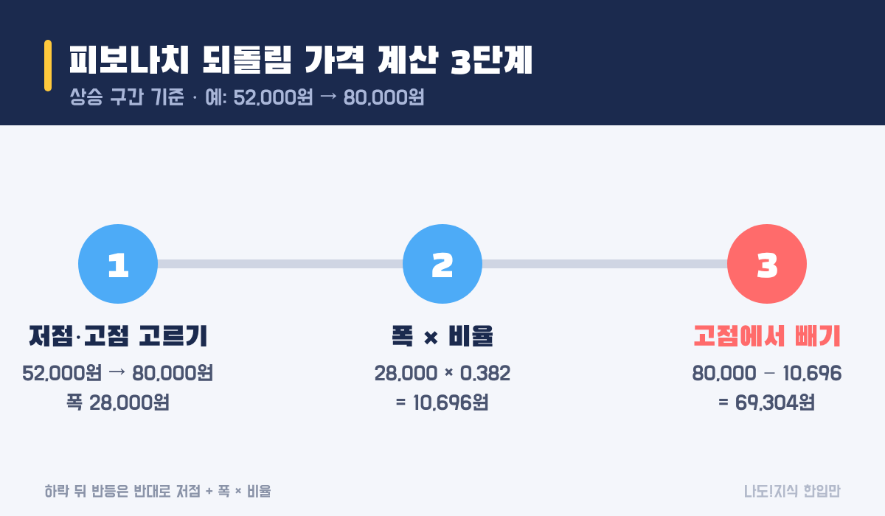
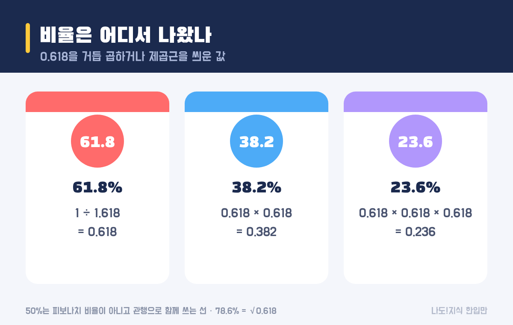
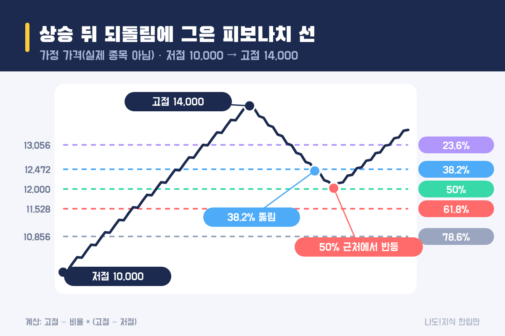

최종 검토일: 2026-11-04

피보나치 되돌림은 <mark>주가가 한 방향으로 크게 움직인 뒤, 그 움직임의 몇 %를 되돌렸는지</mark>를 23.6%·38.2%·50%·61.8%·78.6% 선으로 표시하는 방법이에요. 상승 뒤라면 가격은 <mark>고점 − 비율 × (고점 − 저점)</mark>으로 구해요.

HTS에서 선을 그어 주긴 하지만, 식을 알면 어떤 고점·저점을 잡았는지에 따라 선이 얼마나 달라지는지 바로 보여요. 계산법, 비율이 나온 곳, 그리고 이 선을 믿기 어려운 이유까지 숫자로 볼게요.

  <strong style="color:#1b2a4e;font-size:18px;">📐 한 줄 공식</strong>
  <ul style="margin:10px 0 0 0;padding-left:20px;line-height:1.9;">
    <li><b>상승 뒤 되돌림:</b> 고점 − 비율 × (고점 − 저점)</li>
    <li><b>하락 뒤 반등:</b> 저점 + 비율 × (고점 − 저점)</li>
    <li><b>예:</b> 52,000원 → 80,000원 상승의 38.2% 되돌림 = 80,000 − 0.382 × 28,000 = <b>69,304원</b></li>
  </ul>

<h2 style="border-left:6px solid #1b2a4e;padding-left:12px;margin-top:36px;">목차</h2>
<ol style="line-height:1.9;">
  <li><a href="#sec-1" style="color:inherit;text-decoration:underline;text-underline-offset:3px;">피보나치 되돌림 뜻과 선 다섯 개</a></li>
  <li><a href="#sec-2" style="color:inherit;text-decoration:underline;text-underline-offset:3px;">피보나치 되돌림 가격은 어떻게 계산하나요?</a></li>
  <li><a href="#sec-3" style="color:inherit;text-decoration:underline;text-underline-offset:3px;">38.2·61.8%는 어디서 나왔나</a></li>
  <li><a href="#sec-4" style="color:inherit;text-decoration:underline;text-underline-offset:3px;">되돌림 %와 고점 대비 하락률은 달라요</a></li>
  <li><a href="#sec-5" style="color:inherit;text-decoration:underline;text-underline-offset:3px;">가정 차트로 본 예시</a></li>
  <li><a href="#sec-6" style="color:inherit;text-decoration:underline;text-underline-offset:3px;">한계: 선이 많으면 늘 맞아 보여요</a></li>
  <li><a href="#sec-7" style="color:inherit;text-decoration:underline;text-underline-offset:3px;">피보나치 되돌림 Q&amp;A 5개</a></li>
</ol>

<h2 id="sec-1" style="scroll-margin-top:72px;border-left:6px solid #1b2a4e;padding-left:12px;margin-top:36px;">피보나치 되돌림 뜻과 선 다섯 개</h2>

주가는 오르다가도 중간중간 쉬면서 일부를 되돌려요. 피보나치 되돌림은 그 "쉬는 자리"를 미리 몇 군데 표시해 두는 도구예요. 기준이 되는 저점과 고점을 하나씩 고르면, 그 사이에 다섯 개의 가로선이 그어져요.

<table style="width:100%;border-collapse:collapse;margin:16px 0;">
  <thead>
    <tr style="background:#1b2a4e;color:#fff;"><th style="border:1px solid #ddd;padding:8px;">선</th><th style="border:1px solid #ddd;padding:8px;">뜻(상승 뒤)</th><th style="border:1px solid #ddd;padding:8px;">52,000→80,000원 예시</th></tr>
  </thead>
  <tbody>
    <tr><td style="border:1px solid #ddd;padding:8px;">23.6%</td><td style="border:1px solid #ddd;padding:8px;">오른 폭의 4분의 1 정도만 내줌</td><td style="border:1px solid #ddd;padding:8px;">73,392원</td></tr>
    <tr><td style="border:1px solid #ddd;padding:8px;">38.2%</td><td style="border:1px solid #ddd;padding:8px;">얕은 되돌림</td><td style="border:1px solid #ddd;padding:8px;"><mark>69,304원</mark></td></tr>
    <tr><td style="border:1px solid #ddd;padding:8px;">50%</td><td style="border:1px solid #ddd;padding:8px;">오른 폭의 절반</td><td style="border:1px solid #ddd;padding:8px;"><mark>66,000원</mark></td></tr>
    <tr><td style="border:1px solid #ddd;padding:8px;">61.8%</td><td style="border:1px solid #ddd;padding:8px;">깊은 되돌림</td><td style="border:1px solid #ddd;padding:8px;"><mark>62,696원</mark></td></tr>
    <tr><td style="border:1px solid #ddd;padding:8px;">78.6%</td><td style="border:1px solid #ddd;padding:8px;">오른 폭 대부분을 내줌</td><td style="border:1px solid #ddd;padding:8px;">57,992원</td></tr>
  </tbody>
</table>

반대로 하락 뒤 반등을 볼 때는 저점에서 위로 더해요. 80,000원에서 52,000원으로 내렸다면 38.2% 반등선은 52,000 + 0.382 × 28,000 = <b>62,696원</b>, 61.8% 반등선은 <b>69,304원</b>이에요. 같은 두 가격이라도 방향에 따라 38.2%와 61.8%의 자리가 서로 바뀌어요.

<h2 id="sec-2" style="scroll-margin-top:72px;border-left:6px solid #1b2a4e;padding-left:12px;margin-top:36px;">피보나치 되돌림 가격은 어떻게 계산하나요?</h2>

되돌림 가격은 저점과 고점을 고른 뒤, 그 폭에 비율을 곱해 고점에서 빼면 나와요.

<figure style="margin:24px 0;"><figcaption style="font-size:13px;color:#888;">비율만 바꿔 넣으면 다섯 선이 다 나와요.</figcaption></figure>

<ol style="line-height:1.9;">
  <li><b>저점과 고점 고르기:</b> 하나의 큰 움직임의 시작과 끝을 골라요. 보통 눈에 띄는 최저가와 최고가를 쓰고, 종가를 쓸지 장중 고가·저가를 쓸지도 정해야 해요.</li>
  <li><b>폭 × 비율:</b> 80,000 − 52,000 = 28,000원에 비율을 곱해요. 38.2%면 10,696원이에요.</li>
  <li><b>고점에서 빼기:</b> 80,000 − 10,696 = 69,304원. 하락 뒤 반등이면 저점에 더해요.</li>
</ol>

1단계가 가장 중요해요. 저점을 52,000원이 아니라 60,000원으로 잡으면 폭이 20,000원이 돼서 38.2% 선은 72,360원으로 3,000원 넘게 올라가요. 같은 차트라도 사람마다 선이 다른 이유예요.

<h2 id="sec-3" style="scroll-margin-top:72px;border-left:6px solid #1b2a4e;padding-left:12px;margin-top:36px;">38.2·61.8%는 어디서 나왔나</h2>

38.2%와 61.8%는 황금비 1.618의 역수인 0.618에서 나온 비율이에요.

<figure style="margin:24px 0;"><figcaption style="font-size:13px;color:#888;">세 비율은 모두 0.618에서 나와요.</figcaption></figure>

피보나치 수열은 1, 1, 2, 3, 5, 8, 13, 21, 34, 55, 89…처럼 앞의 두 수를 더해 다음 수를 만들어요. 뒤로 갈수록 이웃한 두 수의 비율이 <b>1.618</b>(황금비)에 가까워지고, 그 역수가 <b>0.618</b>이에요(예: 55 ÷ 89 = 0.618).

<ul style="line-height:1.9;">
  <li><b>61.8%</b> = 1 ÷ 1.618</li>
  <li><b>38.2%</b> = 0.618 × 0.618 (= 1 − 0.618이기도 해요)</li>
  <li><b>23.6%</b> = 0.618 × 0.618 × 0.618</li>
  <li><b>78.6%</b> = √0.618</li>
  <li><b>50%</b>는 피보나치 수열에서 나온 비율이 아니에요. "절반쯤 되돌린다"는 관행 때문에 같이 그려요.</li>
</ul>

즉 비율 자체는 수학적으로 깔끔하지만, 주가가 왜 이 비율에서 멈춰야 하는지에 대한 근거는 아니에요. 많은 사람이 같은 선을 보고 주문을 넣기 때문에 가끔 그 근처에서 멈추는 일이 생긴다는 설명이 더 현실적이에요.

<h2 id="sec-4" style="scroll-margin-top:72px;border-left:6px solid #1b2a4e;padding-left:12px;margin-top:36px;">되돌림 %와 고점 대비 하락률은 달라요</h2>

"50% 되돌림"을 "고점에서 50% 빠졌다"로 읽으면 안 돼요. 되돌림 %는 <b>오른 폭</b> 기준이고, 하락률은 <b>고점 가격</b> 기준이에요. 계좌에서 실제로 느끼는 손실은 하락률 쪽이에요(고점 대비 하락률은 <a href="https://sensitiveboss3.tistory.com/entry/max-drawdown-mdd-recovery-rate" target="_blank" rel="noopener">MDD 뜻과 회복 상승률</a> 글에서 자세히 다뤘어요).

<table style="width:100%;border-collapse:collapse;margin:16px 0;">
  <thead>
    <tr style="background:#1b2a4e;color:#fff;"><th style="border:1px solid #ddd;padding:8px;">되돌림</th><th style="border:1px solid #ddd;padding:8px;">52,000→80,000원 가격</th><th style="border:1px solid #ddd;padding:8px;">고점 대비 하락률</th></tr>
  </thead>
  <tbody>
    <tr><td style="border:1px solid #ddd;padding:8px;">38.2%</td><td style="border:1px solid #ddd;padding:8px;">69,304원</td><td style="border:1px solid #ddd;padding:8px;"><mark>−13.4%</mark></td></tr>
    <tr><td style="border:1px solid #ddd;padding:8px;">50%</td><td style="border:1px solid #ddd;padding:8px;">66,000원</td><td style="border:1px solid #ddd;padding:8px;"><mark>−17.5%</mark></td></tr>
    <tr><td style="border:1px solid #ddd;padding:8px;">61.8%</td><td style="border:1px solid #ddd;padding:8px;">62,696원</td><td style="border:1px solid #ddd;padding:8px;"><mark>−21.6%</mark></td></tr>
  </tbody>
</table>

하락률 = 되돌림 비율 × (고점 − 저점) ÷ 고점이라서, 앞선 상승이 클수록 같은 50% 되돌림이라도 하락률이 커져요.

<h2 id="sec-5" style="scroll-margin-top:72px;border-left:6px solid #1b2a4e;padding-left:12px;margin-top:36px;">가정 차트로 본 예시</h2>

가정 가격으로 선을 그어 보면, 되돌림은 38.2% 선을 그냥 지나 50% 선 근처에서 멈췄어요.

<figure style="margin:24px 0;"><figcaption style="font-size:13px;color:#888;">실제 종목이 아닌 가정 가격이에요. 38.2% 선은 그냥 지나쳤어요.</figcaption></figure>

가정 가격으로 41일 동안 10,000에서 14,000까지 오른 뒤 되돌린 차트예요. 선은 13,056(23.6%), 12,472(38.2%), 12,000(50%), 11,528(61.8%), 10,856(78.6%)이에요.

<ul style="line-height:1.9;">
  <li>되돌림은 <b>38.2% 선을 멈추지 않고 지나갔어요.</b></li>
  <li>59일째 <b>12,020</b>에서 바닥을 찍고 반등했는데, 되돌림 비율로는 <b>49.5%</b>예요.</li>
  <li>끝나고 보면 "50%에서 정확히 반등"처럼 보이지만, 38.2%를 지나던 시점에는 50%에서 멈출지, 61.8%까지 갈지 알 수 없었어요.</li>
</ul>

되돌림 구간에서 평단을 낮추려고 더 사는 경우가 많은데, 그때 계산은 <a href="https://sensitiveboss3.tistory.com/entry/averaging-down-average-price-calculation" target="_blank" rel="noopener">물타기 평단가 계산</a> 글을 참고하면 돼요. 다른 지표와 함께 보는 순서는 <a href="https://sensitiveboss3.tistory.com/entry/stock-chart-reading-guide" target="_blank" rel="noopener">주식 차트 보는법</a>에 정리했어요.

<h2 id="sec-6" style="scroll-margin-top:72px;border-left:6px solid #1b2a4e;padding-left:12px;margin-top:36px;">한계: 선이 많으면 늘 맞아 보여요</h2>

위 예시에서 다섯 선 각각의 위아래 ±1%를 "선 근처"로 치면, 그 띠들이 저점~고점 사이 가격의 <mark>30.2%</mark>를 덮어요. 아무 자리에서나 멈춰도 열에 세 번은 "피보나치 선 근처에서 멈췄다"고 말할 수 있다는 뜻이에요.

<ul style="line-height:1.9;">
  <li><b>고점·저점 선택이 주관적이에요.</b> 기준을 바꾸면 선이 수천 원씩 움직여요(2단계 예시).</li>
  <li><b>어느 선에서 멈출지는 미리 알 수 없어요.</b> 다섯 선 중 하나는 대부분 "맞은" 것처럼 보이게 돼요.</li>
  <li><b>방향을 알려 주지 않아요.</b> 선은 가격 자리일 뿐, 반등할지 더 내릴지는 말해 주지 않아요.</li>
</ul>

그래서 피보나치 선은 단독 신호보다 <b>다른 근거와 겹치는지 확인하는 보조 자</b>로 쓰는 편이 무난해요. 예를 들어 61.8% 선이 <a href="https://sensitiveboss3.tistory.com/entry/moving-average-5-20-day-cross" target="_blank" rel="noopener">이동평균선</a>이나 예전 매물이 몰린 가격과 겹친다면 그 자리를 조금 더 눈여겨보는 식이에요. 그래도 그 자리에서 멈춘다는 보장은 없어요.

<h2 id="sec-7" style="scroll-margin-top:72px;border-left:6px solid #1b2a4e;padding-left:12px;margin-top:36px;">피보나치 되돌림 Q&amp;A 5개</h2>

  
피보나치 되돌림 가격은 어떻게 계산하나요

  
상승 뒤라면 고점 − 비율 × (고점 − 저점)이에요. 52,000원에서 80,000원으로 올랐다면 38.2% 선은 80,000 − 0.382 × 28,000 = 69,304원이에요. 하락 뒤 반등은 저점 + 비율 × (고점 − 저점)으로 구해요.

  
0.618, 0.382는 어디서 나온 숫자인가요

  
피보나치 수열에서 이웃한 두 수의 비율이 가까워지는 황금비 1.618의 역수가 0.618이에요. 0.382는 0.618을 두 번, 0.236은 세 번 곱한 값이고, 0.786은 0.618의 제곱근이에요. 50%는 피보나치 비율이 아니라 관행으로 함께 쓰는 선이에요.

  
50% 되돌림이면 주가가 50% 빠진 건가요

  
아니에요. 되돌림 %는 오른 폭 기준이에요. 52,000원에서 80,000원으로 오른 뒤 50% 되돌리면 66,000원이고, 고점 대비 하락률은 17.5%예요.

  
저점과 고점은 어떤 걸 골라야 하나요

  
정해진 규칙은 없고, 보통 하나의 뚜렷한 상승이나 하락의 시작과 끝을 골라요. 기준을 바꾸면 선이 크게 움직이기 때문에, 어떤 고점·저점과 종가·장중가 중 무엇을 썼는지 스스로 기록해 두는 게 좋아요.

  
피보나치 선에서 반등하면 사도 되나요

  
피보나치 선은 가격 자리를 표시할 뿐 반등을 보장하지 않아요. 다섯 선의 ±1% 띠만으로도 상승폭의 약 30%가 덮여서 우연히 맞아 보이기 쉬워요. 다른 근거와 함께 보는 보조 도구로 쓰는 편이 무난하고, 매수·매도 판단은 본인 몫이에요.

  참고:
  <ul style="margin:6px 0 0 0;padding-left:20px;">
    <li>비율은 수학 정의로 계산했어요: 1 ÷ 1.618 = 0.618, 0.618² = 0.382, 0.618³ = 0.236, √0.618 = 0.786.</li>
    <li>예시 가격과 차트는 계산을 보여 주기 위한 가정값이에요(실제 종목 아님).</li>
  </ul>
  기준일: 2026년 11월 4일.

정보 제공을 목적으로 쓴 글이며 특정 종목의 매수·매도를 권유하지 않아요. 예시는 계산을 보여 주기 위한 가정값이고, 투자 판단과 그 결과에 대한 책임은 투자자 본인에게 있어요.

