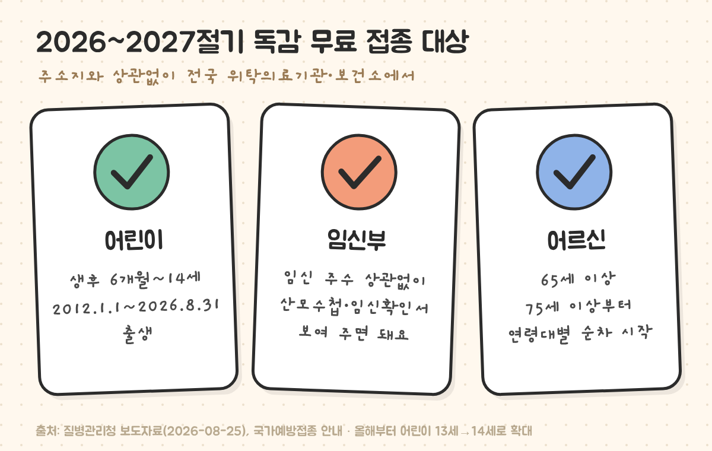
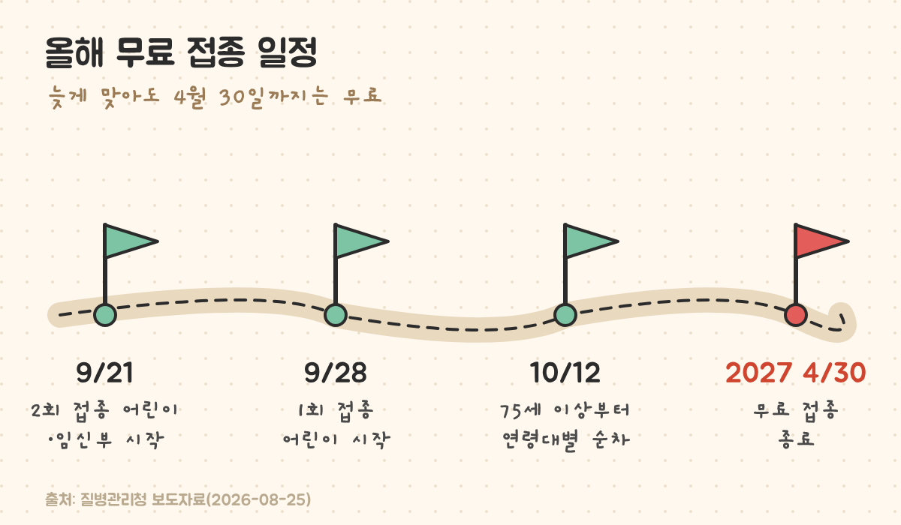
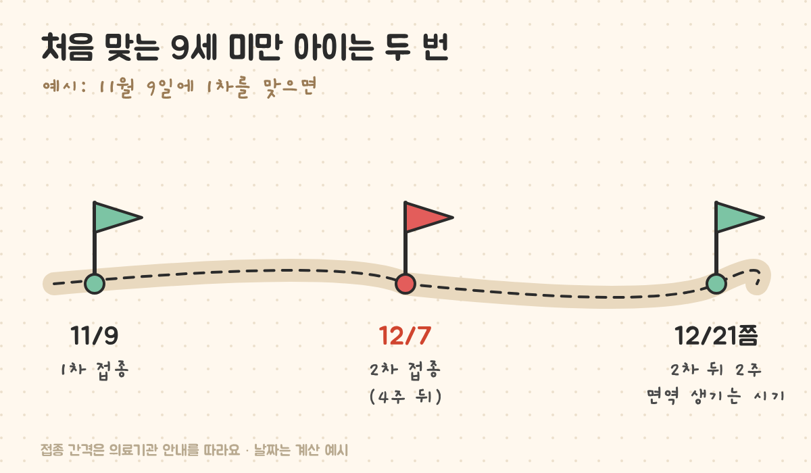

최종 검토일: 2026-11-04

2026~2027절기 독감 무료 예방접종은 <mark>생후 6개월~14세 어린이, 임신부, 65세 이상 어르신</mark>이 대상이고, <mark>2027년 4월 30일</mark>까지 전국 위탁의료기관과 보건소에서 받을 수 있어요. 올해부터 무료 대상 어린이가 13세에서 14세로 넓어져 2012년생도 무료예요.

아직 안 맞았다면 지금 맞아도 늦지 않아요. 우리 집에서 누가 무료인지, 아이가 두 번 맞아야 하는지, 어디서 맞는지 순서대로 볼게요.

  <strong style="color:#1e4e36;font-size:18px;">💉 지금 확인할 세 가지</strong>
  <ul style="margin:10px 0 0 0;padding-left:20px;line-height:1.9;">
    <li><b>2012년 1월 1일 ~ 2026년 8월 31일 사이에 태어난 아이</b>면 무료예요.</li>
    <li><b>독감 백신을 처음 맞는 9세 미만 아이</b>는 두 번 맞아야 해서, 두 번째까지 일정을 미리 잡아 두는 게 좋아요.</li>
    <li>주소지와 상관없이 <b>가까운 위탁의료기관</b>에서 맞을 수 있어요.</li>
  </ul>

<h2 style="border-left:6px solid #2f6f4f;padding-left:12px;margin-top:36px;">목차</h2>
<ol style="line-height:1.9;">
  <li><a href="#sec-1" style="color:inherit;text-decoration:underline;text-underline-offset:3px;">2026~2027절기 독감 무료 접종 대상</a></li>
  <li><a href="#sec-2" style="color:inherit;text-decoration:underline;text-underline-offset:3px;">올해 무료 접종 일정</a></li>
  <li><a href="#sec-3" style="color:inherit;text-decoration:underline;text-underline-offset:3px;">아이가 두 번 맞아야 하는 경우</a></li>
  <li><a href="#sec-4" style="color:inherit;text-decoration:underline;text-underline-offset:3px;">어디서 맞나: 위탁의료기관 찾기</a></li>
  <li><a href="#sec-5" style="color:inherit;text-decoration:underline;text-underline-offset:3px;">지금 맞아도 될까</a></li>
  <li><a href="#sec-6" style="color:inherit;text-decoration:underline;text-underline-offset:3px;">독감 무료 예방접종 Q&amp;A 5개</a></li>
</ol>

<h2 id="sec-1" style="scroll-margin-top:72px;border-left:6px solid #2f6f4f;padding-left:12px;margin-top:36px;">2026~2027절기 독감 무료 접종 대상</h2>

<figure style="margin:24px 0;"><figcaption style="font-size:13px;color:#888;">올해부터 어린이 대상이 14세까지 넓어졌어요.</figcaption></figure>

<table style="width:100%;border-collapse:collapse;margin:16px 0;">
  <thead>
    <tr style="background:#f0f0f0;">
      <th style="border:1px solid #ddd;padding:8px;text-align:left;">대상</th>
      <th style="border:1px solid #ddd;padding:8px;text-align:left;">기준</th>
      <th style="border:1px solid #ddd;padding:8px;text-align:left;">가져갈 것</th>
    </tr>
  </thead>
  <tbody>
    <tr><td style="border:1px solid #ddd;padding:8px;"><mark>어린이</mark></td><td style="border:1px solid #ddd;padding:8px;">생후 6개월~14세(2012.1.1.~2026.8.31. 출생)</td><td style="border:1px solid #ddd;padding:8px;">보호자와 함께 방문</td></tr>
    <tr><td style="border:1px solid #ddd;padding:8px;">임신부</td><td style="border:1px solid #ddd;padding:8px;">임신이 확인된 사람, 임신 주수 상관없음</td><td style="border:1px solid #ddd;padding:8px;">산모수첩 또는 임신확인서</td></tr>
    <tr><td style="border:1px solid #ddd;padding:8px;">어르신</td><td style="border:1px solid #ddd;padding:8px;">65세 이상</td><td style="border:1px solid #ddd;padding:8px;">신분증</td></tr>
  </tbody>
</table>

15세 이상 65세 미만 일반 성인은 무료 대상이 아니라 유료로 맞아요. 다만 지자체에 따라 별도로 대상을 넓혀 지원하는 곳도 있어서, 사는 곳 보건소 공지를 보면 추가 지원이 있는지 알 수 있어요.

<h2 id="sec-2" style="scroll-margin-top:72px;border-left:6px solid #2f6f4f;padding-left:12px;margin-top:36px;">올해 무료 접종 일정</h2>

질병관리청은 대상별로 시작 날짜를 나눠 차례로 열었어요. 지금(11월)은 모든 대상의 접종 기간이에요.

<figure style="margin:24px 0;"><figcaption style="font-size:13px;color:#888;">시작일만 다르고, 끝나는 날은 모두 2027년 4월 30일이에요.</figcaption></figure>

<table style="width:100%;border-collapse:collapse;margin:16px 0;">
  <thead>
    <tr style="background:#f0f0f0;">
      <th style="border:1px solid #ddd;padding:8px;text-align:left;">시작일</th>
      <th style="border:1px solid #ddd;padding:8px;text-align:left;">대상</th>
    </tr>
  </thead>
  <tbody>
    <tr><td style="border:1px solid #ddd;padding:8px;">9월 21일(월)</td><td style="border:1px solid #ddd;padding:8px;">2회 접종 대상 어린이, 임신부</td></tr>
    <tr><td style="border:1px solid #ddd;padding:8px;">9월 28일(월)</td><td style="border:1px solid #ddd;padding:8px;">1회 접종 대상 어린이</td></tr>
    <tr><td style="border:1px solid #ddd;padding:8px;">10월 12일(월)~</td><td style="border:1px solid #ddd;padding:8px;">75세 이상부터 연령대별로 순차 시작</td></tr>
    <tr><td style="border:1px solid #ddd;padding:8px;"><mark>2027년 4월 30일</mark></td><td style="border:1px solid #ddd;padding:8px;">모든 대상 무료 접종 종료</td></tr>
  </tbody>
</table>

<h2 id="sec-3" style="scroll-margin-top:72px;border-left:6px solid #2f6f4f;padding-left:12px;margin-top:36px;">아이가 두 번 맞아야 하는 경우</h2>

생후 6개월 이상 9세 미만 아이 중 <mark>독감 백신을 한 번도 안 맞았거나, 예전에 1회만 맞은 아이</mark>는 이번 절기에 두 번 맞아요. 처음 맞는 해에는 한 번으로 면역이 충분히 생기지 않기 때문이에요.

<figure style="margin:24px 0;"><figcaption style="font-size:13px;color:#888;">보통 4주 간격으로 맞아요. 정확한 간격은 접종하는 의료기관 안내를 따르면 돼요.</figcaption></figure>

<table style="width:100%;border-collapse:collapse;margin:16px 0;">
  <thead>
    <tr style="background:#f0f0f0;">
      <th style="border:1px solid #ddd;padding:8px;text-align:left;">우리 아이</th>
      <th style="border:1px solid #ddd;padding:8px;text-align:left;">이번 절기 횟수</th>
    </tr>
  </thead>
  <tbody>
    <tr><td style="border:1px solid #ddd;padding:8px;">9세 미만, 독감 백신 처음</td><td style="border:1px solid #ddd;padding:8px;"><mark>2회</mark></td></tr>
    <tr><td style="border:1px solid #ddd;padding:8px;">9세 미만, 예전에 1회만 맞음</td><td style="border:1px solid #ddd;padding:8px;"><mark>2회</mark></td></tr>
    <tr><td style="border:1px solid #ddd;padding:8px;">9세 미만, 예전에 2회 이상 맞음</td><td style="border:1px solid #ddd;padding:8px;">1회</td></tr>
    <tr><td style="border:1px solid #ddd;padding:8px;">9세 이상 ~ 14세</td><td style="border:1px solid #ddd;padding:8px;">1회</td></tr>
  </tbody>
</table>

지난 접종 기록은 예방접종도우미 누리집이나 앱에서 아이 이름으로 볼 수 있어요. 두 번 맞는 아이는 두 번째 날짜가 12월 중순 이후로 밀리지 않게 1차를 서두르는 편이 좋아요.

<h2 id="sec-4" style="scroll-margin-top:72px;border-left:6px solid #2f6f4f;padding-left:12px;margin-top:36px;">어디서 맞나: 위탁의료기관 찾기</h2>

<ul style="line-height:1.9;">
  <li><b>어디서든:</b> 주소지와 상관없이 전국 위탁의료기관과 보건소에서 맞을 수 있어요.</li>
  <li><b>병원 찾기:</b> 질병관리청 <a href="https://nip.kdca.go.kr" target="_blank" rel="noopener">예방접종도우미</a> 누리집이나 앱의 의료기관 찾기 메뉴에서 동네 이름으로 찾을 수 있어요.</li>
  <li><b>미리 전화:</b> 병원마다 백신이 남아 있는 양이 달라서, 가기 전에 전화로 무료 접종이 되는지 물어보면 헛걸음을 줄일 수 있어요.</li>
</ul>

<h2 id="sec-5" style="scroll-margin-top:72px;border-left:6px solid #2f6f4f;padding-left:12px;margin-top:36px;">지금 맞아도 될까</h2>

네. 무료 접종은 4월 30일까지라 지금 맞아도 비용은 같아요. 접종 후 면역이 생기기까지 보통 2주 정도 걸린다고 안내되니, 이미 유행이 시작됐다면 하루라도 빨리 맞는 쪽이 나아요.

감기 기운이나 열이 있으면 의사가 접종을 미루자고 할 수 있어요. 열이 내린 뒤 다시 가면 돼요.

<h2 id="sec-6" style="scroll-margin-top:72px;border-left:6px solid #2f6f4f;padding-left:12px;margin-top:36px;">독감 무료 예방접종 Q&amp;A 5개</h2>

  
2026 독감 예방접종 무료 대상은 누구인가요

  
생후 6개월~14세 어린이(2012.1.1.~2026.8.31. 출생), 임신부(주수 상관없음), 65세 이상 어르신이에요. 올해부터 어린이 대상이 13세에서 14세로 넓어졌어요.

  
독감 무료 접종은 언제까지인가요

  
2027년 4월 30일까지예요. 9월 21일부터 대상별로 차례로 시작했고, 지금은 모든 대상이 접종 기간이에요.

  
아이가 독감 주사를 두 번 맞아야 하나요

  
생후 6개월 이상 9세 미만 아이 중 독감 백신을 처음 맞거나 예전에 1회만 맞은 아이는 이번 절기에 두 번 맞아요. 보통 4주 간격이고, 9세 이상은 한 번이에요.

  
주소지가 아닌 병원에서도 무료로 맞을 수 있나요

  
네. 주소지와 상관없이 전국 위탁의료기관과 보건소에서 맞을 수 있어요. 위탁의료기관은 예방접종도우미 누리집이나 앱에서 찾을 수 있어요.

  
임신부는 몇 주부터 맞을 수 있나요

  
임신 주수와 상관없이 무료 대상이에요. 산모수첩이나 임신확인서처럼 임신을 확인할 수 있는 서류를 보여 주면 돼요.

  참고 출처:
  <ul style="margin:6px 0 0 0;padding-left:20px;">
    <li><a href="https://www.kdca.go.kr/bbs/kdca/41/312308/artclView.do" target="_blank" rel="noopener">질병관리청 보도자료: 올겨울 인플루엔자 국가예방접종, 14세까지 확대해 9월 21일부터 순차 시행(2026-08-25)</a></li>
    <li><a href="https://nip.kdca.go.kr/irhp/infm/goVcntInfo.do?menuCd=134&amp;menuLv=1" target="_blank" rel="noopener">질병관리청 예방접종도우미: 인플루엔자 국가예방접종 안내</a></li>
    <li><a href="https://www.medipharmhealth.co.kr/news/article.html?no=118993" target="_blank" rel="noopener">메디팜헬스: 9월 21일부터 인플루엔자 국가예방접종, 어린이 14세까지 확대</a></li>
  </ul>
  기준일: 2026년 11월 4일. 개인의 접종 가능 여부는 접종 전 의사 예진에서 정해져요.

정보 제공을 목적으로 쓴 글이며 의학적 조언을 대신하지 않아요. 접종 여부와 시기는 의료진과 상의해 주세요.

