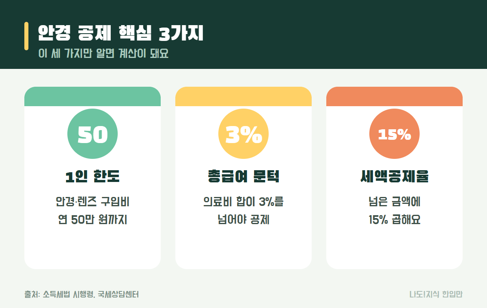
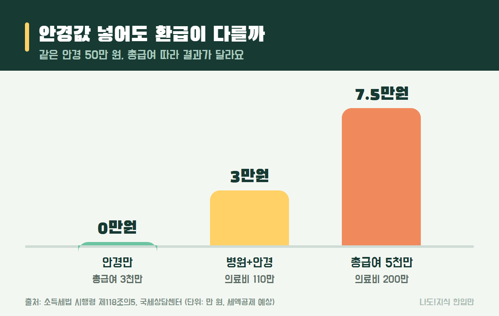
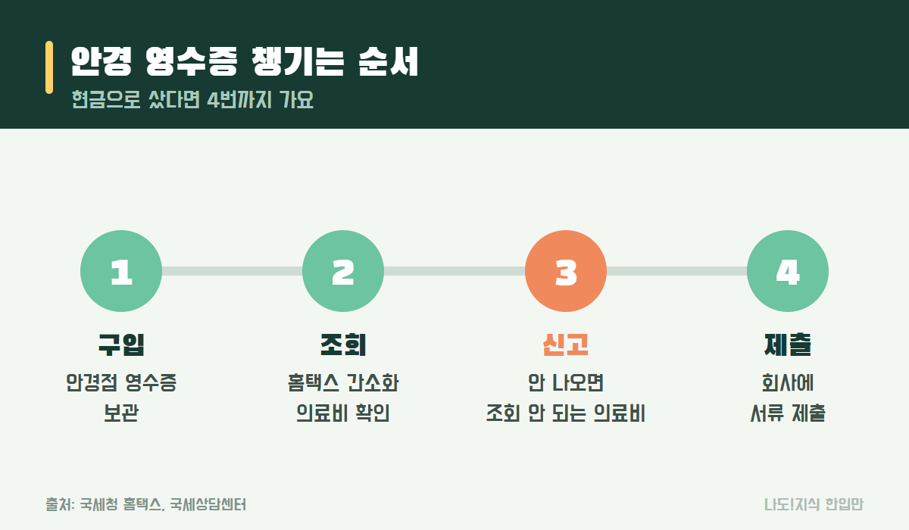

최종 검토일: 2026-11-26

안경 맞춘 영수증, 연말정산에 넣으면 얼마나 돌려받을까요? 현금으로 샀는데 홈택스에 안 나오면 어떡할까요? 안경 값은 1인당 연 50만원까지 의료비로 인정되지만, 의료비 전체가 총급여의 3%를 넘어야 공제가 시작돼요.

그래서 안경만 샀다면 공제가 0원일 수도 있어요. 영수증에 무엇을 적어 달라고 할지, 안 나올 땐 어떻게 신청할지 계산 예시와 함께 순서대로 풀어 볼게요.

  <strong style="color:#145c3c;font-size:18px;font-family:'Noto Serif KR', serif;">🌿 먼저 알아 둘 네 가지</strong>
  <ul style="margin:10px 0 0 0;padding-left:20px;line-height:1.9;">
    <li><b>한도:</b> 안경·콘택트렌즈 구입비는 기본공제대상자 1명당 연 50만원</li>
    <li><b>문턱:</b> 의료비 합계가 총급여의 3%를 넘는 부분부터 15% 세액공제</li>
    <li><b>증빙:</b> 안경사가 확인한 영수증 + 의료비지급명세서</li>
    <li><b>제외:</b> 보험금으로 돌려받은 금액은 빼고 계산</li>
  </ul>

  <strong style="color:#145c3c;font-size:16px;font-family:'Noto Serif KR', serif;">📖 처음이라면 이것만 낱말 풀이</strong>
  <ul style="margin:8px 0 0 0;padding-left:20px;line-height:1.9;">
    <li><b>총급여:</b> 1년 동안 받은 월급·상여 등을 합친 돈이에요. 비과세 소득은 빠져요.</li>
    <li><b>3% 문턱:</b> 의료비가 총급여의 3%에 이를 때까지는 공제가 없다는 뜻으로 쓰는 말이에요.</li>
    <li><b>세액공제:</b> 계산한 세금에서 바로 빼 주는 금액이에요. 소득에서 빼는 소득공제와 달라요.</li>
    <li><b>기본공제대상자:</b> 연말정산에서 공제 대상으로 올릴 수 있는 본인과 가족이에요.</li>
    <li><b>간소화 자료:</b> 홈택스가 병원·약국 등에서 모아 보여 주는 의료비 내역이에요.</li>
  </ul>

<h2 style="color:#145c3c;font-family:'Noto Serif KR', serif;">목차</h2>
<ol style="line-height:1.9;">
  <li><a href="#sec-1">안경 공제는 얼마까지 되나요?</a></li>
  <li><a href="#sec-2">안경만 사면 공제가 0원일 수도 있나요?</a></li>
  <li><a href="#sec-3">가족 합산 기준</a></li>
  <li><a href="#sec-4">보험금 받은 금액은 빼요</a></li>
  <li><a href="#sec-5">영수증에 무엇을 적어 달라고 하나요?</a></li>
  <li><a href="#sec-6">현금으로 샀는데 간소화에 안 나오면 어떻게 하나요?</a></li>
  <li><a href="#sec-7">자주 하는 실수와 마무리 체크</a></li>
  <li><a href="#sec-8">안경 공제 Q&amp;A 6개</a></li>
</ol>

<h2 id="sec-1" style="color:#145c3c;font-family:'Noto Serif KR', serif;">안경 공제는 얼마까지 되나요?</h2>

안경과 콘택트렌즈 구입비는 기본공제대상자 1명당 연 50만원까지 의료비로 넣을 수 있어요. 나이와 소득 제한은 따로 없어요(2026년 11월 기준, 소득세법 시행령 제118조의5, 국세상담센터 안내).

연말정산 안경 공제는 시력보정용 안경·콘택트렌즈 구입비를 의료비로 인정해 세금을 줄여 주는 제도예요. 의료비 세액공제란 1년 동안 쓴 의료비 중 총급여의 3%를 넘는 부분의 15%를 세금에서 빼 주는 제도예요. 안경은 병원비처럼 치료비는 아니지만, 시력을 고치는 데 쓴 돈이라 시행령에서 따로 한도를 두고 의료비로 인정해요.

여기서 많이 헷갈리는 게 있어요. 50만원은 "돌려받는 돈"이 아니라 "의료비로 인정해 주는 금액의 위쪽 한도"예요.

<ul style="line-height:1.9;">
  <li>안경값이 30만원이면 30만원 전부를 의료비로 계산해요.</li>
  <li>안경값이 80만원이면 50만원까지만 의료비로 계산해요. 남은 30만원은 공제 대상이 아니에요.</li>
  <li>한 사람이 안경과 렌즈를 따로 샀다면 둘을 합쳐서 50만원이에요.</li>
</ul>

저도 처음엔 50만원을 그대로 돌려받는 줄 알고 영수증만 열심히 모았어요. 실제로는 이 금액이 다른 의료비와 합쳐진 뒤 3%를 넘어야 하고, 넘은 부분의 15%만 세금에서 빠져요.

<figure style="margin:24px 0;"><figcaption style="font-size:13px;color:#888;">안경 공제는 1인 연 50만원 한도, 총급여 3% 문턱, 15% 세액공제율 세 가지만 알면 계산돼요. 안경 한도 50만원은 총급여 3,000만원의 3%(90만원)보다 작아서 안경만으로는 문턱을 못 넘는 경우가 많아요.</figcaption></figure>

<h2 id="sec-2" style="color:#145c3c;font-family:'Noto Serif KR', serif;">안경만 사면 공제가 0원일 수도 있나요?</h2>

네, 안경만으로는 공제가 0원일 수 있어요. 의료비 합계가 총급여의 3%에 못 미치면 그 금액은 공제되지 않아요(2026년 11월 기준, 국세상담센터 의료비공제 안내, 소득세법 제59조의4).

계산은 세 단계예요. (의료비 합계 - 총급여 × 3%) × 15%이고, 괄호 안이 0 이하면 공제도 0원이에요. 아래는 제가 직접 계산해 본 세 가지 경우예요.

  <strong style="color:#145c3c;font-size:16px;font-family:'Noto Serif KR', serif;">✏️ 직접 계산해 봤어요</strong>
  <ul style="margin:8px 0 0 0;padding-left:20px;line-height:1.9;">
    <li><b>경우 1, 총급여 3,000만원이고 안경 50만원만 쓴 경우:</b> 문턱은 3,000만원 × 3% = 90만원이에요. 의료비 50만원은 90만원에 못 미쳐서 공제는 0원이에요.</li>
    <li><b>경우 2, 총급여 3,000만원이고 병원비 60만원 + 안경 50만원:</b> 의료비 합계는 110만원이에요. 110만원 - 90만원 = 20만원, 20만원 × 15% = 3만원이 공제돼요.</li>
    <li><b>경우 3, 총급여 5,000만원이고 의료비 200만원(안경 50만원 포함):</b> 문턱은 5,000만원 × 3% = 150만원이에요. 200만원 - 150만원 = 50만원, 50만원 × 15% = 7만5천원이 공제돼요.</li>
  </ul>

눈여겨볼 점이 하나 있어요. 경우 2에서 병원비 60만원만 있었다면 문턱 90만원에 못 미쳐 공제는 0원이었어요. 안경 50만원이 더해지면서 문턱을 넘겨 3만원이 생긴 거예요.

경우 3도 같아요. 안경을 빼면 의료비가 150만원이라 문턱과 같아서 공제가 0원이에요. 안경 50만원이 들어가서 7만5천원이 된 셈이에요.

<table style="border-collapse:collapse;width:100%;margin:16px 0;font-size:15px;">
  <thead>
    <tr style="background:#ecf8f1;">
      <th style="border:1px solid #cfe5d8;padding:8px;text-align:left;">경우</th>
      <th style="border:1px solid #cfe5d8;padding:8px;text-align:right;">의료비 합계</th>
      <th style="border:1px solid #cfe5d8;padding:8px;text-align:right;">3% 문턱</th>
      <th style="border:1px solid #cfe5d8;padding:8px;text-align:right;">공제액(15%)</th>
    </tr>
  </thead>
  <tbody>
    <tr><td style="border:1px solid #cfe5d8;padding:8px;">총급여 3,000만원, 안경만</td><td style="border:1px solid #cfe5d8;padding:8px;text-align:right;">50만원</td><td style="border:1px solid #cfe5d8;padding:8px;text-align:right;">90만원</td><td style="border:1px solid #cfe5d8;padding:8px;text-align:right;">0원</td></tr>
    <tr><td style="border:1px solid #cfe5d8;padding:8px;">총급여 3,000만원, 병원비 60만원 + 안경</td><td style="border:1px solid #cfe5d8;padding:8px;text-align:right;">110만원</td><td style="border:1px solid #cfe5d8;padding:8px;text-align:right;">90만원</td><td style="border:1px solid #cfe5d8;padding:8px;text-align:right;">3만원</td></tr>
    <tr><td style="border:1px solid #cfe5d8;padding:8px;">총급여 5,000만원, 의료비 200만원(안경 포함)</td><td style="border:1px solid #cfe5d8;padding:8px;text-align:right;">200만원</td><td style="border:1px solid #cfe5d8;padding:8px;text-align:right;">150만원</td><td style="border:1px solid #cfe5d8;padding:8px;text-align:right;">7만5천원</td></tr>
  </tbody>
</table>

<figure style="margin:24px 0;"><figcaption style="font-size:13px;color:#888;">사례별 공제액은 0원, 3만원, 7만5천원이에요. 모두 총급여 3% 문턱과 15%로 계산한 금액이고, 실제 환급액은 개인 상황에 따라 달라요.</figcaption></figure>

그래서 "안경 값은 50만원 공제된다"는 말은 반만 맞아요. 안경을 영수증까지 챙겨 두면 다른 의료비와 합쳐서 문턱을 넘는 데 힘이 돼요.

<h2 id="sec-3" style="color:#145c3c;font-family:'Noto Serif KR', serif;">가족 합산 기준</h2>

가족의 안경 값도 1인당 50만원씩 따로 인정돼요. 본인과 기본공제대상자로 올린 가족의 의료비를 모두 합쳐서 문턱을 한 번만 빼요.

예를 들어 총급여 5,000만원인 사람이 본인, 배우자, 자녀 안경을 각각 50만원씩 맞췄다고 해 볼게요. 합계는 150만원이에요. 그런데 문턱도 5,000만원 × 3% = 150만원이라 공제는 0원이에요.

<ul style="line-height:1.9;">
  <li>안경값 한도는 사람마다 따로 50만원이에요. 한 사람이 60만원을 쓰고 다른 사람이 20만원을 썼다면 50만원 + 20만원으로 계산해요.</li>
  <li>문턱은 가족 수와 관계없이 총급여 기준 한 번만 적용돼요.</li>
  <li>가족을 부양가족으로 올린 사람이 의료비도 대신 넣는 구조라, 누구 앞으로 올릴지는 소득과 함께 따져 봐야 해요.</li>
</ul>

가족 의료비를 한 사람에게 몰아서 올리면 합계가 커져 문턱을 넘기 쉬워요. 이 부분은 부양가족 자격과 함께 확인해야 해서, 연말정산 전체 일정은 <a href="https://sensitiveboss3.tistory.com/entry/year-end-tax-preview-card-deduction-2026" target="_blank" rel="noopener">연말정산 미리보기</a> 글에 따로 정리해 뒀어요.

<h2 id="sec-4" style="color:#145c3c;font-family:'Noto Serif KR', serif;">보험금 받은 금액은 빼요</h2>

안경값을 실손보험 등으로 돌려받았다면, 그 금액은 의료비에서 빼야 해요(2026년 11월 기준, 국세상담센터 안내). 내 돈이 나간 부분만 공제 대상이에요.

계산은 간단해요. 실제로 내가 부담한 금액만 의료비로 계산한다고 생각하면 돼요.

<ul style="line-height:1.9;">
  <li>안경값 40만원을 내고 보험사에서 10만원을 받았다면, 의료비로 쓸 수 있는 건 30만원이에요.</li>
  <li>보험금을 받을 예정인데 아직 못 받았다면, 받은 뒤 정확한 금액으로 맞춰야 해요.</li>
  <li>회사가 복지로 안경값을 지원해 줬다면 그만큼도 내가 낸 돈이 아닐 수 있으니 지원 금액을 따져 봐요.</li>
</ul>

이 부분은 잊기 쉬워요. 간소화 자료는 병원 쪽 정보라서 안경점에서 받은 보험금까지 알아서 빼 주지 않아요. 직접 수정해서 입력해야 해요.

<h2 id="sec-5" style="color:#145c3c;font-family:'Noto Serif KR', serif;">영수증에 무엇을 적어 달라고 하나요?</h2>

안경사가 확인한 영수증이어야 하고, 내 이름과 구입 품목, 금액, 날짜가 보이게 받아 두면 좋아요(2026년 11월 기준, 국세상담센터 안내). 증빙은 의료비지급명세서와 함께 내요.

안경점에서 계산할 때 이렇게 말하면 돼요. "연말정산 의료비 공제용으로 영수증 부탁드려요."

<ul style="line-height:1.9;">
  <li><b>누가 썼는지:</b> 안경을 쓸 사람 이름이 영수증에 있어야 가족별 한도를 나눌 수 있어요.</li>
  <li><b>무엇을 샀는지:</b> 안경인지 콘택트렌즈인지 품목이 보여야 해요. 시력보정용이어야 하니 어떤 용도인지 혼동되지 않게 받아 둬요.</li>
  <li><b>얼마를 냈는지:</b> 한 번에 결제했더라도 안경테, 렌즈가 나뉘어 있으면 합계 금액이 분명하게 보이게 해요.</li>
  <li><b>언제 샀는지:</b> 구입일이 올해 안이어야 해요. 연말정산은 같은 해 1월부터 12월까지 쓴 돈이 대상이에요.</li>
  <li><b>안경사 확인:</b> 안경사가 확인한 영수증을 달라고 하면 돼요. 안경점에 따라 양식이 달라서, 처음 가는 곳이라면 한 번 물어보면 좋아요.</li>
</ul>

  <strong style="color:#145c3c;font-size:16px;font-family:'Noto Serif KR', serif;">📌 영수증 받을 때 꿀팁</strong>
  <ul style="margin:8px 0 0 0;padding-left:20px;line-height:1.9;">
    <li>영수증은 사진으로도 한 장 찍어 두면 잃어버려도 안심이에요.</li>
    <li>카드 영수증과 안경점 영수증은 달라요. 카드 전표만으로는 안경사 확인이 안 될 수 있어요.</li>
    <li>가족 안경을 한꺼번에 샀다면, 사람별로 금액이 나뉘게 영수증을 따로 받아 두면 정리가 쉬워요.</li>
  </ul>

<h2 id="sec-6" style="color:#145c3c;font-family:'Noto Serif KR', serif;">현금으로 샀는데 간소화에 안 나오면 어떻게 하나요?</h2>

홈택스 간소화 자료에 안 나와도 포기하지 않아도 돼요. 안경사 확인 영수증을 모아 홈택스의 조회되지 않는 의료비 신고센터로 신청하면 돼요(2026년 11월 기준, 국세상담센터 안내).

현금으로 샀거나 안경점이 자료를 올리지 않으면 간소화에 안 나올 수 있어요. 그렇다고 공제 대상에서 빠지는 건 아니에요.

<ol style="line-height:1.9;">
  <li>안경사가 확인한 영수증을 안경점에서 받아요. 사진도 찍어 둬요.</li>
  <li>홈택스(<a href="https://www.hometax.go.kr" target="_blank" rel="noopener">hometax.go.kr</a>)에 로그인해 연말정산 간소화 서비스에서 내 의료비를 조회해요.</li>
  <li>안경 구입비가 없는지 확인해요. 없으면 "조회되지 않는 의료비" 신고센터 메뉴로 들어가요.</li>
  <li>안경 구입 정보(안경점 이름, 금액, 날짜)를 입력하고 영수증 사진을 올려요.</li>
  <li>신청한 내용이 접수됐는지 확인한 뒤, 간소화 자료와 함께 회사에 제출해요.</li>
  <li>회사에 안경 영수증과 의료비지급명세서를 함께 낼 때, 안경 금액이 한도 50만원 이내인지 다시 한 번 봐요.</li>
</ol>

메뉴 이름은 해마다 조금씩 달라질 수 있어요. 홈택스 첫 화면 검색창에 "조회되지 않는 의료비"라고 입력하면 바로 찾아져요. 자세한 서식은 <a href="https://call.nts.go.kr" target="_blank" rel="noopener">국세상담센터</a>의 연말정산 안내를 참고해요.

<figure style="margin:24px 0;"><figcaption style="font-size:13px;color:#888;">영수증을 받는 것부터 회사에 제출하는 것까지 이 순서로 하면 돼요.</figcaption></figure>

<h2 id="sec-7" style="color:#145c3c;font-family:'Noto Serif KR', serif;">자주 하는 실수와 마무리 체크</h2>

가장 흔한 실수는 영수증을 안 받는 것이고, 그다음이 한도 50만원을 넘겨 넣는 것이에요. 아래 다섯 가지만 챙기면 대부분 막을 수 있어요.

  <strong style="color:#145c3c;font-size:16px;font-family:'Noto Serif KR', serif;">✅ 놓치기 쉬운 점 체크리스트</strong>
  <ul style="margin:8px 0 0 0;padding-left:20px;line-height:1.9;">
    <li>영수증은 안경사가 확인한 것으로 받았나요?</li>
    <li>한 사람당 50만원을 넘겨 넣지 않았나요?</li>
    <li>보험금을 받았다면 그 금액을 뺐나요?</li>
    <li>간소화에 안 나오는 안경 값을 신고센터로 따로 올렸나요?</li>
    <li>안경만으로 공제가 0원일 수 있다는 점을 알고 다른 의료비와 합쳐서 계산했나요?</li>
  </ul>

마지막으로 한눈에 정리해 둘게요.

<table style="border-collapse:collapse;width:100%;margin:16px 0;font-size:15px;">
  <thead>
    <tr style="background:#ecf8f1;">
      <th style="border:1px solid #cfe5d8;padding:8px;text-align:left;">항목</th>
      <th style="border:1px solid #cfe5d8;padding:8px;text-align:left;">내용</th>
    </tr>
  </thead>
  <tbody>
    <tr><td style="border:1px solid #cfe5d8;padding:8px;">인정 한도</td><td style="border:1px solid #cfe5d8;padding:8px;">기본공제대상자 1명당 연 50만원 (연령·소득 제한 없음)</td></tr>
    <tr><td style="border:1px solid #cfe5d8;padding:8px;">공제 방식</td><td style="border:1px solid #cfe5d8;padding:8px;">의료비 합계가 총급여 3%를 넘는 부분의 15% 세액공제</td></tr>
    <tr><td style="border:1px solid #cfe5d8;padding:8px;">필요 서류</td><td style="border:1px solid #cfe5d8;padding:8px;">안경사가 확인한 영수증 + 의료비지급명세서</td></tr>
    <tr><td style="border:1px solid #cfe5d8;padding:8px;">현금 구입</td><td style="border:1px solid #cfe5d8;padding:8px;">홈택스 조회되지 않는 의료비 신고센터 또는 영수증 제출</td></tr>
    <tr><td style="border:1px solid #cfe5d8;padding:8px;">제외 금액</td><td style="border:1px solid #cfe5d8;padding:8px;">보험금으로 돌려받은 부분</td></tr>
  </tbody>
</table>

<h2 id="sec-8" style="color:#145c3c;font-family:'Noto Serif KR', serif;">안경 공제 Q&amp;A 6개</h2>

  
연말정산 안경 공제 한도는 얼마예요

  
시력보정용 안경·콘택트렌즈 구입비는 기본공제대상자 1명당 연 50만원까지 인정돼요. 나이와 소득 제한은 없어요.

  
안경값 50만원을 쓰면 50만원을 돌려받나요

  
아니에요. 의료비 합계가 총급여의 3%를 넘는 부분의 15%만 세금에서 빠져요. 총급여 3,000만원이고 안경만 50만원 썼다면 문턱이 90만원이라 공제는 0원이에요.

  
현금으로 산 안경도 공제되나요

  
돼요. 간소화 자료에 안 나올 수 있어서, 안경사가 확인한 영수증을 모아 홈택스 조회되지 않는 의료비 신고센터로 신청하거나 영수증을 회사에 내면 돼요.

  
가족 안경값도 합칠 수 있나요

  
기본공제대상자로 올린 가족의 안경값도 1인당 50만원씩 인정돼요. 문턱 3%는 총급여 기준으로 한 번만 빼요.

  
보험금을 받은 안경값은요

  
보험금으로 돌려받은 금액은 의료비에서 빼요. 내가 실제로 부담한 금액만 계산에 넣어요.

  
영수증은 꼭 안경사 확인이 있어야 하나요

  
네, 증빙은 의료비지급명세서와 안경사가 확인한 영수증이에요. 안경점에 의료비 공제용 영수증이라고 말하고 받으면 돼요.

  <strong style="font-size:16px;">📚 함께 보면 좋은 글</strong>
  <ul style="margin:8px 0 0 0;padding-left:20px;line-height:1.9;"><li><a href="https://sensitiveboss3.tistory.com/entry/year-end-tax-preview-card-deduction-2026" target="_blank" rel="noopener">연말정산 미리보기 12월 18일까지</a></li><li><a href="https://sensitiveboss3.tistory.com/entry/hometown-donation-tax-credit-2026" target="_blank" rel="noopener">고향사랑기부 세액공제 2026</a></li></ul>

  참고 출처:
  <ul style="margin:6px 0 0 0;padding-left:20px;">
    <li><a href="https://www.law.go.kr" target="_blank" rel="noopener">국가법령정보센터: 소득세법 시행령 제118조의5(의료비 공제 범위)</a></li>
    <li><a href="https://call.nts.go.kr" target="_blank" rel="noopener">국세상담센터: 연말정산 의료비공제 안내</a></li>
  </ul>
  기준일: 2026년 11월. 한도·공제율은 법령 개정으로 달라질 수 있어요.

이 글은 정보 제공을 목적으로 하며 특정 종목이나 상품의 매수·매도를
권유하지 않습니다. 투자 판단과 그 결과에 대한 책임은 투자자 본인에게 있습니다.
세율·수수료·한도는 변경될 수 있으므로 반드시 원출처에서 최신 내용을
확인하시기 바랍니다.

