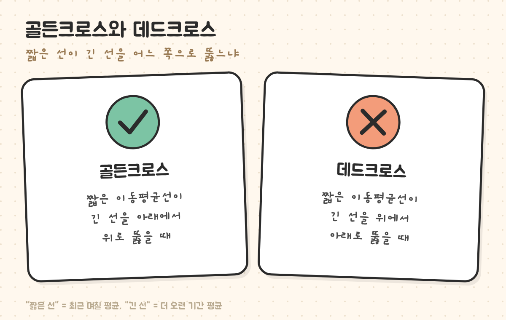
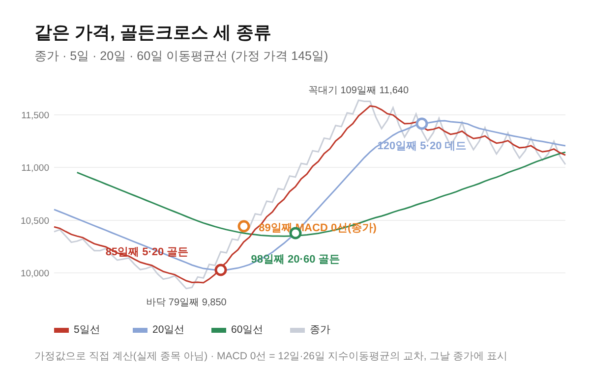
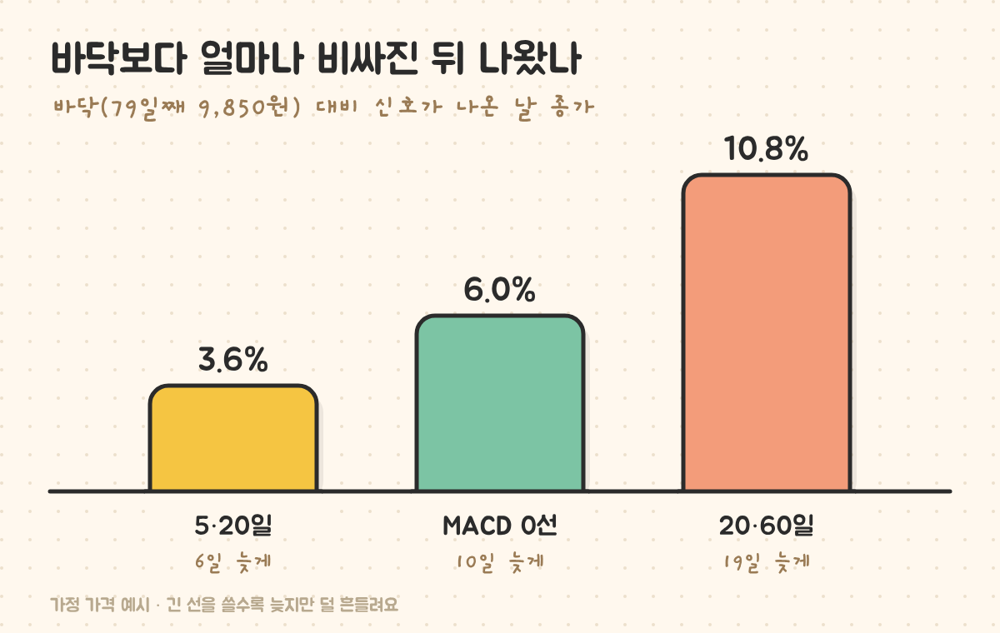

최종 검토일: 2026-11-04

골든크로스는 <mark>짧은 기간 이동평균선이 긴 기간 이동평균선을 아래에서 위로 뚫고 올라가는 것</mark>이고, 데드크로스는 반대로 위에서 아래로 내려가는 것이에요. 최근 평균값이 오래된 평균값을 앞질렀다는 뜻이라, 가격 흐름이 바뀌었다는 표시로 읽어요.

다만 "골든크로스"라고 다 같은 게 아니에요. 5일·20일, 20일·60일, MACD 0선까지 어떤 선을 쓰느냐에 따라 같은 가격에서도 신호가 며칠씩 차이 나요. 가정 가격으로 세 종류를 모두 계산해서, 얼마나 늦게 나오고 얼마나 자주 속는지 비교해 볼게요.

  <strong style="color:#1e4e36;font-size:18px;">✂️ 같은 가격에서 계산한 결과</strong>
  <ul style="margin:10px 0 0 0;padding-left:20px;line-height:1.9;">
    <li><b>5일·20일:</b> 바닥보다 6일 늦게, 3.6% 오른 뒤에 나왔어요.</li>
    <li><b>20일·60일:</b> 19일 늦게, 10.8% 오른 뒤에 나왔어요.</li>
    <li>옆으로 흔들리는 구간에서는 <b>단 하루 만에 뒤집힌</b> 골든크로스도 있었어요(두 선 차이 7원).</li>
  </ul>

<h2 style="border-left:6px solid #2f6f4f;padding-left:12px;margin-top:36px;">목차</h2>
<ol style="line-height:1.9;">
  <li><a href="#sec-1" style="color:inherit;text-decoration:underline;text-underline-offset:3px;">골든크로스·데드크로스 뜻과 판단법</a></li>
  <li><a href="#sec-2" style="color:inherit;text-decoration:underline;text-underline-offset:3px;">골든크로스가 생기는 날 직접 계산</a></li>
  <li><a href="#sec-3" style="color:inherit;text-decoration:underline;text-underline-offset:3px;">같은 가격, 골든크로스 세 종류 비교</a></li>
  <li><a href="#sec-4" style="color:inherit;text-decoration:underline;text-underline-offset:3px;">하루 만에 뒤집힌 가짜 골든크로스</a></li>
  <li><a href="#sec-5" style="color:inherit;text-decoration:underline;text-underline-offset:3px;">골든크로스를 볼 때 따져 볼 3가지</a></li>
  <li><a href="#sec-6" style="color:inherit;text-decoration:underline;text-underline-offset:3px;">골든크로스 Q&amp;A 5개</a></li>
</ol>

<h2 id="sec-1" style="scroll-margin-top:72px;border-left:6px solid #2f6f4f;padding-left:12px;margin-top:36px;">골든크로스·데드크로스 뜻과 판단법</h2>

<figure style="margin:24px 0;"><figcaption style="font-size:13px;color:#888;">짧은 선은 최근 며칠의 평균, 긴 선은 더 오랜 기간의 평균이에요.</figcaption></figure>

판단은 <b>어제와 오늘 두 날짜</b>만 보면 돼요.

<table style="width:100%;border-collapse:collapse;margin:16px 0;">
  <thead>
    <tr style="background:#f0f0f0;">
      <th style="border:1px solid #ddd;padding:8px;text-align:left;">구분</th>
      <th style="border:1px solid #ddd;padding:8px;text-align:left;">어제</th>
      <th style="border:1px solid #ddd;padding:8px;text-align:left;">오늘</th>
    </tr>
  </thead>
  <tbody>
    <tr><td style="border:1px solid #ddd;padding:8px;"><mark>골든크로스</mark></td><td style="border:1px solid #ddd;padding:8px;">짧은 선 ≤ 긴 선</td><td style="border:1px solid #ddd;padding:8px;">짧은 선 &gt; 긴 선</td></tr>
    <tr><td style="border:1px solid #ddd;padding:8px;"><mark>데드크로스</mark></td><td style="border:1px solid #ddd;padding:8px;">짧은 선 ≥ 긴 선</td><td style="border:1px solid #ddd;padding:8px;">짧은 선 &lt; 긴 선</td></tr>
  </tbody>
</table>

많이 쓰는 짝은 5일·20일(단기), 20일·60일(중기), 60일·120일(장기)이에요. 이동평균선 자체를 계산하는 방법은 <a href="https://sensitiveboss3.tistory.com/entry/moving-average-5-20-day-cross" target="_blank" rel="noopener">이동평균선 5일 20일 계산과 크로스 보는 법</a>에 정리해 뒀어요.

<h2 id="sec-2" style="scroll-margin-top:72px;border-left:6px solid #2f6f4f;padding-left:12px;margin-top:36px;">골든크로스가 생기는 날 직접 계산</h2>

아래 예시 가격(가정값)에서 5일·20일 골든크로스가 나온 85일째를 보면 이래요.

<table style="width:100%;border-collapse:collapse;margin:16px 0;">
  <thead>
    <tr style="background:#f0f0f0;">
      <th style="border:1px solid #ddd;padding:8px;text-align:left;">날</th>
      <th style="border:1px solid #ddd;padding:8px;text-align:left;">종가</th>
      <th style="border:1px solid #ddd;padding:8px;text-align:left;">5일 평균</th>
      <th style="border:1px solid #ddd;padding:8px;text-align:left;">20일 평균</th>
      <th style="border:1px solid #ddd;padding:8px;text-align:left;">판단</th>
    </tr>
  </thead>
  <tbody>
    <tr><td style="border:1px solid #ddd;padding:8px;">84일째</td><td style="border:1px solid #ddd;padding:8px;">10,070원</td><td style="border:1px solid #ddd;padding:8px;">9,984원</td><td style="border:1px solid #ddd;padding:8px;">10,026.5원</td><td style="border:1px solid #ddd;padding:8px;">5일선이 아래</td></tr>
    <tr><td style="border:1px solid #ddd;padding:8px;">85일째</td><td style="border:1px solid #ddd;padding:8px;">10,200원</td><td style="border:1px solid #ddd;padding:8px;">10,052원</td><td style="border:1px solid #ddd;padding:8px;">10,025원</td><td style="border:1px solid #ddd;padding:8px;"><mark>골든크로스</mark></td></tr>
  </tbody>
</table>

85일째 5일 평균은 하루 사이 68원 올랐고, 20일 평균은 오히려 1.5원 내렸어요. 짧은 선은 최근 가격을 크게 반영해서 빠르게 따라 올라오고, 긴 선은 지난 20일 중 하루만 바뀌어서 거의 그대로예요. 골든크로스는 결국 <b>최근 가격이 과거 평균보다 높아지는 순간</b>을 잡는 거예요.

<h2 id="sec-3" style="scroll-margin-top:72px;border-left:6px solid #2f6f4f;padding-left:12px;margin-top:36px;">같은 가격, 골든크로스 세 종류 비교</h2>

가정 가격은 79일째 바닥(9,850원)에서 오르기 시작해 109일째 꼭대기(11,640원)를 찍고 옆으로 흔들려요. 같은 가격으로 세 가지 골든크로스를 계산했어요.

<figure style="margin:24px 0;"><figcaption style="font-size:13px;color:#888;">긴 선을 쓸수록 골든크로스가 늦게 나와요.</figcaption></figure>

<table style="width:100%;border-collapse:collapse;margin:16px 0;">
  <thead>
    <tr style="background:#f0f0f0;">
      <th style="border:1px solid #ddd;padding:8px;text-align:left;">종류</th>
      <th style="border:1px solid #ddd;padding:8px;text-align:left;">골든크로스</th>
      <th style="border:1px solid #ddd;padding:8px;text-align:left;">바닥 대비</th>
      <th style="border:1px solid #ddd;padding:8px;text-align:left;">데드크로스</th>
      <th style="border:1px solid #ddd;padding:8px;text-align:left;">꼭대기 대비</th>
    </tr>
  </thead>
  <tbody>
    <tr><td style="border:1px solid #ddd;padding:8px;">5일·20일</td><td style="border:1px solid #ddd;padding:8px;">85일째 10,200원</td><td style="border:1px solid #ddd;padding:8px;">6일 늦게, +3.6%</td><td style="border:1px solid #ddd;padding:8px;">120일째 11,350원</td><td style="border:1px solid #ddd;padding:8px;">11일 늦게, −2.5%</td></tr>
    <tr><td style="border:1px solid #ddd;padding:8px;">12·26일 지수평균(MACD 0선)</td><td style="border:1px solid #ddd;padding:8px;">89일째 10,440원</td><td style="border:1px solid #ddd;padding:8px;">10일 늦게, +6.0%</td><td style="border:1px solid #ddd;padding:8px;">137일째 11,090원</td><td style="border:1px solid #ddd;padding:8px;">28일 늦게, −4.7%</td></tr>
    <tr><td style="border:1px solid #ddd;padding:8px;">20일·60일</td><td style="border:1px solid #ddd;padding:8px;">98일째 10,910원</td><td style="border:1px solid #ddd;padding:8px;">19일 늦게, +10.8%</td><td style="border:1px solid #ddd;padding:8px;">145일째까지 없음</td><td style="border:1px solid #ddd;padding:8px;">—</td></tr>
  </tbody>
</table>

<figure style="margin:24px 0;"><figcaption style="font-size:13px;color:#888;">바닥에서 오른 만큼은 신호가 나오기 전에 이미 지나간 구간이에요.</figcaption></figure>

20일·60일 골든크로스가 나온 날은 꼭대기(11,640원)까지 6.7%밖에 남지 않은 자리였어요. 긴 선의 크로스는 "추세가 확실히 바뀌었다"는 확인에 가깝고, 그만큼 앞부분 상승은 이미 지나간 뒤예요. MACD 0선이 12일·26일 지수평균의 골든크로스라는 점은 <a href="https://sensitiveboss3.tistory.com/entry/macd-calculation-signal-line" target="_blank" rel="noopener">MACD 보는법과 계산법</a>에서 더 자세히 볼 수 있어요.

<h2 id="sec-4" style="scroll-margin-top:72px;border-left:6px solid #2f6f4f;padding-left:12px;margin-top:36px;">하루 만에 뒤집힌 가짜 골든크로스</h2>

MACD 글에서 쓴 다른 가정 가격으로 옆으로 흔들리는 구간을 보면, 5일·20일 선이 사흘 사이에 세 번 엇갈렸어요.

<table style="width:100%;border-collapse:collapse;margin:16px 0;">
  <thead>
    <tr style="background:#f0f0f0;">
      <th style="border:1px solid #ddd;padding:8px;text-align:left;">날</th>
      <th style="border:1px solid #ddd;padding:8px;text-align:left;">종가</th>
      <th style="border:1px solid #ddd;padding:8px;text-align:left;">5일 평균</th>
      <th style="border:1px solid #ddd;padding:8px;text-align:left;">20일 평균</th>
      <th style="border:1px solid #ddd;padding:8px;text-align:left;">판단</th>
    </tr>
  </thead>
  <tbody>
    <tr><td style="border:1px solid #ddd;padding:8px;">71일째</td><td style="border:1px solid #ddd;padding:8px;">11,000원</td><td style="border:1px solid #ddd;padding:8px;">10,860원</td><td style="border:1px solid #ddd;padding:8px;">10,879원</td><td style="border:1px solid #ddd;padding:8px;">데드크로스</td></tr>
    <tr><td style="border:1px solid #ddd;padding:8px;">74일째</td><td style="border:1px solid #ddd;padding:8px;">10,780원</td><td style="border:1px solid #ddd;padding:8px;">10,916원</td><td style="border:1px solid #ddd;padding:8px;">10,909원</td><td style="border:1px solid #ddd;padding:8px;"><mark>골든크로스(차이 7원)</mark></td></tr>
    <tr><td style="border:1px solid #ddd;padding:8px;">75일째</td><td style="border:1px solid #ddd;padding:8px;">10,740원</td><td style="border:1px solid #ddd;padding:8px;">10,892원</td><td style="border:1px solid #ddd;padding:8px;">10,902원</td><td style="border:1px solid #ddd;padding:8px;">다시 데드크로스</td></tr>
  </tbody>
</table>

74일째 골든크로스는 그날 종가가 오히려 내렸는데도 나왔어요. 5일 전의 낮은 가격이 평균에서 빠지면서 5일선이 살짝 올라갔을 뿐이에요. 두 선이 거의 붙어 있을 때는 이런 교차가 하루 이틀 만에 뒤집혀요.

<h2 id="sec-5" style="scroll-margin-top:72px;border-left:6px solid #2f6f4f;padding-left:12px;margin-top:36px;">골든크로스를 볼 때 따져 볼 3가지</h2>

<ol style="line-height:1.9;">
  <li><b>두 선이 얼마나 벌어졌나:</b> 차이가 몇 원뿐이면 위 74일째처럼 다음 날 뒤집힐 수 있어요. 교차 다음 날에도 간격이 벌어지는지가 더 중요해요.</li>
  <li><b>긴 선이 어느 쪽을 향하나:</b> 긴 선이 아직 내려가는 중에 짧은 선만 잠깐 올라오면 흔들림일 가능성이 커요. 85일째도 20일선은 아직 내려가고 있었어요.</li>
  <li><b>어떤 짝을 쓰는지 정해 두기:</b> 5·20일은 빠르지만 자주 흔들리고, 20·60일은 느리지만 덜 흔들려요. 짝을 바꿔 가며 보면 원하는 신호만 골라 보게 돼요.</li>
</ol>

골든크로스 말고 다른 지표를 고르는 순서는 <a href="https://sensitiveboss3.tistory.com/entry/stock-chart-reading-guide" target="_blank" rel="noopener">주식 차트 보는법</a>에 모아 뒀어요.

<h2 id="sec-6" style="scroll-margin-top:72px;border-left:6px solid #2f6f4f;padding-left:12px;margin-top:36px;">골든크로스 Q&amp;A 5개</h2>

  
골든크로스 뜻이 뭔가요

  
짧은 기간 이동평균선이 긴 기간 이동평균선을 아래에서 위로 뚫고 올라가는 것이에요. 어제는 짧은 선이 긴 선 아래거나 같았고, 오늘은 위에 있으면 골든크로스예요.

  
데드크로스는 무슨 뜻인가요

  
골든크로스의 반대로, 짧은 이동평균선이 긴 이동평균선을 위에서 아래로 뚫고 내려가는 것이에요. 최근 평균 가격이 과거 평균보다 낮아졌다는 표시예요.

  
골든크로스는 몇 일선을 기준으로 보나요

  
5일·20일(단기), 20일·60일(중기), 60일·120일(장기)을 많이 써요. 같은 가격 예시에서 5일·20일은 바닥보다 6일, 20일·60일은 19일 늦게 나왔어요. 짧을수록 빠르고 긴 선일수록 늦지만 덜 흔들려요.

  
골든크로스가 나오면 오르나요

  
보장되지 않아요. 골든크로스는 이미 지나간 가격의 평균으로 계산해서, 나온 시점에는 상승의 앞부분이 지나간 뒤예요. 옆으로 흔들리는 구간에서는 하루 만에 뒤집히는 가짜 교차도 자주 나와요.

  
가짜 골든크로스는 어떻게 알아보나요

  
두 선의 차이가 아주 작거나, 긴 선이 아직 내려가는 중이거나, 교차 다음 날 간격이 다시 좁아지면 흔들림일 가능성이 커요. 예시에서는 차이 7원으로 생긴 골든크로스가 다음 날 바로 뒤집혔어요.

  참고 출처:
  <ul style="margin:6px 0 0 0;padding-left:20px;">
    <li>이동평균·지수이동평균·교차 판단은 수학적 정의로, 본문 숫자는 가정 가격으로 직접 계산했어요(실제 종목·시세 아님).</li>
    <li>예시 가격: 일목균형표 글과 같은 145일, 가짜 골든크로스는 MACD 글과 같은 78일 데이터예요.</li>
  </ul>
  기준일: 2026년 11월 4일.

정보 제공을 목적으로 쓴 글이며 특정 종목의 매수·매도를 권유하지 않아요. 예시 가격은 계산을 보여 주기 위한 가정값이고, 지표 신호가 미래 가격을 보장하지 않아요. 투자 판단과 그 결과에 대한 책임은 투자자 본인에게 있어요.

