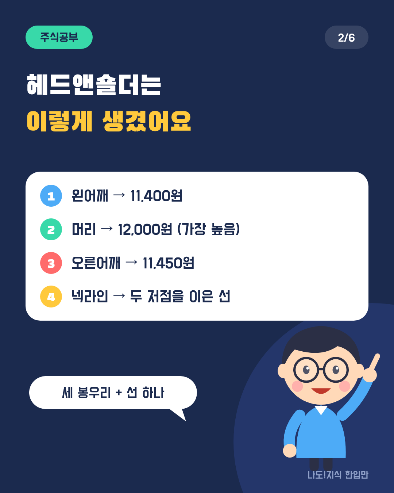
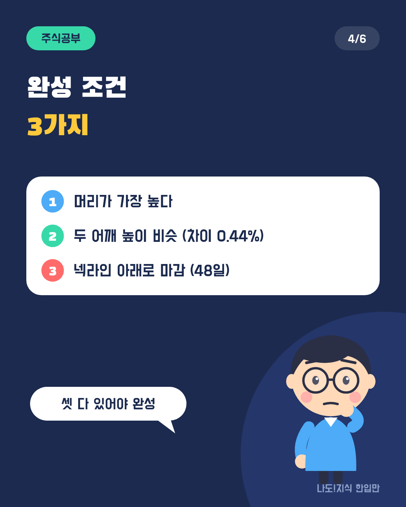
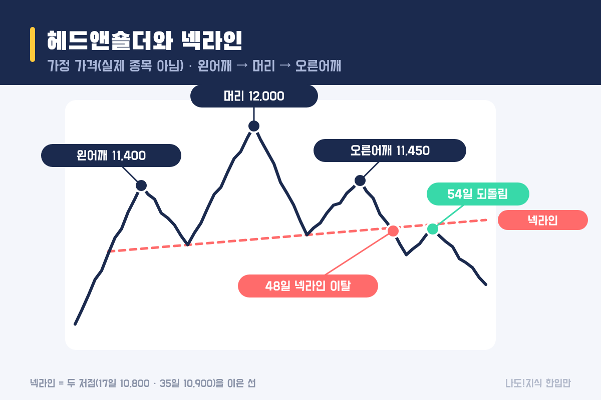
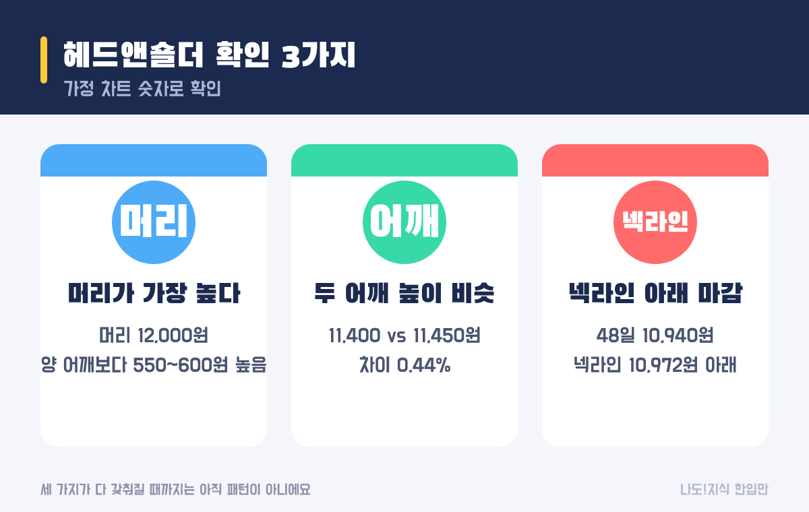
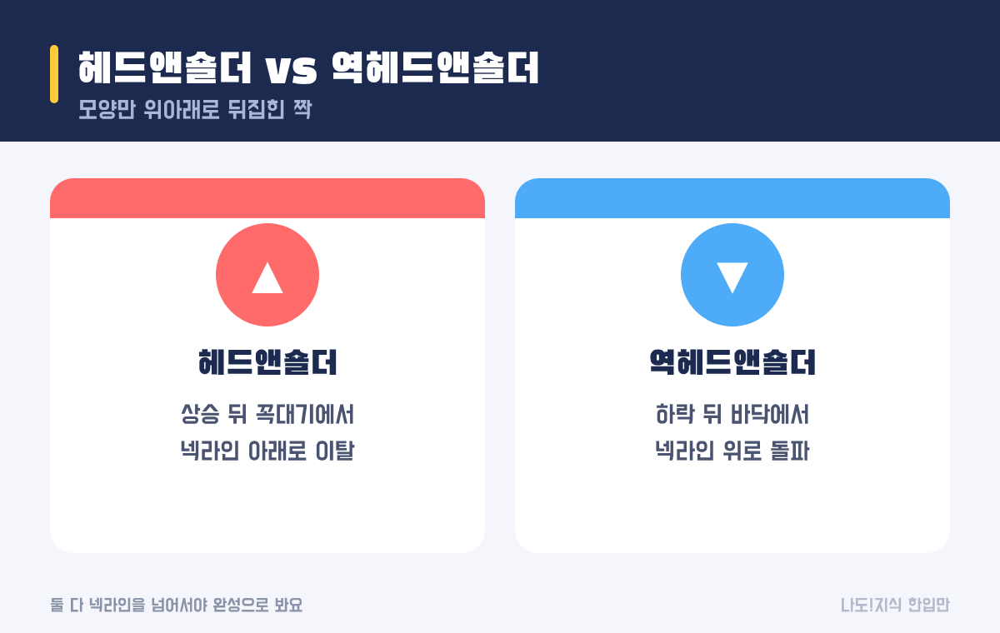

최종 검토일: 2026-11-10

헤드앤숄더는 <mark>왼쪽 어깨 → 더 높은 머리 → 왼쪽과 비슷한 오른쪽 어깨</mark> 모양의 세 봉우리가 생긴 뒤, <mark>두 골짜기를 이은 넥라인 아래로 가격이 내려가면</mark> 완성되는 차트 패턴이에요. 상승이 꺾이는 신호로 흔히 해석해요.

모양만 보고 판단하면 너무 일찍 단정하기 쉬워요. 넥라인을 숫자로 긋는 법, 완성됐는지 확인하는 3가지, 그리고 흔히 쓰는 '측정 폭' 계산이 왜 예측이 될 수 없는지까지 가정 차트로 볼게요.

  <strong style="color:#1b2a4e;font-size:18px;">👤 완성 조건 3가지</strong>
  <ul style="margin:10px 0 0 0;padding-left:20px;line-height:1.9;">
    <li><b>머리가 가장 높다:</b> 가운데 봉우리가 양쪽 어깨보다 높아요.</li>
    <li><b>두 어깨 높이가 비슷하다:</b> 완전히 같을 필요는 없어요.</li>
    <li><b>넥라인 아래로 마감한다:</b> 이게 없으면 아직 패턴이 아니라 '후보'예요.</li>
  </ul>

옆으로 넘겨 보세요 → (카드 6장 요약)

<h2 style="border-left:6px solid #1b2a4e;padding-left:12px;margin-top:36px;">목차</h2>
<ol style="line-height:1.9;">
  <li><a href="#sec-1" style="color:inherit;text-decoration:underline;text-underline-offset:3px;">헤드앤숄더 패턴이란 무엇인가요?</a></li>
  <li><a href="#sec-2" style="color:inherit;text-decoration:underline;text-underline-offset:3px;">넥라인은 어떻게 긋나요?</a></li>
  <li><a href="#sec-3" style="color:inherit;text-decoration:underline;text-underline-offset:3px;">헤드앤숄더 완성은 어떻게 확인하나요?</a></li>
  <li><a href="#sec-4" style="color:inherit;text-decoration:underline;text-underline-offset:3px;">'측정 폭' 계산은 믿어도 될까요?</a></li>
  <li><a href="#sec-5" style="color:inherit;text-decoration:underline;text-underline-offset:3px;">역헤드앤숄더는 뭐가 다른가요?</a></li>
  <li><a href="#sec-6" style="color:inherit;text-decoration:underline;text-underline-offset:3px;">한계: 완성 전엔 패턴이 아니에요</a></li>
  <li><a href="#sec-7" style="color:inherit;text-decoration:underline;text-underline-offset:3px;">헤드앤숄더 Q&amp;A 5개</a></li>
</ol>

<h2 id="sec-1" style="scroll-margin-top:72px;border-left:6px solid #1b2a4e;padding-left:12px;margin-top:36px;">헤드앤숄더 패턴이란 무엇인가요?</h2>

헤드앤숄더는 <b>사람의 머리와 양어깨처럼 생긴 세 봉우리</b>로, 오르던 주가가 힘을 잃고 방향을 바꿀 수 있다는 신호로 읽는 패턴이에요.

<figure style="margin:24px 0;"><figcaption style="font-size:13px;color:#888;">실제 종목이 아닌 가정 가격이에요. 빨간 점선이 넥라인이에요.</figcaption></figure>

<table style="width:100%;border-collapse:collapse;margin:16px 0;">
  <thead>
    <tr style="background:#1b2a4e;color:#fff;"><th style="border:1px solid #ddd;padding:8px;">부분</th><th style="border:1px solid #ddd;padding:8px;">가정 차트</th><th style="border:1px solid #ddd;padding:8px;">흔히 하는 해석</th></tr>
  </thead>
  <tbody>
    <tr><td style="border:1px solid #ddd;padding:8px;">왼어깨</td><td style="border:1px solid #ddd;padding:8px;">10일 11,400원</td><td style="border:1px solid #ddd;padding:8px;">아직 상승 흐름</td></tr>
    <tr><td style="border:1px solid #ddd;padding:8px;">머리</td><td style="border:1px solid #ddd;padding:8px;">27일 12,000원</td><td style="border:1px solid #ddd;padding:8px;">마지막 신고점</td></tr>
    <tr><td style="border:1px solid #ddd;padding:8px;">오른어깨</td><td style="border:1px solid #ddd;padding:8px;">43일 11,450원</td><td style="border:1px solid #ddd;padding:8px;">머리를 못 넘음 → 힘이 빠짐</td></tr>
    <tr><td style="border:1px solid #ddd;padding:8px;">넥라인</td><td style="border:1px solid #ddd;padding:8px;">17일 10,800원 · 35일 10,900원을 이은 선</td><td style="border:1px solid #ddd;padding:8px;">이 선 아래로 내려가야 완성</td></tr>
  </tbody>
</table>

오른어깨를 만들 때 거래량이 줄어드는 경우가 많다는 설명도 흔하지만, 그것만으로 판단하긴 어려워요.

<h2 id="sec-2" style="scroll-margin-top:72px;border-left:6px solid #1b2a4e;padding-left:12px;margin-top:36px;">넥라인은 어떻게 긋나요?</h2>

넥라인은 <mark>머리 양옆의 두 저점을 이은 직선</mark>이에요. 두 저점 높이가 다르면 기울어진 선이 되고, 기울기는 추세선처럼 계산해요.

<ol style="line-height:1.9;">
  <li><b>두 저점:</b> 17일 10,800원, 35일 10,900원</li>
  <li><b>기울기:</b> (10,900 − 10,800) ÷ 18일 = <mark>하루 약 5.6원</mark></li>
  <li><b>그날 넥라인 가격:</b> 10,800 + 5.6 × (그날 − 17). 48일이면 약 <b>10,972원</b></li>
</ol>

기울기와 연장선 계산은 <a href="https://sensitiveboss3.tistory.com/entry/trendline-slope-calculation" target="_blank" rel="noopener">추세선 기울기 계산법</a>과 똑같아요. 넥라인이 위로 기울면 오른쪽으로 갈수록 이탈 기준 가격도 조금씩 올라가요.

<h2 id="sec-3" style="scroll-margin-top:72px;border-left:6px solid #1b2a4e;padding-left:12px;margin-top:36px;">헤드앤숄더 완성은 어떻게 확인하나요?</h2>

세 가지가 모두 갖춰져야 완성으로 봐요. 가장 중요한 건 마지막, <mark>넥라인 아래로 마감했는지</mark>예요.

<figure style="margin:24px 0;"><figcaption style="font-size:13px;color:#888;">세 번째 조건이 생기기 전까지는 '후보'예요.</figcaption></figure>

<table style="width:100%;border-collapse:collapse;margin:16px 0;">
  <thead>
    <tr style="background:#1b2a4e;color:#fff;"><th style="border:1px solid #ddd;padding:8px;">이탈 기준(예)</th><th style="border:1px solid #ddd;padding:8px;">가정 차트 판단일</th><th style="border:1px solid #ddd;padding:8px;">종가 vs 넥라인</th></tr>
  </thead>
  <tbody>
    <tr><td style="border:1px solid #ddd;padding:8px;">종가가 넥라인 아래 1번</td><td style="border:1px solid #ddd;padding:8px;"><mark>48일</mark></td><td style="border:1px solid #ddd;padding:8px;">10,940원 vs 10,972원 (−0.29%)</td></tr>
    <tr><td style="border:1px solid #ddd;padding:8px;">종가가 넥라인보다 1% 이상 아래</td><td style="border:1px solid #ddd;padding:8px;"><mark>49일</mark></td><td style="border:1px solid #ddd;padding:8px;">10,810원 vs 약 10,978원</td></tr>
  </tbody>
</table>

이탈 뒤에 가격이 넥라인 근처로 다시 올라오는 경우도 많아요. 가정 차트에서도 54일에 10,960원까지 올라왔다가(넥라인보다 0.41% 아래) 다시 내려갔어요. 이 되돌림이 넥라인 위로 회복되면 패턴이 실패한 걸로 봐요.

<h2 id="sec-4" style="scroll-margin-top:72px;border-left:6px solid #1b2a4e;padding-left:12px;margin-top:36px;">'측정 폭' 계산은 믿어도 될까요?</h2>

흔히 <b>머리에서 넥라인까지의 높이만큼 넥라인 아래로 더 내려갈 수 있다</b>고 계산하는데, 이건 <mark>예측이 아니라 관행적인 어림셈</mark>이에요. 가정 차트에서도 맞지 않았어요.

<table style="width:100%;border-collapse:collapse;margin:16px 0;">
  <thead>
    <tr style="background:#1b2a4e;color:#fff;"><th style="border:1px solid #ddd;padding:8px;">계산</th><th style="border:1px solid #ddd;padding:8px;">값</th></tr>
  </thead>
  <tbody>
    <tr><td style="border:1px solid #ddd;padding:8px;">머리 − 그 시점 넥라인</td><td style="border:1px solid #ddd;padding:8px;">12,000 − 약 10,856 = 약 1,144원</td></tr>
    <tr><td style="border:1px solid #ddd;padding:8px;">이탈 시점 넥라인 − 높이</td><td style="border:1px solid #ddd;padding:8px;">약 10,972 − 1,144 = <b>약 9,828원</b></td></tr>
    <tr><td style="border:1px solid #ddd;padding:8px;">가정 차트의 실제 최저</td><td style="border:1px solid #ddd;padding:8px;"><mark>10,400원</mark> (어림셈과 약 570원 차이)</td></tr>
  </tbody>
</table>

이 블로그는 목표가를 제시하지 않아요. 이 계산을 소개하는 건 많은 글이 '목표가'처럼 쓰기 때문이고, 실제로는 이렇게 빗나갈 수 있다는 점을 보여 주려는 거예요.

<h2 id="sec-5" style="scroll-margin-top:72px;border-left:6px solid #1b2a4e;padding-left:12px;margin-top:36px;">역헤드앤숄더는 뭐가 다른가요?</h2>

역헤드앤숄더는 <mark>헤드앤숄더를 위아래로 뒤집은 모양</mark>이에요. 하락 뒤 바닥에서 세 골짜기가 생기고, 두 고점을 이은 넥라인 위로 올라서면 완성으로 봐요.

<figure style="margin:24px 0;"><figcaption style="font-size:13px;color:#888;">확인 방법은 같고 방향만 반대예요.</figcaption></figure>

<table style="width:100%;border-collapse:collapse;margin:16px 0;">
  <thead>
    <tr style="background:#1b2a4e;color:#fff;"><th style="border:1px solid #ddd;padding:8px;">구분</th><th style="border:1px solid #ddd;padding:8px;">헤드앤숄더</th><th style="border:1px solid #ddd;padding:8px;">역헤드앤숄더</th></tr>
  </thead>
  <tbody>
    <tr><td style="border:1px solid #ddd;padding:8px;">나오는 곳</td><td style="border:1px solid #ddd;padding:8px;">상승 뒤 꼭대기</td><td style="border:1px solid #ddd;padding:8px;">하락 뒤 바닥</td></tr>
    <tr><td style="border:1px solid #ddd;padding:8px;">넥라인</td><td style="border:1px solid #ddd;padding:8px;">두 저점을 이은 선</td><td style="border:1px solid #ddd;padding:8px;">두 고점을 이은 선</td></tr>
    <tr><td style="border:1px solid #ddd;padding:8px;">완성</td><td style="border:1px solid #ddd;padding:8px;">넥라인 아래로 마감</td><td style="border:1px solid #ddd;padding:8px;">넥라인 위로 마감</td></tr>
  </tbody>
</table>

<h2 id="sec-6" style="scroll-margin-top:72px;border-left:6px solid #1b2a4e;padding-left:12px;margin-top:36px;">한계: 완성 전엔 패턴이 아니에요</h2>

헤드앤숄더의 가장 큰 함정은 <mark>오른어깨가 생기는 중에 미리 패턴이라고 단정하는 것</mark>이에요. 넥라인을 넘지 않고 다시 오르면 그냥 출렁임이었던 거예요.

<ul style="line-height:1.9;">
  <li><b>끝나고 보면 다 그럴듯해요.</b> 지난 차트에서 찾으면 잘 보이지만, 진행 중에는 여러 해석이 가능해요.</li>
  <li><b>어깨·저점 고르기가 주관적이에요.</b> 어떤 저점을 잇느냐에 따라 넥라인과 이탈일이 달라져요.</li>
  <li><b>실패도 흔해요.</b> 넥라인을 잠깐 내려갔다가 다시 회복하는 경우가 있어요.</li>
</ul>

그래서 헤드앤숄더는 단독 신호보다 다른 근거와 함께 보는 보조 도구로 쓰는 편이 무난해요. 큰 흐름을 파동으로 세어 보는 방법은 <a href="https://sensitiveboss3.tistory.com/entry/elliott-wave-rules-count" target="_blank" rel="noopener">엘리어트 파동 3가지 규칙</a>에, 이동평균선과 함께 보는 법은 <a href="https://sensitiveboss3.tistory.com/entry/moving-average-5-20-day-cross" target="_blank" rel="noopener">이동평균선 계산과 크로스 보는 법</a>에 정리했어요.

<h2 id="sec-7" style="scroll-margin-top:72px;border-left:6px solid #1b2a4e;padding-left:12px;margin-top:36px;">헤드앤숄더 Q&amp;A 5개</h2>

  
헤드앤숄더 패턴은 무엇인가요

  
왼쪽 어깨, 더 높은 머리, 왼쪽과 비슷한 오른쪽 어깨의 세 봉우리가 생긴 뒤 두 골짜기를 이은 넥라인 아래로 내려가면 완성되는 차트 패턴이에요. 상승이 꺾이는 신호로 흔히 해석해요.

  
넥라인은 어떻게 긋나요

  
머리 양옆 두 저점을 이어요. 17일 10,800원, 35일 10,900원이면 기울기는 100 ÷ 18 = 하루 약 5.6원이고, 48일 넥라인 가격은 약 10,972원이에요.

  
헤드앤숄더는 언제 완성된 건가요

  
머리가 가장 높고, 두 어깨 높이가 비슷하고, 종가가 넥라인 아래로 마감했을 때예요. 넥라인을 내려가기 전까지는 아직 '후보'로 보는 게 안전해요.

  
헤드앤숄더 측정 폭 계산은 맞나요

  
머리~넥라인 높이만큼 더 내려간다는 계산은 관행적인 어림셈이지 예측이 아니에요. 가정 차트에서도 어림셈은 약 9,828원이었지만 실제 최저는 10,400원이었어요.

  
역헤드앤숄더는 무엇인가요

  
헤드앤숄더를 뒤집은 모양으로, 하락 뒤 바닥에서 세 골짜기가 생기고 두 고점을 이은 넥라인 위로 마감하면 완성으로 봐요. 확인 방법은 같고 방향만 반대예요.

  참고:
  <ul style="margin:6px 0 0 0;padding-left:20px;">
    <li>패턴 정의와 넥라인·측정 폭 계산은 기술적 분석에서 널리 쓰는 방식을 따랐고, 넥라인 기울기는 직선의 식으로 계산했어요.</li>
    <li>예시 가격과 차트는 계산을 보여 주기 위한 가정값이에요(실제 종목 아님).</li>
  </ul>
  기준일: 2026년 11월 10일.

정보 제공을 목적으로 쓴 글이며 특정 종목의 매수·매도를 권유하거나 목표가를 제시하지 않아요. 예시는 계산을 보여 주기 위한 가정값이고, 투자 판단과 그 결과에 대한 책임은 투자자 본인에게 있어요.

