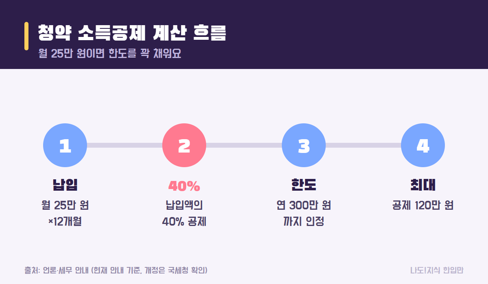
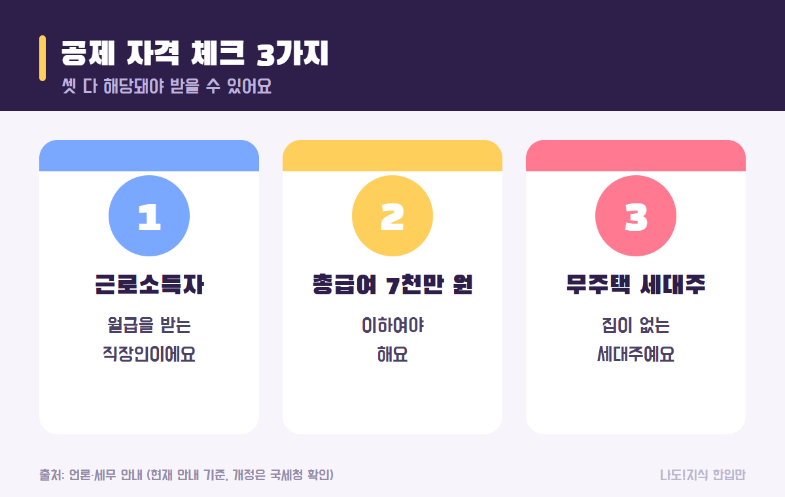
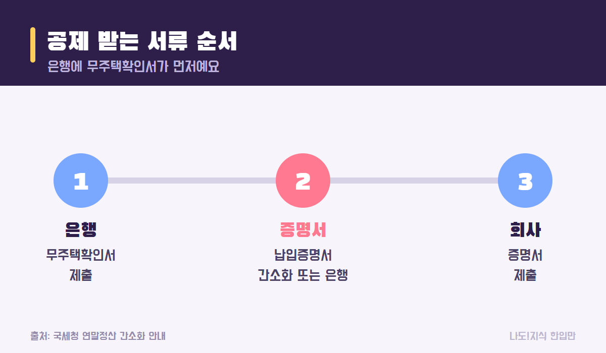

최종 검토일: 2026-11-25

주택청약 소득공제는 청약통장에 낸 돈의 일부를 그해 소득에서 빼 주는 제도예요. 현재 안내되는 기준으로 납입액의 40%를 연 300만원 한도 안에서 공제해 주니, 한도를 꽉 채우면 120만원이 소득에서 빠져요.

통장은 만들어 뒀는데 연말정산에서 어떻게 챙기는지 몰라 놓치는 분이 많아요. 누가 받을 수 있는지, 얼마나 줄어드는지, 회사에 무엇을 내야 하는지 순서대로 정리할게요.

  <strong style="color:#5a3366;font-size:18px;">🏠 한눈에 보기</strong>
  <ul style="margin:10px 0 0 0;padding-left:20px;line-height:1.9;">
    <li><b>공제율:</b> 납입액의 40%</li>
    <li><b>납입 인정 한도:</b> 연 300만원 (월 25만원씩 12개월)</li>
    <li><b>최대 공제액:</b> 120만원</li>
    <li><b>대상:</b> 총급여 7천만원 이하 근로소득자, 무주택 세대주</li>
    <li><b>준비물:</b> 은행의 무주택확인서와 납입증명서 제출</li>
  </ul>

  <strong style="font-size:16px;">📖 처음이라면 이것만 — 낱말 풀이</strong>
  <ul style="margin:8px 0 0 0;padding-left:20px;line-height:1.9;">
    <li><b>소득공제:</b> 세금을 매기는 소득 자체를 줄여 주는 혜택. 줄어든 소득에 본인 세율을 곱한 만큼 세금이 줄어요.</li>
    <li><b>주택청약종합저축:</b> 아파트 청약 자격을 쌓으면서 돈을 모으는 통장.</li>
    <li><b>총급여:</b> 비과세 소득을 뺀, 세금 떼기 전 1년 급여 합계.</li>
    <li><b>무주택 세대주:</b> 세대를 대표하면서 집을 소유하지 않은 사람.</li>
    <li><b>납입증명서:</b> 1년간 통장에 얼마를 넣었는지 은행이 확인해 주는 서류.</li>
  </ul>

<h2 style="border-left:6px solid #7b4a8a;padding-left:12px;margin-top:36px;">목차</h2>
<ol style="line-height:1.9;">
  <li><a href="#sec-1" style="color:inherit;text-decoration:underline;text-underline-offset:3px;">주택청약 소득공제는 얼마나 되나요?</a></li>
  <li><a href="#sec-2" style="color:inherit;text-decoration:underline;text-underline-offset:3px;">누가 받을 수 있나요?</a></li>
  <li><a href="#sec-3" style="color:inherit;text-decoration:underline;text-underline-offset:3px;">내 경우엔 얼마나 줄어드나요?</a></li>
  <li><a href="#sec-4" style="color:inherit;text-decoration:underline;text-underline-offset:3px;">어떤 서류를 어디에 내나요?</a></li>
  <li><a href="#sec-5" style="color:inherit;text-decoration:underline;text-underline-offset:3px;">자주 하는 실수 5가지</a></li>
  <li><a href="#sec-6" style="color:inherit;text-decoration:underline;text-underline-offset:3px;">주택청약 소득공제 Q&amp;A 5개</a></li>
</ol>

<h2 id="sec-1" style="scroll-margin-top:72px;border-left:6px solid #7b4a8a;padding-left:12px;margin-top:36px;">주택청약 소득공제는 얼마나 되나요?</h2>

연 300만원까지 낸 돈의 40%가 공제돼서 최대 120만원까지 소득에서 빠져요.

주택청약 소득공제는 무주택 근로자가 청약저축에 넣은 돈의 40%를 그해 소득에서 빼 주는 제도예요. 현재 안내되는 기준에서 납입 인정 한도는 연 300만원이에요. 2023년 세법 개정으로 연 240만원에서 300만원으로 올랐다고 보도됐어요.

<figure style="margin:24px 0;"><figcaption style="font-size:13px;color:#888;">납입액 × 40%, 단 납입 인정은 연 300만원까지예요.</figcaption></figure>

<ul style="line-height:1.9;">
  <li>공제율은 납입액의 40%예요.</li>
  <li>납입액이 연 300만원을 넘어도 인정되는 금액은 300만원까지예요.</li>
  <li>그래서 공제액은 아무리 많아도 120만원이에요.</li>
</ul>

제도는 개정될 수 있어요. 한도와 공제율은 연말정산 전에 국세청이나 거래 은행에서 한 번 더 확인하세요.

<h2 id="sec-2" style="scroll-margin-top:72px;border-left:6px solid #7b4a8a;padding-left:12px;margin-top:36px;">누가 받을 수 있나요?</h2>

총급여 7천만원 이하인 근로소득자 중 무주택 세대주가 대상으로 안내돼요.

<figure style="margin:24px 0;"><figcaption style="font-size:13px;color:#888;">세 가지가 모두 맞아야 해요.</figcaption></figure>

<table style="width:100%;border-collapse:collapse;margin:16px 0;">
  <thead>
    <tr style="background:#7b4a8a;color:#fff;"><th style="border:1px solid #ddd;padding:8px;">확인할 것</th><th style="border:1px solid #ddd;padding:8px;">기준</th></tr>
  </thead>
  <tbody>
    <tr><td style="border:1px solid #ddd;padding:8px;">소득 종류</td><td style="border:1px solid #ddd;padding:8px;">근로소득자 대상이에요. 사업소득만 있는 프리랜서는 해당하지 않아요.</td></tr>
    <tr><td style="border:1px solid #ddd;padding:8px;">총급여</td><td style="border:1px solid #ddd;padding:8px;">7천만원 이하</td></tr>
    <tr><td style="border:1px solid #ddd;padding:8px;">주택 소유</td><td style="border:1px solid #ddd;padding:8px;">무주택 (집이 있으면 대상이 아니에요)</td></tr>
    <tr><td style="border:1px solid #ddd;padding:8px;">세대 구분</td><td style="border:1px solid #ddd;padding:8px;">세대주</td></tr>
  </tbody>
</table>

  <strong style="font-size:16px;">💡 알아 두세요</strong>
  
세대주 여부와 무주택 여부는 연말정산 시점의 상황으로 확인받아요. 내가 대상인지 애매하면 회사 인사·급여 담당자나 거래 은행에 먼저 물어보세요.

<h2 id="sec-3" style="scroll-margin-top:72px;border-left:6px solid #7b4a8a;padding-left:12px;margin-top:36px;">내 경우엔 얼마나 줄어드나요?</h2>

월 25만원씩 12개월을 넣으면 300만원이고, 그 40%인 120만원이 소득에서 공제돼요.

  <strong>✍️ 따라 해 보기 (월 25만원 납입)</strong> 
  ① 1년 납입액: 25만원 × 12개월 = <b>300만원</b> 
  ② 한도 확인: 연 300만원 이하라서 전액 인정 
  ③ 공제액: 300만원 × 40% = <b>120만원</b> 
  ④ 월 10만원이었다면: 10만원 × 12 = 120만원 × 40% = <b>48만원</b>

여기서 120만원은 돌려받는 돈이 아니라 소득에서 빠지는 금액이에요. 실제로 줄어드는 세금은 공제액 × 본인 세율이에요. 세율은 사람마다 달라서 같은 120만원을 공제받아도 환급이나 추가 납부 차이는 사람마다 다르게 나와요.

<ul style="line-height:1.9;">
  <li>월 납입액이 25만원보다 적으면 공제액도 그만큼 줄어요.</li>
  <li>월 25만원보다 많이 넣어도 공제는 300만원까지만 인정돼요.</li>
  <li>연말정산 결과는 다른 공제와 합쳐 계산되니 내 환급액은 홈택스 모의계산으로 확인하는 게 정확해요.</li>
</ul>

그렇다면 한도를 채우려면 언제 얼마를 넣어야 할까요? 정답은 한 번에 몰아 넣는 것이 아니라, 1년 동안 납입한 합계가 300만원에 닿도록 계획하는 거예요.

<ol style="line-height:2;">
  <li>한 해 동안 낼 수 있는 여유 금액을 먼저 정해요.</li>
  <li>그 금액을 12로 나눠 매달 자동이체로 걸어 둬요.</li>
  <li>연말에 납입증명서의 1년 합계를 보고 300만원을 넘었는지 살펴봐요.</li>
</ol>

생활비가 빠듯한 달에는 납입이 밀릴 수 있어요. 밀린 달을 나중에 채워도 되는지는 은행마다 안내가 달라서 상품 약관을 먼저 살펴보세요. 무리하게 한도를 채우기보다 꾸준히 낼 수 있는 금액으로 시작하는 쪽이 오래가요.

월 납입액별로 보면 이렇게 달라져요. 인정 한도가 연 300만원이라 월 25만원을 넘기면 공제액은 더 늘지 않아요.

<table style="width:100%;border-collapse:collapse;margin:16px 0;">
  <thead>
    <tr style="background:#7b4a8a;color:#fff;"><th style="border:1px solid #ddd;padding:8px;">월 납입액</th><th style="border:1px solid #ddd;padding:8px;">1년 납입액</th><th style="border:1px solid #ddd;padding:8px;">인정액</th><th style="border:1px solid #ddd;padding:8px;">공제액(40%)</th></tr>
  </thead>
  <tbody>
    <tr><td style="border:1px solid #ddd;padding:8px;">10만원</td><td style="border:1px solid #ddd;padding:8px;">120만원</td><td style="border:1px solid #ddd;padding:8px;">120만원</td><td style="border:1px solid #ddd;padding:8px;">48만원</td></tr>
    <tr><td style="border:1px solid #ddd;padding:8px;">15만원</td><td style="border:1px solid #ddd;padding:8px;">180만원</td><td style="border:1px solid #ddd;padding:8px;">180만원</td><td style="border:1px solid #ddd;padding:8px;">72만원</td></tr>
    <tr><td style="border:1px solid #ddd;padding:8px;">25만원</td><td style="border:1px solid #ddd;padding:8px;">300만원</td><td style="border:1px solid #ddd;padding:8px;">300만원</td><td style="border:1px solid #ddd;padding:8px;"><b>120만원</b></td></tr>
    <tr><td style="border:1px solid #ddd;padding:8px;">30만원</td><td style="border:1px solid #ddd;padding:8px;">360만원</td><td style="border:1px solid #ddd;padding:8px;">300만원 (한도)</td><td style="border:1px solid #ddd;padding:8px;">120만원</td></tr>
  </tbody>
</table>

소득공제는 세금을 매기는 소득을 먼저 줄이는 방식이에요. 소득이 줄면 세금이 줄고, 소득이 많아 세율이 높은 사람일수록 같은 공제액에서 줄어드는 세금이 커요.

반대로 세액공제는 계산된 세금에서 일정 비율을 바로 빼는 방식이에요. 이름이 비슷해서 헷갈리지만, 청약 납입액은 소득공제로 처리돼요. 그래서 환급액을 미리 가늠할 때는 공제액에 본인 세율을 곱해 보는 방식이 맞아요.

연금저축 같은 세액공제 상품과 함께 쓰는 방법은 <a href="https://sensitiveboss3.tistory.com/entry/pension-savings-tax-credit" target="_blank" rel="noopener">연금저축 세액공제 얼마 돌려받나</a> 글에서 볼 수 있어요.

<h2 id="sec-4" style="scroll-margin-top:72px;border-left:6px solid #7b4a8a;padding-left:12px;margin-top:36px;">어떤 서류를 어디에 내나요?</h2>

은행에서 무주택확인서를 제출해야 공제 자료가 만들어지고, 그다음 납입증명서를 회사에 내요.

<figure style="margin:24px 0;"><figcaption style="font-size:13px;color:#888;">무주택확인서를 먼저 내지 않으면 공제 자료가 안 뜰 수 있어요.</figcaption></figure>

<ol style="line-height:2;">
  <li><b>무주택확인서 받기:</b> 거래 은행에 무주택확인서를 제출해요. 제출 기한은 은행마다 안내가 달라서 미리 알아 두세요. 연 다음 해 2월 말이라는 안내가 있지만 은행 공지를 기준으로 삼으세요.</li>
  <li><b>납입증명서 조회:</b> 연말정산 간소화 서비스에서 주택마련저축 납입증명서를 조회해요.</li>
  <li><b>안 뜨면 은행 발급:</b> 간소화 서비스에 자료가 없으면 은행에서 직접 발급받아요.</li>
  <li><b>회사에 제출:</b> 회사가 정한 연말정산 제출 기한 안에 서류를 내요.</li>
</ol>

  <strong style="font-size:16px;">💡 알아 두세요</strong>
  
간소화 서비스가 열리는 시기와 자료 누락 때 챙길 서류는 <a href="https://sensitiveboss3.tistory.com/entry/year-end-tax-preview-card-deduction-2026" target="_blank" rel="noopener">연말정산 미리보기</a> 글에서도 볼 수 있어요.

상황별로 대상이 되는지 빠르게 따져 볼 수 있어요. 표는 현재 안내되는 기준을 요약한 것이고, 최종 판단은 은행과 회사 담당자의 안내가 우선이에요.

<table style="width:100%;border-collapse:collapse;margin:16px 0;">
  <thead>
    <tr style="background:#7b4a8a;color:#fff;"><th style="border:1px solid #ddd;padding:8px;">내 상황</th><th style="border:1px solid #ddd;padding:8px;">공제 가능성</th></tr>
  </thead>
  <tbody>
    <tr><td style="border:1px solid #ddd;padding:8px;">총급여 7천만원 이하, 무주택 세대주, 무주택확인서 제출</td><td style="border:1px solid #ddd;padding:8px;">대상으로 안내돼요</td></tr>
    <tr><td style="border:1px solid #ddd;padding:8px;">무주택이지만 세대주가 아님</td><td style="border:1px solid #ddd;padding:8px;">세대주 요건을 못 채워요</td></tr>
    <tr><td style="border:1px solid #ddd;padding:8px;">집을 소유한 세대주</td><td style="border:1px solid #ddd;padding:8px;">무주택이 아니라 대상이 아니에요</td></tr>
    <tr><td style="border:1px solid #ddd;padding:8px;">총급여가 7천만원을 넘음</td><td style="border:1px solid #ddd;padding:8px;">소득 요건을 못 채워요</td></tr>
    <tr><td style="border:1px solid #ddd;padding:8px;">사업소득만 있는 프리랜서</td><td style="border:1px solid #ddd;padding:8px;">근로소득자 대상이라 해당하지 않아요</td></tr>
  </tbody>
</table>

납입을 시작하기 전에 이 표부터 훑어보면 헛수고를 줄일 수 있어요. 중간에 이사나 세대 변경, 주택 매매가 있었다면 무주택 여부가 달라질 수 있으니 그 시점도 함께 따져 보세요. 요건이 안 맞으면 통장은 청약 자격을 쌓는 용도로만 쓰고, 공제는 기대하지 않는 편이 마음 편해요.

<h2 id="sec-5" style="scroll-margin-top:72px;border-left:6px solid #7b4a8a;padding-left:12px;margin-top:36px;">자주 하는 실수 5가지</h2>

공제를 놓치는 경우는 대부분 무주택확인서를 안 냈거나 자격을 잘못 알았을 때 생겨요.

  <strong style="font-size:16px;">⚠️ 이것만 피하세요</strong>
  <ol style="margin:8px 0 0 0;padding-left:20px;line-height:1.9;">
    <li><b>무주택확인서를 안 내기</b> → 통장이 있어도 공제 자료가 만들어지지 않을 수 있어요.</li>
    <li><b>120만원을 환급액으로 착각하기</b> → 120만원은 공제액이고, 줄어드는 세금은 공제액 × 본인 세율이에요.</li>
    <li><b>300만원 넘게 넣고 더 공제될 거라 기대하기</b> → 인정 한도는 연 300만원이에요.</li>
    <li><b>총급여 기준을 놓치기</b> → 총급여 7천만원 이하가 대상으로 안내돼요.</li>
    <li><b>프리랜서인데 근로자처럼 신청하기</b> → 근로소득자 대상이에요. 사업소득만 있으면 해당하지 않아요.</li>
  </ol>

청약 통장 외에도 연말에 챙길 공제가 많아요. 기부로 받는 혜택은 <a href="https://sensitiveboss3.tistory.com/entry/hometown-donation-tax-credit-2026" target="_blank" rel="noopener">고향사랑기부제 2026 세액공제</a> 글을 참고하세요.

<h2 id="sec-6" style="scroll-margin-top:72px;border-left:6px solid #7b4a8a;padding-left:12px;margin-top:36px;">주택청약 소득공제 Q&amp;A 5개</h2>

  
주택청약 소득공제는 얼마까지 받나요

  
현재 안내되는 기준으로 납입액의 40%를 연 300만원 한도에서 공제해요. 한도를 꽉 채우면 최대 120만원이에요. 개정 여부는 국세청이나 거래 은행에서 알아보세요.

  
월 10만원 넣으면 공제액은 얼마인가요

  
1년 납입액이 120만원이고, 그 40%인 48만원이 공제돼요. 줄어드는 세금은 48만원에 본인 세율을 곱한 금액이에요.

  
공제받으려면 어떤 조건이 필요한가요

  
총급여 7천만원 이하 근로소득자이면서 무주택 세대주여야 한다고 안내돼요. 사업소득만 있는 프리랜서는 해당하지 않아요.

  
무주택확인서는 어디에 내나요

  
청약통장을 만든 은행에 내요. 이 서류를 내야 공제 자료가 만들어져요. 제출 기한과 방법은 은행 안내를 따르세요.

  
납입증명서가 간소화 서비스에 안 뜨면요

  
거래 은행에서 직접 납입증명서를 발급받아 회사에 내면 돼요. 무주택확인서를 이미 냈는지 먼저 살펴보세요.

  <strong style="font-size:16px;">📚 함께 보면 좋은 글</strong>
  <ul style="margin:8px 0 0 0;padding-left:20px;line-height:1.9;"><li><a href="https://sensitiveboss3.tistory.com/entry/year-end-tax-preview-card-deduction-2026" target="_blank" rel="noopener">연말정산 미리보기 12월 18일까지</a></li><li><a href="https://sensitiveboss3.tistory.com/entry/pension-savings-tax-credit" target="_blank" rel="noopener">연금저축 세액공제 얼마 돌려받나</a></li><li><a href="https://sensitiveboss3.tistory.com/entry/hometown-donation-tax-credit-2026" target="_blank" rel="noopener">고향사랑기부제 2026 세액공제</a></li></ul>

  참고 출처:
  <ul style="margin:6px 0 0 0;padding-left:20px;">
    <li><a href="https://www.card-gorilla.com/contents/detail/3439" target="_blank" rel="noopener">카드고릴라: 주택청약 소득공제 안내</a></li>
    <li><a href="https://www.newsis.com/view/NISX20230727_0002392010" target="_blank" rel="noopener">뉴시스: 세법 개정으로 청약저축 납입 인정 한도 상향 보도</a></li>
    <li><a href="https://wikidocs.net/blog/@TaxSave/25791/" target="_blank" rel="noopener">위키독스(TaxSave): 청약저축 소득공제 조건과 서류</a></li>
    <li><a href="https://wikidocs.net/blog/@Insight_Lab/23919/" target="_blank" rel="noopener">위키독스(Insight_Lab): 주택청약 소득공제 한도</a></li>
    <li><a href="https://www.nts.go.kr" target="_blank" rel="noopener">국세청: 연말정산 안내</a></li>
  </ul>
  기준일: 2026년 11월 25일. 제도는 개정될 수 있으니 국세청·거래 은행의 최신 안내를 확인하세요.

정보 제공을 목적으로 쓴 글이에요. 공제 대상과 금액은 개인의 소득·세대·주택 보유 상황에 따라 달라질 수 있고, 국세청과 거래 은행의 안내가 기준이에요.

