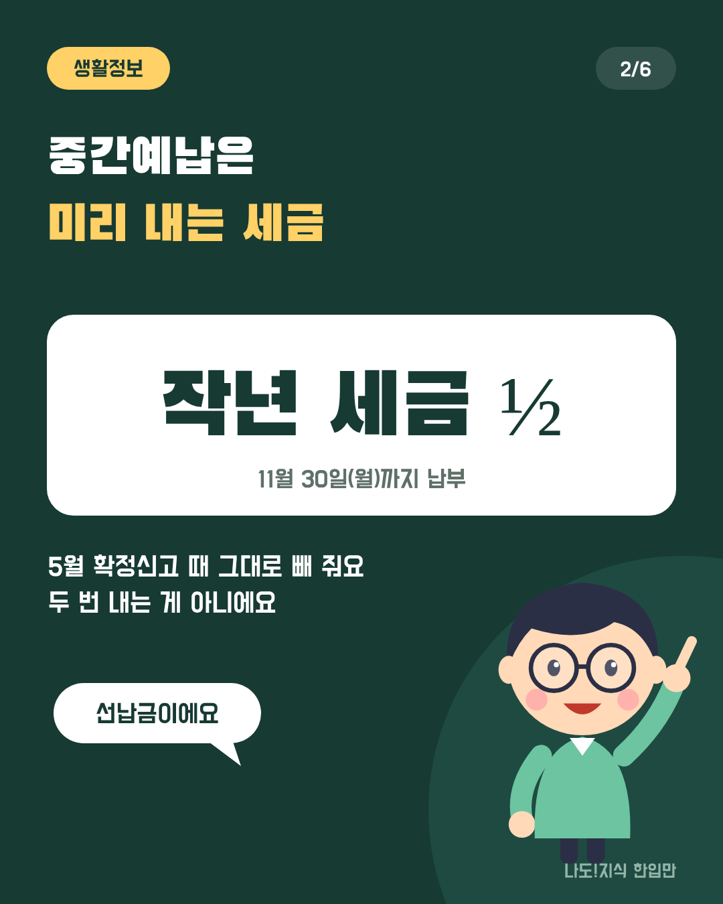
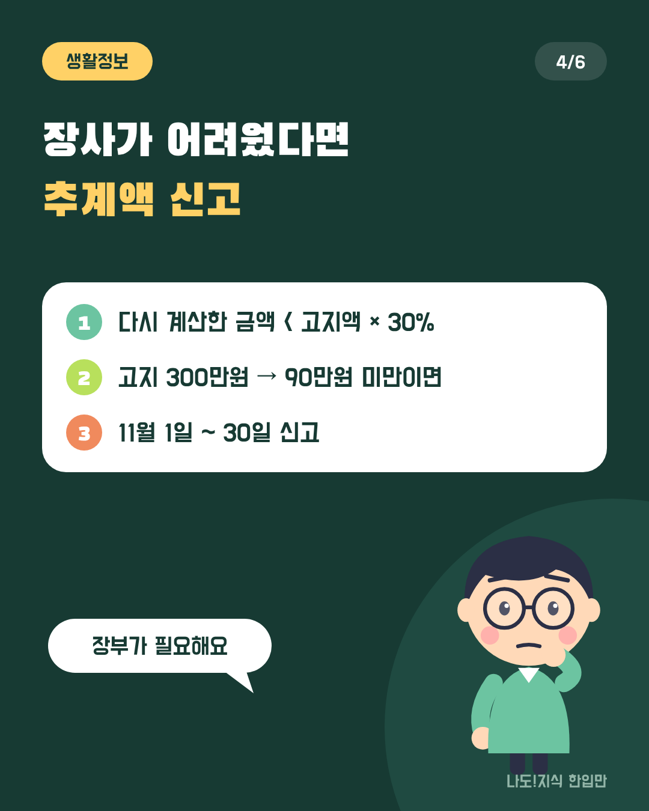
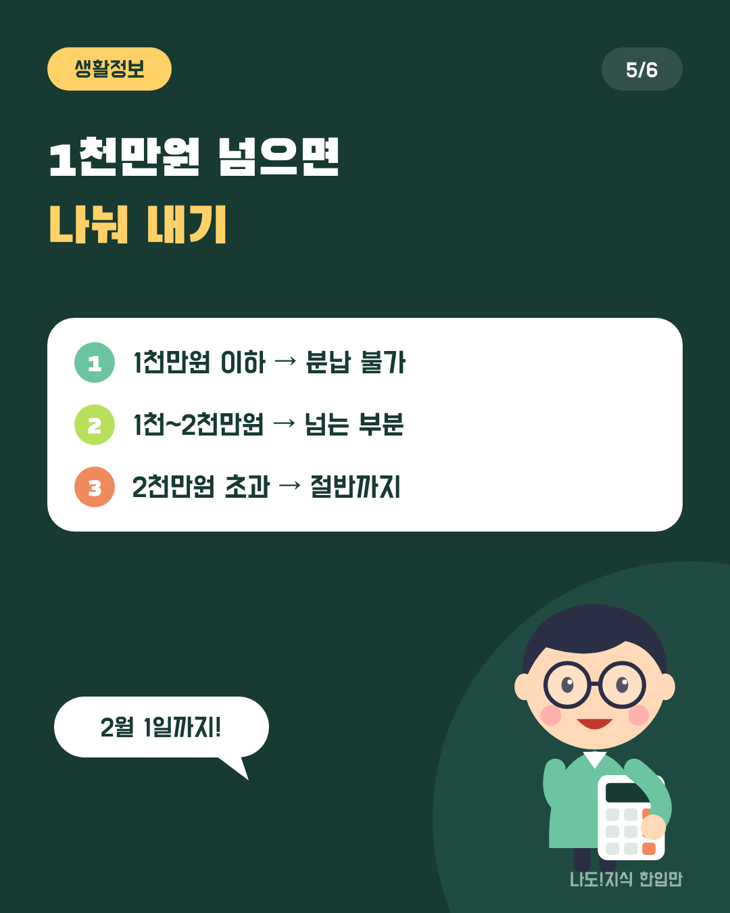
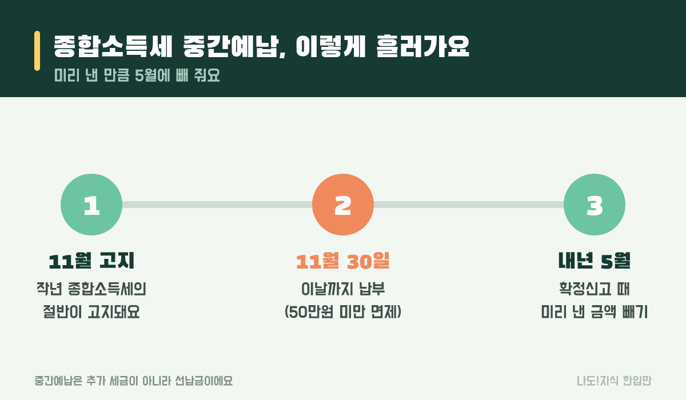
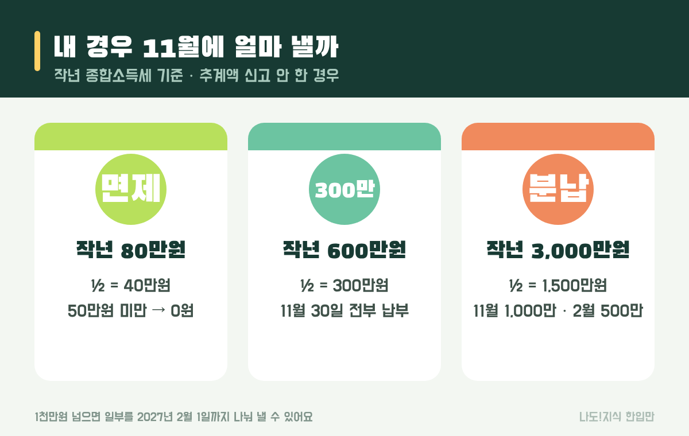
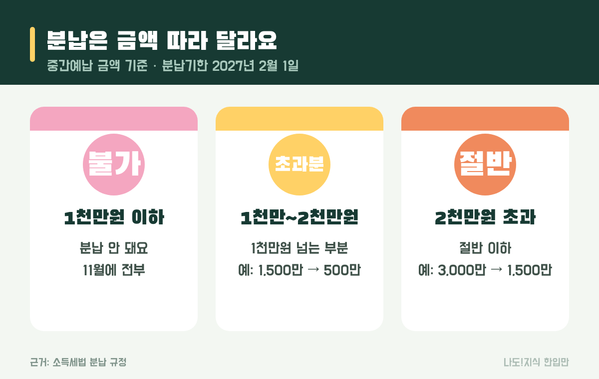

최종 검토일: 2026-11-10

종합소득세 중간예납은 <mark>개인사업자가 올해 낼 종합소득세 일부를 11월에 미리 내는 제도</mark>예요. 금액은 보통 <mark>작년에 낸 종합소득세의 절반</mark>이고, 올해는 <mark>2026년 11월 30일(월)까지</mark> 내야 해요.

처음 고지서를 받으면 "5월에 냈는데 또 내?" 싶어 당황하기 쉬워요. 걱정 마세요. 지금 내는 돈은 내년 5월 확정신고 때 그대로 빼 주는 <b>선납금</b>이에요. 내야 하는지, 얼마를 언제까지 내는지, 사정이 어려우면 줄이거나 나눠 낼 수 있는지까지 사례로 하나씩 계산해 볼게요.

  <strong style="color:#173a33;font-size:18px;">🧾 한눈에 보기</strong>
  <ul style="margin:10px 0 0 0;padding-left:20px;line-height:1.9;">
    <li><b>누가:</b> 사업소득이 있는 개인사업자(프리랜서 포함). 근로소득만 있는 직장인은 해당 없어요.</li>
    <li><b>얼마:</b> 작년 종합소득세의 절반. 그 금액이 <b>50만원 미만이면 안 내도 돼요.</b></li>
    <li><b>언제까지:</b> 2026년 11월 30일(월). 1천만원이 넘으면 일부를 2027년 2월 1일까지 나눠 낼 수 있어요.</li>
    <li><b>어디서:</b> 홈택스·손택스, 고지서의 가상계좌, 은행</li>
  </ul>

옆으로 넘겨 보세요 → (카드 6장 요약)

  <strong style="font-size:16px;">📖 처음이라면 이것만 — 낱말 풀이</strong>
  <ul style="margin:8px 0 0 0;padding-left:20px;line-height:1.9;">
    <li><b>중간예납:</b> 1년 치 세금을 한 번에 내면 부담이 크니, 절반쯤을 11월에 미리 내는 것</li>
    <li><b>결정세액:</b> 작년(2025년) 소득으로 최종 확정된 종합소득세. 이 금액의 절반이 올해 중간예납 기준이에요.</li>
    <li><b>소액부징수:</b> 금액이 너무 적으면 걷지 않는다는 뜻. 중간예납은 50만원 미만이 대상이에요.</li>
    <li><b>추계액 신고:</b> 올해 상반기 실적으로 세금을 다시 계산해서, 고지서보다 적게 내겠다고 신고하는 것</li>
    <li><b>분납:</b> 낼 세금을 두 번에 나눠 내는 것. 중간예납은 1천만원이 넘을 때 가능해요.</li>
  </ul>

<h2 style="border-left:6px solid #173a33;padding-left:12px;margin-top:36px;">목차</h2>
<ol style="line-height:1.9;">
  <li><a href="#sec-1" style="color:inherit;text-decoration:underline;text-underline-offset:3px;">종합소득세 중간예납이란 무엇인가요?</a></li>
  <li><a href="#sec-2" style="color:inherit;text-decoration:underline;text-underline-offset:3px;">중간예납은 누가 내나요?</a></li>
  <li><a href="#sec-3" style="color:inherit;text-decoration:underline;text-underline-offset:3px;">내 경우엔 얼마를 내나요? 사례 4가지</a></li>
  <li><a href="#sec-4" style="color:inherit;text-decoration:underline;text-underline-offset:3px;">올해 장사가 어려웠다면: 추계액 신고</a></li>
  <li><a href="#sec-5" style="color:inherit;text-decoration:underline;text-underline-offset:3px;">한 번에 내기 부담되면: 분납 계산</a></li>
  <li><a href="#sec-6" style="color:inherit;text-decoration:underline;text-underline-offset:3px;">홈택스로 납부하는 법 따라 하기</a></li>
  <li><a href="#sec-7" style="color:inherit;text-decoration:underline;text-underline-offset:3px;">늦게 내면 얼마나 더 내나요?</a></li>
  <li><a href="#sec-8" style="color:inherit;text-decoration:underline;text-underline-offset:3px;">자주 하는 실수 5가지</a></li>
  <li><a href="#sec-9" style="color:inherit;text-decoration:underline;text-underline-offset:3px;">중간예납 Q&amp;A 5개</a></li>
</ol>

<h2 id="sec-1" style="scroll-margin-top:72px;border-left:6px solid #173a33;padding-left:12px;margin-top:36px;">종합소득세 중간예납이란 무엇인가요?</h2>

종합소득세 중간예납은 <mark>1월~6월 사업분에 대한 세금을 11월에 미리 내는 제도</mark>예요. 국세청이 작년 세금의 절반을 계산해서 고지서를 보내고, 사업자는 11월 30일까지 내면 돼요.

<figure style="margin:24px 0;"><figcaption style="font-size:13px;color:#888;">지금 내는 돈은 '추가 세금'이 아니라 5월에 낼 세금을 앞당겨 내는 거예요.</figcaption></figure>

가장 많이 헷갈리는 부분은 "세금을 두 번 내는 것 아니냐"예요. 아니에요. 예를 들어 11월에 300만원을 냈고 내년 5월 확정신고에서 1년 치 세금이 700만원으로 계산되면, 5월에는 <b>700만 − 300만 = 400만원</b>만 더 내면 돼요. 반대로 1년 치 세금이 200만원이면 <b>100만원을 돌려받아요.</b>

<h2 id="sec-2" style="scroll-margin-top:72px;border-left:6px solid #173a33;padding-left:12px;margin-top:36px;">중간예납은 누가 내나요?</h2>

<mark>사업소득이 있는 개인사업자</mark>가 대상이에요. 가게를 하는 자영업자, 3.3%를 떼고 일하는 프리랜서 중 작년에 종합소득세를 낸 사람이 여기에 들어가요.

<table style="width:100%;border-collapse:collapse;margin:16px 0;">
  <thead>
    <tr style="background:#173a33;color:#fff;"><th style="border:1px solid #ddd;padding:8px;">이런 분은</th><th style="border:1px solid #ddd;padding:8px;">중간예납</th><th style="border:1px solid #ddd;padding:8px;">이유</th></tr>
  </thead>
  <tbody>
    <tr><td style="border:1px solid #ddd;padding:8px;">작년에도 사업을 해서 종합소득세를 낸 개인사업자</td><td style="border:1px solid #ddd;padding:8px;"><mark>대상</mark></td><td style="border:1px solid #ddd;padding:8px;">작년 세금 절반이 고지돼요</td></tr>
    <tr><td style="border:1px solid #ddd;padding:8px;">근로소득만 있는 직장인</td><td style="border:1px solid #ddd;padding:8px;">해당 없음</td><td style="border:1px solid #ddd;padding:8px;">월급에서 매달 떼고 연말정산으로 끝나요</td></tr>
    <tr><td style="border:1px solid #ddd;padding:8px;">올해 처음 사업을 시작한 사람</td><td style="border:1px solid #ddd;padding:8px;">해당 없음</td><td style="border:1px solid #ddd;padding:8px;">기준이 될 작년 세금이 없어요</td></tr>
    <tr><td style="border:1px solid #ddd;padding:8px;">계산한 중간예납 금액이 50만원 미만</td><td style="border:1px solid #ddd;padding:8px;">안 내도 됨</td><td style="border:1px solid #ddd;padding:8px;">소액부징수</td></tr>
  </tbody>
</table>

내가 대상인지 가장 빨리 확인하는 방법은 홈택스(손택스)에 로그인해서 고지 내역을 보는 거예요. 고지된 게 없으면 이번 중간예납은 없는 거예요.

<h2 id="sec-3" style="scroll-margin-top:72px;border-left:6px solid #173a33;padding-left:12px;margin-top:36px;">내 경우엔 얼마를 내나요? 사례 4가지</h2>

중간예납 금액은 <mark>작년 종합소득세 × 1/2</mark>로 정해져요. 이 금액이 50만원 미만이면 면제, 1천만원이 넘으면 나눠 낼 수 있어요. 작년 세금별로 계산해 볼게요.

<figure style="margin:24px 0;"><figcaption style="font-size:13px;color:#888;">추계액 신고를 하지 않은 기본 경우예요.</figcaption></figure>

<table style="width:100%;border-collapse:collapse;margin:16px 0;">
  <thead>
    <tr style="background:#173a33;color:#fff;"><th style="border:1px solid #ddd;padding:8px;">작년 종합소득세</th><th style="border:1px solid #ddd;padding:8px;">중간예납 금액(½)</th><th style="border:1px solid #ddd;padding:8px;">11월 30일까지</th><th style="border:1px solid #ddd;padding:8px;">2027년 2월 1일까지</th></tr>
  </thead>
  <tbody>
    <tr><td style="border:1px solid #ddd;padding:8px;">80만원</td><td style="border:1px solid #ddd;padding:8px;">40만원</td><td style="border:1px solid #ddd;padding:8px;"><mark>0원</mark> (50만원 미만 면제)</td><td style="border:1px solid #ddd;padding:8px;">—</td></tr>
    <tr><td style="border:1px solid #ddd;padding:8px;">600만원</td><td style="border:1px solid #ddd;padding:8px;">300만원</td><td style="border:1px solid #ddd;padding:8px;"><mark>300만원</mark></td><td style="border:1px solid #ddd;padding:8px;">— (1천만원 이하라 분납 불가)</td></tr>
    <tr><td style="border:1px solid #ddd;padding:8px;">3,000만원</td><td style="border:1px solid #ddd;padding:8px;">1,500만원</td><td style="border:1px solid #ddd;padding:8px;"><mark>1,000만원</mark></td><td style="border:1px solid #ddd;padding:8px;">500만원</td></tr>
    <tr><td style="border:1px solid #ddd;padding:8px;">6,000만원</td><td style="border:1px solid #ddd;padding:8px;">3,000만원</td><td style="border:1px solid #ddd;padding:8px;"><mark>1,500만원</mark></td><td style="border:1px solid #ddd;padding:8px;">1,500만원(절반)</td></tr>
  </tbody>
</table>

분납은 의무가 아니라 선택이에요. 여유가 있으면 11월에 한꺼번에 내도 되고, 그게 더 간단해요. 분납을 하려면 납부할 때 분납할 금액을 따로 정해서 기한 안에 나머지만 내면 돼요.

<h2 id="sec-4" style="scroll-margin-top:72px;border-left:6px solid #173a33;padding-left:12px;margin-top:36px;">올해 장사가 어려웠다면: 추계액 신고</h2>

올해 상반기 실적이 작년보다 크게 나빴다면, 고지서대로 내지 않고 <mark>상반기 실적으로 다시 계산한 금액(추계액)을 신고해서 그만큼만 낼 수 있어요.</mark> 단, 추계액이 <b>고지된 금액(기준액)의 30%보다 적을 때</b>만 가능해요.

<table style="width:100%;border-collapse:collapse;margin:16px 0;">
  <thead>
    <tr style="background:#173a33;color:#fff;"><th style="border:1px solid #ddd;padding:8px;">고지 금액(기준액)</th><th style="border:1px solid #ddd;padding:8px;">30% 선</th><th style="border:1px solid #ddd;padding:8px;">상반기로 다시 계산한 금액</th><th style="border:1px solid #ddd;padding:8px;">결과</th></tr>
  </thead>
  <tbody>
    <tr><td style="border:1px solid #ddd;padding:8px;">300만원</td><td style="border:1px solid #ddd;padding:8px;">90만원</td><td style="border:1px solid #ddd;padding:8px;">80만원</td><td style="border:1px solid #ddd;padding:8px;"><mark>추계액 신고 가능 → 80만원만 납부</mark>(220만원 덜 냄)</td></tr>
    <tr><td style="border:1px solid #ddd;padding:8px;">300만원</td><td style="border:1px solid #ddd;padding:8px;">90만원</td><td style="border:1px solid #ddd;padding:8px;">150만원</td><td style="border:1px solid #ddd;padding:8px;">30% 이상이라 신고 대상 아님 → 300만원 납부</td></tr>
  </tbody>
</table>

<ul style="line-height:1.9;">
  <li><b>신고 기간:</b> 2026년 11월 1일 ~ 11월 30일, 홈택스에서 '중간예납 추계액 신고'로 해요.</li>
  <li><b>준비:</b> 1~6월 매출과 경비를 정리한 장부(가결산)가 필요해요. 근거 없이 적게 신고하면 나중에 가산세가 붙을 수 있어요.</li>
  <li><b>복식부기 의무자</b>(일정 매출 이상)는 장부로 계산해야 해요. 장부 없이 경비율로만 계산하면 문제가 될 수 있어서, 세무 대리인과 상의하는 게 안전해요.</li>
</ul>

<h2 id="sec-5" style="scroll-margin-top:72px;border-left:6px solid #173a33;padding-left:12px;margin-top:36px;">한 번에 내기 부담되면: 분납 계산</h2>

중간예납 금액이 <mark>1천만원을 넘으면 일부를 2027년 2월 1일까지 나눠 낼 수 있어요.</mark> 얼마까지 미룰 수 있는지는 금액에 따라 달라요.

<figure style="margin:24px 0;"><figcaption style="font-size:13px;color:#888;">분납기한은 원래 1월 31일인데, 2027년 1월 31일이 일요일이라 2월 1일이에요.</figcaption></figure>

<table style="width:100%;border-collapse:collapse;margin:16px 0;">
  <thead>
    <tr style="background:#173a33;color:#fff;"><th style="border:1px solid #ddd;padding:8px;">중간예납 금액</th><th style="border:1px solid #ddd;padding:8px;">나중에 낼 수 있는 금액</th><th style="border:1px solid #ddd;padding:8px;">예시</th></tr>
  </thead>
  <tbody>
    <tr><td style="border:1px solid #ddd;padding:8px;">1천만원 이하</td><td style="border:1px solid #ddd;padding:8px;">분납 불가</td><td style="border:1px solid #ddd;padding:8px;">800만원 → 11월에 전부</td></tr>
    <tr><td style="border:1px solid #ddd;padding:8px;">1천만원 초과 ~ 2천만원 이하</td><td style="border:1px solid #ddd;padding:8px;"><mark>1천만원을 넘는 부분</mark></td><td style="border:1px solid #ddd;padding:8px;">1,500만원 → 11월 1,000만 + 2월 500만</td></tr>
    <tr><td style="border:1px solid #ddd;padding:8px;">2천만원 초과</td><td style="border:1px solid #ddd;padding:8px;"><mark>절반 이하</mark></td><td style="border:1px solid #ddd;padding:8px;">3,000만원 → 11월 1,500만 + 2월 1,500만</td></tr>
  </tbody>
</table>

분납 구조는 양도소득세와 같아요. 같은 방식으로 계산하는 예시는 <a href="https://sensitiveboss3.tistory.com/entry/capital-gains-tax-installment-payment" target="_blank" rel="noopener">양도소득세 분납 계산</a> 글에도 있어요.

<h2 id="sec-6" style="scroll-margin-top:72px;border-left:6px solid #173a33;padding-left:12px;margin-top:36px;">홈택스로 납부하는 법 따라 하기</h2>

고지서를 잃어버렸어도 홈택스나 손택스(모바일 앱)에서 고지 금액을 확인하고 바로 낼 수 있어요. 메뉴 이름은 바뀔 수 있으니 비슷한 이름을 찾으면 돼요.

<ol style="line-height:2;">
  <li>홈택스(또는 손택스) 로그인 → 간편인증이나 공동인증서</li>
  <li><b>[납부·고지·환급]</b> → <b>[세금납부]</b> → <b>[국세납부]</b></li>
  <li>'납부할 세액 조회'에서 <b>종합소득세 중간예납</b> 고지 건을 선택</li>
  <li>납부 방법 선택: 계좌이체, 신용·체크카드, 간편결제 중 하나</li>
  <li>분납할 거라면 이번에 낼 금액만 입력하고, 나머지는 2월 1일 전에 같은 메뉴에서 다시 납부</li>
  <li>납부 후 '납부내역 조회'에서 처리됐는지 확인</li>
</ol>

고지서에 적힌 <b>가상계좌</b>로 은행 앱에서 이체해도 돼요. 카드로 내면 카드사 수수료가 붙으니 금액이 크면 계좌이체가 유리해요.

<h2 id="sec-7" style="scroll-margin-top:72px;border-left:6px solid #173a33;padding-left:12px;margin-top:36px;">늦게 내면 얼마나 더 내나요?</h2>

기한을 넘기면 <mark>하루 0.022%의 납부지연가산세</mark>가 붙어요. 1년이면 약 8%라 생각보다 커요.

<ul style="line-height:1.9;">
  <li><b>300만원을 30일 늦게 내면:</b> 300만 × 0.022% × 30일 = <b>19,800원</b></li>
  <li><b>1,000만원을 60일 늦게 내면:</b> 1,000만 × 0.022% × 60일 = <b>132,000원</b></li>
</ul>

가산세 계산 방식은 다른 세금도 비슷해요. 신고를 놓쳤을 때 붙는 가산세는 <a href="https://sensitiveboss3.tistory.com/entry/inheritance-tax-deadline-penalty" target="_blank" rel="noopener">상속세 신고기한과 가산세</a> 글에서 더 자세히 다뤘어요.

<h2 id="sec-8" style="scroll-margin-top:72px;border-left:6px solid #173a33;padding-left:12px;margin-top:36px;">자주 하는 실수 5가지</h2>

중간예납에서 손해를 보는 경우는 대부분 <mark>기한을 놓치거나 금액을 잘못 이해해서</mark>예요. 아래 다섯 가지만 피하면 돼요.

  <strong style="font-size:16px;">⚠️ 이것만 피하세요</strong>
  <ol style="margin:8px 0 0 0;padding-left:20px;line-height:1.9;">
    <li><b>"5월에 냈으니 또 안 내도 된다"</b>고 생각하고 넘기기 → 가산세가 붙어요. 지금 낸 돈은 5월에 빼 줘요.</li>
    <li><b>고지서가 없다고 끝났다고 생각하기</b> → 우편이 늦거나 전자고지일 수 있어요. 홈택스에서 확인하세요.</li>
    <li><b>근거 없이 추계액을 적게 신고하기</b> → 상반기 장부로 계산해야 해요. 나중에 차액과 가산세를 낼 수 있어요.</li>
    <li><b>분납 금액을 잘못 계산하기</b> → 1,500만원이면 미룰 수 있는 건 500만원뿐이에요. 절반이 아니에요.</li>
    <li><b>11월 30일을 넘기기</b> → 하루만 늦어도 가산세가 시작돼요. 은행 마감 시간 전에 끝내세요.</li>
  </ol>

<h2 id="sec-9" style="scroll-margin-top:72px;border-left:6px solid #173a33;padding-left:12px;margin-top:36px;">중간예납 Q&amp;A 5개</h2>

  
2026년 종합소득세 중간예납 납부기한은 언제인가요

  
2026년 11월 30일(월)이에요. 추계액 신고도 11월 1일부터 30일까지 해야 해요. 분납을 하면 나머지는 2027년 2월 1일까지 내면 돼요.

  
중간예납 금액은 어떻게 정해지나요

  
작년(2025년 귀속) 종합소득세의 절반이에요. 작년에 600만원을 냈다면 300만원이 고지돼요. 이 금액이 50만원 미만이면 내지 않아도 돼요.

  
중간예납을 내면 5월에 세금을 또 내나요

  
5월 확정신고 때 1년 치 세금에서 11월에 낸 금액을 빼고 나머지만 내요. 1년 치 세금이 미리 낸 금액보다 적으면 차액을 돌려받아요.

  
올해 매출이 줄었는데 고지 금액을 줄일 수 있나요

  
상반기 실적으로 다시 계산한 추계액이 고지 금액의 30%보다 적으면 11월 30일까지 추계액 신고를 하고 그 금액만 낼 수 있어요. 고지 300만원이면 추계액이 90만원 미만일 때 가능해요.

  
중간예납도 나눠 낼 수 있나요

  
1천만원을 넘으면 가능해요. 2천만원 이하면 1천만원을 넘는 부분을, 2천만원을 넘으면 절반까지를 2027년 2월 1일까지 나눠 낼 수 있어요.

  참고 출처:
  <ul style="margin:6px 0 0 0;padding-left:20px;">
    <li><a href="https://www.taxtimes.co.kr/mobile/article.html?no=272198" target="_blank" rel="noopener">택스타임즈: '11월은 종소세 중간예납의 달'…사업 힘들었다면 추계액 신고</a></li>
    <li><a href="https://www.findsemusa.com/service/post/postView.do?qidx=2522&amp;stype=30" target="_blank" rel="noopener">2026년 11월 세무일정</a></li>
    <li><a href="https://braindetox.kr/posts/income_tax_interim_prepayment_nov_2026.html" target="_blank" rel="noopener">소득세 중간예납 2026: 11월 30일 납부·추계액 신고·분납 기준</a></li>
    <li><a href="https://www.law.go.kr/법령/소득세법" target="_blank" rel="noopener">국가법령정보센터: 소득세법(중간예납·분납), 국세기본법(납부지연가산세)</a></li>
  </ul>
  기준일: 2026년 11월 10일. 개인별 고지 금액은 홈택스 고지 내역이 기준이에요.

정보 제공을 목적으로 쓴 글이며 세무 대리나 상담을 대신하지 않아요. 추계액 신고처럼 판단이 필요한 경우는 관할 세무서(국세상담센터 126)나 세무 대리인과 상의해 주세요.

