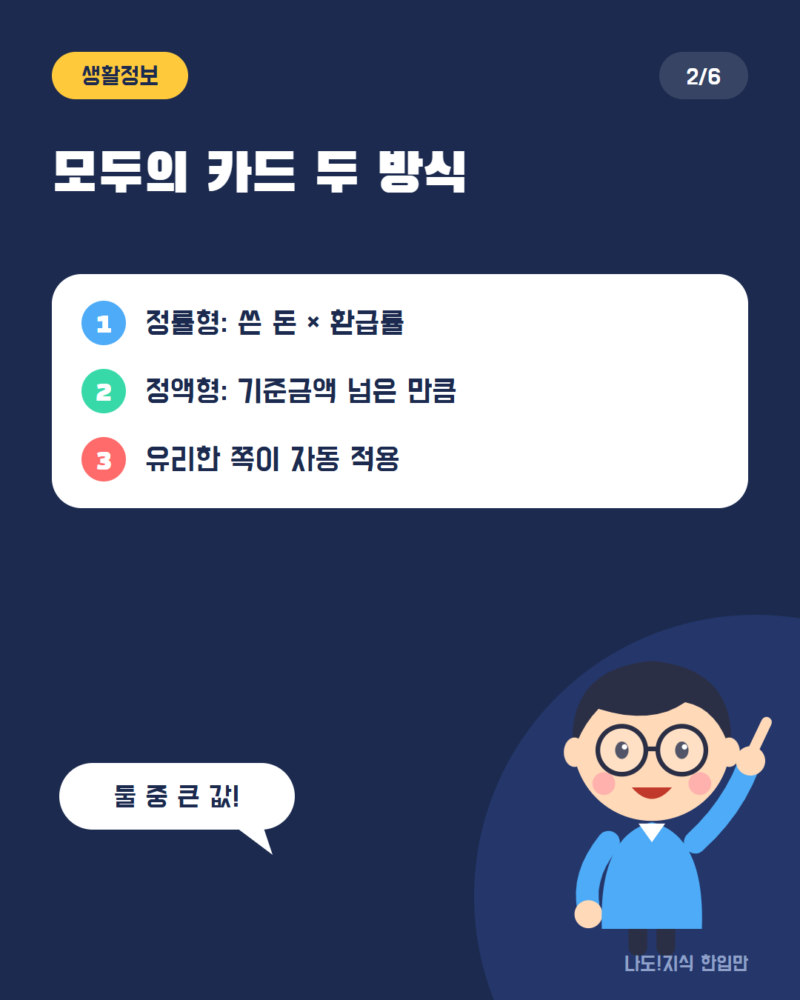
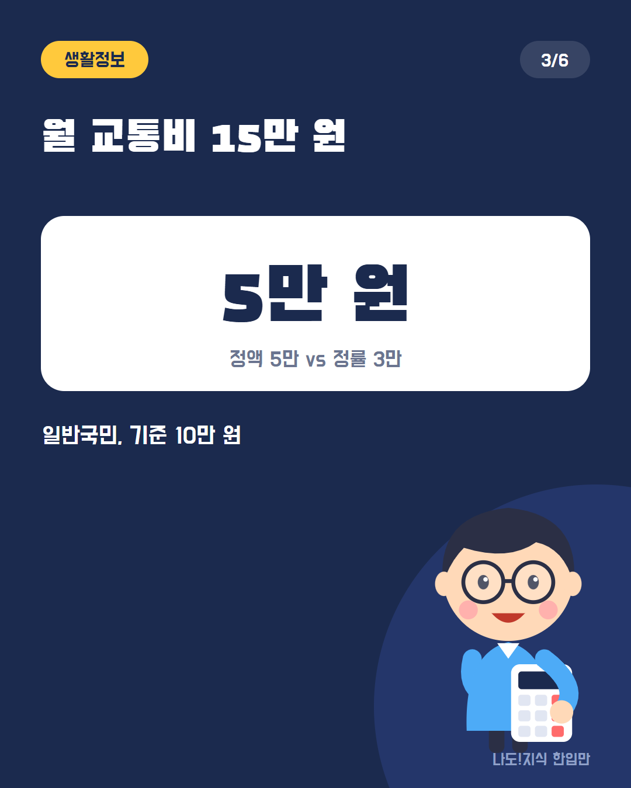
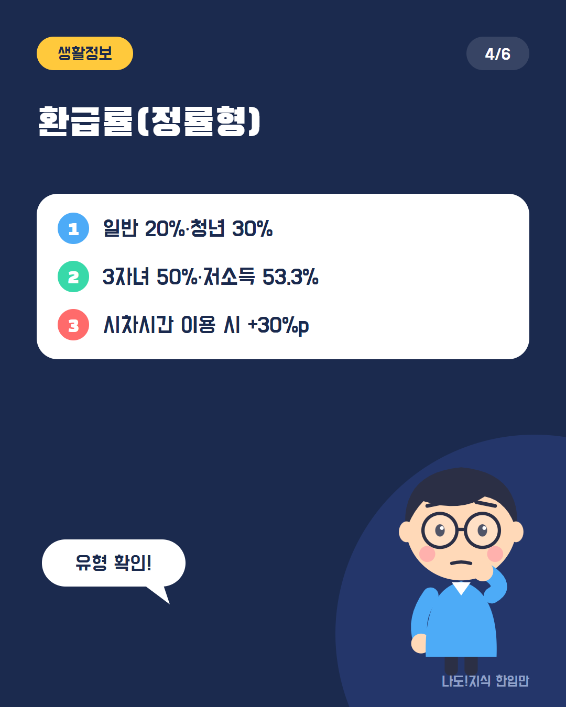
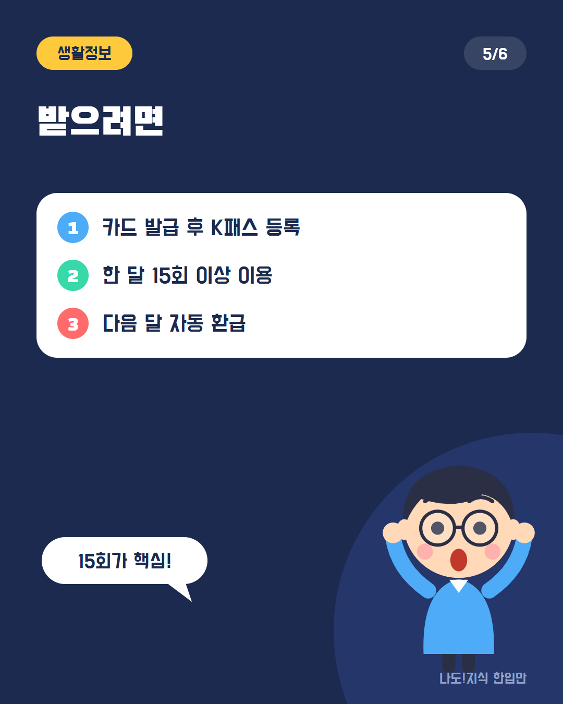
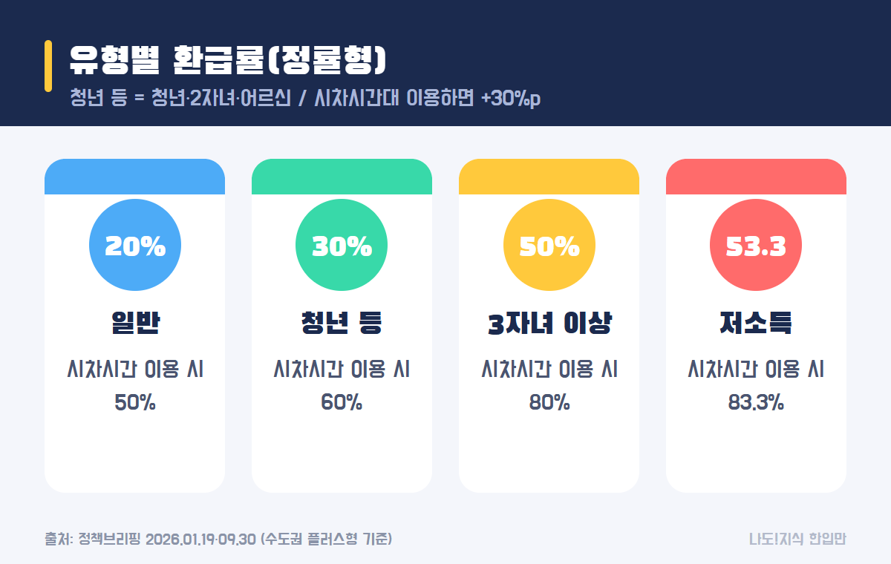
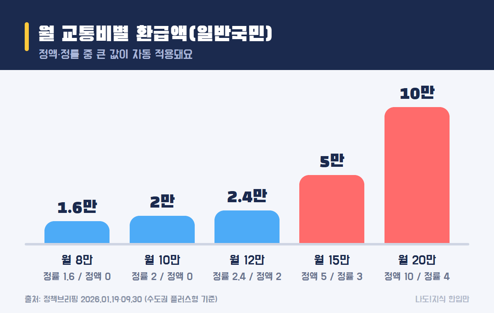
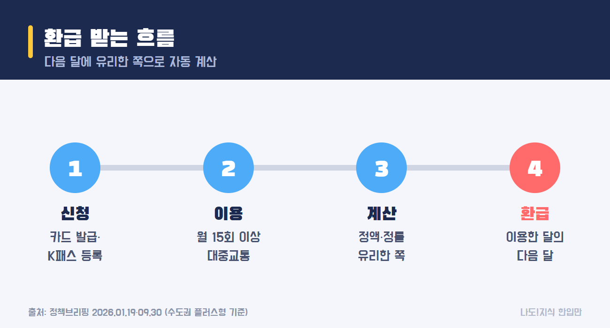

최종 검토일: 2026-11-25

K패스 환급은 한 달에 대중교통을 15회 이상 탄 사람에게 쓴 교통비 일부를 다음 달에 돌려주는 제도예요. 2026년부터는 '모두의 카드'로 확대돼서, 환급 방식이 정률형(20~53.3%)과 정액형(기준금액 초과분 전액) 두 가지가 됐어요.

둘 중 유리한 쪽이 자동으로 적용되지만, 내가 한 달에 얼마를 받는지는 직접 계산해 봐야 알 수 있어요. 월 교통비 8·10·12·15·20만원으로 표를 만들어 놓았으니 내 금액에 가까운 줄을 찾아보세요.

  <strong style="color:#1f3a6e;font-size:18px;">🚌 한눈에 보기</strong>
  <ul style="margin:10px 0 0 0;padding-left:20px;line-height:1.9;">
    <li><b>정률형:</b> 일반 20%, 청년·2자녀·어르신 30%, 3자녀 이상 50%, 저소득 53.3%</li>
    <li><b>정액형:</b> 기준금액(수도권 일반 플러스형 10만원)을 넘게 쓴 초과분 전액</li>
    <li><b>분기점:</b> 일반국민 월 12.5만원, 청년 월 약 12.86만원부터 정액이 유리</li>
    <li><b>조건:</b> 월 15회 이상 이용, 둘 중 유리한 쪽 자동 적용</li>
    <li><b>시차 인센티브:</b> 정률형에 +30%p, 12월까지 연장</li>
  </ul>

옆으로 넘겨 보세요 → (카드 6장 요약)

  <strong style="font-size:16px;">📖 처음이라면 이것만 — 낱말 풀이</strong>
  <ul style="margin:8px 0 0 0;padding-left:20px;line-height:1.9;">
    <li><b>모두의 카드:</b> 2026년 1월 K-패스가 확대·전환된 이름. 기존 K-패스 카드는 바꾸지 않아도 돼요.</li>
    <li><b>정률형:</b> 쓴 교통비에 환급률(20~53.3%)을 곱해 돌려받는 방식.</li>
    <li><b>정액형:</b> 한 달 환급기준금액을 넘게 쓴 초과분을 전액 돌려받는 방식.</li>
    <li><b>일반형·플러스형:</b> 일반형은 1회 3,000원 미만 수단만, 플러스형은 3,000원 이상 포함 모든 수단이 대상.</li>
    <li><b>시차시간:</b> 출퇴근 혼잡 시간을 피한 시간대. 이때 이용하면 환급률이 올라가요.</li>
  </ul>

<h2 style="border-left:6px solid #1f3a6e;padding-left:12px;margin-top:36px;">목차</h2>
<ol style="line-height:1.9;">
  <li><a href="#sec-1" style="color:inherit;text-decoration:underline;text-underline-offset:3px;">K패스 환급은 한 달에 얼마나 받나요?</a></li>
  <li><a href="#sec-2" style="color:inherit;text-decoration:underline;text-underline-offset:3px;">정액형과 정률형은 어떻게 다른가요?</a></li>
  <li><a href="#sec-3" style="color:inherit;text-decoration:underline;text-underline-offset:3px;">월 교통비별로 얼마를 돌려받나요?</a></li>
  <li><a href="#sec-4" style="color:inherit;text-decoration:underline;text-underline-offset:3px;">일반형과 플러스형 기준금액은 얼마인가요?</a></li>
  <li><a href="#sec-5" style="color:inherit;text-decoration:underline;text-underline-offset:3px;">출퇴근 시차 인센티브는 얼마나 더 주나요?</a></li>
  <li><a href="#sec-6" style="color:inherit;text-decoration:underline;text-underline-offset:3px;">신청부터 환급까지 어떻게 진행되나요?</a></li>
  <li><a href="#sec-7" style="color:inherit;text-decoration:underline;text-underline-offset:3px;">자주 하는 실수 5가지</a></li>
  <li><a href="#sec-8" style="color:inherit;text-decoration:underline;text-underline-offset:3px;">K패스 환급 Q&amp;A 5개</a></li>
</ol>

<h2 id="sec-1" style="scroll-margin-top:72px;border-left:6px solid #1f3a6e;padding-left:12px;margin-top:36px;">K패스 환급은 한 달에 얼마나 받나요?</h2>

월 교통비가 8만원인 일반국민이라면 정률형으로 1.6만원을 돌려받아요. 쓴 금액이 커질수록 환급액도 커지고, 어떤 방식이 적용되는지는 월 교통비와 내 유형에 따라 달라져요.

환급률은 유형마다 달라요. 아래 표는 정책브리핑이 공개한 정률형 환급률이에요.

<table style="width:100%;border-collapse:collapse;margin:16px 0;">
  <thead>
    <tr style="background:#1f3a6e;color:#fff;"><th style="border:1px solid #ddd;padding:8px;">유형</th><th style="border:1px solid #ddd;padding:8px;">정률형 환급률</th><th style="border:1px solid #ddd;padding:8px;">시차시간 이용 시</th></tr>
  </thead>
  <tbody>
    <tr><td style="border:1px solid #ddd;padding:8px;">일반국민</td><td style="border:1px solid #ddd;padding:8px;">20%</td><td style="border:1px solid #ddd;padding:8px;">50%</td></tr>
    <tr><td style="border:1px solid #ddd;padding:8px;">청년·2자녀·어르신</td><td style="border:1px solid #ddd;padding:8px;">30%</td><td style="border:1px solid #ddd;padding:8px;">60%</td></tr>
    <tr><td style="border:1px solid #ddd;padding:8px;">3자녀 이상</td><td style="border:1px solid #ddd;padding:8px;">50%</td><td style="border:1px solid #ddd;padding:8px;">80%</td></tr>
    <tr><td style="border:1px solid #ddd;padding:8px;">저소득</td><td style="border:1px solid #ddd;padding:8px;">53.3%</td><td style="border:1px solid #ddd;padding:8px;">83.3%</td></tr>
    </tbody>
</table>

<figure style="margin:24px 0;"><figcaption style="font-size:13px;color:#888;">정책브리핑 2026년 9월 30일 기준 정률형 환급률이에요.</figcaption></figure>

환급은 이용한 달의 다음 달에 이뤄져요. 대상이 되려면 한 달에 15회 이상 시내버스·지하철·광역버스·GTX 등을 타야 해요.

<h2 id="sec-2" style="scroll-margin-top:72px;border-left:6px solid #1f3a6e;padding-left:12px;margin-top:36px;">정액형과 정률형은 어떻게 다른가요?</h2>

정률형은 쓴 금액에 비율을 곱하고, 정액형은 기준금액을 넘은 초과분 전액을 돌려받아요. 두 방식을 따로 신청하지 않고, 한 달 이용 내역으로 계산해 유리한 쪽이 자동 적용돼요.

  <strong>✍️ 계산식</strong> 
  ① 정액 환급 = 월 교통비 − 기준금액 (0보다 작으면 0원) 
  ② 정률 환급 = 월 교통비 × 환급률 
  ③ 둘 중 <b>큰 값</b>이 내가 받는 금액

쓴 돈이 적을 때는 정률형이, 많이 쓸 때는 정액형이 유리해요. 그 갈림길이 되는 금액을 분기점이라고 불러요.

<ul style="line-height:1.9;">
  <li><b>일반국민(플러스형):</b> 10 ÷ 0.8 = 월 12.5만원에서 두 금액이 같아요.</li>
  <li><b>청년(플러스형):</b> 9 ÷ 0.7 ≈ 월 12.86만원에서 두 금액이 같아요.</li>
  <li>분기점 아래에서는 정률형, 위에서는 정액형이 더 많아요.</li>
</ul>

<h2 id="sec-3" style="scroll-margin-top:72px;border-left:6px solid #1f3a6e;padding-left:12px;margin-top:36px;">월 교통비별로 얼마를 돌려받나요?</h2>

수도권 플러스형 기준으로 일반국민은 월 15만원 쓰면 5만원, 청년은 6만원을 돌려받아요. 아래 표는 두 방식을 모두 계산해 큰 값을 굵게 표시했어요.

<figure style="margin:24px 0;"><figcaption style="font-size:13px;color:#888;">일반국민 수도권 플러스형 기준, 둘 중 큰 값이 실제 환급액이에요.</figcaption></figure>

<b>일반국민</b>(기준금액 10만원, 환급률 20%)이에요. 단위는 만원이에요.

<table style="width:100%;border-collapse:collapse;margin:16px 0;">
  <thead>
    <tr style="background:#1f3a6e;color:#fff;"><th style="border:1px solid #ddd;padding:8px;">월 교통비</th><th style="border:1px solid #ddd;padding:8px;">정액</th><th style="border:1px solid #ddd;padding:8px;">정률</th><th style="border:1px solid #ddd;padding:8px;">받는 금액</th></tr>
  </thead>
  <tbody>
    <tr><td style="border:1px solid #ddd;padding:8px;">8만원</td><td style="border:1px solid #ddd;padding:8px;">0</td><td style="border:1px solid #ddd;padding:8px;">1.6</td><td style="border:1px solid #ddd;padding:8px;"><b>1.6 (정률)</b></td></tr>
    <tr><td style="border:1px solid #ddd;padding:8px;">10만원</td><td style="border:1px solid #ddd;padding:8px;">0</td><td style="border:1px solid #ddd;padding:8px;">2</td><td style="border:1px solid #ddd;padding:8px;"><b>2 (정률)</b></td></tr>
    <tr><td style="border:1px solid #ddd;padding:8px;">12만원</td><td style="border:1px solid #ddd;padding:8px;">2</td><td style="border:1px solid #ddd;padding:8px;">2.4</td><td style="border:1px solid #ddd;padding:8px;"><b>2.4 (정률)</b></td></tr>
    <tr><td style="border:1px solid #ddd;padding:8px;">15만원</td><td style="border:1px solid #ddd;padding:8px;">5</td><td style="border:1px solid #ddd;padding:8px;">3</td><td style="border:1px solid #ddd;padding:8px;"><b>5 (정액)</b></td></tr>
    <tr><td style="border:1px solid #ddd;padding:8px;">20만원</td><td style="border:1px solid #ddd;padding:8px;">10</td><td style="border:1px solid #ddd;padding:8px;">4</td><td style="border:1px solid #ddd;padding:8px;"><b>10 (정액)</b></td></tr>
    </tbody>
</table>

<b>청년</b>(기준금액 9만원, 환급률 30%)이에요. 단위는 만원이에요.

<table style="width:100%;border-collapse:collapse;margin:16px 0;">
  <thead>
    <tr style="background:#1f3a6e;color:#fff;"><th style="border:1px solid #ddd;padding:8px;">월 교통비</th><th style="border:1px solid #ddd;padding:8px;">정액</th><th style="border:1px solid #ddd;padding:8px;">정률</th><th style="border:1px solid #ddd;padding:8px;">받는 금액</th></tr>
  </thead>
  <tbody>
    <tr><td style="border:1px solid #ddd;padding:8px;">8만원</td><td style="border:1px solid #ddd;padding:8px;">0</td><td style="border:1px solid #ddd;padding:8px;">2.4</td><td style="border:1px solid #ddd;padding:8px;"><b>2.4 (정률)</b></td></tr>
    <tr><td style="border:1px solid #ddd;padding:8px;">10만원</td><td style="border:1px solid #ddd;padding:8px;">1</td><td style="border:1px solid #ddd;padding:8px;">3</td><td style="border:1px solid #ddd;padding:8px;"><b>3 (정률)</b></td></tr>
    <tr><td style="border:1px solid #ddd;padding:8px;">12만원</td><td style="border:1px solid #ddd;padding:8px;">3</td><td style="border:1px solid #ddd;padding:8px;">3.6</td><td style="border:1px solid #ddd;padding:8px;"><b>3.6 (정률)</b></td></tr>
    <tr><td style="border:1px solid #ddd;padding:8px;">15만원</td><td style="border:1px solid #ddd;padding:8px;">6</td><td style="border:1px solid #ddd;padding:8px;">4.5</td><td style="border:1px solid #ddd;padding:8px;"><b>6 (정액)</b></td></tr>
    <tr><td style="border:1px solid #ddd;padding:8px;">20만원</td><td style="border:1px solid #ddd;padding:8px;">11</td><td style="border:1px solid #ddd;padding:8px;">6</td><td style="border:1px solid #ddd;padding:8px;"><b>11 (정액)</b></td></tr>
    </tbody>
</table>

  <strong>💡 이렇게 읽으세요</strong>
  <ul style="margin:8px 0 0 0;padding-left:20px;line-height:1.9;">
    <li>월 12만원 이하라면 정률형이에요. 대부분의 출퇴근 이용이 여기에 들어가요.</li>
    <li>월 15만원 이상 쓰는 장거리 통근이라면 정액형이 확 커져요.</li>
    <li>표는 카드사 혜택을 뺀 단순 계산이에요.</li>
  </ul>

<h2 id="sec-4" style="scroll-margin-top:72px;border-left:6px solid #1f3a6e;padding-left:12px;margin-top:36px;">일반형과 플러스형 기준금액은 얼마인가요?</h2>

수도권 일반국민은 일반형 6.2만원, 플러스형 10만원이 기준금액이에요. 청년·2자녀·어르신은 수도권 일반형 5.5만원, 플러스형 9만원이에요.

<table style="width:100%;border-collapse:collapse;margin:16px 0;">
  <thead>
    <tr style="background:#1f3a6e;color:#fff;"><th style="border:1px solid #ddd;padding:8px;">지역·유형</th><th style="border:1px solid #ddd;padding:8px;">일반형</th><th style="border:1px solid #ddd;padding:8px;">플러스형</th></tr>
  </thead>
  <tbody>
    <tr><td style="border:1px solid #ddd;padding:8px;">수도권 일반국민</td><td style="border:1px solid #ddd;padding:8px;">6.2만원</td><td style="border:1px solid #ddd;padding:8px;">10만원</td></tr>
    <tr><td style="border:1px solid #ddd;padding:8px;">수도권 청년·2자녀·어르신</td><td style="border:1px solid #ddd;padding:8px;">5.5만원</td><td style="border:1px solid #ddd;padding:8px;">9만원</td></tr>
    <tr><td style="border:1px solid #ddd;padding:8px;">지방 일반국민</td><td style="border:1px solid #ddd;padding:8px;">5.5만원</td><td style="border:1px solid #ddd;padding:8px;">9.5만원</td></tr>
    <tr><td style="border:1px solid #ddd;padding:8px;">지방 청년</td><td style="border:1px solid #ddd;padding:8px;">5만원</td><td style="border:1px solid #ddd;padding:8px;">8.5만원</td></tr>
    </tbody>
</table>

지방 금액은 정책브리핑 한 곳의 자료라 '정책브리핑 기준'으로 적어요. 3자녀·저소득과 우대·특별지원지역 금액은 이 글에서 다루지 않으니 K-패스 누리집을 참고해 주세요.

2026년 4~9월 이용분까지는 기준금액이 절반으로 낮아지는 '반값'이 적용됐어요. 이 반값은 10월부터 끝나서 원래 금액이 지금 기준이에요. 지금 적용되는 정확한 금액은 K-패스 누리집(korea-pass.kr)에서 확인해 주세요.

일반형과 플러스형 중에서는 광역버스나 GTX처럼 1회 3,000원 이상인 수단을 타는지가 갈림길이에요. 시내버스·지하철만 탄다면 일반형, 비싼 수단을 자주 탄다면 플러스형이 맞아요.

<h2 id="sec-5" style="scroll-margin-top:72px;border-left:6px solid #1f3a6e;padding-left:12px;margin-top:36px;">출퇴근 시차 인센티브는 얼마나 더 주나요?</h2>

출퇴근 시차시간에 이용하면 정률형 환급률이 30%p 올라가요. 이 인센티브는 12월까지 연장됐고, 2027년 예산 정부안에도 반영됐어요.

월 6만원을 쓰는 일반국민이 그중 3만원을 시차시간대에 탔다고 해 볼게요.

  <strong>✍️ 시차 사례 (일반국민, 월 6만원 중 3만원이 시차시간)</strong> 
  ① 시차시간 3만원 × 50% = <b>1.5만원</b> 
  ② 그 외 3만원 × 20% = <b>0.6만원</b> 
  ③ 합계 <b>2.1만원</b> (시차를 안 썼다면 6만원 × 20% = 1.2만원)

같은 돈을 쓰고도 시간대만 옮겨서 0.9만원을 더 돌려받는 셈이에요. 12월 이후 지속 여부는 확정된 내용이 없어서 이 글에서는 정부안 예산에 반영됐다는 사실까지만 적어요.

<h2 id="sec-6" style="scroll-margin-top:72px;border-left:6px solid #1f3a6e;padding-left:12px;margin-top:36px;">신청부터 환급까지 어떻게 진행되나요?</h2>

카드 발급과 K패스 등록을 마치고 한 달에 15회 이상 타면 다음 달에 정액·정률 중 유리한 쪽이 자동 환급돼요. 이미 K-패스 카드가 있다면 새로 바꿀 필요가 없어요.

<figure style="margin:24px 0;"><figcaption style="font-size:13px;color:#888;">신청 가능한 카드사는 27개예요(2026년 1월 기준).</figcaption></figure>

<ol style="line-height:2;">
  <li><b>카드 발급:</b> 27개 카드사 중 하나에서 K패스 카드를 만들어요.</li>
  <li><b>K패스 등록:</b> 누리집(korea-pass.kr)에서 카드 번호를 등록해요.</li>
  <li><b>대중교통 이용:</b> 한 달에 15회 이상 시내버스·지하철·광역버스·GTX 등을 타요.</li>
  <li><b>환급 확인:</b> 이용한 다음 달에 환급 내역을 누리집이나 카드사 앱에서 확인해요.</li>
</ol>

연말 소득공제를 같이 챙기는 분이라면 카드 사용액 계획을 <a href="https://sensitiveboss3.tistory.com/entry/year-end-tax-preview-card-deduction-2026" target="_blank" rel="noopener">연말정산 미리보기</a> 글에서 함께 봐 주세요.

<h2 id="sec-7" style="scroll-margin-top:72px;border-left:6px solid #1f3a6e;padding-left:12px;margin-top:36px;">자주 하는 실수 5가지</h2>

환급액이 기대보다 적은 경우는 대부분 횟수·방식·기준금액을 잘못 알고 있어서예요.

  <strong style="font-size:16px;">⚠️ 이것만 피하세요</strong>
  <ol style="margin:8px 0 0 0;padding-left:20px;line-height:1.9;">
    <li><b>월 15회를 못 채우기</b> → 14회까지는 환급 대상이 아니에요.</li>
    <li><b>반값 금액이 지금도 기준이라고 믿기</b> → 반값은 9월 이용분으로 끝났어요. 원래 금액이 기준이에요.</li>
    <li><b>일반형으로 광역버스 타기</b> → 일반형은 1회 3,000원 미만 수단만 대상이에요.</li>
    <li><b>정액형·정률형을 따로 신청해야 한다고 생각하기</b> → 유리한 쪽이 자동 적용돼요.</li>
    <li><b>시차 인센티브를 계속될 제도로 단정하기</b> → 12월까지 연장이라 이후는 누리집에서 확인해야 해요.</li>
  </ol>

소득이 낮은 가구라면 다른 지원도 있어요. <a href="https://sensitiveboss3.tistory.com/entry/energy-voucher-2026-amount-apply" target="_blank" rel="noopener">에너지바우처 금액·신청</a>과 <a href="https://sensitiveboss3.tistory.com/entry/eitc-late-application-2026" target="_blank" rel="noopener">근로장려금 기한 후 신청</a> 글도 확인해 보세요.

<h2 id="sec-8" style="scroll-margin-top:72px;border-left:6px solid #1f3a6e;padding-left:12px;margin-top:36px;">K패스 환급 Q&amp;A 5개</h2>

  
K패스 환급은 얼마나 받나요

  
정률형은 월 교통비의 20~53.3%를 돌려받아요. 일반국민 20%, 청년·2자녀·어르신 30%, 3자녀 이상 50%, 저소득 53.3%예요. 정액형은 한 달 환급기준금액을 넘게 쓴 초과분 전액을 돌려받고, 둘 중 유리한 쪽이 자동으로 적용돼요.

  
정액형과 정률형 중 직접 골라야 하나요

  
아니에요. 한 달 이용 내역을 두 방식으로 계산해 더 많이 돌려받는 쪽이 자동으로 적용돼요. 수도권 일반국민 플러스형이라면 월 교통비가 12.5만원을 넘을 때부터 정액이 유리해져요.

  
일반형과 플러스형은 무엇이 다른가요

  
일반형은 1회 이용요금이 3,000원 미만인 수단만 포함해요. 플러스형은 3,000원 이상인 수단까지 모든 수단이 포함돼서 광역버스·GTX를 자주 타면 플러스형이 맞아요.

  
환급 대상이 되려면 얼마나 타야 하나요

  
한 달에 15회 이상 시내버스·지하철·광역버스·GTX 등을 이용해야 해요. 카드를 새로 바꿀 필요는 없고, 기존 K-패스 카드를 그대로 쓰면 돼요.

  
출퇴근 시차 인센티브는 지금도 받을 수 있나요

  
시차시간대에 이용하면 정률형 환급률이 30%p 올라가는 제도로, 12월까지 연장됐어요. 2027년 예산 정부안에는 반영됐지만 이후 지속 여부는 확정된 내용이 없어서, 12월 이후는 K-패스 누리집에서 확인하세요.

  <strong style="font-size:16px;">📚 함께 보면 좋은 글</strong>
  <ul style="margin:8px 0 0 0;padding-left:20px;line-height:1.9;"><li><a href="https://sensitiveboss3.tistory.com/entry/year-end-tax-preview-card-deduction-2026" target="_blank" rel="noopener">연말정산 미리보기 12월 18일까지</a></li><li><a href="https://sensitiveboss3.tistory.com/entry/energy-voucher-2026-amount-apply" target="_blank" rel="noopener">에너지바우처 2026 금액·신청</a></li><li><a href="https://sensitiveboss3.tistory.com/entry/eitc-late-application-2026" target="_blank" rel="noopener">근로장려금 기한 후 신청 12월 1일까지</a></li></ul>

  참고 출처:
  <ul style="margin:6px 0 0 0;padding-left:20px;">
    <li><a href="https://www.korea.kr/news/policyNewsView.do?newsId=148957978" target="_blank" rel="noopener">정책브리핑: 모두의 카드 확대(2026.01.19)</a></li>
    <li><a href="https://www.korea.kr/news/policyNewsView.do?newsId=148972791" target="_blank" rel="noopener">정책브리핑: 모두의카드 환급 혜택은 계속된다(2026.09.30)</a></li>
    <li><a href="https://news.bizwatch.co.kr/article/real_estate/2026/09/28/0004" target="_blank" rel="noopener">비즈워치: 반값 종료·시차 인센티브 연장(2026.09.28)</a></li>
    <li><a href="https://www.newsis.com/view/NISX20260120_0003483236" target="_blank" rel="noopener">뉴시스: 모두의 카드 출범(2026.01.20)</a></li>
    <li><a href="https://mobile.newsis.com/view/NISX20260416_0003594819" target="_blank" rel="noopener">뉴시스: 반값 기준금액(2026.04.16)</a></li>
    <li><a href="https://korea-pass.kr" target="_blank" rel="noopener">K-패스 누리집: 신청·조회</a></li>
  </ul>
  기준일: 2026년 11월 25일. 금액은 수도권 플러스형 기준 단순 계산이에요.

정보 제공을 목적으로 쓴 글이에요. 기준금액·환급률·시차 인센티브는 바뀔 수 있고, 실제 환급액은 이용 내역과 K-패스 누리집 공지가 기준이에요.

