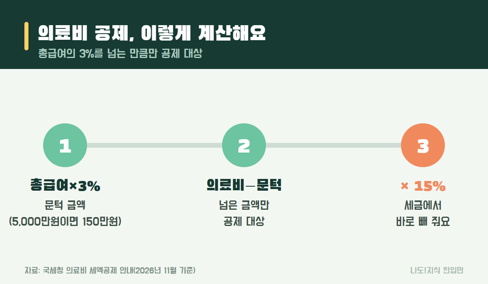
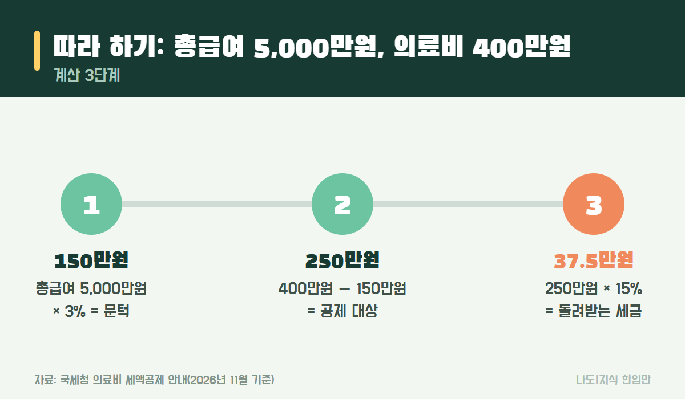
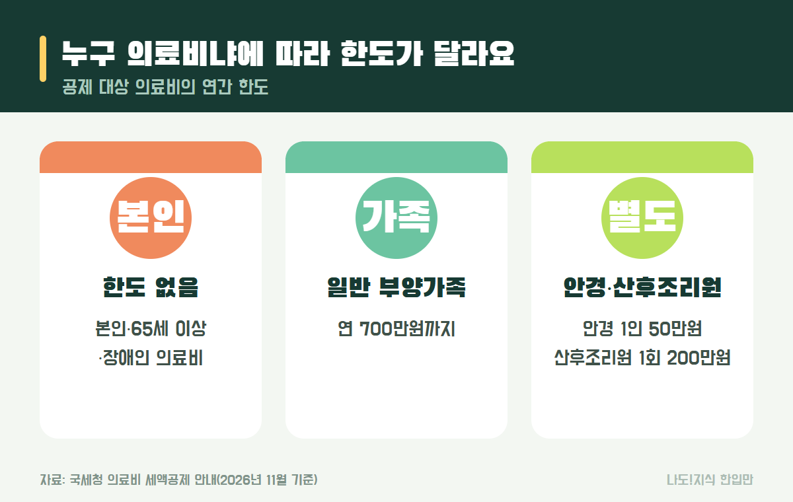

최종 검토일: 2026-11-23

의료비 세액공제는 한 해 쓴 의료비 중 총급여의 3%를 넘는 만큼의 15%를 내 세금에서 빼 주는 제도예요. 총급여가 5,000만원이면 문턱이 150만원이라, 본인 의료비 400만원을 썼다면 37.5만원을 돌려받아요.

병원비를 많이 썼는데 연말정산에서 얼마나 돌려받는지 모르겠다는 분이 많아요. 문턱 계산, 사람별 한도, 실손보험금을 받았을 때 처리까지 숫자 예시로 풀어 볼게요.

  <strong style="color:#2f5d3a;font-size:18px;">🌿 한눈에 보기</strong>
  <ul style="margin:10px 0 0 0;padding-left:20px;line-height:1.9;">
    <li><b>공식:</b> (의료비 − 총급여 × 3%) × 15%</li>
    <li><b>총급여 5,000만원:</b> 문턱 150만원, 의료비 400만원이면 37.5만원</li>
    <li><b>한도 없음:</b> 본인, 65세 이상, 장애인 등</li>
    <li><b>한도 연 700만원:</b> 그 밖의 일반 부양가족</li>
    <li><b>실손보험금:</b> 받은 금액은 의료비에서 빼고 계산</li>
  </ul>

  <strong style="font-size:16px;">📖 처음이라면 이것만 — 낱말 풀이</strong>
  <ul style="margin:8px 0 0 0;padding-left:20px;line-height:1.9;">
    <li><b>세액공제:</b> 계산된 세금에서 일정 금액을 바로 빼 주는 것. 소득에서 빼는 소득공제와 달라요.</li>
    <li><b>총급여:</b> 비과세를 뺀, 세금 떼기 전 연봉. 급여명세서나 원천징수영수증에 나와요.</li>
    <li><b>문턱(3% 기준):</b> 총급여의 3%. 의료비가 이 금액까지는 공제가 안 돼요.</li>
    <li><b>실손보험금:</b> 실손의료보험에서 돌려받은 병원비. 공제 대상 의료비에서 빠져요.</li>
    <li><b>연말정산 간소화:</b> 홈택스에서 병원·약국 지출 자료를 한 번에 조회하는 서비스.</li>
  </ul>

의료비 세액공제는 총급여의 3%를 넘는 의료비에 15%를 적용해 세금을 줄여 주는 근로자용 공제이다. 쉽게 말해 "병원비 전부"가 아니라 "문턱을 넘은 만큼"만 계산 대상이에요.

<h2 style="border-left:6px solid #2f5d3a;padding-left:12px;margin-top:36px;">목차</h2>
<ol style="line-height:1.9;">
  <li><a href="#sec-1" style="color:inherit;text-decoration:underline;text-underline-offset:3px;">의료비 세액공제는 어떻게 계산하나요?</a></li>
  <li><a href="#sec-2" style="color:inherit;text-decoration:underline;text-underline-offset:3px;">총급여별로 문턱은 얼마인가요?</a></li>
  <li><a href="#sec-3" style="color:inherit;text-decoration:underline;text-underline-offset:3px;">누구 의료비는 한도가 있나요?</a></li>
  <li><a href="#sec-4" style="color:inherit;text-decoration:underline;text-underline-offset:3px;">실손보험금을 받았다면 어떻게 하나요?</a></li>
  <li><a href="#sec-5" style="color:inherit;text-decoration:underline;text-underline-offset:3px;">의료비 공제는 어떻게 신청하나요?</a></li>
  <li><a href="#sec-6" style="color:inherit;text-decoration:underline;text-underline-offset:3px;">자주 하는 실수 5가지</a></li>
  <li><a href="#sec-7" style="color:inherit;text-decoration:underline;text-underline-offset:3px;">의료비 세액공제 Q&amp;A 5개</a></li>
</ol>

<h2 id="sec-1" style="scroll-margin-top:72px;border-left:6px solid #2f5d3a;padding-left:12px;margin-top:36px;">의료비 세액공제는 어떻게 계산하나요?</h2>

계산은 (의료비 − 총급여 × 3%) × 15%이에요. 소득세법 제59조의4 기준이고, 2026년 11월 현재 국세청 안내와 같아요.

<figure style="margin:24px 0;"><figcaption style="font-size:13px;color:#888;">총급여 5,000만원이면 문턱은 150만원이에요.</figcaption></figure>

  <strong>✍️ 내 경우로 따라 해 보기 (총급여 5,000만원, 본인 의료비 400만원)</strong> 
  ① 문턱 구하기: 5,000만원 × 3% = <b>150만원</b> 
  ② 문턱을 넘은 금액: 400만원 − 150만원 = <b>250만원</b> 
  ③ 세액공제: 250만원 × 15% = <b>37.5만원</b> 
  ④ 의료비가 150만원 이하였다면: 공제액 <b>0원</b>

<figure style="margin:24px 0;"><figcaption style="font-size:13px;color:#888;">400만원을 썼어도 돌려받는 건 문턱을 넘은 250만원의 15%예요.</figcaption></figure>

예를 들어 총급여 4,000만원인 직장인이 65세 이상 부모님 의료비로 600만원을 썼다면, 문턱 120만원을 빼고 480만원에 15%를 곱한 72만원이 공제돼요. 부모님 의료비라도 65세 이상이면 한도가 없어서 600만원이 전부 계산에 들어가요.

문턱은 가족 의료비를 합친 뒤에 한 번만 빼요. 가족별로 문턱을 따로 빼지 않는다는 점을 기억해 두세요.

그래서 의료비가 문턱 근처라면 올해 영수증을 먼저 모두 모아 합계를 내 보는 게 순서예요. 합계가 문턱보다 작으면 공제는 0원이고, 조금이라도 넘으면 넘은 만큼부터 15%가 붙어요. 본인 병원비, 부모님 병원비, 약국비를 한 장의 표에 적어 두면 연말정산 때 빠뜨리지 않아요.

<h2 id="sec-2" style="scroll-margin-top:72px;border-left:6px solid #2f5d3a;padding-left:12px;margin-top:36px;">총급여별로 문턱은 얼마인가요?</h2>

문턱은 총급여의 3%라서 연봉이 높을수록 커져요. 같은 의료비를 써도 총급여가 높은 사람은 공제가 적거나 없을 수 있어요.

<table style="width:100%;border-collapse:collapse;margin:16px 0;">
  <thead>
    <tr style="background:#2f5d3a;color:#fff;"><th style="border:1px solid #ddd;padding:8px;">총급여</th><th style="border:1px solid #ddd;padding:8px;">문턱(3%)</th><th style="border:1px solid #ddd;padding:8px;">의료비 400만원일 때 공제(본인 의료비)</th></tr>
  </thead>
  <tbody>
    <tr><td style="border:1px solid #ddd;padding:8px;">3,000만원</td><td style="border:1px solid #ddd;padding:8px;">90만원</td><td style="border:1px solid #ddd;padding:8px;">46.5만원</td></tr>
    <tr><td style="border:1px solid #ddd;padding:8px;">4,000만원</td><td style="border:1px solid #ddd;padding:8px;">120만원</td><td style="border:1px solid #ddd;padding:8px;">42만원</td></tr>
    <tr><td style="border:1px solid #ddd;padding:8px;">5,000만원</td><td style="border:1px solid #ddd;padding:8px;"><b>150만원</b></td><td style="border:1px solid #ddd;padding:8px;"><b>37.5만원</b></td></tr>
    <tr><td style="border:1px solid #ddd;padding:8px;">7,000만원</td><td style="border:1px solid #ddd;padding:8px;">210만원</td><td style="border:1px solid #ddd;padding:8px;">28.5만원</td></tr>
  </tbody>
</table>

부부가 모두 일한다면 의료비를 누구 명의로 모을지에 따라 공제액이 달라질 수 있어요. 문턱이 각자 총급여의 3%라서, 총급여가 낮은 쪽이 문턱이 낮은 점을 따져 볼 수 있어요. 다만 부양가족 요건과 영수증 명의가 얽혀 있으니 연말정산 안내에서 확인해 주세요.

<h2 id="sec-3" style="scroll-margin-top:72px;border-left:6px solid #2f5d3a;padding-left:12px;margin-top:36px;">누구 의료비는 한도가 있나요?</h2>

본인·65세 이상·장애인 등은 한도가 없고, 그 밖의 일반 부양가족은 연 700만원까지예요. 문턱인 총급여 3%는 어느 쪽이든 똑같이 적용돼요.

<figure style="margin:24px 0;"><figcaption style="font-size:13px;color:#888;">한도는 사람과 항목에 따라 갈려요.</figcaption></figure>

<table style="width:100%;border-collapse:collapse;margin:16px 0;">
  <thead>
    <tr style="background:#2f5d3a;color:#fff;"><th style="border:1px solid #ddd;padding:8px;">대상·항목</th><th style="border:1px solid #ddd;padding:8px;">한도</th><th style="border:1px solid #ddd;padding:8px;">공제율</th></tr>
  </thead>
  <tbody>
    <tr><td style="border:1px solid #ddd;padding:8px;">본인</td><td style="border:1px solid #ddd;padding:8px;">없음</td><td style="border:1px solid #ddd;padding:8px;">15%</td></tr>
    <tr><td style="border:1px solid #ddd;padding:8px;">65세 이상 부양가족, 장애인</td><td style="border:1px solid #ddd;padding:8px;">없음</td><td style="border:1px solid #ddd;padding:8px;">15%</td></tr>
    <tr><td style="border:1px solid #ddd;padding:8px;">그 밖의 일반 부양가족(배우자 등)</td><td style="border:1px solid #ddd;padding:8px;">연 700만원</td><td style="border:1px solid #ddd;padding:8px;">15%</td></tr>
    <tr><td style="border:1px solid #ddd;padding:8px;">미숙아·선천성이상아 의료비</td><td style="border:1px solid #ddd;padding:8px;">없음</td><td style="border:1px solid #ddd;padding:8px;">20%</td></tr>
    <tr><td style="border:1px solid #ddd;padding:8px;">난임시술비</td><td style="border:1px solid #ddd;padding:8px;">없음</td><td style="border:1px solid #ddd;padding:8px;">30%</td></tr>
    <tr><td style="border:1px solid #ddd;padding:8px;">산후조리원(시행령 기준)</td><td style="border:1px solid #ddd;padding:8px;">출산 1회 200만원</td><td style="border:1px solid #ddd;padding:8px;">15%</td></tr>
    <tr><td style="border:1px solid #ddd;padding:8px;">시력보정용 안경·렌즈(시행령 기준)</td><td style="border:1px solid #ddd;padding:8px;">1인 연 50만원</td><td style="border:1px solid #ddd;padding:8px;">15%</td></tr>
  </tbody>
</table>

  <strong style="font-size:16px;">💡 일반 부양가족 한도 계산 예시</strong>
  <ol style="margin:8px 0 0 0;padding-left:20px;line-height:1.9;">
    <li>총급여 5,000만원, 본인 의료비 없음, 배우자 의료비 1,000만원이라고 가정해요.</li>
    <li>문턱 150만원을 빼면 850만원이지만, 일반 부양가족 한도 700만원이 먼저 걸려요.</li>
    <li>700만원 × 15% = <b>105만원</b>이 공제돼요.</li>
  </ol>

산후조리원과 안경은 시행령 기준이라, 실제로는 영수증과 간소화 조회로 대상인지 확인한 뒤 계산하는 게 안전해요. 안경은 현금으로 샀다면 간소화 서비스에 안 나올 수 있어서 영수증을 챙겨 두세요. 난임시술비 같은 우대 항목은 해당하는 경우에만 별도로 구분해 신고해요.

<h2 id="sec-4" style="scroll-margin-top:72px;border-left:6px solid #2f5d3a;padding-left:12px;margin-top:36px;">실손보험금을 받았다면 어떻게 하나요?</h2>

실손보험으로 돌려받은 돈은 의료비에서 빼고 계산해요. 소득세법 시행령 제118조의5 기준이에요.

<ul style="line-height:1.9;">
  <li><b>병원비 300만원, 실손보험금 200만원 수령:</b> 공제 대상 의료비는 100만원이에요.</li>
  <li><b>총급여 5,000만원이라면:</b> 문턱 150만원보다 적어서 공제는 0원이에요.</li>
  <li><b>실손을 청구하지 않았다면:</b> 병원비 300만원이 그대로 대상이지만, 보험금을 받을 수 있는 돈을 안 받은 것이라 따져 봐야 해요.</li>
</ul>

실손을 청구했는지에 따라 연말정산 숫자가 달라지니, 청구 내역과 간소화 자료를 맞춰 보세요. 이미 보험금을 받은 의료비를 그대로 넣으면 나중에 다시 정정해야 할 수 있어요. 간소화 서비스의 의료비 합계에서 실손 수령분이 따로 표시되는지도 같이 확인해 주세요.

<h2 id="sec-5" style="scroll-margin-top:72px;border-left:6px solid #2f5d3a;padding-left:12px;margin-top:36px;">의료비 공제는 어떻게 신청하나요?</h2>

의료비는 연말정산 간소화 서비스(홈택스)에서 조회한 자료를 회사에 내서 공제받아요. 의료기관과 약국 지출은 대부분 조회되지만 안경 같은 일부 항목은 빠질 수 있어요.

<ol style="line-height:2;">
  <li><b>대상 확인:</b> 본인과 기본공제 대상 가족의 의료비인지 확인해요.</li>
  <li><b>간소화 조회:</b> 홈택스에서 의료비 항목을 열어 병원·약국 지출을 봐요.</li>
  <li><b>빠진 지출 챙기기:</b> 안경·산후조리원처럼 조회되지 않는 항목은 영수증을 모아요.</li>
  <li><b>실손 수령액 빼기:</b> 보험금을 받은 금액은 의료비에서 제외해요.</li>
  <li><b>회사에 제출:</b> 연말정산 서식에 의료비 내역을 넣어 공제받아요.</li>
</ol>

올해 쓴 의료비는 다음 해 초 연말정산에서 정리해요. 간소화 서비스 일정은 국세청 공고가 나오면 확인해 주세요. 남은 기간 다른 공제 점검은 <a href="https://sensitiveboss3.tistory.com/entry/year-end-tax-preview-card-deduction-2026" target="_blank" rel="noopener">연말정산 미리보기</a> 글을 같이 보면 좋아요.

<h2 id="sec-6" style="scroll-margin-top:72px;border-left:6px solid #2f5d3a;padding-left:12px;margin-top:36px;">자주 하는 실수 5가지</h2>

의료비 공제를 놓치는 경우는 대부분 문턱과 실손보험금을 빼먹어서 생겨요.

  <strong style="font-size:16px;">⚠️ 이것만 피하세요</strong>
  <ol style="margin:8px 0 0 0;padding-left:20px;line-height:1.9;">
    <li><b>의료비 전체에 15% 곱하기</b> → 총급여 3%를 뺀 나머지에만 곱해요.</li>
    <li><b>실손보험금 받은 금액 포함하기</b> → 받은 금액은 의료비에서 빼야 해요.</li>
    <li><b>일반 부양가족 한도를 잊기</b> → 배우자 등은 연 700만원까지만 계산돼요.</li>
    <li><b>안경·산후조리원 영수증 버리기</b> → 간소화에 안 나올 수 있어 직접 챙겨야 해요.</li>
    <li><b>문턱을 가족별로 따로 빼기</b> → 문턱은 총급여의 3%로 한 번만 빼요.</li>
  </ol>

연말에 몰아서 의료비를 쓰려는 분도 있지만, 문턱을 못 넘으면 공제는 0원이에요. 쓸 계획이 있었던 치료를 미루거나 당기는 판단은 건강이 먼저이고, 세금은 그다음이에요. 연금저축 같은 다른 공제와 함께 보려면 <a href="https://sensitiveboss3.tistory.com/entry/pension-savings-tax-credit" target="_blank" rel="noopener">연금저축 세액공제</a> 글을 참고하세요.

<h2 id="sec-7" style="scroll-margin-top:72px;border-left:6px solid #2f5d3a;padding-left:12px;margin-top:36px;">의료비 세액공제 Q&amp;A 5개</h2>

  
의료비 세액공제 계산 방법은요

  
(의료비 − 총급여 × 3%) × 15%예요. 총급여 5,000만원에 본인 의료비 400만원이면 문턱 150만원을 빼고 250만원 × 15% = 37.5만원이에요.

  
의료비 공제 한도는 얼마인가요

  
본인, 65세 이상 부양가족, 장애인 등은 한도가 없어요. 그 밖의 일반 부양가족은 연 700만원까지예요. 총급여 3% 문턱은 모두 똑같이 적용돼요.

  
실손보험금을 받은 의료비도 공제되나요

  
보험금으로 돌려받은 금액은 공제 대상에서 빠져요. 병원비 300만원 중 실손 200만원을 받았다면 100만원만 의료비로 계산해요.

  
산후조리원 비용도 의료비 공제가 되나요

  
시행령 기준으로 출산 1회 200만원까지 대상이에요. 실제 적용은 영수증과 간소화 조회로 확인한 뒤 신청해 주세요.

  
안경이나 렌즈 구입비도 공제되나요

  
시행령 기준으로 시력보정용 안경·렌즈는 1인당 연 50만원까지 대상이에요. 현금으로 사면 간소화 서비스에 안 나올 수 있으니 영수증을 챙겨 두세요.

  <strong style="font-size:16px;">📚 함께 보면 좋은 글</strong>
  <ul style="margin:8px 0 0 0;padding-left:20px;line-height:1.9;"><li><a href="https://sensitiveboss3.tistory.com/entry/year-end-tax-preview-card-deduction-2026" target="_blank" rel="noopener">연말정산 미리보기 12월 18일까지</a></li><li><a href="https://sensitiveboss3.tistory.com/entry/pension-savings-tax-credit" target="_blank" rel="noopener">연금저축 세액공제 얼마 돌려받나</a></li><li><a href="https://sensitiveboss3.tistory.com/entry/hometown-donation-tax-credit-2026" target="_blank" rel="noopener">고향사랑기부제 2026 세액공제, 20만원 기부하면 얼마 돌려받나</a></li></ul>

  참고 출처:
  <ul style="margin:6px 0 0 0;padding-left:20px;">
    <li><a href="https://www.law.go.kr/법령/소득세법" target="_blank" rel="noopener">국가법령정보센터: 소득세법 제59조의4(특별세액공제)</a></li>
    <li><a href="https://www.law.go.kr/법령/소득세법시행령" target="_blank" rel="noopener">국가법령정보센터: 소득세법 시행령 제118조의5(의료비 공제)</a></li>
    <li><a href="https://www.nts.go.kr" target="_blank" rel="noopener">국세청: 연말정산 안내(의료비 세액공제)</a></li>
  </ul>
  기준일: 2026년 11월 23일. 금액은 세전 단순 계산이에요.

이 글은 정보 제공을 목적으로 하며 특정 종목이나 상품의 매수·매도를 권유하지 않습니다. 투자 판단과 그 결과에 대한 책임은 투자자 본인에게 있습니다. 세율·수수료·한도는 변경될 수 있으므로 반드시 원출처에서 최신 내용을 확인하시기 바랍니다.

