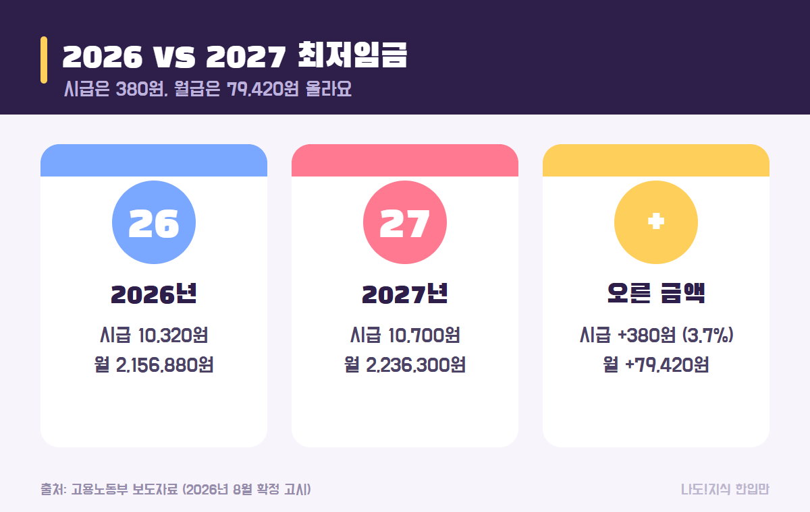
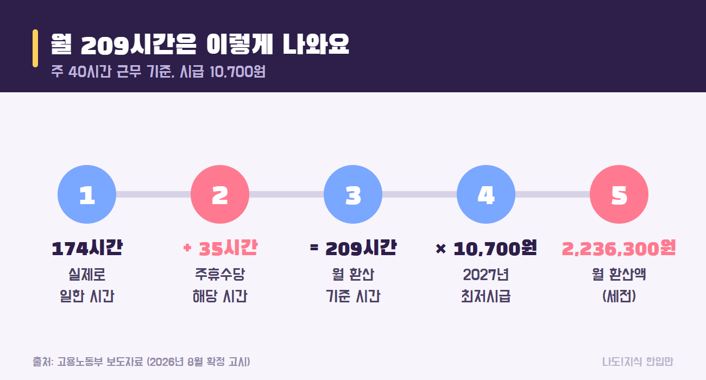
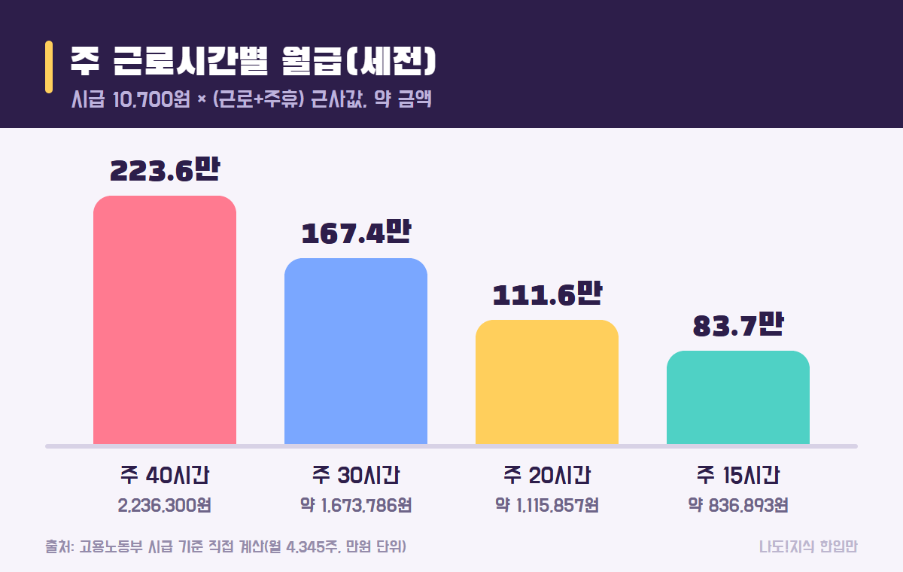

최종 검토일: 2026-11-26

많은 분이 "시급 10,700원"만 보고 월급을 직접 곱했다가 숫자가 안 맞아 당황해요. 월 환산액에는 쉬는 날인 주휴 시간이 이미 들어 있기 때문이에요. 2027년 최저임금 월급은 시급 10,700원, 월 환산액 2,236,300원이고, 2026년 8월 고용노동부 고시 기준이에요.

2027 최저임금 월급은 <b>시간급 최저임금에 주 40시간 근로와 유급 주휴시간을 합한 월 209시간을 곱해 만든 세전 월 환산액</b>이에요.

낱말 풀이

<ul style="line-height:1.9;">
  <li><b>시간급:</b> 한 시간 일했을 때 최소로 줘야 하는 돈이에요.</li>
  <li><b>소정근로시간:</b> 근로계약서에 정한 주당 일하기로 한 시간이에요.</li>
  <li><b>주휴수당:</b> 일주일을 개근하면 쉬는 날 하루 치 임금을 더 주는 돈이에요.</li>
  <li><b>월 환산액:</b> 시급을 한 달 기준시간으로 곱해 월급처럼 바꾼 금액이에요.</li>
</ul>

핵심만 먼저

<ul style="line-height:1.9;">
  <li><b>시급:</b> 10,700원 (2026년 10,320원보다 380원, 3.7% 올랐어요)</li>
  <li><b>월 환산액:</b> 2,236,300원 (주 40시간, 월 209시간 기준, 세전)</li>
  <li><b>적용 기간:</b> 2027년 1월 1일부터 12월 31일까지, 업종 구분 없이 같아요</li>
  <li><b>주휴수당:</b> 월 209시간에 이미 포함돼 있어서 따로 더하지 않아요</li>
</ul>

2026년 11월 고용노동부 보도 기준으로 정리했어요. 준비물, 계산 3단계, 결과 확인, 흔한 실수 순서로 볼게요.

<figure style="margin:24px 0;"><figcaption style="font-size:13px;color:#777;text-align:center;">2026년과 2027년 최저임금 비교(월 환산액은 월 209시간 기준)</figcaption></figure>

<h2 id="sec-1" style="scroll-margin-top:72px;color:#20242c;">준비물: 어떤 숫자를 알아야 하나요?</h2>

준비할 숫자는 시급 10,700원, 주 근로시간, 한 주 개근 여부 세 가지예요. 고용노동부가 고시한 것은 시간급과 월 환산액 두 가지뿐이에요.

<ul style="line-height:1.9;">
  <li><b>시급 10,700원:</b> 2027년 적용 시간급이에요.</li>
  <li><b>월 환산액 2,236,300원:</b> 주 40시간 근무자 기준 금액이에요.</li>
  <li><b>내 주 근로시간:</b> 계약서의 주 소정근로시간을 확인해요.</li>
</ul>

일급·주급·연 환산액은 시급을 단순히 곱한 참고값이에요. 고시 금액 자체는 아니에요.

<h2 id="sec-2" style="scroll-margin-top:72px;color:#20242c;">1단계. 월 209시간은 어떻게 나온 숫자인가요?</h2>

209시간은 실제 근무 약 174시간에 주휴 35시간을 더한 기준시간이에요. 실제로 일한 시간이 아니라, 유급 주휴를 받는 보통의 근로조건을 전제로 만든 값이에요.

<figure style="margin:24px 0;"><figcaption style="font-size:13px;color:#777;text-align:center;">월 209시간 = 실근로 174시간 + 주휴 35시간</figcaption></figure>

<ul style="line-height:1.9;">
  <li>주 40시간 근무는 하루 8시간씩 5일이에요.</li>
  <li>하루 쉬는 주휴 8시간이 매주 유급으로 더해져요.</li>
  <li>한 달을 약 4.345주로 보면 (40+8)시간 × 4.345 ≈ 209시간이 돼요.</li>
</ul>

직접 계산해 봤어요

10,700원 × 209시간 = 2,236,300원이에요. 2026년 10,320원 × 209시간은 2,156,880원이라, 한 달 기준으로 79,420원이 올랐어요.

<h2 id="sec-3" style="scroll-margin-top:72px;color:#20242c;">2단계. 내 월급은 어떻게 계산하나요?</h2>

주 40시간이면 월급은 고시된 2,236,300원이에요. 그보다 적게 일하면 주 근로시간에 비례해 줄어요.

<table style="width:100%;border-collapse:collapse;margin:16px 0;">
  <thead>
    <tr style="background:#3b4250;color:#fff;"><th style="border:1px solid #ddd;padding:8px;">주 근로시간</th><th style="border:1px solid #ddd;padding:8px;">주휴시간</th><th style="border:1px solid #ddd;padding:8px;">월 환산 시간</th><th style="border:1px solid #ddd;padding:8px;">월급(세전, 약)</th></tr>
  </thead>
  <tbody>
    <tr><td style="border:1px solid #ddd;padding:8px;">40시간</td><td style="border:1px solid #ddd;padding:8px;">8시간</td><td style="border:1px solid #ddd;padding:8px;">209시간</td><td style="border:1px solid #ddd;padding:8px;">2,236,300원 (고시 금액)</td></tr>
    <tr><td style="border:1px solid #ddd;padding:8px;">30시간</td><td style="border:1px solid #ddd;padding:8px;">6시간</td><td style="border:1px solid #ddd;padding:8px;">약 156시간</td><td style="border:1px solid #ddd;padding:8px;">약 167만 원</td></tr>
    <tr><td style="border:1px solid #ddd;padding:8px;">20시간</td><td style="border:1px solid #ddd;padding:8px;">4시간</td><td style="border:1px solid #ddd;padding:8px;">약 104시간</td><td style="border:1px solid #ddd;padding:8px;">약 111만 원</td></tr>
    <tr><td style="border:1px solid #ddd;padding:8px;">15시간</td><td style="border:1px solid #ddd;padding:8px;">3시간</td><td style="border:1px solid #ddd;padding:8px;">약 78시간</td><td style="border:1px solid #ddd;padding:8px;">약 83만 원</td></tr>
  </tbody>
</table>

40시간 외 줄은 제가 한 비례 계산이에요. 주휴를 근로시간에 비례해 주고, 한 달을 약 4.345주로 본 값이라 사업장 계산 방식에 따라 조금 달라요.

<figure style="margin:24px 0;"><figcaption style="font-size:13px;color:#777;text-align:center;">주 근로시간별 세전 월급(40시간만 고시 금액, 나머지는 비례 계산)</figcaption></figure>

따라 해 보기 (가상 사례)

<ol style="line-height:1.9;">
  <li>주 5일 하루 8시간 일하는 A씨(가상)는 주 40시간이라 월 209시간이에요.</li>
  <li>10,700원 × 209시간 = 2,236,300원이 세전 최저 월급이에요.</li>
  <li>주 3일 하루 6시간 일하는 B씨(가상)는 주 18시간이라 주휴 약 3.6시간이 붙어요.</li>
  <li>(18 + 3.6)시간 × 4.345주 × 10,700원 ≈ 1,004,000원이에요(내 계산, 약 100만 원).</li>
  <li>주 12시간 일하는 C씨(가상)는 주 15시간 미만이라 주휴가 없어서 12 × 4.345 × 10,700원 ≈ 558,000원이에요.</li>
</ol>

같은 시급이어도 일하는 시간에 따라 월급이 크게 달라져요. 특히 주 15시간 선을 넘는지가 주휴 몫 약 20%를 가르는 기준이에요.

<h2 id="sec-4" style="scroll-margin-top:72px;color:#20242c;">3단계. 주휴수당은 누가 받나요?</h2>

주휴수당은 주 15시간 이상 일하고 그 주 소정근로일을 모두 채운 사람이 받아요. 근로기준법에 따른 유급휴일이에요.

<ul style="line-height:1.9;">
  <li><b>받는 경우:</b> 주 15시간 이상이고 약속한 근무일을 빠짐없이 나온 주예요.</li>
  <li><b>못 받는 경우:</b> 주 15시간 미만이거나, 그 주에 결근이 있는 주예요.</li>
  <li><b>월급제:</b> 월급에 주휴가 이미 들어 있는 경우가 많아서, 계약서의 '주휴 포함' 표시를 확인해요.</li>
</ul>

자세한 계산은 <a href="https://sensitiveboss3.tistory.com/entry/weekly-holiday-pay-calculation-2026" target="_blank" rel="noopener">주휴수당 계산 2026</a> 글에서 볼 수 있어요.

<h2 id="sec-5" style="scroll-margin-top:72px;color:#20242c;">결과 확인: 2027년 최저임금은 어떻게 정해졌나요?</h2>

2027년 최저임금은 2026년 8월 5일 고용노동부가 시간급 10,700원으로 고시했어요. 앞서 최저임금위원회가 7월 14일 제14차 전원회의에서 이 금액을 의결했어요.

<ul style="line-height:1.9;">
  <li><b>인상폭:</b> 2026년 10,320원에서 380원, 3.7% 올랐어요.</li>
  <li><b>이의제기:</b> 노동계·소상공인 단체 이의는 받아들여지지 않았어요.</li>
  <li><b>업종별 차등:</b> 6월 18일 부결돼서 모든 사업장에 같은 금액이 적용돼요.</li>
  <li><b>적용 기간:</b> 2027년 1월 1일부터 12월 31일까지예요.</li>
</ul>

2026년 11월 현재 안내 기준이고, 공식 고시문은 고용노동부와 최저임금위원회 누리집에서 확인할 수 있어요. 고시 금액은 해가 바뀌어도 그해 12월 31일까지 그대로이니, 2027년 한 해 동안은 이 숫자로 비교하면 돼요. 계약서의 월급이 이 기준보다 낮아 보이면 수당 항목부터 다시 확인해 보세요. 다음 해 금액은 2027년 여름 이후 다시 정해져요.

내 월급이 최저임금 이상인지 확인하는 순서

<ol style="line-height:1.9;">
  <li>근로계약서에서 주 소정근로시간과 월급(또는 시급)을 찾아요.</li>
  <li>월급을 '월 환산 시간'으로 나눠 시간당 금액을 구해요. 주 40시간이면 209로 나눠요.</li>
  <li>나온 시간당 금액이 10,700원 이상인지 비교해요.</li>
  <li>10,700원보다 낮다면 급여명세서의 항목을 확인하고, 필요하면 고용노동부(1350)에 문의해요.</li>
</ol>

예를 들어 월급 220만 원을 받는 주 40시간 근로자라면 2,200,000 ÷ 209 ≈ 10,526원이에요(내 계산). 10,700원보다 낮으니 2027년에는 월급이 오르거나 확인이 필요한 수준이에요. 연봉으로 단순히 곱하면 2,236,300원 × 12개월 = 26,835,600원이지만, 상여나 수당 구성에 따라 다를 수 있어요.

<h2 id="sec-6" style="scroll-margin-top:72px;color:#20242c;">자주 하는 실수 4가지</h2>

가장 흔한 실수는 주휴수당을 한 번 더 더하는 것이에요. 나머지 세 가지도 숫자가 어긋나는 이유가 돼요.

<ol style="line-height:1.9;">
  <li><b>주휴수당 이중 계산:</b> 223만 6,300원에 주휴수당을 또 더해요. 209시간에 이미 들어 있어요.</li>
  <li><b>실수령액으로 착각:</b> 이 금액은 세전이에요. 4대 보험 등이 빠지면 통장 금액은 줄어요.</li>
  <li><b>실제 근무시간으로만 곱하기:</b> 시급 × 174시간만 곱하면 주휴가 빠져 약 186만 원이 나와요.</li>
  <li><b>수당 포함 여부 무시:</b> 최저임금 비교에는 포함되는 수당과 아닌 수당이 있어요. 급여명세서의 항목을 확인해요.</li>
</ol>

한 가지 주의

위 4번은 일반 원칙을 짚은 거예요. 내 급여가 최저임금에 못 미치는지는 고용노동부(1350)나 최저임금위원회에 문의해 확인해요.

<h2 id="sec-7" style="scroll-margin-top:72px;color:#20242c;">최저임금 월급 Q&amp;A 5개</h2>

  
2027년 최저임금 월급은 얼마인가요

  
세전 월 환산액은 2,236,300원이에요. 시급 10,700원에 월 209시간을 곱한 값이고, 2026년 8월 고용노동부 고시 기준이에요.

  
월급 223만 6,300원에 주휴수당이 또 붙나요

  
붙지 않아요. 209시간 안에 주휴 35시간이 이미 들어 있어서, 주휴수당을 따로 더하면 이중 계산이에요.

  
주 30시간 일하면 월급이 얼마인가요

  
주휴 6시간을 더해 36시간을 기준으로 계산하면 한 달에 약 167만 원이에요. 한 달을 약 4.345주로 보는 근사 계산이라 사업장 방식에 따라 몇천 원 달라질 수 있어요.

  
주 15시간 미만이면 주휴수당이 없나요

  
주 15시간 이상 일하고 그 주 소정근로일을 모두 채워야 주휴수당이 생겨요. 15시간 미만이면 시급 10,700원에 일한 시간만 곱해서 받아요.

  
월급 223만 원이 실수령액인가요

  
아니에요. 세전 금액이에요. 국민연금·건강보험 같은 공제가 빠지면 실제 통장에 찍히는 돈은 줄어요. 이 글은 세후 금액을 계산하지 않아요.

소제목별 한 줄 정리

<ul style="line-height:1.9;">
  <li>준비물: 시급 10,700원, 주 근로시간, 개근 여부</li>
  <li>1단계: 209시간은 실근로 174시간에 주휴 35시간을 더한 값</li>
  <li>2단계: 주 40시간이면 2,236,300원, 적게 일하면 비례해서 줄어요</li>
  <li>3단계: 주 15시간 이상 개근하면 주휴수당 대상</li>
  <li>결과: 2026년 8월 5일 고시, 2027년 1월 1일 적용</li>
  <li>실수: 주휴 이중 계산과 세전·세후 혼동</li>
</ul>

  <strong style="font-size:16px;">함께 보면 좋은 글</strong>
  <ul style="margin:8px 0 0 0;padding-left:20px;line-height:1.9;"><li><a href="https://sensitiveboss3.tistory.com/entry/weekly-holiday-pay-calculation-2026" target="_blank" rel="noopener">주휴수당 계산 2026</a></li><li><a href="https://sensitiveboss3.tistory.com/entry/annual-leave-pay-calculation-2026" target="_blank" rel="noopener">연차수당 계산 2026</a></li><li><a href="https://sensitiveboss3.tistory.com/entry/severance-pay-calculation-2026" target="_blank" rel="noopener">퇴직금 계산 2026</a></li></ul>

  참고 출처:
  <ul style="margin:6px 0 0 0;padding-left:20px;">
    <li><a href="https://moel.go.kr/news/enews/report/enewsView.do?news_seq=19659" target="_blank" rel="noopener">고용노동부 보도: 2027년 적용 최저임금 고시</a></li>
    <li><a href="https://www.minimumwage.go.kr" target="_blank" rel="noopener">최저임금위원회</a></li>
    <li><a href="https://www.taxnet.co.kr/contents/taxnetpost/post-detail?id=4905" target="_blank" rel="noopener">택스넷: 2027년 최저임금 시간급 10,700원, 월 환산액 223만 6,300원</a></li>
  </ul>
  기준일: 2026년 11월 26일. 주 40시간 미만 월급은 비례 계산한 근사값이에요.

이 글은 정보 제공을 목적으로 하며 특정 종목이나 상품의 매수·매도를 권유하지 않습니다. 투자 판단과 그 결과에 대한 책임은 투자자 본인에게 있습니다. 세율·수수료·한도는 변경될 수 있으므로 반드시 원출처에서 최신 내용을 확인하시기 바랍니다.

