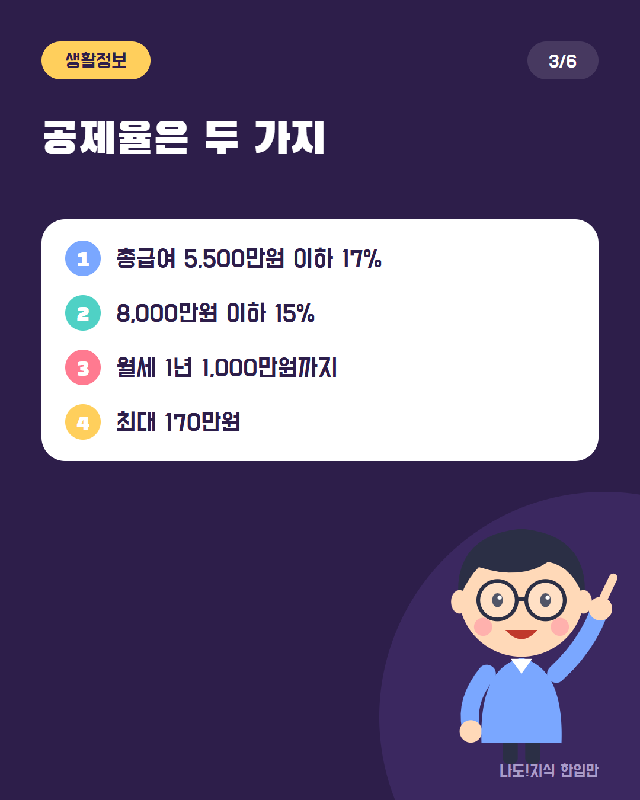
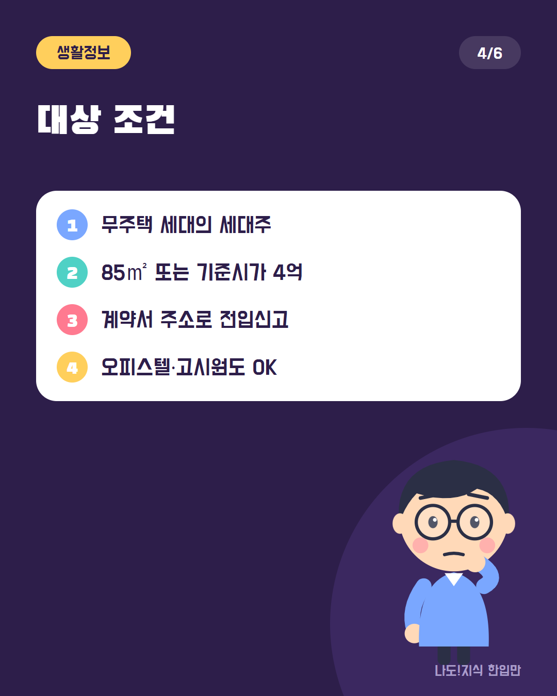
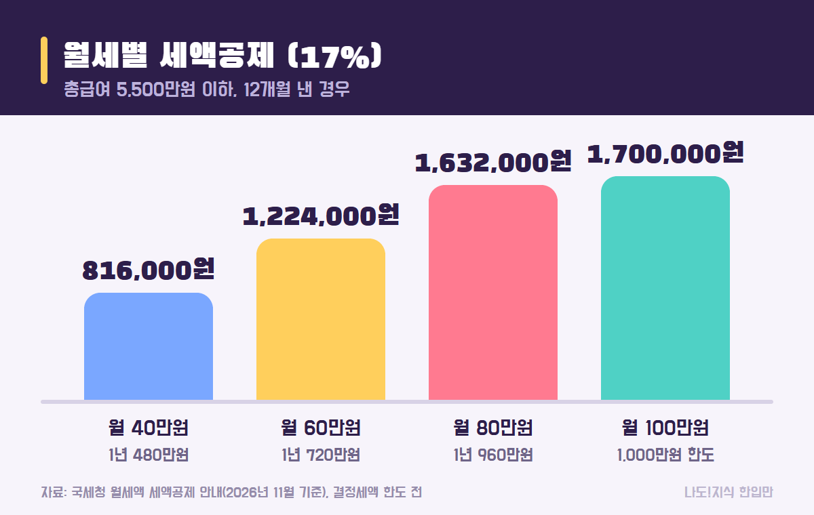
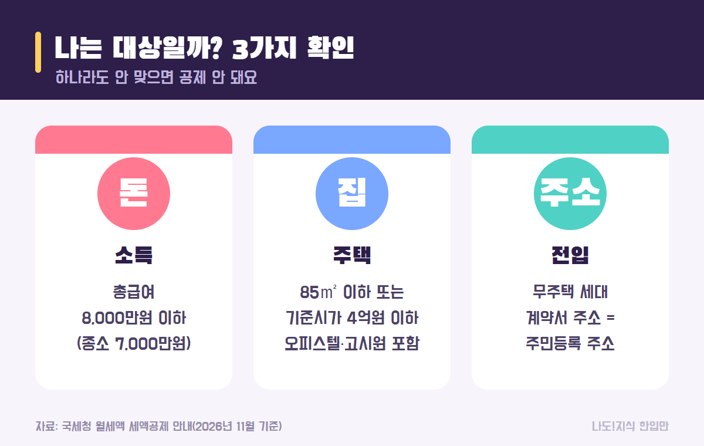
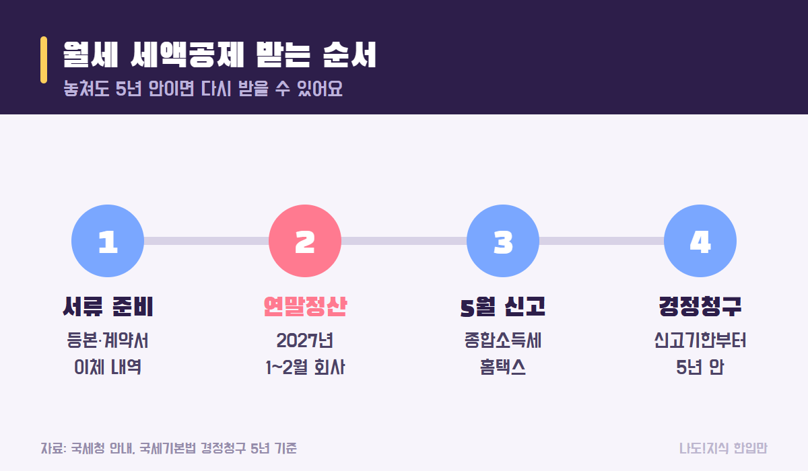

최종 검토일: 2026-11-20

월세 60만원을 내는 직장인이라면 연말정산에서 122만원 넘게 돌려받을 수 있어요. 월세 세액공제는 총급여 8,000만원 이하 무주택 세대주가 1년 동안 낸 월세의 17% 또는 15%를 세금에서 빼 주는 제도이고, 월세는 1년에 1,000만원까지 인정돼요.

2026년에 낸 월세는 2027년 초 연말정산에서 돌려받아요. 월세별로 얼마인지, 나는 대상인지, 서류는 무엇을 내는지, 놓쳤을 때 5년 안에 다시 받는 법까지 차례로 계산해 볼게요.

  <strong style="color:#2d1e4a;font-size:18px;">💡 30초 정리</strong>
  <ul style="margin:10px 0 0 0;padding-left:20px;line-height:1.9;">
    <li><b>누가:</b> 총급여 8,000만원 이하, 집이 없는 세대의 세대주(조건 맞으면 세대원)</li>
    <li><b>얼마:</b> 총급여 5,500만원 이하 17%, 8,000만원 이하 15%, 최대 170만원</li>
    <li><b>어떤 집:</b> 전용 85㎡ 이하 또는 기준시가 4억원 이하, 주거용 오피스텔·고시원 포함</li>
    <li><b>언제:</b> 2027년 1~2월 회사 연말정산, 놓치면 5월 신고나 5년 안 경정청구</li>
  </ul>

옆으로 넘겨 보세요 → (카드 6장 요약)

  <strong style="font-size:16px;">📖 처음이라면 이것만: 낱말 풀이</strong>
  <ul style="margin:8px 0 0 0;padding-left:20px;line-height:1.9;">
    <li><b>세액공제:</b> 계산된 세금에서 바로 빼 주는 금액. 소득에서 빼는 소득공제보다 효과가 눈에 잘 보여요.</li>
    <li><b>총급여:</b> 1년 동안 받은 급여 중 비과세(식대 일부 등)를 뺀 금액. 원천징수영수증 맨 위쪽 숫자예요.</li>
    <li><b>무주택 세대:</b> 주민등록상 같은 세대에 있는 사람 모두가 집을 갖고 있지 않은 세대.</li>
    <li><b>기준시가:</b> 정부가 세금 계산용으로 정해 둔 집값. 실제 거래가보다 보통 낮아요.</li>
    <li><b>경정청구:</b> 이미 낸 세금이 너무 많았다며 돌려 달라고 세무서에 요청하는 절차.</li>
  </ul>

<h2 style="border-left:6px solid #2d1e4a;padding-left:12px;margin-top:36px;">목차</h2>
<ol style="line-height:1.9;">
  <li><a href="#sec-1" style="color:inherit;text-decoration:underline;text-underline-offset:3px;">월세 세액공제는 얼마 돌려받나요?</a></li>
  <li><a href="#sec-2" style="color:inherit;text-decoration:underline;text-underline-offset:3px;">내 월급과 월세로 계산하는 법</a></li>
  <li><a href="#sec-3" style="color:inherit;text-decoration:underline;text-underline-offset:3px;">월세 세액공제 대상 조건, 나는 받을 수 있을까?</a></li>
  <li><a href="#sec-4" style="color:inherit;text-decoration:underline;text-underline-offset:3px;">연말정산 때 월세 세액공제 받는 순서</a></li>
  <li><a href="#sec-5" style="color:inherit;text-decoration:underline;text-underline-offset:3px;">놓쳤다면 5년 안에 다시 받는 방법</a></li>
  <li><a href="#sec-6" style="color:inherit;text-decoration:underline;text-underline-offset:3px;">자주 하는 실수 5가지</a></li>
  <li><a href="#sec-7" style="color:inherit;text-decoration:underline;text-underline-offset:3px;">월세 세액공제 Q&amp;A 5개</a></li>
</ol>

<h2 id="sec-1" style="scroll-margin-top:72px;border-left:6px solid #2d1e4a;padding-left:12px;margin-top:36px;">월세 세액공제는 얼마 돌려받나요?</h2>

돌려받는 돈은 1년 동안 낸 월세 × 17%(총급여 5,500만원 이하) 또는 15%(8,000만원 이하)예요. 월세는 1년에 1,000만원까지만 계산에 넣으니, 가장 많이 받아도 170만원이에요.

<table style="width:100%;border-collapse:collapse;margin:16px 0;">
  <thead>
    <tr style="background:#2d1e4a;color:#fff;"><th style="border:1px solid #ddd;padding:8px;">매달 월세</th><th style="border:1px solid #ddd;padding:8px;">1년 월세</th><th style="border:1px solid #ddd;padding:8px;">총급여 5,500만원 이하 (17%)</th><th style="border:1px solid #ddd;padding:8px;">5,500만~8,000만원 (15%)</th></tr>
  </thead>
  <tbody>
    <tr><td style="border:1px solid #ddd;padding:8px;">40만원</td><td style="border:1px solid #ddd;padding:8px;">480만원</td><td style="border:1px solid #ddd;padding:8px;">816,000원</td><td style="border:1px solid #ddd;padding:8px;">720,000원</td></tr>
    <tr><td style="border:1px solid #ddd;padding:8px;">50만원</td><td style="border:1px solid #ddd;padding:8px;">600만원</td><td style="border:1px solid #ddd;padding:8px;">1,020,000원</td><td style="border:1px solid #ddd;padding:8px;">900,000원</td></tr>
    <tr><td style="border:1px solid #ddd;padding:8px;">60만원</td><td style="border:1px solid #ddd;padding:8px;">720만원</td><td style="border:1px solid #ddd;padding:8px;"><b>1,224,000원</b></td><td style="border:1px solid #ddd;padding:8px;">1,080,000원</td></tr>
    <tr><td style="border:1px solid #ddd;padding:8px;">70만원</td><td style="border:1px solid #ddd;padding:8px;">840만원</td><td style="border:1px solid #ddd;padding:8px;">1,428,000원</td><td style="border:1px solid #ddd;padding:8px;">1,260,000원</td></tr>
    <tr><td style="border:1px solid #ddd;padding:8px;">80만원</td><td style="border:1px solid #ddd;padding:8px;">960만원</td><td style="border:1px solid #ddd;padding:8px;">1,632,000원</td><td style="border:1px solid #ddd;padding:8px;">1,440,000원</td></tr>
    <tr><td style="border:1px solid #ddd;padding:8px;">100만원</td><td style="border:1px solid #ddd;padding:8px;">1,200만원 → 1,000만원까지만</td><td style="border:1px solid #ddd;padding:8px;">1,700,000원 (최대)</td><td style="border:1px solid #ddd;padding:8px;">1,500,000원 (최대)</td></tr>
  </tbody>
</table>

<figure style="margin:24px 0;"><figcaption style="font-size:13px;color:#888;">자료: 국세청 월세액 세액공제 안내(2026년 11월 기준)로 계산, 결정세액 한도 전 금액이에요.</figcaption></figure>

한도에 걸리는 지점은 월세 약 83만 3천원(1,000만원 ÷ 12개월)이에요. 이보다 월세가 비싸도 환급액은 더 늘지 않아요.

공제율 17%는 총급여 5,500만원 이하이면서 종합소득금액 4,500만원 이하일 때 적용돼요. 근로소득만 있는 직장인이라면 총급여 기준으로 보면 돼요(<a href="https://www.nts.go.kr/nts/cm/cntnts/cntntsView.do?cntntsId=239025&amp;mi=" target="_blank" rel="noopener">국세청 월세액 세액공제 안내</a>).

<h2 id="sec-2" style="scroll-margin-top:72px;border-left:6px solid #2d1e4a;padding-left:12px;margin-top:36px;">내 월급과 월세로 계산하는 법</h2>

계산은 세 단계면 끝나요. 1년에 실제로 낸 월세(최대 1,000만원) × 내 공제율이에요.

  <strong>✍️ 상황 1: 사회초년생, 총급여 3,200만원 · 월세 55만원 · 12개월</strong> 
  ① 1년 월세: 55만원 × 12 = <b>660만원</b> 
  ② 공제율: 총급여 5,500만원 이하라서 <b>17%</b> 
  ③ 세액공제: 660만원 × 17% = <b>1,122,000원</b>

  <strong>✍️ 상황 2: 총급여 6,500만원 · 월세 85만원 · 12개월</strong> 
  ① 1년 월세: 85만원 × 12 = 1,020만원 → 한도 <b>1,000만원</b>까지만 
  ② 공제율: 5,500만원 초과 8,000만원 이하라서 <b>15%</b> 
  ③ 세액공제: 1,000만원 × 15% = <b>1,500,000원</b>

  <strong>✍️ 상황 3: 7월에 이사 와서 6개월만 냄, 총급여 4,000만원 · 월세 60만원</strong> 
  ① 1년 월세: 60만원 × 6 = <b>360만원</b> 
  ② 공제율: <b>17%</b> 
  ③ 세액공제: 360만원 × 17% = <b>612,000원</b>

여기서 꼭 알아 둘 점이 하나 있어요. 세액공제는 그해 내야 할 소득세(결정세액)에서 빼는 것이라, 낸 세금보다 많이 돌려받을 수는 없어요.

첫 월급을 받은 해처럼 세금 자체가 적으면 계산값보다 덜 돌려받을 수 있어요. 소득이 적어 세금이 거의 없다면 <a href="https://sensitiveboss3.tistory.com/entry/eitc-late-application-2026" target="_blank" rel="noopener">근로장려금 기한 후 신청</a> 쪽이 더 큰 도움이 될 수 있어요.

<h2 id="sec-3" style="scroll-margin-top:72px;border-left:6px solid #2d1e4a;padding-left:12px;margin-top:36px;">월세 세액공제 대상 조건, 나는 받을 수 있을까?</h2>

네 가지가 모두 맞아야 받아요. 소득 8,000만원 이하, 무주택 세대, 85㎡ 또는 기준시가 4억원 이하 집, 계약서 주소로 전입신고예요.

<figure style="margin:24px 0;"><figcaption style="font-size:13px;color:#888;">자료: 국세청 월세액 세액공제 안내(2026년 11월 기준)</figcaption></figure>

<table style="width:100%;border-collapse:collapse;margin:16px 0;">
  <thead>
    <tr style="background:#2d1e4a;color:#fff;"><th style="border:1px solid #ddd;padding:8px;">확인할 것</th><th style="border:1px solid #ddd;padding:8px;">받을 수 있음</th><th style="border:1px solid #ddd;padding:8px;">받을 수 없음</th></tr>
  </thead>
  <tbody>
    <tr><td style="border:1px solid #ddd;padding:8px;">소득</td><td style="border:1px solid #ddd;padding:8px;">총급여 8,000만원 이하(종합소득금액 7,000만원 이하)</td><td style="border:1px solid #ddd;padding:8px;">총급여 8,000만원 초과</td></tr>
    <tr><td style="border:1px solid #ddd;padding:8px;">세대</td><td style="border:1px solid #ddd;padding:8px;">세대 전원이 집이 없는 세대의 세대주</td><td style="border:1px solid #ddd;padding:8px;">세대원 중 한 명이라도 집이 있음</td></tr>
    <tr><td style="border:1px solid #ddd;padding:8px;">세대원이라면</td><td style="border:1px solid #ddd;padding:8px;">세대주가 주택 관련 공제를 안 받음</td><td style="border:1px solid #ddd;padding:8px;">세대주가 주택자금 공제 등을 받음</td></tr>
    <tr><td style="border:1px solid #ddd;padding:8px;">집</td><td style="border:1px solid #ddd;padding:8px;">전용 85㎡ 이하 <b>또는</b> 기준시가 4억원 이하, 주거용 오피스텔·고시원</td><td style="border:1px solid #ddd;padding:8px;">85㎡ 초과이면서 기준시가도 4억원 초과</td></tr>
    <tr><td style="border:1px solid #ddd;padding:8px;">계약·주소</td><td style="border:1px solid #ddd;padding:8px;">본인 또는 기본공제 대상자 명의 계약, 계약서 주소 = 주민등록 주소</td><td style="border:1px solid #ddd;padding:8px;">전입신고 안 함, 다른 사람 명의 계약</td></tr>
  </tbody>
</table>

집 조건은 둘 중 하나만 맞으면 돼요. 넓은 집이라도 기준시가가 4억원 이하라면 대상이에요. 수도권이 아닌 읍·면 지역은 면적 기준이 100㎡예요.

짧게 말해, 집이 없고 전입신고를 했다면 대부분 대상이에요.

<h2 id="sec-4" style="scroll-margin-top:72px;border-left:6px solid #2d1e4a;padding-left:12px;margin-top:36px;">연말정산 때 월세 세액공제 받는 순서</h2>

월세는 연말정산 간소화 자료에 저절로 잡히지 않는 경우가 많아서, 직장인은 회사 연말정산 때 서류를 직접 내야 해요. 준비물은 세 가지예요.

<ol style="line-height:2;">
  <li><b>주민등록등본 떼기:</b> <a href="https://www.gov.kr" target="_blank" rel="noopener">정부24</a>에서 무료로 발급해요. 주소와 세대주가 나와야 해요.</li>
  <li><b>임대차계약서 사본 준비:</b> 계약서의 주소가 등본 주소와 같은지 봐요.</li>
  <li><b>월세 낸 증빙 모으기:</b> 2026년 1~12월 계좌이체 내역이나 무통장입금증을 은행 앱에서 내려받아요.</li>
  <li><b>회사 연말정산 화면에 입력:</b> 2027년 1~2월 회사 안내에 따라 '월세액' 항목에 집주인 이름·주소·계약 기간·1년 월세를 적고 서류를 올려요.</li>
  <li><b>2월 급여명세서 확인:</b> 환급은 보통 2월이나 3월 급여에 함께 들어와요. 원천징수영수증에 월세액 세액공제가 찍혔는지 봐요.</li>
</ol>

<figure style="margin:24px 0;"><figcaption style="font-size:13px;color:#888;">자료: 국세청 안내, 국세기본법 경정청구 5년 기준</figcaption></figure>

연말정산을 앞두고 카드 사용액도 함께 점검하고 싶다면 <a href="https://sensitiveboss3.tistory.com/entry/year-end-tax-preview-card-deduction-2026" target="_blank" rel="noopener">연말정산 미리보기</a> 글에서 남은 기간 카드 쓰는 법을 볼 수 있어요.

<h2 id="sec-5" style="scroll-margin-top:72px;border-left:6px solid #2d1e4a;padding-left:12px;margin-top:36px;">놓쳤다면 5년 안에 다시 받는 방법</h2>

연말정산 때 빠뜨렸어도 법정 신고기한부터 5년 안에 경정청구로 돌려받을 수 있어요. 지난 몇 년 치를 한꺼번에 청구할 수도 있어요.

<ul style="line-height:2;">
  <li><b>바로 다음 5월:</b> 종합소득세 신고 기간에 <a href="https://www.hometax.go.kr" target="_blank" rel="noopener">홈택스</a>에서 월세액을 넣어 신고해요.</li>
  <li><b>그 뒤라면:</b> 홈택스 종합소득세 신고 메뉴의 경정청구로 해당 연도를 골라 신청해요.</li>
  <li><b>준비물:</b> 연말정산 때와 같아요. 등본(그때 주소가 나오는 초본이 더 좋아요), 계약서, 이체 내역.</li>
  <li><b>예:</b> 2024년에 월 50만원을 냈고 총급여가 4,000만원이었다면 600만원 × 17% = 1,020,000원을 지금이라도 청구할 수 있어요(결정세액 한도 안).</li>
</ul>

경정청구는 세무서와 나 사이의 절차라 집주인 서명이 들어가는 서류가 없어요. 이사를 이미 했어도 그때 계약서와 이체 내역만 있으면 돼요.

<h2 id="sec-6" style="scroll-margin-top:72px;border-left:6px solid #2d1e4a;padding-left:12px;margin-top:36px;">자주 하는 실수 5가지</h2>

월세 세액공제를 못 받는 이유는 대부분 서류의 주소·명의·증빙이 맞지 않아서 생겨요.

  <strong style="font-size:16px;">⚠️ 연말정산 전에 하나씩 지워 보세요</strong>
  <ol style="margin:8px 0 0 0;padding-left:20px;line-height:1.9;">
    <li><b>전입신고를 미룸</b> → 계약서 주소와 주민등록 주소가 달라 대상에서 빠져요.</li>
    <li><b>월세를 현금으로 줌</b> → 낸 사실을 보여 줄 이체 기록이 없어 증빙이 어려워요. 계좌이체로 내세요.</li>
    <li><b>관리비까지 월세로 적음</b> → 계약서에 적힌 월세액 기준으로 계산해요.</li>
    <li><b>세대주가 주택 공제를 받는데 세대원이 신청</b> → 세대원은 세대주가 주택 관련 공제를 안 받을 때만 돼요.</li>
    <li><b>놓쳤다고 포기함</b> → 5년 안이면 경정청구로 받을 수 있어요.</li>
  </ol>

연말에 세액공제를 하나 더 챙기고 싶다면 10만원까지 전액 돌려받는 <a href="https://sensitiveboss3.tistory.com/entry/hometown-donation-tax-credit-2026" target="_blank" rel="noopener">고향사랑기부제 세액공제</a>도 12월 31일 전에 함께 볼 만해요.

<h2 id="sec-7" style="scroll-margin-top:72px;border-left:6px solid #2d1e4a;padding-left:12px;margin-top:36px;">월세 세액공제 Q&amp;A 5개</h2>

  
월세 세액공제는 얼마나 돌려받나요

  
1년 동안 낸 월세에 총급여 5,500만원 이하는 17%, 8,000만원 이하는 15%를 곱한 금액이에요. 월세는 1년 1,000만원까지 인정돼서 최대 170만원(17%) 또는 150만원(15%)이에요. 월세 60만원이면 1년 720만원 × 17% = 1,224,000원이에요.

  
총급여가 8,000만원을 넘으면 못 받나요

  
네, 월세액 세액공제는 총급여 8,000만원(종합소득금액 7,000만원) 이하 근로자만 받을 수 있어요. 기준은 세금 떼기 전, 비과세를 뺀 1년 급여예요.

  
전입신고를 안 했는데 받을 수 있나요

  
받을 수 없어요. 임대차계약서의 주소와 주민등록표의 주소가 같아야 해요. 이사했다면 전입신고부터 하고, 전입한 뒤 낸 월세로 계산해요.

  
오피스텔이나 고시원 월세도 되나요

  
주거용 오피스텔과 고시원도 대상이에요. 집 조건(전용 85㎡ 이하 또는 기준시가 4억원 이하)과 전입신고 조건은 똑같이 맞아야 해요.

  
작년에 못 받은 월세 세액공제도 돌려받을 수 있나요

  
법정 신고기한부터 5년 안이면 홈택스에서 경정청구로 돌려받을 수 있어요. 그해 계약서, 주소가 나오는 등본이나 초본, 월세 이체 내역을 준비하면 돼요.

  <strong style="font-size:16px;">📚 함께 보면 좋은 글</strong>
  <ul style="margin:8px 0 0 0;padding-left:20px;line-height:1.9;"><li><a href="https://sensitiveboss3.tistory.com/entry/year-end-tax-preview-card-deduction-2026" target="_blank" rel="noopener">연말정산 미리보기 12월 18일까지</a></li><li><a href="https://sensitiveboss3.tistory.com/entry/eitc-late-application-2026" target="_blank" rel="noopener">근로장려금 기한 후 신청 12월 1일까지</a></li><li><a href="https://sensitiveboss3.tistory.com/entry/hometown-donation-tax-credit-2026" target="_blank" rel="noopener">고향사랑기부제 세액공제 2026</a></li></ul>

  참고 출처:
  <ul style="margin:6px 0 0 0;padding-left:20px;">
    <li><a href="https://www.nts.go.kr/nts/cm/cntnts/cntntsView.do?cntntsId=239025&amp;mi=" target="_blank" rel="noopener">국세청: 월세액 세액공제 안내</a></li>
    <li><a href="https://biz.sbs.co.kr/amp/article/20000137148" target="_blank" rel="noopener">SBS Biz: 월세 60만원 냈으면, 늦게라도 122만원 돌려 받으세요</a></li>
    <li><a href="https://wikidocs.net/blog/@TaxSave/27022/" target="_blank" rel="noopener">월세 세액공제 놓쳤다면 경정청구로 받는 조건과 서류(2026)</a></li>
    <li><a href="https://glasswallet.com/blog/monthly-rent-tax-credit-guide" target="_blank" rel="noopener">월세 세액공제 조건·한도 안내</a></li>
  </ul>
  기준일: 2026년 11월 20일. 금액은 결정세액 한도 전 단순 계산이에요.

세금 정보를 알기 쉽게 풀어 쓴 글이에요. 실제 공제 여부와 금액은 개인의 소득·세대·주택 상황에 따라 달라지며, 최종 판단은 국세청(국번 없이 126) 상담과 회사 연말정산 결과를 따르세요.

