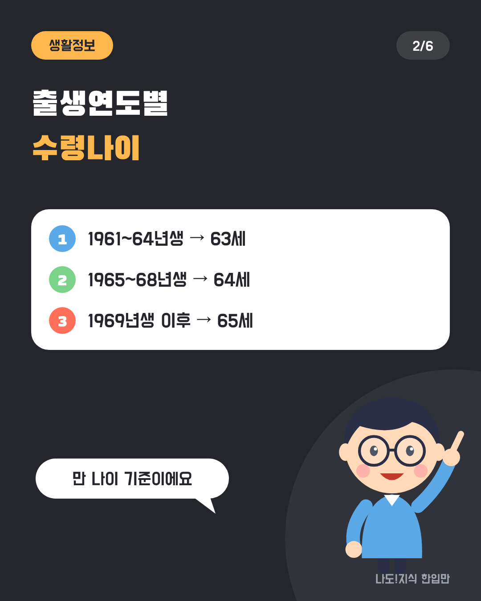
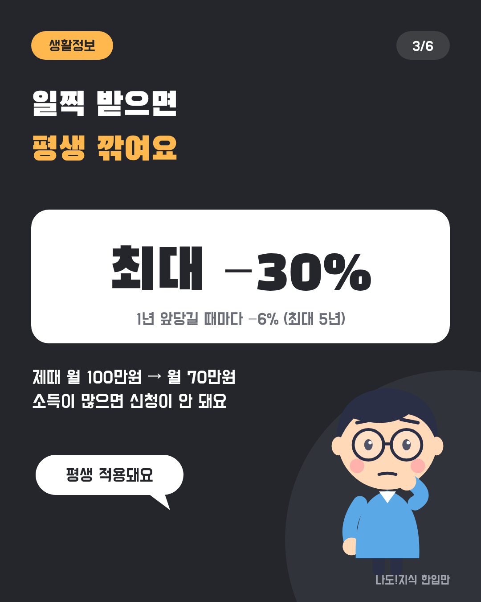
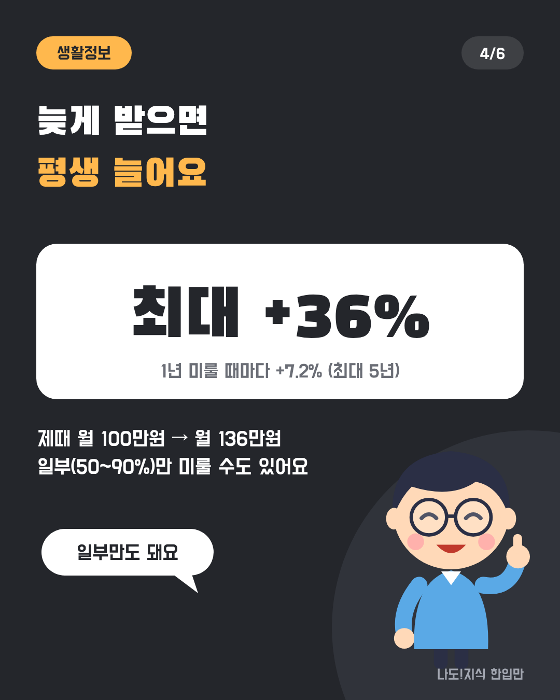
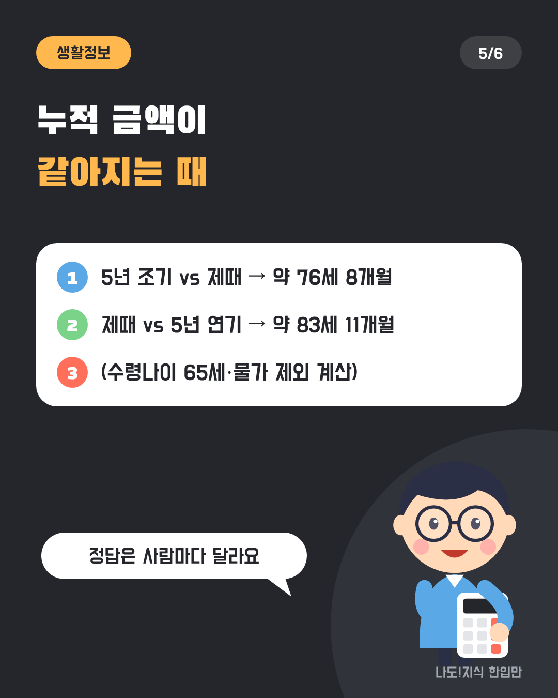
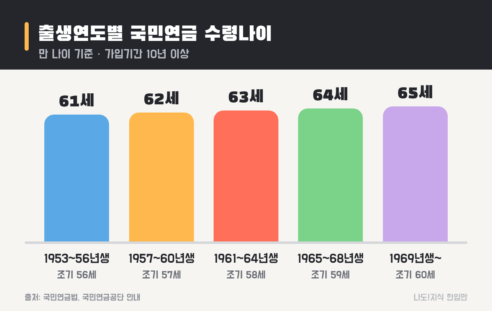
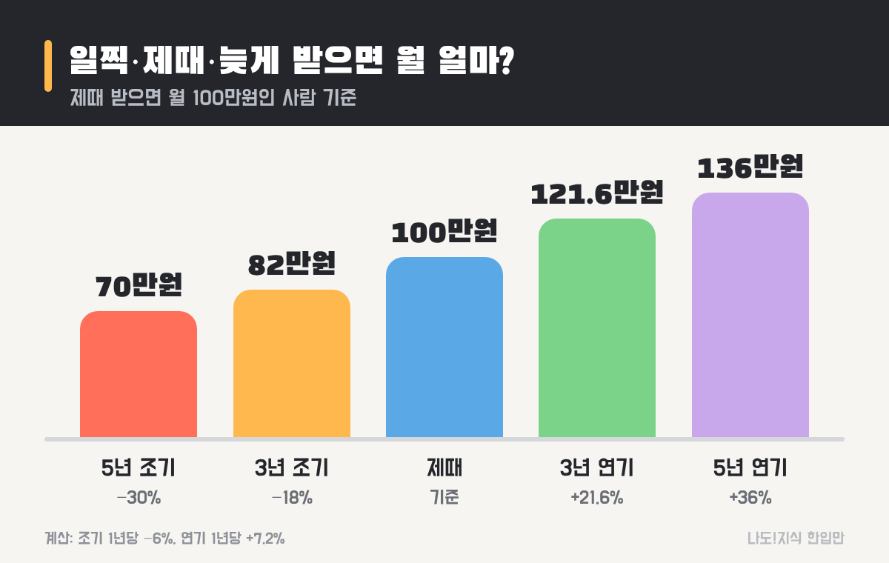
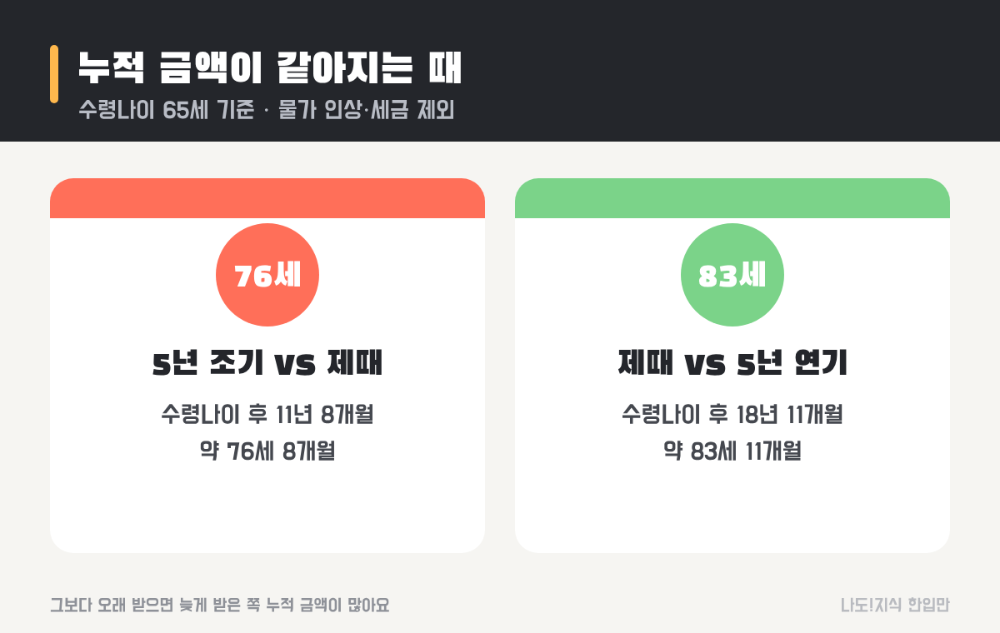

최종 검토일: 2026-11-11

국민연금 수령나이는 국민연금(노령연금)을 받기 시작할 수 있는 나이예요. 지금은 <mark>출생연도에 따라 만 63~65세</mark>로 정해져 있어요. 1961~64년생은 63세, 1965~68년생은 64세, <mark>1969년생부터는 65세</mark>예요.

여기에 선택지가 두 개 더 있어요. 최대 5년 일찍 받는 대신 깎이는 <b>조기수령</b>, 최대 5년 늦게 받는 대신 늘어나는 <b>연기</b>예요. 내 출생연도로 언제부터 받는지, 일찍 받거나 늦게 받으면 금액이 얼마나 달라지는지 같은 금액을 놓고 계산해 볼게요.

  <strong style="color:#24262b;font-size:18px;">🗓 한눈에 보기</strong>
  <ul style="margin:10px 0 0 0;padding-left:20px;line-height:1.9;">
    <li><b>누가:</b> 국민연금에 10년(120개월) 이상 가입한 사람</li>
    <li><b>언제부터:</b> 1961~64년생 63세 · 1965~68년생 64세 · 1969년생 이후 65세</li>
    <li><b>일찍 받으면:</b> 1년 앞당길 때마다 6% 감액(최대 5년, −30%)</li>
    <li><b>늦게 받으면:</b> 1년 미룰 때마다 7.2% 증액(최대 5년, +36%)</li>
    <li><b>어디서:</b> 국민연금공단 지사·누리집·앱, 문의 1355</li>
  </ul>

옆으로 넘겨 보세요 → (카드 6장 요약)

  <strong style="font-size:16px;">📖 처음이라면 이것만 — 낱말 풀이</strong>
  <ul style="margin:8px 0 0 0;padding-left:20px;line-height:1.9;">
    <li><b>노령연금:</b> 우리가 흔히 '국민연금 받는다'고 할 때의 그 연금. 나이가 되면 매달 평생 받아요.</li>
    <li><b>수급개시연령:</b> 연금을 받기 시작할 수 있는 나이. 이 글의 '수령나이'와 같은 말이에요.</li>
    <li><b>조기노령연금:</b> 정해진 나이보다 최대 5년 먼저 받는 것. 대신 평생 깎인 금액을 받아요.</li>
    <li><b>연기연금:</b> 받을 나이가 됐지만 최대 5년 미루는 것. 대신 평생 늘어난 금액을 받아요.</li>
    <li><b>가입기간:</b> 보험료를 낸 기간. 10년을 채워야 매달 받는 연금이 생겨요.</li>
  </ul>

<h2 style="border-left:6px solid #24262b;padding-left:12px;margin-top:36px;">목차</h2>
<ol style="line-height:1.9;">
  <li><a href="#sec-1" style="color:inherit;text-decoration:underline;text-underline-offset:3px;">국민연금 수령나이는 몇 살인가요?</a></li>
  <li><a href="#sec-2" style="color:inherit;text-decoration:underline;text-underline-offset:3px;">내 출생연도면 몇 년도부터 받나요?</a></li>
  <li><a href="#sec-3" style="color:inherit;text-decoration:underline;text-underline-offset:3px;">조기수령하면 얼마나 깎이나요?</a></li>
  <li><a href="#sec-4" style="color:inherit;text-decoration:underline;text-underline-offset:3px;">연기하면 얼마나 늘어나나요?</a></li>
  <li><a href="#sec-5" style="color:inherit;text-decoration:underline;text-underline-offset:3px;">일찍·제때·늦게, 누적 금액은 언제 같아지나요?</a></li>
  <li><a href="#sec-6" style="color:inherit;text-decoration:underline;text-underline-offset:3px;">내 예상 연금액 조회하고 신청하는 법</a></li>
  <li><a href="#sec-7" style="color:inherit;text-decoration:underline;text-underline-offset:3px;">자주 하는 실수 5가지</a></li>
  <li><a href="#sec-8" style="color:inherit;text-decoration:underline;text-underline-offset:3px;">국민연금 수령나이 Q&amp;A 5개</a></li>
</ol>

<h2 id="sec-1" style="scroll-margin-top:72px;border-left:6px solid #24262b;padding-left:12px;margin-top:36px;">국민연금 수령나이는 몇 살인가요?</h2>

국민연금 수령나이는 <mark>출생연도별로 만 61세에서 65세까지 단계적으로 올라가도록</mark> 법에 정해져 있어요. 예전에는 60세였는데, 2013년부터 5년마다 한 살씩 늦춰졌어요.

<figure style="margin:24px 0;"><figcaption style="font-size:13px;color:#888;">1969년 이후 출생자는 모두 65세예요.</figcaption></figure>

<table style="width:100%;border-collapse:collapse;margin:16px 0;">
  <thead>
    <tr style="background:#24262b;color:#fff;"><th style="border:1px solid #ddd;padding:8px;">출생연도</th><th style="border:1px solid #ddd;padding:8px;">수령나이(정상)</th><th style="border:1px solid #ddd;padding:8px;">조기수령 가능 나이</th></tr>
  </thead>
  <tbody>
    <tr><td style="border:1px solid #ddd;padding:8px;">1953~1956년생</td><td style="border:1px solid #ddd;padding:8px;">61세</td><td style="border:1px solid #ddd;padding:8px;">56세</td></tr>
    <tr><td style="border:1px solid #ddd;padding:8px;">1957~1960년생</td><td style="border:1px solid #ddd;padding:8px;">62세</td><td style="border:1px solid #ddd;padding:8px;">57세</td></tr>
    <tr><td style="border:1px solid #ddd;padding:8px;">1961~1964년생</td><td style="border:1px solid #ddd;padding:8px;"><mark>63세</mark></td><td style="border:1px solid #ddd;padding:8px;">58세</td></tr>
    <tr><td style="border:1px solid #ddd;padding:8px;">1965~1968년생</td><td style="border:1px solid #ddd;padding:8px;"><mark>64세</mark></td><td style="border:1px solid #ddd;padding:8px;">59세</td></tr>
    <tr><td style="border:1px solid #ddd;padding:8px;">1969년생 이후</td><td style="border:1px solid #ddd;padding:8px;"><mark>65세</mark></td><td style="border:1px solid #ddd;padding:8px;">60세</td></tr>
  </tbody>
</table>

나이는 모두 <b>만 나이</b>예요. 그리고 가입기간이 10년이 안 되면 매달 받는 연금이 아니라, 낸 돈에 이자를 더해 한 번에 돌려받는 방식(반환일시금)이 돼요. 1957~60년생을 63세로 적은 글도 있는데, 62세가 맞아요.

<h2 id="sec-2" style="scroll-margin-top:72px;border-left:6px solid #24262b;padding-left:12px;margin-top:36px;">내 출생연도면 몇 년도부터 받나요?</h2>

받기 시작하는 해는 <mark>출생연도 + 수령나이</mark>로 바로 계산돼요. 실제 지급은 생일이 지난 다음 달부터 시작돼요.

<table style="width:100%;border-collapse:collapse;margin:16px 0;">
  <thead>
    <tr style="background:#24262b;color:#fff;"><th style="border:1px solid #ddd;padding:8px;">내가 이렇다면</th><th style="border:1px solid #ddd;padding:8px;">수령나이</th><th style="border:1px solid #ddd;padding:8px;">받기 시작하는 해</th><th style="border:1px solid #ddd;padding:8px;">조기수령 가능한 해</th></tr>
  </thead>
  <tbody>
    <tr><td style="border:1px solid #ddd;padding:8px;">1963년생</td><td style="border:1px solid #ddd;padding:8px;">63세</td><td style="border:1px solid #ddd;padding:8px;"><mark>2026년</mark> (올해)</td><td style="border:1px solid #ddd;padding:8px;">2021년부터</td></tr>
    <tr><td style="border:1px solid #ddd;padding:8px;">1965년생</td><td style="border:1px solid #ddd;padding:8px;">64세</td><td style="border:1px solid #ddd;padding:8px;"><mark>2029년</mark></td><td style="border:1px solid #ddd;padding:8px;">2024년부터</td></tr>
    <tr><td style="border:1px solid #ddd;padding:8px;">1969년생</td><td style="border:1px solid #ddd;padding:8px;">65세</td><td style="border:1px solid #ddd;padding:8px;"><mark>2034년</mark></td><td style="border:1px solid #ddd;padding:8px;">2029년부터</td></tr>
    <tr><td style="border:1px solid #ddd;padding:8px;">1975년생</td><td style="border:1px solid #ddd;padding:8px;">65세</td><td style="border:1px solid #ddd;padding:8px;"><mark>2040년</mark></td><td style="border:1px solid #ddd;padding:8px;">2035년부터</td></tr>
  </tbody>
</table>

예를 들어 1965년 7월생이라면 만 64세가 되는 2029년 7월의 다음 달인 <b>2029년 8월분부터</b> 받아요. 연금은 보통 매달 25일에 들어와요.

같은 해에 태어났어도 생일이 늦으면 그만큼 늦게 시작돼요. 12월생은 다음 해 1월분부터 받게 되니, 은퇴 계획을 세울 때는 연도뿐 아니라 달까지 따져 보는 게 좋아요.

<h2 id="sec-3" style="scroll-margin-top:72px;border-left:6px solid #24262b;padding-left:12px;margin-top:36px;">조기수령하면 얼마나 깎이나요?</h2>

조기수령(조기노령연금)은 <mark>1년 앞당길 때마다 6%씩, 한 달로는 0.5%씩 깎여요.</mark> 최대 5년까지 앞당길 수 있고, 그러면 30%가 깎인 금액을 <b>평생</b> 받아요.

<figure style="margin:24px 0;"><figcaption style="font-size:13px;color:#888;">제때 받으면 월 100만원인 사람을 가정한 계산이에요.</figcaption></figure>

<table style="width:100%;border-collapse:collapse;margin:16px 0;">
  <thead>
    <tr style="background:#24262b;color:#fff;"><th style="border:1px solid #ddd;padding:8px;">앞당기는 기간</th><th style="border:1px solid #ddd;padding:8px;">감액</th><th style="border:1px solid #ddd;padding:8px;">제때 월 100만원이라면</th></tr>
  </thead>
  <tbody>
    <tr><td style="border:1px solid #ddd;padding:8px;">1년</td><td style="border:1px solid #ddd;padding:8px;">−6%</td><td style="border:1px solid #ddd;padding:8px;">월 94만원</td></tr>
    <tr><td style="border:1px solid #ddd;padding:8px;">3년</td><td style="border:1px solid #ddd;padding:8px;">−18%</td><td style="border:1px solid #ddd;padding:8px;">월 82만원</td></tr>
    <tr><td style="border:1px solid #ddd;padding:8px;">5년</td><td style="border:1px solid #ddd;padding:8px;"><mark>−30%</mark></td><td style="border:1px solid #ddd;padding:8px;"><mark>월 70만원</mark></td></tr>
  </tbody>
</table>

조기수령에는 조건이 있어요. 가입기간이 10년 이상이어야 하고, <b>일정 금액을 넘는 소득 활동을 하지 않아야</b> 해요. 소득 기준 금액은 해마다 바뀌니 신청 전에 국민연금공단(1355)에 확인해 보세요.

<h2 id="sec-4" style="scroll-margin-top:72px;border-left:6px solid #24262b;padding-left:12px;margin-top:36px;">연기하면 얼마나 늘어나나요?</h2>

연기연금은 반대로 <mark>1년 미룰 때마다 7.2%씩, 한 달로는 0.6%씩 늘어나요.</mark> 최대 5년 미루면 36%가 늘어난 금액을 평생 받아요.

<table style="width:100%;border-collapse:collapse;margin:16px 0;">
  <thead>
    <tr style="background:#24262b;color:#fff;"><th style="border:1px solid #ddd;padding:8px;">미루는 기간</th><th style="border:1px solid #ddd;padding:8px;">증액</th><th style="border:1px solid #ddd;padding:8px;">제때 월 100만원이라면</th></tr>
  </thead>
  <tbody>
    <tr><td style="border:1px solid #ddd;padding:8px;">1년</td><td style="border:1px solid #ddd;padding:8px;">+7.2%</td><td style="border:1px solid #ddd;padding:8px;">월 107만2천원</td></tr>
    <tr><td style="border:1px solid #ddd;padding:8px;">3년</td><td style="border:1px solid #ddd;padding:8px;">+21.6%</td><td style="border:1px solid #ddd;padding:8px;">월 121만6천원</td></tr>
    <tr><td style="border:1px solid #ddd;padding:8px;">5년</td><td style="border:1px solid #ddd;padding:8px;"><mark>+36%</mark></td><td style="border:1px solid #ddd;padding:8px;"><mark>월 136만원</mark></td></tr>
  </tbody>
</table>

연금 전부가 아니라 일부(50~90%)만 미루는 것도 돼요. 예를 들어 절반만 미루면, 나머지 절반은 제때 받으면서 미룬 절반만 늘어나요.

<h2 id="sec-5" style="scroll-margin-top:72px;border-left:6px solid #24262b;padding-left:12px;margin-top:36px;">일찍·제때·늦게, 누적 금액은 언제 같아지나요?</h2>

일찍 받으면 먼저 받은 만큼 앞서가지만 매달 적게 받아서, <mark>어느 시점부터는 제때 받은 쪽의 누적 금액이 더 많아져요.</mark> 그 시점을 계산해 봤어요(물가에 따른 인상과 세금은 뺀 단순 계산이에요).

<figure style="margin:24px 0;"><figcaption style="font-size:13px;color:#888;">수령나이 65세 기준으로는 약 76세 8개월, 83세 11개월이에요.</figcaption></figure>

<table style="width:100%;border-collapse:collapse;margin:16px 0;">
  <thead>
    <tr style="background:#24262b;color:#fff;"><th style="border:1px solid #ddd;padding:8px;">비교</th><th style="border:1px solid #ddd;padding:8px;">계산</th><th style="border:1px solid #ddd;padding:8px;">누적 금액이 같아지는 때</th></tr>
  </thead>
  <tbody>
    <tr><td style="border:1px solid #ddd;padding:8px;">5년 조기(70만) vs 제때(100만)</td><td style="border:1px solid #ddd;padding:8px;">먼저 받은 70만 × 60개월 = 4,200만원 ÷ 매달 차이 30만원</td><td style="border:1px solid #ddd;padding:8px;"><mark>수령나이 후 11년 8개월</mark> (65세 기준 약 76세 8개월)</td></tr>
    <tr><td style="border:1px solid #ddd;padding:8px;">제때(100만) vs 5년 연기(136만)</td><td style="border:1px solid #ddd;padding:8px;">먼저 받은 100만 × 60개월 = 6,000만원 ÷ 매달 차이 36만원 + 미룬 5년</td><td style="border:1px solid #ddd;padding:8px;"><mark>수령나이 후 18년 11개월</mark> (65세 기준 약 83세 11개월)</td></tr>
  </tbody>
</table>

그 시점보다 오래 받으면 늦게 받은 쪽이, 그 전까지만 받으면 일찍 받은 쪽이 누적 금액이 많아요. 어느 쪽이 낫다고 딱 잘라 말할 수 없는 이유예요. 건강 상태, 당장 필요한 생활비, 다른 소득이 있는지에 따라 답이 달라져요.

국민연금만으로 부족한 부분은 개인연금으로 채우기도 해요. 세금 혜택은 <a href="https://sensitiveboss3.tistory.com/entry/pension-savings-tax-credit" target="_blank" rel="noopener">연금저축 세액공제</a> 글에서 다뤘어요.

<h2 id="sec-6" style="scroll-margin-top:72px;border-left:6px solid #24262b;padding-left:12px;margin-top:36px;">내 예상 연금액 조회하고 신청하는 법</h2>

내가 받을 금액은 <mark>국민연금공단 누리집이나 '내 곁에 국민연금' 앱</mark>에서 바로 조회할 수 있어요. 메뉴 이름은 바뀔 수 있으니 비슷한 이름을 찾으면 돼요.

<ol style="line-height:2;">
  <li><a href="https://www.nps.or.kr" target="_blank" rel="noopener">국민연금공단 누리집(nps.or.kr)</a> 또는 '내 곁에 국민연금' 앱에 간편인증으로 로그인해요.</li>
  <li><b>[내 연금 알아보기]</b> → <b>[예상연금액 조회]</b>를 눌러요.</li>
  <li>지금까지 낸 기간과, 60세까지 계속 낼 때의 예상 월 연금액이 나와요.</li>
  <li>조기수령·연기를 했을 때 금액도 같은 화면 근처에서 모의계산할 수 있어요.</li>
  <li>받을 나이가 가까워지면 공단에서 안내문이 와요. <b>청구(신청)는 본인이 해야 지급이 시작</b>돼요. 지사 방문, 우편, 누리집·앱으로 할 수 있어요.</li>
</ol>

연금은 나이가 됐다고 자동으로 들어오지 않아요. 청구하지 않고 오래 두면 받을 권리가 시효로 사라질 수 있으니, 안내문을 받으면 바로 청구하세요. 궁금한 점은 국민연금 콜센터 <b>1355</b>로 물어보면 돼요.

<h2 id="sec-7" style="scroll-margin-top:72px;border-left:6px solid #24262b;padding-left:12px;margin-top:36px;">자주 하는 실수 5가지</h2>

국민연금에서 손해를 보는 경우는 대부분 <mark>나이와 감액을 잘못 알고 결정해서</mark> 생겨요. 아래 다섯 가지만 확인하세요.

  <strong style="font-size:16px;">⚠️ 이것만 피하세요</strong>
  <ol style="margin:8px 0 0 0;padding-left:20px;line-height:1.9;">
    <li><b>"60세부터 받는다"고 알고 있기</b> → 지금은 63~65세예요. 60세는 보험료를 내는 의무가 끝나는 나이예요.</li>
    <li><b>조기수령 감액이 몇 년만 적용된다고 생각하기</b> → 깎인 금액을 평생 받아요. 나중에 원래 금액으로 돌아오지 않아요.</li>
    <li><b>일하면서 조기수령 신청하기</b> → 소득이 기준을 넘으면 신청이 안 되거나 지급이 멈출 수 있어요.</li>
    <li><b>청구를 안 하고 기다리기</b> → 자동 지급이 아니에요. 청구해야 받아요.</li>
    <li><b>가입기간 10년을 못 채우고 그만두기</b> → 매달 받는 연금이 아니라 일시금으로 끝나요. 모자란 기간을 채우는 방법(임의계속가입·추후납부)이 있으니 공단에 물어보세요.</li>
  </ol>

<h2 id="sec-8" style="scroll-margin-top:72px;border-left:6px solid #24262b;padding-left:12px;margin-top:36px;">국민연금 수령나이 Q&amp;A 5개</h2>

  
국민연금은 몇 살부터 받나요

  
출생연도에 따라 달라요. 1961~64년생은 만 63세, 1965~68년생은 만 64세, 1969년생 이후는 만 65세부터 받아요. 가입기간이 10년 이상이어야 해요.

  
1969년생은 국민연금을 언제부터 받나요

  
만 65세가 되는 2034년부터 받아요. 생일이 지난 다음 달분부터 지급되고, 조기수령은 만 60세인 2029년부터 신청할 수 있어요.

  
국민연금 조기수령하면 얼마나 깎이나요

  
1년 앞당길 때마다 6%(한 달 0.5%)씩 깎여요. 최대 5년 앞당기면 30%가 깎여서, 제때 월 100만원인 사람은 평생 월 70만원을 받아요.

  
국민연금을 늦게 받으면 얼마나 늘어나나요

  
1년 미룰 때마다 7.2%(한 달 0.6%)씩 늘어요. 최대 5년 미루면 36%가 늘어서, 제때 월 100만원인 사람은 월 136만원을 받아요. 일부(50~90%)만 미룰 수도 있어요.

  
조기수령과 제때 받는 것 중 누적 금액은 언제 같아지나요

  
5년 조기수령(70%)과 제때 받는 경우는 정상 수령나이 후 약 11년 8개월에 누적 금액이 같아져요. 수령나이가 65세라면 약 76세 8개월이에요. 물가 인상과 세금을 뺀 단순 계산이에요.

  <strong style="font-size:16px;">📚 함께 보면 좋은 글</strong>
  <ul style="margin:8px 0 0 0;padding-left:20px;line-height:1.9;"><li><a href="https://sensitiveboss3.tistory.com/entry/pension-savings-tax-credit" target="_blank" rel="noopener">연금저축 세액공제 얼마 돌려받나</a></li><li><a href="https://sensitiveboss3.tistory.com/entry/irp-isa-account-difference" target="_blank" rel="noopener">IRP ISA 차이 세액공제 인출조건 비교</a></li><li><a href="https://sensitiveboss3.tistory.com/entry/retirement-pension-db-dc-difference" target="_blank" rel="noopener">퇴직연금 DB DC 차이</a></li></ul>

  참고 출처:
  <ul style="margin:6px 0 0 0;padding-left:20px;">
    <li><a href="https://www.npsonair.kr/advantages/detail.html?strIdx=3553" target="_blank" rel="noopener">국민연금 온에어: 조기노령연금과 연기연금</a></li>
    <li><a href="https://www.newsnnet.com/news/articleView.html?idxno=30900" target="_blank" rel="noopener">뉴스앤넷: 국민연금 수령나이 총정리 Q&amp;A</a></li>
    <li><a href="https://www.retireguide.co.kr/blog/old-age-pension-eligibility" target="_blank" rel="noopener">은퇴가이드: 노령연금 수급 자격, 출생연도별 수급 나이</a></li>
    <li><a href="https://www.law.go.kr/법령/국민연금법" target="_blank" rel="noopener">국가법령정보센터: 국민연금법(노령연금·조기노령연금·연기연금)</a></li>
  </ul>
  기준일: 2026년 11월 11일. 누적 금액 계산은 물가 인상·세금을 뺀 단순 계산이에요.

정보 제공을 목적으로 쓴 글이며, 조기수령·연기 중 어느 쪽을 권하지 않아요. 개인별 수령나이와 금액은 국민연금공단(1355) 조회 결과가 기준이에요.

