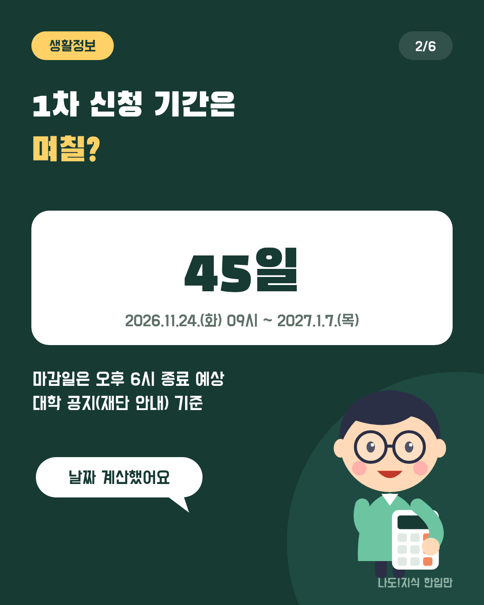
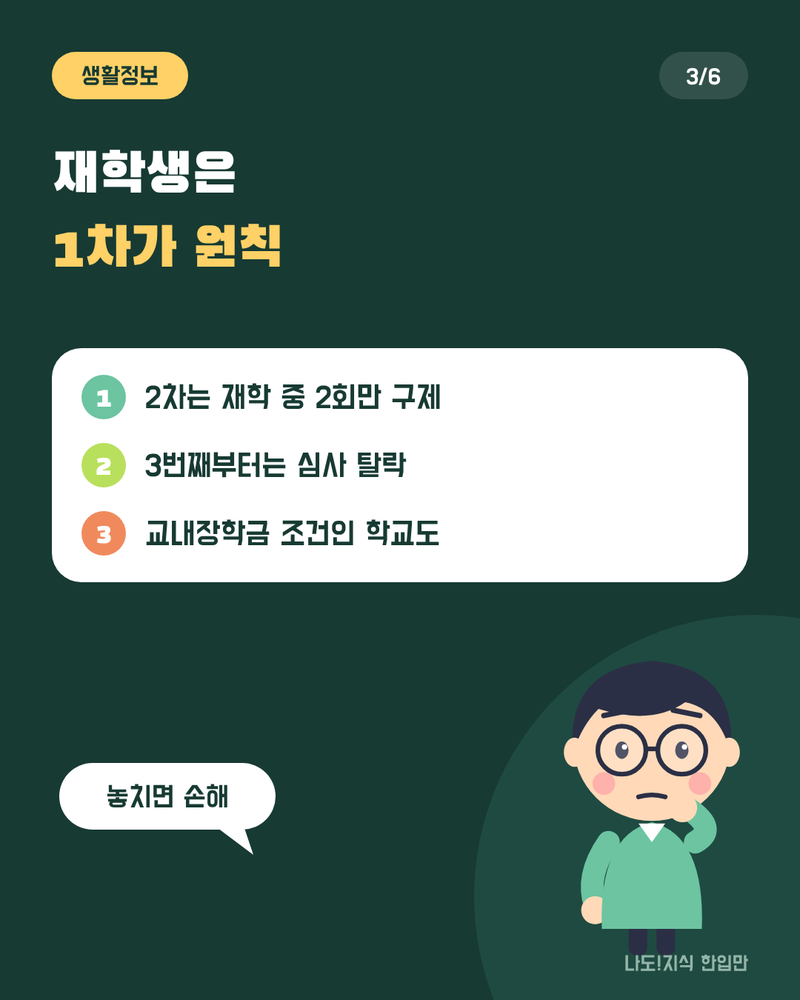
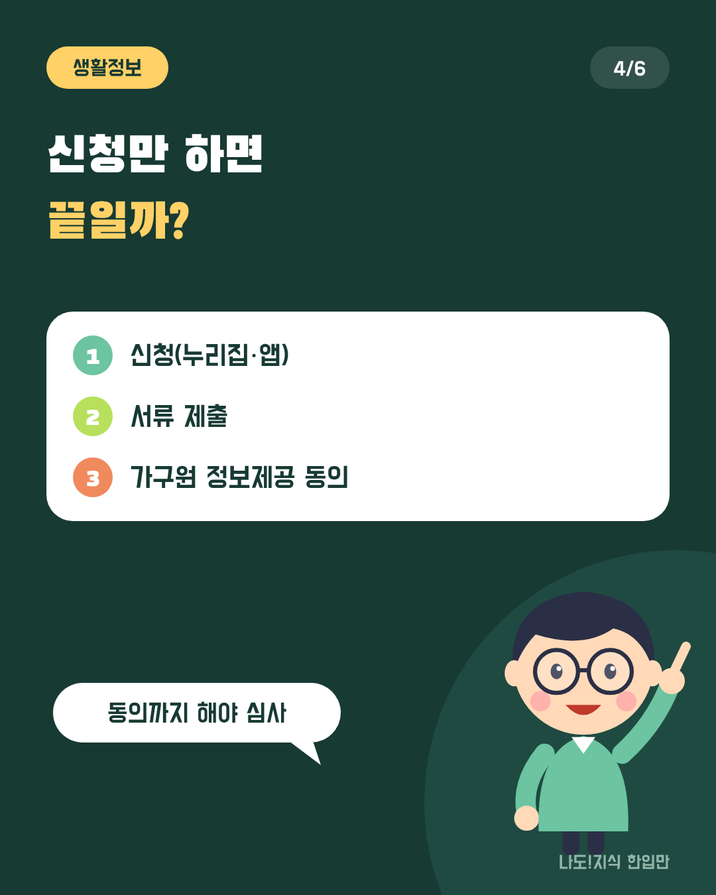
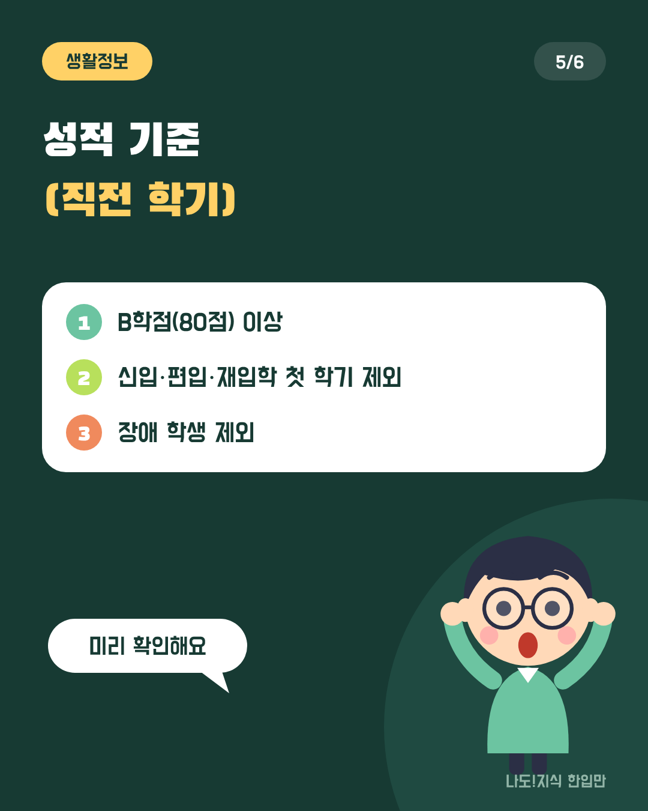
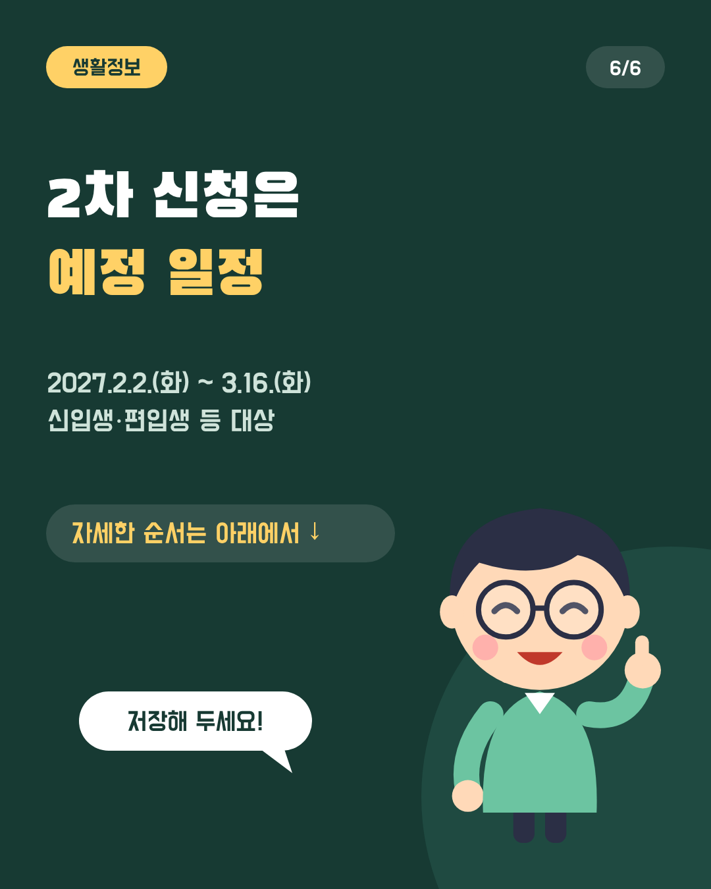
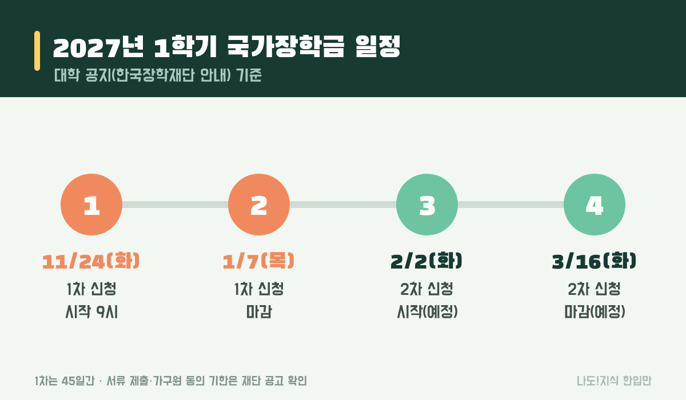
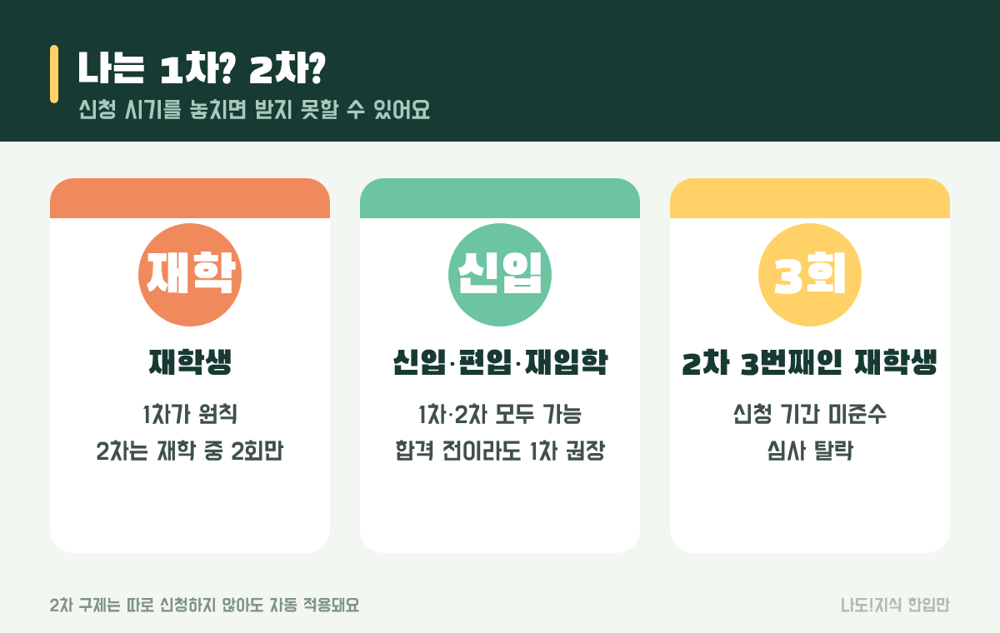
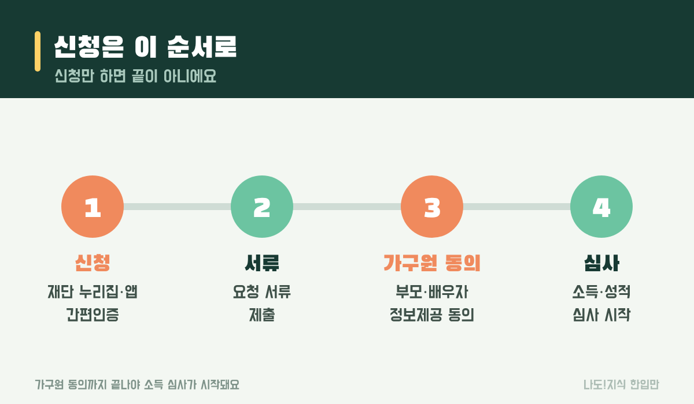

최종 검토일: 2026-11-18

국가장학금 신청기간은 2027년 1학기 1차 기준으로 2026년 11월 24일(화) 오전 9시부터 2027년 1월 7일(목)까지, 45일간이에요. 여러 대학이 한국장학재단 안내를 인용해 같은 일정을 공지했어요.

재학생은 1차에 신청하는 게 원칙이라, 이 기간을 놓치면 장학금을 못 받을 수도 있어요. 날짜, 누가 1차에 꼭 해야 하는지, 신청부터 가구원 동의까지 순서를 차례로 정리할게요.

  <strong style="color:#173a33;font-size:18px;">🎓 한눈에 보기</strong>
  <ul style="margin:10px 0 0 0;padding-left:20px;line-height:1.9;">
    <li><b>1차 신청:</b> 2026.11.24.(화) 09시 ~ 2027.1.7.(목), 45일간</li>
    <li><b>2차 신청(예정):</b> 2027.2.2.(화) ~ 3.16.(화)</li>
    <li><b>재학생:</b> 1차가 원칙, 2차는 재학 중 2회까지만 구제</li>
    <li><b>순서:</b> 신청 → 서류 제출 → 가구원 동의 → 심사</li>
    <li><b>성적:</b> 직전 학기 B학점 이상(신입생 등 첫 학기 제외)</li>
  </ul>

옆으로 넘겨 보세요 → (카드 6장 요약)

  <strong style="font-size:16px;">📖 처음이라면 이것만 — 낱말 풀이</strong>
  <ul style="margin:8px 0 0 0;padding-left:20px;line-height:1.9;">
    <li><b>국가장학금(Ⅰ유형):</b> 가구 소득에 따라 나라가 등록금을 지원하는 장학금. 한국장학재단에서 신청해요.</li>
    <li><b>1차·2차 신청:</b> 학기마다 두 번 받는 신청 기간. 재학생은 1차, 신입생 등은 1·2차 모두 가능해요.</li>
    <li><b>2차 구제:</b> 1차를 놓친 재학생에게 재학 중 2번까지 2차 신청을 인정해 주는 것.</li>
    <li><b>가구원 정보제공 동의:</b> 부모나 배우자가 소득·재산 정보를 조회해도 된다고 동의하는 절차.</li>
    <li><b>지원구간:</b> 가구 소득과 재산으로 정해지는 등급. 이 구간에 따라 받는 금액이 달라져요.</li>
  </ul>

<h2 style="border-left:6px solid #173a33;padding-left:12px;margin-top:36px;">목차</h2>
<ol style="line-height:1.9;">
  <li><a href="#sec-1" style="color:inherit;text-decoration:underline;text-underline-offset:3px;">2027년 1학기 국가장학금 1차 신청은 언제인가요?</a></li>
  <li><a href="#sec-2" style="color:inherit;text-decoration:underline;text-underline-offset:3px;">재학생은 왜 1차에 꼭 신청해야 하나요?</a></li>
  <li><a href="#sec-3" style="color:inherit;text-decoration:underline;text-underline-offset:3px;">신입생·편입생은 언제 신청하나요?</a></li>
  <li><a href="#sec-4" style="color:inherit;text-decoration:underline;text-underline-offset:3px;">국가장학금은 어떤 순서로 신청하나요?</a></li>
  <li><a href="#sec-5" style="color:inherit;text-decoration:underline;text-underline-offset:3px;">가구원 동의는 왜 해야 하나요?</a></li>
  <li><a href="#sec-6" style="color:inherit;text-decoration:underline;text-underline-offset:3px;">성적 기준은 어떻게 되나요?</a></li>
  <li><a href="#sec-7" style="color:inherit;text-decoration:underline;text-underline-offset:3px;">자주 하는 실수 5가지</a></li>
  <li><a href="#sec-8" style="color:inherit;text-decoration:underline;text-underline-offset:3px;">국가장학금 1차 신청 Q&amp;A 5개</a></li>
</ol>

<h2 id="sec-1" style="scroll-margin-top:72px;border-left:6px solid #173a33;padding-left:12px;margin-top:36px;">2027년 1학기 국가장학금 1차 신청은 언제인가요?</h2>

2027년 1학기 국가장학금 1차 신청은 2026년 11월 24일(화) 오전 9시에 시작해 2027년 1월 7일(목)에 마감돼요. 첫날과 마지막 날을 모두 넣으면 45일이에요.

<figure style="margin:24px 0;"><figcaption style="font-size:13px;color:#888;">대학 공지(한국장학재단 안내 인용) 기준이에요. 서류 제출·가구원 동의 기한은 재단 공고를 함께 확인하세요.</figcaption></figure>

<table style="width:100%;border-collapse:collapse;margin:16px 0;">
  <thead>
    <tr style="background:#173a33;color:#fff;"><th style="border:1px solid #ddd;padding:8px;">구분</th><th style="border:1px solid #ddd;padding:8px;">기간</th><th style="border:1px solid #ddd;padding:8px;">비고</th></tr>
  </thead>
  <tbody>
    <tr><td style="border:1px solid #ddd;padding:8px;">1차 신청</td><td style="border:1px solid #ddd;padding:8px;"><b>2026.11.24.(화) 09시 ~ 2027.1.7.(목)</b></td><td style="border:1px solid #ddd;padding:8px;">재학생은 이 기간이 원칙</td></tr>
    <tr><td style="border:1px solid #ddd;padding:8px;">2차 신청(예정)</td><td style="border:1px solid #ddd;padding:8px;">2027.2.2.(화) ~ 3.16.(화)</td><td style="border:1px solid #ddd;padding:8px;">신입·편입·재입학·복학생, 구제 대상 재학생</td></tr>
    <tr><td style="border:1px solid #ddd;padding:8px;">서류 제출·가구원 동의</td><td style="border:1px solid #ddd;padding:8px;">재단 공고로 확정</td><td style="border:1px solid #ddd;padding:8px;">신청 기간보다 조금 늦게 끝나는 경우가 많아요</td></tr>
  </tbody>
</table>

지난 학기에는 주말과 공휴일에도 24시간 신청할 수 있었고, 마감일만 오후 6시에 끝났어요. 이번에도 마감일 저녁에는 접속이 몰리니, 마지막 주가 아니라 첫 주에 끝내 두는 게 안전해요. 예를 들어 11월 18일 기준으로 신청 시작까지는 6일 남았고, 시작일부터 마감일까지는 주말과 연말 연휴를 모두 포함해 45일이에요. 기말고사와 겨울방학이 겹치는 시기라, 시작 주에 신청하고 그다음 주에 서류와 가구원 동의까지 마치는 식으로 2주 안에 끝내 두면 마감 직전에 서두를 일이 없어요. 일정은 대학 공지를 기준으로 썼고, 정확한 마감 시각과 서류·동의 기한은 <a href="https://www.kosaf.go.kr" target="_blank" rel="noopener">한국장학재단 누리집(kosaf.go.kr)</a> 공지가 기준이에요.

<h2 id="sec-2" style="scroll-margin-top:72px;border-left:6px solid #173a33;padding-left:12px;margin-top:36px;">재학생은 왜 1차에 꼭 신청해야 하나요?</h2>

재학생은 1차 신청이 원칙이고, 2차 신청은 재학 중 2번까지만 구제돼요. 1차를 놓쳐도 바로 탈락은 아니지만, 구제 기회를 한 번 써 버리는 셈이에요.

<figure style="margin:24px 0;"><figcaption style="font-size:13px;color:#888;">2차 구제는 따로 신청하지 않아도 자동 적용돼요.</figcaption></figure>

<table style="width:100%;border-collapse:collapse;margin:16px 0;">
  <thead>
    <tr style="background:#173a33;color:#fff;"><th style="border:1px solid #ddd;padding:8px;">내 상황</th><th style="border:1px solid #ddd;padding:8px;">1차</th><th style="border:1px solid #ddd;padding:8px;">2차</th></tr>
  </thead>
  <tbody>
    <tr><td style="border:1px solid #ddd;padding:8px;">재학생(2차 구제 사용 0~1회)</td><td style="border:1px solid #ddd;padding:8px;"><b>원칙</b></td><td style="border:1px solid #ddd;padding:8px;">가능(구제 1회 사용)</td></tr>
    <tr><td style="border:1px solid #ddd;padding:8px;">재학생(이미 2회 사용)</td><td style="border:1px solid #ddd;padding:8px;"><b>반드시 1차</b></td><td style="border:1px solid #ddd;padding:8px;">신청 기간 미준수로 탈락</td></tr>
    <tr><td style="border:1px solid #ddd;padding:8px;">신입생·편입생·재입학생</td><td style="border:1px solid #ddd;padding:8px;">가능</td><td style="border:1px solid #ddd;padding:8px;">가능</td></tr>
    <tr><td style="border:1px solid #ddd;padding:8px;">복학생</td><td style="border:1px solid #ddd;padding:8px;">가능</td><td style="border:1px solid #ddd;padding:8px;">가능</td></tr>
  </tbody>
</table>

구제는 따로 신청하지 않아도 2차에 신청하면 자동으로 적용돼요. 그래서 내가 몇 번 썼는지 모르고 지나가기 쉬워요. 그리고 교내장학금을 받을 때 "국가장학금 1차 신청"을 조건으로 거는 학교도 있어서, 2차로 미루면 교내장학금까지 놓칠 수 있어요.

<h2 id="sec-3" style="scroll-margin-top:72px;border-left:6px solid #173a33;padding-left:12px;margin-top:36px;">신입생·편입생은 언제 신청하나요?</h2>

신입생·편입생·재입학생은 1차와 2차 모두 신청할 수 있어요. 다만 합격 발표 전이라도 1차에 미리 신청해 두는 걸 권해요.

1차에 신청하면 소득 심사가 일찍 끝나서, 등록금 고지서에 장학금이 미리 빠진 금액으로 나오는 경우가 많아요. 2차에 신청하면 일단 등록금을 다 낸 뒤 나중에 돌려받는 방식이 될 수 있어요. 아직 대학이 정해지지 않았어도 1차 신청은 할 수 있으니, 수시 합격 여부와 상관없이 먼저 해 두면 편해요.

<h2 id="sec-4" style="scroll-margin-top:72px;border-left:6px solid #173a33;padding-left:12px;margin-top:36px;">국가장학금은 어떤 순서로 신청하나요?</h2>

국가장학금은 신청 → 서류 제출 → 가구원 동의 → 심사 순서로 진행돼요. 신청 버튼만 누르고 끝내면 심사가 시작되지 않아요.

<figure style="margin:24px 0;"><figcaption style="font-size:13px;color:#888;">가구원 동의까지 끝나야 소득 심사가 시작돼요.</figcaption></figure>

<ol style="line-height:2;">
  <li><b>신청:</b> 한국장학재단 누리집이나 앱에서 간편인증으로 로그인한 뒤 국가장학금을 신청해요.</li>
  <li><b>서류 확인:</b> 신청 뒤 '서류제출 대상'인지 확인해요. 대상이면 요청한 서류를 기한 안에 올려요.</li>
  <li><b>가구원 동의:</b> 부모(미혼) 또는 배우자(기혼)가 각자 정보제공 동의를 해야 해요.</li>
  <li><b>진행 확인:</b> 누리집의 심사 진행 상황에서 '가구원 동의 완료'가 떴는지 봐요.</li>
  <li><b>결과 확인:</b> 지원구간이 나오면 받을 금액을 확인하고, 다른 장학금과 겹치는지 학교 공지를 봐요. 결과에 이의가 있으면 재단 안내에 따라 이의 신청을 할 수 있어요.</li>
</ol>

지원구간과 금액은 소득·재산 심사 뒤에 나와요. 2027년 1학기부터 구간 체계가 바뀐다는 안내도 있으니, 금액은 결과가 나온 뒤 재단 화면에서 확인하는 게 가장 정확해요.

<h2 id="sec-5" style="scroll-margin-top:72px;border-left:6px solid #173a33;padding-left:12px;margin-top:36px;">가구원 동의는 왜 해야 하나요?</h2>

가구원 동의는 부모나 배우자의 소득·재산을 조회해도 된다는 동의예요. 국가장학금은 가구 소득으로 지원구간을 정하기 때문에, 이 동의가 없으면 심사를 시작할 수 없어요.

<table style="width:100%;border-collapse:collapse;margin:16px 0;">
  <thead>
    <tr style="background:#173a33;color:#fff;"><th style="border:1px solid #ddd;padding:8px;">학생 상황</th><th style="border:1px solid #ddd;padding:8px;">동의해야 하는 사람</th></tr>
  </thead>
  <tbody>
    <tr><td style="border:1px solid #ddd;padding:8px;">미혼</td><td style="border:1px solid #ddd;padding:8px;">부모(각각)</td></tr>
    <tr><td style="border:1px solid #ddd;padding:8px;">기혼</td><td style="border:1px solid #ddd;padding:8px;">배우자</td></tr>
    <tr><td style="border:1px solid #ddd;padding:8px;">부모가 이혼·사망 등</td><td style="border:1px solid #ddd;padding:8px;">재단 안내에 따라 예외 처리 신청</td></tr>
  </tbody>
</table>

부모가 떨어져 살거나 바빠서 동의를 미루면 신청을 해 놓고도 탈락할 수 있어요. 신청한 날 바로 가족에게 동의를 부탁하고, 동의 완료 표시까지 확인해 두세요. 가족이 휴대폰으로 재단 앱에 접속해 간편인증으로 동의하면 몇 분이면 끝나니, 미리 방법을 알려 드리면 좋아요.

<h2 id="sec-6" style="scroll-margin-top:72px;border-left:6px solid #173a33;padding-left:12px;margin-top:36px;">성적 기준은 어떻게 되나요?</h2>

성적 기준은 직전 학기 B학점(80점) 이상이에요. 신입생·편입생·재입학생의 첫 학기와 장애 학생은 이 기준을 적용하지 않아요.

성적은 신청할 때가 아니라 심사할 때 반영되니, 2026년 2학기 성적이 나오기 전에 신청해도 괜찮아요. 저소득 구간에는 성적 기준을 조금 낮게 보는 예외가 있을 수 있어서, 기준에 조금 못 미치더라도 신청은 해 두는 게 좋아요.

장학금 외에 청년 대상 돈 관리도 함께 챙기고 싶다면 <a href="https://sensitiveboss3.tistory.com/entry/youth-future-savings-account-opening-2026" target="_blank" rel="noopener">청년미래적금 2차 계좌 개설</a> 글도 참고해 보세요. 아르바이트를 한다면 <a href="https://sensitiveboss3.tistory.com/entry/eitc-late-application-2026" target="_blank" rel="noopener">근로장려금 기한 후 신청</a>도 확인해 볼 만해요.

<h2 id="sec-7" style="scroll-margin-top:72px;border-left:6px solid #173a33;padding-left:12px;margin-top:36px;">자주 하는 실수 5가지</h2>

국가장학금을 놓치는 경우는 대부분 신청 기간이나 후속 절차를 놓쳐서 생겨요.

  <strong style="font-size:16px;">⚠️ 이것만 피하세요</strong>
  <ol style="margin:8px 0 0 0;padding-left:20px;line-height:1.9;">
    <li><b>지난 학기에 받았으니 자동이라고 생각하기</b> → 학기마다 새로 신청해야 해요.</li>
    <li><b>재학생인데 2차로 미루기</b> → 2차 구제는 재학 중 2번뿐이에요.</li>
    <li><b>신청만 하고 가구원 동의를 잊기</b> → 동의가 끝나야 심사가 시작돼요.</li>
    <li><b>마감일 저녁에 신청하기</b> → 마감일은 오후 6시에 끝날 수 있고, 접속이 몰려요.</li>
    <li><b>교내장학금 조건을 확인하지 않기</b> → 1차 신청을 조건으로 거는 학교가 있어요.</li>
  </ol>

<h2 id="sec-8" style="scroll-margin-top:72px;border-left:6px solid #173a33;padding-left:12px;margin-top:36px;">국가장학금 1차 신청 Q&amp;A 5개</h2>

  
2027년 1학기 국가장학금 1차 신청기간은 언제인가요

  
대학들이 게시한 한국장학재단 안내 기준으로 2026년 11월 24일(화) 오전 9시부터 2027년 1월 7일(목)까지, 45일간이에요. 서류 제출과 가구원 동의 기한은 재단 공고를 함께 확인해야 해요.

  
재학생이 1차를 놓치면 국가장학금을 못 받나요

  
재학생은 1차 신청이 원칙이지만, 재학 중 2회까지는 2차 신청이 구제돼요. 구제는 따로 신청하지 않아도 자동 적용되고, 2회를 다 쓴 뒤 2차에 신청하면 심사에서 탈락해요.

  
신입생도 1차에 신청할 수 있나요

  
네. 신입생·편입생·재입학생은 1차와 2차 모두 신청할 수 있어요. 합격 발표 전이라도 1차에 미리 신청해 두면 서류와 가구원 동의를 여유 있게 마칠 수 있어요.

  
국가장학금 가구원 동의는 누가 하나요

  
미혼이면 부모, 기혼이면 배우자가 정보제공에 동의해야 해요. 가구원 동의까지 끝나야 소득 심사가 시작되니 신청 직후 바로 요청하는 게 좋아요.

  
국가장학금 성적 기준은 어떻게 되나요

  
직전 학기 성적이 B학점(80점) 이상이어야 해요. 신입생·편입생·재입학생의 첫 학기와 장애 학생은 이 기준을 적용하지 않아요.

  <strong style="font-size:16px;">📚 함께 보면 좋은 글</strong>
  <ul style="margin:8px 0 0 0;padding-left:20px;line-height:1.9;"><li><a href="https://sensitiveboss3.tistory.com/entry/youth-future-savings-account-opening-2026" target="_blank" rel="noopener">청년미래적금 2차 계좌 개설</a></li><li><a href="https://sensitiveboss3.tistory.com/entry/eitc-late-application-2026" target="_blank" rel="noopener">근로장려금 기한 후 신청 12월 1일까지</a></li><li><a href="https://sensitiveboss3.tistory.com/entry/culture-nuri-card-2026-deadline" target="_blank" rel="noopener">문화누리카드 2026 신청·사용 마감</a></li></ul>

  참고 출처:
  <ul style="margin:6px 0 0 0;padding-left:20px;">
    <li><a href="https://www.konyang.ac.kr/cop/bbs/BBSMSTR_000000000585/selectBoardArticle.do?nttId=296010" target="_blank" rel="noopener">건양대학교 공지: 한국장학재단 2027년 1학기 1차 신청기간 안내</a></li>
    <li><a href="https://tilnote.io/en/pages/6aea0537010a5c47f5206405" target="_blank" rel="noopener">국립한국해양대 공지 인용: 1차 11.24.~1.7., 2차 2.2.~3.16.</a></li>
    <li><a href="https://www.korea.kr/news/policyNewsView.do?newsId=148932519" target="_blank" rel="noopener">정책브리핑: 국가장학금 2차 신청 대상·재학생 2회 구제</a></li>
    <li><a href="https://www.bokjiro.go.kr/ssis-tbu/cms/pc/news/promotion/1308421_1118.html" target="_blank" rel="noopener">복지로: 국가장학금 2차 신청 안내</a></li>
  </ul>
  기준일: 2026년 11월 18일. 서류 제출·가구원 동의 기한과 지원 금액은 한국장학재단 공고가 기준이에요.

정보 제공을 목적으로 쓴 글이에요. 신청 자격과 지원 금액은 한국장학재단(1599-2000) 심사 결과가 기준이에요.

