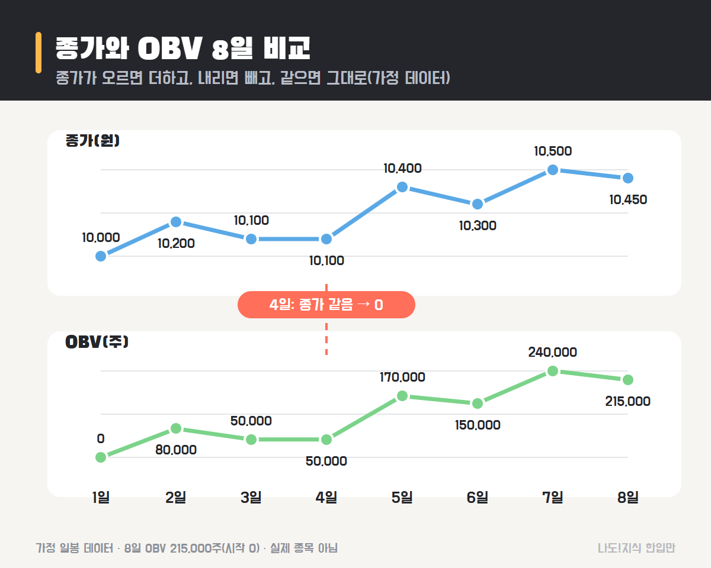
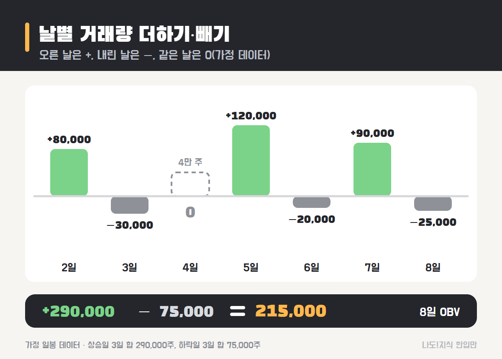
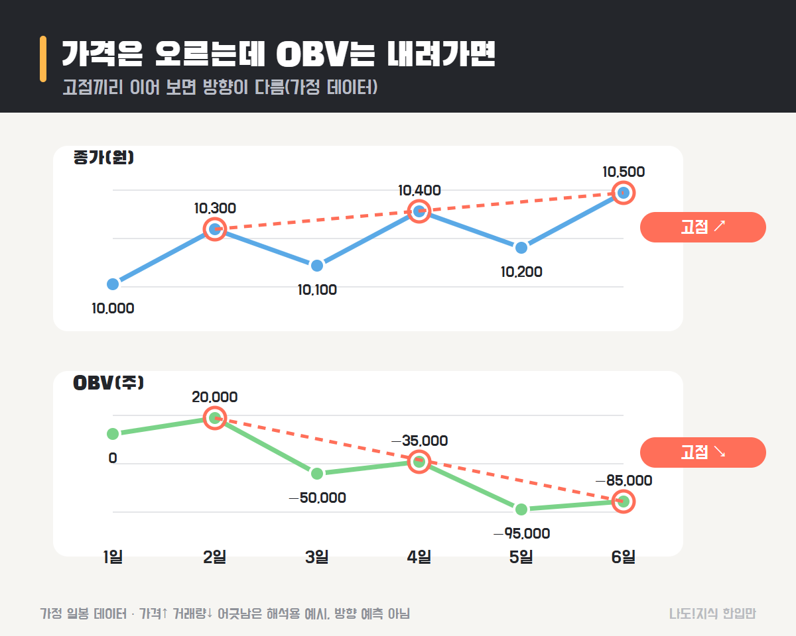

최종 검토일: 2026-11-23

OBV는 종가가 오른 날의 거래량은 더하고 내린 날의 거래량은 빼서 쌓아 가는 지표예요. On-Balance Volume의 줄임말이고, 거래량이 가격 움직임을 얼마나 뒷받침하는지 눈으로 보려고 써요.

가격만 보면 안 보이는 거래량의 흐름을 한 줄로 만든다는 게 핵심이에요. 가정 데이터 8일을 직접 계산해 보면 결과가 215,000이 되는 과정과, 가격과 OBV가 어긋나는 다이버전스 해석법까지 볼 수 있어요.

  <strong style="color:#2b2f36;font-size:18px;">📊 한눈에 보기</strong>
  <ul style="margin:10px 0 0 0;padding-left:20px;line-height:1.9;">
    <li><b>뜻:</b> 종가 방향에 따라 거래량을 더하고 빼서 누적한 값</li>
    <li><b>규칙:</b> 오르면 더하고, 내리면 빼고, 같으면 그대로</li>
    <li><b>예시:</b> 8일 계산 결과 OBV 215,000 (상승일 290,000 − 하락일 75,000)</li>
    <li><b>주의:</b> 절대 숫자는 시작점에 따라 달라서 방향과 모양만 봐요</li>
    <li><b>한계:</b> 방향을 예측하는 선이 아니라 거래량 확인용이에요</li>
  </ul>

  <strong style="font-size:16px;">📖 처음이라면 이것만 — 낱말 풀이</strong>
  <ul style="margin:8px 0 0 0;padding-left:20px;line-height:1.9;">
    <li><b>종가:</b> 그날 장이 끝날 때의 마지막 가격.</li>
    <li><b>거래량:</b> 하루 동안 사고팔린 주식 수.</li>
    <li><b>누적:</b> 매일 나온 값을 계속 더하거나 빼서 쌓아 가는 방식.</li>
    <li><b>전일 대비:</b> 어제 종가와 비교해 오늘이 올랐는지 내렸는지.</li>
    <li><b>다이버전스:</b> 가격과 지표가 서로 다른 방향을 가리키는 상태.</li>
  </ul>

<h2 style="border-left:6px solid #2b2f36;padding-left:12px;margin-top:36px;">목차</h2>
<ol style="line-height:1.9;">
  <li><a href="#sec-1" style="color:inherit;text-decoration:underline;text-underline-offset:3px;">OBV는 무엇인가요?</a></li>
  <li><a href="#sec-2" style="color:inherit;text-decoration:underline;text-underline-offset:3px;">OBV는 어떻게 계산하나요?</a></li>
  <li><a href="#sec-3" style="color:inherit;text-decoration:underline;text-underline-offset:3px;">시작 숫자가 달라도 모양이 같은 이유는?</a></li>
  <li><a href="#sec-4" style="color:inherit;text-decoration:underline;text-underline-offset:3px;">OBV 다이버전스는 어떻게 보나요?</a></li>
  <li><a href="#sec-5" style="color:inherit;text-decoration:underline;text-underline-offset:3px;">차트에서 OBV 켜는 법 따라 하기</a></li>
  <li><a href="#sec-6" style="color:inherit;text-decoration:underline;text-underline-offset:3px;">자주 하는 실수 5가지</a></li>
  <li><a href="#sec-7" style="color:inherit;text-decoration:underline;text-underline-offset:3px;">OBV Q&amp;A 5개</a></li>
</ol>

<h2 id="sec-1" style="scroll-margin-top:72px;border-left:6px solid #2b2f36;padding-left:12px;margin-top:36px;">OBV는 무엇인가요?</h2>

OBV는 종가 방향에 따라 그날의 거래량을 더하거나 빼서 쌓아 가는 거래량 누적 지표이에요. 1963년 조셉 그랜빌(Joseph Granville)이 책에서 소개한 것으로 알려져 있어요.

생각은 단순해요. 오른 날에 거래가 많았다면 사려는 힘이 컸고, 내린 날에 거래가 많았다면 팔려는 힘이 컸다고 읽어 보는 거예요. 그 힘을 하루하루 쌓아 한 줄로 그린 것이 OBV예요.

거래량 막대만 보면 그날이 오른 날인지 내린 날인지 따로 확인해야 해요. OBV는 그 구분을 계산에 넣어 둔 지표라서, 거래량의 방향까지 한눈에 보여 줘요. 대부분의 차트 도구가 자동으로 그려 줘요.

<h2 id="sec-2" style="scroll-margin-top:72px;border-left:6px solid #2b2f36;padding-left:12px;margin-top:36px;">OBV는 어떻게 계산하나요?</h2>

OBV는 오늘 종가를 어제 종가와 비교해서 더할지 뺄지 정하면 돼요. 규칙은 세 가지뿐이에요.

<ol style="line-height:2;">
  <li>종가가 어제보다 <b>높으면</b> 어제 OBV에 오늘 거래량을 <b>더해요</b>.</li>
  <li>종가가 어제보다 <b>낮으면</b> 어제 OBV에서 오늘 거래량을 <b>빼요</b>.</li>
  <li>종가가 어제와 <b>같으면</b> OBV는 <b>그대로</b>예요.</li>
</ol>

<figure style="margin:24px 0;"><figcaption style="font-size:13px;color:#888;">계산을 보여 주기 위한 가정 데이터예요. 실제 종목이 아니에요. 4일은 종가가 같아 OBV가 그대로예요.</figcaption></figure>

<table style="width:100%;border-collapse:collapse;margin:16px 0;">
  <thead>
    <tr style="background:#2b2f36;color:#fff;"><th style="border:1px solid #ddd;padding:8px;">날</th><th style="border:1px solid #ddd;padding:8px;">종가</th><th style="border:1px solid #ddd;padding:8px;">거래량</th><th style="border:1px solid #ddd;padding:8px;">전일 대비</th><th style="border:1px solid #ddd;padding:8px;">OBV</th></tr>
  </thead>
  <tbody>
    <tr><td style="border:1px solid #ddd;padding:8px;">1일</td><td style="border:1px solid #ddd;padding:8px;">10,000</td><td style="border:1px solid #ddd;padding:8px;">50,000</td><td style="border:1px solid #ddd;padding:8px;">기준</td><td style="border:1px solid #ddd;padding:8px;">0</td></tr>
    <tr><td style="border:1px solid #ddd;padding:8px;">2일</td><td style="border:1px solid #ddd;padding:8px;">10,200</td><td style="border:1px solid #ddd;padding:8px;">80,000</td><td style="border:1px solid #ddd;padding:8px;">상승 +80,000</td><td style="border:1px solid #ddd;padding:8px;">80,000</td></tr>
    <tr><td style="border:1px solid #ddd;padding:8px;">3일</td><td style="border:1px solid #ddd;padding:8px;">10,100</td><td style="border:1px solid #ddd;padding:8px;">30,000</td><td style="border:1px solid #ddd;padding:8px;">하락 −30,000</td><td style="border:1px solid #ddd;padding:8px;">50,000</td></tr>
    <tr><td style="border:1px solid #ddd;padding:8px;">4일</td><td style="border:1px solid #ddd;padding:8px;">10,100</td><td style="border:1px solid #ddd;padding:8px;">40,000</td><td style="border:1px solid #ddd;padding:8px;">같음 0</td><td style="border:1px solid #ddd;padding:8px;">50,000</td></tr>
    <tr><td style="border:1px solid #ddd;padding:8px;">5일</td><td style="border:1px solid #ddd;padding:8px;">10,400</td><td style="border:1px solid #ddd;padding:8px;">120,000</td><td style="border:1px solid #ddd;padding:8px;">상승 +120,000</td><td style="border:1px solid #ddd;padding:8px;">170,000</td></tr>
    <tr><td style="border:1px solid #ddd;padding:8px;">6일</td><td style="border:1px solid #ddd;padding:8px;">10,300</td><td style="border:1px solid #ddd;padding:8px;">20,000</td><td style="border:1px solid #ddd;padding:8px;">하락 −20,000</td><td style="border:1px solid #ddd;padding:8px;">150,000</td></tr>
    <tr><td style="border:1px solid #ddd;padding:8px;">7일</td><td style="border:1px solid #ddd;padding:8px;">10,500</td><td style="border:1px solid #ddd;padding:8px;">90,000</td><td style="border:1px solid #ddd;padding:8px;">상승 +90,000</td><td style="border:1px solid #ddd;padding:8px;">240,000</td></tr>
    <tr><td style="border:1px solid #ddd;padding:8px;">8일</td><td style="border:1px solid #ddd;padding:8px;">10,450</td><td style="border:1px solid #ddd;padding:8px;">25,000</td><td style="border:1px solid #ddd;padding:8px;">하락 −25,000</td><td style="border:1px solid #ddd;padding:8px;">215,000</td></tr>
    </tbody>
</table>

  <strong>✍️ 따라 해 보기 (1일~5일)</strong> 
  ① 1일은 비교할 어제가 없으니 시작값 <b>0</b>으로 둬요. 
  ② 2일: 종가 10,000 → 10,200 상승이라 0 + 80,000 = <b>80,000</b> 
  ③ 3일: 10,200 → 10,100 하락이라 80,000 − 30,000 = <b>50,000</b> 
  ④ 4일: 종가가 10,100으로 같아서 거래량 40,000주는 넣지 않고 <b>50,000 그대로</b> 
  ⑤ 5일: 10,100 → 10,400 상승이라 50,000 + 120,000 = <b>170,000</b>

4일이 눈여겨볼 곳이에요. 거래량이 4만 주나 됐지만 종가가 같아서 OBV는 움직이지 않았어요. 5일에는 거래량 12만 주가 상승일에 얹혀 OBV가 크게 올랐어요.

끝까지 계산하면 6일 150,000, 7일 240,000, 8일 215,000이에요. 검산도 쉬워요. 상승일 거래량 합은 80,000 + 120,000 + 90,000 = 290,000이고, 하락일 합은 30,000 + 20,000 + 25,000 = 75,000이라서 차이가 215,000이에요.

<figure style="margin:24px 0;"><figcaption style="font-size:13px;color:#888;">상승일 거래량은 더하고 하락일 거래량은 빼요. 4일은 0으로 처리해요.</figcaption></figure>

하락일의 거래량이 상승일보다 작았기 때문에 OBV는 우상향 모양이 됐어요. 다만 이것은 가정 데이터의 결과이고, 이 모양이 앞으로의 가격을 알려 주지는 않아요.

<h2 id="sec-3" style="scroll-margin-top:72px;border-left:6px solid #2b2f36;padding-left:12px;margin-top:36px;">시작 숫자가 달라도 모양이 같은 이유는?</h2>

OBV는 시작점부터 쌓은 누적값이라 절대 숫자에는 의미가 없어요. 어느 날부터 계산을 시작했느냐에 따라 숫자가 통째로 달라지기 때문이에요.

같은 8일 데이터를 시작값 1,000,000으로 계산하면 1,000,000 → … → 1,215,000이 돼요. 모든 날의 값이 똑같이 100만씩 높아질 뿐이라 선의 모양은 그대로예요.

<table style="width:100%;border-collapse:collapse;margin:16px 0;">
  <thead>
    <tr style="background:#2b2f36;color:#fff;"><th style="border:1px solid #ddd;padding:8px;">구분</th><th style="border:1px solid #ddd;padding:8px;">1일</th><th style="border:1px solid #ddd;padding:8px;">5일</th><th style="border:1px solid #ddd;padding:8px;">8일</th><th style="border:1px solid #ddd;padding:8px;">8일 − 1일</th></tr>
  </thead>
  <tbody>
    <tr><td style="border:1px solid #ddd;padding:8px;">시작값 0</td><td style="border:1px solid #ddd;padding:8px;">0</td><td style="border:1px solid #ddd;padding:8px;">170,000</td><td style="border:1px solid #ddd;padding:8px;">215,000</td><td style="border:1px solid #ddd;padding:8px;">+215,000</td></tr>
    <tr><td style="border:1px solid #ddd;padding:8px;">시작값 1,000,000</td><td style="border:1px solid #ddd;padding:8px;">1,000,000</td><td style="border:1px solid #ddd;padding:8px;">1,170,000</td><td style="border:1px solid #ddd;padding:8px;">1,215,000</td><td style="border:1px solid #ddd;padding:8px;">+215,000</td></tr>
    </tbody>
</table>

  <strong style="font-size:16px;">💡 읽는 요령</strong>
  <ul style="margin:8px 0 0 0;padding-left:20px;line-height:1.9;">
    <li>"OBV가 215,000이다"보다 "올라가는 모양이다"가 의미 있는 말이에요.</li>
    <li>서로 다른 종목의 OBV 숫자를 크기로 비교하지 않아요.</li>
    <li>차트 도구마다 시작 날짜가 달라 숫자가 다를 수 있어요.</li>
  </ul>

<h2 id="sec-4" style="scroll-margin-top:72px;border-left:6px solid #2b2f36;padding-left:12px;margin-top:36px;">OBV 다이버전스는 어떻게 보나요?</h2>

다이버전스는 가격과 OBV가 서로 다른 방향을 가리킬 때를 말해요. 보통은 가격과 OBV가 같은 방향으로 움직이면 흐름이 거래량의 뒷받침을 받는다고 읽고, 어긋나면 한 번 더 점검해 보라는 경고 정도로 해석해요.

<table style="width:100%;border-collapse:collapse;margin:16px 0;">
  <thead>
    <tr style="background:#2b2f36;color:#fff;"><th style="border:1px solid #ddd;padding:8px;">날</th><th style="border:1px solid #ddd;padding:8px;">종가</th><th style="border:1px solid #ddd;padding:8px;">거래량</th><th style="border:1px solid #ddd;padding:8px;">OBV</th></tr>
  </thead>
  <tbody>
    <tr><td style="border:1px solid #ddd;padding:8px;">1일</td><td style="border:1px solid #ddd;padding:8px;">10,000</td><td style="border:1px solid #ddd;padding:8px;">50,000</td><td style="border:1px solid #ddd;padding:8px;">0</td></tr>
    <tr><td style="border:1px solid #ddd;padding:8px;">2일</td><td style="border:1px solid #ddd;padding:8px;">10,300</td><td style="border:1px solid #ddd;padding:8px;">20,000</td><td style="border:1px solid #ddd;padding:8px;">20,000</td></tr>
    <tr><td style="border:1px solid #ddd;padding:8px;">3일</td><td style="border:1px solid #ddd;padding:8px;">10,100</td><td style="border:1px solid #ddd;padding:8px;">70,000</td><td style="border:1px solid #ddd;padding:8px;">−50,000</td></tr>
    <tr><td style="border:1px solid #ddd;padding:8px;">4일</td><td style="border:1px solid #ddd;padding:8px;">10,400</td><td style="border:1px solid #ddd;padding:8px;">15,000</td><td style="border:1px solid #ddd;padding:8px;">−35,000</td></tr>
    <tr><td style="border:1px solid #ddd;padding:8px;">5일</td><td style="border:1px solid #ddd;padding:8px;">10,200</td><td style="border:1px solid #ddd;padding:8px;">60,000</td><td style="border:1px solid #ddd;padding:8px;">−95,000</td></tr>
    <tr><td style="border:1px solid #ddd;padding:8px;">6일</td><td style="border:1px solid #ddd;padding:8px;">10,500</td><td style="border:1px solid #ddd;padding:8px;">10,000</td><td style="border:1px solid #ddd;padding:8px;">−85,000</td></tr>
    </tbody>
</table>

<figure style="margin:24px 0;"><figcaption style="font-size:13px;color:#888;">가격은 고점이 높아지는데 OBV 고점은 낮아져요(가정). 가격과 거래량이 다른 말을 하는 모습이에요.</figcaption></figure>

예시 B에서 종가 고점은 10,300 → 10,400 → 10,500으로 높아졌어요. 그런데 OBV 고점은 20,000 → −35,000 → −85,000으로 낮아졌어요.

이유는 거래량의 위치에 있어요. 오른 날의 거래량은 2만·1.5만·1만 주로 적었고, 내린 날은 7만·6만 주로 많았어요. 가격은 올라도 거래량은 내릴 때 더 몰린 셈이에요.

<ul style="line-height:1.9;">
  <li>가격 고점은 높아지는데 OBV 고점은 낮아지면: 가격과 거래량이 어긋난 모양이에요.</li>
  <li>가격 저점은 낮아지는데 OBV 저점은 높아지면: 반대 방향으로 어긋난 모양이에요.</li>
  <li>어긋남이 나타난 뒤 가격이 어떻게 움직일지는 정해져 있지 않아요.</li>
</ul>

그래서 다이버전스는 방향을 맞히는 도구가 아니라, 가격과 거래량이 같은 이야기를 하고 있는지 확인하는 도구예요. 이동평균선 같은 다른 지표를 함께 보면 해석할 때 도움이 돼요. 가격 평균선의 계산은 <a href="https://sensitiveboss3.tistory.com/entry/moving-average-5-20-day-cross" target="_blank" rel="noopener">이동평균선 5일 20일 계산과 크로스 보는 법</a>에서 볼 수 있어요.

<h2 id="sec-5" style="scroll-margin-top:72px;border-left:6px solid #2b2f36;padding-left:12px;margin-top:36px;">차트에서 OBV 켜는 법 따라 하기</h2>

OBV는 보조지표 목록에서 OBV를 검색해 추가하면 끝이에요. 대부분의 증권사 HTS·MTS와 차트 서비스에 기본으로 들어 있어요.

<ol style="line-height:2;">
  <li>차트를 <b>일봉</b>으로 놓아요. 종가 기준 지표라 일봉이 가장 단순해요.</li>
  <li><b>[지표 추가]</b> 또는 <b>[보조지표]</b>에서 <b>OBV</b>(또는 On Balance Volume)를 검색해 추가해요.</li>
  <li>가격 차트 아래 칸에 OBV 선이 그려져요.</li>
  <li>숫자는 보지 말고, 가격 선과 OBV 선이 <b>같은 방향</b>인지 <b>어긋나는지</b> 모양만 살펴봐요.</li>
  <li>OBV에 이동평균선을 겹쳐 주는 설정도 있어요. 필수는 아니에요.</li>
</ol>

조회 기간을 바꾸면 시작점이 달라져 숫자도 달라져요. 앞에서 본 것처럼 모양이 같으면 괜찮아요. 거래량이 지표의 재료이니 거래량 기준 평균가인 <a href="https://sensitiveboss3.tistory.com/entry/vwap-calculation" target="_blank" rel="noopener">VWAP 뜻과 계산법</a>도 함께 보면 이해가 쉬워요.

<h2 id="sec-6" style="scroll-margin-top:72px;border-left:6px solid #2b2f36;padding-left:12px;margin-top:36px;">자주 하는 실수 5가지</h2>

OBV에서 생기는 실수는 대부분 누적된 숫자를 신호로 착각해서 생겨요.

  <strong style="font-size:16px;">⚠️ 이것만 피하세요</strong>
  <ol style="margin:8px 0 0 0;padding-left:20px;line-height:1.9;">
    <li><b>OBV 숫자 크기를 비교하기</b> → 시작점에 따라 달라지는 값이라 종목끼리 비교할 수 없어요.</li>
    <li><b>종가가 같은 날도 거래량을 더하기</b> → 종가가 같으면 OBV는 그대로예요. 4일의 4만 주는 넣지 않아요.</li>
    <li><b>OBV가 오르면 주가도 오른다고 생각하기</b> → 거래량 흐름을 보여 줄 뿐 방향을 알려 주지 않아요.</li>
    <li><b>다이버전스를 곧바로 신호로 받아들이기</b> → 어긋나도 가격이 그대로 이어지는 경우가 있어요.</li>
    <li><b>OBV 하나만 보기</b> → 하루 안의 움직임은 반영되지 않아서 다른 지표와 함께 참고해야 해요.</li>
  </ol>

<h2 id="sec-7" style="scroll-margin-top:72px;border-left:6px solid #2b2f36;padding-left:12px;margin-top:36px;">OBV Q&amp;A 5개</h2>

  
OBV 뜻이 뭔가요

  
OBV는 On-Balance Volume(온밸런스 볼륨)의 줄임말이에요. 종가가 전날보다 오른 날의 거래량은 더하고, 내린 날의 거래량은 빼서 계속 쌓아 가는 거래량 누적 지표예요.

  
OBV 계산 방법은요

  
오늘 종가가 어제보다 높으면 어제 OBV에 오늘 거래량을 더하고, 낮으면 빼고, 같으면 그대로 둬요. 가정 데이터 8일에서는 상승일 거래량 합 290,000주에서 하락일 합 75,000주를 뺀 215,000이 OBV였어요.

  
OBV 숫자가 크면 좋은 건가요

  
아니에요. OBV는 시작점부터 쌓은 누적값이라 절대 숫자는 어디서 시작했느냐에 따라 달라져요. 시작값을 0에서 1,000,000으로 바꿔도 모양은 같고 숫자만 달라져서, 숫자 크기보다 선의 방향과 모양을 봐요.

  
OBV 다이버전스는 무슨 뜻인가요

  
가격과 OBV가 서로 다른 방향을 가리키는 상태예요. 가정 예시 B에서는 종가 고점이 10,300 → 10,400 → 10,500으로 높아지는데 OBV 고점은 20,000 → −35,000 → −85,000으로 낮아졌어요. 가격과 거래량이 다른 말을 한다는 확인용이고, 앞으로의 방향을 알려 주는 것은 아니에요.

  
OBV만 보고 사고팔면 되나요

  
OBV 하나로 판단하는 방식은 권하지 않아요. 종가의 방향만으로 거래량을 통째로 더하거나 빼기 때문에 하루 안의 움직임이 반영되지 않아요. 이동평균선 같은 다른 지표와 함께 참고용으로 보는 정도가 알맞아요.

  <strong style="font-size:16px;">📚 함께 보면 좋은 글</strong>
  <ul style="margin:8px 0 0 0;padding-left:20px;line-height:1.9;"><li><a href="https://sensitiveboss3.tistory.com/entry/vwap-calculation" target="_blank" rel="noopener">VWAP 뜻과 계산법, 거래량가중평균가격 직접 구하기</a></li><li><a href="https://sensitiveboss3.tistory.com/entry/moving-average-5-20-day-cross" target="_blank" rel="noopener">이동평균선 5일 20일 계산과 크로스 보는 법</a></li><li><a href="https://sensitiveboss3.tistory.com/entry/rsi-meaning-14day-calculation" target="_blank" rel="noopener">RSI 뜻과 14일 값 직접 구하기</a></li></ul>

  참고 출처 (OBV는 공시 기관이 정의한 지표가 아니라서 1차 출처가 없고, 아래는 교육·도움말 자료예요):
  <ul style="margin:6px 0 0 0;padding-left:20px;">
    <li><a href="https://en.wikipedia.org/wiki/On-balance_volume" target="_blank" rel="noopener">Wikipedia: On-balance volume</a></li>
    <li><a href="https://www.incrediblecharts.com/indicators/on_balance_volume.php" target="_blank" rel="noopener">Incredible Charts: On Balance Volume</a></li>
    <li><a href="https://help.tradestation.com/10_00/eng/tsdevhelp/elword/function/obv_function_.htm" target="_blank" rel="noopener">TradeStation 도움말: OBV 함수</a></li>
    <li><a href="https://www.ig.com/uk/learn/trading/on-balance-volume-obv-what-it-is-and-how-to-trade-it" target="_blank" rel="noopener">IG: On-balance volume (OBV)</a></li>
    <li><a href="https://therighttrader.com/ko/learn/indicators/on-balance-volume" target="_blank" rel="noopener">The Right Trader: OBV</a></li>
    <li><a href="https://wikidocs.net/195867" target="_blank" rel="noopener">위키독스: OBV</a></li>
  </ul>
  기준일: 2026년 11월 23일. 예시는 계산을 보여 주기 위한 가정 데이터예요.

이 글은 정보 제공을 목적으로 하며 특정 종목이나 상품의 매수·매도를 권유하지 않습니다. 투자 판단과 그 결과에 대한 책임은 투자자 본인에게 있습니다.
예시는 계산을 보여 주기 위한 가정값이며, 지표 정의와 계산 방식은 차트 도구마다 다를 수 있으므로 반드시 이용하는 서비스의 도움말에서 확인하시기 바랍니다.

