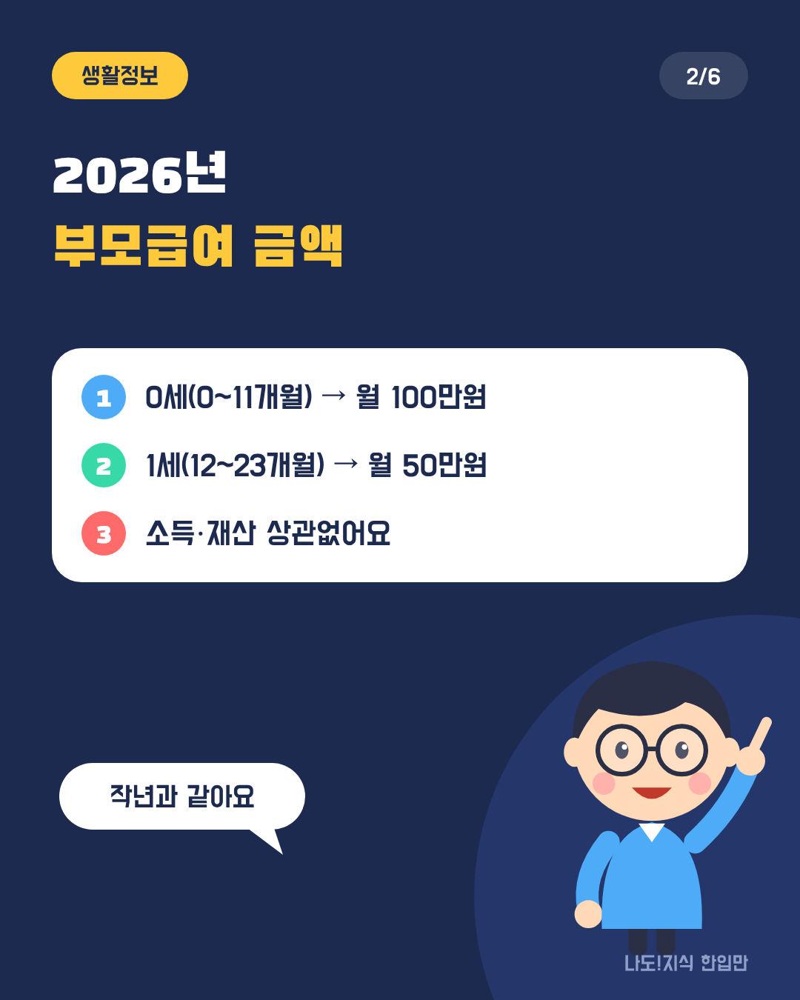
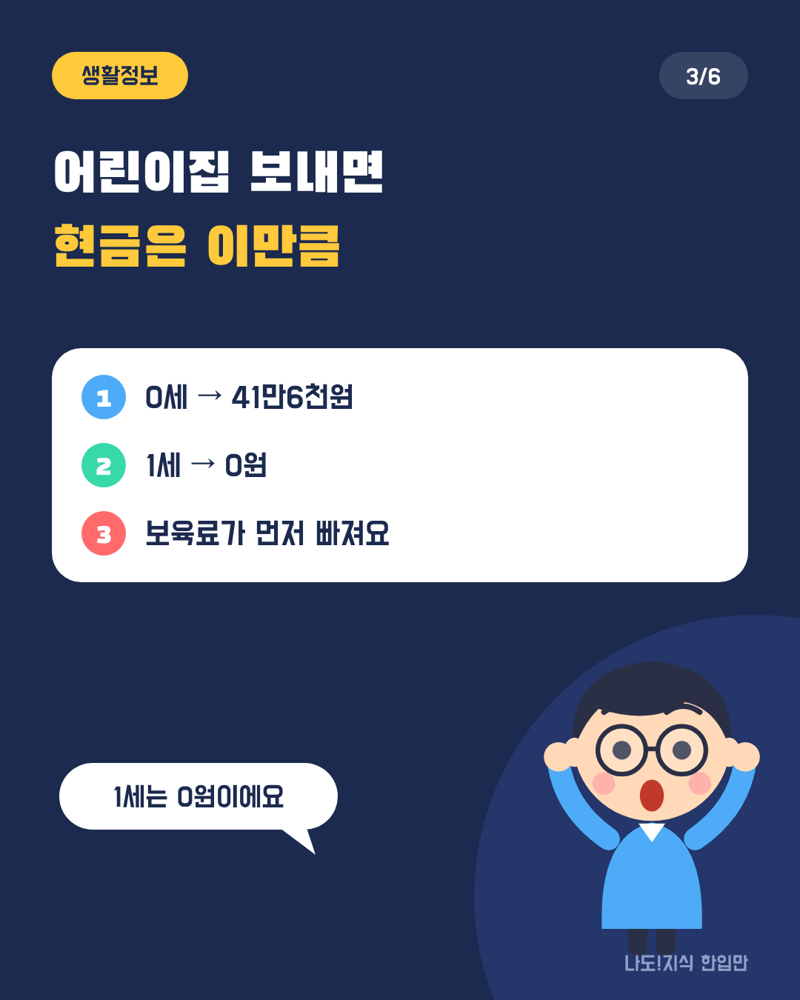
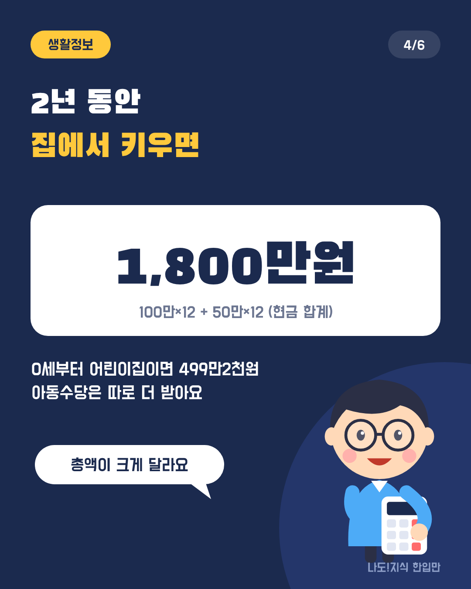
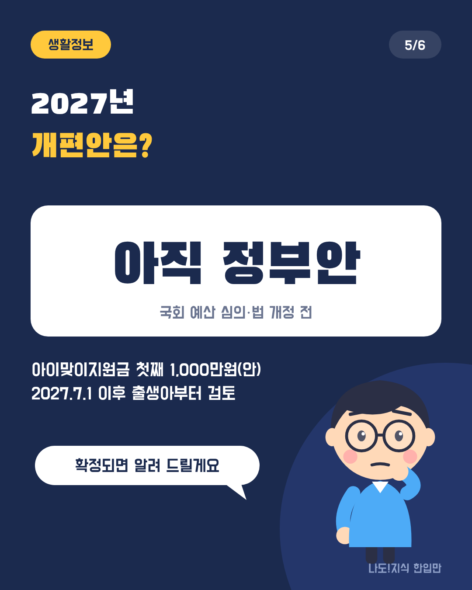
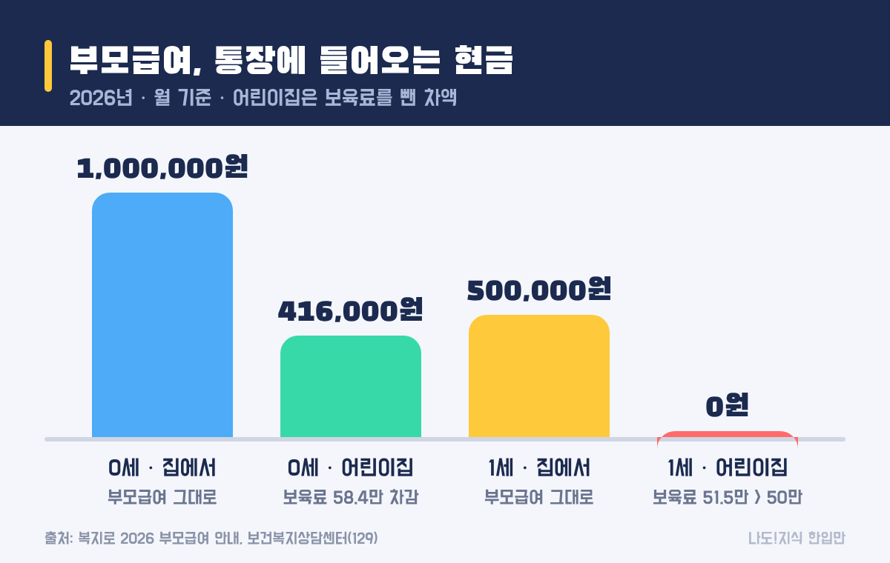
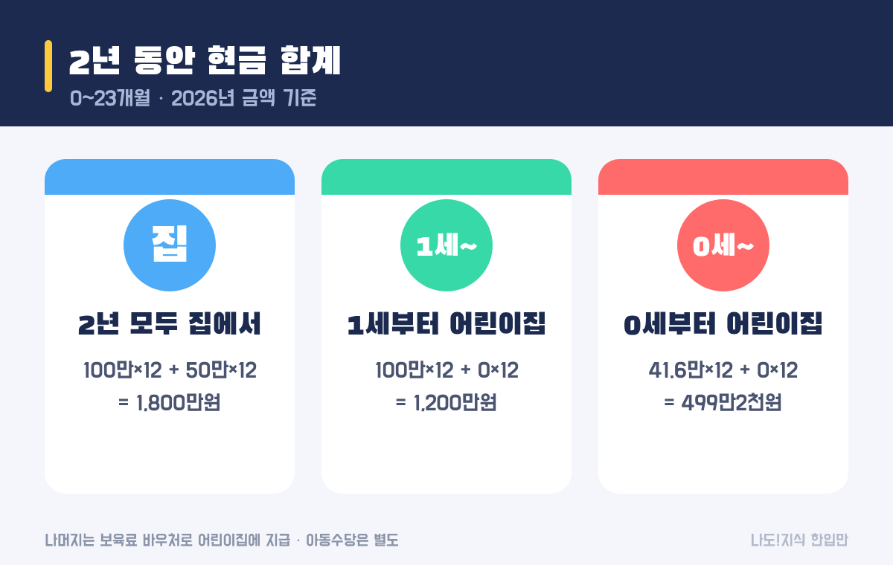
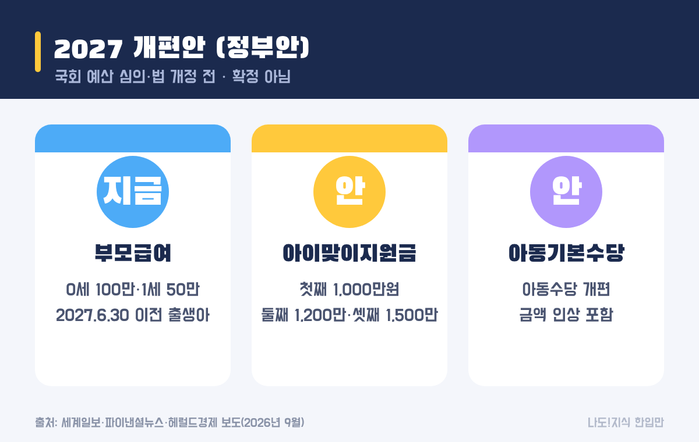

최종 검토일: 2026-11-09

2026년 부모급여는 0세(0~11개월) 월 100만원, 1세(12~23개월) 월 50만원이에요. 소득·재산과 상관없이 만 2세 미만이면 받고, 어린이집에 보내면 보육료를 뺀 나머지만 현금으로 들어와요.

그래서 같은 부모급여라도 집에서 키우는지, 어린이집에 보내는지에 따라 통장에 들어오는 돈이 크게 달라요. 경우별 금액과 2년 총액, 그리고 국회에서 논의 중인 2027년 개편안까지 정리할게요.

  <strong style="color:#1b2a4e;font-size:18px;">🍼 한눈에 보기</strong>
  <ul style="margin:10px 0 0 0;padding-left:20px;line-height:1.9;">
    <li><b>누가:</b> 만 2세 미만(0~23개월) 아이를 키우는 가정, 소득·재산 상관없음</li>
    <li><b>얼마:</b> 집에서 키우면 0세 100만원·1세 50만원 / 어린이집이면 0세 41만6천원·1세 0원(현금 기준)</li>
    <li><b>언제까지 신청:</b> 출생일 포함 60일 안에 하면 태어난 달부터 받아요</li>
    <li><b>어디서:</b> 복지로·정부24(출생신고와 함께) 또는 주민센터</li>
  </ul>

옆으로 넘겨 보세요 → (카드 6장 요약)

<h2 style="border-left:6px solid #1b2a4e;padding-left:12px;margin-top:36px;">목차</h2>
<ol style="line-height:1.9;">
  <li><a href="#sec-1" style="color:inherit;text-decoration:underline;text-underline-offset:3px;">부모급여란 무엇이고 2026년엔 얼마인가요?</a></li>
  <li><a href="#sec-2" style="color:inherit;text-decoration:underline;text-underline-offset:3px;">어린이집 보내면 부모급여는 얼마 받나요?</a></li>
  <li><a href="#sec-3" style="color:inherit;text-decoration:underline;text-underline-offset:3px;">2년 동안 모두 얼마 받을까: 총액 비교</a></li>
  <li><a href="#sec-4" style="color:inherit;text-decoration:underline;text-underline-offset:3px;">신청은 언제, 어디서 하나요?</a></li>
  <li><a href="#sec-5" style="color:inherit;text-decoration:underline;text-underline-offset:3px;">2027년엔 바뀌나요: 개편안(정부안) 정리</a></li>
  <li><a href="#sec-6" style="color:inherit;text-decoration:underline;text-underline-offset:3px;">부모급여 Q&amp;A 5개</a></li>
</ol>

<h2 id="sec-1" style="scroll-margin-top:72px;border-left:6px solid #1b2a4e;padding-left:12px;margin-top:36px;">부모급여란 무엇이고 2026년엔 얼마인가요?</h2>

부모급여는 만 2세 미만 아이를 키우는 가정에 매달 주는 현금 지원이에요. 2026년 금액은 작년과 같아요.

<table style="width:100%;border-collapse:collapse;margin:16px 0;">
  <thead>
    <tr style="background:#1b2a4e;color:#fff;"><th style="border:1px solid #ddd;padding:8px;">나이</th><th style="border:1px solid #ddd;padding:8px;">월 금액</th><th style="border:1px solid #ddd;padding:8px;">1년 합계</th></tr>
  </thead>
  <tbody>
    <tr><td style="border:1px solid #ddd;padding:8px;">0세(0~11개월)</td><td style="border:1px solid #ddd;padding:8px;">100만원</td><td style="border:1px solid #ddd;padding:8px;">1,200만원</td></tr>
    <tr><td style="border:1px solid #ddd;padding:8px;">1세(12~23개월)</td><td style="border:1px solid #ddd;padding:8px;">50만원</td><td style="border:1px solid #ddd;padding:8px;">600만원</td></tr>
  </tbody>
</table>

소득이나 재산 기준은 없어요. 아이가 대한민국 국적이고 주민등록번호가 있으면 대상이에요.

<h2 id="sec-2" style="scroll-margin-top:72px;border-left:6px solid #1b2a4e;padding-left:12px;margin-top:36px;">어린이집 보내면 부모급여는 얼마 받나요?</h2>

어린이집에 다니면 부모급여에서 보육료가 먼저 빠지고, 남는 금액만 현금으로 들어와요. 0세는 41만6천원이 남지만, 1세는 보육료가 부모급여보다 많아서 현금이 0원이에요.

<figure style="margin:24px 0;"><figcaption style="font-size:13px;color:#888;">어린이집 보육료는 바우처로 어린이집에 바로 지급돼요. 그래서 '못 받는' 게 아니라 '보육료로 쓰인' 거예요.</figcaption></figure>

<table style="width:100%;border-collapse:collapse;margin:16px 0;">
  <thead>
    <tr style="background:#1b2a4e;color:#fff;"><th style="border:1px solid #ddd;padding:8px;">경우</th><th style="border:1px solid #ddd;padding:8px;">부모급여</th><th style="border:1px solid #ddd;padding:8px;">보육료(바우처)</th><th style="border:1px solid #ddd;padding:8px;">현금으로 받는 돈</th></tr>
  </thead>
  <tbody>
    <tr><td style="border:1px solid #ddd;padding:8px;">0세 · 집에서</td><td style="border:1px solid #ddd;padding:8px;">100만원</td><td style="border:1px solid #ddd;padding:8px;">—</td><td style="border:1px solid #ddd;padding:8px;">100만원</td></tr>
    <tr><td style="border:1px solid #ddd;padding:8px;">0세 · 어린이집</td><td style="border:1px solid #ddd;padding:8px;">100만원</td><td style="border:1px solid #ddd;padding:8px;">58만4천원</td><td style="border:1px solid #ddd;padding:8px;">41만6천원</td></tr>
    <tr><td style="border:1px solid #ddd;padding:8px;">1세 · 집에서</td><td style="border:1px solid #ddd;padding:8px;">50만원</td><td style="border:1px solid #ddd;padding:8px;">—</td><td style="border:1px solid #ddd;padding:8px;">50만원</td></tr>
    <tr><td style="border:1px solid #ddd;padding:8px;">1세 · 어린이집</td><td style="border:1px solid #ddd;padding:8px;">50만원</td><td style="border:1px solid #ddd;padding:8px;">51만5천원</td><td style="border:1px solid #ddd;padding:8px;">0원</td></tr>
  </tbody>
</table>

1세 어린이집 차액을 '2만5천원'으로 적은 글도 있는데, 예전 보육료 기준이에요. 2026년 1세반 보육료는 51만5천원이라 차액이 없어요. 어린이집 유형에 따라 부모가 따로 내는 금액(필요경비 등)이 있을 수 있으니, 다니는 곳에 확인해 보세요.

<h2 id="sec-3" style="scroll-margin-top:72px;border-left:6px solid #1b2a4e;padding-left:12px;margin-top:36px;">2년 동안 모두 얼마 받을까: 총액 비교</h2>

2년(0~23개월) 동안 집에서 키우면 현금으로 1,800만원, 0세부터 어린이집에 보내면 현금은 499만2천원이에요. 나머지는 보육료로 어린이집에 들어가요.

<figure style="margin:24px 0;"><figcaption style="font-size:13px;color:#888;">계산: 월 현금 × 12개월. 2026년 금액이 2년 내내 같다고 가정했어요.</figcaption></figure>

<table style="width:100%;border-collapse:collapse;margin:16px 0;">
  <thead>
    <tr style="background:#1b2a4e;color:#fff;"><th style="border:1px solid #ddd;padding:8px;">키우는 방식</th><th style="border:1px solid #ddd;padding:8px;">계산</th><th style="border:1px solid #ddd;padding:8px;">2년 현금 합계</th></tr>
  </thead>
  <tbody>
    <tr><td style="border:1px solid #ddd;padding:8px;">2년 모두 집에서</td><td style="border:1px solid #ddd;padding:8px;">100만 × 12 + 50만 × 12</td><td style="border:1px solid #ddd;padding:8px;">1,800만원</td></tr>
    <tr><td style="border:1px solid #ddd;padding:8px;">0세 집 → 1세 어린이집</td><td style="border:1px solid #ddd;padding:8px;">100만 × 12 + 0 × 12</td><td style="border:1px solid #ddd;padding:8px;">1,200만원</td></tr>
    <tr><td style="border:1px solid #ddd;padding:8px;">0세부터 어린이집</td><td style="border:1px solid #ddd;padding:8px;">41.6만 × 12 + 0 × 12</td><td style="border:1px solid #ddd;padding:8px;">499만2천원</td></tr>
  </tbody>
</table>

여기에 아동수당(2026년 만 9세 미만, 지역별 월 10만~12만원)은 키우는 방식과 상관없이 따로 더 들어와요. 아동수당 금액과 대상 나이는 <a href="https://sensitiveboss3.tistory.com/entry/child-allowance-2026-age-amount" target="_blank" rel="noopener">아동수당 2026 정리</a>에 있어요.

<h2 id="sec-4" style="scroll-margin-top:72px;border-left:6px solid #1b2a4e;padding-left:12px;margin-top:36px;">신청은 언제, 어디서 하나요?</h2>

출생일을 포함해 60일 안에 신청하면 태어난 달부터 받고, 늦으면 신청한 달부터 받아요. 출생신고 때 아동수당과 함께 신청하는 게 가장 편해요.

<ul style="line-height:1.9;">
  <li><b>온라인:</b> 복지로 누리집·앱, 또는 정부24의 출산 서비스 통합 신청</li>
  <li><b>방문:</b> 아이 주소지 읍·면·동 주민센터</li>
  <li><b>어린이집 입소할 때:</b> 보육료 바우처로 바꾸는 신청을 따로 해야 해요(현금 → 보육료 전환).</li>
</ul>

<h2 id="sec-5" style="scroll-margin-top:72px;border-left:6px solid #1b2a4e;padding-left:12px;margin-top:36px;">2027년엔 바뀌나요: 개편안(정부안) 정리</h2>

정부는 2027년 예산안에 <b>첫만남이용권과 부모급여를 '아이맞이지원금'으로 합치는 개편안</b>을 담았어요. 다만 국회 예산 심의와 법 개정 전이라 확정이 아니에요.

<figure style="margin:24px 0;"><figcaption style="font-size:13px;color:#888;">언론 보도 기준 정부안이에요. 12월 국회 심의에서 바뀔 수 있어요.</figcaption></figure>

<table style="width:100%;border-collapse:collapse;margin:16px 0;">
  <thead>
    <tr style="background:#1b2a4e;color:#fff;"><th style="border:1px solid #ddd;padding:8px;">구분</th><th style="border:1px solid #ddd;padding:8px;">지금(2026년)</th><th style="border:1px solid #ddd;padding:8px;">개편안(정부안, 보도 기준)</th></tr>
  </thead>
  <tbody>
    <tr><td style="border:1px solid #ddd;padding:8px;">출산 지원</td><td style="border:1px solid #ddd;padding:8px;">첫만남이용권 + 부모급여</td><td style="border:1px solid #ddd;padding:8px;">아이맞이지원금: 첫째 1,000만원·둘째 1,200만원·셋째 이상 1,500만원(1년에 4번 나눠 현금)</td></tr>
    <tr><td style="border:1px solid #ddd;padding:8px;">아동수당</td><td style="border:1px solid #ddd;padding:8px;">만 9세 미만 월 10만~12만원</td><td style="border:1px solid #ddd;padding:8px;">아동기본수당으로 개편(금액 인상 포함)</td></tr>
    <tr><td style="border:1px solid #ddd;padding:8px;">적용 대상</td><td style="border:1px solid #ddd;padding:8px;">—</td><td style="border:1px solid #ddd;padding:8px;">2027년 7월 1일 이후 출생아부터 적용 검토</td></tr>
  </tbody>
</table>

보도대로라면 <b>그 전에 태어난 아이는 지금 부모급여를 그대로</b> 받아요. 이미 아이를 키우는 집이나 2027년 상반기 출산 예정인 집은 위 표의 2026년 기준으로 보면 돼요. 국회에서 확정되면 이 글을 고칠게요.

<h2 id="sec-6" style="scroll-margin-top:72px;border-left:6px solid #1b2a4e;padding-left:12px;margin-top:36px;">부모급여 Q&amp;A 5개</h2>

  
2026년 부모급여는 얼마인가요

  
0세(0~11개월)는 월 100만원, 1세(12~23개월)는 월 50만원이에요. 작년과 같고, 소득·재산과 상관없이 만 2세 미만이면 받아요.

  
어린이집에 보내면 부모급여는 얼마 받나요

  
보육료를 먼저 빼고 남는 금액을 현금으로 받아요. 0세는 100만원에서 0세반 보육료 58만4천원을 뺀 41만6천원, 1세는 1세반 보육료 51만5천원이 부모급여 50만원보다 많아 현금이 0원이에요.

  
부모급여 2년 동안 모두 얼마 받나요

  
2년 모두 집에서 키우면 현금 1,800만원(100만원×12 + 50만원×12)이에요. 0세부터 어린이집에 보내면 현금은 499만2천원이고, 나머지는 보육료로 어린이집에 지급돼요.

  
부모급여와 아동수당을 같이 받을 수 있나요

  
네. 두 제도는 별개라 함께 받아요. 아동수당은 2026년 기준 만 9세 미만에게 지역별 월 10만~12만원이 따로 나와요.

  
2027년에 부모급여가 없어지나요

  
정부가 첫만남이용권과 부모급여를 '아이맞이지원금'으로 합치는 개편안을 냈지만, 국회 확정 전이에요. 보도로는 2027년 7월 1일 이후 출생아부터 적용을 검토하고 있어서, 그 전에 태어난 아이는 지금 부모급여를 그대로 받는 구조예요.

  참고 출처:
  <ul style="margin:6px 0 0 0;padding-left:20px;">
    <li><a href="https://www.bokjiro.go.kr/ssis-tbu/cms/pc/customer/notice/1309189_1141.html" target="_blank" rel="noopener">복지로: 2026년 부모급여 지원 안내</a></li>
    <li><a href="https://korea.legal/wiki/%eb%b3%b4%ea%b1%b4%eb%b3%b5%ec%a7%80%ec%83%81%eb%8b%b4%ec%84%bc%ed%84%b0-%ec%96%b4%eb%a6%b0%ec%9d%b4%ec%a7%91-%ec%9d%b4%ec%9a%a9-%eb%b6%80%eb%aa%a8%ea%b8%89%ec%97%ac-%ec%b0%a8/" target="_blank" rel="noopener">보건복지상담센터(129) 어린이집 이용 부모급여 차액 FAQ 정리</a></li>
    <li><a href="https://www.segye.com/newsView/20260904508422" target="_blank" rel="noopener">세계일보: 2027년 예산안 아이맞이지원금 보도(2026-09-04)</a></li>
    <li><a href="https://www.fnnews.com/news/202609011218243180" target="_blank" rel="noopener">파이낸셜뉴스: 2027년 예산안 출산·아동 지원 개편 보도(2026-09-01)</a></li>
    <li><a href="https://www.heraldk.com/article/2026090318385403982" target="_blank" rel="noopener">헤럴드경제: 아이맞이지원금·아동기본수당 편성(2026-09-03)</a></li>
  </ul>
  기준일: 2026년 11월 9일. 보육료 단가는 해마다 고시로 바뀌어요.

정보 제공을 목적으로 쓴 글이에요. 실제 지급 금액은 주소지 지자체와 어린이집 이용 여부에 따라 정해져요.

