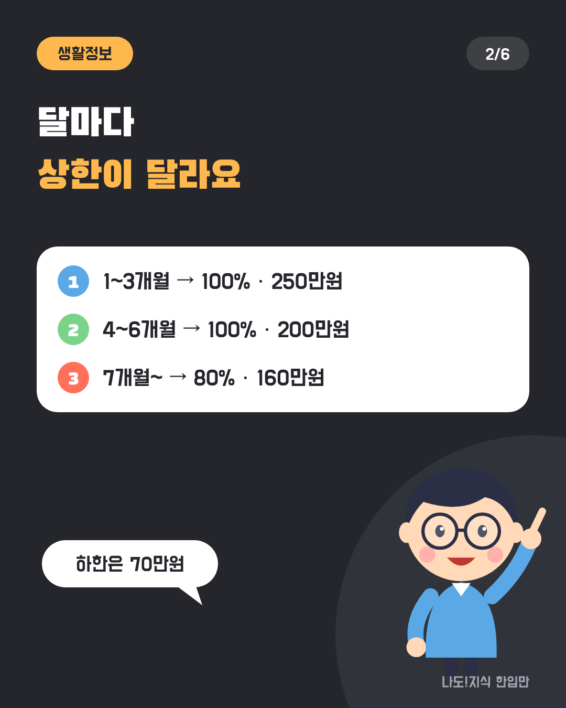
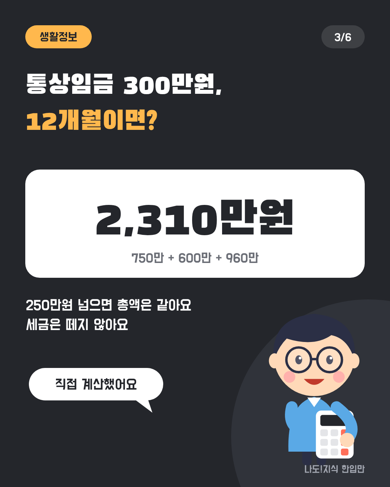
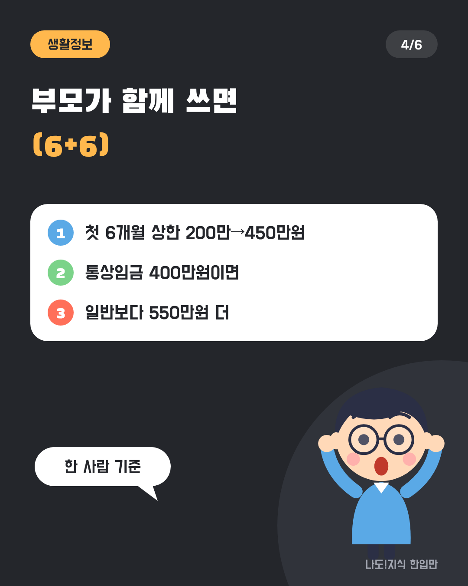
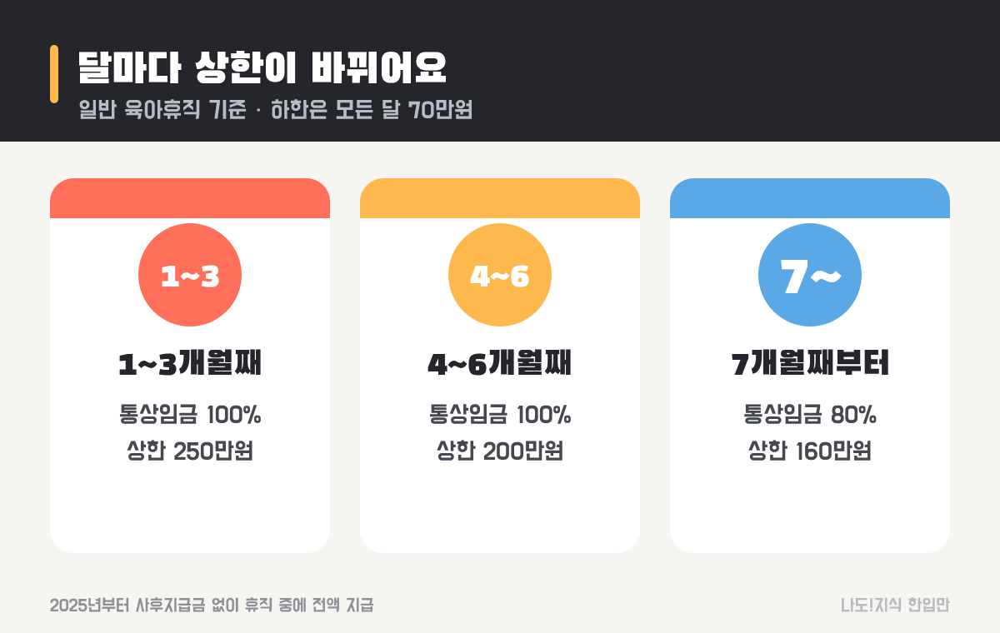
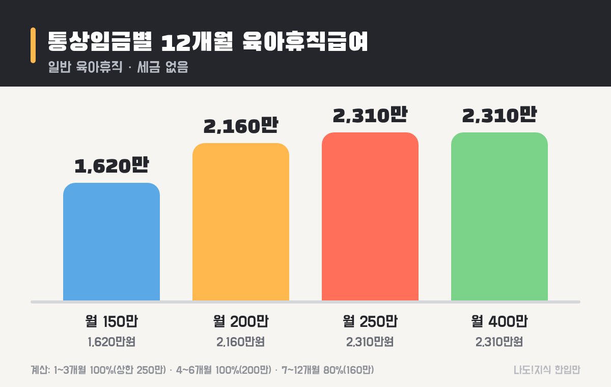
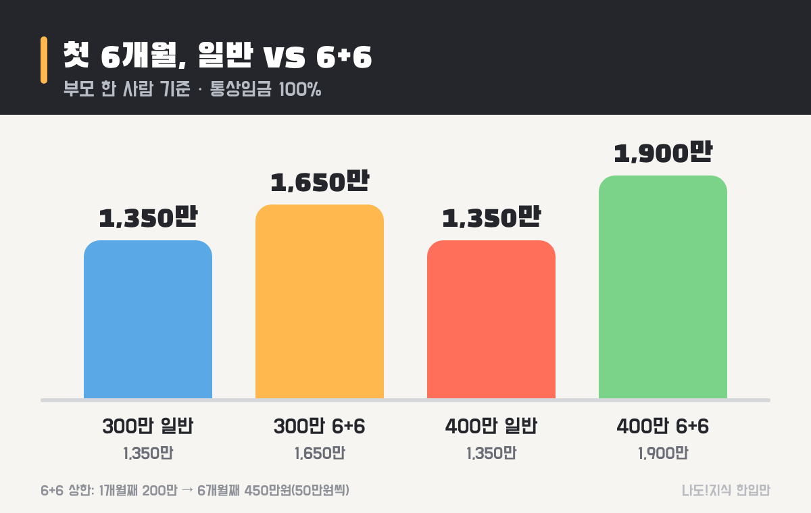

최종 검토일: 2026-11-13

육아휴직급여는 육아휴직을 쓰는 동안 고용보험에서 매달 주는 돈이에요. 2026년에는 <mark>1~3개월째 월 최대 250만원, 4~6개월째 200만원, 7개월째부터 160만원</mark>을 받아요. 하한은 모든 달 월 70만원이에요.

상한이 석 달마다 바뀌어서 "그래서 1년이면 총 얼마?"가 바로 안 나오죠. 통상임금별로 12개월 총액을 계산하고, 부모가 함께 쓰는 6+6 제도로 바꾸면 얼마나 더 받는지도 같은 숫자로 비교해 볼게요.

  <strong style="color:#24262b;font-size:18px;">👶 한눈에 보기</strong>
  <ul style="margin:10px 0 0 0;padding-left:20px;line-height:1.9;">
    <li><b>1~3개월:</b> 통상임금 100% · 상한 250만원</li>
    <li><b>4~6개월:</b> 통상임금 100% · 상한 200만원</li>
    <li><b>7개월~:</b> 통상임금 80% · 상한 160만원 (하한은 모든 달 70만원)</li>
    <li><b>12개월 총액:</b> 통상임금 250만원 이상이면 2,310만원 (세금 없음)</li>
    <li><b>6+6:</b> 부모가 함께 쓰면 첫 6개월 상한 200만→450만원</li>
  </ul>

옆으로 넘겨 보세요 → (카드 6장 요약)

  <strong style="font-size:16px;">📖 처음이라면 이것만 — 낱말 풀이</strong>
  <ul style="margin:8px 0 0 0;padding-left:20px;line-height:1.9;">
    <li><b>통상임금:</b> 매달 고정으로 받는 임금(기본급과 고정 수당). 성과급·초과근무수당처럼 달마다 바뀌는 돈은 빠져요.</li>
    <li><b>상한액·하한액:</b> 계산한 금액이 아무리 커도 상한까지만, 아무리 작아도 하한만큼은 줘요.</li>
    <li><b>6+6 부모육아휴직제:</b> 자녀 생후 18개월 안에 부모가 함께 또는 차례로 휴직하면 첫 6개월을 더 주는 제도.</li>
    <li><b>사후지급금:</b> 예전에는 급여의 25%를 복직 후에 줬어요. 2025년부터 없어져서 휴직 중에 다 받아요.</li>
    <li><b>고용24:</b> 고용노동부의 고용보험 신청 누리집. 육아휴직급여도 여기서 신청해요.</li>
  </ul>

<h2 style="border-left:6px solid #24262b;padding-left:12px;margin-top:36px;">목차</h2>
<ol style="line-height:1.9;">
  <li><a href="#sec-1" style="color:inherit;text-decoration:underline;text-underline-offset:3px;">2026년 육아휴직급여는 얼마인가요?</a></li>
  <li><a href="#sec-2" style="color:inherit;text-decoration:underline;text-underline-offset:3px;">달마다 상한이 어떻게 바뀌나요?</a></li>
  <li><a href="#sec-3" style="color:inherit;text-decoration:underline;text-underline-offset:3px;">내 통상임금이면 12개월에 얼마 받나요?</a></li>
  <li><a href="#sec-4" style="color:inherit;text-decoration:underline;text-underline-offset:3px;">부모가 함께 쓰면(6+6) 얼마나 더 받나요?</a></li>
  <li><a href="#sec-5" style="color:inherit;text-decoration:underline;text-underline-offset:3px;">육아휴직을 1년 6개월로 늘리려면?</a></li>
  <li><a href="#sec-6" style="color:inherit;text-decoration:underline;text-underline-offset:3px;">육아휴직급여는 어떻게 신청하나요?</a></li>
  <li><a href="#sec-7" style="color:inherit;text-decoration:underline;text-underline-offset:3px;">자주 하는 실수 5가지</a></li>
  <li><a href="#sec-8" style="color:inherit;text-decoration:underline;text-underline-offset:3px;">육아휴직급여 Q&amp;A 5개</a></li>
</ol>

<h2 id="sec-1" style="scroll-margin-top:72px;border-left:6px solid #24262b;padding-left:12px;margin-top:36px;">2026년 육아휴직급여는 얼마인가요?</h2>

2026년 육아휴직급여는 <mark>휴직 시작부터 6개월까지 통상임금의 100%, 7개월째부터 80%</mark>를 주되, 달마다 정해진 상한과 하한 안에서 줘요. 2025년에 크게 오른 기준이 2026년에도 그대로 적용되고 있어요.

<table style="width:100%;border-collapse:collapse;margin:16px 0;">
  <thead>
    <tr style="background:#24262b;color:#fff;"><th style="border:1px solid #ddd;padding:8px;">기간</th><th style="border:1px solid #ddd;padding:8px;">지급률</th><th style="border:1px solid #ddd;padding:8px;">상한</th><th style="border:1px solid #ddd;padding:8px;">하한</th></tr>
  </thead>
  <tbody>
    <tr><td style="border:1px solid #ddd;padding:8px;">1~3개월째</td><td style="border:1px solid #ddd;padding:8px;">통상임금 100%</td><td style="border:1px solid #ddd;padding:8px;"><mark>월 250만원</mark></td><td style="border:1px solid #ddd;padding:8px;">월 70만원</td></tr>
    <tr><td style="border:1px solid #ddd;padding:8px;">4~6개월째</td><td style="border:1px solid #ddd;padding:8px;">통상임금 100%</td><td style="border:1px solid #ddd;padding:8px;">월 200만원</td><td style="border:1px solid #ddd;padding:8px;">월 70만원</td></tr>
    <tr><td style="border:1px solid #ddd;padding:8px;">7개월째부터</td><td style="border:1px solid #ddd;padding:8px;">통상임금 80%</td><td style="border:1px solid #ddd;padding:8px;">월 160만원</td><td style="border:1px solid #ddd;padding:8px;">월 70만원</td></tr>
  </tbody>
</table>

받으려면 육아휴직을 시작하기 전까지 고용보험 가입 기간(피보험단위기간)이 <b>180일 이상</b>이어야 하고, 만 8세 이하 또는 초등학교 2학년 이하 자녀를 키우려고 30일 이상 휴직해야 해요. 이 돈은 고용보험에서 나오기 때문에 <b>세금을 떼지 않아요.</b>

<h2 id="sec-2" style="scroll-margin-top:72px;border-left:6px solid #24262b;padding-left:12px;margin-top:36px;">달마다 상한이 어떻게 바뀌나요?</h2>

상한은 <mark>석 달 단위로 250만원 → 200만원 → 160만원으로 내려가요.</mark> 휴직 초기에 돈이 더 필요하다는 점을 반영해 앞쪽을 두텁게 줘요.

<figure style="margin:24px 0;"><figcaption style="font-size:13px;color:#888;">하한은 모든 달 70만원이에요.</figcaption></figure>

여기서 놓치기 쉬운 건 <b>7개월째부터는 지급률도 80%로 내려간다</b>는 점이에요. 통상임금이 200만원이라면 6개월째까지는 200만원을 받지만, 7개월째부터는 80%인 160만원을 받아요. 통상임금이 150만원이면 7개월째부터 120만원이에요.

예전에는 급여의 25%를 떼 두었다가 복직하고 6개월을 일해야 줬는데(사후지급금), 2025년부터 이 제도가 없어졌어요. 그래서 계산한 금액을 휴직하는 동안 매달 전부 받아요.

<h2 id="sec-3" style="scroll-margin-top:72px;border-left:6px solid #24262b;padding-left:12px;margin-top:36px;">내 통상임금이면 12개월에 얼마 받나요?</h2>

통상임금이 <mark>월 250만원 이상이면 12개월 총액은 2,310만원으로 모두 같아요.</mark> 모든 달이 상한에 걸리기 때문이에요. 그보다 적으면 통상임금에 따라 줄어요.

<figure style="margin:24px 0;"><figcaption style="font-size:13px;color:#888;">일반 육아휴직 12개월 기준, 세금 없음.</figcaption></figure>

  <strong>✍️ 내 경우로 따라 해 보기 (통상임금 월 300만원, 12개월)</strong> 
  ① 1~3개월: 300만원 → 상한 250만원 × 3 = <b>750만원</b> 
  ② 4~6개월: 300만원 → 상한 200만원 × 3 = <b>600만원</b> 
  ③ 7~12개월: 300만원 × 80% = 240만원 → 상한 160만원 × 6 = <b>960만원</b> 
  ④ 합계: 750 + 600 + 960 = <mark><b>2,310만원</b></mark> (한 달 평균 약 192만원)

<table style="width:100%;border-collapse:collapse;margin:16px 0;">
  <thead>
    <tr style="background:#24262b;color:#fff;"><th style="border:1px solid #ddd;padding:8px;">통상임금(월)</th><th style="border:1px solid #ddd;padding:8px;">1~3개월</th><th style="border:1px solid #ddd;padding:8px;">4~6개월</th><th style="border:1px solid #ddd;padding:8px;">7~12개월</th><th style="border:1px solid #ddd;padding:8px;">12개월 합계</th></tr>
  </thead>
  <tbody>
    <tr><td style="border:1px solid #ddd;padding:8px;">150만원</td><td style="border:1px solid #ddd;padding:8px;">150만 × 3</td><td style="border:1px solid #ddd;padding:8px;">150만 × 3</td><td style="border:1px solid #ddd;padding:8px;">120만 × 6</td><td style="border:1px solid #ddd;padding:8px;"><b>1,620만원</b></td></tr>
    <tr><td style="border:1px solid #ddd;padding:8px;">200만원</td><td style="border:1px solid #ddd;padding:8px;">200만 × 3</td><td style="border:1px solid #ddd;padding:8px;">200만 × 3</td><td style="border:1px solid #ddd;padding:8px;">160만 × 6</td><td style="border:1px solid #ddd;padding:8px;"><b>2,160만원</b></td></tr>
    <tr><td style="border:1px solid #ddd;padding:8px;">250만원 이상</td><td style="border:1px solid #ddd;padding:8px;">250만 × 3</td><td style="border:1px solid #ddd;padding:8px;">200만 × 3</td><td style="border:1px solid #ddd;padding:8px;">160만 × 6</td><td style="border:1px solid #ddd;padding:8px;"><mark><b>2,310만원</b></mark></td></tr>
  </tbody>
</table>

6개월만 쓴다면 통상임금 250만원 이상은 <b>1,350만원</b>(750만 + 600만), 200만원이면 1,200만원이에요. 휴직 중에는 월급이 없으니, 한 달 평균으로 생활비 계획을 세워 두면 편해요.

<h2 id="sec-4" style="scroll-margin-top:72px;border-left:6px solid #24262b;padding-left:12px;margin-top:36px;">부모가 함께 쓰면(6+6) 얼마나 더 받나요?</h2>

부모가 함께 쓰면 <mark>첫 6개월 동안 통상임금 100%를 주고, 상한이 1개월째 200만원에서 6개월째 450만원까지 50만원씩 올라가요.</mark> 자녀가 생후 18개월 안일 때 부모가 동시에 또는 차례로 휴직하면 해당돼요.

<figure style="margin:24px 0;"><figcaption style="font-size:13px;color:#888;">부모 한 사람 기준이에요. 둘 다 쓰면 두 사람 모두 이 금액을 받아요.</figcaption></figure>

<table style="width:100%;border-collapse:collapse;margin:16px 0;">
  <thead>
    <tr style="background:#24262b;color:#fff;"><th style="border:1px solid #ddd;padding:8px;">개월</th><th style="border:1px solid #ddd;padding:8px;">6+6 상한</th><th style="border:1px solid #ddd;padding:8px;">통상임금 300만원</th><th style="border:1px solid #ddd;padding:8px;">통상임금 400만원</th></tr>
  </thead>
  <tbody>
    <tr><td style="border:1px solid #ddd;padding:8px;">1개월째</td><td style="border:1px solid #ddd;padding:8px;">200만원</td><td style="border:1px solid #ddd;padding:8px;">200만원</td><td style="border:1px solid #ddd;padding:8px;">200만원</td></tr>
    <tr><td style="border:1px solid #ddd;padding:8px;">2개월째</td><td style="border:1px solid #ddd;padding:8px;">250만원</td><td style="border:1px solid #ddd;padding:8px;">250만원</td><td style="border:1px solid #ddd;padding:8px;">250만원</td></tr>
    <tr><td style="border:1px solid #ddd;padding:8px;">3개월째</td><td style="border:1px solid #ddd;padding:8px;">300만원</td><td style="border:1px solid #ddd;padding:8px;">300만원</td><td style="border:1px solid #ddd;padding:8px;">300만원</td></tr>
    <tr><td style="border:1px solid #ddd;padding:8px;">4개월째</td><td style="border:1px solid #ddd;padding:8px;">350만원</td><td style="border:1px solid #ddd;padding:8px;">300만원</td><td style="border:1px solid #ddd;padding:8px;">350만원</td></tr>
    <tr><td style="border:1px solid #ddd;padding:8px;">5개월째</td><td style="border:1px solid #ddd;padding:8px;">400만원</td><td style="border:1px solid #ddd;padding:8px;">300만원</td><td style="border:1px solid #ddd;padding:8px;">400만원</td></tr>
    <tr><td style="border:1px solid #ddd;padding:8px;">6개월째</td><td style="border:1px solid #ddd;padding:8px;">450만원</td><td style="border:1px solid #ddd;padding:8px;">300만원</td><td style="border:1px solid #ddd;padding:8px;">400만원</td></tr>
    <tr><td style="border:1px solid #ddd;padding:8px;"><b>합계</b></td><td style="border:1px solid #ddd;padding:8px;"></td><td style="border:1px solid #ddd;padding:8px;"><b>1,650만원</b></td><td style="border:1px solid #ddd;padding:8px;"><mark><b>1,900만원</b></mark></td></tr>
  </tbody>
</table>

같은 6개월을 일반 육아휴직으로 쓰면 1,350만원이니, 통상임금 300만원이면 <b>300만원</b>, 400만원이면 <b>550만원</b>을 한 사람이 더 받아요. 부모 둘 다 받으니 집 전체로는 두 배 차이가 나요. 상한이 높아지는 뒤쪽 달까지 채워야 효과가 커서, 짧게 쓰면 차이가 작아요.

<h2 id="sec-5" style="scroll-margin-top:72px;border-left:6px solid #24262b;padding-left:12px;margin-top:36px;">육아휴직을 1년 6개월로 늘리려면?</h2>

육아휴직은 자녀 1명당 <mark>기본 1년</mark>이고, <mark>부모가 같은 자녀로 각각 3개월 이상 쓰면 6개월이 늘어나 1년 6개월</mark>까지 쓸 수 있어요. 한부모 가정의 부모, 중증 장애 아동의 부모도 늘릴 수 있어요.

<table style="width:100%;border-collapse:collapse;margin:16px 0;">
  <thead>
    <tr style="background:#24262b;color:#fff;"><th style="border:1px solid #ddd;padding:8px;">상황</th><th style="border:1px solid #ddd;padding:8px;">쓸 수 있는 기간</th></tr>
  </thead>
  <tbody>
    <tr><td style="border:1px solid #ddd;padding:8px;">한 사람만 사용</td><td style="border:1px solid #ddd;padding:8px;">1년</td></tr>
    <tr><td style="border:1px solid #ddd;padding:8px;">부모 모두 각각 3개월 이상 사용</td><td style="border:1px solid #ddd;padding:8px;"><mark>각자 1년 6개월</mark></td></tr>
    <tr><td style="border:1px solid #ddd;padding:8px;">한 명이 3개월 미만 사용</td><td style="border:1px solid #ddd;padding:8px;">1년 (연장 안 됨)</td></tr>
    <tr><td style="border:1px solid #ddd;padding:8px;">한부모·중증 장애 아동 부모</td><td style="border:1px solid #ddd;padding:8px;">1년 6개월</td></tr>
  </tbody>
</table>

늘어난 6개월(13~18개월째)도 7개월째 이후와 같은 기준(통상임금 80%, 상한 160만원)으로 받아요. 그래서 통상임금 250만원 이상이면 18개월 총액은 2,310만원 + 960만원 = <b>3,270만원</b>이에요.

<h2 id="sec-6" style="scroll-margin-top:72px;border-left:6px solid #24262b;padding-left:12px;margin-top:36px;">육아휴직급여는 어떻게 신청하나요?</h2>

육아휴직급여는 <mark>고용24에서 휴직 시작 1개월이 지난 뒤부터 매달 신청하고, 휴직이 끝난 뒤 12개월 안에 신청해야</mark> 받을 수 있어요.

<ol style="line-height:2;">
  <li><b>회사에 휴직 신청:</b> 휴직 시작 30일 전까지 회사에 신청해요.</li>
  <li><b>회사가 확인서 제출:</b> 회사가 고용센터에 '육아휴직 확인서'를 내요. 냈는지 회사에 물어보세요.</li>
  <li><b>내가 급여 신청:</b> <a href="https://www.work24.go.kr" target="_blank" rel="noopener">고용24(work24.go.kr)</a>에 로그인해 육아휴직급여를 신청해요. 휴직 시작 후 1개월이 지나면 신청할 수 있어요.</li>
  <li><b>매달 반복:</b> 보통 한 달 단위로 신청하고, 몇 달치를 모아 한꺼번에 신청할 수도 있어요.</li>
  <li><b>마감:</b> 휴직이 끝난 날부터 12개월이 지나면 받을 수 없어요.</li>
</ol>

문의는 고용노동부 고객상담센터 <b>1350</b>이에요. 퇴사하게 되면 받을 수 있는 실업급여는 <a href="https://sensitiveboss3.tistory.com/entry/unemployment-benefit-2026-daily-amount" target="_blank" rel="noopener">실업급여 하루 얼마</a> 글에서 계산해 뒀어요.

<h2 id="sec-7" style="scroll-margin-top:72px;border-left:6px solid #24262b;padding-left:12px;margin-top:36px;">자주 하는 실수 5가지</h2>

육아휴직급여를 덜 받거나 놓치는 경우는 대부분 <mark>상한·지급률을 잘못 알거나 신청 기한을 넘겨서</mark> 생겨요.

  <strong style="font-size:16px;">⚠️ 이것만 피하세요</strong>
  <ol style="margin:8px 0 0 0;padding-left:20px;line-height:1.9;">
    <li><b>1년 내내 250만원 받는다고 생각하기</b> → 250만원은 1~3개월째뿐이에요. 12개월 평균은 약 192만원이에요.</li>
    <li><b>7개월째부터 지급률이 내려가는 걸 모르기</b> → 100%에서 80%로 내려가요.</li>
    <li><b>세후 월급으로 계산하기</b> → 기준은 통상임금(세전 고정 임금)이에요.</li>
    <li><b>부부가 짧게 나눠 쓰기</b> → 둘 중 한 명이 3개월 미만이면 1년 6개월 연장이 안 돼요.</li>
    <li><b>복직하고 한참 뒤에 신청하기</b> → 휴직이 끝나고 12개월이 지나면 받을 수 없어요.</li>
  </ol>

휴직한 해에는 월급이 줄어서 연말정산 결과도 달라져요. 남은 기간 카드 사용을 어떻게 나누면 좋은지는 <a href="https://sensitiveboss3.tistory.com/entry/year-end-tax-preview-card-deduction-2026" target="_blank" rel="noopener">연말정산 미리보기</a> 글에서 볼 수 있어요.

<h2 id="sec-8" style="scroll-margin-top:72px;border-left:6px solid #24262b;padding-left:12px;margin-top:36px;">육아휴직급여 Q&amp;A 5개</h2>

  
2026년 육아휴직급여는 얼마인가요

  
1~3개월째는 통상임금의 100%(상한 월 250만원), 4~6개월째는 100%(상한 200만원), 7개월째부터는 80%(상한 160만원)를 받아요. 하한은 모든 달 월 70만원이에요.

  
통상임금 300만원이면 12개월에 얼마 받나요

  
1~3개월 250만원씩 750만원, 4~6개월 200만원씩 600만원, 7~12개월 160만원씩 960만원으로 합계 2,310만원이에요. 통상임금이 250만원 이상이면 12개월 총액은 모두 같아요.

  
6+6 부모육아휴직제는 얼마를 받나요

  
자녀가 생후 18개월 안일 때 부모가 함께 또는 차례로 휴직하면 첫 6개월은 통상임금의 100%를 주고, 상한이 1개월째 200만원에서 6개월째 450만원까지 50만원씩 올라가요.

  
육아휴직은 몇 개월까지 쓸 수 있나요

  
자녀 1명당 기본 1년이에요. 부모가 같은 자녀로 각각 3개월 이상 쓰면 6개월이 늘어 1년 6개월까지 쓸 수 있어요. 한부모나 중증 장애 아동의 부모도 늘릴 수 있어요.

  
육아휴직급여에 세금이 붙나요

  
붙지 않아요. 육아휴직급여는 고용보험에서 나오는 돈이라 소득세를 떼지 않고, 계산한 금액이 그대로 들어와요.

  <strong style="font-size:16px;">📚 함께 보면 좋은 글</strong>
  <ul style="margin:8px 0 0 0;padding-left:20px;line-height:1.9;"><li><a href="https://sensitiveboss3.tistory.com/entry/unemployment-benefit-2026-daily-amount" target="_blank" rel="noopener">실업급여 하루 얼마? 2026 계산법</a></li><li><a href="https://sensitiveboss3.tistory.com/entry/year-end-tax-preview-card-deduction-2026" target="_blank" rel="noopener">연말정산 미리보기 12월 18일까지</a></li><li><a href="https://sensitiveboss3.tistory.com/entry/eitc-late-application-2026" target="_blank" rel="noopener">근로장려금 기한 후 신청 12월 1일까지</a></li></ul>

  참고 출처:
  <ul style="margin:6px 0 0 0;padding-left:20px;">
    <li><a href="https://www.bokjiro.go.kr/ssis-tbu/cms/pc/news/promotion/1307727_1118.html" target="_blank" rel="noopener">복지로: 올해부터 달라지는 육아지원제도</a></li>
    <li><a href="https://brunch.co.kr/@2d02d8ec2eea4e1/50" target="_blank" rel="noopener">이용교 복지상식: 육아휴직 급여액 월 250만 원까지</a></li>
    <li><a href="https://wikidocs.net/blog/@mythos/21350/" target="_blank" rel="noopener">육아휴직 급여 2026, 6+6 부모육아휴직제 정리</a></li>
    <li><a href="https://www.law.go.kr/법령/고용보험법시행령" target="_blank" rel="noopener">국가법령정보센터: 고용보험법 시행령(육아휴직 급여)</a></li>
  </ul>
  기준일: 2026년 11월 13일. 금액 계산은 통상임금이 휴직 기간 동안 같다고 가정한 단순 계산이에요.

정보 제공을 목적으로 쓴 글이에요. 실제 지급액은 고용센터의 통상임금 확인 결과에 따라 달라질 수 있고, 고용노동부(1350)·고용24 안내가 기준이에요.

