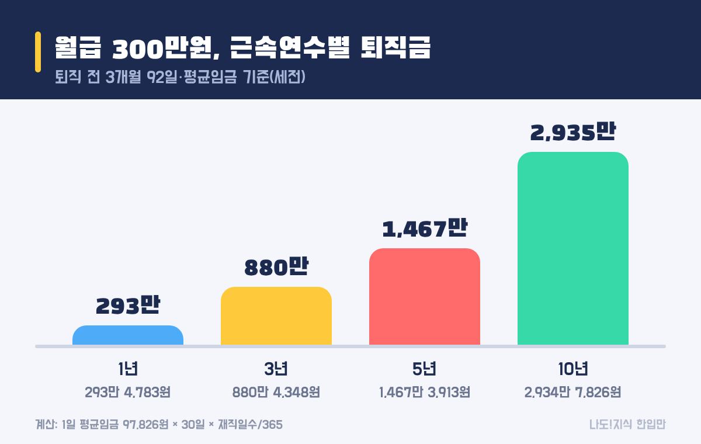

최종 검토일: 2026-11-12

퇴직금 계산은 <mark>1일 평균임금 × 30일 × (재직일수 ÷ 365)</mark> 공식 하나로 끝나요. 퇴직금은 같은 회사에서 1년 이상 일하고 그만둘 때 회사가 주는 돈으로, 대략 <b>1년 일할 때마다 한 달 치 월급</b>이 쌓인다고 보면 돼요.

그런데 '한 달 치'가 정확히 얼마인지는 상여금을 넣느냐, 퇴사 전 3개월이 며칠이냐에 따라 달라져요. 월급 300만원, 3년 다닌 경우를 놓고 한 줄씩 직접 계산해 볼게요.

  <strong style="color:#1b2a4e;font-size:18px;">🧮 한눈에 보기</strong>
  <ul style="margin:10px 0 0 0;padding-left:20px;line-height:1.9;">
    <li><b>누가:</b> 같은 회사 1년 이상 + 4주 평균 주 15시간 이상 (알바·계약직 포함)</li>
    <li><b>공식:</b> 1일 평균임금 × 30일 × 재직일수 ÷ 365</li>
    <li><b>예시:</b> 월급 300만원 · 3년이면 약 <b>880만원</b> (세전)</li>
    <li><b>상여금·연차수당:</b> 1년치의 3/12만 넣기</li>
    <li><b>받는 날:</b> 퇴직 후 14일 이내, 55세 미만은 IRP 계좌로</li>
  </ul>

옆으로 넘겨 보세요 → (카드 6장 요약)

  <strong style="font-size:16px;">📖 처음이라면 이것만 — 낱말 풀이</strong>
  <ul style="margin:8px 0 0 0;padding-left:20px;line-height:1.9;">
    <li><b>평균임금:</b> 퇴직 전 3개월 동안 받은 돈을 날짜 수로 나눈 '하루치 임금'. 퇴직금은 이 값으로 계산해요.</li>
    <li><b>통상임금:</b> 매달 고정으로 정해진 임금. 평균임금이 이보다 적으면 통상임금으로 계산해요.</li>
    <li><b>계속근로기간:</b> 입사일부터 퇴직일 전날까지 끊기지 않고 일한 기간. 1년 이상이어야 퇴직금이 생겨요.</li>
    <li><b>재직일수:</b> 계속근로기간을 날짜로 센 것. 3년이면 보통 1,095일(윤년이 끼면 1,096일)이에요.</li>
    <li><b>IRP(개인형 퇴직연금):</b> 퇴직금을 받아 두는 본인 명의 계좌. 은행·증권사에서 만들어요.</li>
  </ul>

<h2 style="border-left:6px solid #1b2a4e;padding-left:12px;margin-top:36px;">목차</h2>
<ol style="line-height:1.9;">
  <li><a href="#sec-1" style="color:inherit;text-decoration:underline;text-underline-offset:3px;">퇴직금은 누가 받을 수 있나요?</a></li>
  <li><a href="#sec-2" style="color:inherit;text-decoration:underline;text-underline-offset:3px;">퇴직금 계산 공식은 어떻게 되나요?</a></li>
  <li><a href="#sec-3" style="color:inherit;text-decoration:underline;text-underline-offset:3px;">월급 300만원, 3년 다니면 퇴직금은 얼마인가요?</a></li>
  <li><a href="#sec-4" style="color:inherit;text-decoration:underline;text-underline-offset:3px;">상여금·연차수당은 어떻게 넣나요?</a></li>
  <li><a href="#sec-5" style="color:inherit;text-decoration:underline;text-underline-offset:3px;">퇴사 날짜에 따라 퇴직금이 달라지나요?</a></li>
  <li><a href="#sec-6" style="color:inherit;text-decoration:underline;text-underline-offset:3px;">퇴직금은 언제, 어떻게 받나요?</a></li>
  <li><a href="#sec-7" style="color:inherit;text-decoration:underline;text-underline-offset:3px;">자주 하는 실수 5가지</a></li>
  <li><a href="#sec-8" style="color:inherit;text-decoration:underline;text-underline-offset:3px;">퇴직금 계산 Q&amp;A 5개</a></li>
</ol>

<h2 id="sec-1" style="scroll-margin-top:72px;border-left:6px solid #1b2a4e;padding-left:12px;margin-top:36px;">퇴직금은 누가 받을 수 있나요?</h2>

퇴직금은 <mark>같은 회사에서 1년 이상 일했고, 4주를 평균해 일주일에 15시간 이상 일한 사람</mark>이면 받아요. 근로자퇴직급여보장법(<a href="https://www.law.go.kr/법령/근로자퇴직급여보장법" target="_blank" rel="noopener">국가법령정보센터</a>)에 정해진 회사의 의무라서, 정규직·계약직·아르바이트를 가리지 않아요.

<table style="width:100%;border-collapse:collapse;margin:16px 0;">
  <thead>
    <tr style="background:#1b2a4e;color:#fff;"><th style="border:1px solid #ddd;padding:8px;">내 상황</th><th style="border:1px solid #ddd;padding:8px;">퇴직금</th></tr>
  </thead>
  <tbody>
    <tr><td style="border:1px solid #ddd;padding:8px;">정규직 3년 근무 후 퇴사</td><td style="border:1px solid #ddd;padding:8px;"><mark>받음</mark></td></tr>
    <tr><td style="border:1px solid #ddd;padding:8px;">편의점 알바, 주 20시간씩 1년 2개월</td><td style="border:1px solid #ddd;padding:8px;"><mark>받음</mark></td></tr>
    <tr><td style="border:1px solid #ddd;padding:8px;">계약직 11개월 근무 후 계약 종료</td><td style="border:1px solid #ddd;padding:8px;">못 받음 (1년 미만)</td></tr>
    <tr><td style="border:1px solid #ddd;padding:8px;">주 12시간씩 2년 근무</td><td style="border:1px solid #ddd;padding:8px;">못 받음 (주 15시간 미만)</td></tr>
    <tr><td style="border:1px solid #ddd;padding:8px;">1년 계약 끝나고 같은 회사와 재계약해 계속 근무</td><td style="border:1px solid #ddd;padding:8px;">기간을 합쳐서 계산</td></tr>
  </tbody>
</table>

자주 헷갈리는 건 '1년'의 기준이에요. 365일을 꽉 채워야 해서, 입사 1년이 되기 하루 전에 그만두면 법정 퇴직금은 생기지 않아요. 반대로 계약서를 여러 번 새로 썼어도 중간에 쉬지 않고 같은 회사에서 일했다면 전체 기간을 하나로 이어서 봐요.

회사가 망하거나 사장이 바뀌어도 받을 권리는 그대로예요. 5인 미만 작은 사업장도 2010년 12월부터는 퇴직금을 줘야 해요.

<h2 id="sec-2" style="scroll-margin-top:72px;border-left:6px solid #1b2a4e;padding-left:12px;margin-top:36px;">퇴직금 계산 공식은 어떻게 되나요?</h2>

퇴직금 공식은 <mark>1일 평균임금 × 30일 × (재직일수 ÷ 365)</mark>예요. 하루치 임금으로 '한 달 치'를 만들고, 일한 햇수만큼 곱한다고 이해하면 쉬워요.

<ol style="line-height:2;">
  <li><b>3개월 임금 총액 구하기:</b> 퇴직일 전 3개월 동안 받은 월급·수당(세금 떼기 전)을 모두 더해요.</li>
  <li><b>상여금·연차수당 더하기:</b> 1년 동안 받은 상여금과 확정된 연차수당의 3/12을 더해요(다음 장에서 자세히).</li>
  <li><b>1일 평균임금 구하기:</b> 위 금액을 그 3개월의 <b>날짜 수(89~92일)</b>로 나눠요. 일한 날이 아니라 달력 날짜예요.</li>
  <li><b>한 달 치 만들기:</b> 1일 평균임금 × 30일.</li>
  <li><b>햇수 곱하기:</b> 한 달 치 × 재직일수 ÷ 365.</li>
</ol>

3단계에서 나온 평균임금이 통상임금(고정 월급을 하루치로 바꾼 값)보다 적으면, 통상임금을 대신 써요. 일하는 사람이 손해 보지 않게 바닥을 정해 둔 거예요. 계산이 맞는지는 <a href="https://www.moel.go.kr" target="_blank" rel="noopener">고용노동부 누리집(moel.go.kr)</a>의 퇴직금 계산기에 날짜와 금액을 넣어 맞춰 볼 수 있어요.

<h2 id="sec-3" style="scroll-margin-top:72px;border-left:6px solid #1b2a4e;padding-left:12px;margin-top:36px;">월급 300만원, 3년 다니면 퇴직금은 얼마인가요?</h2>

상여금 없이 월급 300만원을 받고 3년(1,095일) 일했다면 퇴직금은 <mark>약 880만원(세전)</mark>이에요. 퇴직일이 11월 1일이라 퇴직 전 3개월이 8~10월(92일)인 경우로 계산했어요.

<figure style="margin:24px 0;"><figcaption style="font-size:13px;color:#888;">월급 300만원·3개월 92일 기준. 평균임금 계산이며 세금 떼기 전 금액이에요.</figcaption></figure>

  <strong>✍️ 내 경우로 따라 해 보기 (월급 300만원 · 3년)</strong> 
  ① 3개월 임금: 300만 × 3 = <b>900만원</b> 
  ② 1일 평균임금: 900만 ÷ 92일 = <b>97,826원</b> 
  ③ 한 달 치: 97,826원 × 30일 = <b>약 293만원</b> 
  ④ 3년치: 293만 × 1,095 ÷ 365 = <mark><b>약 880만원</b></mark>

<table style="width:100%;border-collapse:collapse;margin:16px 0;">
  <thead>
    <tr style="background:#1b2a4e;color:#fff;"><th style="border:1px solid #ddd;padding:8px;">월급(세전)</th><th style="border:1px solid #ddd;padding:8px;">1년</th><th style="border:1px solid #ddd;padding:8px;">3년</th><th style="border:1px solid #ddd;padding:8px;">5년</th></tr>
  </thead>
  <tbody>
    <tr><td style="border:1px solid #ddd;padding:8px;">250만원</td><td style="border:1px solid #ddd;padding:8px;">약 245만원</td><td style="border:1px solid #ddd;padding:8px;"><b>약 734만원</b></td><td style="border:1px solid #ddd;padding:8px;">약 1,223만원</td></tr>
    <tr><td style="border:1px solid #ddd;padding:8px;">300만원</td><td style="border:1px solid #ddd;padding:8px;">약 293만원</td><td style="border:1px solid #ddd;padding:8px;"><b>약 880만원</b></td><td style="border:1px solid #ddd;padding:8px;">약 1,467만원</td></tr>
    <tr><td style="border:1px solid #ddd;padding:8px;">400만원</td><td style="border:1px solid #ddd;padding:8px;">약 391만원</td><td style="border:1px solid #ddd;padding:8px;"><b>약 1,174만원</b></td><td style="border:1px solid #ddd;padding:8px;">약 1,957만원</td></tr>
  </tbody>
</table>

표를 보면 퇴직금이 '월급 × 햇수'보다 조금 적어요. 한 달을 30일로 치는데, 평균임금을 구할 때는 92일(한 달 약 30.7일)로 나눠서 그래요. 1년 넘게 일한 뒤의 날짜도 그대로 반영돼서, 3년 6개월이면 3.5년치를 받아요.

<h2 id="sec-4" style="scroll-margin-top:72px;border-left:6px solid #1b2a4e;padding-left:12px;margin-top:36px;">상여금·연차수당은 어떻게 넣나요?</h2>

상여금과 연차수당은 <mark>1년 동안 받은 금액의 3/12만 3개월 임금에 더해요.</mark> 상여금을 받은 달에 몰아서 넣으면 퇴직 시점에 따라 금액이 들쭉날쭉해지니, 1년치를 12로 나눠 3개월분만 넣도록 정해 둔 거예요.

<figure style="margin:24px 0;"><figcaption style="font-size:13px;color:#888;">같은 사람도 계산에 넣는 항목과 퇴사 시점에 따라 금액이 달라져요.</figcaption></figure>

<table style="width:100%;border-collapse:collapse;margin:16px 0;">
  <thead>
    <tr style="background:#1b2a4e;color:#fff;"><th style="border:1px solid #ddd;padding:8px;">항목</th><th style="border:1px solid #ddd;padding:8px;">넣는 방법</th><th style="border:1px solid #ddd;padding:8px;">월급 300만원 예시</th></tr>
  </thead>
  <tbody>
    <tr><td style="border:1px solid #ddd;padding:8px;">월급·고정수당</td><td style="border:1px solid #ddd;padding:8px;">3개월치 전부</td><td style="border:1px solid #ddd;padding:8px;">900만원</td></tr>
    <tr><td style="border:1px solid #ddd;padding:8px;">상여금(1년 300만원)</td><td style="border:1px solid #ddd;padding:8px;">300만 × 3/12</td><td style="border:1px solid #ddd;padding:8px;">+75만원</td></tr>
    <tr><td style="border:1px solid #ddd;padding:8px;">연차수당(확정 40만원)</td><td style="border:1px solid #ddd;padding:8px;">40만 × 3/12</td><td style="border:1px solid #ddd;padding:8px;">+10만원</td></tr>
    <tr><td style="border:1px solid #ddd;padding:8px;"><b>합계 ÷ 92일</b></td><td style="border:1px solid #ddd;padding:8px;">1일 평균임금</td><td style="border:1px solid #ddd;padding:8px;"><b>107,065원</b></td></tr>
    <tr><td style="border:1px solid #ddd;padding:8px;"><b>3년 퇴직금</b></td><td style="border:1px solid #ddd;padding:8px;">× 30 × 3</td><td style="border:1px solid #ddd;padding:8px;"><mark><b>약 964만원</b></mark></td></tr>
  </tbody>
</table>

상여금과 연차수당을 넣으면 같은 사람의 퇴직금이 <b>약 83만원</b> 늘어요. 회사 계산서에 이 두 줄이 빠져 있지 않은지 꼭 보세요. 단, 퇴직하면서 처음 생기는 '남은 연차를 돈으로 바꾼 수당'은 넣지 않아요. 퇴직 전에 이미 확정된 연차수당만 들어가요.

<h2 id="sec-5" style="scroll-margin-top:72px;border-left:6px solid #1b2a4e;padding-left:12px;margin-top:36px;">퇴사 날짜에 따라 퇴직금이 달라지나요?</h2>

네, <mark>퇴직 전 3개월의 날짜 수에 따라 1일 평균임금이 달라져요.</mark> 같은 900만원을 92일로 나누느냐, 89일로 나누느냐의 차이예요.

<table style="width:100%;border-collapse:collapse;margin:16px 0;">
  <thead>
    <tr style="background:#1b2a4e;color:#fff;"><th style="border:1px solid #ddd;padding:8px;">퇴직일</th><th style="border:1px solid #ddd;padding:8px;">계산하는 3개월</th><th style="border:1px solid #ddd;padding:8px;">날짜 수</th><th style="border:1px solid #ddd;padding:8px;">3년 퇴직금</th></tr>
  </thead>
  <tbody>
    <tr><td style="border:1px solid #ddd;padding:8px;">11월 1일</td><td style="border:1px solid #ddd;padding:8px;">8월·9월·10월</td><td style="border:1px solid #ddd;padding:8px;">92일</td><td style="border:1px solid #ddd;padding:8px;">약 880만원</td></tr>
    <tr><td style="border:1px solid #ddd;padding:8px;">5월 1일</td><td style="border:1px solid #ddd;padding:8px;">2월·3월·4월(평년)</td><td style="border:1px solid #ddd;padding:8px;">89일</td><td style="border:1px solid #ddd;padding:8px;"><mark>약 910만원</mark></td></tr>
  </tbody>
</table>

월급이 같아도 2월이 끼면 나누는 날짜가 줄어 약 30만원 차이가 나요. 다만 이건 평균임금으로 계산한 경우이고, 통상임금이 더 높게 나오면 통상임금이 기준이 돼서 차이가 줄어들 수 있어요. 퇴사 날짜를 정할 수 있는 상황이라면 한 번 계산해 볼 만한 부분이에요.

반대로 퇴직 전 3개월에 무급휴직·육아휴직·병가처럼 임금이 줄어든 기간이 끼어 있으면, 그 기간은 날짜와 금액에서 모두 빼고 계산해요. 평균임금이 갑자기 낮아지는 걸 막기 위한 규칙이에요.

<h2 id="sec-6" style="scroll-margin-top:72px;border-left:6px solid #1b2a4e;padding-left:12px;margin-top:36px;">퇴직금은 언제, 어떻게 받나요?</h2>

회사는 <mark>퇴직한 날부터 14일 안에</mark> 퇴직금을 줘야 해요. 특별한 사정이 있으면 서로 합의해서 미룰 수 있지만, 늦어진 날만큼 <b>연 20%</b>의 지연이자가 붙어요.

<ol style="line-height:2;">
  <li><b>퇴사 전:</b> 은행·증권사 앱에서 본인 명의 <b>IRP 계좌</b>를 만들어 회사에 알려요. 55세 미만이면 원칙적으로 이 계좌로 받아요.</li>
  <li><b>퇴사일:</b> 회사에 퇴직금 계산 내역(3개월 임금, 상여금, 재직일수)을 요청해요.</li>
  <li><b>계산 맞춰 보기:</b> 위 공식이나 고용노동부 계산기로 금액을 비교해요.</li>
  <li><b>14일 안에 입금:</b> 퇴직소득세를 뗀 금액이 IRP에 들어와요. IRP에서 해지하면 바로 현금으로 쓸 수 있어요.</li>
  <li><b>안 들어오면:</b> 회사에 먼저 요청하고, 그래도 안 주면 지방고용노동청에 진정을 넣을 수 있어요.</li>
</ol>

회사가 퇴직연금에 가입돼 있으면 계산 방식이 조금 달라요. 확정급여형(DB)은 이 글의 공식과 같고, 확정기여형(DC)은 회사가 매년 넣어 준 돈과 운용 수익이 퇴직금이 돼요. 내 회사가 어느 쪽인지는 <a href="https://sensitiveboss3.tistory.com/entry/retirement-pension-db-dc-difference" target="_blank" rel="noopener">퇴직연금 DB DC 차이</a> 글에서 정리했어요.

IRP로 받은 돈을 바로 꺼내지 않고 연금으로 나눠 받으면 퇴직소득세를 덜 낼 수 있어요. 중간에 꺼낼 때 세금은 <a href="https://sensitiveboss3.tistory.com/entry/retirement-pension-withdrawal-tax" target="_blank" rel="noopener">퇴직연금 중도인출 세금</a> 글에서 계산해 뒀어요.

<h2 id="sec-7" style="scroll-margin-top:72px;border-left:6px solid #1b2a4e;padding-left:12px;margin-top:36px;">자주 하는 실수 5가지</h2>

퇴직금을 덜 받는 경우는 대부분 <mark>계산에 들어갈 항목을 빠뜨리거나 날짜를 잘못 세서</mark> 생겨요.

  <strong style="font-size:16px;">⚠️ 이것만 피하세요</strong>
  <ol style="margin:8px 0 0 0;padding-left:20px;line-height:1.9;">
    <li><b>세후 월급으로 계산하기</b> → 퇴직금은 세금 떼기 전 금액(세전)으로 계산해요. 통장에 들어온 돈으로 하면 적게 나와요.</li>
    <li><b>상여금·연차수당 빼먹기</b> → 1년치의 3/12을 넣어야 해요. 월급 300만원 예시에서 83만원 차이가 났어요.</li>
    <li><b>3개월을 90일로 고정하기</b> → 실제 달력 날짜(89~92일)로 나눠요.</li>
    <li><b>1년에서 며칠 모자라게 퇴사하기</b> → 하루라도 모자라면 법정 퇴직금이 없어요. 입사일을 다시 보세요.</li>
    <li><b>IRP 계좌 없이 퇴사하기</b> → 55세 미만은 IRP로 받는 게 원칙이라, 계좌가 없으면 입금이 늦어질 수 있어요.</li>
  </ol>

퇴사 뒤 바로 일을 구하지 못한다면 실업급여도 함께 챙겨 보세요. 하루 얼마를 며칠 받는지는 <a href="https://sensitiveboss3.tistory.com/entry/unemployment-benefit-2026-daily-amount" target="_blank" rel="noopener">실업급여 하루 얼마</a> 글에 계산해 뒀어요. 퇴직금을 받았다고 실업급여가 줄지는 않아요.

<h2 id="sec-8" style="scroll-margin-top:72px;border-left:6px solid #1b2a4e;padding-left:12px;margin-top:36px;">퇴직금 계산 Q&amp;A 5개</h2>

  
퇴직금은 몇 년 일해야 받나요

  
같은 회사에서 1년 이상 일하고, 4주를 평균해 일주일에 15시간 이상 일했다면 받아요. 정규직·계약직·아르바이트 모두 같아요. 1년에서 하루라도 모자라면 법정 퇴직금은 없어요.

  
퇴직금 계산 공식이 뭔가요

  
퇴직금 = 1일 평균임금 × 30일 × (재직일수 ÷ 365)예요. 1일 평균임금은 퇴직 전 3개월 동안 받은 임금 총액을 그 3개월의 날짜 수(89~92일)로 나눠 구해요.

  
월급 300만원이면 퇴직금은 얼마인가요

  
상여금 없이 월급 300만원, 3개월 일수 92일이면 1일 평균임금이 97,826원이에요. 1년이면 약 293만원, 3년이면 약 880만원, 5년이면 약 1,467만원이에요(세전, 평균임금 기준).

  
상여금도 퇴직금에 들어가나요

  
들어가요. 퇴직 전 1년 동안 받은 상여금 총액의 3/12을 3개월 임금에 더해요. 이미 확정된 연차수당도 같은 방식(3/12)으로 넣어요.

  
퇴직금은 언제까지 줘야 하나요

  
퇴직한 날부터 14일 안에 줘야 해요. 당사자가 합의하면 미룰 수 있지만, 늦어진 기간에는 연 20%의 지연이자가 붙어요. 55세 미만이면 원칙적으로 IRP 계좌로 받아요.

  <strong style="font-size:16px;">📚 함께 보면 좋은 글</strong>
  <ul style="margin:8px 0 0 0;padding-left:20px;line-height:1.9;"><li><a href="https://sensitiveboss3.tistory.com/entry/unemployment-benefit-2026-daily-amount" target="_blank" rel="noopener">실업급여 하루 얼마? 2026 상한·하한 계산법</a></li><li><a href="https://sensitiveboss3.tistory.com/entry/retirement-pension-db-dc-difference" target="_blank" rel="noopener">퇴직연금 DB DC 차이</a></li><li><a href="https://sensitiveboss3.tistory.com/entry/irp-isa-account-difference" target="_blank" rel="noopener">IRP ISA 차이 세액공제 인출조건 비교</a></li></ul>

  참고 출처:
  <ul style="margin:6px 0 0 0;padding-left:20px;">
    <li><a href="https://www.law.go.kr/법령/근로자퇴직급여보장법" target="_blank" rel="noopener">국가법령정보센터: 근로자퇴직급여보장법(퇴직금 지급 요건·14일 지급·IRP 이전)</a></li>
    <li><a href="https://www.law.go.kr/법령/근로기준법" target="_blank" rel="noopener">국가법령정보센터: 근로기준법(평균임금 정의·지연이자)</a></li>
    <li><a href="https://shiftee.io/ko/blog/article/severance-pay-calculation-average-wage-guide" target="_blank" rel="noopener">시프티: 퇴직금 계산 방법과 평균임금 산정 기준</a></li>
    <li><a href="https://glasswallet.com/calculate/late-payment-interest/retirement-delay" target="_blank" rel="noopener">글래스월렛: 퇴직금 지연이자 14일·연 20%</a></li>
  </ul>
  기준일: 2026년 11월 12일. 금액 예시는 평균임금 공식으로 한 세전 계산이에요.

정보 제공을 목적으로 쓴 글이에요. 실제 퇴직금은 회사의 임금 내역과 퇴직연금 유형에 따라 달라지고, 다툼이 있으면 지방고용노동청(국번 없이 1350) 상담 결과가 기준이에요.

