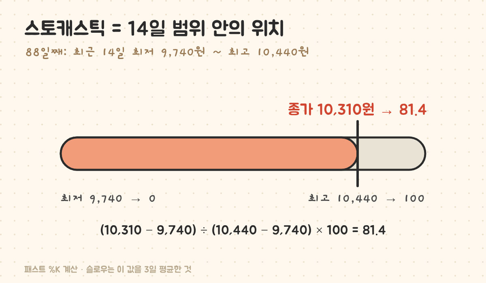
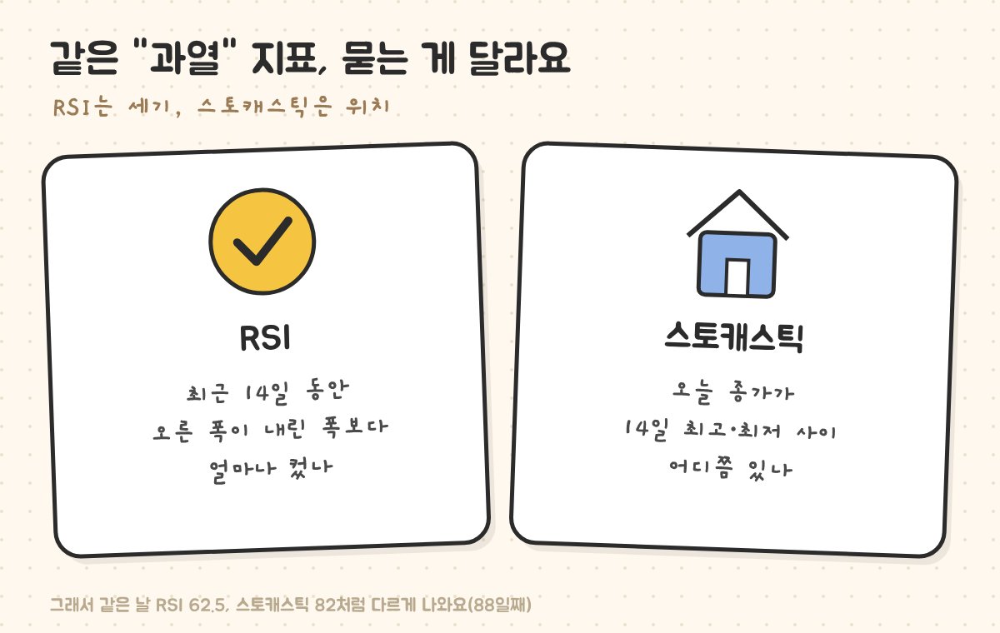
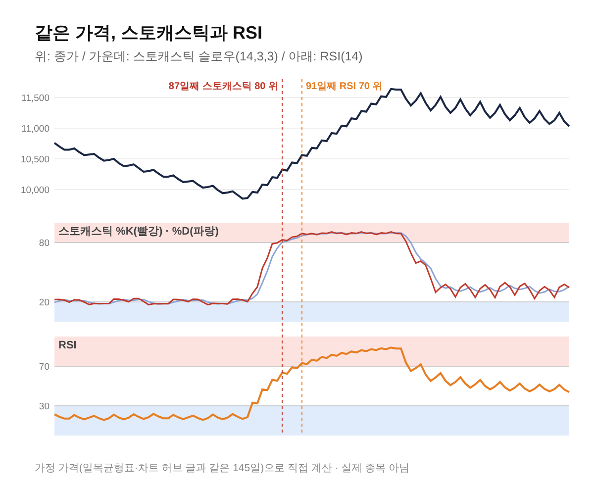

최종 검토일: 2026-11-04

스토캐스틱은 오늘 종가가 최근 14일 최고가와 최저가 사이 어디쯤 있는지를 0~100으로 나타낸 지표예요. 80 위면 범위의 꼭대기 근처, 20 아래면 바닥 근처라는 뜻이고, 보통 이 값을 한 번 더 부드럽게 만든 <b>스토캐스틱 슬로우</b>를 봐요.

RSI와 똑같이 "과열"을 본다고 알려져 있지만, 둘은 묻는 질문이 달라요. 같은 가정 가격으로 두 지표를 나란히 계산해서, 어디서 같은 말을 하고 어디서 갈리는지 볼게요.

  <strong style="color:#1e4e36;font-size:18px;">📏 같은 가격, 다른 대답</strong>
  <ul style="margin:10px 0 0 0;padding-left:20px;line-height:1.9;">
    <li><b>오르기 시작할 때:</b> 스토캐스틱은 87일째 80을 넘었고, RSI는 91일째에야 70을 넘었어요.</li>
    <li><b>천천히 내릴 때:</b> RSI는 66일 내내 30 아래였지만, 스토캐스틱은 20 근처를 7번 들락날락했어요.</li>
    <li><b>교차는 많아요:</b> %K와 %D가 145일 동안 50번 엇갈렸어요.</li>
  </ul>

<h2 style="border-left:6px solid #2f6f4f;padding-left:12px;margin-top:36px;">목차</h2>
<ol style="line-height:1.9;">
  <li><a href="#sec-1" style="color:inherit;text-decoration:underline;text-underline-offset:3px;">스토캐스틱 공식: 패스트와 슬로우</a></li>
  <li><a href="#sec-2" style="color:inherit;text-decoration:underline;text-underline-offset:3px;">88일째 스토캐스틱 직접 계산</a></li>
  <li><a href="#sec-3" style="color:inherit;text-decoration:underline;text-underline-offset:3px;">RSI와 무엇이 다른가</a></li>
  <li><a href="#sec-4" style="color:inherit;text-decoration:underline;text-underline-offset:3px;">같은 가격으로 비교한 145일</a></li>
  <li><a href="#sec-5" style="color:inherit;text-decoration:underline;text-underline-offset:3px;">스토캐스틱이 틀리는 경우 3가지</a></li>
  <li><a href="#sec-6" style="color:inherit;text-decoration:underline;text-underline-offset:3px;">스토캐스틱 Q&amp;A 5개</a></li>
</ol>

<h2 id="sec-1" style="scroll-margin-top:72px;border-left:6px solid #2f6f4f;padding-left:12px;margin-top:36px;">스토캐스틱 공식: 패스트와 슬로우</h2>

스토캐스틱은 조지 레인(George Lane)이 고안한 지표예요. 계산은 세 단계예요.

<table style="width:100%;border-collapse:collapse;margin:16px 0;">
  <thead>
    <tr style="background:#f0f0f0;">
      <th style="border:1px solid #ddd;padding:8px;text-align:left;">이름</th>
      <th style="border:1px solid #ddd;padding:8px;text-align:left;">계산</th>
    </tr>
  </thead>
  <tbody>
    <tr><td style="border:1px solid #ddd;padding:8px;">패스트 %K</td><td style="border:1px solid #ddd;padding:8px;">(오늘 종가 − 14일 최저가) ÷ (14일 최고가 − 14일 최저가) × 100</td></tr>
    <tr><td style="border:1px solid #ddd;padding:8px;">패스트 %D = 슬로우 %K</td><td style="border:1px solid #ddd;padding:8px;">패스트 %K의 3일 평균</td></tr>
    <tr><td style="border:1px solid #ddd;padding:8px;">슬로우 %D</td><td style="border:1px solid #ddd;padding:8px;">슬로우 %K의 3일 평균</td></tr>
  </tbody>
</table>

패스트 %K는 하루하루 너무 크게 흔들려서, 3일 평균을 한 번 더 낸 슬로우를 주로 써요. 설정을 "14, 3, 3"처럼 적는 게 이 세 숫자예요. 증권사 앱마다 기본값이 다를 수 있으니 설정 화면의 숫자를 먼저 보면 돼요.

<h2 id="sec-2" style="scroll-margin-top:72px;border-left:6px solid #2f6f4f;padding-left:12px;margin-top:36px;">88일째 스토캐스틱 직접 계산</h2>

아래 예시 가격(가정값)에서 오르기 시작한 지 일주일쯤 된 88일째를 계산해 볼게요.

<figure style="margin:24px 0;"><figcaption style="font-size:13px;color:#888;">14일 범위를 0~100 막대로 놓고 종가가 어디 있는지 재는 거예요.</figcaption></figure>

<table style="width:100%;border-collapse:collapse;margin:16px 0;">
  <thead>
    <tr style="background:#f0f0f0;">
      <th style="border:1px solid #ddd;padding:8px;text-align:left;">항목</th>
      <th style="border:1px solid #ddd;padding:8px;text-align:left;">계산</th>
      <th style="border:1px solid #ddd;padding:8px;text-align:left;">값</th>
    </tr>
  </thead>
  <tbody>
    <tr><td style="border:1px solid #ddd;padding:8px;">패스트 %K</td><td style="border:1px solid #ddd;padding:8px;">(10,310 − 9,740) ÷ (10,440 − 9,740) × 100</td><td style="border:1px solid #ddd;padding:8px;">81.4</td></tr>
    <tr><td style="border:1px solid #ddd;padding:8px;">슬로우 %K</td><td style="border:1px solid #ddd;padding:8px;">86~88일째 패스트 %K(81.8, 82.9, 81.4)의 평균</td><td style="border:1px solid #ddd;padding:8px;">82.0</td></tr>
    <tr><td style="border:1px solid #ddd;padding:8px;">슬로우 %D</td><td style="border:1px solid #ddd;padding:8px;">86~88일째 슬로우 %K(79.6, 82.8, 82.0)의 평균</td><td style="border:1px solid #ddd;padding:8px;">81.5</td></tr>
    <tr><td style="border:1px solid #ddd;padding:8px;">같은 날 RSI(14)</td><td style="border:1px solid #ddd;padding:8px;">—</td><td style="border:1px solid #ddd;padding:8px;">62.5</td></tr>
  </tbody>
</table>

같은 날인데 스토캐스틱은 82로 "범위 꼭대기 근처"라고 하고, RSI는 62.5로 "중간보다 조금 위"라고 해요. 둘 중 하나가 틀린 게 아니라, 재는 것이 달라서 생기는 차이예요.

<h2 id="sec-3" style="scroll-margin-top:72px;border-left:6px solid #2f6f4f;padding-left:12px;margin-top:36px;">RSI와 무엇이 다른가</h2>

<figure style="margin:24px 0;"><figcaption style="font-size:13px;color:#888;">RSI는 "얼마나 세게", 스토캐스틱은 "범위 안 어디쯤"을 물어요.</figcaption></figure>

<table style="width:100%;border-collapse:collapse;margin:16px 0;">
  <thead>
    <tr style="background:#f0f0f0;">
      <th style="border:1px solid #ddd;padding:8px;text-align:left;">구분</th>
      <th style="border:1px solid #ddd;padding:8px;text-align:left;">RSI</th>
      <th style="border:1px solid #ddd;padding:8px;text-align:left;">스토캐스틱</th>
    </tr>
  </thead>
  <tbody>
    <tr><td style="border:1px solid #ddd;padding:8px;">재료</td><td style="border:1px solid #ddd;padding:8px;">매일 종가의 오른 폭·내린 폭</td><td style="border:1px solid #ddd;padding:8px;">종가 + 14일 최고가·최저가</td></tr>
    <tr><td style="border:1px solid #ddd;padding:8px;">질문</td><td style="border:1px solid #ddd;padding:8px;">최근 오름이 내림보다 얼마나 셌나</td><td style="border:1px solid #ddd;padding:8px;">오늘 종가가 최근 범위 어디쯤인가</td></tr>
    <tr><td style="border:1px solid #ddd;padding:8px;">흔히 쓰는 기준</td><td style="border:1px solid #ddd;padding:8px;">70 위·30 아래</td><td style="border:1px solid #ddd;padding:8px;">80 위·20 아래</td></tr>
    <tr><td style="border:1px solid #ddd;padding:8px;">반응 속도</td><td style="border:1px solid #ddd;padding:8px;">느린 편</td><td style="border:1px solid #ddd;padding:8px;">빠른 편</td></tr>
  </tbody>
</table>

RSI를 직접 계산하는 과정은 <a href="https://sensitiveboss3.tistory.com/entry/rsi-meaning-14day-calculation" target="_blank" rel="noopener">RSI 14일 값 직접 구하기</a>에 있어요.

<h2 id="sec-4" style="scroll-margin-top:72px;border-left:6px solid #2f6f4f;padding-left:12px;margin-top:36px;">같은 가격으로 비교한 145일</h2>

차트 허브 글과 같은 145일 가정 가격으로 두 지표를 계산했어요. 80일째까지 천천히 내리고, 81일째부터 오르다가, 110일째쯤부터 옆으로 흔들려요.

<figure style="margin:24px 0;"><figcaption style="font-size:13px;color:#888;">분홍 칸은 과열(스토캐스틱 80·RSI 70 위), 파란 칸은 침체(20·30 아래) 구간이에요.</figcaption></figure>

<table style="width:100%;border-collapse:collapse;margin:16px 0;">
  <thead>
    <tr style="background:#f0f0f0;">
      <th style="border:1px solid #ddd;padding:8px;text-align:left;">구간</th>
      <th style="border:1px solid #ddd;padding:8px;text-align:left;">RSI</th>
      <th style="border:1px solid #ddd;padding:8px;text-align:left;">스토캐스틱 슬로우</th>
    </tr>
  </thead>
  <tbody>
    <tr><td style="border:1px solid #ddd;padding:8px;">천천히 내림(15~80일째)</td><td style="border:1px solid #ddd;padding:8px;">30 아래 66일 연속</td><td style="border:1px solid #ddd;padding:8px;">20 아래를 7번 들락날락(합계 29일)</td></tr>
    <tr><td style="border:1px solid #ddd;padding:8px;">오르기 시작</td><td style="border:1px solid #ddd;padding:8px;">91일째 70 위</td><td style="border:1px solid #ddd;padding:8px;">87일째 80 위</td></tr>
    <tr><td style="border:1px solid #ddd;padding:8px;">과열 구간 머문 기간</td><td style="border:1px solid #ddd;padding:8px;">91~112일째(22일)</td><td style="border:1px solid #ddd;padding:8px;">87~112일째(26일)</td></tr>
    <tr><td style="border:1px solid #ddd;padding:8px;">%K·%D 교차 횟수</td><td style="border:1px solid #ddd;padding:8px;">—</td><td style="border:1px solid #ddd;padding:8px;">50번(내림 28·오름 8·횡보 14)</td></tr>
  </tbody>
</table>

천천히 내릴 때 스토캐스틱이 20을 들락날락한 이유는, 14일 범위의 바닥이 매일 같이 내려가면서 종가가 범위 바닥에서 조금만 떨어져도 값이 20 위로 올라오기 때문이에요. RSI는 매일 조금씩이라도 내린 날이 많으면 계속 낮게 머물러요.

<h2 id="sec-5" style="scroll-margin-top:72px;border-left:6px solid #2f6f4f;padding-left:12px;margin-top:36px;">스토캐스틱이 틀리는 경우 3가지</h2>

<ol style="line-height:1.9;">
  <li><b>80 위에 오래 머물러도 계속 올라요.</b> 예시에서 87~112일째 26일 동안 80 위였고, 그 사이 가격은 10,320원에서 최고 11,640원까지 올랐어요. 80은 "곧 떨어진다"가 아니라 "범위 꼭대기에서 끝나는 날이 이어진다"는 뜻이에요.</li>
  <li><b>%K·%D 교차가 너무 자주 나와요.</b> 145일 동안 50번, 평균 3일에 한 번꼴이에요. 특히 천천히 내리던 구간에서만 28번이었어요.</li>
  <li><b>범위가 좁으면 작은 움직임에도 크게 흔들려요.</b> 14일 최고·최저 차이가 작으면 몇십 원 움직임에도 0과 100 사이를 크게 오가요.</li>
</ol>

다른 지표와 함께 고르는 순서는 <a href="https://sensitiveboss3.tistory.com/entry/stock-chart-reading-guide" target="_blank" rel="noopener">주식 차트 보는법</a>에, 같은 가격의 볼린저밴드 계산은 <a href="https://sensitiveboss3.tistory.com/entry/bollinger-bands-calculation" target="_blank" rel="noopener">볼린저밴드 뜻과 계산법</a>에 있어요.

<h2 id="sec-6" style="scroll-margin-top:72px;border-left:6px solid #2f6f4f;padding-left:12px;margin-top:36px;">스토캐스틱 Q&amp;A 5개</h2>

  
스토캐스틱 계산 공식은 무엇인가요

  
패스트 %K는 (오늘 종가 − 14일 최저가) ÷ (14일 최고가 − 14일 최저가) × 100이에요. 슬로우 %K는 패스트 %K의 3일 평균, 슬로우 %D는 슬로우 %K의 3일 평균이에요.

  
스토캐스틱 패스트와 슬로우 차이는 뭔가요

  
패스트는 오늘 위치를 그대로 쓰고, 슬로우는 그 값을 3일 평균해서 덜 흔들리게 만든 거예요. 패스트의 %D가 슬로우의 %K가 되고, 그 3일 평균이 슬로우 %D예요.

  
스토캐스틱과 RSI 중 뭘 봐야 하나요

  
묻는 질문이 달라요. RSI는 최근 오름이 내림보다 얼마나 셌는지, 스토캐스틱은 오늘 종가가 14일 범위 어디쯤인지를 봐요. 같은 가격 예시에서 스토캐스틱이 과열 구간에 4일 먼저 들어갔지만 교차는 훨씬 잦았어요.

  
스토캐스틱 80 이상이면 떨어지나요

  
그렇지 않아요. 80 위는 종가가 최근 범위 꼭대기 근처라는 뜻이고, 오르는 흐름이 이어지면 오래 머물러요. 예시에서는 26일 동안 80 위에 있는 사이 가격이 1,300원 넘게 올랐어요.

  
스토캐스틱 설정 14, 3, 3은 무슨 뜻인가요

  
14는 최고가·최저가를 찾는 기간, 첫 번째 3은 패스트 %K를 평균하는 날수(슬로우 %K), 두 번째 3은 그 값을 다시 평균하는 날수(슬로우 %D)예요. 앱마다 기본값이 다를 수 있어요.

  참고 출처:
  <ul style="margin:6px 0 0 0;padding-left:20px;">
    <li><a href="https://www.metatrader5.com/en/terminal/help/indicators/oscillators/so" target="_blank" rel="noopener">MetaTrader 5 도움말: Stochastic Oscillator 공식</a></li>
    <li><a href="https://www.barchart.com/trader/help/studies/stoch_s.php" target="_blank" rel="noopener">Barchart: Stochastic Slow</a></li>
    <li>본문 계산: 가정 가격 145일(고가·저가·종가)로 직접 계산(실제 종목·시세 아님). RSI는 14일 와일더 방식.</li>
  </ul>
  기준일: 2026년 11월 4일.

정보 제공을 목적으로 쓴 글이며 특정 종목의 매수·매도를 권유하지 않아요. 예시 가격은 계산을 보여 주기 위한 가정값이고, 지표 신호가 미래 가격을 보장하지 않아요. 투자 판단과 그 결과에 대한 책임은 투자자 본인에게 있어요.

