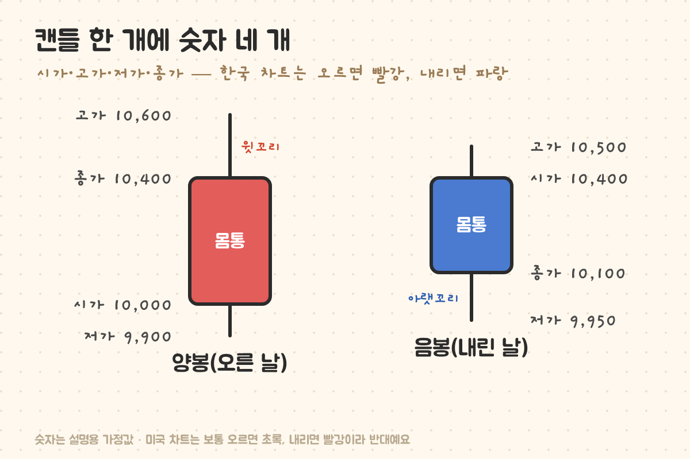
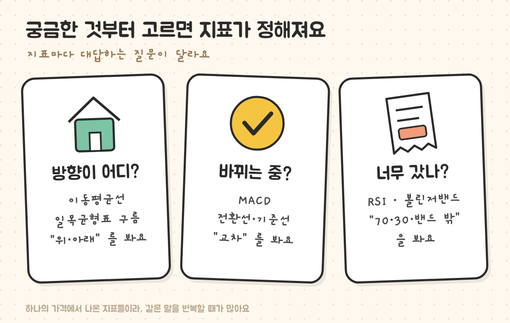
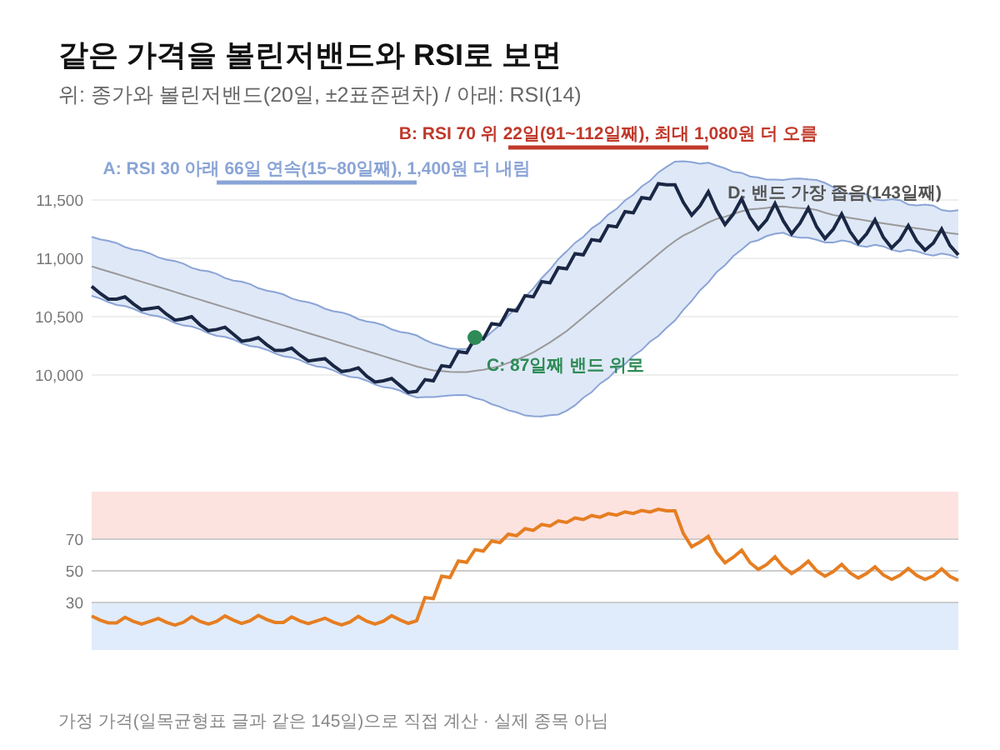

최종 검토일: 2026-11-02

주식 차트는 <mark>캔들(양봉·음봉)로 하루 가격을 보고, 이동평균선으로 방향을, 보조지표로 속도와 과열을 보는 순서</mark>로 읽으면 돼요. 캔들 하나에는 시가·고가·저가·종가 네 숫자가 들어 있고, 한국 차트는 오른 날을 빨간 양봉, 내린 날을 파란 음봉으로 그려요.

보조지표는 수십 가지지만 대답하는 질문은 세 가지뿐이에요. "방향이 어디냐", "바뀌는 중이냐", "너무 갔냐". 같은 가정 가격 하나로 지표들을 계산해서, 각 지표가 같은 장면을 어떻게 다르게 말하는지까지 볼게요.

  <strong style="color:#1e4e36;font-size:18px;">🧭 차트 화면을 위에서 아래로</strong>
  <ul style="margin:10px 0 0 0;padding-left:20px;line-height:1.9;">
    <li><b>맨 위 큰 창:</b> 캔들과 이동평균선(가격의 방향)</li>
    <li><b>가운데 막대:</b> 거래량(얼마나 많이 사고팔았나)</li>
    <li><b>맨 아래 작은 창:</b> RSI·MACD 같은 보조지표(속도·과열)</li>
  </ul>

<h2 style="border-left:6px solid #2f6f4f;padding-left:12px;margin-top:36px;">목차</h2>
<ol style="line-height:1.9;">
  <li><a href="#sec-1" style="color:inherit;text-decoration:underline;text-underline-offset:3px;">캔들 한 개 읽기: 양봉과 음봉</a></li>
  <li><a href="#sec-2" style="color:inherit;text-decoration:underline;text-underline-offset:3px;">꼬리와 몸통 길이로 보는 하루의 싸움</a></li>
  <li><a href="#sec-3" style="color:inherit;text-decoration:underline;text-underline-offset:3px;">궁금한 질문별로 고르는 보조지표</a></li>
  <li><a href="#sec-4" style="color:inherit;text-decoration:underline;text-underline-offset:3px;">같은 가격, 지표마다 다른 말</a></li>
  <li><a href="#sec-5" style="color:inherit;text-decoration:underline;text-underline-offset:3px;">차트를 볼 때 흔한 착각 3가지</a></li>
  <li><a href="#sec-6" style="color:inherit;text-decoration:underline;text-underline-offset:3px;">주식 차트 Q&amp;A 5개</a></li>
</ol>

<h2 id="sec-1" style="scroll-margin-top:72px;border-left:6px solid #2f6f4f;padding-left:12px;margin-top:36px;">캔들 한 개 읽기: 양봉과 음봉</h2>

일봉 차트에서 캔들 하나는 하루예요. <b>시가</b>(처음 거래된 가격)와 <b>종가</b>(마지막 가격) 사이가 굵은 몸통이고, 그날 가장 높았던 <b>고가</b>와 가장 낮았던 <b>저가</b>까지 가는 가는 선이 꼬리예요.

<figure style="margin:24px 0;"><figcaption style="font-size:13px;color:#888;">양봉은 종가가 위, 음봉은 시가가 위에 있어요. 몸통의 위아래가 뒤집힌다는 점만 기억하면 돼요.</figcaption></figure>

<table style="width:100%;border-collapse:collapse;margin:16px 0;">
  <thead>
    <tr style="background:#f0f0f0;">
      <th style="border:1px solid #ddd;padding:8px;text-align:left;">구분</th>
      <th style="border:1px solid #ddd;padding:8px;text-align:left;">조건</th>
      <th style="border:1px solid #ddd;padding:8px;text-align:left;">한국 차트 색</th>
      <th style="border:1px solid #ddd;padding:8px;text-align:left;">미국 차트 색(보통)</th>
    </tr>
  </thead>
  <tbody>
    <tr><td style="border:1px solid #ddd;padding:8px;"><mark>양봉</mark></td><td style="border:1px solid #ddd;padding:8px;">종가 &gt; 시가</td><td style="border:1px solid #ddd;padding:8px;">빨강</td><td style="border:1px solid #ddd;padding:8px;">초록</td></tr>
    <tr><td style="border:1px solid #ddd;padding:8px;"><mark>음봉</mark></td><td style="border:1px solid #ddd;padding:8px;">종가 &lt; 시가</td><td style="border:1px solid #ddd;padding:8px;">파랑</td><td style="border:1px solid #ddd;padding:8px;">빨강</td></tr>
  </tbody>
</table>

여기서 자주 헷갈리는 게 하나 있어요. 양봉은 <b>그날 시가보다 올랐다</b>는 뜻이지, 전날보다 올랐다는 뜻이 아니에요. 전날 종가 10,500원이던 주식이 10,000원에 시작해 10,400원에 끝나면 전날보다는 100원 내렸지만 캔들은 빨간 양봉이에요. 앱 화면의 등락률(전날 대비)과 캔들 색이 다를 수 있는 이유예요.

<h2 id="sec-2" style="scroll-margin-top:72px;border-left:6px solid #2f6f4f;padding-left:12px;margin-top:36px;">꼬리와 몸통 길이로 보는 하루의 싸움</h2>

위 그림의 양봉을 숫자로 풀면 하루 동안 무슨 일이 있었는지 보여요.

<table style="width:100%;border-collapse:collapse;margin:16px 0;">
  <thead>
    <tr style="background:#f0f0f0;">
      <th style="border:1px solid #ddd;padding:8px;text-align:left;">부분</th>
      <th style="border:1px solid #ddd;padding:8px;text-align:left;">계산</th>
      <th style="border:1px solid #ddd;padding:8px;text-align:left;">길이</th>
      <th style="border:1px solid #ddd;padding:8px;text-align:left;">읽는 법</th>
    </tr>
  </thead>
  <tbody>
    <tr><td style="border:1px solid #ddd;padding:8px;">전체(고가−저가)</td><td style="border:1px solid #ddd;padding:8px;">10,600 − 9,900</td><td style="border:1px solid #ddd;padding:8px;">700원</td><td style="border:1px solid #ddd;padding:8px;">하루에 움직인 폭</td></tr>
    <tr><td style="border:1px solid #ddd;padding:8px;">몸통(종가−시가)</td><td style="border:1px solid #ddd;padding:8px;">10,400 − 10,000</td><td style="border:1px solid #ddd;padding:8px;">400원(57%)</td><td style="border:1px solid #ddd;padding:8px;">시작부터 끝까지 실제로 오른 만큼</td></tr>
    <tr><td style="border:1px solid #ddd;padding:8px;">윗꼬리(고가−종가)</td><td style="border:1px solid #ddd;padding:8px;">10,600 − 10,400</td><td style="border:1px solid #ddd;padding:8px;">200원(29%)</td><td style="border:1px solid #ddd;padding:8px;">더 올랐다가 밀려 내려온 만큼</td></tr>
    <tr><td style="border:1px solid #ddd;padding:8px;">아랫꼬리(시가−저가)</td><td style="border:1px solid #ddd;padding:8px;">10,000 − 9,900</td><td style="border:1px solid #ddd;padding:8px;">100원(14%)</td><td style="border:1px solid #ddd;padding:8px;">빠졌다가 되돌아온 만큼</td></tr>
  </tbody>
</table>

몸통이 전체의 절반을 넘으면 그날은 한쪽 방향이 우세했던 날이에요. 반대로 몸통이 아주 짧고 꼬리만 길면(위아래로 많이 흔들렸지만 시작과 끝이 비슷하면) 사는 쪽과 파는 쪽이 팽팽했던 날로 읽어요. 몸통이 유난히 긴 빨간 캔들을 "장대양봉"이라고 불러요.

<h2 id="sec-3" style="scroll-margin-top:72px;border-left:6px solid #2f6f4f;padding-left:12px;margin-top:36px;">궁금한 질문별로 고르는 보조지표</h2>

보조지표를 많이 켤수록 잘 보이는 게 아니에요. 지금 궁금한 질문 하나를 정하고 그 질문에 맞는 지표만 켜는 편이 덜 헷갈려요.

<figure style="margin:24px 0;"><figcaption style="font-size:13px;color:#888;">세 질문에 하나씩만 골라도 충분해요.</figcaption></figure>

<table style="width:100%;border-collapse:collapse;margin:16px 0;">
  <thead>
    <tr style="background:#f0f0f0;">
      <th style="border:1px solid #ddd;padding:8px;text-align:left;">궁금한 것</th>
      <th style="border:1px solid #ddd;padding:8px;text-align:left;">지표</th>
      <th style="border:1px solid #ddd;padding:8px;text-align:left;">볼 곳</th>
      <th style="border:1px solid #ddd;padding:8px;text-align:left;">계산부터 보는 글</th>
    </tr>
  </thead>
  <tbody>
    <tr><td style="border:1px solid #ddd;padding:8px;">방향이 어디?</td><td style="border:1px solid #ddd;padding:8px;">이동평균선</td><td style="border:1px solid #ddd;padding:8px;">가격이 선 위인지 아래인지</td><td style="border:1px solid #ddd;padding:8px;"><a href="https://sensitiveboss3.tistory.com/entry/moving-average-5-20-day-cross" target="_blank" rel="noopener">이동평균선 5일 20일 계산</a></td></tr>
    <tr><td style="border:1px solid #ddd;padding:8px;">방향이 바뀌었나?</td><td style="border:1px solid #ddd;padding:8px;">골든·데드크로스</td><td style="border:1px solid #ddd;padding:8px;">짧은 선이 긴 선을 뚫는 날</td><td style="border:1px solid #ddd;padding:8px;"><a href="https://sensitiveboss3.tistory.com/entry/golden-cross-dead-cross-types" target="_blank" rel="noopener">골든크로스 뜻과 데드크로스</a></td></tr>
    <tr><td style="border:1px solid #ddd;padding:8px;">큰 흐름의 균형은?</td><td style="border:1px solid #ddd;padding:8px;">일목균형표</td><td style="border:1px solid #ddd;padding:8px;">구름 위·안·아래</td><td style="border:1px solid #ddd;padding:8px;"><a href="https://sensitiveboss3.tistory.com/entry/ichimoku-cloud-calculation" target="_blank" rel="noopener">일목균형표 보는법과 계산</a></td></tr>
    <tr><td style="border:1px solid #ddd;padding:8px;">바뀌는 중?</td><td style="border:1px solid #ddd;padding:8px;">MACD</td><td style="border:1px solid #ddd;padding:8px;">MACD와 시그널 교차</td><td style="border:1px solid #ddd;padding:8px;"><a href="https://sensitiveboss3.tistory.com/entry/macd-calculation-signal-line" target="_blank" rel="noopener">MACD 보는법과 계산법</a></td></tr>
    <tr><td style="border:1px solid #ddd;padding:8px;">너무 올랐나·내렸나?</td><td style="border:1px solid #ddd;padding:8px;">RSI</td><td style="border:1px solid #ddd;padding:8px;">70 위·30 아래</td><td style="border:1px solid #ddd;padding:8px;"><a href="https://sensitiveboss3.tistory.com/entry/rsi-meaning-14day-calculation" target="_blank" rel="noopener">RSI 14일 값 직접 구하기</a></td></tr>
    <tr><td style="border:1px solid #ddd;padding:8px;">범위 안 어디쯤?</td><td style="border:1px solid #ddd;padding:8px;">스토캐스틱</td><td style="border:1px solid #ddd;padding:8px;">80 위·20 아래, %K·%D 교차</td><td style="border:1px solid #ddd;padding:8px;"><a href="https://sensitiveboss3.tistory.com/entry/stochastic-slow-rsi-difference" target="_blank" rel="noopener">스토캐스틱 보는법과 RSI 차이</a></td></tr>
    <tr><td style="border:1px solid #ddd;padding:8px;">평소보다 크게 움직이나?</td><td style="border:1px solid #ddd;padding:8px;">볼린저밴드</td><td style="border:1px solid #ddd;padding:8px;">밴드 밖·밴드 폭</td><td style="border:1px solid #ddd;padding:8px;"><a href="https://sensitiveboss3.tistory.com/entry/bollinger-bands-calculation" target="_blank" rel="noopener">볼린저밴드 뜻과 계산법</a></td></tr>
  </tbody>
</table>

<h2 id="sec-4" style="scroll-margin-top:72px;border-left:6px solid #2f6f4f;padding-left:12px;margin-top:36px;">같은 가격, 지표마다 다른 말</h2>

일목균형표 글에서 쓴 가정 가격 145일을 그대로 써서 볼린저밴드와 RSI를 계산했어요. 가격은 80일째까지 천천히 내리고, 81일째부터 오르다가, 110일째쯤부터 옆으로 흔들려요.

<figure style="margin:24px 0;"><figcaption style="font-size:13px;color:#888;">RSI가 30 아래(파란 칸), 70 위(분홍 칸)에 오래 머무는 동안에도 가격은 같은 방향으로 계속 갔어요.</figcaption></figure>

<table style="width:100%;border-collapse:collapse;margin:16px 0;">
  <thead>
    <tr style="background:#f0f0f0;">
      <th style="border:1px solid #ddd;padding:8px;text-align:left;">장면</th>
      <th style="border:1px solid #ddd;padding:8px;text-align:left;">지표가 한 말</th>
      <th style="border:1px solid #ddd;padding:8px;text-align:left;">그 뒤 가격</th>
    </tr>
  </thead>
  <tbody>
    <tr><td style="border:1px solid #ddd;padding:8px;">A 15~80일째</td><td style="border:1px solid #ddd;padding:8px;">RSI 30 아래 66일 연속(과매도)</td><td style="border:1px solid #ddd;padding:8px;">11,260원 → 9,860원, <mark>1,400원 더 내림</mark></td></tr>
    <tr><td style="border:1px solid #ddd;padding:8px;">B 91~112일째</td><td style="border:1px solid #ddd;padding:8px;">RSI 70 위 22일 연속(과매수)</td><td style="border:1px solid #ddd;padding:8px;">10,560원 → 최고 11,640원, <mark>1,080원 더 오름</mark></td></tr>
    <tr><td style="border:1px solid #ddd;padding:8px;">C 87일째</td><td style="border:1px solid #ddd;padding:8px;">종가가 볼린저밴드 상단 위로</td><td style="border:1px solid #ddd;padding:8px;">오름이 막 시작된 자리였어요</td></tr>
    <tr><td style="border:1px solid #ddd;padding:8px;">D 143일째</td><td style="border:1px solid #ddd;padding:8px;">밴드 폭이 145일 중 가장 좁음</td><td style="border:1px solid #ddd;padding:8px;">가격이 좁게 오가는 구간</td></tr>
  </tbody>
</table>

A는 가정 가격이 너무 일정하게 내려서 생긴 극단적인 예예요. 그래도 말해 주는 건 분명해요. <b>"과매도·과매수"는 "곧 돌아선다"가 아니라 "한쪽으로 세게 가고 있다"는 뜻</b>이에요. 같은 날 이동평균선과 MACD는 "아직 내림"이라고 말하고 있었어요. 지표를 하나만 보면 이런 엇갈림을 놓쳐요.

<h2 id="sec-5" style="scroll-margin-top:72px;border-left:6px solid #2f6f4f;padding-left:12px;margin-top:36px;">차트를 볼 때 흔한 착각 3가지</h2>

<ol style="line-height:1.9;">
  <li><b>지표를 많이 켜면 더 확실해진다.</b> 이동평균선·MACD·볼린저밴드는 모두 같은 종가로 만든 값이라, 여러 개가 같은 말을 해도 확인이 세 번 된 게 아니라 같은 정보를 세 번 본 거예요.</li>
  <li><b>양봉이면 오른 날이다.</b> 양봉은 시가보다 오른 날이에요. 전날 대비 등락은 화면의 등락률로 따로 봐야 해요.</li>
  <li><b>신호가 나오면 그 방향으로 간다.</b> 모든 지표는 이미 지나간 가격으로 계산해요. 앞 장면 A·B처럼 신호와 반대로 한참 가는 일이 흔해요.</li>
</ol>

<h2 id="sec-6" style="scroll-margin-top:72px;border-left:6px solid #2f6f4f;padding-left:12px;margin-top:36px;">주식 차트 Q&amp;A 5개</h2>

  
주식 차트 보는법, 무엇부터 보나요

  
캔들로 하루 가격(시가·고가·저가·종가)을 먼저 보고, 이동평균선으로 방향을 본 다음, 궁금한 질문에 맞는 보조지표 하나를 더해요. 방향은 이동평균선·일목균형표, 변화는 MACD, 과열은 RSI·볼린저밴드가 맡아요.

  
양봉과 음봉은 어떻게 구분하나요

  
종가가 시가보다 높으면 양봉, 낮으면 음봉이에요. 한국 차트는 양봉을 빨강, 음봉을 파랑으로 그리고, 미국 차트는 보통 오르면 초록, 내리면 빨강이라 색이 반대예요.

  
양봉인데 등락률이 마이너스인 이유는 뭔가요

  
양봉은 그날 시가보다 종가가 높다는 뜻이고, 등락률은 전날 종가와 비교한 값이에요. 전날보다 낮게 시작해서 조금 오르고 끝나면 양봉이면서 등락률은 마이너스가 될 수 있어요.

  
윗꼬리가 길면 무슨 뜻인가요

  
그날 높이 올라갔다가 다시 밀려 내려와 끝났다는 뜻이에요. 고가와 종가의 차이가 윗꼬리 길이예요. 하루치 캔들 하나만으로 다음 날 방향을 판단하기는 어려워요.

  
보조지표는 몇 개를 켜는 게 좋나요

  
정해진 개수는 없지만, 같은 종가로 만든 지표를 여러 개 켜면 같은 정보를 반복해서 보게 돼요. 방향·변화·과열 질문에 하나씩, 많아도 두세 개 정도가 보기 편해요.

  참고 출처:
  <ul style="margin:6px 0 0 0;padding-left:20px;">
    <li>캔들 구성(시가·고가·저가·종가)과 지표 공식은 수학적 정의로, 본문 숫자는 가정값으로 직접 계산했어요(실제 종목·시세 아님).</li>
    <li>RSI: 14일 와일더 방식, 볼린저밴드: 20일 이동평균 ±2 표준편차로 계산했어요.</li>
  </ul>
  기준일: 2026년 11월 2일.

정보 제공을 목적으로 쓴 글이며 특정 종목의 매수·매도를 권유하지 않아요. 예시 가격은 계산을 보여 주기 위한 가정값이고, 지표 신호가 미래 가격을 보장하지 않아요. 투자 판단과 그 결과에 대한 책임은 투자자 본인에게 있어요.

