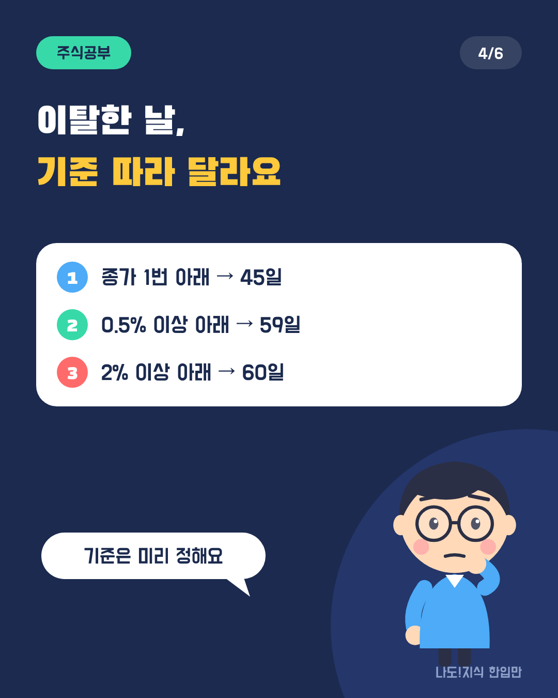
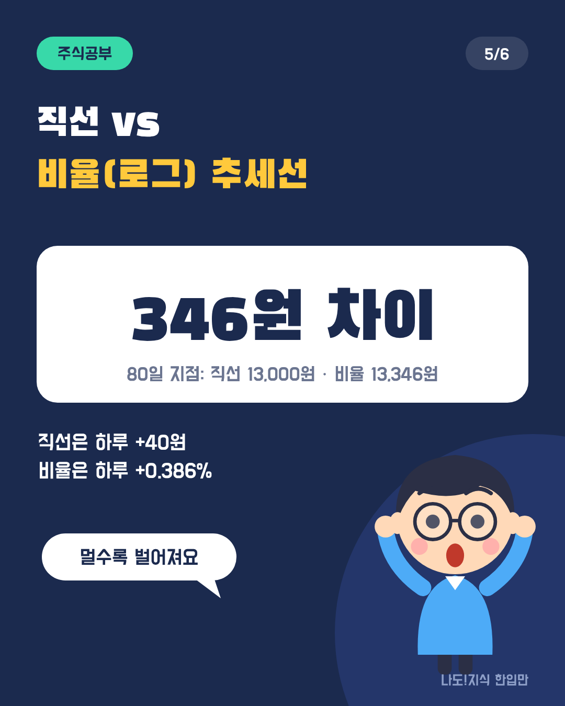
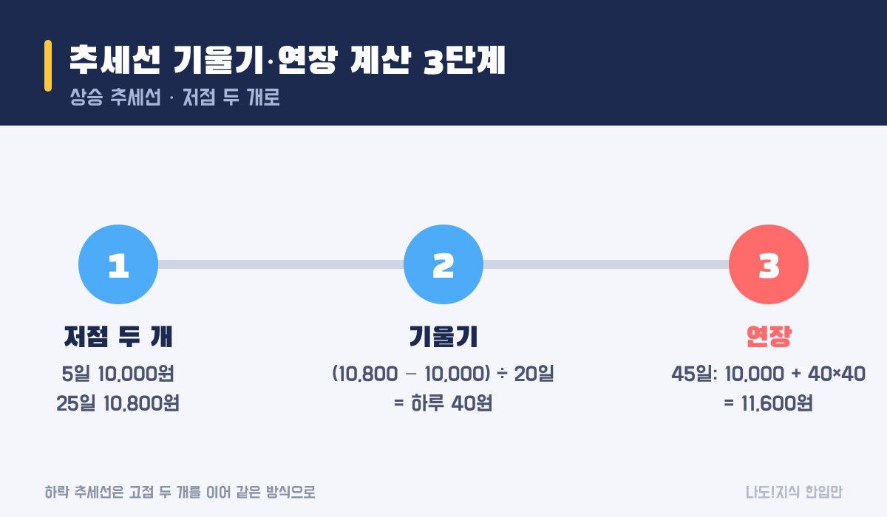
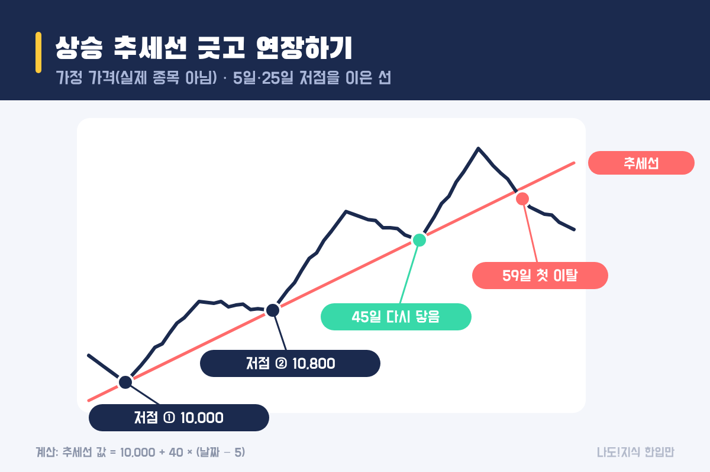
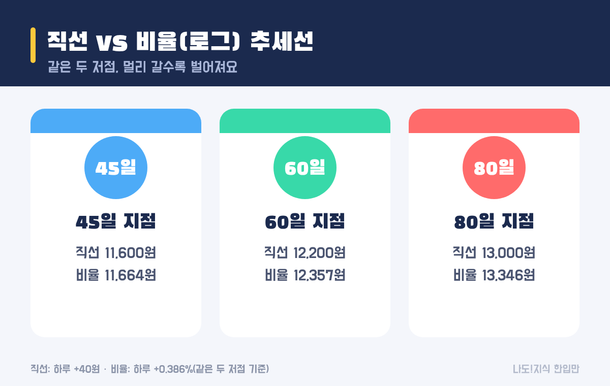

최종 검토일: 2026-11-09

추세선은 상승할 때는 저점끼리, 하락할 때는 고점끼리 이은 직선이에요. 두 점만 있으면 기울기를 숫자로 구할 수 있고, 추세선 가격 = 첫 저점 + 기울기 × 지난 날짜로 미래 날짜의 선 위치까지 계산할 수 있어요.

눈대중으로 긋는 대신 숫자로 구하면, 지금 가격이 선에 닿았는지, 뚫고 내려갔는지를 더 분명하게 말할 수 있어요. 가정 차트로 기울기, 연장선 가격, 이탈 판단까지 계산해 볼게요.

  <strong style="color:#1b2a4e;font-size:18px;">📐 한 줄 공식</strong>
  <ul style="margin:10px 0 0 0;padding-left:20px;line-height:1.9;">
    <li><b>기울기:</b> (두 번째 저점 − 첫 저점) ÷ 두 저점 사이 날짜 수</li>
    <li><b>연장선 가격:</b> 첫 저점 + 기울기 × (그날 − 첫 저점 날)</li>
    <li><b>예:</b> 5일 10,000원, 25일 10,800원 → 하루 40원 → 45일 선 가격 <b>11,600원</b></li>
  </ul>

옆으로 넘겨 보세요 → (카드 6장 요약)

<h2 style="border-left:6px solid #1b2a4e;padding-left:12px;margin-top:36px;">목차</h2>
<ol style="line-height:1.9;">
  <li><a href="#sec-1" style="color:inherit;text-decoration:underline;text-underline-offset:3px;">추세선이란 무엇이고 어떻게 긋나요?</a></li>
  <li><a href="#sec-2" style="color:inherit;text-decoration:underline;text-underline-offset:3px;">추세선 기울기는 어떻게 계산하나요?</a></li>
  <li><a href="#sec-3" style="color:inherit;text-decoration:underline;text-underline-offset:3px;">가정 차트로 본 재접촉과 이탈</a></li>
  <li><a href="#sec-4" style="color:inherit;text-decoration:underline;text-underline-offset:3px;">추세선 이탈은 언제로 볼까요?</a></li>
  <li><a href="#sec-5" style="color:inherit;text-decoration:underline;text-underline-offset:3px;">직선 추세선과 비율(로그) 추세선의 차이</a></li>
  <li><a href="#sec-6" style="color:inherit;text-decoration:underline;text-underline-offset:3px;">한계: 어디를 잇느냐에 따라 달라져요</a></li>
  <li><a href="#sec-7" style="color:inherit;text-decoration:underline;text-underline-offset:3px;">추세선 Q&amp;A 5개</a></li>
</ol>

<h2 id="sec-1" style="scroll-margin-top:72px;border-left:6px solid #1b2a4e;padding-left:12px;margin-top:36px;">추세선이란 무엇이고 어떻게 긋나요?</h2>

추세선은 주가가 오르거나 내리는 방향을 한 줄로 보여 주는 보조선이에요. 상승 추세는 <b>점점 높아지는 저점 두 개</b>를, 하락 추세는 <b>점점 낮아지는 고점 두 개</b>를 이어서 그어요.

<table style="width:100%;border-collapse:collapse;margin:16px 0;">
  <thead>
    <tr style="background:#1b2a4e;color:#fff;"><th style="border:1px solid #ddd;padding:8px;">종류</th><th style="border:1px solid #ddd;padding:8px;">잇는 점</th><th style="border:1px solid #ddd;padding:8px;">흔히 하는 해석</th></tr>
  </thead>
  <tbody>
    <tr><td style="border:1px solid #ddd;padding:8px;">상승 추세선</td><td style="border:1px solid #ddd;padding:8px;">높아지는 저점 2개</td><td style="border:1px solid #ddd;padding:8px;">선 근처가 받쳐 주는 자리(지지)로 봐요</td></tr>
    <tr><td style="border:1px solid #ddd;padding:8px;">하락 추세선</td><td style="border:1px solid #ddd;padding:8px;">낮아지는 고점 2개</td><td style="border:1px solid #ddd;padding:8px;">선 근처가 눌러 주는 자리(저항)로 봐요</td></tr>
  </tbody>
</table>

두 점으로 선을 긋고, 나중에 가격이 그 선에 <b>세 번째로 닿으면</b> 더 의미 있게 보는 경우가 많아요. 점을 고를 때 종가를 쓸지 장중 저가를 쓸지는 정해 두고 계속 같은 기준을 쓰는 게 중요해요.

<h2 id="sec-2" style="scroll-margin-top:72px;border-left:6px solid #1b2a4e;padding-left:12px;margin-top:36px;">추세선 기울기는 어떻게 계산하나요?</h2>

기울기는 두 저점의 가격 차이를 그 사이 날짜 수로 나눈 값이에요. 기울기를 알면 원하는 날짜의 추세선 가격을 바로 구할 수 있어요.

<figure style="margin:24px 0;"><figcaption style="font-size:13px;color:#888;">날짜는 거래일 기준으로 세요. 주말·휴일은 빼요.</figcaption></figure>

<ol style="line-height:1.9;">
  <li><b>저점 두 개 고르기:</b> 5일 10,000원, 25일 10,800원</li>
  <li><b>기울기:</b> (10,800 − 10,000) ÷ (25 − 5) = 800 ÷ 20 = 하루 40원</li>
  <li><b>연장:</b> 그날 추세선 가격 = 10,000 + 40 × (그날 − 5). 45일이면 10,000 + 40 × 40 = 11,600원</li>
</ol>

<table style="width:100%;border-collapse:collapse;margin:16px 0;">
  <thead>
    <tr style="background:#1b2a4e;color:#fff;"><th style="border:1px solid #ddd;padding:8px;">날짜</th><th style="border:1px solid #ddd;padding:8px;">45일</th><th style="border:1px solid #ddd;padding:8px;">59일</th><th style="border:1px solid #ddd;padding:8px;">60일</th><th style="border:1px solid #ddd;padding:8px;">80일</th></tr>
  </thead>
  <tbody>
    <tr><td style="border:1px solid #ddd;padding:8px;">추세선 가격</td><td style="border:1px solid #ddd;padding:8px;">11,600원</td><td style="border:1px solid #ddd;padding:8px;">12,160원</td><td style="border:1px solid #ddd;padding:8px;">12,200원</td><td style="border:1px solid #ddd;padding:8px;">13,000원</td></tr>
  </tbody>
</table>

<h2 id="sec-3" style="scroll-margin-top:72px;border-left:6px solid #1b2a4e;padding-left:12px;margin-top:36px;">가정 차트로 본 재접촉과 이탈</h2>

가정 차트에서는 45일에 가격이 추세선에 다시 닿았다가 오르고, 59일에 처음으로 선 아래에서 마감했어요.

<figure style="margin:24px 0;"><figcaption style="font-size:13px;color:#888;">실제 종목이 아닌 가정 가격이에요.</figcaption></figure>

<table style="width:100%;border-collapse:collapse;margin:16px 0;">
  <thead>
    <tr style="background:#1b2a4e;color:#fff;"><th style="border:1px solid #ddd;padding:8px;">날짜</th><th style="border:1px solid #ddd;padding:8px;">종가</th><th style="border:1px solid #ddd;padding:8px;">추세선</th><th style="border:1px solid #ddd;padding:8px;">차이</th></tr>
  </thead>
  <tbody>
    <tr><td style="border:1px solid #ddd;padding:8px;">45일(재접촉)</td><td style="border:1px solid #ddd;padding:8px;">11,580원</td><td style="border:1px solid #ddd;padding:8px;">11,600원</td><td style="border:1px solid #ddd;padding:8px;">−0.17%</td></tr>
    <tr><td style="border:1px solid #ddd;padding:8px;">59일(첫 이탈)</td><td style="border:1px solid #ddd;padding:8px;">12,040원</td><td style="border:1px solid #ddd;padding:8px;">12,160원</td><td style="border:1px solid #ddd;padding:8px;">−0.99%</td></tr>
    <tr><td style="border:1px solid #ddd;padding:8px;">60일</td><td style="border:1px solid #ddd;padding:8px;">11,950원</td><td style="border:1px solid #ddd;padding:8px;">12,200원</td><td style="border:1px solid #ddd;padding:8px;">−2.05%</td></tr>
  </tbody>
</table>

45일도 엄밀히는 선보다 20원(0.17%) 아래였어요. 이걸 '닿았다'로 볼지 '뚫었다'로 볼지는 아래처럼 미리 정한 기준에 따라 달라져요.

<h2 id="sec-4" style="scroll-margin-top:72px;border-left:6px solid #1b2a4e;padding-left:12px;margin-top:36px;">추세선 이탈은 언제로 볼까요?</h2>

정해진 정답은 없고, 어떤 기준을 쓰느냐에 따라 '이탈한 날'이 달라져요. 그래서 기준을 미리 정해 두고 똑같이 적용하는 게 중요해요.

<table style="width:100%;border-collapse:collapse;margin:16px 0;">
  <thead>
    <tr style="background:#1b2a4e;color:#fff;"><th style="border:1px solid #ddd;padding:8px;">이탈 기준(예)</th><th style="border:1px solid #ddd;padding:8px;">가정 차트 판단일</th><th style="border:1px solid #ddd;padding:8px;">특징</th></tr>
  </thead>
  <tbody>
    <tr><td style="border:1px solid #ddd;padding:8px;">종가가 선 아래 1번이라도</td><td style="border:1px solid #ddd;padding:8px;">45일(−0.17%)</td><td style="border:1px solid #ddd;padding:8px;">가장 빠르지만 가짜 이탈도 잦아요</td></tr>
    <tr><td style="border:1px solid #ddd;padding:8px;">종가가 선보다 0.5% 이상 아래</td><td style="border:1px solid #ddd;padding:8px;">59일(−0.99%)</td><td style="border:1px solid #ddd;padding:8px;">작은 흔들림은 걸러요</td></tr>
    <tr><td style="border:1px solid #ddd;padding:8px;">종가가 선보다 2% 이상 아래</td><td style="border:1px solid #ddd;padding:8px;">60일(−2.05%)</td><td style="border:1px solid #ddd;padding:8px;">확실하지만 한발 늦어요</td></tr>
  </tbody>
</table>

기준을 느슨하게 하면 빨리 알아채지만 헛신호가 늘고, 엄격하게 하면 헛신호는 줄지만 늦어요. 이 기준은 정답이 아니라 내가 정하는 규칙이에요.

<h2 id="sec-5" style="scroll-margin-top:72px;border-left:6px solid #1b2a4e;padding-left:12px;margin-top:36px;">직선 추세선과 비율(로그) 추세선의 차이</h2>

같은 두 저점이라도 '하루 몇 원씩 오른다(직선)'로 보느냐, '하루 몇 %씩 오른다(비율·로그)'로 보느냐에 따라 연장선이 달라요. 멀리 갈수록 차이가 커져요.

<figure style="margin:24px 0;"><figcaption style="font-size:13px;color:#888;">HTS에서 차트 눈금을 '로그'로 바꾸면 비율 추세선처럼 보여요.</figcaption></figure>

<ul style="line-height:1.9;">
  <li><b>직선:</b> 하루 +40원. 80일 추세선 가격 13,000원</li>
  <li><b>비율:</b> 20일에 8% 올랐으니 하루 약 +0.386%. 80일 추세선 가격 13,346원</li>
  <li><b>차이:</b> 45일 64원 → 60일 157원 → 80일 346원</li>
</ul>

가격이 몇 배씩 오르는 긴 기간 차트일수록 비율(로그) 눈금이 더 자연스럽다고 보는 사람이 많아요. 짧은 기간이면 둘의 차이가 작아요.

<h2 id="sec-6" style="scroll-margin-top:72px;border-left:6px solid #1b2a4e;padding-left:12px;margin-top:36px;">한계: 어디를 잇느냐에 따라 달라져요</h2>

추세선의 가장 큰 약점은 어떤 저점을 고르느냐에 따라 선이 완전히 달라진다는 점이에요.

<ul style="line-height:1.9;">
  <li><b>점 선택이 주관적이에요.</b> 5일 대신 0일 가격을 쓰거나 장중 저가를 쓰면 기울기가 바뀌어요.</li>
  <li><b>나중에 다시 긋게 돼요.</b> 이탈한 뒤 새 저점으로 선을 다시 그으면, 과거엔 '맞은' 것처럼 보이기 쉬워요.</li>
  <li><b>방향을 보장하지 않아요.</b> 선에 닿았다고 반드시 반등하는 것도, 이탈했다고 반드시 계속 내리는 것도 아니에요.</li>
</ul>

그래서 추세선은 단독 신호보다 다른 근거와 함께 보는 보조 도구로 쓰는 편이 무난해요. 이동평균선과 같이 보는 방법은 <a href="https://sensitiveboss3.tistory.com/entry/moving-average-5-20-day-cross" target="_blank" rel="noopener">이동평균선 계산과 크로스 보는 법</a>에, 큰 흐름을 파동으로 나눠 보는 방법은 <a href="https://sensitiveboss3.tistory.com/entry/elliott-wave-rules-count" target="_blank" rel="noopener">엘리어트 파동 3가지 규칙</a>에, 여러 지표를 함께 보는 순서는 <a href="https://sensitiveboss3.tistory.com/entry/stock-chart-reading-guide" target="_blank" rel="noopener">주식 차트 보는법</a>에 정리했어요.

<h2 id="sec-7" style="scroll-margin-top:72px;border-left:6px solid #1b2a4e;padding-left:12px;margin-top:36px;">추세선 Q&amp;A 5개</h2>

  
추세선은 어떻게 긋나요

  
상승 추세는 점점 높아지는 저점 두 개를, 하락 추세는 점점 낮아지는 고점 두 개를 이어요. 종가와 장중 저가 중 어느 쪽을 쓸지 정하고 같은 기준을 계속 쓰는 게 중요해요.

  
추세선 기울기는 어떻게 계산하나요

  
두 저점의 가격 차이를 그 사이 날짜 수로 나눠요. 5일 10,000원, 25일 10,800원이면 800 ÷ 20 = 하루 40원이에요.

  
미래 날짜의 추세선 가격은 어떻게 구하나요

  
첫 저점 + 기울기 × (그날 − 첫 저점 날)이에요. 위 예에서 45일 추세선 가격은 10,000 + 40 × 40 = 11,600원, 80일은 13,000원이에요.

  
추세선을 뚫으면 이탈인가요

  
기준에 따라 달라요. 종가가 한 번만 아래여도 이탈로 볼 수도 있고, 선보다 몇 % 이상 아래로 마감해야 이탈로 볼 수도 있어요. 가정 차트에서는 0.5% 기준이면 59일, 2% 기준이면 60일이 이탈일이에요.

  
로그 차트에서 그은 추세선은 뭐가 다른가요

  
로그 눈금에서는 '하루 몇 %씩'으로 연장돼서 직선 눈금보다 위로 휘어 올라가요. 같은 두 저점이라도 80일 지점에서 직선은 13,000원, 비율은 13,346원으로 346원 차이가 나요.

  참고:
  <ul style="margin:6px 0 0 0;padding-left:20px;">
    <li>기울기·연장식은 직선의 식, 비율 추세선은 같은 비율로 늘어나는 등비 계산으로 구했어요.</li>
    <li>예시 가격과 차트는 계산을 보여 주기 위한 가정값이에요(실제 종목 아님).</li>
  </ul>
  기준일: 2026년 11월 9일.

정보 제공을 목적으로 쓴 글이며 특정 종목의 매수·매도를 권유하지 않아요. 예시는 계산을 보여 주기 위한 가정값이고, 투자 판단과 그 결과에 대한 책임은 투자자 본인에게 있어요.

