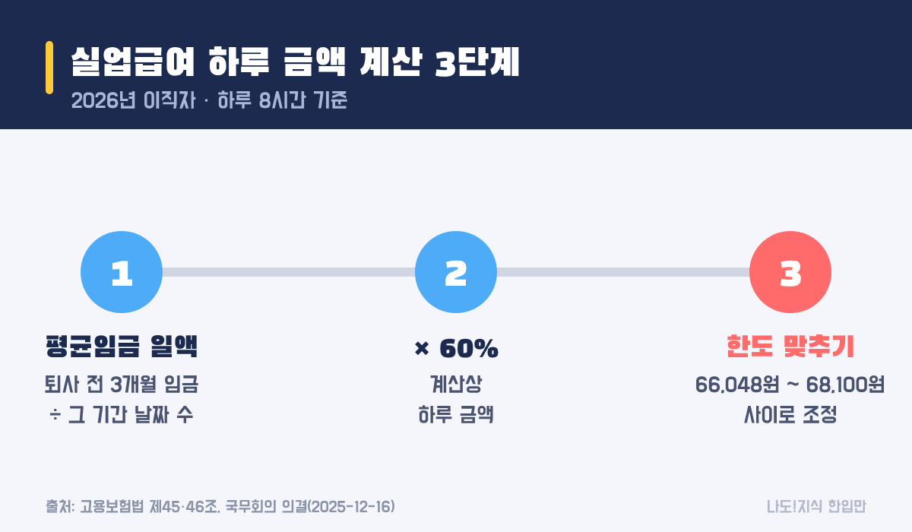
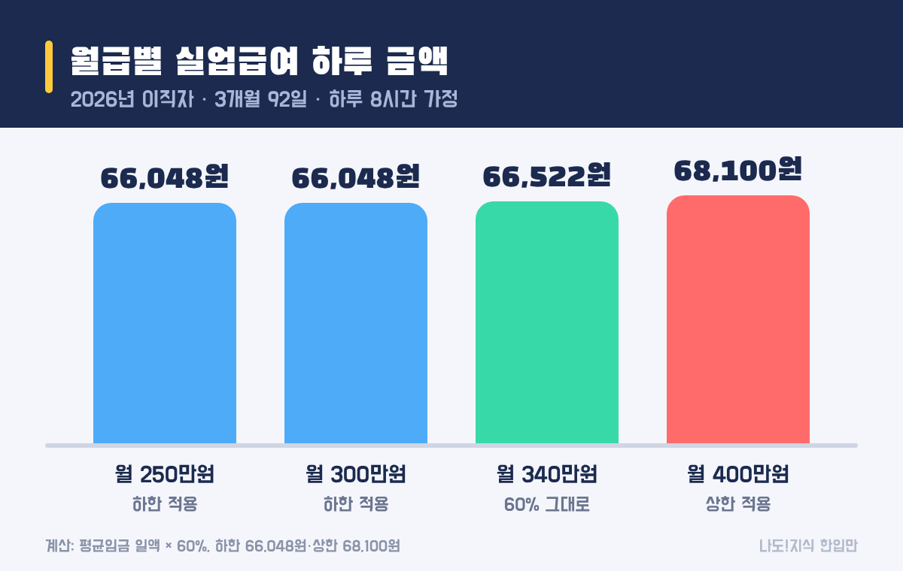
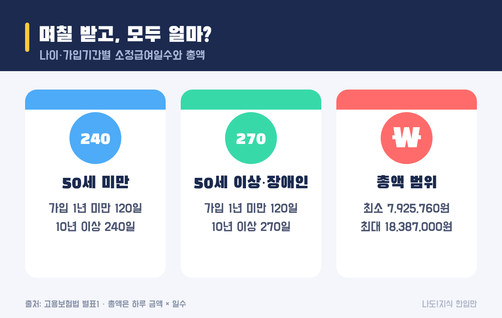

최종 검토일: 2026-11-04

2026년에 회사를 그만둔 사람의 실업급여(구직급여)는 <mark>하루 최대 6만8100원, 최소 6만6048원</mark>이에요(하루 8시간 일한 경우). 퇴사 전 평균임금의 60%로 계산하지만, 위아래 한도가 붙어 있어서 실제로는 월급이 꽤 달라도 하루 금액이 거의 같게 나와요.

그래서 "내 월급이면 얼마?"를 따질 때는 60%를 곱하는 것보다 한도에 걸리는지를 먼저 보는 게 빨라요. 월급별 예시와 받는 일수, 총액까지 순서대로 계산해 볼게요.

  <strong style="color:#1b2a4e;font-size:18px;">💼 먼저 볼 세 가지</strong>
  <ul style="margin:10px 0 0 0;padding-left:20px;line-height:1.9;">
    <li><b>하루 금액:</b> 평균임금의 60%, 단 <b>하한 66,048원 ~ 상한 68,100원</b> 안에서만 나와요.</li>
    <li><b>받는 일수:</b> 나이와 고용보험 가입기간에 따라 <b>120~270일</b>이에요.</li>
    <li><b>기한:</b> 퇴사 다음 날부터 <b>12개월 안에</b> 다 받아야 해요. 늦게 신청하면 남은 날을 못 받을 수 있어요.</li>
  </ul>

<h2 style="border-left:6px solid #1b2a4e;padding-left:12px;margin-top:36px;">목차</h2>
<ol style="line-height:1.9;">
  <li><a href="#sec-1" style="color:inherit;text-decoration:underline;text-underline-offset:3px;">2026년 실업급여 상한액·하한액</a></li>
  <li><a href="#sec-2" style="color:inherit;text-decoration:underline;text-underline-offset:3px;">하루 금액 계산법 3단계</a></li>
  <li><a href="#sec-3" style="color:inherit;text-decoration:underline;text-underline-offset:3px;">월급별 계산 예시: 60%가 그대로인 구간은 좁아요</a></li>
  <li><a href="#sec-4" style="color:inherit;text-decoration:underline;text-underline-offset:3px;">며칠 받나: 소정급여일수와 총액</a></li>
  <li><a href="#sec-5" style="color:inherit;text-decoration:underline;text-underline-offset:3px;">받을 수 있는 조건과 신청 순서</a></li>
  <li><a href="#sec-6" style="color:inherit;text-decoration:underline;text-underline-offset:3px;">2027년에 그만두면 달라지는 점</a></li>
  <li><a href="#sec-7" style="color:inherit;text-decoration:underline;text-underline-offset:3px;">실업급여 Q&amp;A 5개</a></li>
</ol>

<h2 id="sec-1" style="scroll-margin-top:72px;border-left:6px solid #1b2a4e;padding-left:12px;margin-top:36px;">2026년 실업급여 상한액·하한액</h2>

상한액은 2025년까지 하루 66,000원이었는데, 2026년 1월 1일 이후 이직자부터 <mark>68,100원</mark>으로 올랐어요. 2025년 12월 16일 국무회의에서 고용보험법 시행령 개정안이 의결됐고, 상한액이 바뀐 건 2019년 이후 6년 만이에요.

올린 이유는 하한액 때문이에요. 하한액은 최저임금에 붙어 움직이는데, 2026년 최저임금이 시간당 10,320원이 되면서 하한액(66,048원)이 옛 상한액(66,000원)보다 커지는 역전이 생겼거든요.

<table style="width:100%;border-collapse:collapse;margin:16px 0;">
  <thead>
    <tr style="background:#1b2a4e;color:#fff;"><th style="border:1px solid #ddd;padding:8px;">구분</th><th style="border:1px solid #ddd;padding:8px;">2026년 이직자</th><th style="border:1px solid #ddd;padding:8px;">계산 근거</th></tr>
  </thead>
  <tbody>
    <tr><td style="border:1px solid #ddd;padding:8px;">상한액(하루)</td><td style="border:1px solid #ddd;padding:8px;"><mark>68,100원</mark></td><td style="border:1px solid #ddd;padding:8px;">기초일액 상한 113,500원 × 60%</td></tr>
    <tr><td style="border:1px solid #ddd;padding:8px;">하한액(하루, 8시간)</td><td style="border:1px solid #ddd;padding:8px;"><mark>66,048원</mark></td><td style="border:1px solid #ddd;padding:8px;">최저임금 10,320원 × 8시간 × 80%</td></tr>
    <tr><td style="border:1px solid #ddd;padding:8px;">하한액(하루, 4시간)</td><td style="border:1px solid #ddd;padding:8px;">33,024원</td><td style="border:1px solid #ddd;padding:8px;">10,320원 × 4시간 × 80%</td></tr>
    <tr><td style="border:1px solid #ddd;padding:8px;">2025년 이직자 상한액</td><td style="border:1px solid #ddd;padding:8px;">66,000원</td><td style="border:1px solid #ddd;padding:8px;">퇴사일 기준이라 옛 금액 그대로</td></tr>
  </tbody>
</table>

어느 해 금액을 쓰는지는 <b>신청한 날이 아니라 이직일(퇴사일)</b>로 정해져요. 2025년 12월에 그만두고 2026년 1월에 신청했다면 2025년 금액이에요. 하루 일하는 시간이 8시간보다 짧았던 사람은 하한액도 시간에 맞춰 줄어들어요.

<h2 id="sec-2" style="scroll-margin-top:72px;border-left:6px solid #1b2a4e;padding-left:12px;margin-top:36px;">하루 금액 계산법 3단계</h2>

<figure style="margin:24px 0;"><figcaption style="font-size:13px;color:#888;">세 번째 단계에서 대부분 한도에 걸려요.</figcaption></figure>

<ol style="line-height:1.9;">
  <li><b>평균임금 일액 구하기:</b> 퇴사 전 3개월 동안 받은 임금 총액을 그 3개월의 날짜 수(보통 89~92일)로 나눠요. 이 금액이 통상임금보다 적으면 통상임금을 써요.</li>
  <li><b>60% 곱하기:</b> 평균임금 일액 × 0.6이 계산상 하루 금액이에요.</li>
  <li><b>한도 맞추기:</b> 68,100원보다 크면 68,100원, 66,048원보다 작으면 66,048원을 받아요.</li>
</ol>

정확한 임금 총액에는 상여금·연차수당 일부가 들어가는 등 따질 게 있어서, 내 금액은 고용24의 구직급여 모의계산이나 고용센터(☎1350)에서 확인하는 게 가장 정확해요.

<h2 id="sec-3" style="scroll-margin-top:72px;border-left:6px solid #1b2a4e;padding-left:12px;margin-top:36px;">월급별 계산 예시: 60%가 그대로인 구간은 좁아요</h2>

하루 8시간 일했고, 퇴사 전 3개월이 92일(예: 8~10월)이며, 매달 같은 금액을 받았다고 가정해 계산했어요.

<figure style="margin:24px 0;"><figcaption style="font-size:13px;color:#888;">월급 차이는 150만원인데 하루 금액 차이는 2,052원이에요.</figcaption></figure>

<table style="width:100%;border-collapse:collapse;margin:16px 0;">
  <thead>
    <tr style="background:#1b2a4e;color:#fff;"><th style="border:1px solid #ddd;padding:8px;">월급(세전)</th><th style="border:1px solid #ddd;padding:8px;">평균임금 일액</th><th style="border:1px solid #ddd;padding:8px;">× 60%</th><th style="border:1px solid #ddd;padding:8px;">실제 하루 금액</th></tr>
  </thead>
  <tbody>
    <tr><td style="border:1px solid #ddd;padding:8px;">250만원</td><td style="border:1px solid #ddd;padding:8px;">81,522원</td><td style="border:1px solid #ddd;padding:8px;">48,913원</td><td style="border:1px solid #ddd;padding:8px;"><mark>66,048원</mark> (하한)</td></tr>
    <tr><td style="border:1px solid #ddd;padding:8px;">300만원</td><td style="border:1px solid #ddd;padding:8px;">97,826원</td><td style="border:1px solid #ddd;padding:8px;">58,696원</td><td style="border:1px solid #ddd;padding:8px;"><mark>66,048원</mark> (하한)</td></tr>
    <tr><td style="border:1px solid #ddd;padding:8px;">340만원</td><td style="border:1px solid #ddd;padding:8px;">110,870원</td><td style="border:1px solid #ddd;padding:8px;">66,522원</td><td style="border:1px solid #ddd;padding:8px;"><mark>66,522원</mark> (60% 그대로)</td></tr>
    <tr><td style="border:1px solid #ddd;padding:8px;">400만원</td><td style="border:1px solid #ddd;padding:8px;">130,435원</td><td style="border:1px solid #ddd;padding:8px;">78,261원</td><td style="border:1px solid #ddd;padding:8px;"><mark>68,100원</mark> (상한)</td></tr>
  </tbody>
</table>

60%가 그대로 적용되려면 평균임금 일액이 <mark>110,080원(66,048÷0.6) ~ 113,500원(68,100÷0.6)</mark> 사이여야 해요. 위 가정(92일)으로 바꾸면 월급 약 <b>338만~348만원</b> 사이예요. 이보다 적으면 하한, 많으면 상한을 받으니, 하루 8시간 일한 2026년 이직자는 대부분 <b>66,048~68,100원</b> 사이에서 정해진다고 보면 돼요.

<h2 id="sec-4" style="scroll-margin-top:72px;border-left:6px solid #1b2a4e;padding-left:12px;margin-top:36px;">며칠 받나: 소정급여일수와 총액</h2>

받는 날 수(소정급여일수)는 <b>퇴사할 때 나이</b>와 <b>고용보험 가입기간</b>으로 정해져요. 장애인은 50세 이상과 같은 일수를 받아요.

<table style="width:100%;border-collapse:collapse;margin:16px 0;">
  <thead>
    <tr style="background:#1b2a4e;color:#fff;"><th style="border:1px solid #ddd;padding:8px;">가입기간</th><th style="border:1px solid #ddd;padding:8px;">1년 미만</th><th style="border:1px solid #ddd;padding:8px;">1~3년</th><th style="border:1px solid #ddd;padding:8px;">3~5년</th><th style="border:1px solid #ddd;padding:8px;">5~10년</th><th style="border:1px solid #ddd;padding:8px;">10년 이상</th></tr>
  </thead>
  <tbody>
    <tr><td style="border:1px solid #ddd;padding:8px;">50세 미만</td><td style="border:1px solid #ddd;padding:8px;">120일</td><td style="border:1px solid #ddd;padding:8px;">150일</td><td style="border:1px solid #ddd;padding:8px;">180일</td><td style="border:1px solid #ddd;padding:8px;">210일</td><td style="border:1px solid #ddd;padding:8px;">240일</td></tr>
    <tr><td style="border:1px solid #ddd;padding:8px;">50세 이상·장애인</td><td style="border:1px solid #ddd;padding:8px;">120일</td><td style="border:1px solid #ddd;padding:8px;">180일</td><td style="border:1px solid #ddd;padding:8px;">210일</td><td style="border:1px solid #ddd;padding:8px;">240일</td><td style="border:1px solid #ddd;padding:8px;"><mark>270일</mark></td></tr>
  </tbody>
</table>

<figure style="margin:24px 0;"><figcaption style="font-size:13px;color:#888;">총액은 하루 금액 × 받는 일수예요(2026년 이직자, 8시간 기준).</figcaption></figure>

<ul style="line-height:1.9;">
  <li><b>가장 적은 경우:</b> 하한 66,048원 × 120일 = <mark>7,925,760원</mark></li>
  <li><b>가장 많은 경우:</b> 상한 68,100원 × 270일 = <mark>18,387,000원</mark></li>
  <li><b>한 달(30일)로 치면:</b> 하한 1,981,440원 ~ 상한 2,043,000원</li>
</ul>

월급보다 일수가 총액을 훨씬 크게 바꿔요. 하루 금액 차이는 최대 2,052원이지만, 일수는 120일과 270일이 두 배 넘게 차이 나거든요.

<h2 id="sec-5" style="scroll-margin-top:72px;border-left:6px solid #1b2a4e;padding-left:12px;margin-top:36px;">받을 수 있는 조건과 신청 순서</h2>

<ul style="line-height:1.9;">
  <li><b>가입기간:</b> 퇴사 전 18개월 동안 고용보험에 가입해 일한 날(피보험 단위기간)이 합쳐서 180일 이상이어야 해요.</li>
  <li><b>퇴사 이유:</b> 권고사직, 계약 만료, 폐업처럼 본인 뜻이 아닌 이직이어야 해요. 자발적 퇴사는 원칙적으로 안 되고, 법에서 정한 정당한 사유가 있으면 예외로 인정돼요.</li>
  <li><b>재취업 활동:</b> 일할 의사와 능력이 있고, 구직 활동을 해야 계속 받을 수 있어요.</li>
</ul>

신청은 보통 <b>고용24에서 구직 등록 → 온라인 수급자격 교육 → 거주지 고용센터에서 수급자격 신청</b> 순서예요. 실업을 신고한 날부터 <b>7일은 대기기간</b>이라 지급되지 않고, 그 뒤로 정해진 날마다 실업인정을 받으며 나눠 받아요.

가장 많이 놓치는 건 기한이에요. 실업급여는 <mark>퇴사 다음 날부터 12개월 안에</mark>만 받을 수 있어서, 270일을 받을 수 있는 사람이 퇴사 후 5개월 지나 신청하면 남은 7개월 안에 들어가는 날까지만 받게 돼요. 퇴사했다면 바로 구직 등록부터 해 두는 게 좋아요.

<h2 id="sec-6" style="scroll-margin-top:72px;border-left:6px solid #1b2a4e;padding-left:12px;margin-top:36px;">2027년에 그만두면 달라지는 점</h2>

2027년 최저임금은 시간당 <b>10,700원</b>으로 정해졌어요(2026년 7월 14일 최저임금위원회 의결). 지금 산식을 그대로 넣으면 2027년 이직자의 하한액은 10,700원 × 8시간 × 80% = <mark>68,480원</mark>이 돼요. 2026년 상한액 68,100원보다 커서, 2026년처럼 상한액을 다시 손봐야 하는 상황이에요.

여기에 고용노동부가 상한액을 하한액에 연동하는 방식, 지급 기준을 주 7일에서 주 6일로 바꾸는 방식 등을 담은 제도 개편안을 논의 중이라는 보도가 나왔어요. 다만 <b>법·시행령 개정 전이라 금액과 시기는 확정되지 않았어요.</b> 확정되면 이 글의 표를 갱신할게요.

정리하면, 퇴사 시기를 고민 중이라면 <b>이직일이 2026년 12월 31일 이전이면 이 글의 2026년 금액</b>, 2027년 1월 1일 이후면 새로 확정될 금액이 적용돼요.

<h2 id="sec-7" style="scroll-margin-top:72px;border-left:6px solid #1b2a4e;padding-left:12px;margin-top:36px;">실업급여 Q&amp;A 5개</h2>

  
2026년 실업급여 하루 최대 금액은 얼마인가요

  
2026년 1월 1일 이후 이직자는 하루 68,100원이 최대예요. 최소는 하루 8시간 일한 경우 66,048원이에요.

  
실업급여는 월급의 60%를 받는 건가요

  
계산은 평균임금의 60%로 하지만 하한 66,048원과 상한 68,100원 사이로 맞춰요. 그래서 60%가 그대로 나오는 건 평균임금 일액이 110,080~113,500원인 좁은 구간뿐이고, 대부분은 하한이나 상한을 받아요.

  
실업급여는 며칠 동안 받을 수 있나요

  
퇴사할 때 나이와 고용보험 가입기간에 따라 120~270일이에요. 50세 미만은 최대 240일, 50세 이상과 장애인은 최대 270일이에요.

  
실업급여 총액은 최대 얼마인가요

  
2026년 이직자 기준으로 상한 68,100원 × 270일 = 18,387,000원이 최대예요. 가장 적은 경우는 하한 66,048원 × 120일 = 7,925,760원이에요.

  
퇴사하고 늦게 신청해도 되나요

  
퇴사 다음 날부터 12개월이 지나면 남은 날이 있어도 받을 수 없어요. 늦게 신청할수록 받을 수 있는 날이 줄 수 있으니 퇴사 후 바로 고용24에서 구직 등록을 하는 게 좋아요.

  참고 출처:
  <ul style="margin:6px 0 0 0;padding-left:20px;">
    <li><a href="https://www.segye.com/newsView/20251216507484" target="_blank" rel="noopener">세계일보: 구직급여 상한액 6만8100원으로 인상, 국무회의 의결(2025-12-16)</a></li>
    <li><a href="https://www.hankyung.com/article/202510022340Y" target="_blank" rel="noopener">한국경제: 실업급여 상한액 6년 만에 인상, 개정안 입법예고(2025-10)</a></li>
    <li><a href="https://www.law.go.kr/법령/고용보험법" target="_blank" rel="noopener">국가법령정보센터: 고용보험법 제40·45·46·48·49·50조, 별표1</a></li>
    <li><a href="https://v.daum.net/v/20260715085108633" target="_blank" rel="noopener">다음 뉴스: 2027년 최저임금 시급 1만700원 확정(2026-07-15)</a></li>
    <li><a href="https://kbmaeil.com/article/20260901500872" target="_blank" rel="noopener">경북매일: 실업급여 제도 개편안 보도(2026-09-01)</a></li>
    <li><a href="https://www.work24.go.kr" target="_blank" rel="noopener">고용24: 구직급여 모의계산·수급자격 신청</a></li>
  </ul>
  기준일: 2026년 11월 4일. 예시 금액은 매달 같은 임금, 3개월 92일, 하루 8시간을 가정한 계산이에요.

정보 제공을 목적으로 쓴 글이며, 개인별 수급 자격과 금액은 고용센터 심사로 정해져요. 정확한 금액은 고용24 모의계산이나 고용센터(☎1350)에서 확인해 주세요.

