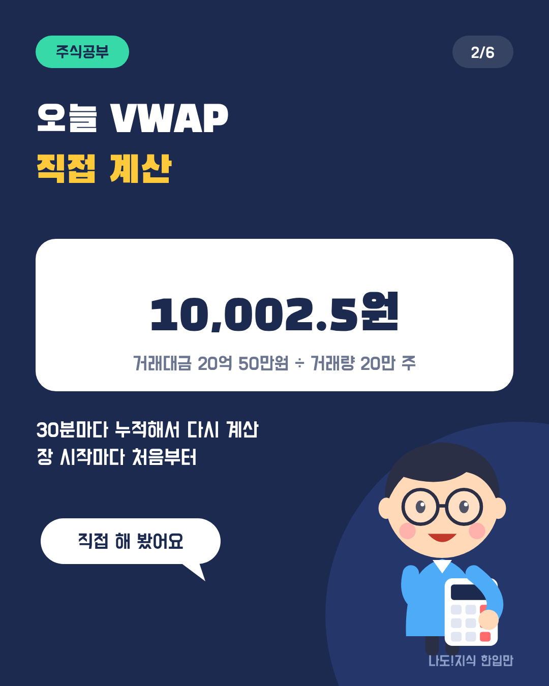
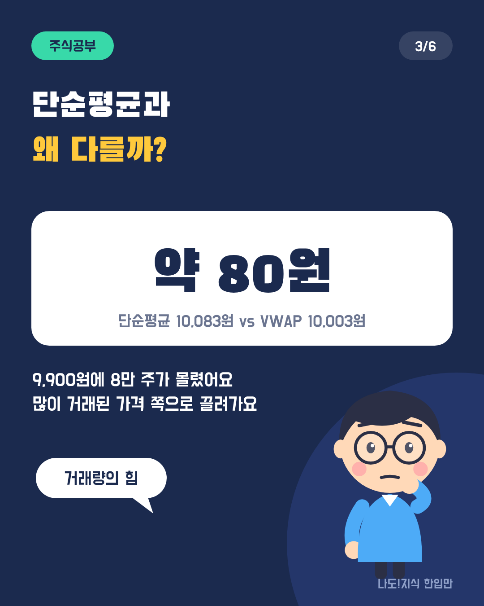
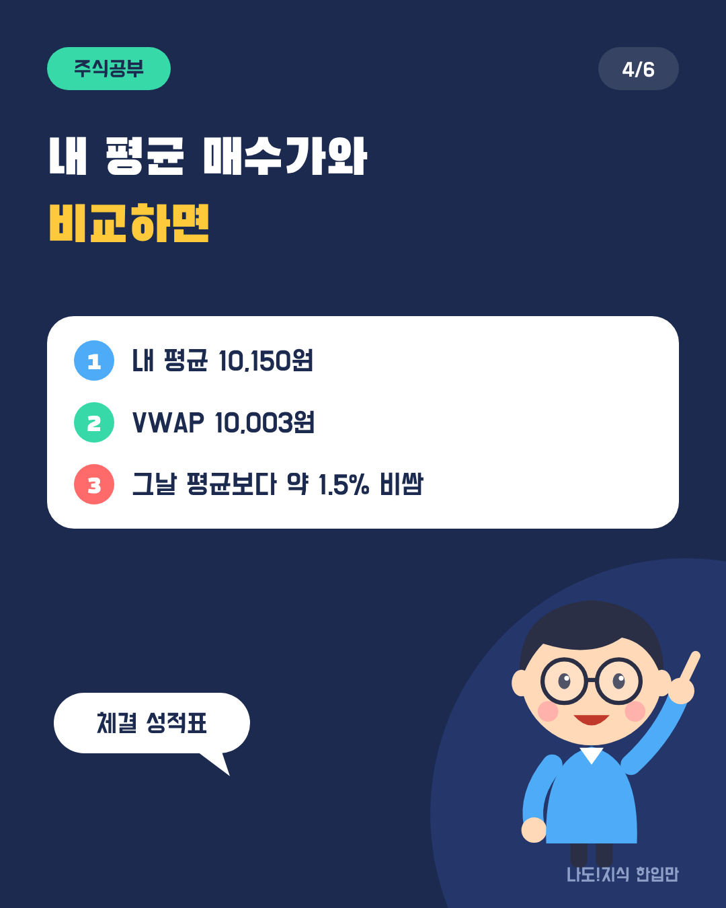
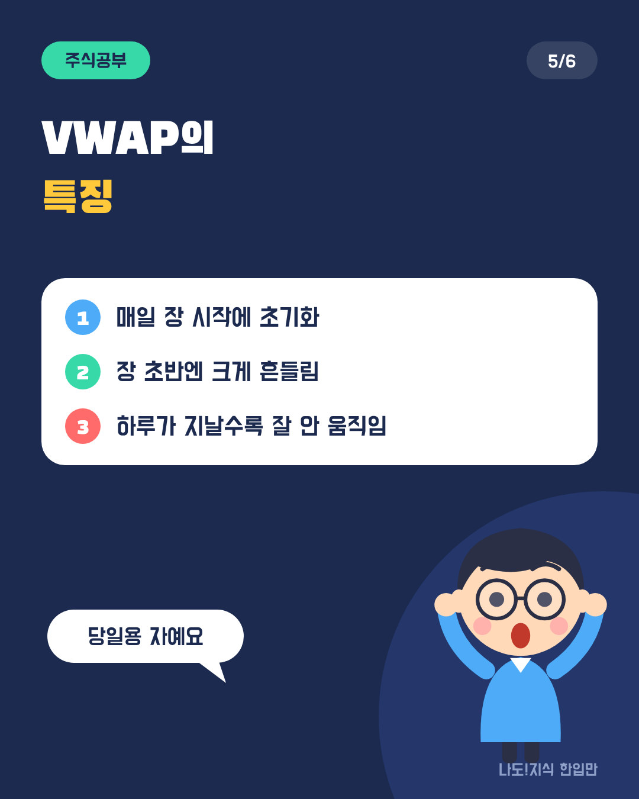
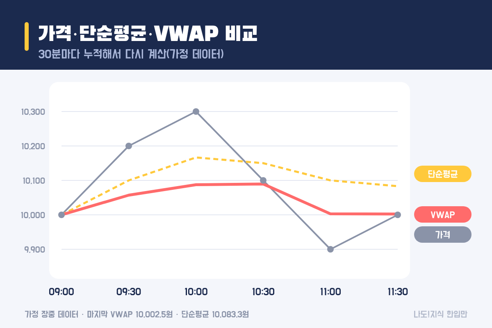
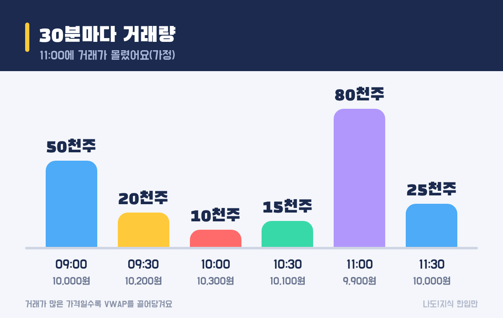
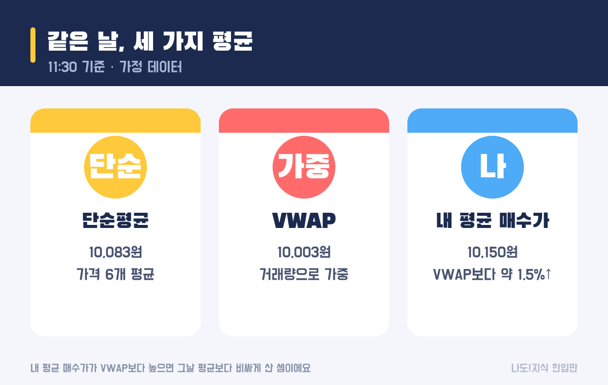

최종 검토일: 2026-11-18

VWAP는 그날 거래된 가격을 거래량만큼 무게를 줘서 평균 낸 값이에요. 거래량가중평균가격(Volume Weighted Average Price)의 줄임말이고, 공식은 Σ(가격 × 거래량) ÷ Σ거래량 한 줄이에요.

그냥 가격을 평균 내면 되지 왜 거래량을 곱할까요? 가정 데이터로 직접 계산해 보면 단순평균과 VWAP가 80원이나 차이 나는 이유가 보여요. 내 평균 매수가와 비교하는 법, 매일 처음부터 계산하는 이유까지 볼게요.

  <strong style="color:#1b2a4e;font-size:18px;">⚖️ 한눈에 보기</strong>
  <ul style="margin:10px 0 0 0;padding-left:20px;line-height:1.9;">
    <li><b>뜻:</b> 거래량으로 무게를 준 그날의 평균 가격</li>
    <li><b>공식:</b> 장 시작부터 거래대금 합계 ÷ 거래량 합계</li>
    <li><b>예시:</b> 단순평균 10,083원 vs VWAP 10,003원 (약 80원 차이)</li>
    <li><b>쓰임:</b> 내 체결 가격이 그날 평균보다 비쌌는지 확인</li>
    <li><b>특징:</b> 매일 장 시작에 초기화, 방향을 알려 주는 선은 아님</li>
  </ul>

옆으로 넘겨 보세요 → (카드 6장 요약)

  <strong style="font-size:16px;">📖 처음이라면 이것만 — 낱말 풀이</strong>
  <ul style="margin:8px 0 0 0;padding-left:20px;line-height:1.9;">
    <li><b>거래량:</b> 일정 시간 동안 사고팔린 주식 수.</li>
    <li><b>거래대금:</b> 가격 × 거래량. 실제로 오간 돈의 크기예요.</li>
    <li><b>가중평균:</b> 값마다 무게를 다르게 줘서 낸 평균. 많이 거래된 가격이 더 크게 반영돼요.</li>
    <li><b>Σ(시그마):</b> "모두 더한다"는 기호.</li>
    <li><b>체결:</b> 주문이 실제로 사고팔린 것. 내 평균 체결가 = 내가 실제로 산 평균 가격이에요.</li>
  </ul>

<h2 style="border-left:6px solid #1b2a4e;padding-left:12px;margin-top:36px;">목차</h2>
<ol style="line-height:1.9;">
  <li><a href="#sec-1" style="color:inherit;text-decoration:underline;text-underline-offset:3px;">VWAP는 무엇인가요?</a></li>
  <li><a href="#sec-2" style="color:inherit;text-decoration:underline;text-underline-offset:3px;">VWAP는 어떻게 계산하나요?</a></li>
  <li><a href="#sec-3" style="color:inherit;text-decoration:underline;text-underline-offset:3px;">단순평균과 VWAP는 왜 다른가요?</a></li>
  <li><a href="#sec-4" style="color:inherit;text-decoration:underline;text-underline-offset:3px;">내 평균 매수가와 VWAP를 비교하면?</a></li>
  <li><a href="#sec-5" style="color:inherit;text-decoration:underline;text-underline-offset:3px;">VWAP는 왜 매일 처음부터 계산하나요?</a></li>
  <li><a href="#sec-6" style="color:inherit;text-decoration:underline;text-underline-offset:3px;">HTS에서 VWAP 켜는 법 따라 하기</a></li>
  <li><a href="#sec-7" style="color:inherit;text-decoration:underline;text-underline-offset:3px;">자주 하는 오해 5가지</a></li>
  <li><a href="#sec-8" style="color:inherit;text-decoration:underline;text-underline-offset:3px;">VWAP Q&amp;A 5개</a></li>
</ol>

<h2 id="sec-1" style="scroll-margin-top:72px;border-left:6px solid #1b2a4e;padding-left:12px;margin-top:36px;">VWAP는 무엇인가요?</h2>

VWAP는 그날 시장 참여자들이 평균적으로 얼마에 사고팔았는지를 보여 주는 가격이에요. 단순히 가격들을 평균 내는 게 아니라, 많이 거래된 가격에 더 큰 무게를 줘요.

예를 들어 10,000원에 1주, 9,000원에 99주가 거래됐다면 단순평균은 9,500원이지만, 실제로 대부분의 거래는 9,000원에서 일어났죠. VWAP는 (10,000 × 1 + 9,000 × 99) ÷ 100 = 9,010원으로, 실제 거래 현실에 훨씬 가까워요.

그래서 기관 투자자들은 VWAP를 "오늘 우리 주문이 시장 평균보다 싸게 체결됐나"를 보는 기준으로 쓰기도 해요. 매수 평균 체결가가 VWAP보다 낮으면 평균보다 유리하게 샀다고 보는 식이에요.

<h2 id="sec-2" style="scroll-margin-top:72px;border-left:6px solid #1b2a4e;padding-left:12px;margin-top:36px;">VWAP는 어떻게 계산하나요?</h2>

VWAP는 장 시작부터 지금까지 가격 × 거래량을 모두 더하고, 거래량 합계로 나누면 돼요. 새 거래가 생길 때마다 분자와 분모에 더해서 다시 나누는 누적 계산이에요.

<figure style="margin:24px 0;"><figcaption style="font-size:13px;color:#888;">계산을 보여 주기 위한 가정 데이터예요. 실제 종목이 아니에요.</figcaption></figure>

<table style="width:100%;border-collapse:collapse;margin:16px 0;">
  <thead>
    <tr style="background:#1b2a4e;color:#fff;"><th style="border:1px solid #ddd;padding:8px;">시각</th><th style="border:1px solid #ddd;padding:8px;">가격</th><th style="border:1px solid #ddd;padding:8px;">거래량</th><th style="border:1px solid #ddd;padding:8px;">거래대금</th><th style="border:1px solid #ddd;padding:8px;">누적 거래대금</th><th style="border:1px solid #ddd;padding:8px;">누적 거래량</th><th style="border:1px solid #ddd;padding:8px;">VWAP</th></tr>
  </thead>
  <tbody>
    <tr><td style="border:1px solid #ddd;padding:8px;">09:00</td><td style="border:1px solid #ddd;padding:8px;">10,000원</td><td style="border:1px solid #ddd;padding:8px;">50,000주</td><td style="border:1px solid #ddd;padding:8px;">50,000만원</td><td style="border:1px solid #ddd;padding:8px;">50,000만원</td><td style="border:1px solid #ddd;padding:8px;">50,000주</td><td style="border:1px solid #ddd;padding:8px;"><b>10,000.0원</b></td></tr>
    <tr><td style="border:1px solid #ddd;padding:8px;">09:30</td><td style="border:1px solid #ddd;padding:8px;">10,200원</td><td style="border:1px solid #ddd;padding:8px;">20,000주</td><td style="border:1px solid #ddd;padding:8px;">20,400만원</td><td style="border:1px solid #ddd;padding:8px;">70,400만원</td><td style="border:1px solid #ddd;padding:8px;">70,000주</td><td style="border:1px solid #ddd;padding:8px;"><b>10,057.1원</b></td></tr>
    <tr><td style="border:1px solid #ddd;padding:8px;">10:00</td><td style="border:1px solid #ddd;padding:8px;">10,300원</td><td style="border:1px solid #ddd;padding:8px;">10,000주</td><td style="border:1px solid #ddd;padding:8px;">10,300만원</td><td style="border:1px solid #ddd;padding:8px;">80,700만원</td><td style="border:1px solid #ddd;padding:8px;">80,000주</td><td style="border:1px solid #ddd;padding:8px;"><b>10,087.5원</b></td></tr>
    <tr><td style="border:1px solid #ddd;padding:8px;">10:30</td><td style="border:1px solid #ddd;padding:8px;">10,100원</td><td style="border:1px solid #ddd;padding:8px;">15,000주</td><td style="border:1px solid #ddd;padding:8px;">15,150만원</td><td style="border:1px solid #ddd;padding:8px;">95,850만원</td><td style="border:1px solid #ddd;padding:8px;">95,000주</td><td style="border:1px solid #ddd;padding:8px;"><b>10,089.5원</b></td></tr>
    <tr><td style="border:1px solid #ddd;padding:8px;">11:00</td><td style="border:1px solid #ddd;padding:8px;">9,900원</td><td style="border:1px solid #ddd;padding:8px;">80,000주</td><td style="border:1px solid #ddd;padding:8px;">79,200만원</td><td style="border:1px solid #ddd;padding:8px;">175,050만원</td><td style="border:1px solid #ddd;padding:8px;">175,000주</td><td style="border:1px solid #ddd;padding:8px;"><b>10,002.9원</b></td></tr>
    <tr><td style="border:1px solid #ddd;padding:8px;">11:30</td><td style="border:1px solid #ddd;padding:8px;">10,000원</td><td style="border:1px solid #ddd;padding:8px;">25,000주</td><td style="border:1px solid #ddd;padding:8px;">25,000만원</td><td style="border:1px solid #ddd;padding:8px;">200,050만원</td><td style="border:1px solid #ddd;padding:8px;">200,000주</td><td style="border:1px solid #ddd;padding:8px;"><b>10,002.5원</b></td></tr>
  </tbody>
</table>

  <strong>✍️ 따라 해 보기 (09:30까지)</strong> 
  ① 09:00 거래대금: 10,000원 × 50,000주 = <b>5억원</b> 
  ② 09:30 거래대금: 10,200원 × 20,000주 = <b>2억 400만원</b> 
  ③ 누적: 7억 400만원 ÷ 누적 거래량 70,000주 = <b>10,057.1원</b> 
  ④ 단순평균이었다면: (10,000 + 10,200) ÷ 2 = 10,100원 → VWAP가 더 낮아요

③에서 VWAP가 10,100원이 아니라 10,057원인 이유는 09:00에 10,000원으로 거래된 양(5만 주)이 09:30 거래량(2만 주)보다 훨씬 많기 때문이에요. 실제 차트 프로그램은 1분봉 같은 짧은 봉으로 계산해서, 실제 체결 하나하나로 계산한 값과 아주 조금 다를 수 있어요.

<h2 id="sec-3" style="scroll-margin-top:72px;border-left:6px solid #1b2a4e;padding-left:12px;margin-top:36px;">단순평균과 VWAP는 왜 다른가요?</h2>

거래가 한 가격대에 몰리면 VWAP는 그쪽으로 끌려가요. 가정 데이터에서 11:00에 9,900원으로 8만 주가 거래되자 VWAP가 10,089.5원에서 10,002.9원으로 크게 내려왔어요.

<figure style="margin:24px 0;"><figcaption style="font-size:13px;color:#888;">11:00에 9,900원으로 거래가 몰렸어요(가정).</figcaption></figure>

반면 단순평균은 가격 6개를 똑같이 취급해서 10,083.3원이에요. 거래가 적었던 10,300원(1만 주)과 거래가 몰린 9,900원(8만 주)이 같은 무게로 들어가니, 실제 거래 현실과 약 80원 차이가 생겼어요. 이동평균선처럼 기간을 정해 종가를 똑같은 무게로 평균 내는 방식은 <a href="https://sensitiveboss3.tistory.com/entry/moving-average-5-20-day-cross" target="_blank" rel="noopener">이동평균선 5일 20일 계산과 크로스 보는 법</a>에서 볼 수 있어요.

<h2 id="sec-4" style="scroll-margin-top:72px;border-left:6px solid #1b2a4e;padding-left:12px;margin-top:36px;">내 평균 매수가와 VWAP를 비교하면?</h2>

내 평균 매수가가 VWAP보다 높으면 그날 평균보다 비싸게 산 셈이에요. 결과가 좋았는지와 별개로, 체결 가격 자체를 점검하는 성적표처럼 쓸 수 있어요.

<figure style="margin:24px 0;"><figcaption style="font-size:13px;color:#888;">내 평균 매수가가 VWAP보다 높으면 그날 평균보다 비싸게 산 셈이에요.</figcaption></figure>

<table style="width:100%;border-collapse:collapse;margin:16px 0;">
  <thead>
    <tr style="background:#1b2a4e;color:#fff;"><th style="border:1px solid #ddd;padding:8px;">구분</th><th style="border:1px solid #ddd;padding:8px;">가격</th><th style="border:1px solid #ddd;padding:8px;">VWAP와 비교</th></tr>
  </thead>
  <tbody>
    <tr><td style="border:1px solid #ddd;padding:8px;">VWAP</td><td style="border:1px solid #ddd;padding:8px;">10,002.5원</td><td style="border:1px solid #ddd;padding:8px;">기준</td></tr>
    <tr><td style="border:1px solid #ddd;padding:8px;">내 평균 매수가(여러 번 나눠 삼)</td><td style="border:1px solid #ddd;padding:8px;">10,150원 (가정)</td><td style="border:1px solid #ddd;padding:8px;">약 1.5% 높음</td></tr>
    <tr><td style="border:1px solid #ddd;padding:8px;">11:00에만 샀다면</td><td style="border:1px solid #ddd;padding:8px;">9,900원</td><td style="border:1px solid #ddd;padding:8px;">약 1.0% 낮음</td></tr>
  </tbody>
</table>

같은 날 같은 종목을 사도 언제 샀느냐에 따라 평균보다 비싸게, 또는 싸게 살 수 있어요. 여러 번 나눠 사는 경우의 평균 단가 계산은 물타기 평단가 계산과 같은 원리라, 내 평균 매수가부터 정확히 구해 두는 게 먼저예요. 다만 VWAP보다 싸게 샀다고 그 뒤에 주가가 오른다는 뜻은 아니에요.

<h2 id="sec-5" style="scroll-margin-top:72px;border-left:6px solid #1b2a4e;padding-left:12px;margin-top:36px;">VWAP는 왜 매일 처음부터 계산하나요?</h2>

VWAP는 보통 매일 장이 열릴 때 처음부터 다시 계산해요. "그날의 평균 거래 가격"을 보는 지표라서, 어제 거래는 섞지 않아요.

그래서 장 초반에는 거래가 적어 VWAP가 크게 흔들리고, 시간이 지나 누적 거래량이 쌓일수록 잘 움직이지 않아요. 가정 데이터에서도 09:30에는 VWAP가 57원 움직였지만, 11:30에는 11:00보다 0.4원만 움직였어요. 거래량 2만 5천 주가 새로 들어와도 이미 쌓인 17만 5천 주에 비하면 작기 때문이에요.

여러 날에 걸친 흐름을 보고 싶다면 이동평균선이나 <a href="https://sensitiveboss3.tistory.com/entry/bollinger-bands-calculation" target="_blank" rel="noopener">볼린저밴드</a>처럼 기간을 정해 계산하는 지표가 더 맞아요. VWAP는 하루 안에서 쓰는 자라고 생각하면 쉬워요.

<h2 id="sec-6" style="scroll-margin-top:72px;border-left:6px solid #1b2a4e;padding-left:12px;margin-top:36px;">HTS에서 VWAP 켜는 법 따라 하기</h2>

VWAP는 분봉 차트에서 켜는 지표예요. 일봉에서는 하루가 한 봉이라 의미가 약하고, 증권사에 따라 아예 분봉에서만 보여 주기도 해요.

<ol style="line-height:2;">
  <li>차트를 <b>1분·5분 같은 분봉</b>으로 바꿔요.</li>
  <li><b>[지표 추가]</b> 또는 <b>[보조지표]</b>에서 <b>VWAP</b>(또는 거래량가중평균)를 검색해 추가해요.</li>
  <li>초기화 기준이 있다면 <b>하루(세션)</b>로 두는 게 기본이에요.</li>
  <li>가격선 위에 겹쳐 그려지면, 현재가가 그날 평균 거래 가격보다 위인지 아래인지 바로 보여요.</li>
  <li>내 평균 매수가와 비교하려면 주문 내역의 평균 체결가를 함께 띄워 두면 편해요.</li>
</ol>

<h2 id="sec-7" style="scroll-margin-top:72px;border-left:6px solid #1b2a4e;padding-left:12px;margin-top:36px;">자주 하는 오해 5가지</h2>

VWAP에서 생기는 오해는 대부분 평균 가격을 신호로 착각해서 생겨요.

  <strong style="font-size:16px;">⚠️ 이것만 피하세요</strong>
  <ol style="margin:8px 0 0 0;padding-left:20px;line-height:1.9;">
    <li><b>VWAP 위면 오른다고 생각하기</b> → 평균보다 위라는 위치일 뿐, 방향은 따로 봐야 해요.</li>
    <li><b>단순평균과 같다고 생각하기</b> → 가정 데이터에서 80원 차이 났어요.</li>
    <li><b>일봉에서 보기</b> → 하루 단위 지표라 분봉에서 봐야 의미가 있어요.</li>
    <li><b>장 초반 VWAP를 믿기</b> → 거래가 적어 크게 흔들려요.</li>
    <li><b>VWAP보다 싸게 샀으니 이득이라고 생각하기</b> → 체결이 유리했다는 뜻이지, 수익이 난다는 뜻은 아니에요.</li>
  </ol>

<h2 id="sec-8" style="scroll-margin-top:72px;border-left:6px solid #1b2a4e;padding-left:12px;margin-top:36px;">VWAP Q&amp;A 5개</h2>

  
VWAP 뜻이 뭔가요

  
VWAP는 거래량가중평균가격(Volume Weighted Average Price)의 줄임말이에요. 그날 거래된 가격들을 거래량만큼 무게를 줘서 평균 낸 값이라, 많이 거래된 가격일수록 평균에 크게 반영돼요.

  
VWAP 계산 방법은요

  
VWAP = Σ(가격 × 거래량) ÷ Σ거래량이에요. 장 시작부터 지금까지의 거래대금 합계를 거래량 합계로 나누면 돼요. 가정 데이터에서 거래대금 20억 50만원 ÷ 20만 주 = 10,002.5원이었어요.

  
VWAP와 이동평균선은 뭐가 다른가요

  
이동평균선은 정해진 기간의 종가를 똑같은 무게로 평균 내고, VWAP는 그날 장 시작부터 거래량만큼 무게를 줘서 평균 내요. 그래서 VWAP는 보통 매일 처음부터 다시 계산해요.

  
VWAP보다 비싸게 사면 손해인가요

  
그날 평균적으로 거래된 가격보다 비싸게 샀다는 뜻이에요. 기관들은 VWAP를 체결이 잘 됐는지 보는 기준으로 쓰기도 해요. 다만 앞으로 주가가 오를지 내릴지와는 별개예요.

  
VWAP 위에 있으면 오르나요

  
VWAP는 방향을 알려 주는 선이 아니에요. 현재가가 그날 평균 거래 가격보다 위인지 아래인지를 보여 줄 뿐이고, 그 뒤 움직임은 따로 봐야 해요.

  <strong style="font-size:16px;">📚 함께 보면 좋은 글</strong>
  <ul style="margin:8px 0 0 0;padding-left:20px;line-height:1.9;"><li><a href="https://sensitiveboss3.tistory.com/entry/moving-average-5-20-day-cross" target="_blank" rel="noopener">이동평균선 5일 20일 계산과 크로스 보는 법</a></li><li><a href="https://sensitiveboss3.tistory.com/entry/bollinger-bands-calculation" target="_blank" rel="noopener">볼린저밴드 뜻과 계산법</a></li><li><a href="https://sensitiveboss3.tistory.com/entry/rsi-meaning-14day-calculation" target="_blank" rel="noopener">RSI 뜻과 14일 값 직접 구하기</a></li></ul>

  참고 출처:
  <ul style="margin:6px 0 0 0;padding-left:20px;">
    <li><a href="https://kr.tradingview.com/support/solutions/43000502018/" target="_blank" rel="noopener">트레이딩뷰: 거래량 가중 평균값(VWAP)</a></li>
    <li><a href="https://www.babypips.com/ko/forexpedia/vwap" target="_blank" rel="noopener">BabyPips: VWAP</a></li>
    <li><a href="https://therighttrader.com/ko/learn/indicators/vwap" target="_blank" rel="noopener">The Right Trader: VWAP</a></li>
    <li><a href="https://wikidocs.net/453559" target="_blank" rel="noopener">위키독스: 1분봉 VWAP과 체결 기준 VWAP 비교</a></li>
  </ul>
  기준일: 2026년 11월 18일. 예시는 계산을 보여 주기 위한 가정 데이터예요.

정보 제공을 목적으로 쓴 글이며 특정 종목의 매수·매도를 권유하지 않아요. 예시는 계산을 보여 주기 위한 가정값이고, 투자 판단과 그 결과에 대한 책임은 투자자 본인에게 있어요.

