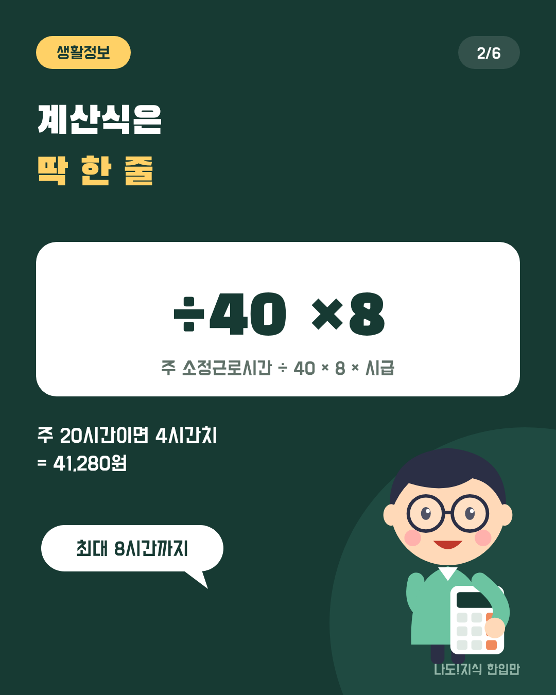
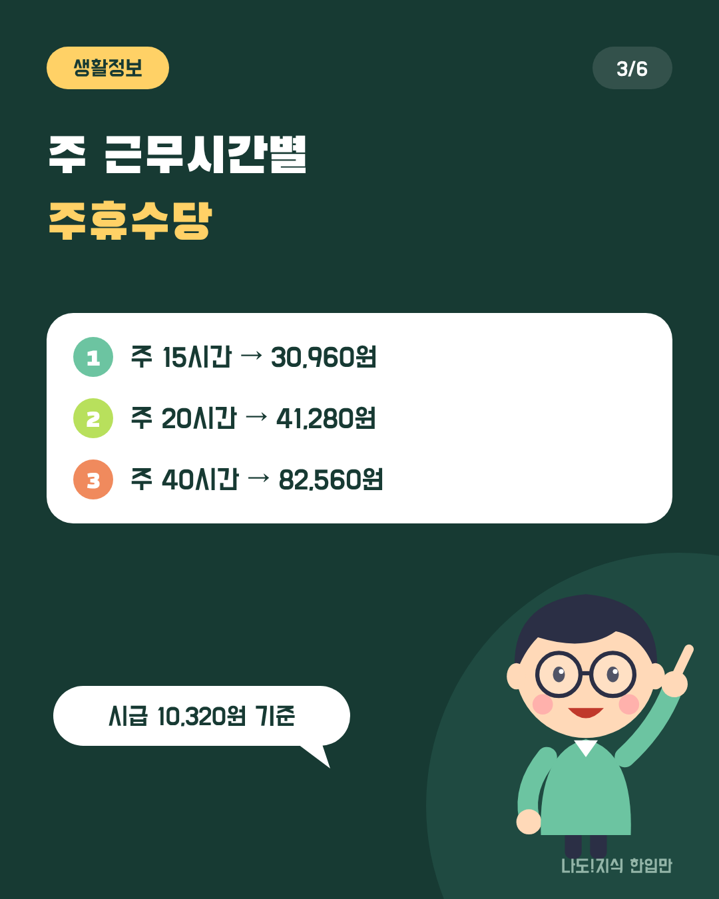
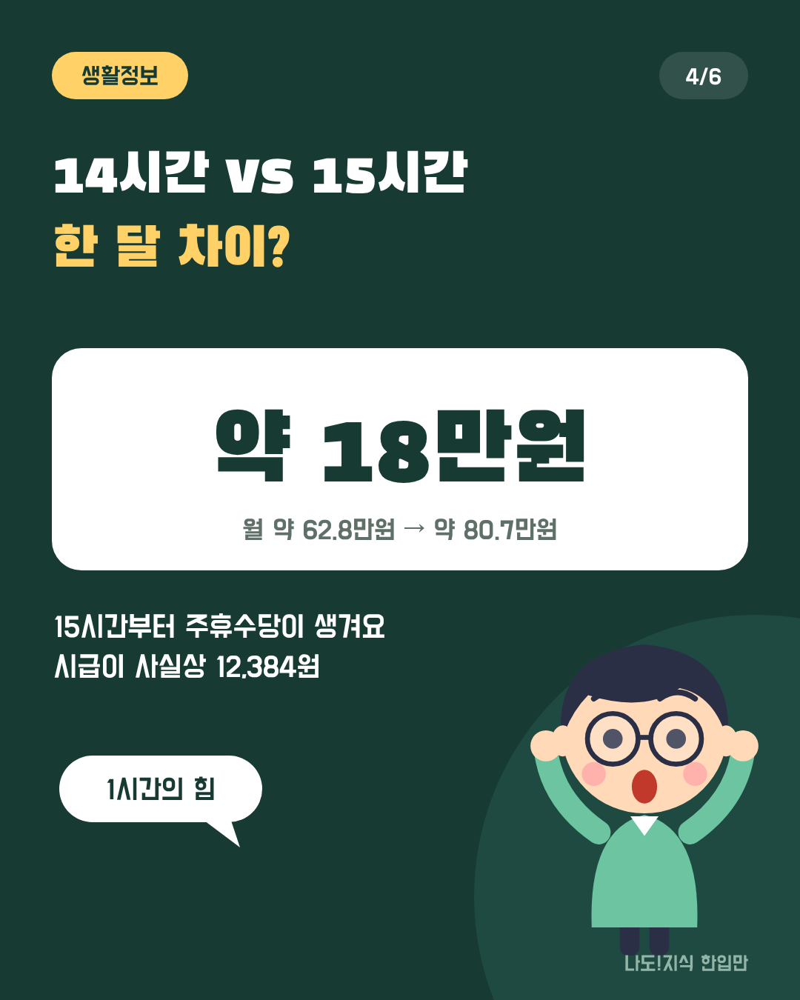
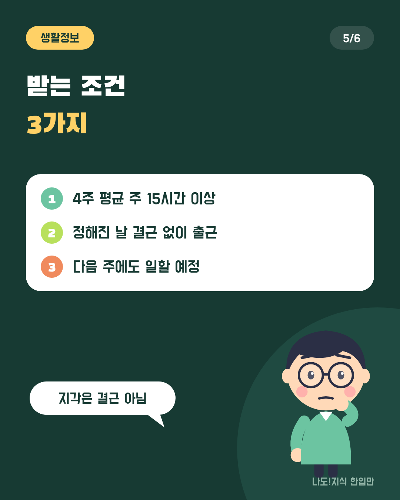
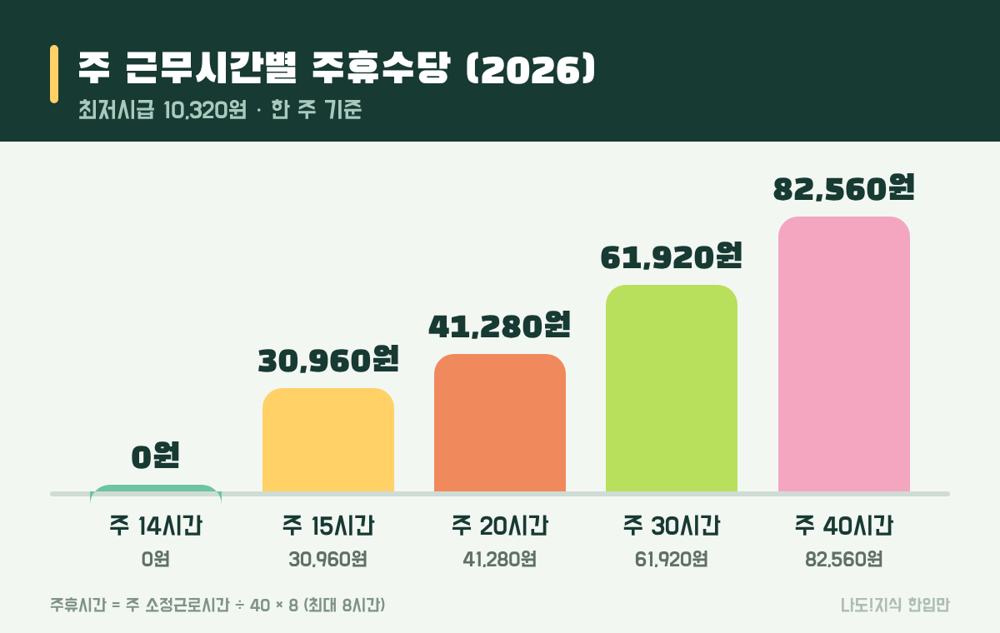
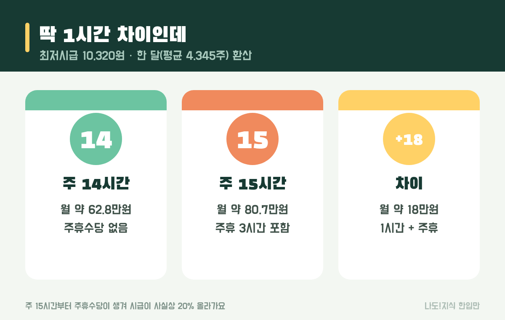
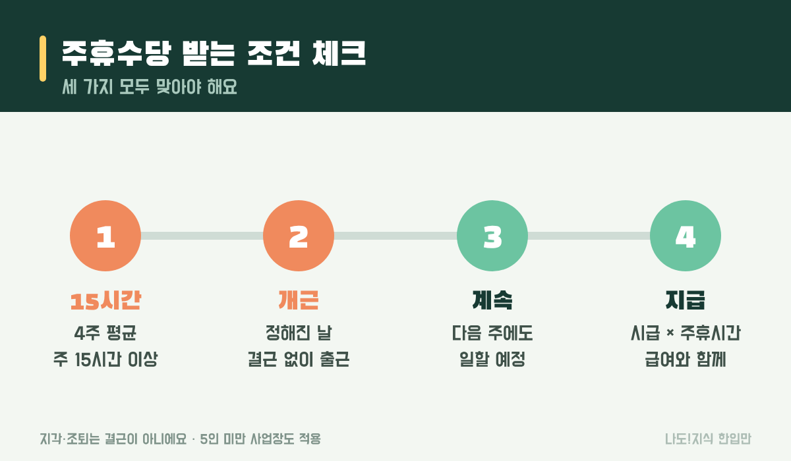

최종 검토일: 2026-11-13

주휴수당은 일주일 동안 정해진 날을 빠짐없이 일한 사람에게 하루치 임금을 더 주는 돈이에요. 2026년 최저시급 10,320원 기준으로 주 40시간이면 한 주에 82,560원, 주 20시간이면 41,280원이에요.

그런데 주 14시간과 15시간은 딱 1시간 차이인데 한 달로 보면 받는 돈이 18만원 가까이 달라져요. 계산식 한 줄로 내 주휴수당을 구하고, 받는 조건과 못 받았을 때 할 일까지 정리할게요.

  <strong style="color:#173a33;font-size:18px;">🕒 한눈에 보기</strong>
  <ul style="margin:10px 0 0 0;padding-left:20px;line-height:1.9;">
    <li><b>계산식:</b> 주 소정근로시간 ÷ 40 × 8 × 시급 (최대 8시간분)</li>
    <li><b>2026 최저시급:</b> 10,320원 · 주 40시간이면 주휴수당 82,560원</li>
    <li><b>조건:</b> 4주 평균 주 15시간 이상 + 정해진 날 개근</li>
    <li><b>효과:</b> 15시간 이상이면 시급이 사실상 12,384원(20%↑)</li>
    <li><b>못 받으면:</b> 근무 기록 모아 고용노동부 1350 상담</li>
  </ul>

옆으로 넘겨 보세요 → (카드 6장 요약)

  <strong style="font-size:16px;">📖 처음이라면 이것만 — 낱말 풀이</strong>
  <ul style="margin:8px 0 0 0;padding-left:20px;line-height:1.9;">
    <li><b>주휴일:</b> 일주일에 하루 쉬면서도 돈을 받는 날(유급휴일). 보통 일요일이에요.</li>
    <li><b>주휴수당:</b> 주휴일에 주는 하루치 임금.</li>
    <li><b>소정근로시간:</b> 근로계약서에 "일하기로 정한" 시간. 실제로 더 일한 연장근무 시간은 빠져요.</li>
    <li><b>개근:</b> 일하기로 정한 날에 결근 없이 나온 것. 지각·조퇴는 결근이 아니에요.</li>
    <li><b>통상시급:</b> 계산에 쓰는 시급. 최저시급 이상이어야 해요.</li>
  </ul>

<h2 style="border-left:6px solid #173a33;padding-left:12px;margin-top:36px;">목차</h2>
<ol style="line-height:1.9;">
  <li><a href="#sec-1" style="color:inherit;text-decoration:underline;text-underline-offset:3px;">2026년 주휴수당은 얼마인가요?</a></li>
  <li><a href="#sec-2" style="color:inherit;text-decoration:underline;text-underline-offset:3px;">주휴수당은 어떻게 계산하나요?</a></li>
  <li><a href="#sec-3" style="color:inherit;text-decoration:underline;text-underline-offset:3px;">주 근무시간별로 얼마를 받나요?</a></li>
  <li><a href="#sec-4" style="color:inherit;text-decoration:underline;text-underline-offset:3px;">주 14시간과 15시간은 얼마나 차이 나나요?</a></li>
  <li><a href="#sec-5" style="color:inherit;text-decoration:underline;text-underline-offset:3px;">주휴수당을 받는 조건은 무엇인가요?</a></li>
  <li><a href="#sec-6" style="color:inherit;text-decoration:underline;text-underline-offset:3px;">주휴수당을 못 받았다면 어떻게 하나요?</a></li>
  <li><a href="#sec-7" style="color:inherit;text-decoration:underline;text-underline-offset:3px;">자주 하는 실수 5가지</a></li>
  <li><a href="#sec-8" style="color:inherit;text-decoration:underline;text-underline-offset:3px;">주휴수당 Q&amp;A 5개</a></li>
</ol>

<h2 id="sec-1" style="scroll-margin-top:72px;border-left:6px solid #173a33;padding-left:12px;margin-top:36px;">2026년 주휴수당은 얼마인가요?</h2>

2026년 주휴수당은 최저시급 10,320원 기준 하루 8시간분, 82,560원이 최대예요. 주 40시간을 다 채우지 않아도 일한 시간에 비례해 받고, 시급이 더 높으면 그만큼 커져요.

<table style="width:100%;border-collapse:collapse;margin:16px 0;">
  <thead>
    <tr style="background:#173a33;color:#fff;"><th style="border:1px solid #ddd;padding:8px;">구분</th><th style="border:1px solid #ddd;padding:8px;">2026년</th></tr>
  </thead>
  <tbody>
    <tr><td style="border:1px solid #ddd;padding:8px;">최저시급</td><td style="border:1px solid #ddd;padding:8px;">10,320원 (2025년보다 2.9%↑)</td></tr>
    <tr><td style="border:1px solid #ddd;padding:8px;">주휴수당 최대(주 40시간)</td><td style="border:1px solid #ddd;padding:8px;">82,560원</td></tr>
    <tr><td style="border:1px solid #ddd;padding:8px;">주 40시간 월급(209시간)</td><td style="border:1px solid #ddd;padding:8px;">2,156,880원 (주휴 포함, 세전)</td></tr>
  </tbody>
</table>

월급제로 일하는 직장인의 "월 209시간"에는 이미 주휴시간이 들어 있어요. 주 40시간에 주휴 8시간을 더한 48시간을 한 달 평균 4.345주로 곱하면 약 209시간이 되거든요. 그래서 주휴수당은 시급제·아르바이트에서 특히 따로 챙겨야 하는 돈이에요. 급여명세서에 "주휴수당" 줄이 따로 없다면, 시급에 포함된 건지 빠진 건지 사업주에게 물어보는 게 좋아요.

<h2 id="sec-2" style="scroll-margin-top:72px;border-left:6px solid #173a33;padding-left:12px;margin-top:36px;">주휴수당은 어떻게 계산하나요?</h2>

주휴수당은 주 소정근로시간 ÷ 40 × 8로 주휴시간을 구하고, 여기에 시급을 곱하면 돼요. 주휴시간은 최대 8시간이라, 주 40시간을 넘게 일해도 8시간분까지만 받아요.

  <strong>✍️ 내 경우로 따라 해 보기 (주 5일 × 하루 4시간 = 주 20시간, 시급 10,320원)</strong> 
  ① 주휴시간: 20 ÷ 40 × 8 = <b>4시간</b> 
  ② 주휴수당: 4시간 × 10,320원 = <b>41,280원</b> 
  ③ 한 주 받는 돈: 20시간 × 10,320원 + 41,280원 = <b>247,680원</b> 
  ④ 시간당으로 보면: 247,680 ÷ 20 = <b>12,384원</b> (시급보다 20% 많음)

④가 중요한 포인트예요. 주 15시간 이상이면 근무시간과 상관없이 주휴수당이 일한 시간의 20%(8 ÷ 40)만큼 붙어서, 시급이 사실상 12,384원이 돼요. 그래서 공고에 "시급 12,384원(주휴 포함)"이라고 적힌 곳은 주휴수당을 시급에 미리 넣은 거예요. 이 경우에도 주휴를 뺀 기본 시급이 10,320원 이상이어야 해요.

<h2 id="sec-3" style="scroll-margin-top:72px;border-left:6px solid #173a33;padding-left:12px;margin-top:36px;">주 근무시간별로 얼마를 받나요?</h2>

최저시급 기준으로 주 15시간이면 30,960원, 20시간이면 41,280원, 40시간이면 82,560원을 한 주에 더 받아요.

<figure style="margin:24px 0;"><figcaption style="font-size:13px;color:#888;">한 주 기준이에요. 시급이 더 높으면 같은 비율로 커져요.</figcaption></figure>

<table style="width:100%;border-collapse:collapse;margin:16px 0;">
  <thead>
    <tr style="background:#173a33;color:#fff;"><th style="border:1px solid #ddd;padding:8px;">주 근무시간</th><th style="border:1px solid #ddd;padding:8px;">주휴시간</th><th style="border:1px solid #ddd;padding:8px;">주휴수당(주)</th><th style="border:1px solid #ddd;padding:8px;">한 주 합계</th><th style="border:1px solid #ddd;padding:8px;">한 달 환산(세전)</th></tr>
  </thead>
  <tbody>
    <tr><td style="border:1px solid #ddd;padding:8px;">14시간</td><td style="border:1px solid #ddd;padding:8px;">0시간</td><td style="border:1px solid #ddd;padding:8px;">0원</td><td style="border:1px solid #ddd;padding:8px;">144,480원</td><td style="border:1px solid #ddd;padding:8px;">약 62.8만원</td></tr>
    <tr><td style="border:1px solid #ddd;padding:8px;">15시간</td><td style="border:1px solid #ddd;padding:8px;">3시간</td><td style="border:1px solid #ddd;padding:8px;">30,960원</td><td style="border:1px solid #ddd;padding:8px;">185,760원</td><td style="border:1px solid #ddd;padding:8px;">약 80.7만원</td></tr>
    <tr><td style="border:1px solid #ddd;padding:8px;">20시간</td><td style="border:1px solid #ddd;padding:8px;">4시간</td><td style="border:1px solid #ddd;padding:8px;">41,280원</td><td style="border:1px solid #ddd;padding:8px;">247,680원</td><td style="border:1px solid #ddd;padding:8px;">약 107.6만원</td></tr>
    <tr><td style="border:1px solid #ddd;padding:8px;">30시간</td><td style="border:1px solid #ddd;padding:8px;">6시간</td><td style="border:1px solid #ddd;padding:8px;">61,920원</td><td style="border:1px solid #ddd;padding:8px;">371,520원</td><td style="border:1px solid #ddd;padding:8px;">약 161.4만원</td></tr>
    <tr><td style="border:1px solid #ddd;padding:8px;">40시간</td><td style="border:1px solid #ddd;padding:8px;">8시간</td><td style="border:1px solid #ddd;padding:8px;">82,560원</td><td style="border:1px solid #ddd;padding:8px;">495,360원</td><td style="border:1px solid #ddd;padding:8px;"><b>2,156,880원</b></td></tr>
  </tbody>
</table>

한 달 환산은 (근무시간 + 주휴시간) × 4.345주 × 10,320원으로 구했어요. 주 40시간만 정부가 발표하는 월 209시간 기준(2,156,880원)으로 적었고, 나머지는 같은 방식으로 계산한 어림값이에요.

<h2 id="sec-4" style="scroll-margin-top:72px;border-left:6px solid #173a33;padding-left:12px;margin-top:36px;">주 14시간과 15시간은 얼마나 차이 나나요?</h2>

주 14시간과 15시간은 한 달에 약 18만원 차이 나요. 15시간부터 주휴수당이 생기기 때문이에요.

<figure style="margin:24px 0;"><figcaption style="font-size:13px;color:#888;">최저시급 10,320원, 한 달 평균 4.345주로 환산했어요.</figcaption></figure>

늘어난 1시간분(약 4.5만원)보다 새로 생긴 주휴수당(한 달 약 13.5만원)이 훨씬 커요. 반대로 말하면, 근무표를 주 14시간대로 짜면 주휴수당과 연차·퇴직금이 모두 생기지 않아요. 주 15시간 미만인 '초단시간 근로자'는 주휴수당, 연차휴가, 퇴직금이 적용되지 않거든요.

그래서 알바를 구할 때는 시급만 보지 말고 <b>주 몇 시간 일하는지</b>를 같이 봐야 해요. 같은 시급이라도 주 15시간을 넘으면 실제로 받는 시간당 금액이 20% 높아요.

<h2 id="sec-5" style="scroll-margin-top:72px;border-left:6px solid #173a33;padding-left:12px;margin-top:36px;">주휴수당을 받는 조건은 무엇인가요?</h2>

주휴수당은 4주 평균 주 15시간 이상, 정해진 날 개근, 다음 주에도 계속 일할 예정 세 가지가 맞으면 받아요.

<figure style="margin:24px 0;"><figcaption style="font-size:13px;color:#888;">지각·조퇴는 결근이 아니고, 5인 미만 사업장도 적용돼요.</figcaption></figure>

<table style="width:100%;border-collapse:collapse;margin:16px 0;">
  <thead>
    <tr style="background:#173a33;color:#fff;"><th style="border:1px solid #ddd;padding:8px;">상황</th><th style="border:1px solid #ddd;padding:8px;">주휴수당</th></tr>
  </thead>
  <tbody>
    <tr><td style="border:1px solid #ddd;padding:8px;">주 20시간, 정해진 날 모두 출근</td><td style="border:1px solid #ddd;padding:8px;">받음</td></tr>
    <tr><td style="border:1px solid #ddd;padding:8px;">주 20시간, 한 번 지각·조퇴</td><td style="border:1px solid #ddd;padding:8px;">받음 (결근 아님)</td></tr>
    <tr><td style="border:1px solid #ddd;padding:8px;">주 20시간, 하루 무단결근</td><td style="border:1px solid #ddd;padding:8px;">그 주는 못 받음</td></tr>
    <tr><td style="border:1px solid #ddd;padding:8px;">주 12시간씩 일함</td><td style="border:1px solid #ddd;padding:8px;">못 받음 (15시간 미만)</td></tr>
    <tr><td style="border:1px solid #ddd;padding:8px;">5인 미만 편의점·카페</td><td style="border:1px solid #ddd;padding:8px;">받음 (규모 상관없음)</td></tr>
  </tbody>
</table>

정규직·계약직·아르바이트 모두 같아요. 근로계약서에 "주휴수당 없음"이라고 적혀 있어도 조건을 채우면 받을 수 있어요. 법보다 불리한 계약 내용은 효력이 없기 때문이에요.

<h2 id="sec-6" style="scroll-margin-top:72px;border-left:6px solid #173a33;padding-left:12px;margin-top:36px;">주휴수당을 못 받았다면 어떻게 하나요?</h2>

받지 못한 주휴수당은 근무 기록을 모아 사업주에게 먼저 요청하고, 안 되면 고용노동부에 진정할 수 있어요.

<ol style="line-height:2;">
  <li><b>기록 모으기:</b> 근로계약서, 근무표(스케줄 사진·메신저), 급여명세서나 통장 입금 내역을 모아요.</li>
  <li><b>계산하기:</b> 위 계산식으로 주마다 받아야 할 주휴수당을 적어 둬요.</li>
  <li><b>요청하기:</b> 사업주에게 계산 내역을 보여 주고 지급을 요청해요.</li>
  <li><b>상담·진정:</b> 해결이 안 되면 고용노동부 고객상담센터 <b>1350</b>에 상담하거나, <a href="https://minwon.moel.go.kr" target="_blank" rel="noopener">고용노동부 민원마당</a>에서 임금체불 진정을 넣을 수 있어요.</li>
  <li><b>기한:</b> 임금을 청구할 수 있는 권리는 3년이 지나면 사라져요. 오래 미루지 마세요.</li>
</ol>

일을 그만둔 뒤에는 실업급여를 받을 수 있는지도 확인해 보세요. 하루 얼마를 며칠 받는지는 <a href="https://sensitiveboss3.tistory.com/entry/unemployment-benefit-2026-daily-amount" target="_blank" rel="noopener">실업급여 하루 얼마</a> 글에 계산해 뒀어요. 소득이 적은 해에는 <a href="https://sensitiveboss3.tistory.com/entry/eitc-late-application-2026" target="_blank" rel="noopener">근로장려금 기한 후 신청</a>도 챙길 수 있어요.

<h2 id="sec-7" style="scroll-margin-top:72px;border-left:6px solid #173a33;padding-left:12px;margin-top:36px;">자주 하는 실수 5가지</h2>

주휴수당을 놓치는 경우는 대부분 조건을 잘못 알거나 시급만 보고 계산해서 생겨요.

  <strong style="font-size:16px;">⚠️ 이것만 피하세요</strong>
  <ol style="margin:8px 0 0 0;padding-left:20px;line-height:1.9;">
    <li><b>알바는 주휴수당이 없다고 생각하기</b> → 주 15시간 이상, 개근이면 알바도 받아요.</li>
    <li><b>지각·조퇴하면 못 받는다고 생각하기</b> → 결근이 아니라서 받아요.</li>
    <li><b>5인 미만 가게는 예외라고 생각하기</b> → 주휴일은 사업장 규모와 상관없어요.</li>
    <li><b>연장근무 시간까지 넣어 계산하기</b> → 기준은 계약서의 소정근로시간이에요.</li>
    <li><b>"주휴 포함 시급"을 그냥 넘기기</b> → 주휴를 뺀 기본 시급이 10,320원 이상인지 계산해 보세요.</li>
  </ol>

<h2 id="sec-8" style="scroll-margin-top:72px;border-left:6px solid #173a33;padding-left:12px;margin-top:36px;">주휴수당 Q&amp;A 5개</h2>

  
2026년 주휴수당은 얼마인가요

  
최저시급 10,320원으로 주 40시간 일하면 한 주에 82,560원(8시간분)이에요. 주 20시간이면 41,280원, 주 15시간이면 30,960원이에요.

  
주휴수당 계산 방법은요

  
주휴시간 = 1주 소정근로시간 ÷ 40 × 8(최대 8시간)이고, 여기에 시급을 곱하면 주휴수당이에요. 주 20시간 일하는 사람은 20 ÷ 40 × 8 = 4시간분을 받아요.

  
주 15시간 미만이면 주휴수당이 없나요

  
네. 4주를 평균해 1주 소정근로시간이 15시간 미만이면 주휴수당이 생기지 않아요. 주 14시간이면 0원, 주 15시간부터 3시간분(30,960원)이 생겨요.

  
지각하거나 조퇴하면 주휴수당이 없어지나요

  
아니에요. 주휴수당 조건은 정해진 날에 결근하지 않는 것이라, 지각이나 조퇴는 결근이 아니어서 주휴수당이 생겨요. 다만 늦거나 일찍 간 시간만큼 임금은 줄 수 있어요.

  
5인 미만 가게 아르바이트도 주휴수당을 받나요

  
받아요. 주휴일은 사업장 규모와 상관없이 적용돼요. 4주 평균 주 15시간 이상, 정해진 날 개근이면 5인 미만 사업장에서도 받을 수 있어요.

  <strong style="font-size:16px;">📚 함께 보면 좋은 글</strong>
  <ul style="margin:8px 0 0 0;padding-left:20px;line-height:1.9;"><li><a href="https://sensitiveboss3.tistory.com/entry/unemployment-benefit-2026-daily-amount" target="_blank" rel="noopener">실업급여 하루 얼마? 2026 계산법</a></li><li><a href="https://sensitiveboss3.tistory.com/entry/eitc-late-application-2026" target="_blank" rel="noopener">근로장려금 기한 후 신청 12월 1일까지</a></li><li><a href="https://sensitiveboss3.tistory.com/entry/youth-future-savings-account-opening-2026" target="_blank" rel="noopener">청년미래적금 2차 계좌 개설</a></li></ul>

  참고 출처:
  <ul style="margin:6px 0 0 0;padding-left:20px;">
    <li><a href="https://kbthink.com/investment/issues/minimum-wage.html" target="_blank" rel="noopener">KB 씽크: 2026 최저시급과 주휴수당 포함 임금 계산법</a></li>
    <li><a href="https://www.bizforms.co.kr/guide365/313" target="_blank" rel="noopener">비즈폼: 아르바이트 급여 계산법(주휴수당 포함)</a></li>
    <li><a href="https://www.bizforms.co.kr/guide365/162" target="_blank" rel="noopener">비즈폼: 최저임금 2026년 월급·시급 환산</a></li>
    <li><a href="https://www.law.go.kr/법령/근로기준법" target="_blank" rel="noopener">국가법령정보센터: 근로기준법(주휴일·단시간근로자)</a></li>
  </ul>
  기준일: 2026년 11월 13일. 월 환산은 한 달 평균 4.345주로 계산한 세전 어림값이에요.

정보 제공을 목적으로 쓴 글이에요. 개별 근로관계의 판단은 근로계약 내용과 근무 실태에 따라 달라질 수 있고, 고용노동부(1350) 상담 결과가 기준이에요.

