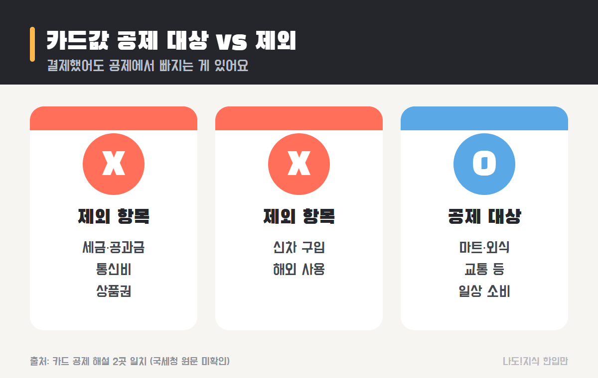
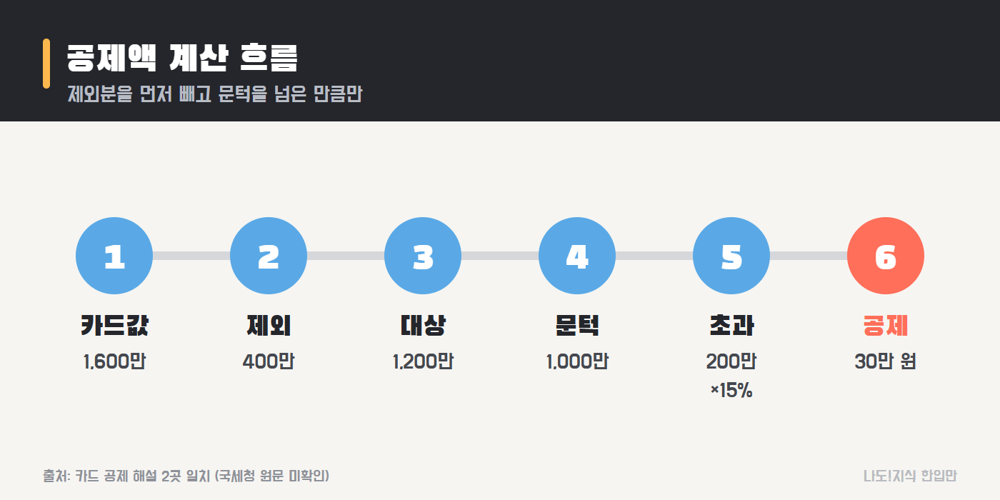
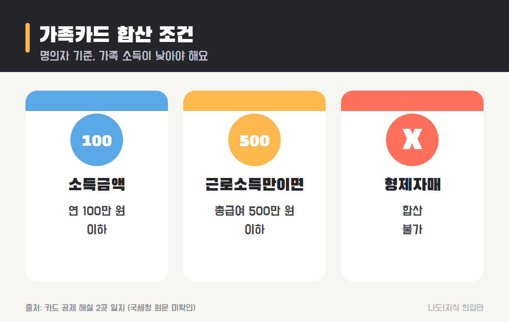

최종 검토일: 2026-11-25

연말정산 신용카드는 총급여의 25%를 넘게 쓴 카드 사용액 중 공제 대상인 금액에 15%(체크카드는 30%)를 곱해 소득에서 빼 주는 소득공제 제도예요. 카드값이 전부 공제 대상은 아니라서, 세금·통신비 같은 제외 항목을 먼저 빼고 계산해야 해요.

카드 사용 마감은 12월 31일쯤이라 남은 기간이 길지 않아요. 내 카드값 중 얼마가 진짜 공제 대상인지 숫자로 확인해 볼게요.

  <strong style="color:#24262b;font-size:18px;">💳 한눈에 보기</strong>
  <ul style="margin:10px 0 0 0;padding-left:20px;line-height:1.9;">
    <li><b>문턱:</b> 총급여의 25%를 넘게 쓴 부분부터 공제 대상</li>
    <li><b>공제율:</b> 신용카드 15%, 체크·직불·현금영수증 30% (해설 기준)</li>
    <li><b>제외 항목:</b> 세금·공과금, 통신비, 상품권, 신차 구입비, 해외 사용</li>
    <li><b>예시:</b> 총급여 4,000만원, 카드값 1,600만원 → 공제 30만원</li>
    <li><b>가족카드:</b> 명의자 기준, 가족 소득금액 100만원 이하일 때 합산</li>
  </ul>

  <strong style="font-size:16px;">📖 처음이라면 이것만 — 낱말 풀이</strong>
  <ul style="margin:8px 0 0 0;padding-left:20px;line-height:1.9;">
    <li><b>총급여:</b> 비과세를 뺀 1년 치 월급 총액. 세금 떼기 전 금액이에요.</li>
    <li><b>소득공제:</b> 세금을 매기는 소득 자체를 줄여 주는 제도. 줄어든 소득에 세율을 곱한 만큼 세금이 줄어요.</li>
    <li><b>공제율:</b> 쓴 금액 중 공제로 인정해 주는 비율. 카드 종류마다 달라요.</li>
    <li><b>가족카드:</b> 본인 명의 카드에 딸린 가족용 카드. 공제는 명의자 기준으로 따져요.</li>
    <li><b>간소화 자료:</b> 국세청이 카드사 등에서 모아 홈택스에 보여 주는 공제 자료.</li>
  </ul>

<h2 style="border-left:6px solid #24262b;padding-left:12px;margin-top:36px;">목차</h2>
<ol style="line-height:1.9;">
  <li><a href="#sec-1" style="color:inherit;text-decoration:underline;text-underline-offset:3px;">카드값 중 공제 안 되는 항목은 무엇인가요?</a></li>
  <li><a href="#sec-2" style="color:inherit;text-decoration:underline;text-underline-offset:3px;">신용카드 공제는 얼마부터 받나요?</a></li>
  <li><a href="#sec-3" style="color:inherit;text-decoration:underline;text-underline-offset:3px;">제외 항목을 빼면 공제액이 얼마나 달라지나요?</a></li>
  <li><a href="#sec-4" style="color:inherit;text-decoration:underline;text-underline-offset:3px;">가족카드 사용액은 합산되나요?</a></li>
  <li><a href="#sec-5" style="color:inherit;text-decoration:underline;text-underline-offset:3px;">내 카드 공제 대상은 어떻게 확인하나요?</a></li>
  <li><a href="#sec-6" style="color:inherit;text-decoration:underline;text-underline-offset:3px;">자주 하는 실수 5가지</a></li>
  <li><a href="#sec-7" style="color:inherit;text-decoration:underline;text-underline-offset:3px;">연말정산 신용카드 Q&amp;A 5개</a></li>
</ol>

<h2 id="sec-1" style="scroll-margin-top:72px;border-left:6px solid #24262b;padding-left:12px;margin-top:36px;">카드값 중 공제 안 되는 항목은 무엇인가요?</h2>

해설 기준으로 세금·공과금, 통신비, 상품권, 신차 구입비, 해외 사용 금액은 카드로 결제해도 공제 대상이 아니에요.

<figure style="margin:24px 0;"><figcaption style="font-size:13px;color:#888;">마트·외식·교통 같은 생활 지출은 대상이고, 아래 항목은 제외예요.</figcaption></figure>

<table style="width:100%;border-collapse:collapse;margin:16px 0;">
  <thead>
    <tr style="background:#24262b;color:#fff;"><th style="border:1px solid #ddd;padding:8px;">구분</th><th style="border:1px solid #ddd;padding:8px;">항목</th><th style="border:1px solid #ddd;padding:8px;">설명</th></tr>
  </thead>
  <tbody>
    <tr><td style="border:1px solid #ddd;padding:8px;">대상</td><td style="border:1px solid #ddd;padding:8px;">마트·외식·교통 등 생활 지출</td><td style="border:1px solid #ddd;padding:8px;">총급여 25% 문턱을 넘은 부분부터 공제</td></tr>
    <tr><td style="border:1px solid #ddd;padding:8px;">제외</td><td style="border:1px solid #ddd;padding:8px;">세금·공과금</td><td style="border:1px solid #ddd;padding:8px;">국세·지방세, 공과금 카드 납부</td></tr>
    <tr><td style="border:1px solid #ddd;padding:8px;">제외</td><td style="border:1px solid #ddd;padding:8px;">통신비</td><td style="border:1px solid #ddd;padding:8px;">휴대폰·인터넷 요금</td></tr>
    <tr><td style="border:1px solid #ddd;padding:8px;">제외</td><td style="border:1px solid #ddd;padding:8px;">상품권</td><td style="border:1px solid #ddd;padding:8px;">상품권 구입 금액</td></tr>
    <tr><td style="border:1px solid #ddd;padding:8px;">제외</td><td style="border:1px solid #ddd;padding:8px;">신차 구입비</td><td style="border:1px solid #ddd;padding:8px;">새 차 구입 대금</td></tr>
    <tr><td style="border:1px solid #ddd;padding:8px;">제외</td><td style="border:1px solid #ddd;padding:8px;">해외 사용</td><td style="border:1px solid #ddd;padding:8px;">해외에서 결제한 금액</td></tr>
  </tbody>
</table>

쉽게 말해 카드 승인 내역과 공제 대상 금액은 다른 숫자예요. 카드사 앱에 보이는 총 이용액을 그대로 옮겨 적으면 계산이 어긋나기 쉬워요.

제외 항목도 카드로 결제는 할 수 있지만, 공제 계산에서는 빼야 해요. 카드값이 많아 보여도 실제 공제 대상은 훨씬 적을 수 있어요.

  <strong style="font-size:16px;">⚠️ 일부 해설에서만 나오는 제외 항목</strong>
  <ul style="margin:8px 0 0 0;padding-left:20px;line-height:1.9;">
    <li>보험료, 교육비(수업료·입학금), 월세 세액공제를 받은 금액</li>
    <li>법인·사업 경비, 기부금, 가상자산, 금융비용</li>
    <li>중고차는 구입금액의 10%만 공제 대상</li>
    <li>예외로 취학 전 아동 학원비, 스마트폰 단말기 할부 원금은 공제</li>
  </ul>
  
위 내용은 KB Think 해설 기준이고 국세청 원문은 확인하지 못했어요. 홈택스 안내가 최종 기준이에요.

<h2 id="sec-2" style="scroll-margin-top:72px;border-left:6px solid #24262b;padding-left:12px;margin-top:36px;">신용카드 공제는 얼마부터 받나요?</h2>

공제는 총급여의 25%를 넘게 쓴 금액부터 시작해요. 총급여 4,000만원이라면 문턱이 1,000만원이에요.

<ol style="line-height:2;">
  <li><b>문턱 계산:</b> 총급여 × 25%</li>
  <li><b>공제 대상 사용액 확인:</b> 카드값에서 제외 항목을 뺀 금액</li>
  <li><b>초과분 계산:</b> 공제 대상 사용액 − 문턱</li>
  <li><b>공제율 곱하기:</b> 신용카드 15%, 체크·직불·현금영수증 30%</li>
</ol>

예를 들어 총급여가 3,000만원이면 문턱은 750만원이고, 공제 대상 사용액이 700만원이면 공제액은 0원이에요. 공제 대상 사용액이 900만원이라면 초과분 150만원에 신용카드 공제율을 곱해 계산해요.

문턱 이하로 썼다면 공제액은 0원이에요. 한도(기본 7천만원 이하 300만원, 초과 250만원)는 <a href="https://sensitiveboss3.tistory.com/entry/year-end-tax-preview-card-deduction-2026" target="_blank" rel="noopener">연말정산 미리보기</a> 글에 정리해 뒀어요.

<h2 id="sec-3" style="scroll-margin-top:72px;border-left:6px solid #24262b;padding-left:12px;margin-top:36px;">제외 항목을 빼면 공제액이 얼마나 달라지나요?</h2>

총급여 4,000만원, 카드값 1,600만원 기준으로 제외 항목 400만원을 빼면 공제는 30만원, 빼지 않으면 90만원으로 계산돼요.

<figure style="margin:24px 0;"><figcaption style="font-size:13px;color:#888;">카드값 1,600만원이 공제 30만원으로 줄어드는 흐름이에요.</figcaption></figure>

  <strong>✍️ 내 경우로 따라 해 보기 (총급여 4,000만원, 신용카드 1,600만원)</strong> 
  ① 문턱: 4,000만원 × 25% = <b>1,000만원</b> 
  ② 제외 항목(세금·통신비·보험료 등) 400만원을 뺀 공제 대상: 1,600만 − 400만 = <b>1,200만원</b> 
  ③ 초과분: 1,200만 − 1,000만 = <b>200만원</b> 
  ④ 공제액: 200만원 × 15% = <b>30만원</b>

<table style="width:100%;border-collapse:collapse;margin:16px 0;">
  <thead>
    <tr style="background:#24262b;color:#fff;"><th style="border:1px solid #ddd;padding:8px;">계산 방식</th><th style="border:1px solid #ddd;padding:8px;">초과분</th><th style="border:1px solid #ddd;padding:8px;">공제율</th><th style="border:1px solid #ddd;padding:8px;">공제액</th></tr>
  </thead>
  <tbody>
    <tr><td style="border:1px solid #ddd;padding:8px;">제외 항목을 뺀 경우(정상)</td><td style="border:1px solid #ddd;padding:8px;">200만원</td><td style="border:1px solid #ddd;padding:8px;">15%</td><td style="border:1px solid #ddd;padding:8px;"><b>30만원</b></td></tr>
    <tr><td style="border:1px solid #ddd;padding:8px;">제외 항목을 못 뺀 경우(잘못)</td><td style="border:1px solid #ddd;padding:8px;">600만원</td><td style="border:1px solid #ddd;padding:8px;">15%</td><td style="border:1px solid #ddd;padding:8px;">90만원 (60만원 과대)</td></tr>
    <tr><td style="border:1px solid #ddd;padding:8px;">같은 초과분을 체크카드로 쓴 경우</td><td style="border:1px solid #ddd;padding:8px;">200만원</td><td style="border:1px solid #ddd;padding:8px;">30%</td><td style="border:1px solid #ddd;padding:8px;">60만원</td></tr>
  </tbody>
</table>

공제액 30만원은 세금을 직접 30만원 깎아 주는 게 아니라 소득에서 빼는 금액이에요. 세율 15%를 가정하면 실제 줄어드는 세금은 약 4만5천원이에요.

그래서 제외 항목을 빼고 계산하는 일이 중요해요. 400만원 차이가 공제 60만원, 세금으로는 약 9만원 차이를 만들 수 있어요.

<h2 id="sec-4" style="scroll-margin-top:72px;border-left:6px solid #24262b;padding-left:12px;margin-top:36px;">가족카드 사용액은 합산되나요?</h2>

가족카드는 카드 명의자 기준으로 합산하고, 가족의 소득금액이 100만원 이하일 때만 공제받을 수 있어요. 근로소득만 있는 가족이라면 총급여 500만원 이하가 기준이에요.

<figure style="margin:24px 0;"><figcaption style="font-size:13px;color:#888;">가족 소득이 기준을 넘으면 그 가족의 카드 사용액은 합산할 수 없어요.</figcaption></figure>

<table style="width:100%;border-collapse:collapse;margin:16px 0;">
  <thead>
    <tr style="background:#24262b;color:#fff;"><th style="border:1px solid #ddd;padding:8px;">가족</th><th style="border:1px solid #ddd;padding:8px;">합산 가능 여부</th><th style="border:1px solid #ddd;padding:8px;">조건</th></tr>
  </thead>
  <tbody>
    <tr><td style="border:1px solid #ddd;padding:8px;">배우자</td><td style="border:1px solid #ddd;padding:8px;">가능</td><td style="border:1px solid #ddd;padding:8px;">소득금액 100만원 이하 (근로소득만이면 총급여 500만원 이하)</td></tr>
    <tr><td style="border:1px solid #ddd;padding:8px;">부양가족</td><td style="border:1px solid #ddd;padding:8px;">가능</td><td style="border:1px solid #ddd;padding:8px;">같은 소득 요건</td></tr>
    <tr><td style="border:1px solid #ddd;padding:8px;">형제자매</td><td style="border:1px solid #ddd;padding:8px;">불가</td><td style="border:1px solid #ddd;padding:8px;">합산 대상이 아니에요</td></tr>
  </tbody>
</table>

배우자는 나이 제한이 없다는 해설도 있어요. 다만 이 부분은 세무 카페 인용 검색결과 기준이라 홈택스 안내와 대조해 보면 좋아요.

부양가족 요건과 한도는 <a href="https://sensitiveboss3.tistory.com/entry/year-end-tax-preview-card-deduction-2026" target="_blank" rel="noopener">연말정산 미리보기</a> 글과 함께 보면 이해하기 쉬워요.

<h2 id="sec-5" style="scroll-margin-top:72px;border-left:6px solid #24262b;padding-left:12px;margin-top:36px;">내 카드 공제 대상은 어떻게 확인하나요?</h2>

가장 확실한 방법은 홈택스 연말정산 간소화 자료에서 카드별 공제 대상 금액을 확인하는 거예요. 이 글의 항목은 해설 기준이라 최종 판정은 국세청 자료가 기준이에요.

<ol style="line-height:2;">
  <li><b>홈택스 접속:</b> 연말정산 간소화 서비스에 로그인해요. 2026년 귀속 개통일은 공지 전이라 국세청 안내를 확인해요.</li>
  <li><b>카드 항목 확인:</b> 신용카드·체크카드 사용 금액이 구분돼 나와요.</li>
  <li><b>제외 항목 점검:</b> 세금·통신비·상품권 등이 대상 금액에 섞여 있지 않은지 봐요.</li>
  <li><b>총급여 문턱 계산:</b> 급여명세서 총급여 × 25%와 비교해요.</li>
  <li><b>남은 기간 점검:</b> 문턱을 넘었는지에 따라 12월 결제 수단을 살펴봐요.</li>
</ol>

카드 결제를 어떻게 나눌지는 <a href="https://sensitiveboss3.tistory.com/entry/year-end-tax-preview-card-deduction-2026" target="_blank" rel="noopener">연말정산 미리보기 12월 18일까지</a> 글에서 이어서 볼 수 있어요. 공제를 위해 소비를 일부러 늘리라는 뜻은 아니에요.

<h2 id="sec-6" style="scroll-margin-top:72px;border-left:6px solid #24262b;padding-left:12px;margin-top:36px;">자주 하는 실수 5가지</h2>

공제액이 틀어지는 경우는 대부분 제외 항목을 섞거나 문턱 계산을 놓쳐서 생겨요.

  <strong style="font-size:16px;">⚠️ 이것만 피하세요</strong>
  <ol style="margin:8px 0 0 0;padding-left:20px;line-height:1.9;">
    <li><b>카드값 전체를 공제 대상으로 보기</b> → 세금·통신비·상품권 등은 빼고 계산해요.</li>
    <li><b>문턱 없이 전액 공제 생각하기</b> → 총급여 25%를 넘은 부분부터예요.</li>
    <li><b>세금 효과를 공제액으로 착각하기</b> → 공제 30만원은 소득에서 빼는 금액이에요. 세율 15%면 약 4만5천원이에요.</li>
    <li><b>가족 소득 요건 놓치기</b> → 소득금액 100만원(근로소득만이면 총급여 500만원)을 넘으면 합산할 수 없어요.</li>
    <li><b>해설만 믿고 확인 안 하기</b> → 해설 기준 항목은 홈택스에서 최종 확인해요.</li>
  </ol>

카드 공제만 보고 다른 공제를 놓치기 쉬워요. 근로장려금 같은 항목은 아래 함께 보면 좋은 글에서 이어 확인해 보세요.

<h2 id="sec-7" style="scroll-margin-top:72px;border-left:6px solid #24262b;padding-left:12px;margin-top:36px;">연말정산 신용카드 Q&amp;A 5개</h2>

  
연말정산 신용카드 공제 안 되는 항목은 뭔가요

  
해설 기준으로 세금·공과금, 통신비, 상품권 구입, 신차 구입비, 해외 사용 금액은 공제 대상에서 빠져요. 일부 해설에서는 보험료, 교육비(수업료·입학금), 월세 세액공제를 받은 금액, 법인·사업비, 기부금, 가상자산, 금융비용도 제외 항목으로 정리해요. 홈택스에서 최종 확인이 필요해요.

  
신용카드 소득공제는 얼마부터 받나요

  
총급여의 25%를 넘게 쓴 금액부터 공제 대상이에요. 총급여 4,000만원이면 문턱이 1,000만원이고, 제외 항목을 뺀 공제 대상 사용액이 이 문턱을 넘어야 해요.

  
신용카드와 체크카드 공제율은 얼마나 다른가요

  
해설 기준으로 신용카드는 15%, 체크카드·직불카드·현금영수증은 30%예요. 같은 초과 금액 200만원이면 신용카드는 30만원, 체크카드는 60만원이 공제돼요.

  
가족카드 사용액도 합산할 수 있나요

  
합산은 카드 명의자 기준이고, 배우자·부양가족의 소득금액이 100만원 이하여야 해요. 근로소득만 있다면 총급여 500만원 이하가 기준이에요. 형제자매는 합산할 수 없어요.

  
제외 항목을 잘못 넣으면 어떻게 되나요

  
공제 금액이 실제보다 크게 계산돼 나중에 세금을 더 내야 할 수 있어요. 예시처럼 400만원을 잘못 넣으면 공제액이 60만원 부풀려져요. 간소화 자료의 분류를 확인하고 의심되면 국세청에 문의하세요.

  <strong style="font-size:16px;">📚 함께 보면 좋은 글</strong>
  <ul style="margin:8px 0 0 0;padding-left:20px;line-height:1.9;"><li><a href="https://sensitiveboss3.tistory.com/entry/year-end-tax-preview-card-deduction-2026" target="_blank" rel="noopener">연말정산 미리보기 12월 18일까지</a></li><li><a href="https://sensitiveboss3.tistory.com/entry/unemployment-benefit-2026-daily-amount" target="_blank" rel="noopener">실업급여 하루 얼마? 2026 계산법</a></li><li><a href="https://sensitiveboss3.tistory.com/entry/eitc-late-application-2026" target="_blank" rel="noopener">근로장려금 기한 후 신청 12월 1일까지</a></li></ul>

  참고 출처:
  <ul style="margin:6px 0 0 0;padding-left:20px;">
    <li><a href="https://kbthink.com/year-end-tax/creditcard.html" target="_blank" rel="noopener">KB Think: 연말정산 신용카드 소득공제 해설</a></li>
    <li><a href="https://toss.im/tossfeed/article/card-tax-adjustment" target="_blank" rel="noopener">토스피드: 카드 소득공제 해설</a></li>
    <li><a href="https://www.hometax.go.kr" target="_blank" rel="noopener">국세청 홈택스</a></li>
    <li><a href="https://www.nts.go.kr" target="_blank" rel="noopener">국세청</a></li>
  </ul>
  기준일: 2026년 11월 25일. 제외 항목과 공제율은 해설 기준이며 국세청 원문은 확인하지 못했어요. 금액은 단순 계산이에요.

정보 제공을 목적으로 쓴 글이에요. 공제 대상과 한도는 개인 상황과 해마다 바뀌는 세법에 따라 달라질 수 있으니 홈택스와 국세청 안내가 기준이에요.

