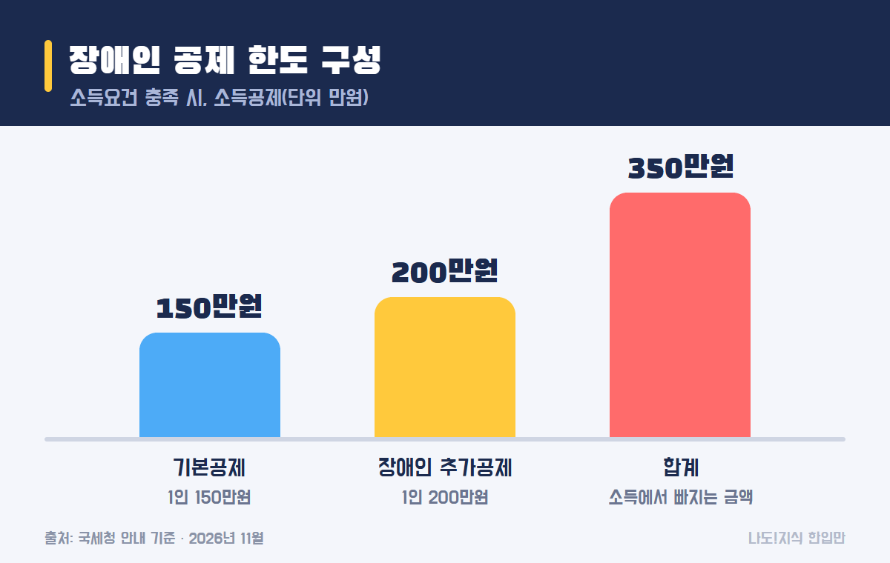
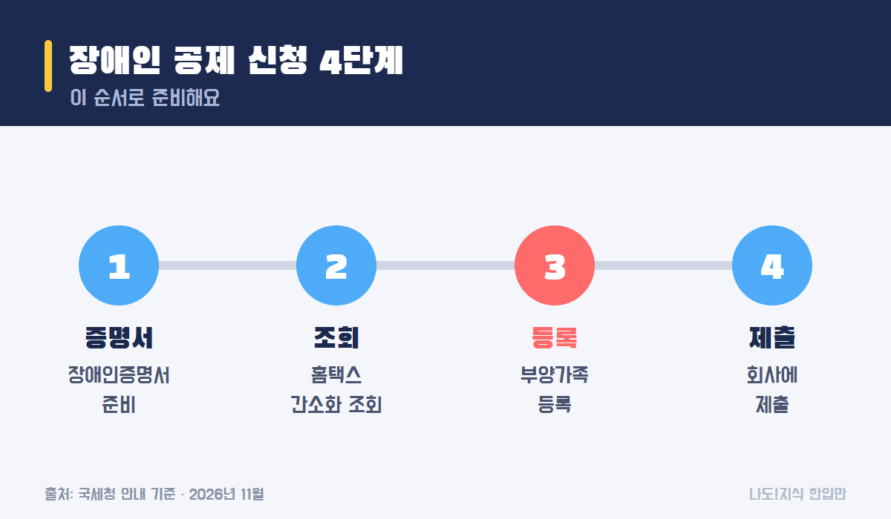

최종 검토일: 2026-11-26

월급 300만원대 직장인 A씨(가상 인물이에요)는 올해 처음으로 장애인 증명서가 있는 어머니를 부양가족으로 올리려고 해요. 결론부터 말하면 나이 제한 없이 소득요건만 맞으면 기본공제 150만원에 장애인 추가공제 200만원을 더한 350만원을 소득에서 빼 줘요이에요.

연말정산 장애인 공제는 <b>장애인 가족이 기본공제 대상일 때 기본공제 150만원에 추가공제 200만원을 더해 소득에서 빼 주는 제도</b>예요.

  <strong style="font-family:'Nanum Gothic', sans-serif;color:#163d7a;">낱말 풀이</strong>
<ul style="line-height:1.9;">
  <li><b>기본공제:</b> 요건을 채운 가족 1명당 소득에서 150만원을 빼 주는 공제예요.</li>
  <li><b>추가공제:</b> 기본공제 대상자가 특정 조건일 때 기본공제에 더해지는 공제예요.</li>
  <li><b>소득금액:</b> 수입에서 필요경비 등을 뺀 금액이에요. 근로소득만 있으면 총급여로 기준을 봐요.</li>
  <li><b>총급여:</b> 비과세를 뺀, 세금 떼기 전 연봉이에요.</li>
  <li><b>장애인증명서:</b> 의료기관이 발급하는 서류로, 중증환자 확인에 써요.</li>
</ul>

2026년 11월 국세청 안내 기준으로 정리했어요. 조건, 금액, 증빙 서류, 경우별 계산 순서로 볼게요.

  <strong style="font-family:'Nanum Gothic', sans-serif;color:#163d7a;">핵심만 먼저</strong>
<ul style="line-height:1.9;">
  <li><b>금액:</b> 기본공제 150만원 + 장애인 추가공제 200만원 = 350만원</li>
  <li><b>나이:</b> 제한 없음</li>
  <li><b>소득요건:</b> 연 소득금액 100만원 이하, 근로소득만이면 총급여 500만원 이하</li>
  <li><b>서류:</b> 장애인복지법 장애인이 아닌 중증환자는 의료기관 장애인증명서가 필요해요</li>
</ul>

<h2 style="color:#163d7a;font-family:'Nanum Gothic', sans-serif;">목차</h2>

<ol style="line-height:1.9;">
  <li><a href="#sec-1" style="color:inherit;text-decoration:underline;text-underline-offset:3px;">장애인 공제는 얼마나 받나요?</a></li>
  <li><a href="#sec-2" style="color:inherit;text-decoration:underline;text-underline-offset:3px;">누가 장애인 공제 대상인가요?</a></li>
  <li><a href="#sec-3" style="color:inherit;text-decoration:underline;text-underline-offset:3px;">경우별로 얼마나 달라지나요?</a></li>
  <li><a href="#sec-4" style="color:inherit;text-decoration:underline;text-underline-offset:3px;">장애인 의료비·교육비는 따로 공제되나요?</a></li>
  <li><a href="#sec-5" style="color:inherit;text-decoration:underline;text-underline-offset:3px;">서류는 어떻게 준비하나요?</a></li>
  <li><a href="#sec-6" style="color:inherit;text-decoration:underline;text-underline-offset:3px;">자주 하는 실수 4가지</a></li>
  <li><a href="#sec-7" style="color:inherit;text-decoration:underline;text-underline-offset:3px;">장애인 공제 Q&amp;A 3개</a></li>
</ol>

<h2 id="sec-1" style="scroll-margin-top:72px;color:#163d7a;font-family:'Nanum Gothic', sans-serif;">장애인 공제는 얼마나 받나요?</h2>

장애인 공제는 기본공제 150만원에 장애인 추가공제 200만원을 더한 350만원이에요. 2026년 11월 국세청 안내 기준 금액이에요.

<b>장애인 추가공제</b>는 기본공제 대상자가 장애인일 때 기본공제에 더해 소득에서 200만원을 더 빼 주는 제도예요.

<table style="width:100%;border-collapse:collapse;margin:16px 0;">
  <thead>
    <tr style="background:#1f6feb;color:#fff;"><th style="border:1px solid #ddd;padding:8px;">구분</th><th style="border:1px solid #ddd;padding:8px;">금액</th><th style="border:1px solid #ddd;padding:8px;">비고</th></tr>
  </thead>
  <tbody>
    <tr><td style="border:1px solid #ddd;padding:8px;">기본공제</td><td style="border:1px solid #ddd;padding:8px;">150만원</td><td style="border:1px solid #ddd;padding:8px;">1인 기준</td></tr>
    <tr><td style="border:1px solid #ddd;padding:8px;">장애인 추가공제</td><td style="border:1px solid #ddd;padding:8px;">200만원</td><td style="border:1px solid #ddd;padding:8px;">기본공제에 더해져요</td></tr>
    <tr><td style="border:1px solid #ddd;padding:8px;">합계</td><td style="border:1px solid #ddd;padding:8px;">350만원</td><td style="border:1px solid #ddd;padding:8px;">소득공제 금액이에요</td></tr>
  </tbody>
</table>

350만원은 세금에서 바로 빠지는 돈이 아니라 소득에서 빼는 금액이에요. 그래서 내 세율이 높을수록 줄어드는 세금도 커져요.

<figure style="margin:24px 0;"><figcaption style="font-size:13px;color:#888;">기본공제 150만원과 추가공제 200만원이 합쳐져 350만원이에요.</figcaption></figure>

<h2 id="sec-2" style="scroll-margin-top:72px;color:#163d7a;font-family:'Nanum Gothic', sans-serif;">누가 장애인 공제 대상인가요?</h2>

대상은 소득요건을 채운 기본공제 대상 가족 중 장애인이에요. 장애인복지법상 장애인이 아니어도 항시 치료를 요하는 중증환자라면 해당될 수 있어요.

<ul style="line-height:1.9;">
  <li><b>나이:</b> 부모든 자녀든 나이 제한 없이 소득요건만 봐요.</li>
  <li><b>소득요건:</b> 연 소득금액 100만원 이하예요. 근로소득만 있다면 총급여 500만원 이하예요.</li>
  <li><b>장애인 범위:</b> 장애인복지법상 장애인, 또는 항시 치료를 요하는 중증환자(의료기관 장애인증명서 필요)예요.</li>
</ul>

소득요건은 기본공제와 똑같이 적용돼요. 장애인이어도 소득이 기준을 넘으면 기본공제도 추가공제도 받기 어려워요.

  <strong style="font-family:'Nanum Gothic', sans-serif;color:#163d7a;">작은 메모</strong>
<ul style="line-height:1.9;">
  <li>위 기준은 2026년 11월 국세청 안내 기준이에요.</li>
  <li>가족이 요건에 해당하는지 헷갈리면 국세청(126)에 먼저 물어보세요.</li>
</ul>

<h2 id="sec-3" style="scroll-margin-top:72px;color:#163d7a;font-family:'Nanum Gothic', sans-serif;">경우별로 얼마나 달라지나요?</h2>

경우별 공제액은 조건이 달라도 공제액은 350만원이지만 줄어드는 세금은 세율 구간에 따라 달라요이에요. 아래 세 사례는 모두 가상이고, 절세액은 세율 구간에 따라 달라서 구간마다 따로 적었어요.

<b>사례 1. 장애인 어머니를 모시는 A씨 (가상)</b>

<ul style="line-height:1.9;">
  <li>어머니는 장애인증명서가 있고 소득이 없어요.</li>
  <li>기본공제 150만원 + 추가공제 200만원 = <b>350만원</b>이에요.</li>
  <li>세율 15% 구간이면 약 52.5만원, 24% 구간이면 84만원 세금이 줄어요(지방소득세 별도, 내 계산이에요).</li>
</ul>

<b>사례 2. 장애인 본인인 B씨 (가상)</b>

<ul style="line-height:1.9;">
  <li>B씨 본인이 장애인이라 본인 기본공제 150만원에 추가공제 200만원이 붙어요.</li>
  <li>합계 <b>350만원</b>이고, 실제 절세액은 세율 구간에 따라 달라요.</li>
</ul>

<b>사례 3. 9세 미만 발달재활서비스를 받는 자녀를 둔 C씨 (가상)</b>

<ul style="line-height:1.9;">
  <li>2026년 11월 국세청 보도자료 기준, 올해 간소화부터 발달재활서비스 이용증명이 제공돼요.</li>
  <li>이 증명은 9세 미만 아동을 장애인 추가공제 대상으로 포함할 때 쓰는 증빙이에요.</li>
  <li>증빙이 갖춰지고 요건에 해당하면 자녀분 기본공제 150만원에 추가공제 200만원이 붙어 <b>350만원</b>이에요. 실제 절세액은 세율 구간에 따라 달라요.</li>
</ul>

세 사례 모두 공제액은 같지만 줄어드는 세금은 사람마다 달라요. 내 세율 구간은 연말정산 미리보기나 홈택스 모의계산으로 확인해요.

사례를 한 번 더 따라 해 볼게요. 소득이 없는 장애인 부모님 1명을 올리는 A씨(가상)의 계산이에요.

  <strong style="font-family:'Nanum Gothic', sans-serif;color:#163d7a;">따라 해 보기 (가상 사례)</strong>
<ol style="line-height:1.9;">
  <li>부모님이 소득요건(소득금액 100만원 이하)을 채우는지 확인해요.</li>
  <li>기본공제 150만원을 적용해요.</li>
  <li>장애인 추가공제 200만원을 더해요.</li>
  <li>합계 350만원이 소득에서 빠져요. 줄어드는 세금은 내 세율 구간에 따라 달라요.</li>
</ol>

부모님 소득이 기준을 넘으면 이 350만원 전체를 받기 어려워요. 연말 전에 가족별 연 소득을 한 번 더 계산해 보는 것이 좋아요.

<h2 id="sec-4" style="scroll-margin-top:72px;color:#163d7a;font-family:'Nanum Gothic', sans-serif;">장애인 의료비·교육비는 따로 공제되나요?</h2>

의료비와 교육비는 장애인에게 더 넉넉한 기준이 적용되는 별도 공제이에요. 인적공제와 따로 받을 수 있는 항목이에요.

<ul style="line-height:1.9;">
  <li><b>의료비:</b> 일반 의료비의 연 700만원 한도 없이 전액 대상이에요. 단 총급여의 3%를 넘는 금액부터 공제돼요.</li>
  <li><b>재활교육비:</b> 소득요건 없이, 한도 없이 공제받을 수 있어요. 직계존속(부모님) 몫도 가능해요.</li>
  <li><b>장애인전용보장성보험료:</b> 연 100만원까지 대상이고 공제율은 15%예요(법 원문 확인 권장).</li>
  <li><b>간소화 신규 자료:</b> 올해부터 장애인활동지원급여 본인부담금이 의료비 증빙으로 제공돼요.</li>
</ul>

위 내용은 2026년 11월 국세청 안내 기준이에요. 항목마다 요건이 달라서 영수증과 증명서를 같이 챙기는 편이 안전해요.

장애인 공제는 한 번 요건을 확인해 두면 매년 같은 방식으로 준비할 수 있어요. 다만 가족의 소득과 건강 상태는 해마다 달라지니 해마다 증빙을 새로 확인하는 것이 안전해요.

증명서의 발급 기관과 유효 여부는 회사나 국세청 안내에서 확인해요. 서류가 부족하면 공제가 빠질 수 있어서, 12월 초에는 서류 목록을 한 번 점검해요.

<h2 id="sec-5" style="scroll-margin-top:72px;color:#163d7a;font-family:'Nanum Gothic', sans-serif;">서류는 어떻게 준비하나요?</h2>

서류는 장애인증명서, 간소화 조회, 부양가족 등록, 회사 제출의 네 단계로 준비하면 돼요. 간소화 서비스는 2026년 1월 15일 개통 기준이에요.

<ol style="line-height:1.9;">
  <li>의료기관 등에서 장애인증명서를 받아요(중증환자인 경우 필수예요).</li>
  <li>홈택스 간소화 서비스에서 의료비·발달재활서비스 이용증명 등을 조회해요.</li>
  <li>회사 연말정산 화면에서 부양가족과 장애인 항목을 등록해요.</li>
  <li>증명서와 자료를 회사에 제출해요.</li>
</ol>

<figure style="margin:24px 0;"><figcaption style="font-size:13px;color:#888;">네 단계 중 증명서는 미리 챙겨 두면 마지막에 덜 바빠요.</figcaption></figure>

서류를 준비할 때는 미리 점검할 것이 몇 가지 있어요. 2026년 11월 국세청 안내 기준으로 아래 순서가 편해요.

<ul style="line-height:1.9;">
  <li>가족 중 장애인증명서가 있는 사람이 누구인지 먼저 적어 둬요.</li>
  <li>그 가족의 올해 소득이 기준을 넘지 않는지 계산해요.</li>
  <li>의료비와 재활교육비 영수증을 한곳에 모아 둬요.</li>
  <li>9세 미만 자녀가 발달재활서비스를 받았다면 이용증명이 간소화에 뜨는지 확인해요.</li>
  <li>회사 제출 마감일은 회사마다 달라서 담당 부서에 물어봐요.</li>
</ul>

<h2 id="sec-6" style="scroll-margin-top:72px;color:#163d7a;font-family:'Nanum Gothic', sans-serif;">자주 하는 실수 4가지</h2>

실수는 대부분 요건 확인 누락에서 나와요. 아래 네 가지만 미리 확인해요.

<ol style="line-height:1.9;">
  <li><b>소득요건 확인 안 하기:</b> 장애인이어도 소득이 100만원(총급여 500만원)을 넘으면 어려워요.</li>
  <li><b>증명서 없이 올리기:</b> 중증환자는 의료기관 장애인증명서가 필요해요.</li>
  <li><b>추가공제를 기본공제 없이 기대하기:</b> 추가공제는 기본공제 대상자에게만 붙어요.</li>
  <li><b>공제 금액을 환급액으로 착각하기:</b> 350만원은 소득에서 빼는 금액이에요.</li>
</ol>

가족 공제는 한 사람만 받을 수 있어요. 인적공제 전체 요건은 <a href="https://sensitiveboss3.tistory.com/entry/year-end-tax-personal-deduction-2026" target="_blank" rel="noopener">연말정산 인적공제 조건 2026</a> 글에서 볼 수 있어요.

<h2 id="sec-7" style="scroll-margin-top:72px;color:#163d7a;font-family:'Nanum Gothic', sans-serif;">장애인 공제 Q&amp;A 3개</h2>

  
장애인 공제는 나이 제한이 있나요

  
나이 제한이 없어요. 소득요건(연 소득금액 100만원, 근로소득만이면 총급여 500만원 이하)만 채우면 기본공제 150만원에 장애인 추가공제 200만원이 붙어요. 2026년 11월 국세청 안내 기준이에요.

  
장애인복지법상 장애인이 아니면 공제가 안 되나요

  
항시 치료를 요하는 중증환자도 대상이 될 수 있어요. 이때는 의료기관이 발급한 장애인증명서가 필요해요. 2026년 11월 국세청 안내 기준이에요.

  
장애인 의료비는 한도가 있나요

  
일반 의료비의 연 700만원 한도가 장애인 의료비에는 적용되지 않고 전액 대상이에요. 단 총급여의 3%를 넘는 금액부터 공제돼요. 2026년 11월 국세청 안내 기준이에요.

  <strong style="font-family:'Nanum Gothic', sans-serif;color:#163d7a;">이 글 다음에 할 일</strong>
<ol style="line-height:1.9;">
  <li>가족 중 장애인이 있는지, 소득요건을 채우는지 확인해요.</li>
  <li>장애인증명서와 간소화 자료를 미리 챙겨요.</li>
  <li>홈택스 모의계산으로 내 세율에서 줄어드는 세금을 확인해요.</li>
</ol>

  <strong style="font-size:16px;">함께 보면 좋은 글</strong>
  <ul style="margin:8px 0 0 0;padding-left:20px;line-height:1.9;"><li><a href="https://sensitiveboss3.tistory.com/entry/year-end-tax-personal-deduction-2026" target="_blank" rel="noopener">연말정산 인적공제 조건 2026</a></li><li><a href="https://sensitiveboss3.tistory.com/entry/medical-expense-tax-credit-2026" target="_blank" rel="noopener">의료비 세액공제 2026</a></li><li><a href="https://sensitiveboss3.tistory.com/entry/year-end-tax-education-expense-2026" target="_blank" rel="noopener">교육비 세액공제 2026</a></li></ul>

  참고 출처:
  <ul style="margin:6px 0 0 0;padding-left:20px;">
    <li><a href="https://www.nts.go.kr/nts/na/ntt/selectNttInfo.do?mi=&amp;nttSn=1347979" target="_blank" rel="noopener">국세청 보도자료: 2026년 연말정산 간소화 서비스</a></li>
    <li><a href="https://www.korea.kr/news/policyNewsView.do?newsId=148725720" target="_blank" rel="noopener">정책브리핑: 소득공제 안내(국세청)</a></li>
    <li><a href="https://www.mt.co.kr/economy/2026/01/14/2026011410294621205" target="_blank" rel="noopener">머니투데이 2026-01-14 보도</a></li>
  </ul>
  기준일: 2026년 11월 26일. 금액은 단순 계산이고 세율에 따라 실제 절세액은 달라요.

이 글은 정보 제공을 목적으로 하며 특정 종목이나 상품의 매수·매도를 권유하지 않습니다. 투자 판단과 그 결과에 대한 책임은 투자자 본인에게 있습니다. 세율·수수료·한도는 변경될 수 있으므로 반드시 원출처에서 최신 내용을 확인하시기 바랍니다.

