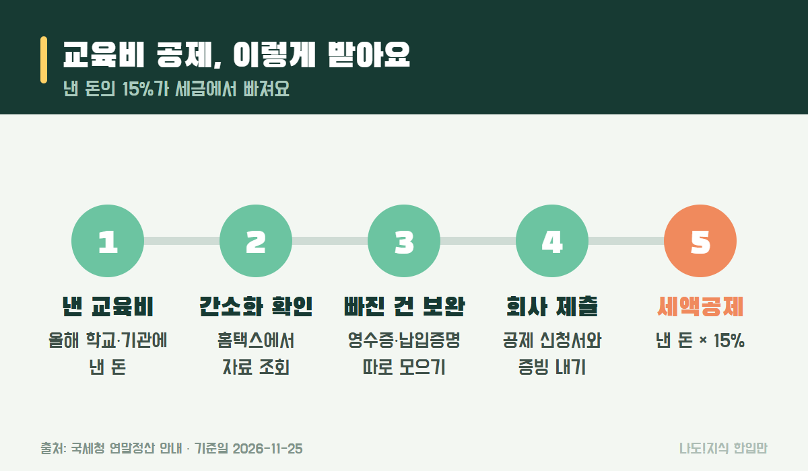
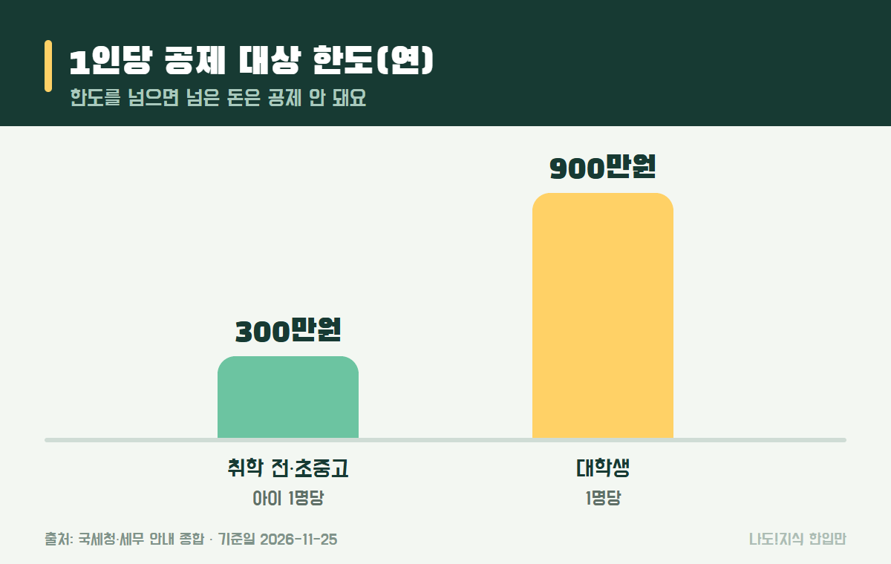
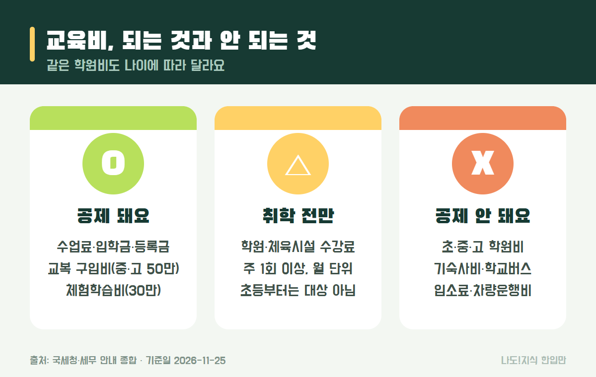

최종 검토일: 2026-11-26

자녀 학원비도 되고 대학 등록금도 될까요? 교육비 세액공제는 낸 교육비의 15%를 세금에서 빼 주는 제도예요. 한도는 취학 전·초중고 1인 연 300만원, 대학생 1인 연 900만원이라 대학생 등록금 900만원이면 135만원이 줄어요.

저도 처음엔 "학원비 낸 건 다 되는 줄" 알았다가 나이별로 갈린다는 걸 알고 놀랐어요. 아래에서 한도, 되는 것과 안 되는 것, 계산 예시를 순서대로 정리할게요.

  <strong style="font-size:17px;color:#145c3c;font-family:'Nanum Myeongjo', serif;">📌 핵심만 먼저 보기</strong>
  <ul style="margin:8px 0 0 0;padding-left:20px;line-height:1.9;">
    <li>교육비 세액공제는 소득공제가 아니라 <b>세액공제</b>예요. 낸 돈 × 15%가 세금에서 직접 빠져요.</li>
    <li>한도는 취학 전·초중고 1인 300만원, 대학생 1인 900만원이에요. 본인 교육비는 한도가 없어요.</li>
    <li>초·중·고 학원비는 공제가 안 되고, 취학 전 학원·체육시설 수강료는 대상이에요.</li>
    <li>간소화 자료에서 빠진 영수증은 따로 모아 회사에 내야 해요.</li>
  </ul>

<h2 id="sec-1" style="color:#145c3c;font-family:'Nanum Myeongjo', serif;border-left:6px solid #1e8a5a;padding-left:12px;margin-top:36px;">교육비 세액공제는 얼마나 돌려받나요?</h2>

낸 교육비(한도 안)의 15%가 산출세액에서 빠져요. 2026년 11월 기준 세무 해설과 소득세법 제59조의4 조문 안내가 같은 값이에요.

소득공제는 소득에서 금액을 빼지만, 세액공제는 세금에서 바로 빼요. 그래서 같은 금액이면 공제 효과가 더 직접적이에요.

<ul style="line-height:1.9;">
  <li>대학생 자녀 등록금 900만원 → 900만 × 15% = <b>135만원</b></li>
  <li>초등학생 교육비 400만원 → 한도 300만 × 15% = <b>45만원</b></li>
  <li>본인 대학원 학비 1,200만원 → 한도 없음, 1,200만 × 15% = <b>180만원</b></li>
</ul>

<figure><figcaption>낸 돈의 15%가 세금에서 빠지는 흐름이에요.</figcaption></figure>

  <strong style="color:#145c3c;font-family:'Nanum Myeongjo', serif;">📖 낱말 풀이 3가지</strong>
  <ul style="margin:8px 0 0 0;padding-left:20px;line-height:1.9;">
    <li><b>세액공제</b>: 계산된 세금(산출세액)에서 금액을 직접 빼는 방식이에요.</li>
    <li><b>취학 전 아동</b>: 초등학교에 들어가기 전의 자녀예요. 어린이집·유치원·학원이 여기에 해당해요.</li>
    <li><b>납입증명서</b>: 학교나 기관이 "이만큼 받았다"고 발급해 주는 서류예요. 간소화에 없을 때 대신 내요.</li>
  </ul>

<h2 id="sec-1b" style="color:#145c3c;font-family:'Nanum Myeongjo', serif;border-left:6px solid #1e8a5a;padding-left:12px;margin-top:36px;">내 경우엔 얼마가 되나요?</h2>

가정마다 한도에 걸리는 지점이 달라서 공제액이 크게 갈려요. 아래 세 가정을 내 상황에 대 보세요.

<ul style="line-height:1.9;">
  <li><b>가정 A. 초등학생 1명, 교육비 200만원</b>: 한도(300만원) 안이라 200만 × 15% = 30만원이에요. 학원비는 처음부터 빼고 계산해요.</li>
  <li><b>가정 B. 대학생 1명, 등록금 1,000만원</b>: 한도 900만원에서 잘려서 900만 × 15% = 135만원이에요. 넘는 100만원은 공제가 안 돼요.</li>
  <li><b>가정 C. 본인 대학원 1,200만원</b>: 본인은 한도가 없어 1,200만 × 15% = 180만원이에요.</li>
</ul>

이 금액은 세금에서 빠지는 액수지만, 올해 낸 세금이 이보다 적으면 그만큼만 돌려받아요. 결정세액 안에서만 의미가 있다는 점도 기억해 두세요.

<h2 id="sec-2" style="color:#145c3c;font-family:'Nanum Myeongjo', serif;border-left:6px solid #1e8a5a;padding-left:12px;margin-top:36px;">한도는 누구 몫이 얼마인가요?</h2>

한도는 가족 전체가 아니라 교육받는 사람 1명마다 따로 적용돼요. 취학 전과 초·중·고는 연 300만원, 대학생은 연 900만원이에요.

<table style="border-collapse:collapse;width:100%;margin:12px 0;">
  <thead>
    <tr style="background:#ecf8f1;">
      <th style="border:1px solid #c9e3d4;padding:8px;">대상</th>
      <th style="border:1px solid #c9e3d4;padding:8px;">연 한도(1인)</th>
      <th style="border:1px solid #c9e3d4;padding:8px;">최대 공제액(15%)</th>
    </tr>
  </thead>
  <tbody>
    <tr><td style="border:1px solid #c9e3d4;padding:8px;">취학 전·초·중·고</td><td style="border:1px solid #c9e3d4;padding:8px;">300만원</td><td style="border:1px solid #c9e3d4;padding:8px;">45만원</td></tr>
    <tr><td style="border:1px solid #c9e3d4;padding:8px;">대학생</td><td style="border:1px solid #c9e3d4;padding:8px;">900만원</td><td style="border:1px solid #c9e3d4;padding:8px;">135만원</td></tr>
    <tr><td style="border:1px solid #c9e3d4;padding:8px;">본인(대학원 포함)</td><td style="border:1px solid #c9e3d4;padding:8px;">한도 없음</td><td style="border:1px solid #c9e3d4;padding:8px;">낸 돈 × 15%</td></tr>
    <tr><td style="border:1px solid #c9e3d4;padding:8px;">장애인 특수교육비</td><td style="border:1px solid #c9e3d4;padding:8px;">한도 없음</td><td style="border:1px solid #c9e3d4;padding:8px;">낸 돈 × 15%</td></tr>
  </tbody>
</table>

자녀가 둘이면 합산해서 따져요. 초등학생 200만원과 대학생 800만원이면 (200만 + 800만) 각각 15%라서 30만원 + 120만원 = 150만원이 공제돼요.

<figure><figcaption>한도를 넘는 금액은 공제되지 않아요.</figcaption></figure>

  <strong style="color:#145c3c;font-family:'Nanum Myeongjo', serif;">💡 부모님 교육비는요?</strong>
  
직계존속(부모님·조부모) 교육비는 공제 대상이 아니라고 해설에서 안내해요. 부양가족 나이·소득 요건도 따로 있으니 홈택스에서 최종 확인이 필요해요.

<h2 id="sec-3" style="color:#145c3c;font-family:'Nanum Myeongjo', serif;border-left:6px solid #1e8a5a;padding-left:12px;margin-top:36px;">학원비·교복비도 공제되나요?</h2>

초·중·고 학원비는 공제가 안 되고, 취학 전 아동의 학원·체육시설 수강료는 공제돼요. 같은 학원비도 나이에 따라 갈려서 가장 많이 헷갈리는 부분이에요.

<ul style="line-height:1.9;">
  <li><b>공제 돼요</b>: 수업료·입학금·등록금, 교복 구입비(중·고 1인 50만원), 체험학습비(초·중·고 1인 30만원)</li>
  <li><b>취학 전만</b>: 학원·체육시설 수강료(주 1회 이상, 월 단위 교습)</li>
  <li><b>안 돼요</b>: 초·중·고 학원비, 기숙사비, 학교버스·차량운행비, 입소료</li>
</ul>

<figure><figcaption>나이에 따라 달라지는 학원비 기준이에요.</figcaption></figure>

교복 50만원과 체험학습비 30만원이 300만원 한도와 별도인지 합산인지는 출처마다 해석이 엇갈려요. 이 글에서는 단정하지 않고, 해당되면 홈택스 안내를 확인하길 권해요.

일부 보도에는 올해부터 초등 저학년 예체능 학원비가 추가됐다는 내용도 있어요. 확인되지 않은 부분이라 본문 계산에는 넣지 않았어요.

학원이 "취학 전 대상"인지 헷갈릴 때는 자녀의 나이와 수업 형태를 먼저 보세요. 만 나이가 아니라 학교에 들어갔는지가 기준이고, 주 1회 이상 월 단위로 배우는 수업이어야 해요. 한 번 하고 끝나는 체험 수업이나 단발 특강은 대상에서 빠질 수 있어요. 애매하면 학원에 "교육비 공제 대상 납입증명서가 되는지" 먼저 물어보는 것이 가장 빨라요.

<h2 id="sec-4" style="color:#145c3c;font-family:'Nanum Myeongjo', serif;border-left:6px solid #1e8a5a;padding-left:12px;margin-top:36px;">장학금 받았거나 대출로 냈으면 어떻게 하나요?</h2>

장학금이나 학자금으로 충당한 부분은 공제 대상에서 빠져요. 실제로 내 돈으로 낸 금액만 계산해요.

<ul style="line-height:1.9;">
  <li>등록금 800만원 중 장학금 300만원 → 공제 대상은 500만원, 500만 × 15% = 75만원</li>
  <li>학자금 대출은 대출금을 갚을 때 기준으로 볼 수 있어서 서류를 확인해야 해요</li>
</ul>

  <strong style="color:#145c3c;font-family:'Nanum Myeongjo', serif;">💡 간소화 자료에서 빠지기 쉬운 것</strong>
  
학원·어린이집 일부, 해외 학교, 방과후 수업은 간소화에 안 잡히는 경우가 있어요. 납입증명서를 따로 받아 두세요.

퇴사했거나 중간에 직장을 옮겼다면 일한 기간에 낸 교육비만 대상이에요. 근로 기간 밖에 낸 금액은 공제에서 빠지는 경우가 많아서, 입사·퇴사 날짜와 납부 날짜를 같이 적어 두면 편해요.

납부 시점은 실제로 돈을 낸 날 기준이에요. 12월에 낸 내년 1학기 등록금은 낸 해에 공제를 받는 것이 일반적이지만, 학교 납입증명서의 납부일로 확인하는 편이 안전해요.

<h2 id="sec-5" style="color:#145c3c;font-family:'Nanum Myeongjo', serif;border-left:6px solid #1e8a5a;padding-left:12px;margin-top:36px;">어디서 확인하고 어떻게 신청하나요?</h2>

홈택스 연말정산 간소화 서비스에서 교육비 자료를 조회하고, 회사에 공제 신청서와 증빙을 내면 돼요. 간소화 자료는 매년 연초에 열리니 개통 일정은 국세청 공지로 알 수 있어요.

<ol style="line-height:1.9;">
  <li>올해 낸 교육비 내역을 정리해요</li>
  <li>홈택스에서 간소화 자료를 조회해요</li>
  <li>빠진 항목은 영수증·납입증명서로 보완해요</li>
  <li>회사에 공제 신청서와 증빙을 제출해요</li>
</ol>

다른 공제와 함께 보려면 <a href="https://sensitiveboss3.tistory.com/entry/year-end-tax-preview-card-deduction-2026" target="_blank" rel="noopener">연말정산 미리보기</a> 글에서 카드 공제 한도와 마감 일정을 같이 볼 수 있어요.

  <strong style="color:#145c3c;font-family:'Nanum Myeongjo', serif;">⚠️ 자주 하는 실수 4가지</strong>
  <ol style="margin:8px 0 0 0;padding-left:20px;line-height:1.9;">
    <li><b>초·중·고 학원비를 넣기</b> → 공제 대상이 아니라서 빼야 해요.</li>
    <li><b>한도 넘는 금액까지 계산하기</b> → 대학생 1,000만원도 계산은 900만원까지예요.</li>
    <li><b>장학금을 안 빼기</b> → 내 돈으로 낸 금액만 대상이에요.</li>
    <li><b>부모님 교육비를 넣기</b> → 직계존속은 대상이 아니에요.</li>
  </ol>

저도 처음엔 간소화 자료가 알아서 다 걸러 준다고 믿었어요. 막상 서류를 대 보니 빠진 영수증이 두 장 있었고, 그걸 따로 내서 공제를 챙겼어요.

<h2 id="sec-5b" style="color:#145c3c;font-family:'Nanum Myeongjo', serif;border-left:6px solid #1e8a5a;padding-left:12px;margin-top:36px;">맞벌이면 누가 공제받는 게 유리한가요?</h2>

자녀 교육비는 부모 중 한 명이 몰아서 공제받는 것이 원칙이에요. 자녀 1명의 교육비를 부부가 나눠 신청할 수는 없어요.

<ul style="line-height:1.9;">
  <li>세액공제는 낸 세금이 있어야 돌려받아요. 그래서 낼 세금(결정세액)이 더 많은 쪽에 몰아주는 편이 보통 유리해요.</li>
  <li>자녀가 둘이면 한 명은 아빠, 한 명은 엄마로 나누는 것은 가능한지 홈택스·회사 안내에서 확인해 보세요.</li>
  <li>기본공제 대상 자녀를 누가 올렸는지와 맞춰야 해서, 먼저 인적공제 신청을 정리해 두는 게 좋아요.</li>
</ul>

  <strong style="color:#145c3c;font-family:'Nanum Myeongjo', serif;">💡 서류 준비 팁</strong>
  
학원 수강료는 기관에서 현금영수증이나 납입증명서를 받아 두면 신청이 편해요. 파일은 사진으로 찍어 폴더 하나에 모아 두면 제출할 때 빨리 찾을 수 있어요.

<h2 id="sec-6" style="color:#145c3c;font-family:'Nanum Myeongjo', serif;border-left:6px solid #1e8a5a;padding-left:12px;margin-top:36px;">오늘 할 일 체크리스트는요?</h2>

연말 전에 아래 다섯 가지만 챙겨도 놓치는 공제가 크게 줄어요.

<ul style="list-style:none;padding-left:0;line-height:2;">
  <li>☐ 올해 낸 학교·기관별 교육비 합계 적기</li>
  <li>☐ 자녀별로 한도(300만/900만원) 넘는지 확인하기</li>
  <li>☐ 초·중·고 학원비는 빼고 계산하기</li>
  <li>☐ 간소화에 안 잡힐 영수증·납입증명서 미리 받기</li>
  <li>☐ 장학금·학자금 받은 금액 빼기</li>
</ul>

<h2 id="sec-7" style="color:#145c3c;font-family:'Nanum Myeongjo', serif;border-left:6px solid #1e8a5a;padding-left:12px;margin-top:36px;">교육비 세액공제 Q&amp;A 6개</h2>

  
교육비 세액공제율은 몇 퍼센트인가요

  
낸 교육비의 15%예요. 한도 안에서만 계산하고, 결과는 세금에서 바로 빠져요.

  
교육비 공제 한도는 얼마인가요

  
취학 전·초·중·고는 1인 연 300만원, 대학생은 1인 연 900만원이에요. 본인과 장애인 특수교육비는 한도가 없어요.

  
초등학생 학원비도 공제되나요

  
초·중·고 학원비는 원칙적으로 공제가 안 돼요. 취학 전 아동의 학원·체육시설 수강료만 대상이에요.

  
대학원 학비도 공제되나요

  
근로자 본인의 대학원 학비는 공제돼요. 부양가족의 대학원 학비는 대상이 아니라고 안내돼요.

  
부모님 교육비도 공제받을 수 있나요

  
직계존속(부모님·조부모)의 교육비는 공제 대상이 아니에요. 자녀·본인 교육비만 대상이에요.

  
장학금 받은 등록금은 어떻게 계산하나요

  
장학금으로 충당한 부분은 빼고, 내 돈으로 낸 금액만 15%로 계산해요. 800만원 중 장학금 300만원이면 500만원 기준이에요.

  <strong style="font-size:16px;">📚 함께 보면 좋은 글</strong>
  <ul style="margin:8px 0 0 0;padding-left:20px;line-height:1.9;"><li><a href="https://sensitiveboss3.tistory.com/entry/year-end-tax-preview-card-deduction-2026" target="_blank" rel="noopener">연말정산 미리보기 12월 18일까지</a></li><li><a href="https://sensitiveboss3.tistory.com/entry/eitc-late-application-2026" target="_blank" rel="noopener">근로장려금 기한 후 신청 2026</a></li></ul>

  참고 출처:
  <ul style="margin:6px 0 0 0;padding-left:20px;">
    <li><a href="https://www.law.go.kr" target="_blank" rel="noopener">국가법령정보센터: 소득세법 제59조의4, 시행령 제118조의6</a></li>
    <li><a href="https://www.hometax.go.kr" target="_blank" rel="noopener">국세청 홈택스</a></li>
    <li><a href="https://www.nts.go.kr" target="_blank" rel="noopener">국세청</a></li>
  </ul>
  기준일: 2026년 11월 26일. 공제율·한도는 법령 조문 요약과 세무 해설 기준이며 국세청 원문은 직접 확인하지 못했어요. 금액은 단순 계산이에요.

정보 제공을 목적으로 쓴 글이에요. 공제 대상과 한도는 개인 상황과 해마다 바뀌는 세법에 따라 달라질 수 있으니 홈택스와 국세청 안내가 기준이에요.

