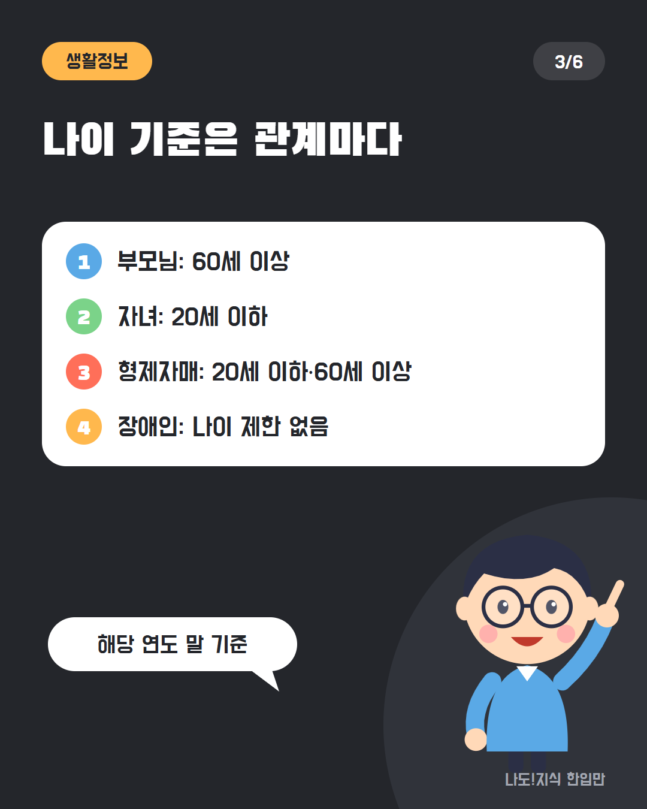
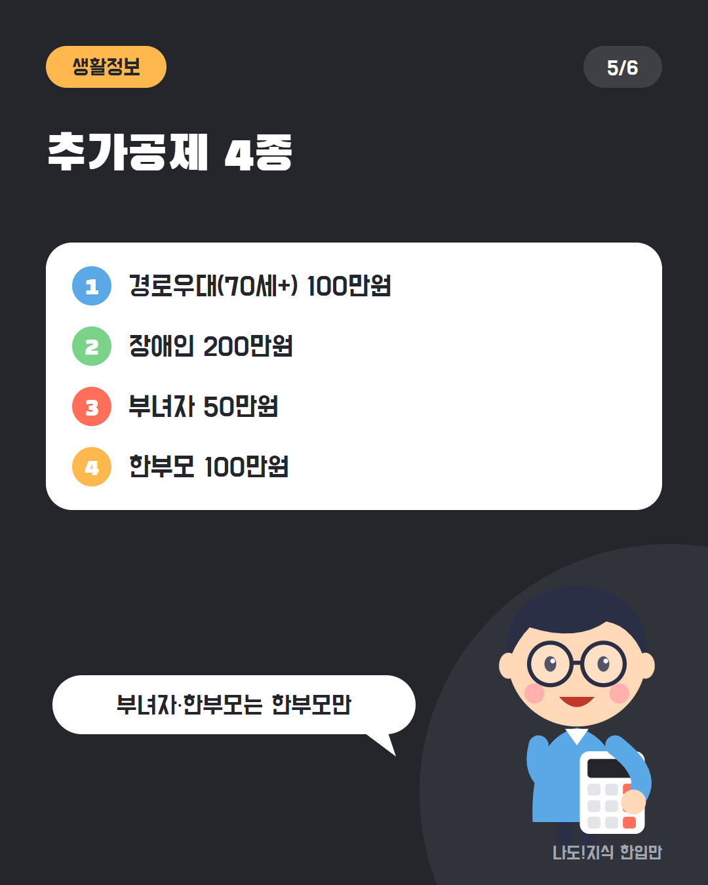
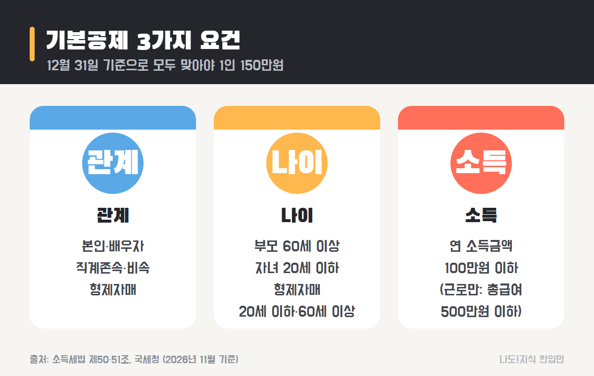
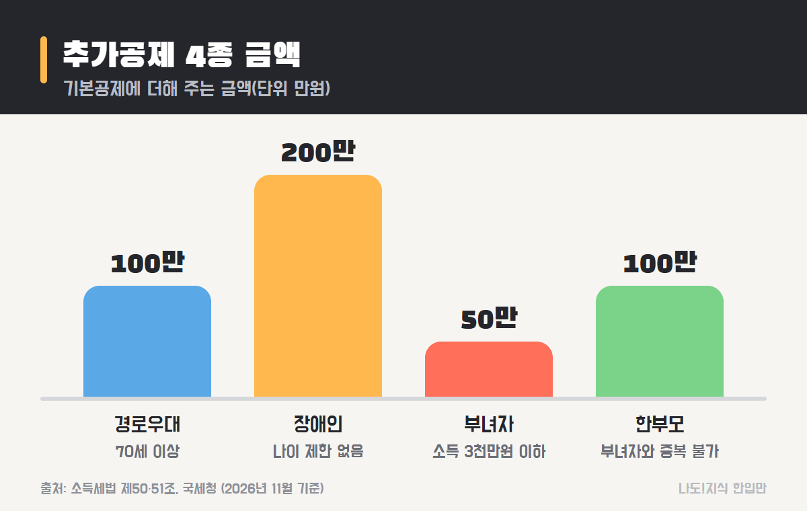
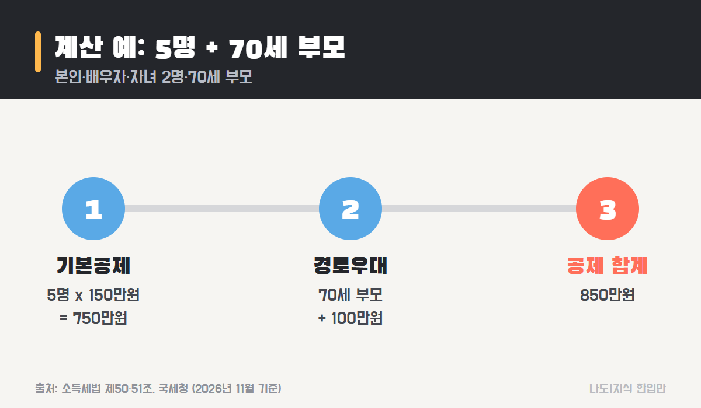

최종 검토일: 2026-11-24

연말정산 인적공제는 본인·배우자·부양가족 1명당 150만원을 소득에서 빼 주는 제도예요. 부모님이나 배우자가 공제되려면 관계·나이·소득 세 가지를 12월 31일 기준으로 모두 충족해야 해요.

"부모님 공제 되나요?", "배우자 소득이 조금 있는데요?"가 해마다 가장 많이 나오는 질문이죠. 2026년 귀속 기준으로 요건과 금액을 표와 계산 예로 정리할게요.

  <strong style="color:#24262b;font-size:18px;">🗓 한눈에 보기</strong>
  <ul style="margin:10px 0 0 0;padding-left:20px;line-height:1.9;">
    <li><b>기본공제:</b> 1인 150만원 (본인·배우자·부양가족)</li>
    <li><b>소득요건:</b> 소득금액 100만원 이하, 근로소득만이면 총급여 500만원 이하</li>
    <li><b>나이:</b> 부모 60세 이상, 자녀 20세 이하 (장애인은 나이 제한 없음)</li>
    <li><b>추가공제:</b> 경로우대 100만원, 장애인 200만원, 부녀자 50만원, 한부모 100만원</li>
    <li><b>2026 귀속:</b> 현행 100만원·500만원 유지 (300만원·750만원은 정부안, 국회 확정 전)</li>
  </ul>

옆으로 넘겨 보세요 → (카드 6장 요약)

  <strong style="font-size:16px;">📖 처음이라면 이것만 — 낱말 풀이</strong>
  <ul style="margin:8px 0 0 0;padding-left:20px;line-height:1.9;">
    <li><b>인적공제:</b> 사람 수에 따라 소득에서 빼 주는 금액. 기본공제와 추가공제로 나뉘어요.</li>
    <li><b>기본공제 대상자:</b> 본인, 배우자, 생계를 같이하는 부양가족 중 요건을 채운 사람.</li>
    <li><b>소득금액:</b> 수입에서 필요경비 등을 뺀 금액. 근로자는 총급여에서 근로소득공제를 뺀 값이에요.</li>
    <li><b>총급여:</b> 비과세를 뺀, 세금 떼기 전 연봉.</li>
    <li><b>직계존속·직계비속:</b> 부모·조부모는 직계존속, 자녀·손자녀는 직계비속이에요.</li>
  </ul>

<h2 style="border-left:6px solid #24262b;padding-left:12px;margin-top:36px;">목차</h2>
<ol style="line-height:1.9;">
  <li><a href="#sec-1" style="color:inherit;text-decoration:underline;text-underline-offset:3px;">인적공제는 누구를 몇 명까지 받나요?</a></li>
  <li><a href="#sec-2" style="color:inherit;text-decoration:underline;text-underline-offset:3px;">부모님·배우자는 소득이 얼마까지 공제되나요?</a></li>
  <li><a href="#sec-3" style="color:inherit;text-decoration:underline;text-underline-offset:3px;">나이 기준은 어떻게 따지나요?</a></li>
  <li><a href="#sec-4" style="color:inherit;text-decoration:underline;text-underline-offset:3px;">추가공제는 얼마나 더 받나요?</a></li>
  <li><a href="#sec-5" style="color:inherit;text-decoration:underline;text-underline-offset:3px;">내 경우 인적공제는 얼마인가요?</a></li>
  <li><a href="#sec-6" style="color:inherit;text-decoration:underline;text-underline-offset:3px;">2027년부터 소득 기준이 바뀌나요?</a></li>
  <li><a href="#sec-7" style="color:inherit;text-decoration:underline;text-underline-offset:3px;">자주 하는 실수 5가지</a></li>
  <li><a href="#sec-8" style="color:inherit;text-decoration:underline;text-underline-offset:3px;">인적공제 Q&amp;A 5개</a></li>
</ol>

<h2 id="sec-1" style="scroll-margin-top:72px;border-left:6px solid #24262b;padding-left:12px;margin-top:36px;">인적공제는 누구를 몇 명까지 받나요?</h2>

인적공제는 기본공제 대상자 1명당 150만원이고, 요건을 채우는 사람이 많을수록 공제액이 커져요. 본인과 배우자도 대상에 들어가요.

<table style="width:100%;border-collapse:collapse;margin:16px 0;">
  <thead>
    <tr style="background:#24262b;color:#fff;"><th style="border:1px solid #ddd;padding:8px;">대상</th><th style="border:1px solid #ddd;padding:8px;">관계</th><th style="border:1px solid #ddd;padding:8px;">기본공제</th></tr>
  </thead>
  <tbody>
    <tr><td style="border:1px solid #ddd;padding:8px;">본인</td><td style="border:1px solid #ddd;padding:8px;">-</td><td style="border:1px solid #ddd;padding:8px;">150만원</td></tr>
    <tr><td style="border:1px solid #ddd;padding:8px;">배우자</td><td style="border:1px solid #ddd;padding:8px;">법적 부부</td><td style="border:1px solid #ddd;padding:8px;">150만원</td></tr>
    <tr><td style="border:1px solid #ddd;padding:8px;">직계존속</td><td style="border:1px solid #ddd;padding:8px;">부모·조부모(재혼 배우자 포함)</td><td style="border:1px solid #ddd;padding:8px;">1인 150만원</td></tr>
    <tr><td style="border:1px solid #ddd;padding:8px;">직계비속·입양자</td><td style="border:1px solid #ddd;padding:8px;">자녀·입양자</td><td style="border:1px solid #ddd;padding:8px;">1인 150만원</td></tr>
    <tr><td style="border:1px solid #ddd;padding:8px;">형제자매</td><td style="border:1px solid #ddd;padding:8px;">동거하며 부양</td><td style="border:1px solid #ddd;padding:8px;">1인 150만원</td></tr>
  </tbody>
</table>

예를 들어 맞벌이 부부라면 본인과 배우자는 각자 자기 공제를 받고, 자녀와 부모님 같은 부양가족은 누가 공제받을지 정해서 한쪽에만 올려요. 가족 구성이 바뀌면 해마다 다시 정해도 돼요.

공제는 세금을 계산하기 전에 소득에서 빼 주는 방식이에요. 그래서 세율이 높은 사람일수록 같은 150만원이라도 절세 효과가 커요.

<figure style="margin:24px 0;"><figcaption style="font-size:13px;color:#888;">관계·나이·소득 세 가지를 모두 채워야 기본공제 대상이에요.</figcaption></figure>

<h2 id="sec-2" style="scroll-margin-top:72px;border-left:6px solid #24262b;padding-left:12px;margin-top:36px;">부모님·배우자는 소득이 얼마까지 공제되나요?</h2>

소득요건은 연 소득금액 100만원 이하, 근로소득만 있다면 총급여 500만원 이하예요. 이 기준은 2026년 귀속(2027년 초 연말정산)에도 그대로 적용돼요.

<table style="width:100%;border-collapse:collapse;margin:16px 0;">
  <thead>
    <tr style="background:#24262b;color:#fff;"><th style="border:1px solid #ddd;padding:8px;">소득 종류</th><th style="border:1px solid #ddd;padding:8px;">기준 (2026 귀속)</th></tr>
  </thead>
  <tbody>
    <tr><td style="border:1px solid #ddd;padding:8px;">소득금액 합계</td><td style="border:1px solid #ddd;padding:8px;">연 100만원 이하</td></tr>
    <tr><td style="border:1px solid #ddd;padding:8px;">근로소득만 있는 경우</td><td style="border:1px solid #ddd;padding:8px;">총급여 500만원 이하</td></tr>
  </tbody>
</table>

<ul style="line-height:1.9;">
  <li>배우자에게 아르바이트 소득이 있다면 총급여가 500만원 이하인지 먼저 봐요.</li>
  <li>부모님이 연금이나 임대 소득이 있다면 소득금액이 100만원 이하인지 따져 봐요.</li>
  <li>한 해 중 기준을 넘긴 소득이 있다면 그해 공제는 받지 못해요.</li>
</ul>

부모님이 기초연금 같은 공적 급여만 받는다면 소득금액에 어떻게 잡히는지 국세청 Q&amp;A에서 따로 확인해 보세요. 소득 종류마다 계산 방식이 달라서 같은 금액이라도 결과가 다를 수 있어요.

소득 종류별 계산은 국세청 상담 Q&amp;A에서 확인하는 것이 안전해요. 소득은 한 해 전체를 기준으로 판단해서 연말에 임박해 바꾸기는 어려워요.

<h2 id="sec-3" style="scroll-margin-top:72px;border-left:6px solid #24262b;padding-left:12px;margin-top:36px;">나이 기준은 어떻게 따지나요?</h2>

나이는 부모 등 직계존속은 60세 이상, 자녀 등 직계비속과 입양자는 20세 이하여야 해요. 형제자매는 20세 이하 또는 60세 이상이어야 하고 동거 요건이 있어요.

<table style="width:100%;border-collapse:collapse;margin:16px 0;">
  <thead>
    <tr style="background:#24262b;color:#fff;"><th style="border:1px solid #ddd;padding:8px;">대상</th><th style="border:1px solid #ddd;padding:8px;">나이 기준</th><th style="border:1px solid #ddd;padding:8px;">비고</th></tr>
  </thead>
  <tbody>
    <tr><td style="border:1px solid #ddd;padding:8px;">직계존속</td><td style="border:1px solid #ddd;padding:8px;">60세 이상</td><td style="border:1px solid #ddd;padding:8px;">재혼 배우자 포함</td></tr>
    <tr><td style="border:1px solid #ddd;padding:8px;">직계비속·입양자</td><td style="border:1px solid #ddd;padding:8px;">20세 이하</td><td style="border:1px solid #ddd;padding:8px;">-</td></tr>
    <tr><td style="border:1px solid #ddd;padding:8px;">형제자매</td><td style="border:1px solid #ddd;padding:8px;">20세 이하 또는 60세 이상</td><td style="border:1px solid #ddd;padding:8px;">동거 필요</td></tr>
    <tr><td style="border:1px solid #ddd;padding:8px;">장애인</td><td style="border:1px solid #ddd;padding:8px;">나이 제한 없음</td><td style="border:1px solid #ddd;padding:8px;">-</td></tr>
  </tbody>
</table>

판정 시점은 해당 연도 12월 31일이에요. 나이는 해당 연도 말을 기준으로 출생연도로 계산하니, 연말에 생일이 지났는지는 상관이 없어요.

<h2 id="sec-4" style="scroll-margin-top:72px;border-left:6px solid #24262b;padding-left:12px;margin-top:36px;">추가공제는 얼마나 더 받나요?</h2>

추가공제는 기본공제 대상자가 요건에 맞을 때 경로우대 100만원, 장애인 200만원, 부녀자 50만원, 한부모 100만원을 더 받는 제도예요. 기본공제에 더해지는 금액이에요.

<table style="width:100%;border-collapse:collapse;margin:16px 0;">
  <thead>
    <tr style="background:#24262b;color:#fff;"><th style="border:1px solid #ddd;padding:8px;">추가공제</th><th style="border:1px solid #ddd;padding:8px;">금액</th><th style="border:1px solid #ddd;padding:8px;">대상</th></tr>
  </thead>
  <tbody>
    <tr><td style="border:1px solid #ddd;padding:8px;">경로우대</td><td style="border:1px solid #ddd;padding:8px;">100만원</td><td style="border:1px solid #ddd;padding:8px;">70세 이상</td></tr>
    <tr><td style="border:1px solid #ddd;padding:8px;">장애인</td><td style="border:1px solid #ddd;padding:8px;">200만원</td><td style="border:1px solid #ddd;padding:8px;">장애인</td></tr>
    <tr><td style="border:1px solid #ddd;padding:8px;">부녀자</td><td style="border:1px solid #ddd;padding:8px;">50만원</td><td style="border:1px solid #ddd;padding:8px;">종합소득금액 3천만원 이하</td></tr>
    <tr><td style="border:1px solid #ddd;padding:8px;">한부모</td><td style="border:1px solid #ddd;padding:8px;">100만원</td><td style="border:1px solid #ddd;padding:8px;">한부모</td></tr>
  </tbody>
</table>

추가공제는 기본공제 대상자에게만 붙어요. 기본공제 요건을 채우지 못한 사람에게는 경로우대나 장애인 공제도 받을 수 없어요.

부녀자 공제와 한부모 공제가 겹치면 한부모 공제만 받아요. 둘을 합쳐서 받을 수는 없어요.

<figure style="margin:24px 0;"><figcaption style="font-size:13px;color:#888;">부녀자·한부모가 겹치면 한부모만 적용돼요.</figcaption></figure>

<h2 id="sec-5" style="scroll-margin-top:72px;border-left:6px solid #24262b;padding-left:12px;margin-top:36px;">내 경우 인적공제는 얼마인가요?</h2>

본인·배우자·자녀 2명·70세 부모님 1명이면 기본공제 750만원에 경로우대 100만원을 더한 850만원이에요. 가족이 모두 요건을 채웠다는 가정이에요.

  <strong>✍️ 내 경우로 따라 해 보기 (본인 + 배우자 + 자녀 2명 + 70세 부모)</strong> 
  ① 대상자 수 세기: 본인 1 + 배우자 1 + 자녀 2 + 부모 1 = <b>5명</b> 
  ② 기본공제: 5명 × 150만원 = <b>750만원</b> 
  ③ 추가공제: 70세 부모 경로우대 = <b>100만원</b> 
  ④ 인적공제 합계: 750만원 + 100만원 = <b>850만원</b>

<figure style="margin:24px 0;"><figcaption style="font-size:13px;color:#888;">850만원은 소득에서 빼는 금액이고, 환급액이 아니에요.</figcaption></figure>

이 계산에서 부모님이 소득요건을 넘으면 그분만 빠져서 기본공제 4명 600만원이 되고, 경로우대 100만원도 함께 사라져요. 가족 중 한 명의 요건 하나가 합계를 크게 바꾸니, 연말 전에 가족별 소득과 나이를 한 번씩 확인해요.

850만원은 소득에서 빠지는 금액이지 돌려받는 금액이 아니에요. 실제 절세액은 내 세율에 따라 달라지고, 최종 결과는 홈택스 모의계산으로 확인해요.

<h2 id="sec-6" style="scroll-margin-top:72px;border-left:6px solid #24262b;padding-left:12px;margin-top:36px;">2027년부터 소득 기준이 바뀌나요?</h2>

소득요건 상향은 2027년 1월 1일 이후 과세기간부터 적용하려는 정부안이고 국회 확정 전이에요. 2026년 귀속 연말정산은 현행 기준이에요.

<table style="width:100%;border-collapse:collapse;margin:16px 0;">
  <thead>
    <tr style="background:#24262b;color:#fff;"><th style="border:1px solid #ddd;padding:8px;">구분</th><th style="border:1px solid #ddd;padding:8px;">소득금액</th><th style="border:1px solid #ddd;padding:8px;">총급여(근로소득만)</th><th style="border:1px solid #ddd;padding:8px;">적용 시점</th></tr>
  </thead>
  <tbody>
    <tr><td style="border:1px solid #ddd;padding:8px;">2026 귀속 (현행)</td><td style="border:1px solid #ddd;padding:8px;">100만원 이하</td><td style="border:1px solid #ddd;padding:8px;">500만원 이하</td><td style="border:1px solid #ddd;padding:8px;">2027년 초 연말정산</td></tr>
    <tr><td style="border:1px solid #ddd;padding:8px;">2026년 세제개편안 (정부안)</td><td style="border:1px solid #ddd;padding:8px;">300만원 이하</td><td style="border:1px solid #ddd;padding:8px;">750만원 이하</td><td style="border:1px solid #ddd;padding:8px;">2027-01-01 이후 과세기간부터 적용 예정, 국회 확정 전</td></tr>
  </tbody>
</table>

2026년 8월 3일 발표된 세제개편안 내용이고, 국회 심의에서 바뀔 수 있어요. 확정되기 전에는 현행 100만원·500만원을 기준으로 판단해야 해요.

<h2 id="sec-7" style="scroll-margin-top:72px;border-left:6px solid #24262b;padding-left:12px;margin-top:36px;">자주 하는 실수 5가지</h2>

인적공제 실수는 대부분 중복 공제와 소득 기준 착각에서 생겨요. 나중에 추징되는 경우도 있으니 미리 확인해요.

  <strong style="font-size:16px;">⚠️ 이것만 피하세요</strong>
  <ol style="margin:8px 0 0 0;padding-left:20px;line-height:1.9;">
    <li><b>부모님을 형제 모두 공제하기</b> → 같은 부양가족은 형제 중 한 명만 공제받아요.</li>
    <li><b>맞벌이 부부가 자녀를 양쪽에서 공제하기</b> → 자녀는 부부 중 한쪽만 공제받아요.</li>
    <li><b>소득금액 100만원 초과를 놓치기</b> → 부모님 연금·임대소득도 합쳐서 봐요. 근로소득만이면 총급여 500만원이에요.</li>
    <li><b>나이를 생일로 따지기</b> → 해당 연도 12월 31일 기준 출생연도로 계산해요.</li>
    <li><b>2027 상향안을 올해에 적용하기</b> → 300만원·750만원은 국회 확정 전 정부안이에요.</li>
  </ol>

연말정산 준비는 카드 사용액 정리와 함께 하면 효율적이에요. 남은 기간 카드 사용 방법은 <a href="https://sensitiveboss3.tistory.com/entry/year-end-tax-preview-card-deduction-2026" target="_blank" rel="noopener">연말정산 미리보기</a> 글에서 볼 수 있어요.

<h2 id="sec-8" style="scroll-margin-top:72px;border-left:6px solid #24262b;padding-left:12px;margin-top:36px;">인적공제 Q&amp;A 5개</h2>

  
인적공제 소득 기준은 얼마인가요

  
연 소득금액 100만원 이하가 기준이에요. 근로소득만 있다면 총급여 500만원 이하까지 해당돼요. 2026년 귀속(2027년 초 연말정산)은 이 현행 기준이 그대로 적용돼요.

  
부모님은 몇 살부터 공제되나요

  
직계존속(부모·조부모)은 만 60세 이상이어야 해요. 나이는 해당 연도 12월 31일 기준으로 따져요. 소득요건도 함께 충족해야 해요.

  
경로우대 추가공제는 얼마인가요

  
70세 이상 부양가족 1명당 100만원을 기본공제 150만원에 더해 받아요. 70세 부모님 1명이면 150만원에 100만원을 더한 250만원이 공제돼요.

  
부모님을 형제 둘이 같이 공제받을 수 있나요

  
안 돼요. 같은 부양가족은 한 사람만 공제받을 수 있어서 형제 중 한 명만 신청해야 해요. 중복으로 올리면 나중에 추징될 수 있어요.

  
2026년 세제개편안 300만원·750만원은 올해부터인가요

  
아니에요. 소득금액 300만원, 총급여 750만원 상향은 2027년 1월 1일 이후 과세기간부터 적용하려는 정부안이고 국회 확정 전이에요. 2026년 귀속 연말정산은 100만원·500만원 기준으로 해요.

  <strong style="font-size:16px;">📚 함께 보면 좋은 글</strong>
  <ul style="margin:8px 0 0 0;padding-left:20px;line-height:1.9;"><li><a href="https://sensitiveboss3.tistory.com/entry/year-end-tax-preview-card-deduction-2026" target="_blank" rel="noopener">연말정산 미리보기 12월 18일까지</a></li><li><a href="https://sensitiveboss3.tistory.com/entry/unemployment-benefit-2026-daily-amount" target="_blank" rel="noopener">실업급여 하루 얼마? 2026 계산법</a></li><li><a href="https://sensitiveboss3.tistory.com/entry/eitc-late-application-2026" target="_blank" rel="noopener">근로장려금 기한 후 신청 12월 1일까지</a></li></ul>

  참고 출처:
  <ul style="margin:6px 0 0 0;padding-left:20px;">
    <li><a href="https://www.law.go.kr/법령/소득세법" target="_blank" rel="noopener">국가법령정보센터: 소득세법 제50조·제51조(기본공제·추가공제)</a></li>
    <li><a href="https://call.nts.go.kr/call/qna/selectQnaInfo.do?mi=1318&amp;ctgId=CTG11923" target="_blank" rel="noopener">국세청 상담 Q&amp;A: 인적공제 소득요건</a></li>
    <li><a href="https://www.korea.kr/news/policyNewsView.do?newsId=148725720" target="_blank" rel="noopener">정책브리핑: 연말정산 안내</a></li>
    <li>뉴시스 2026-08-03 보도: 2026년 세제개편안(소득요건 상향 정부안)</li>
  </ul>
  기준일: 2026년 11월 24일. 금액은 단순 계산이고 세율에 따라 실제 절세액은 달라요.

정보 제공을 목적으로 쓴 글이에요. 공제 대상 여부는 개인 사정에 따라 달라질 수 있고, 국세청(126) 상담과 홈택스 안내가 기준이에요.

