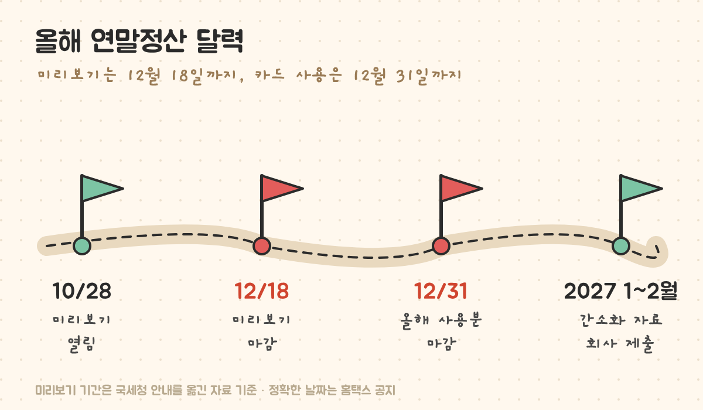
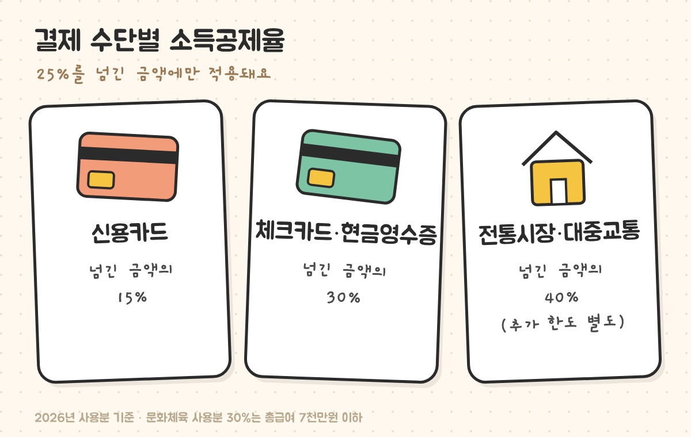
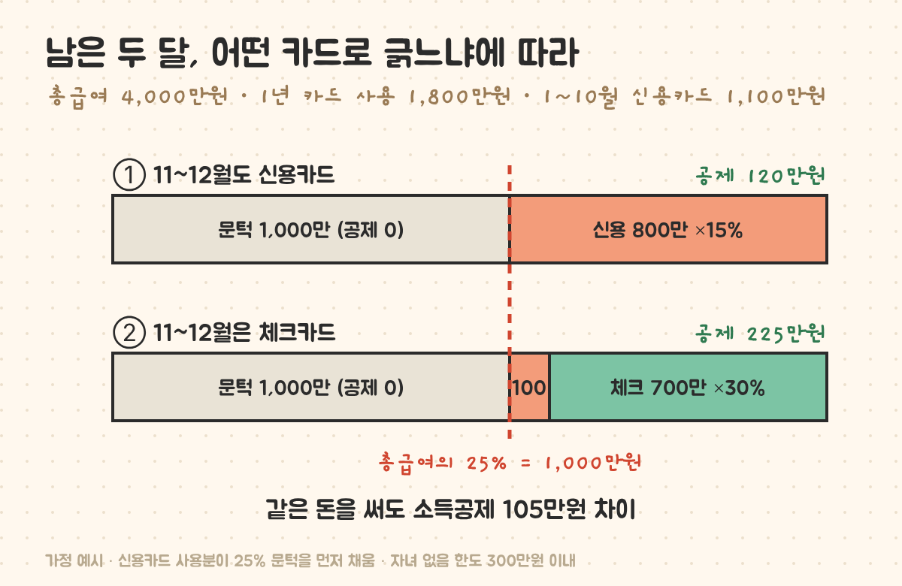

최종 검토일: 2026-11-04

연말정산 미리보기는 <mark>홈택스에서 올해 1~9월 카드 사용액으로 내년 초 환급액을 미리 계산해 보는 서비스</mark>이고, 올해는 10월 28일 열려 <mark>12월 18일</mark>까지 운영된다고 안내돼 있어요. 미리보기에서 카드 사용액이 총급여의 25%를 넘었는지 보면, 남은 11~12월에 신용카드와 체크카드 중 무엇을 쓸지가 정해져요.

같은 돈을 써도 남은 두 달 결제 수단만 바꾸면 소득공제가 100만원 넘게 달라질 수 있어요. 미리보기에서 볼 곳, 25% 문턱 계산, 2026년에 바뀐 카드 공제 한도까지 순서대로 볼게요.

  <strong style="color:#a04e0e;font-size:18px;">🧾 미리보기에서 볼 숫자 하나</strong>
  <ul style="margin:10px 0 0 0;padding-left:20px;line-height:1.9;">
    <li><b>카드 사용액이 총급여의 25%를 넘었나?</b></li>
    <li>아직 안 넘었다면 → 남은 기간은 혜택 많은 <b>신용카드</b>(25%까지는 어차피 공제 0)</li>
    <li>이미 넘었다면 → 남은 기간은 <b>체크카드·현금영수증</b>(넘긴 금액의 30%, 신용카드의 두 배)</li>
  </ul>

<h2 style="border-left:6px solid #e0703a;padding-left:12px;margin-top:36px;">목차</h2>
<ol style="line-height:1.9;">
  <li><a href="#sec-1" style="color:inherit;text-decoration:underline;text-underline-offset:3px;">연말정산 미리보기 기간과 들어가는 곳</a></li>
  <li><a href="#sec-2" style="color:inherit;text-decoration:underline;text-underline-offset:3px;">카드 소득공제의 25% 문턱 계산</a></li>
  <li><a href="#sec-3" style="color:inherit;text-decoration:underline;text-underline-offset:3px;">남은 두 달 결제 수단에 따른 차이</a></li>
  <li><a href="#sec-4" style="color:inherit;text-decoration:underline;text-underline-offset:3px;">2026년 사용분 카드 공제 한도(자녀 수별)</a></li>
  <li><a href="#sec-5" style="color:inherit;text-decoration:underline;text-underline-offset:3px;">미리보기 결과를 볼 때 주의할 점</a></li>
  <li><a href="#sec-6" style="color:inherit;text-decoration:underline;text-underline-offset:3px;">연말정산 미리보기 Q&amp;A 5개</a></li>
</ol>

<h2 id="sec-1" style="scroll-margin-top:72px;border-left:6px solid #e0703a;padding-left:12px;margin-top:36px;">연말정산 미리보기 기간과 들어가는 곳</h2>

미리보기는 1~9월 실제 카드 사용액과 지난 연말정산 때 넣은 공제 정보를 불러오고, 10~12월 예상 사용액은 직접 입력해서 내년 초 환급액이나 추가 납부액을 계산해 줘요.

<ul style="line-height:1.9;">
  <li><b>기간:</b> 2026년 10월 28일 ~ 12월 18일로 안내돼 있어요(작년에는 11월 5일에 열렸어요).</li>
  <li><b>들어가는 곳:</b> <a href="https://www.hometax.go.kr" target="_blank" rel="noopener">홈택스</a> → 장려금·연말정산·기부금 → 편리한 연말정산 → 연말정산 미리보기.</li>
  <li><b>결과는 예상치:</b> 실제 자료는 2027년 1월 간소화 서비스에서 확정돼요.</li>
</ul>

<figure style="margin:24px 0;"><figcaption style="font-size:13px;color:#888;">미리보기가 끝나도 12월 31일까지 쓴 돈은 올해 공제에 들어가요.</figcaption></figure>

<h2 id="sec-2" style="scroll-margin-top:72px;border-left:6px solid #e0703a;padding-left:12px;margin-top:36px;">카드 소득공제의 25% 문턱 계산</h2>

카드 소득공제는 1년 카드 사용액 전체가 아니라 <mark>총급여의 25%를 넘긴 금액</mark>에만 공제율을 곱해요. 총급여 4,000만원이면 1,000만원까지는 아무리 써도 공제가 0원이에요.

<figure style="margin:24px 0;"><figcaption style="font-size:13px;color:#888;">25%를 넘긴 금액에만 이 비율이 적용돼요.</figcaption></figure>

<table style="width:100%;border-collapse:collapse;margin:16px 0;">
  <thead>
    <tr style="background:#f0f0f0;">
      <th style="border:1px solid #ddd;padding:8px;text-align:left;">총급여</th>
      <th style="border:1px solid #ddd;padding:8px;text-align:left;">25% 문턱</th>
      <th style="border:1px solid #ddd;padding:8px;text-align:left;">월 평균으로 치면</th>
    </tr>
  </thead>
  <tbody>
    <tr><td style="border:1px solid #ddd;padding:8px;">3,000만원</td><td style="border:1px solid #ddd;padding:8px;">750만원</td><td style="border:1px solid #ddd;padding:8px;">월 62만5천원</td></tr>
    <tr><td style="border:1px solid #ddd;padding:8px;">4,000만원</td><td style="border:1px solid #ddd;padding:8px;">1,000만원</td><td style="border:1px solid #ddd;padding:8px;">월 83만3천원</td></tr>
    <tr><td style="border:1px solid #ddd;padding:8px;">5,000만원</td><td style="border:1px solid #ddd;padding:8px;">1,250만원</td><td style="border:1px solid #ddd;padding:8px;">월 104만2천원</td></tr>
    <tr><td style="border:1px solid #ddd;padding:8px;">7,000만원</td><td style="border:1px solid #ddd;padding:8px;">1,750만원</td><td style="border:1px solid #ddd;padding:8px;">월 145만8천원</td></tr>
  </tbody>
</table>

중요한 규칙이 하나 더 있어요. 문턱은 <b>공제율이 낮은 신용카드 사용분부터 먼저 채워요.</b> 그래서 같은 금액이라도 문턱을 넘은 뒤에 쓴 돈을 체크카드로 결제해야 30%를 받아요.

<h2 id="sec-3" style="scroll-margin-top:72px;border-left:6px solid #e0703a;padding-left:12px;margin-top:36px;">남은 두 달 결제 수단에 따른 차이</h2>

총급여 4,000만원, 1~10월에 신용카드로 1,100만원을 썼고 11~12월에 700만원을 더 쓸 사람을 예로 계산했어요. 미리보기로 이미 문턱(1,000만원)을 넘은 걸 확인한 상황이에요.

<figure style="margin:24px 0;"><figcaption style="font-size:13px;color:#888;">문턱을 넘긴 뒤 쓴 700만원을 어떤 카드로 결제했느냐의 차이예요.</figcaption></figure>

<table style="width:100%;border-collapse:collapse;margin:16px 0;">
  <thead>
    <tr style="background:#f0f0f0;">
      <th style="border:1px solid #ddd;padding:8px;text-align:left;">11~12월 결제</th>
      <th style="border:1px solid #ddd;padding:8px;text-align:left;">계산</th>
      <th style="border:1px solid #ddd;padding:8px;text-align:left;">소득공제</th>
    </tr>
  </thead>
  <tbody>
    <tr><td style="border:1px solid #ddd;padding:8px;">계속 신용카드</td><td style="border:1px solid #ddd;padding:8px;">(1,800만 − 1,000만) × 15%</td><td style="border:1px solid #ddd;padding:8px;">120만원</td></tr>
    <tr><td style="border:1px solid #ddd;padding:8px;"><mark>체크카드로 바꿈</mark></td><td style="border:1px solid #ddd;padding:8px;">(1,100만 − 1,000만) × 15% + 700만 × 30%</td><td style="border:1px solid #ddd;padding:8px;"><b>225만원</b></td></tr>
  </tbody>
</table>

소득공제 105만원 차이는 세금으로 바꾸면 내 세율만큼이에요. 이 사람이 지방소득세 포함 16.5% 구간이라고 가정하면 <mark>약 17만3천원</mark>을 더 돌려받는 셈이에요. 반대로 미리보기에서 아직 문턱 아래로 나왔다면, 문턱까지는 어떤 카드로 써도 공제가 0이니 포인트·할인이 많은 신용카드가 나아요.

<h2 id="sec-4" style="scroll-margin-top:72px;border-left:6px solid #e0703a;padding-left:12px;margin-top:36px;">2026년 사용분 카드 공제 한도(자녀 수별)</h2>

공제액이 아무리 커도 한도를 넘으면 잘려요. 정부의 2025년 세법개정안으로 <b>자녀 수에 따라 기본 한도가 올라</b>, 2026년 사용분부터 아래 기준이 적용된다고 안내돼 있어요.

<table style="width:100%;border-collapse:collapse;margin:16px 0;">
  <thead>
    <tr style="background:#f0f0f0;">
      <th style="border:1px solid #ddd;padding:8px;text-align:left;">총급여</th>
      <th style="border:1px solid #ddd;padding:8px;text-align:left;">자녀 없음</th>
      <th style="border:1px solid #ddd;padding:8px;text-align:left;">자녀 1명</th>
      <th style="border:1px solid #ddd;padding:8px;text-align:left;">자녀 2명 이상</th>
    </tr>
  </thead>
  <tbody>
    <tr><td style="border:1px solid #ddd;padding:8px;">7,000만원 이하</td><td style="border:1px solid #ddd;padding:8px;">300만원</td><td style="border:1px solid #ddd;padding:8px;">350만원</td><td style="border:1px solid #ddd;padding:8px;">400만원</td></tr>
    <tr><td style="border:1px solid #ddd;padding:8px;">7,000만원 초과</td><td style="border:1px solid #ddd;padding:8px;">250만원</td><td style="border:1px solid #ddd;padding:8px;">275만원</td><td style="border:1px solid #ddd;padding:8px;">300만원</td></tr>
  </tbody>
</table>

전통시장·대중교통 사용분은 이 기본 한도와 별도로 추가 한도가 있어요. 위 예시(225만원)는 자녀가 없어도 300만원 한도 안이라 전부 인정돼요. 공제액이 이미 한도에 닿았다면 남은 기간 결제 수단을 바꿔도 더 늘지 않으니, 미리보기 결과의 신용카드 공제액이 한도에 닿았는지 함께 봐야 해요.

<h2 id="sec-5" style="scroll-margin-top:72px;border-left:6px solid #e0703a;padding-left:12px;margin-top:36px;">미리보기 결과를 볼 때 주의할 점</h2>

<ol style="line-height:1.9;">
  <li><b>10~12월은 내가 넣은 예상값이에요.</b> 너무 적게 넣으면 문턱을 못 넘는 걸로 나올 수 있어요. 지난 몇 달 평균으로 넣는 게 현실적이에요.</li>
  <li><b>일부 카드 자료는 빠져 있을 수 있어요.</b> 빠진 자료는 1월 간소화 서비스에서 채워져요.</li>
  <li><b>결정세액이 작으면 공제를 늘려도 효과가 없어요.</b> 세액공제·소득공제는 낼 세금이 있어야 줄어드는 구조라, 이미 결정세액이 0원 근처라면 결제 수단을 바꿀 이유가 적어요. 기부로 세금을 돌려받는 <a href="https://sensitiveboss3.tistory.com/entry/hometown-donation-tax-credit-2026" target="_blank" rel="noopener">고향사랑기부제 세액공제</a>도 같은 원리예요.</li>
</ol>

<h2 id="sec-6" style="scroll-margin-top:72px;border-left:6px solid #e0703a;padding-left:12px;margin-top:36px;">연말정산 미리보기 Q&amp;A 5개</h2>

  
연말정산 미리보기는 언제까지 할 수 있나요

  
2026년은 10월 28일 열려 12월 18일까지 운영된다고 안내돼 있어요. 홈택스 장려금·연말정산·기부금 메뉴의 연말정산 미리보기로 들어가요.

  
신용카드 소득공제는 얼마부터 받나요

  
1년 카드 사용액이 총급여의 25%를 넘긴 금액부터 받아요. 총급여 4,000만원이면 1,000만원을 넘긴 금액에 신용카드 15%, 체크카드·현금영수증 30%, 전통시장·대중교통 40%를 곱해요.

  
신용카드와 체크카드 중 뭘 써야 유리한가요

  
총급여의 25%까지는 신용카드 사용분부터 문턱을 채우고 공제가 0원이라 혜택 많은 신용카드가 나아요. 25%를 넘긴 뒤 쓰는 돈은 체크카드·현금영수증이 30%로 신용카드 15%의 두 배예요.

  
2026년 카드 소득공제 한도는 얼마인가요

  
총급여 7,000만원 이하는 자녀 없음 300만원, 자녀 1명 350만원, 2명 이상 400만원이에요. 7,000만원 초과는 250만원, 275만원, 300만원이에요. 전통시장·대중교통 사용분은 별도 추가 한도가 있어요.

  
미리보기 결과대로 환급받나요

  
아니요. 1~9월 실제 자료와 내가 넣은 10~12월 예상값으로 계산한 참고값이에요. 실제 금액은 2027년 1월 간소화 자료와 회사 연말정산에서 확정돼요.

  참고 출처:
  <ul style="margin:6px 0 0 0;padding-left:20px;">
    <li><a href="https://www.newsis.com/view/NISX20250731_0003273783" target="_blank" rel="noopener">뉴시스: 신용카드 소득공제 기본한도 자녀당 50만원 상향(2025년 세제개편안, 2025-07-31)</a></li>
    <li><a href="https://www.hometax.go.kr" target="_blank" rel="noopener">국세청 홈택스(연말정산 미리보기)</a></li>
    <li><a href="https://biz.sbs.co.kr/amp/article/20000279853" target="_blank" rel="noopener">SBS Biz: 카드 사용 순서와 소득공제</a></li>
    <li>미리보기 기간(10/28~12/18)은 국세청 안내를 옮긴 여러 해설 자료 기준이며, 정확한 날짜는 홈택스 공지가 기준이에요.</li>
  </ul>
  기준일: 2026년 11월 4일. 예시 계산은 가정이며 개인의 실제 공제·환급액은 다를 수 있어요.

정보 제공을 목적으로 쓴 글이에요. 공제율과 한도는 세법 개정에 따라 바뀔 수 있어요.

