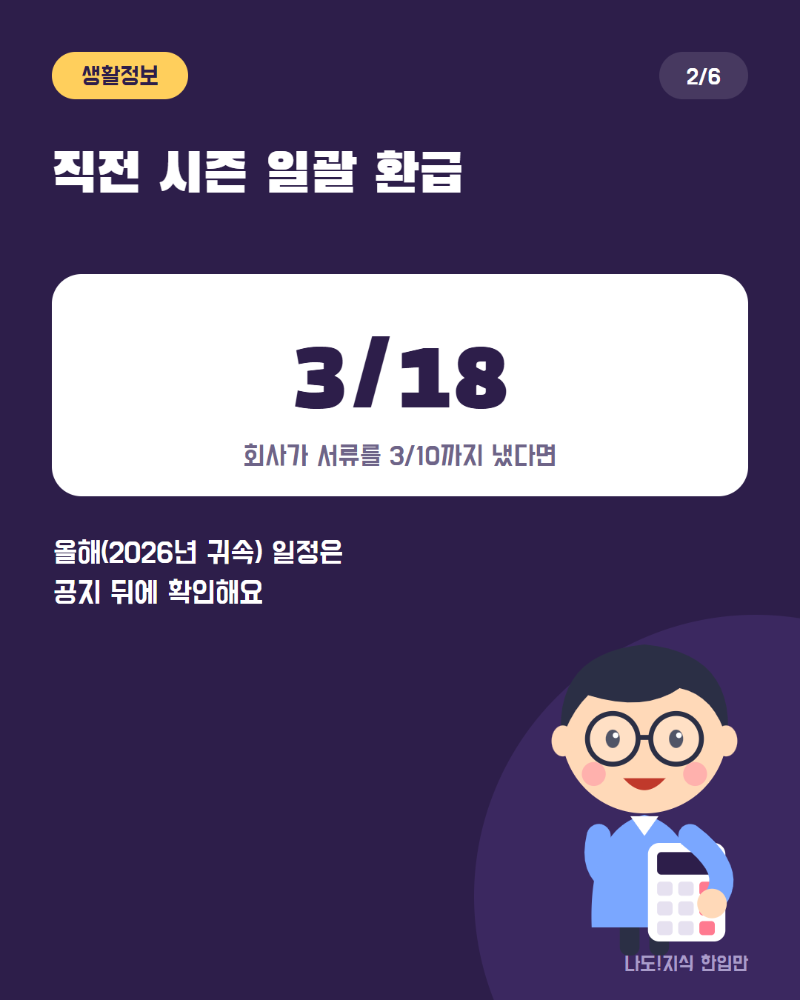
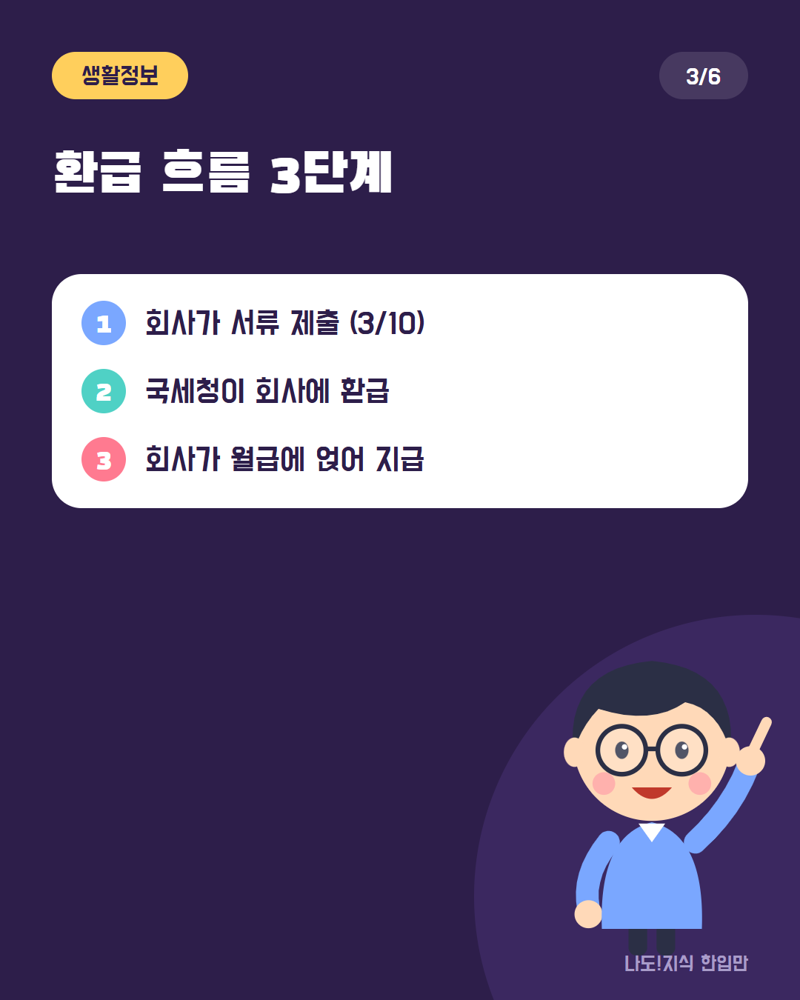
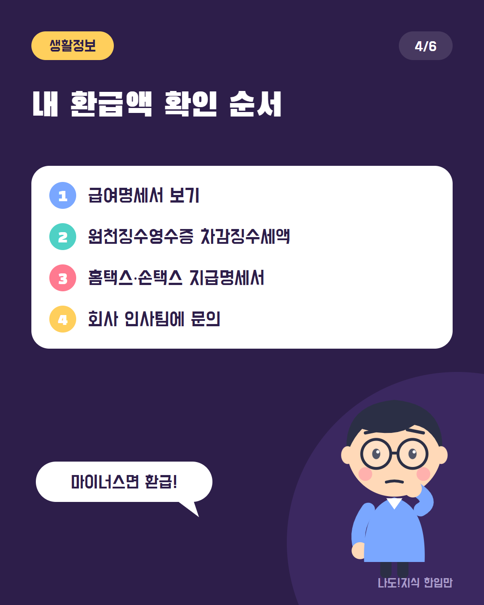
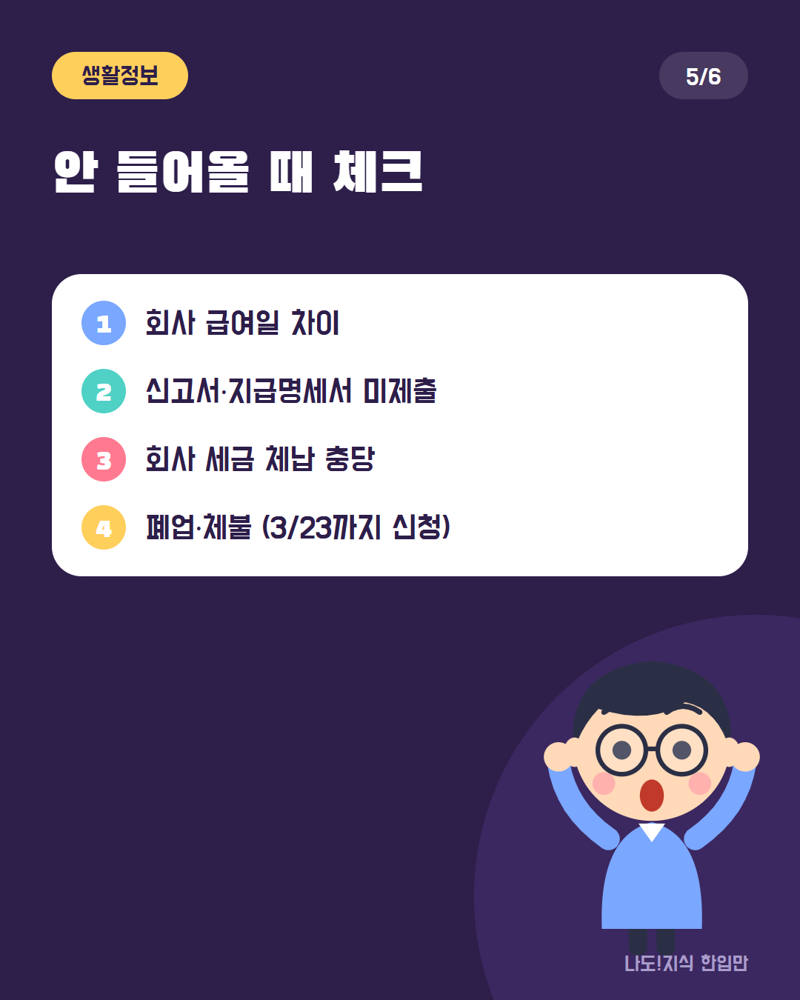
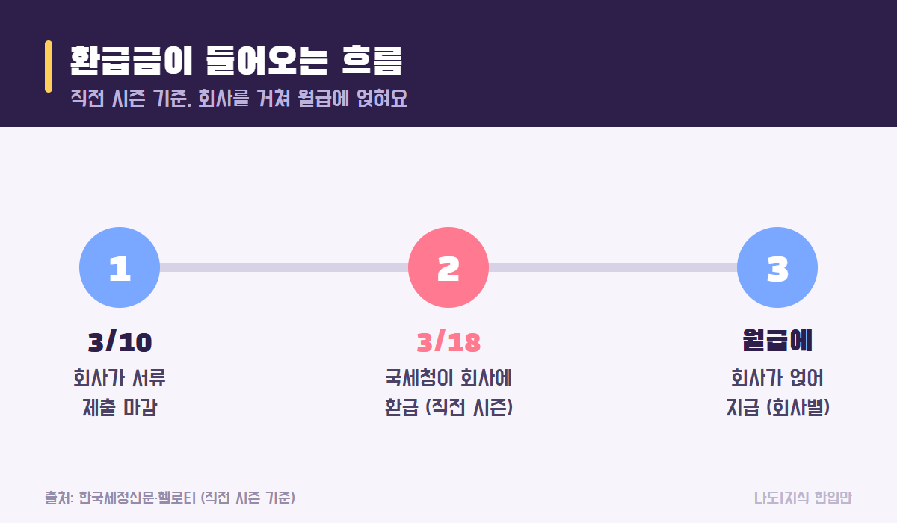
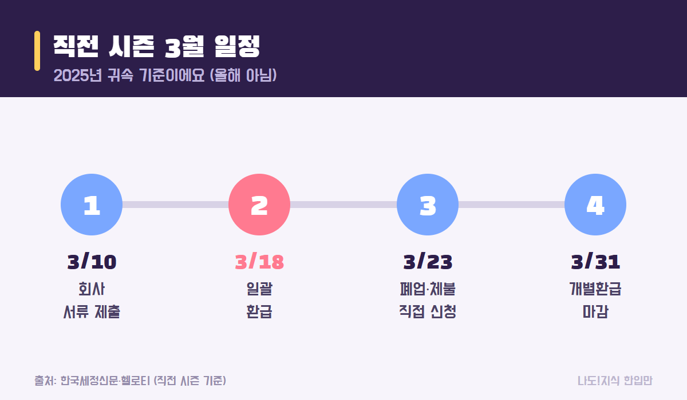
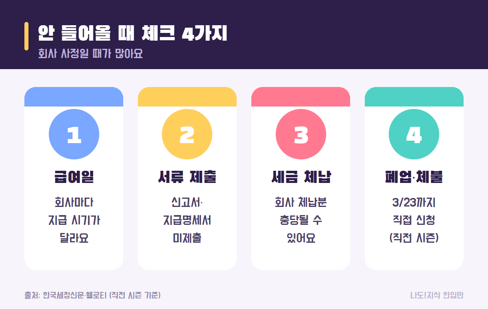

최종 검토일: 2026-11-25

연말정산 환급금은 국세청이 먼저 회사로 보내고, 회사가 월급에 얹어 주는 순서로 들어와요. 그래서 내 환급액은 원천징수영수증이나 지급명세서에서 확인하고, 실제 입금일은 회사마다 달라요.

직전 시즌(2025년 귀속, 2026년 3월)에는 국세청이 3월 18일에 환급금을 일괄 지급했어요. 올해(2026년 귀속) 일정은 아직 공식 공지 전이라, 직전 시즌 기준으로 흐름과 확인 순서를 정리할게요.

  <strong style="color:#4a2d55;font-size:18px;">🗓 한눈에 보기</strong>
  <ul style="margin:10px 0 0 0;padding-left:20px;line-height:1.9;">
    <li><b>흐름:</b> 국세청 → 회사 → 내 월급 순서로 들어와요</li>
    <li><b>직전 시즌:</b> 회사 대상 환급금 3월 18일 일괄 지급</li>
    <li><b>내 환급액 확인:</b> 원천징수영수증·지급명세서의 차감징수세액</li>
    <li><b>입금일:</b> 회사 급여일과 자금 집행 일정에 따라 달라요</li>
    <li><b>안 들어오면:</b> 급여명세서 → 영수증 → 지급명세서 → 인사팀 순서로 확인</li>
  </ul>

옆으로 넘겨 보세요 → (카드 6장 요약)

  <strong style="font-size:16px;">📖 처음이라면 이것만 — 낱말 풀이</strong>
  <ul style="margin:8px 0 0 0;padding-left:20px;line-height:1.9;">
    <li><b>결정세액:</b> 1년 소득과 공제를 계산해 최종으로 내야 하는 세금.</li>
    <li><b>기납부세액:</b> 매달 월급에서 미리 떼어 낸 세금을 1년 치 합한 금액.</li>
    <li><b>차감징수세액:</b> 결정세액에서 기납부세액을 뺀 값. 마이너스면 환급, 플러스면 추가 납부예요.</li>
    <li><b>원천징수영수증:</b> 회사가 1년 소득과 세금을 정리해 주는 서류.</li>
    <li><b>지급명세서:</b> 회사가 국세청에 낸 소득 자료. 홈택스·손택스에서 조회할 수 있어요.</li>
  </ul>

<h2 style="border-left:6px solid #4a2d55;padding-left:12px;margin-top:36px;">목차</h2>
<ol style="line-height:1.9;">
  <li><a href="#sec-1" style="color:inherit;text-decoration:underline;text-underline-offset:3px;">연말정산 환급금은 어떻게 생기나요?</a></li>
  <li><a href="#sec-2" style="color:inherit;text-decoration:underline;text-underline-offset:3px;">내 환급액은 어디서 확인하나요?</a></li>
  <li><a href="#sec-3" style="color:inherit;text-decoration:underline;text-underline-offset:3px;">환급금은 언제 들어오나요?</a></li>
  <li><a href="#sec-4" style="color:inherit;text-decoration:underline;text-underline-offset:3px;">회사마다 입금일이 다른 이유는?</a></li>
  <li><a href="#sec-5" style="color:inherit;text-decoration:underline;text-underline-offset:3px;">환급금이 안 들어올 때 확인 순서는?</a></li>
  <li><a href="#sec-6" style="color:inherit;text-decoration:underline;text-underline-offset:3px;">환급을 못 받거나 늦어질 수 있는 경우는?</a></li>
  <li><a href="#sec-7" style="color:inherit;text-decoration:underline;text-underline-offset:3px;">자주 하는 실수 5가지</a></li>
  <li><a href="#sec-8" style="color:inherit;text-decoration:underline;text-underline-offset:3px;">연말정산 환급금 Q&amp;A 5개</a></li>
</ol>

<h2 id="sec-1" style="scroll-margin-top:72px;border-left:6px solid #4a2d55;padding-left:12px;margin-top:36px;">연말정산 환급금은 어떻게 생기나요?</h2>

연말정산 환급금은 1년 동안 미리 낸 세금이 최종 세금보다 많을 때 그 차이를 돌려받는 돈이에요. 매달 월급에서 떼는 세금은 대략적인 금액이라, 연말에 공제를 반영해 다시 계산하면 차이가 생겨요.

환급금 조회는 이 차이가 얼마인지, 그리고 언제 내 통장에 들어오는지를 확인하는 일이에요. 기준은 하나예요. 결정세액이 기납부세액보다 적으면 환급, 많으면 추가 납부예요.

  <strong>✍️ 가정 예시로 따라 해 보기 (실제 금액이 아니에요)</strong> 
  ① 1년간 월급에서 미리 낸 소득세(기납부세액): 1,000,000원 (가정) 
  ② 공제를 반영한 최종 소득세(결정세액): 800,000원 (가정) 
  ③ 소득세 환급: 1,000,000원 − 800,000원 = <b>200,000원</b> 
  ④ 지방소득세는 소득세의 10%라고 가정하면 20,000원 
  ⑤ 합계: 200,000원 + 20,000원 = <b>220,000원</b>

소득세와 지방소득세는 따로 계산돼서 영수증에도 각각 나와요. 위 금액은 이해를 돕는 숫자일 뿐이고, 내 실제 금액은 내 영수증으로 확인해야 해요.

<h2 id="sec-2" style="scroll-margin-top:72px;border-left:6px solid #4a2d55;padding-left:12px;margin-top:36px;">내 환급액은 어디서 확인하나요?</h2>

내 환급액은 회사가 주는 원천징수영수증과 홈택스·손택스의 지급명세서에서 볼 수 있어요. 영수증의 차감징수세액이 마이너스이면 환급이에요.

<figure style="margin:24px 0;"><figcaption style="font-size:13px;color:#888;">직전 시즌 기준 흐름이에요. 입금일은 회사마다 달라요.</figcaption></figure>

<ol style="line-height:2;">
  <li><b>급여명세서 보기:</b> 환급금이 월급에 더해져 들어오는 달에 명세서에 항목으로 찍혀요.</li>
  <li><b>원천징수영수증 보기:</b> 차감징수세액이 마이너스이면 환급이고, 소득세와 지방소득세가 따로 적혀 있어요.</li>
  <li><b>홈택스·손택스 지급명세서 조회:</b> 회사가 국세청에 낸 자료로 내 소득과 세금을 확인해요.</li>
  <li><b>회사 인사팀·총무팀 문의:</b> 입금 예정일과 급여에 반영되는 달은 회사에 물어보는 게 가장 정확해요.</li>
</ol>

홈택스 안에서 어떤 메뉴를 눌러야 하는지는 화면이 바뀔 수 있어서 이 글에서는 따로 적지 않았어요. 홈택스 첫 화면의 안내나 국세청 상담(126)에서 최신 경로를 확인해 주세요.

<h2 id="sec-3" style="scroll-margin-top:72px;border-left:6px solid #4a2d55;padding-left:12px;margin-top:36px;">환급금은 언제 들어오나요?</h2>

직전 시즌에는 국세청이 3월 18일에 회사 대상 환급금을 일괄 지급했고, 법정 지급기한인 4월 9일보다 앞당겼어요. 이건 2026년 3월 6일 국세청 발표를 보도한 기사 기준이에요.

올해 귀속분의 일정은 아직 공지되지 않았어요. 아래 표는 직전 시즌 일정이고, 같은 날짜가 그대로 반복된다고 단정할 수는 없어요.

<table style="width:100%;border-collapse:collapse;margin:16px 0;">
  <thead>
    <tr style="background:#4a2d55;color:#fff;"><th style="border:1px solid #ddd;padding:8px;">날짜(2026년)</th><th style="border:1px solid #ddd;padding:8px;">내용</th></tr>
  </thead>
  <tbody>
    <tr><td style="border:1px solid #ddd;padding:8px;">3월 6일</td><td style="border:1px solid #ddd;padding:8px;">국세청이 환급 일정 발표</td></tr>
    <tr><td style="border:1px solid #ddd;padding:8px;">3월 10일</td><td style="border:1px solid #ddd;padding:8px;">회사의 원천세 신고서·지급명세서 제출 기준일</td></tr>
    <tr><td style="border:1px solid #ddd;padding:8px;">3월 18일</td><td style="border:1px solid #ddd;padding:8px;"><b>서류를 제때 낸 회사에 환급금 일괄 지급</b></td></tr>
    <tr><td style="border:1px solid #ddd;padding:8px;">3월 23일</td><td style="border:1px solid #ddd;padding:8px;">부도·폐업·체불 회사 근로자의 직접 신청 마감</td></tr>
    <tr><td style="border:1px solid #ddd;padding:8px;">3월 31일</td><td style="border:1px solid #ddd;padding:8px;">기한 후 제출·검토 필요 건의 개별환급, 직접 신청자 지급</td></tr>
    <tr><td style="border:1px solid #ddd;padding:8px;">4월 9일</td><td style="border:1px solid #ddd;padding:8px;">법정 지급기한</td></tr>
  </tbody>
</table>

<figure style="margin:24px 0;"><figcaption style="font-size:13px;color:#888;">2025년 귀속(2026년 3월) 일정이에요.</figcaption></figure>

이 날짜는 국세청이 회사에 돈을 보내는 날이에요. 내 통장에 들어오는 날은 아래처럼 회사마다 달라요.

<h2 id="sec-4" style="scroll-margin-top:72px;border-left:6px solid #4a2d55;padding-left:12px;margin-top:36px;">회사마다 입금일이 다른 이유는?</h2>

국세청은 환급금을 회사에 보내고, 회사가 직원에게 나눠 주기 때문에 입금일은 회사의 급여일과 자금 집행 일정에 따라 달라져요.

<ul style="line-height:2;">
  <li>2월 급여에서 먼저 정산해 환급액을 미리 반영하는 회사</li>
  <li>회사 자금으로 먼저 지급해 주는 회사</li>
  <li>국세청 환급금을 받은 뒤 자금 집행 일정에 맞춰 주는 회사</li>
</ul>

그래서 같은 시기에 연말정산을 했어도 동료마다 받는 날이 다를 수 있어요. 내 회사가 어느 방식인지는 인사팀에 물어보면 알 수 있어요.

  <strong style="font-size:16px;">💡 알아 두면 좋아요</strong>
  
3월 18일은 확정된 입금일이 아니라, 직전 시즌에 국세청이 회사로 환급금을 보낸 날이에요. 내 통장에 들어오는 날로 기대하면 어긋날 수 있어요.

연말정산 준비가 처음이라면 공제 항목을 미리 점검해 두는 것이 좋아요. <a href="https://sensitiveboss3.tistory.com/entry/year-end-tax-preview-card-deduction-2026" target="_blank" rel="noopener">연말정산 미리보기 카드 공제</a> 글에서 카드 사용 구간을 볼 수 있어요.

<h2 id="sec-5" style="scroll-margin-top:72px;border-left:6px solid #4a2d55;padding-left:12px;margin-top:36px;">환급금이 안 들어올 때 확인 순서는?</h2>

환급금이 안 들어오면 급여명세서, 원천징수영수증, 지급명세서, 인사팀 순서로 확인하면 돼요.

<figure style="margin:24px 0;"><figcaption style="font-size:13px;color:#888;">위에서부터 차례로 확인해 보세요.</figcaption></figure>

<ol style="line-height:2;">
  <li><b>급여명세서:</b> 연말정산 환급 항목이 이미 반영됐는지 먼저 봐요.</li>
  <li><b>원천징수영수증:</b> 차감징수세액이 정말 마이너스인지, 즉 환급 대상이 맞는지 확인해요.</li>
  <li><b>지급명세서 조회:</b> 회사가 서류를 국세청에 냈는지 홈택스·손택스에서 확인해요.</li>
  <li><b>회사 인사팀 문의:</b> 입금 예정일이 언제인지, 아직 국세청에서 못 받은 건 아닌지 물어봐요.</li>
  <li><b>그래도 해결이 안 되면:</b> 국세청 상담(126)이나 고용노동부 상담을 이용해요.</li>
</ol>

회사가 환급금을 주지 않으면 고용노동부에 임금체불 진정을 낼 수 있어요. 퇴사한 사람도 진정할 수 있으니 시기는 고용노동부에 확인해 보세요.

<h2 id="sec-6" style="scroll-margin-top:72px;border-left:6px solid #4a2d55;padding-left:12px;margin-top:36px;">환급을 못 받거나 늦어질 수 있는 경우는?</h2>

회사가 서류를 늦게 냈거나 세금을 체납했거나 폐업한 경우에는 환급이 늦어지거나 직접 신청해야 할 수 있어요.

<table style="width:100%;border-collapse:collapse;margin:16px 0;">
  <thead>
    <tr style="background:#4a2d55;color:#fff;"><th style="border:1px solid #ddd;padding:8px;">상황</th><th style="border:1px solid #ddd;padding:8px;">어떻게 되나요</th></tr>
  </thead>
  <tbody>
    <tr><td style="border:1px solid #ddd;padding:8px;">회사가 서류를 기한 안에 제출</td><td style="border:1px solid #ddd;padding:8px;">직전 시즌 기준 3월 18일 일괄 지급 대상</td></tr>
    <tr><td style="border:1px solid #ddd;padding:8px;">서류 제출이 늦었거나 검토가 필요한 건</td><td style="border:1px solid #ddd;padding:8px;">개별환급, 직전 시즌 기준 3월 31일까지</td></tr>
    <tr><td style="border:1px solid #ddd;padding:8px;">회사가 근로소득세를 체납</td><td style="border:1px solid #ddd;padding:8px;">환급금이 체납세금에 충당돼 안 들어올 수 있음</td></tr>
    <tr><td style="border:1px solid #ddd;padding:8px;">원천세 신고서·지급명세서 미제출</td><td style="border:1px solid #ddd;padding:8px;">환급이 지연될 수 있음</td></tr>
    <tr><td style="border:1px solid #ddd;padding:8px;">부도·폐업·체불 회사 근로자</td><td style="border:1px solid #ddd;padding:8px;">직전 시즌 3월 23일까지 홈택스·세무서에 서면 신청, 3월 31일까지 직접 지급</td></tr>
    <tr><td style="border:1px solid #ddd;padding:8px;">계좌 해지 등으로 입금 불가</td><td style="border:1px solid #ddd;padding:8px;">국세환급금통지서를 받아 우체국에서 현금 수령</td></tr>
  </tbody>
</table>

위 날짜는 직전 시즌 기준이에요. 올해는 국세청 공지에서 정확한 날짜를 확인해 주세요.

<h2 id="sec-7" style="scroll-margin-top:72px;border-left:6px solid #4a2d55;padding-left:12px;margin-top:36px;">자주 하는 실수 5가지</h2>

환급금 때문에 불안해지는 경우는 대부분 입금 순서와 날짜를 잘못 이해해서 생겨요.

  <strong style="font-size:16px;">⚠️ 이것만 피하세요</strong>
  <ol style="margin:8px 0 0 0;padding-left:20px;line-height:1.9;">
    <li><b>3월 18일을 내 입금일로 알기</b> → 국세청이 회사로 보내는 날이고, 내 입금일은 회사마다 달라요.</li>
    <li><b>직전 시즌 날짜를 올해 날짜로 알기</b> → 올해 일정은 공식 공지를 기다려야 해요.</li>
    <li><b>소득세만 보고 지방소득세 놓치기</b> → 영수증에는 둘이 따로 나와요.</li>
    <li><b>차감징수세액의 부호 헷갈리기</b> → 마이너스이면 환급, 플러스이면 추가 납부예요.</li>
    <li><b>안 들어오는데 가만히 기다리기</b> → 급여명세서와 지급명세서부터 확인하고 인사팀에 물어보세요.</li>
  </ol>

환급이 생기면 쓸 곳이 많죠. 퇴사나 이직을 고민 중이라면 <a href="https://sensitiveboss3.tistory.com/entry/annual-leave-pay-calculation-2026" target="_blank" rel="noopener">연차수당 계산</a>과 <a href="https://sensitiveboss3.tistory.com/entry/unemployment-benefit-2026-daily-amount" target="_blank" rel="noopener">실업급여 하루 금액</a>도 함께 챙겨 보세요.

<h2 id="sec-8" style="scroll-margin-top:72px;border-left:6px solid #4a2d55;padding-left:12px;margin-top:36px;">연말정산 환급금 Q&amp;A 5개</h2>

  
연말정산 환급금은 어디서 조회하나요

  
회사가 주는 원천징수영수증에서 차감징수세액을 보면 돼요. 마이너스이면 환급이에요. 홈택스·손택스의 지급명세서에서도 내 소득과 세금을 확인할 수 있어요.

  
연말정산 환급금은 언제 들어오나요

  
직전 시즌에는 국세청이 3월 18일에 회사로 환급금을 일괄 지급했어요. 회사가 직원에게 주는 날은 회사마다 달라요. 올해 일정은 공식 공지 전이에요.

  
왜 동료와 입금일이 다른가요

  
환급금이 국세청에서 회사로 가고, 회사가 급여일과 자금 집행 일정에 맞춰 나눠 주기 때문이에요. 2월 급여에 먼저 정산하거나 회사 자금으로 먼저 주는 회사도 있어요.

  
환급금이 안 들어오면 어떻게 하나요

  
급여명세서, 원천징수영수증, 지급명세서 순으로 확인한 뒤 인사팀에 물어보세요. 회사가 주지 않으면 고용노동부에 임금체불 진정을 낼 수 있어요.

  
회사가 폐업했는데 환급은 어떻게 받나요

  
직전 시즌에는 부도·폐업·체불 회사 근로자가 3월 23일까지 홈택스나 세무서에 서면으로 신청하면 3월 31일까지 직접 지급했어요. 올해 기한은 국세청 공지를 확인해 주세요.

  <strong style="font-size:16px;">📚 함께 보면 좋은 글</strong>
  <ul style="margin:8px 0 0 0;padding-left:20px;line-height:1.9;"><li><a href="https://sensitiveboss3.tistory.com/entry/unemployment-benefit-2026-daily-amount" target="_blank" rel="noopener">실업급여 하루 얼마? 2026 계산법</a></li><li><a href="https://sensitiveboss3.tistory.com/entry/annual-leave-pay-calculation-2026" target="_blank" rel="noopener">연차수당 계산 2026, 월급별 미사용 연차 금액</a></li><li><a href="https://sensitiveboss3.tistory.com/entry/year-end-tax-preview-card-deduction-2026" target="_blank" rel="noopener">연말정산 미리보기 12월 18일까지</a></li></ul>

  참고 출처:
  <ul style="margin:6px 0 0 0;padding-left:20px;">
    <li><a href="https://www.taxtimes.co.kr/news/article.html?no=274174" target="_blank" rel="noopener">세정신문: 연말정산 환급금 3월 18일 일괄 지급</a></li>
    <li><a href="https://www.hellot.net/mobile/article.html?no=111376" target="_blank" rel="noopener">헬로티: 연말정산 환급 일정</a></li>
    <li><a href="https://biz.sbs.co.kr/amp/article/20000295673" target="_blank" rel="noopener">SBS Biz: 연말정산 환급금 지급 일정</a></li>
    <li><a href="https://www.hometax.go.kr" target="_blank" rel="noopener">국세청 홈택스</a></li>
  </ul>
  기준일: 2026년 11월 25일. 일정은 직전 시즌(2025년 귀속, 2026년 3월) 기준이며, 금액 예시는 모두 가정이에요.

정보 제공을 목적으로 쓴 글이에요. 환급액과 입금일은 개인의 공제 내역과 회사의 급여·자금 일정에 따라 달라질 수 있고, 올해 일정은 국세청 공식 공지가 기준이에요.

