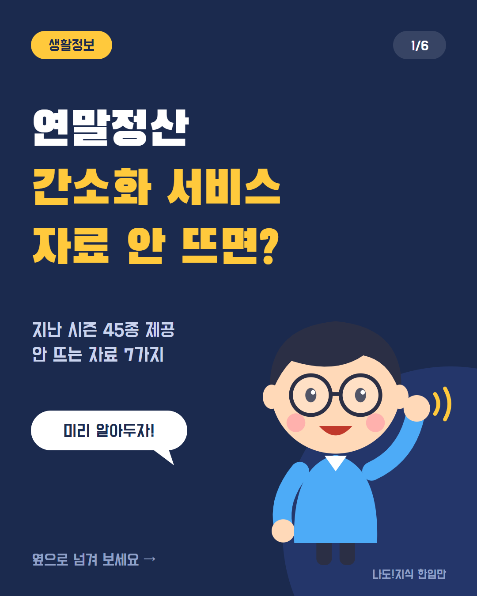
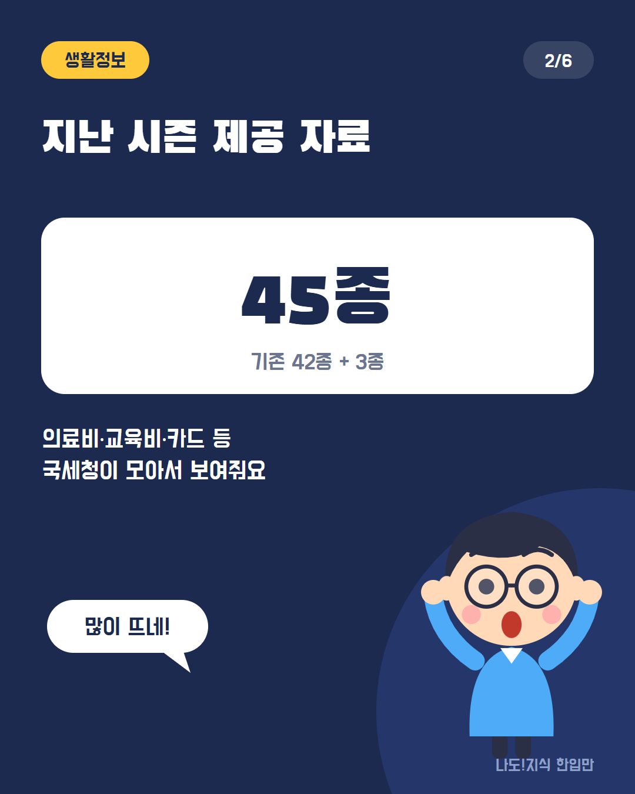
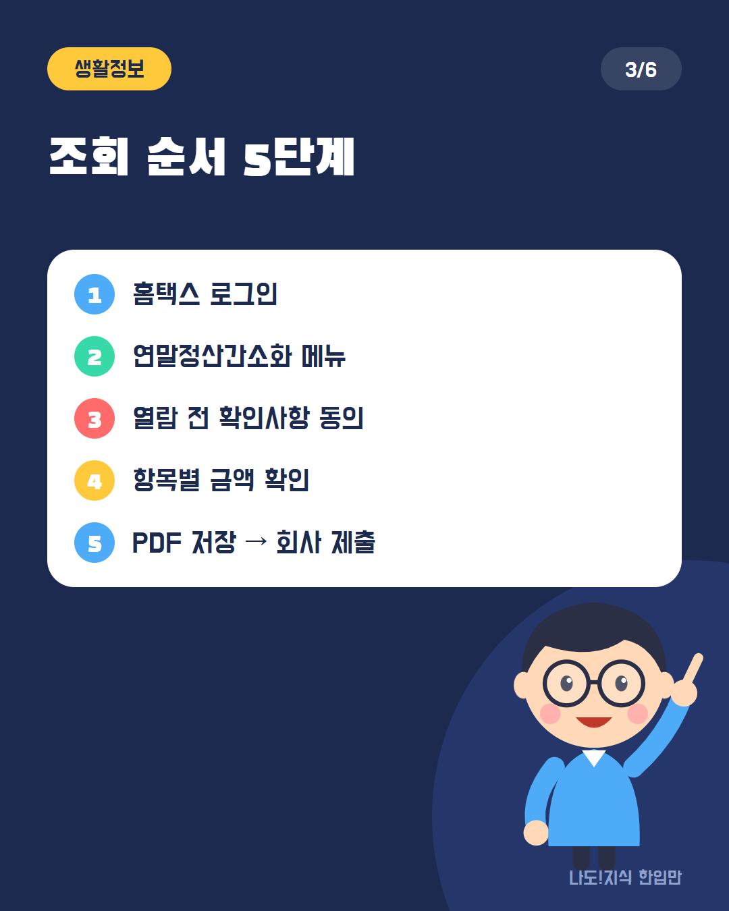
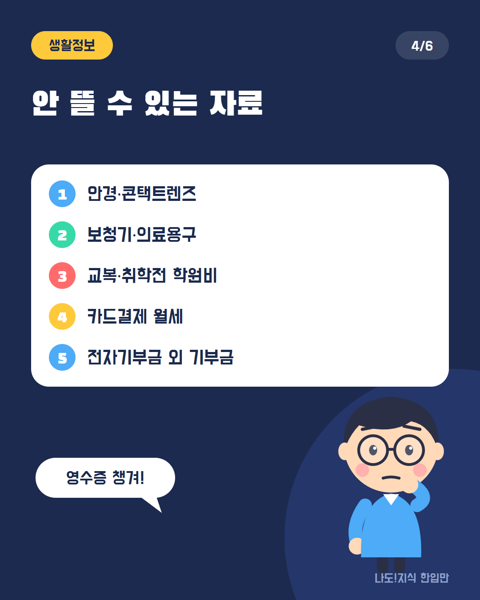
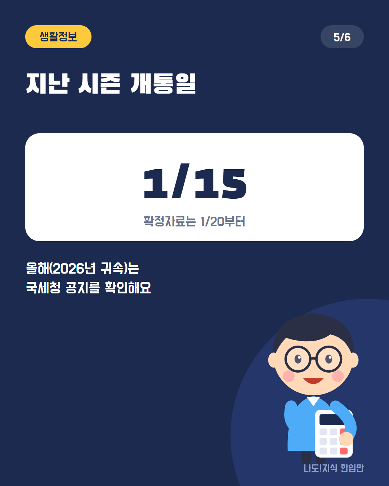
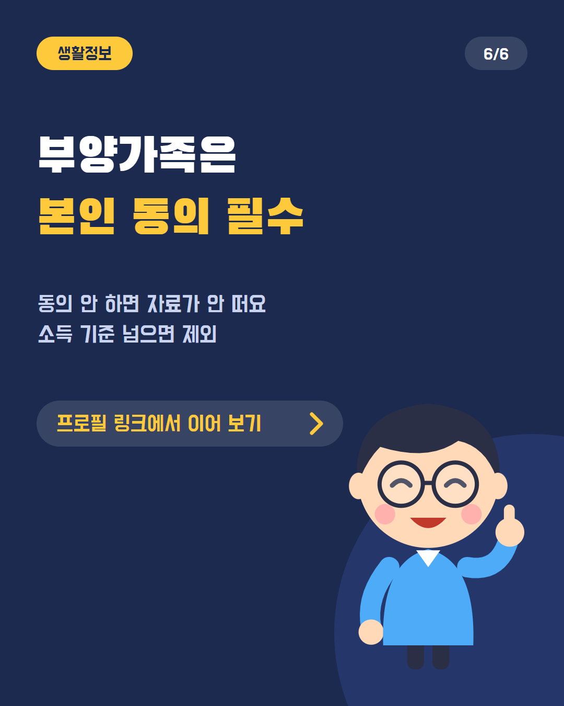
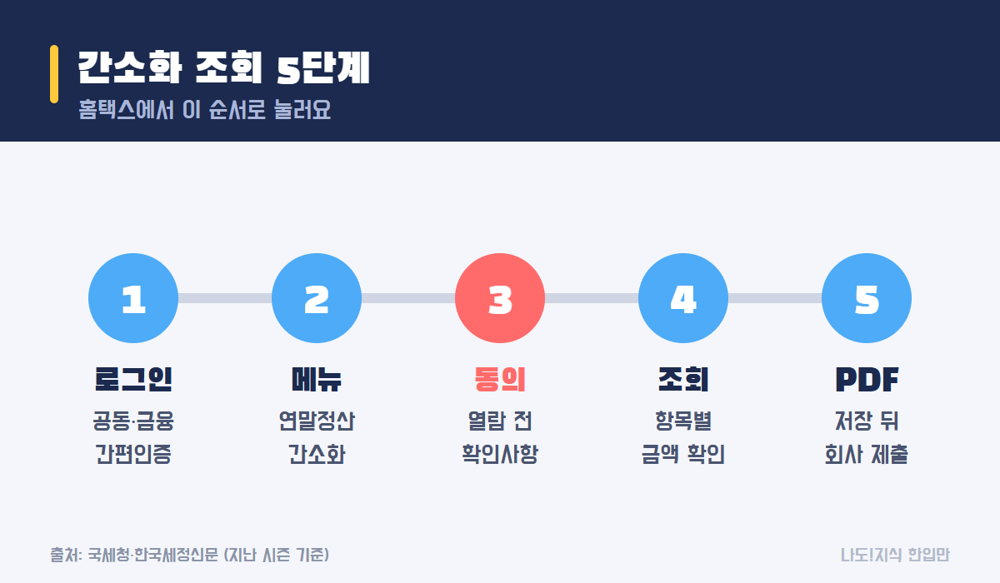
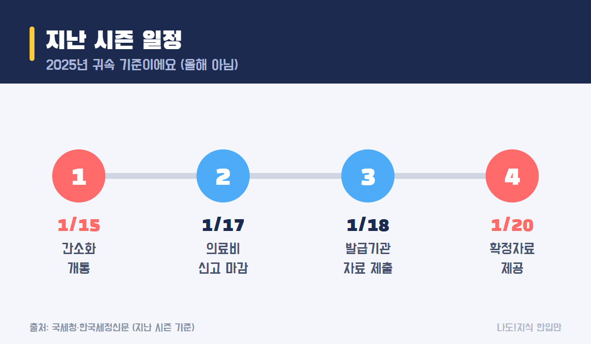
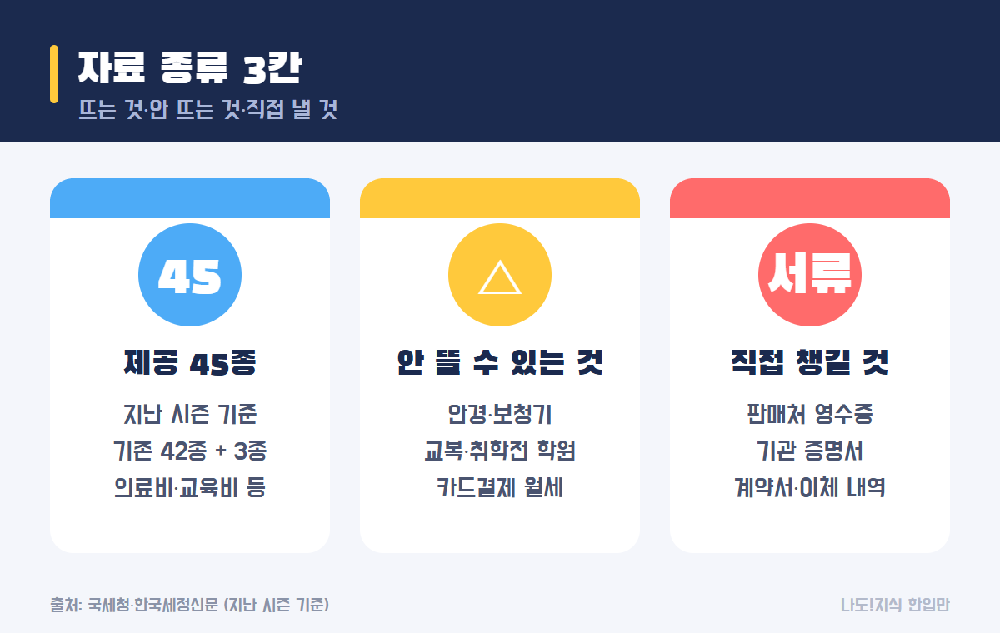

최종 검토일: 2026-11-24

연말정산 간소화 서비스는 국세청이 병원·카드·보험 등에서 모아 둔 공제 자료를 한곳에서 보여 주는 서비스예요. 홈택스에 로그인해 조회하고 PDF로 받은 뒤 회사에 내면 돼요.

2026년 귀속 연말정산은 2027년 1~2월에 진행돼요. 개통일은 아직 공지 전이라, 지난 시즌 일정과 조회 순서, 안 뜨는 자료를 미리 정리해 둘게요.

  <strong style="color:#1b2a4e;font-size:18px;">🗓 한눈에 보기</strong>
  <ul style="margin:10px 0 0 0;padding-left:20px;line-height:1.9;">
    <li><b>조회 경로:</b> 홈택스 → 연말정산간소화 → 소득·세액공제 자료 조회</li>
    <li><b>지난 시즌:</b> 2026년 1월 15일(목) 개통, 1월 20일(화)부터 확정자료</li>
    <li><b>제공 항목:</b> 지난 시즌 45종 (기존 42종 + 3종)</li>
    <li><b>안 뜰 수 있는 것:</b> 안경·보청기·교복·취학전 학원·카드 월세 등</li>
    <li><b>부양가족:</b> 가족 본인이 자료 제공에 동의해야 조회돼요</li>
  </ul>

옆으로 넘겨 보세요 → (카드 6장 요약)

  <strong style="font-size:16px;">📖 처음이라면 이것만 — 낱말 풀이</strong>
  <ul style="margin:8px 0 0 0;padding-left:20px;line-height:1.9;">
    <li><b>간소화 서비스:</b> 공제에 쓸 지출 자료를 국세청이 모아서 보여 주는 서비스.</li>
    <li><b>귀속연도:</b> 그 소득과 지출이 생긴 해. 2026년 귀속은 2026년 1~12월 지출 기준이에요.</li>
    <li><b>확정자료:</b> 발급기관이 수정·추가한 내용이 반영된 최종 자료.</li>
    <li><b>자료제공 동의:</b> 부양가족의 자료를 내가 보려면 가족 본인이 허락하는 절차.</li>
    <li><b>증명서류:</b> 회사에 내는 영수증과 PDF 같은 서류.</li>
  </ul>

<h2 style="border-left:6px solid #1b2a4e;padding-left:12px;margin-top:36px;">목차</h2>
<ol style="line-height:1.9;">
  <li><a href="#sec-1" style="color:inherit;text-decoration:underline;text-underline-offset:3px;">연말정산 간소화 서비스는 무엇인가요?</a></li>
  <li><a href="#sec-2" style="color:inherit;text-decoration:underline;text-underline-offset:3px;">연말정산 간소화 자료는 어떻게 조회하나요?</a></li>
  <li><a href="#sec-3" style="color:inherit;text-decoration:underline;text-underline-offset:3px;">지난 시즌 일정은 어땠나요?</a></li>
  <li><a href="#sec-4" style="color:inherit;text-decoration:underline;text-underline-offset:3px;">간소화 서비스에 안 뜨는 자료는 무엇인가요?</a></li>
  <li><a href="#sec-5" style="color:inherit;text-decoration:underline;text-underline-offset:3px;">부양가족 자료가 안 보일 때는 어떻게 하나요?</a></li>
  <li><a href="#sec-6" style="color:inherit;text-decoration:underline;text-underline-offset:3px;">조회한 자료는 회사에 어떻게 내나요?</a></li>
  <li><a href="#sec-7" style="color:inherit;text-decoration:underline;text-underline-offset:3px;">자주 하는 실수 5가지</a></li>
  <li><a href="#sec-8" style="color:inherit;text-decoration:underline;text-underline-offset:3px;">간소화 서비스 Q&amp;A 5개</a></li>
</ol>

<h2 id="sec-1" style="scroll-margin-top:72px;border-left:6px solid #1b2a4e;padding-left:12px;margin-top:36px;">연말정산 간소화 서비스는 무엇인가요?</h2>

간소화 서비스는 의료비·보험료·교육비·기부금·카드 사용액 같은 공제 자료를 국세청이 모아 한 번에 보여 주는 서비스예요. 직접 영수증을 하나씩 모으지 않아도 돼서 연말정산이 훨씬 쉬워져요.

지난 시즌에는 모두 45종의 자료가 제공됐어요. 기존 42종에 아래 3종이 더해졌어요.

<ul style="line-height:1.9;">
  <li><b>발달재활서비스 이용증명</b> (인적공제의 장애인 증명자료)</li>
  <li><b>장애인활동지원급여 본인부담금</b> (의료비)</li>
  <li><b>체육시설 이용료</b> (신용카드 등 사용금액)</li>
</ul>

다만 모든 지출이 다 뜨는 건 아니에요. 어떤 건 빠질 수 있어서 뒤에서 따로 정리할게요.

<h2 id="sec-2" style="scroll-margin-top:72px;border-left:6px solid #1b2a4e;padding-left:12px;margin-top:36px;">연말정산 간소화 자료는 어떻게 조회하나요?</h2>

조회는 홈택스 로그인 → 연말정산간소화 → 소득·세액공제 자료 조회 순서예요. 아래 5단계만 따라 하면 돼요.

<figure style="margin:24px 0;"><figcaption style="font-size:13px;color:#888;">지난 시즌 국세청 안내 기준이에요. 메뉴 이름은 바뀔 수 있어요.</figcaption></figure>

<ol style="line-height:2;">
  <li><b>로그인:</b> 홈택스에서 공동·금융·간편인증으로 로그인해요.</li>
  <li><b>메뉴 찾기:</b> 장려금·연말정산·기부금 → 연말정산간소화 → 소득·세액공제 자료 조회를 눌러요.</li>
  <li><b>열람 전 확인사항 동의:</b> 지난 시즌부터 이 동의를 해야 자료가 조회돼요.</li>
  <li><b>자료 조회·저장:</b> 항목별 금액을 확인하고 PDF로 내려받아요.</li>
  <li><b>빠진 자료 점검:</b> 안 뜬 지출은 발급처에서 직접 영수증을 받아요.</li>
</ol>

  <strong style="font-size:16px;">💡 막힐 때</strong>
  <ul style="margin:8px 0 0 0;padding-left:20px;line-height:1.9;">
    <li>국세상담센터 <b>126</b>으로 전화하면 상담받을 수 있어요.</li>
    <li>지난 시즌에는 홈택스 챗봇 상담도 시범 운영됐어요.</li>
    <li>회사 연말정산 프로그램 사용법은 소속 회사에 물어보세요.</li>
  </ul>

<h2 id="sec-3" style="scroll-margin-top:72px;border-left:6px solid #1b2a4e;padding-left:12px;margin-top:36px;">지난 시즌 일정은 어땠나요?</h2>

지난 시즌(2025년 귀속)은 2026년 1월 15일(목)에 개통했고, 확정자료는 1월 20일(화)부터 제공됐어요. 2026년 귀속 날짜는 공지 전이라 아직 알 수 없어요.

<figure style="margin:24px 0;"><figcaption style="font-size:13px;color:#888;">지난 시즌(2025년 귀속) 국세청 공지 기준이에요. 올해 일정이 아니에요.</figcaption></figure>

<table style="width:100%;border-collapse:collapse;margin:16px 0;">
  <thead>
    <tr style="background:#1b2a4e;color:#fff;"><th style="border:1px solid #ddd;padding:8px;">날짜(지난 시즌)</th><th style="border:1px solid #ddd;padding:8px;">내용</th></tr>
  </thead>
  <tbody>
    <tr><td style="border:1px solid #ddd;padding:8px;">2026년 1월 15일(목)</td><td style="border:1px solid #ddd;padding:8px;">간소화 서비스 개통</td></tr>
    <tr><td style="border:1px solid #ddd;padding:8px;">1월 17일까지</td><td style="border:1px solid #ddd;padding:8px;">조회되지 않는 의료비 신고</td></tr>
    <tr><td style="border:1px solid #ddd;padding:8px;">1월 18일 20시까지</td><td style="border:1px solid #ddd;padding:8px;">발급기관의 수정·추가 자료 제출</td></tr>
    <tr><td style="border:1px solid #ddd;padding:8px;">2026년 1월 20일(화)</td><td style="border:1px solid #ddd;padding:8px;">확정자료 제공 시작</td></tr>
  </tbody>
</table>

확정자료가 나오기 전에 조회한 금액은 바뀔 수 있어요. 그래서 회사에 낼 PDF는 확정자료가 나온 뒤 한 번 더 받아 두는 편이 안전해요.

올해 일정은 국세청 공지가 나오면 이 글에서 갱신할게요.

예를 들어 1월 초에 미리 조회한 의료비가 확정자료에서 달라지는 경우가 있어요. 병원이나 약국이 자료를 늦게 낸 경우가 그래요. 그래서 회사 마감이 가까우면 확정자료가 나온 날 한 번 더 내려받는 순서를 정해 두면 마음이 편해요.

가족 자료도 같은 방식이에요. 부모님이 동의를 아직 안 했다면 내 화면에는 부모님 자료가 비어 있을 수 있어요. 그러니 개통 전에 미리 가족에게 동의 방법을 알려 두면 좋아요.

준비할 순서는 간단해요. 먼저 연말 전에 안경·교복·월세 영수증을 한곳에 모아 둬요. 개통되면 조회하고 PDF를 받고, 빠진 항목은 영수증으로 채워요. 마지막으로 확정자료가 나오면 금액이 달라진 곳만 다시 고쳐요.

<h2 id="sec-4" style="scroll-margin-top:72px;border-left:6px solid #1b2a4e;padding-left:12px;margin-top:36px;">간소화 서비스에 안 뜨는 자료는 무엇인가요?</h2>

시력보정용 안경·콘택트렌즈, 보청기·의료용구, 교복 구입비, 취학전 아동 학원비 같은 지출은 제출 의무가 없어 간소화에 안 뜰 수 있어요. 안 뜨면 직접 영수증을 받아 회사에 내야 해요.

<figure style="margin:24px 0;"><figcaption style="font-size:13px;color:#888;">안 뜨는 항목은 해마다 달라질 수 있어요. 조회 결과를 먼저 보는 게 좋아요.</figcaption></figure>

<table style="width:100%;border-collapse:collapse;margin:16px 0;">
  <thead>
    <tr style="background:#1b2a4e;color:#fff;"><th style="border:1px solid #ddd;padding:8px;">지출</th><th style="border:1px solid #ddd;padding:8px;">안 뜰 수 있는 이유</th><th style="border:1px solid #ddd;padding:8px;">직접 챙길 것</th></tr>
  </thead>
  <tbody>
    <tr><td style="border:1px solid #ddd;padding:8px;">시력보정용 안경·콘택트렌즈</td><td style="border:1px solid #ddd;padding:8px;">제출 의무 없음(자료마다 설명이 달라요)</td><td style="border:1px solid #ddd;padding:8px;">안경점 영수증</td></tr>
    <tr><td style="border:1px solid #ddd;padding:8px;">보청기·의료용구</td><td style="border:1px solid #ddd;padding:8px;">제출 의무 없음</td><td style="border:1px solid #ddd;padding:8px;">구입처 영수증</td></tr>
    <tr><td style="border:1px solid #ddd;padding:8px;">교복 구입비</td><td style="border:1px solid #ddd;padding:8px;">제출 의무 없음</td><td style="border:1px solid #ddd;padding:8px;">판매점 연말정산용 영수증</td></tr>
    <tr><td style="border:1px solid #ddd;padding:8px;">취학전 아동 학원비</td><td style="border:1px solid #ddd;padding:8px;">제출 의무 없음</td><td style="border:1px solid #ddd;padding:8px;">학원 납입 증명</td></tr>
    <tr><td style="border:1px solid #ddd;padding:8px;">장애인특수교육비·학점인정 교육비</td><td style="border:1px solid #ddd;padding:8px;">제출 의무 없음</td><td style="border:1px solid #ddd;padding:8px;">기관 증명서</td></tr>
    <tr><td style="border:1px solid #ddd;padding:8px;">전자기부금영수증 외 기부금</td><td style="border:1px solid #ddd;padding:8px;">발급 방식이 달라요</td><td style="border:1px solid #ddd;padding:8px;">기부 단체 영수증</td></tr>
    <tr><td style="border:1px solid #ddd;padding:8px;">신용카드로 낸 월세</td><td style="border:1px solid #ddd;padding:8px;">자료가 수집되지 않을 수 있어요</td><td style="border:1px solid #ddd;padding:8px;">계약서·이체 내역</td></tr>
  </tbody>
</table>

안경은 자료마다 자동으로 뜬다는 설명과 안 뜰 수 있다는 설명이 엇갈려요. 그래서 <b>조회해 보고 없으면 영수증을 내는 것</b>이 가장 안전해요.

  <strong style="font-size:16px;">⚠️ 영수증은 버리지 마세요</strong>
  <ul style="margin:8px 0 0 0;padding-left:20px;line-height:1.9;">
    <li>안경·교복·보청기 영수증은 연말까지 모아 두세요.</li>
    <li>월세는 계약서와 이체 내역을 같이 보관하세요.</li>
    <li>회사 제출 전에 이름·금액이 맞는지 살펴보세요.</li>
  </ul>

<h2 id="sec-5" style="scroll-margin-top:72px;border-left:6px solid #1b2a4e;padding-left:12px;margin-top:36px;">부양가족 자료가 안 보일 때는 어떻게 하나요?</h2>

부양가족 자료는 가족 본인이 자료 제공에 동의해야 조회돼요. 동의가 없으면 내 화면에 가족의 지출이 나오지 않아요.

<ul style="line-height:1.9;">
  <li><b>동의 여부:</b> 부모님·배우자에게 홈택스에서 동의했는지 물어보세요.</li>
  <li><b>소득 기준:</b> 소득금액 100만원 이하(근로소득만 있으면 총급여 500만원 이하)여야 자료가 나와요.</li>
  <li><b>제외 대상:</b> 소득 기준을 넘는 가족과 2024년 12월 31일 이전 사망자 자료는 처음부터 빠져요.</li>
  <li><b>대안:</b> 가족의 간소화 PDF를 받아 회사 프로그램에 올리거나 직접 입력하는 방법이 있어요.</li>
</ul>

누가 부양가족으로 공제되는지는 이 글에서 다루지 않고, 자료가 보이는 조건만 정리했어요.

<h2 id="sec-6" style="scroll-margin-top:72px;border-left:6px solid #1b2a4e;padding-left:12px;margin-top:36px;">조회한 자료는 회사에 어떻게 내나요?</h2>

회사에 내는 방법은 회사마다 달라서 먼저 회사 안내를 확인하는 것이 가장 정확해요. 마감일도 회사가 정해 알려 줘요.

<ol style="line-height:2;">
  <li><b>PDF 일괄 업로드:</b> 회사 프로그램이 허용하면 간소화 PDF를 올려요.</li>
  <li><b>수동 입력:</b> 프로그램에 금액을 직접 적어요.</li>
  <li><b>별도 서류 제출:</b> 안 뜨는 항목은 영수증을 따로 내요.</li>
  <li><b>가족 자료:</b> 부양가족 PDF도 함께 올려요.</li>
</ol>

카드 사용을 어떻게 나눌지는 <a href="https://sensitiveboss3.tistory.com/entry/year-end-tax-preview-card-deduction-2026" target="_blank" rel="noopener">연말정산 미리보기</a>를, 기부 공제는 <a href="https://sensitiveboss3.tistory.com/entry/hometown-donation-tax-credit-2026" target="_blank" rel="noopener">고향사랑기부제 세액공제</a> 글을 참고하세요.

<h2 id="sec-7" style="scroll-margin-top:72px;border-left:6px solid #1b2a4e;padding-left:12px;margin-top:36px;">자주 하는 실수 5가지</h2>

간소화 서비스를 쓰는 사람도 뜨는 자료만 믿고 빠진 지출을 놓치는 일이 가장 흔해요.

  <strong style="font-size:16px;">⚠️ 이것만 피하세요</strong>
  <ol style="margin:8px 0 0 0;padding-left:20px;line-height:1.9;">
    <li><b>확정자료 전 PDF만 내기</b> → 확정자료가 나온 뒤 다시 받아 비교해 보세요.</li>
    <li><b>안 뜨는 항목을 공제 불가로 착각하기</b> → 영수증을 내면 공제받을 수 있어요.</li>
    <li><b>부양가족 동의를 깜빡하기</b> → 가족 자료가 비어 보여요.</li>
    <li><b>작년 일정을 올해로 믿기</b> → 올해 개통일은 국세청 공지를 보고 정하세요.</li>
    <li><b>회사 마감 놓치기</b> → 간소화 개통 뒤 회사 안내 마감을 먼저 확인하세요.</li>
  </ol>

<h2 id="sec-8" style="scroll-margin-top:72px;border-left:6px solid #1b2a4e;padding-left:12px;margin-top:36px;">간소화 서비스 Q&amp;A 5개</h2>

  
연말정산 간소화 서비스는 어디서 보나요

  
국세청 홈택스에서 공동·금융·간편인증으로 로그인한 뒤 장려금·연말정산·기부금 메뉴의 연말정산간소화에서 소득·세액공제 자료 조회를 누르면 돼요. 지난 시즌 기준이고, 메뉴 이름은 바뀔 수 있어요.

  
2026년 귀속 간소화 서비스는 언제 열리나요

  
2026년 귀속 연말정산은 2027년 1~2월에 진행돼요. 개통일은 국세청 공지가 나오기 전이라 정해진 날짜를 알 수 없어요. 지난 시즌에는 2026년 1월 15일(목)에 열렸어요.

  
간소화 자료는 총 몇 종이 제공되나요

  
지난 시즌 기준 45종이에요. 기존 42종에 발달재활서비스 이용증명, 장애인활동지원급여 본인부담금, 체육시설 이용료 3종이 더해졌어요.

  
안경이나 교복 영수증이 안 뜨면 어떻게 하나요

  
시력보정용 안경·콘택트렌즈, 교복 구입비는 제출 의무가 없어 조회되지 않을 수 있어요. 판매처에서 연말정산용 영수증을 받아 회사에 따로 내면 돼요.

  
부양가족 자료는 왜 안 보이나요

  
부양가족 본인이 자료 제공에 동의해야 조회돼요. 소득금액 100만원(근로소득만 있으면 총급여 500만원)을 넘는 가족의 자료는 처음부터 제외돼요.

  <strong style="font-size:16px;">📚 함께 보면 좋은 글</strong>
  <ul style="margin:8px 0 0 0;padding-left:20px;line-height:1.9;"><li><a href="https://sensitiveboss3.tistory.com/entry/year-end-tax-preview-card-deduction-2026" target="_blank" rel="noopener">연말정산 미리보기 카드 공제</a></li><li><a href="https://sensitiveboss3.tistory.com/entry/hometown-donation-tax-credit-2026" target="_blank" rel="noopener">고향사랑기부제 세액공제</a></li><li><a href="https://sensitiveboss3.tistory.com/entry/pension-savings-tax-credit" target="_blank" rel="noopener">연금저축 세액공제</a></li></ul>

  참고 출처:
  <ul style="margin:6px 0 0 0;padding-left:20px;">
    <li><a href="https://www.nts.go.kr/nts/na/ntt/selectNttInfo.do?mi=&amp;nttSn=1347979" target="_blank" rel="noopener">국세청: 연말정산 간소화 서비스 개통 안내(2026.1.14.)</a></li>
    <li><a href="https://www.taxtimes.co.kr/news/article.html?no=273312" target="_blank" rel="noopener">한국세정신문: 간소화서비스 15일 개통, 45개 항목 제공</a></li>
    <li><a href="https://www.hometax.go.kr" target="_blank" rel="noopener">국세청 홈택스</a></li>
  </ul>
  기준일: 2026년 11월 24일. 날짜는 지난 시즌(2025년 귀속) 공지 기준이에요.

정보 제공을 목적으로 쓴 글이에요. 제공 항목과 일정은 해마다 달라질 수 있으니 국세청 공지와 회사 안내를 꼭 확인하세요.

